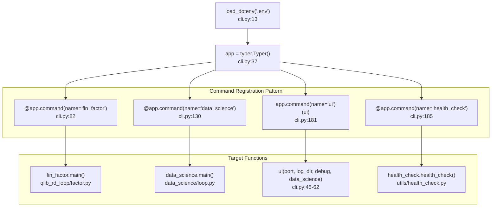
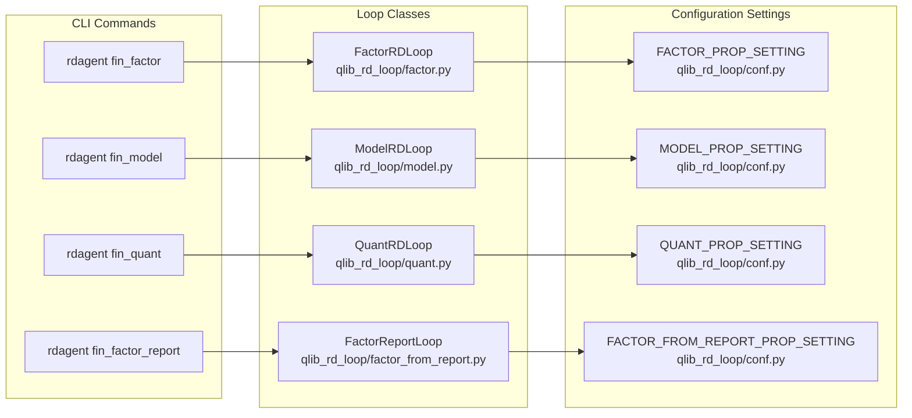
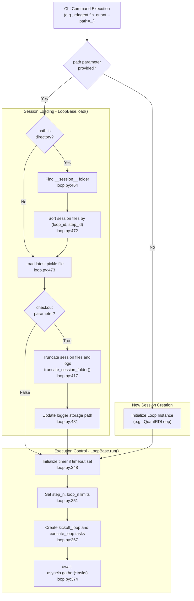

<!-- source: DeepWiki mcp.deepwiki.com · repo microsoft/RD-Agent · page 1.2 Command Line Interface · fetched 2026-10-26 -->

# Command Line Interface

<details>
<summary>Relevant source files</summary>

The following files were used as context for generating this wiki page:

- [.bumpversion.cfg](.bumpversion.cfg)
- [.commitlintrc.js](.commitlintrc.js)
- [.env.example](.env.example)
- [.github/PULL_REQUEST_TEMPLATE.md](.github/PULL_REQUEST_TEMPLATE.md)
- [.github/workflows/pr.yml](.github/workflows/pr.yml)
- [.github/workflows/release.yml](.github/workflows/release.yml)
- [README.md](README.md)
- [docs/changelog.md](docs/changelog.md)
- [docs/installation_and_configuration.rst](docs/installation_and_configuration.rst)
- [pyproject.toml](pyproject.toml)
- [rdagent/app/cli.py](rdagent/app/cli.py)
- [rdagent/app/data_science/loop.py](rdagent/app/data_science/loop.py)
- [rdagent/app/general_model/general_model.py](rdagent/app/general_model/general_model.py)
- [rdagent/app/qlib_rd_loop/factor.py](rdagent/app/qlib_rd_loop/factor.py)
- [rdagent/app/qlib_rd_loop/factor_from_report.py](rdagent/app/qlib_rd_loop/factor_from_report.py)
- [rdagent/app/qlib_rd_loop/model.py](rdagent/app/qlib_rd_loop/model.py)
- [rdagent/app/qlib_rd_loop/quant.py](rdagent/app/qlib_rd_loop/quant.py)
- [rdagent/app/utils/health_check.py](rdagent/app/utils/health_check.py)
- [rdagent/components/document_reader/document_reader.py](rdagent/components/document_reader/document_reader.py)
- [rdagent/components/interactor/__init__.py](rdagent/components/interactor/__init__.py)
- [rdagent/components/workflow/conf.py](rdagent/components/workflow/conf.py)
- [rdagent/components/workflow/rd_loop.py](rdagent/components/workflow/rd_loop.py)
- [rdagent/core/interactor.py](rdagent/core/interactor.py)
- [rdagent/log/ui/ds_user_interact.py](rdagent/log/ui/ds_user_interact.py)
- [rdagent/scenarios/data_science/experiment/experiment.py](rdagent/scenarios/data_science/experiment/experiment.py)
- [rdagent/scenarios/data_science/interactor/__init__.py](rdagent/scenarios/data_science/interactor/__init__.py)
- [rdagent/scenarios/qlib/proposal/quant_proposal.py](rdagent/scenarios/qlib/proposal/quant_proposal.py)
- [rdagent/utils/workflow/loop.py](rdagent/utils/workflow/loop.py)
- [requirements/package.txt](requirements/package.txt)

</details>


This document covers the `rdagent` command-line interface, which serves as the primary entry point for executing automated R&D workflows across different scenarios. The CLI provides access to specialized agents for financial quantitative research, data science competitions, general model extraction, and system monitoring capabilities.

For information about system configuration and environment setup, see [Installation and Configuration](#1.1). For details about the core R&D loop orchestration that these commands execute, see [R&D Loop Framework](#2.1).

## CLI Architecture and Entry Point

The RD-Agent CLI is built using the `typer` framework and provides a unified interface to all RD-Agent scenarios. The CLI automatically loads environment configuration from a `.env` file in the current directory through the `load_dotenv(".env")` call at module initialization, ensuring all configuration is available before any RD-Agent components are instantiated [rdagent/app/cli.py:11-15]().

The main entry point is defined in [rdagent/app/cli.py:37-204]() and is registered as the `rdagent` script in the project metadata [pyproject.toml:34-35]().

### Available CLI Commands

**Command Registration in `cli.py`**

| Command | Function Import | Target Module |
|---------|----------------|---------------|
| `fin_factor` | `rdagent.app.qlib_rd_loop.factor.main` | Factor evolution loop [rdagent/app/cli.py:82-90]() |
| `fin_model` | `rdagent.app.qlib_rd_loop.model.main` | Model evolution loop [rdagent/app/cli.py:93-101]() |
| `fin_quant` | `rdagent.app.qlib_rd_loop.quant.main` | Joint factor-model optimization [rdagent/app/cli.py:104-112]() |
| `fin_factor_report` | `rdagent.app.qlib_rd_loop.factor_from_report.main` | PDF report factor extraction [rdagent/app/cli.py:115-122]() |
| `general_model` | `rdagent.app.general_model.general_model.extract_models_and_implement` | Paper-to-model implementation [rdagent/app/cli.py:125-127]() |
| `data_science` | `rdagent.app.data_science.loop.main` | Data science competition agent [rdagent/app/cli.py:130-146]() |
| `llm_finetune` | `rdagent.app.finetune.llm.loop.main` | LLM fine-tuning agent [rdagent/app/cli.py:149-173]() |
| `grade_summary` | `rdagent.log.mle_summary.grade_summary` | MLE-bench result grading [rdagent/app/cli.py:176-178]() |
| `ui` | Local function | Streamlit trace viewer [rdagent/app/cli.py:45-62]() |
| `server_ui` | Local function | Real-time Flask log server [rdagent/app/cli.py:65-71]() |
| `health_check` | `rdagent.app.utils.health_check.health_check` | System validation [rdagent/app/cli.py:185-191]() |
| `collect_info` | `rdagent.app.utils.info.collect_info` | System information [rdagent/app/cli.py:194-196]() |
| `ds_user_interact` | Local function | Data science interaction UI [rdagent/app/cli.py:74-79]() |

### CLI Command Registration Architecture

Title: CLI Command Registration Architecture



Sources: [rdagent/app/cli.py:11-203](), [pyproject.toml:34-35]()

## Financial Quantitative Research Commands

### Command Overview and Loop Classes

Title: Financial R&D Command to Loop Class Mapping



### `fin_factor` - Iterative Factor Evolution

**Purpose:** Automates the research and development of quantitative trading factors through iterative hypothesis generation, implementation, and evaluation.

**Parameters:** [rdagent/app/qlib_rd_loop/factor.py:30-39]()

| Parameter | Type | Default | Description |
|-----------|------|---------|-------------|
| `path` | str | None | Path to resume from previous session |
| `step_n` | int | None | Maximum number of steps to execute |
| `loop_n` | int | None | Maximum number of R&D loops to execute |
| `all_duration` | str | None | Maximum execution time (e.g., "2h", "30m") |
| `checkout` | bool | True | Whether to truncate logs when resuming |
| `base_features_path` | str | None | Path to base features file |

**Usage Examples:**
```bash
# Start new factor evolution session
rdagent fin_factor

# Resume from specific session checkpoint
rdagent fin_factor --path=log/__session__/1/0_propose --checkout=True
```

### `fin_model` - Iterative Model Evolution

**Purpose:** Automates the development of quantitative trading models through iterative proposal and implementation cycles.

**Parameters:** Same as `fin_factor` [rdagent/app/qlib_rd_loop/model.py:18-26]()

### `fin_quant` - Joint Factor-Model Optimization

**Purpose:** Co-evolves factors and models through coordinated optimization. The `QuantRDLoop` class implements action selection between factor and model evolution.

**Implementation Details:**
- Uses `QuantRDLoop` class [rdagent/app/qlib_rd_loop/quant.py:28-119]()
- Action selection in `direct_exp_gen` determines whether to generate factor or model hypothesis [rdagent/app/qlib_rd_loop/quant.py:68-79]()

### `fin_factor_report` - Factor Extraction from PDFs

**Purpose:** Extracts factor definitions from financial research reports (PDF format) and implements them as runnable code [rdagent/app/qlib_rd_loop/factor_from_report.py:61-94]().

**Parameters:** [rdagent/app/qlib_rd_loop/factor_from_report.py:143-151]()

| Parameter | Type | Default | Description |
|-----------|------|---------|-------------|
| `report_folder` | str | None | Directory containing PDF files to process |
| `path` | str | None | Path to resume from previous session |
| `all_duration` | str | None | Maximum execution time |
| `checkout` | bool | True | Whether to truncate logs when resuming |

**Implementation Notes:**
- Uses `FactorExperimentLoaderFromPDFfiles` to parse PDF reports [rdagent/app/qlib_rd_loop/factor_from_report.py:72]().
- Sequentially processes reports with `shift_report` to handle failures [rdagent/app/qlib_rd_loop/factor_from_report.py:113-123]().

Sources: [rdagent/app/cli.py:82-122](), [rdagent/app/qlib_rd_loop/factor.py:30-66](), [rdagent/app/qlib_rd_loop/model.py:18-49](), [rdagent/app/qlib_rd_loop/factor_from_report.py:97-163]()

## Data Science Competition Commands

### `data_science` - Automated Competition Agent

**Purpose:** Automates participation in data science competitions (Kaggle, MLE-bench). Supports the complete R&D workflow from data understanding to model submission [rdagent/app/data_science/loop.py:53-60]().

**Parameters:** [rdagent/app/data_science/loop.py:13-23]()

| Parameter | Type | Default | Description |
|-----------|------|---------|-------------|
| `competition` | str | "bms-molecular-translation" | Name of the competition to run |
| `path` | str | None | Path to resume from previous session |
| `step_n` | int | None | Maximum number of steps to execute |
| `loop_n` | int | None | Maximum number of R&D loops |
| `timeout` | str | None | Maximum execution time |
| `checkout` | bool | True | Control the log session path |

**Scenario Configuration:** Behavior is controlled by `DS_RD_SETTING` [rdagent/app/data_science/loop.py:7-10]().

### `general_model` - Research Paper Implementation

**Purpose:** Extracts model architectures from research papers (PDF format) and generates implementation code [rdagent/app/general_model/general_model.py:34-45]().

**Parameters:** `report_file_path` (str) - URL or local path to PDF paper [rdagent/app/cli.py:126]().

Sources: [rdagent/app/data_science/loop.py:13-83](), [rdagent/app/cli.py:130-146](), [rdagent/app/general_model/general_model.py:14-45]()

## System Monitoring and Utility Commands

### `ui` - Streamlit Log Viewer

**Purpose:** Launches a Streamlit web interface to visualize execution logs and experiment results [rdagent/app/cli.py:45-48]().

**Parameters:** [rdagent/app/cli.py:45]()

| Parameter | Type | Default | Description |
|-----------|------|---------|-------------|
| `port` | int | 19899 | Port for Streamlit server |
| `log_dir` | str | "" | Directory containing log files |
| `debug` | bool | False | Enable debug mode |
| `data_science` | bool | False | Use data science UI variant (`dsapp.py`) |

### `server_ui` - Real-time Log Server

**Purpose:** Launches a Flask-based server for real-time interaction and trace viewing [rdagent/app/cli.py:65-71]().

### `health_check` - System Validation

**Purpose:** Validates Docker installation, port availability, and environment variables [rdagent/app/utils/health_check.py:11-20]().

**Parameters:** [rdagent/app/cli.py:186-190]()

| Parameter | Type | Default | Description |
|-----------|------|---------|-------------|
| `check_env` | bool | True | Check environment variables |
| `check_docker` | bool | True | Check Docker installation |
| `check_ports` | bool | True | Check port availability |

Sources: [rdagent/app/cli.py:45-81](), [rdagent/app/cli.py:185-200](), [rdagent/app/utils/health_check.py:11-45]()

## Session Management and Resumption

### Session Persistence Mechanism

RD-Agent uses a checkpointing mechanism implemented in `LoopBase`. Snapshots are saved to `self.session_folder` (defaulting to `LOG_SETTINGS.trace_path / "__session__"`) after each step [rdagent/utils/workflow/loop.py:127-128]().

**Automatic Snapshot Saving:**
```python
# From loop.py lines 287-290
if name in self.loop_prev_out[li]:
    self.dump(self.session_folder / f"{li}" / f"{si}_{name}")
```

### Session Loading and Resumption Flow

Title: Session Loading and Resumption Workflow



Sources: [rdagent/utils/workflow/loop.py:33-514](), [rdagent/app/data_science/loop.py:13-79]()

---

