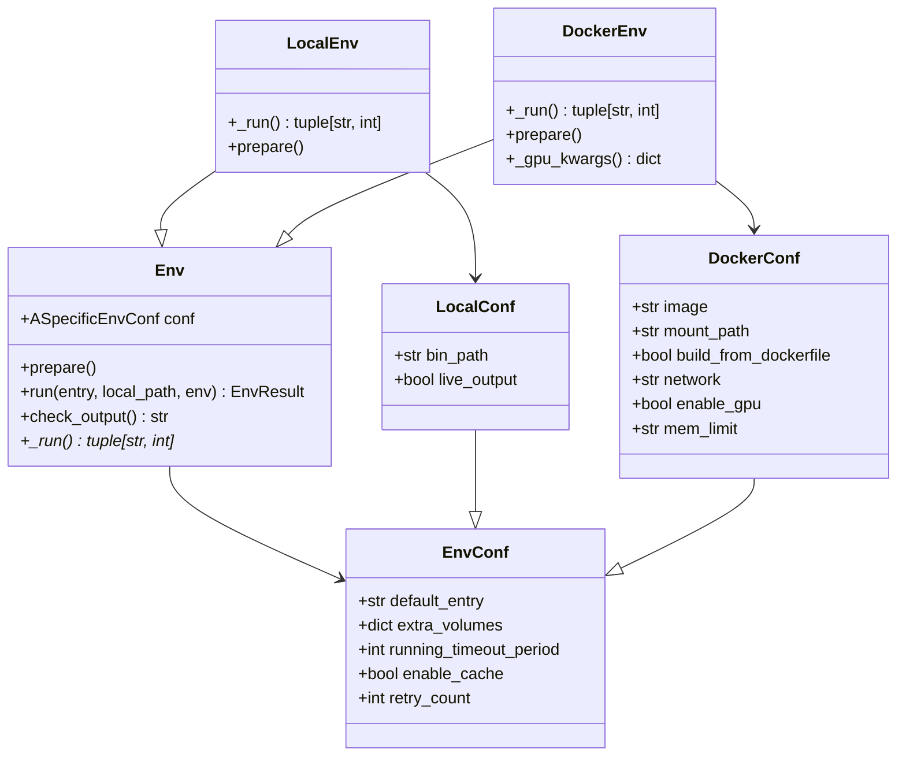
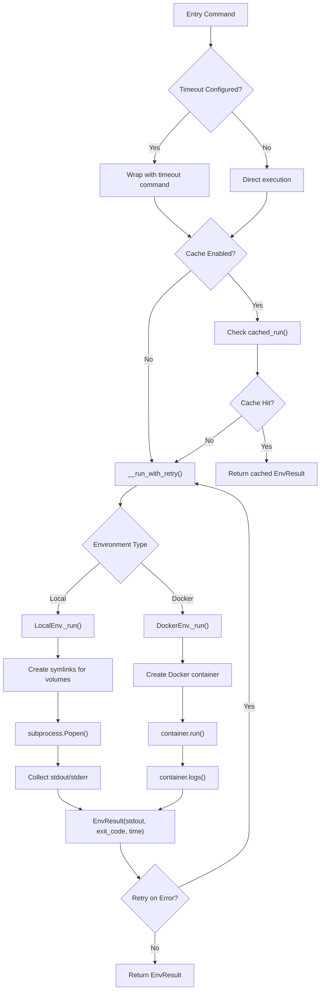
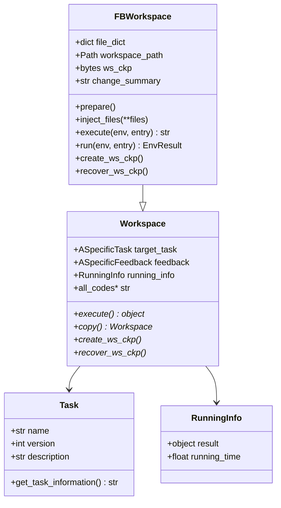
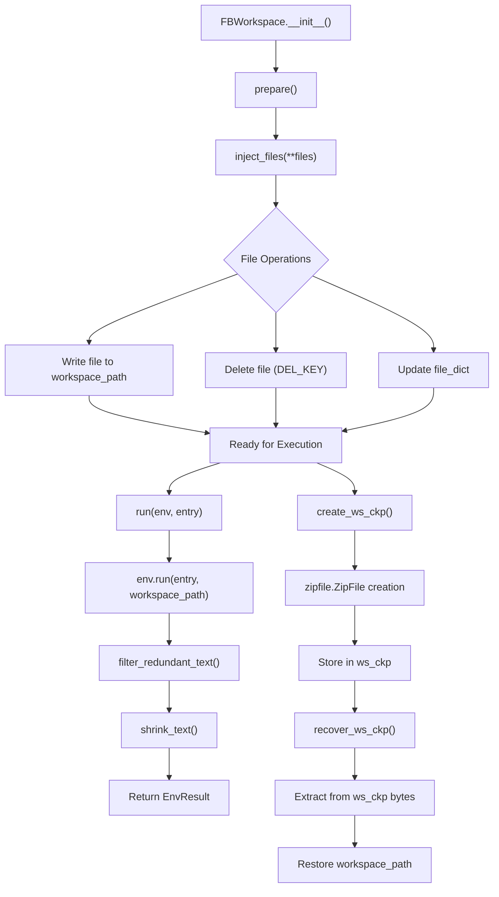
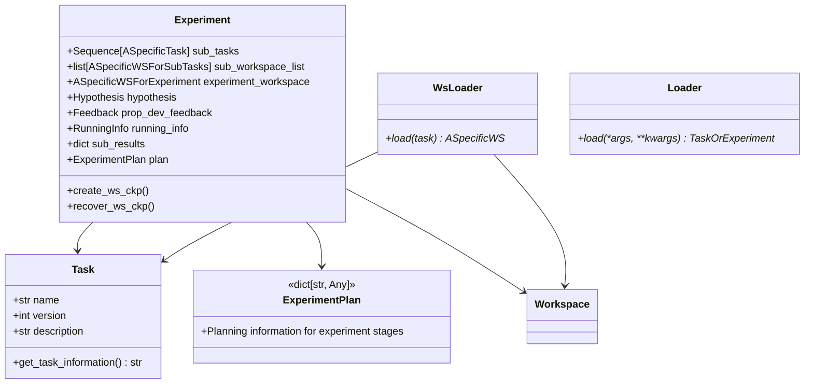
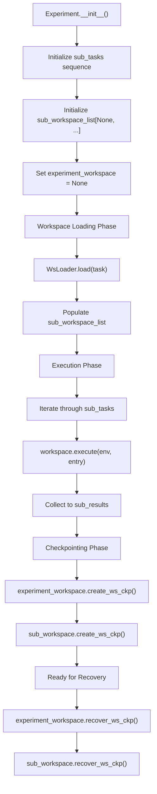
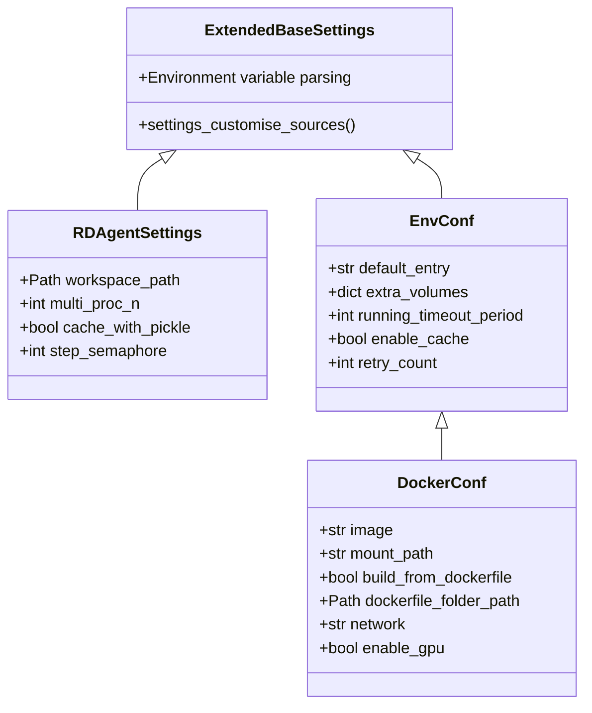
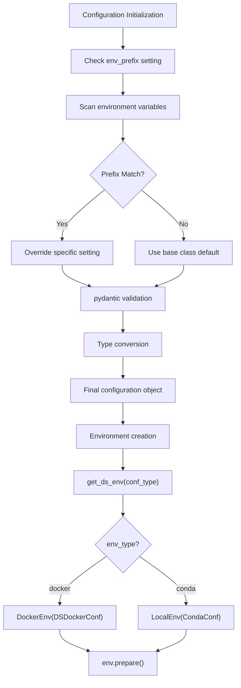

<!-- source: DeepWiki mcp.deepwiki.com · repo microsoft/RD-Agent · page 2 Core Architecture · fetched 2026-10-26 -->

# Core Architecture

Relevant source files

The following files were used as context for generating this wiki page:

- [rdagent/app/cli.py](rdagent/app/cli.py)
- [rdagent/app/general_model/general_model.py](rdagent/app/general_model/general_model.py)
- [rdagent/app/qlib_rd_loop/factor.py](rdagent/app/qlib_rd_loop/factor.py)
- [rdagent/app/qlib_rd_loop/factor_from_report.py](rdagent/app/qlib_rd_loop/factor_from_report.py)
- [rdagent/app/qlib_rd_loop/model.py](rdagent/app/qlib_rd_loop/model.py)
- [rdagent/app/qlib_rd_loop/quant.py](rdagent/app/qlib_rd_loop/quant.py)
- [rdagent/components/workflow/rd_loop.py](rdagent/components/workflow/rd_loop.py)
- [rdagent/core/conf.py](rdagent/core/conf.py)
- [rdagent/core/exception.py](rdagent/core/exception.py)
- [rdagent/core/proposal.py](rdagent/core/proposal.py)
- [rdagent/core/utils.py](rdagent/core/utils.py)
- [rdagent/oai/llm_utils.py](rdagent/oai/llm_utils.py)
- [rdagent/scenarios/data_science/proposal/exp_gen/base.py](rdagent/scenarios/data_science/proposal/exp_gen/base.py)
- [rdagent/scenarios/data_science/proposal/exp_gen/merge.py](rdagent/scenarios/data_science/proposal/exp_gen/merge.py)
- [rdagent/scenarios/data_science/proposal/exp_gen/merge.yaml](rdagent/scenarios/data_science/proposal/exp_gen/merge.yaml)
- [rdagent/scenarios/qlib/factor_experiment_loader/pdf_loader.py](rdagent/scenarios/qlib/factor_experiment_loader/pdf_loader.py)
- [rdagent/scenarios/qlib/factor_experiment_loader/prompts.yaml](rdagent/scenarios/qlib/factor_experiment_loader/prompts.yaml)
- [rdagent/scenarios/qlib/proposal/quant_proposal.py](rdagent/scenarios/qlib/proposal/quant_proposal.py)
- [rdagent/utils/fmt.py](rdagent/utils/fmt.py)
- [rdagent/utils/workflow/loop.py](rdagent/utils/workflow/loop.py)
- [test/oai/test_completion.py](test/oai/test_completion.py)

This document explains the fundamental systems and abstractions that power RD-Agent's automated research and development capabilities. It covers the environment abstraction layer, workspace management system, experiment model, and configuration architecture that form the foundation for all R&D scenarios.

For specific R&D workflows and domain applications, see [R&D Loop Framework](#2.1). For execution environment details, see [Environment and Execution System](#2.3). For LLM integration patterns, see [LLM Integration and Backends](#2.4).

## Environment Abstraction Layer

RD-Agent provides a unified environment abstraction that allows code execution across different computational environments while maintaining consistent interfaces. The core abstraction is built around the `Env` class hierarchy.

**Environment Execution Flow**

The environment system supports both local and containerized execution with automatic retry, caching, and timeout handling.

**Sources:** [rdagent/utils/env.py:149-412](), [rdagent/utils/env.py:459-599](), [rdagent/utils/env.py:762-930]()

## Workspace Management System

The workspace system manages code, data, and execution state through the `Workspace` abstraction, with `FBWorkspace` providing file-based implementation for most scenarios.

**Workspace Lifecycle and File Management**

**Sources:** [rdagent/core/experiment.py:75-116](), [rdagent/core/experiment.py:127-362]()

## Experiment and Task Model

The experiment model organizes research work through `Task` and `Experiment` abstractions that coordinate multiple sub-tasks and their implementations.

**Experiment Execution Coordination**

**Sources:** [rdagent/core/experiment.py:36-63](), [rdagent/core/experiment.py:374-450]()

## Configuration Architecture

RD-Agent uses a hierarchical configuration system based on `pydantic-settings` that supports environment variables and type validation for different execution contexts. The `ExtendedBaseSettings` class allows for prefix-based overrides across class hierarchies.

**Configuration Resolution Flow**

The configuration system resolves settings from environment variables with prefix matching, allowing per-scenario customization. Classes like `RDAgentSettings` manage global execution parameters such as parallelism and workspace paths.

**Sources:** [rdagent/core/conf.py:13-43](), [rdagent/core/conf.py:46-109](), [rdagent/utils/env.py:119-133](), [rdagent/utils/env.py:622-759]()

## Integration Points

The core architecture provides standardized integration points for higher-level systems:

| Integration Point | Interface | Purpose |
|------------------|-----------|---------|
| **Environment Factory** | `get_ds_env(conf_type, extra_volumes, ...)` | Creates configured environments for scenarios |
| **Workspace Loading** | `WsLoader.load(task) -> Workspace` | Loads task-specific workspaces |
| **Execution Interface** | `workspace.run(env, entry) -> EnvResult` | Executes code in isolated environments |
| **State Management** | `create_ws_ckp()` / `recover_ws_ckp()` | Checkpoints and restores workspace state |
| **LLM Backend** | `APIBackend()` | Dynamic LLM provider selection and chat completion |

This architecture enables the R&D loop system to orchestrate complex multi-stage experiments while maintaining isolation, reproducibility, and configurability across different computational environments.

**Sources:** [rdagent/core/experiment.py:120-125](), [rdagent/utils/env.py:182-245](), [rdagent/oai/llm_utils.py:35-44]()

---

