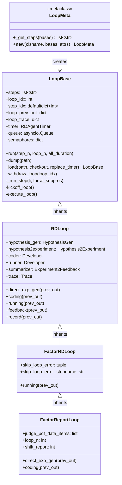
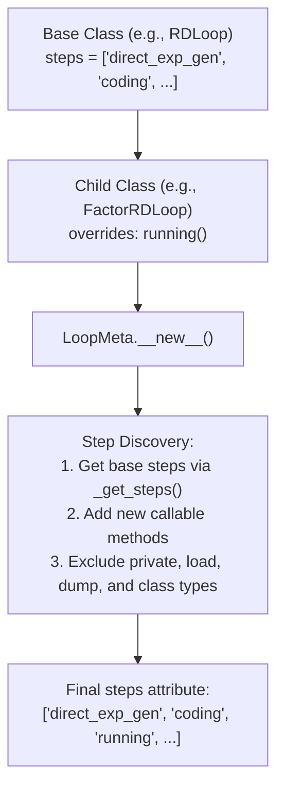
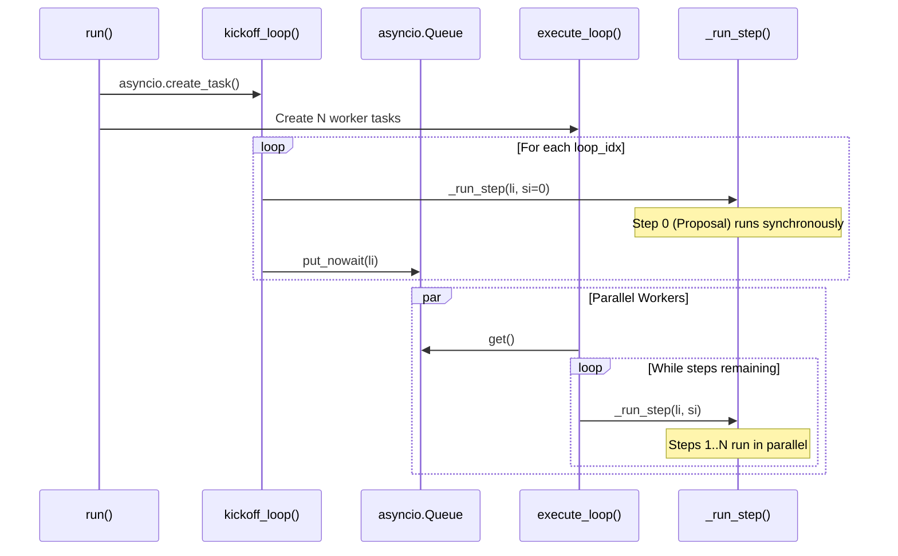
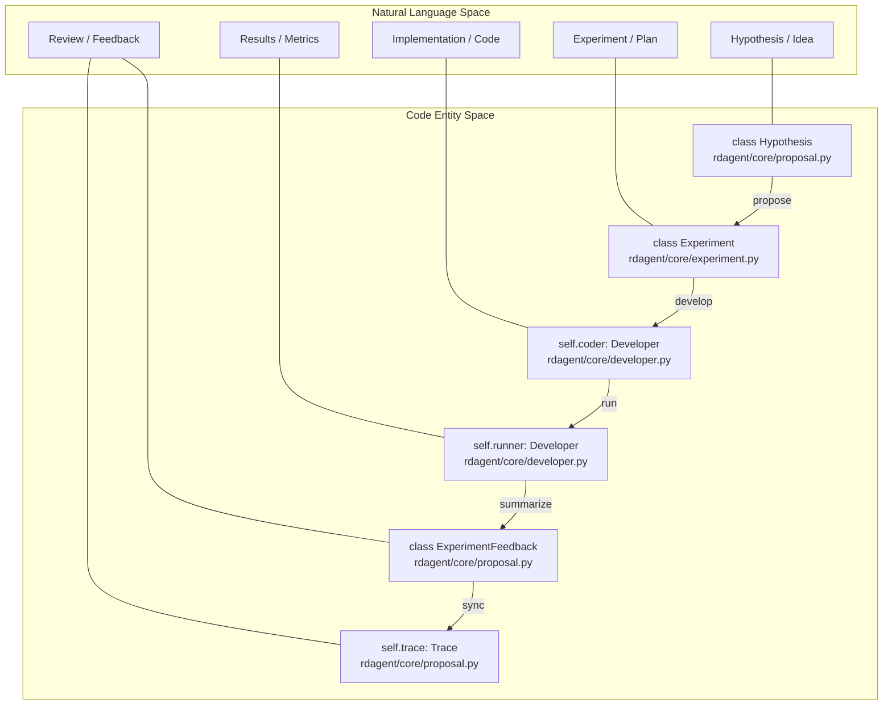

<!-- source: DeepWiki mcp.deepwiki.com · repo microsoft/RD-Agent · page 2.1 R&D Loop Framework · fetched 2026-10-26 -->

# R&D Loop Framework

<details>
<summary>Relevant source files</summary>

The following files were used as context for generating this wiki page:

- [rdagent/app/cli.py](rdagent/app/cli.py)
- [rdagent/app/general_model/general_model.py](rdagent/app/general_model/general_model.py)
- [rdagent/app/qlib_rd_loop/factor.py](rdagent/app/qlib_rd_loop/factor.py)
- [rdagent/app/qlib_rd_loop/factor_from_report.py](rdagent/app/qlib_rd_loop/factor_from_report.py)
- [rdagent/app/qlib_rd_loop/model.py](rdagent/app/qlib_rd_loop/model.py)
- [rdagent/app/qlib_rd_loop/quant.py](rdagent/app/qlib_rd_loop/quant.py)
- [rdagent/components/coder/CoSTEER/evaluators.py](rdagent/components/coder/CoSTEER/evaluators.py)
- [rdagent/components/coder/CoSTEER/evolvable_subjects.py](rdagent/components/coder/CoSTEER/evolvable_subjects.py)
- [rdagent/components/coder/CoSTEER/evolving_strategy.py](rdagent/components/coder/CoSTEER/evolving_strategy.py)
- [rdagent/components/workflow/rd_loop.py](rdagent/components/workflow/rd_loop.py)
- [rdagent/core/evaluation.py](rdagent/core/evaluation.py)
- [rdagent/core/evolving_agent.py](rdagent/core/evolving_agent.py)
- [rdagent/core/evolving_framework.py](rdagent/core/evolving_framework.py)
- [rdagent/core/proposal.py](rdagent/core/proposal.py)
- [rdagent/scenarios/data_science/proposal/exp_gen/base.py](rdagent/scenarios/data_science/proposal/exp_gen/base.py)
- [rdagent/scenarios/data_science/proposal/exp_gen/merge.py](rdagent/scenarios/data_science/proposal/exp_gen/merge.py)
- [rdagent/scenarios/data_science/proposal/exp_gen/merge.yaml](rdagent/scenarios/data_science/proposal/exp_gen/merge.yaml)
- [rdagent/scenarios/qlib/proposal/quant_proposal.py](rdagent/scenarios/qlib/proposal/quant_proposal.py)
- [rdagent/utils/agent/workflow.py](rdagent/utils/agent/workflow.py)
- [rdagent/utils/workflow/loop.py](rdagent/utils/workflow/loop.py)

</details>


## Purpose and Scope

The R&D Loop Framework provides the core workflow orchestration system for autonomous research and development in RD-Agent. It implements a generic, resumable, async execution pattern where a sequence of steps is repeatedly executed across multiple loops. The framework handles session persistence, parallel execution, timeout management, and error recovery.

This page covers:
- The `LoopBase` abstraction and its metaclass-driven step discovery mechanism.
- Async execution model with parallel workers and semaphore-based concurrency control.
- Session management (checkpoint, resume, withdraw).
- The `RDLoop` pattern that specializes `LoopBase` for hypothesis-driven R&D workflows.

---

## Core Architecture

### Class Hierarchy

The framework uses a metaclass-driven approach to define workflow steps dynamically.



Sources: `[rdagent/utils/workflow/loop.py:33-136]()`, `[rdagent/components/workflow/rd_loop.py:31-68]()`, `[rdagent/app/qlib_rd_loop/factor.py:17-28]()`, `[rdagent/app/qlib_rd_loop/factor_from_report.py:97-141]()`

### LoopMeta Metaclass and Step Discovery

The `LoopMeta` metaclass automatically discovers workflow steps by introspecting class methods. Any callable, non-private method (not starting with `_`) becomes a step in the workflow sequence. Steps are inherited and combined from base classes in method resolution order (MRO).



**Step Discovery Algorithm:**
1. **Base Recursion**: Recursively collect steps from all base classes using `_get_steps` `[rdagent/utils/workflow/loop.py:35-51]()`.
2. **Method Scan**: Identify new callable methods in the current class attributes `[rdagent/utils/workflow/loop.py:66-72]()`.
3. **Exclusion**: Skip `load`, `dump`, private methods (`_*`), and class types to avoid accidental step registration `[rdagent/utils/workflow/loop.py:49-69]()`.
4. **Assignment**: Set the `steps` class attribute with the combined, ordered list `[rdagent/utils/workflow/loop.py:73]()`.

Sources: `[rdagent/utils/workflow/loop.py:33-74]()`

### LoopBase State Management

The `LoopBase` class maintains the execution state for all concurrent loops.

| State Variable | Type | Purpose |
|---------------|------|---------|
| `loop_idx` | `int` | Current loop index / next loop index to kickoff `[rdagent/utils/workflow/loop.py:118]()`. |
| `step_idx` | `defaultdict[int, int]` | Maps loop index → next step index to execute `[rdagent/utils/workflow/loop.py:119]()`. |
| `loop_prev_out` | `dict[int, dict[str, Any]]` | Storage for step results: `loop_index` → `{step_name: output}` `[rdagent/utils/workflow/loop.py:125]()`. |
| `loop_trace` | `dict[int, list[LoopTrace]]` | Timing information (start/end) for each step `[rdagent/utils/workflow/loop.py:126]()`. |
| `queue` | `asyncio.Queue` | Orchestrates loop indices for worker coroutines `[rdagent/utils/workflow/loop.py:120]()`. |
| `semaphores` | `dict[str, asyncio.Semaphore]` | Per-step concurrency limits `[rdagent/utils/workflow/loop.py:135]()`. |

Sources: `[rdagent/utils/workflow/loop.py:116-136]()`

---

## Async Execution Model

### Parallel Worker Architecture

RD-Agent uses a producer-consumer model where `kickoff_loop` produces loop indices and `execute_loop` workers consume them.



**Key Execution Constraints:**
- **Step 0 Synchronicity**: The first step (typically `direct_exp_gen`) is executed synchronously in the kickoff loop to ensure sequential proposal generation `[rdagent/utils/workflow/loop.py:333-339]()`.
- **Final Step Seriality**: Steps named `record` or `feedback` are forced to a semaphore limit of 1 to prevent race conditions when updating the global `Trace` `[rdagent/utils/workflow/loop.py:153-155]()`.
- **Subprocess Forking**: Middle steps can be forced into subprocesses using `ProcessPoolExecutor` if `force_subproc` is enabled in settings `[rdagent/utils/workflow/loop.py:224-245]()`.

Sources: `[rdagent/utils/workflow/loop.py:144-159]()`, `[rdagent/utils/workflow/loop.py:312-403]()`

### Semaphore-Based Concurrency Control

Concurrency is managed via `get_semaphore(step_name)`. It reads limits from `RD_AGENT_SETTINGS.step_semaphore` `[rdagent/utils/workflow/loop.py:145-146]()`. If a step name is not specified, it defaults to 1 `[rdagent/utils/workflow/loop.py:146]()`.

Sources: `[rdagent/utils/workflow/loop.py:144-159]()`

---

## Session Management

### Checkpoint and Resume

RD-Agent automatically saves a session checkpoint after every step completion in `_run_step` `[rdagent/utils/workflow/loop.py:302-304]()`.

- **Persistence**: Checkpoints are stored in the `__session__` folder within the trace path `[rdagent/utils/workflow/loop.py:127]()`.
- **Serialization**: The entire `LoopBase` instance is pickled `[rdagent/utils/workflow/loop.py:433-442]()`.
- **Loading**: The `load` method restores the instance. If `checkout=True`, it truncates the session folder and storage logs to the specific checkpoint time to ensure a clean state for resumption `[rdagent/utils/workflow/loop.py:476-499]()`.

### Error Recovery and Withdrawal

The framework differentiates between errors that skip a loop and errors that require a full state rollback.

1. **Skip Loop Error**: Defined in `skip_loop_error`. If caught, the loop jumps to `skip_loop_error_stepname` (usually `feedback`) `[rdagent/utils/workflow/loop.py:252-261]()`.
2. **Withdraw Loop Error**: Defined in `withdraw_loop_error`. If caught, `withdraw_loop(loop_idx)` is called, which loads the checkpoint from the *previous* loop and raises `LoopResumeError` to trigger a full system restart from that state `[rdagent/utils/workflow/loop.py:263-270]()`, `[rdagent/utils/workflow/loop.py:405-423]()`.

Sources: `[rdagent/utils/workflow/loop.py:250-271]()`, `[rdagent/utils/workflow/loop.py:405-423]()`, `[rdagent/utils/workflow/loop.py:452-527]()`

---

## RDLoop Pattern

`RDLoop` is the base implementation for standard R&D cycles (Propose -> Code -> Run -> Feedback -> Record).

### Generic Workflow Steps

| Method | Role | Source |
|---|---|---|
| `direct_exp_gen` | Generates the `Experiment` and `Hypothesis` | `[rdagent/components/workflow/rd_loop.py:82-84]()` |
| `coding` | Uses `Developer` (Coder) to implement logic in the `Workspace` | `[rdagent/components/workflow/rd_loop.py:86-89]()` |
| `running` | Uses `Developer` (Runner) to execute the code and collect results | `[rdagent/components/workflow/rd_loop.py:91-94]()` |
| `feedback` | Uses `Experiment2Feedback` to summarize performance | `[rdagent/components/workflow/rd_loop.py:96-103]()` |
| `record` | Synchronizes the experiment and feedback into the `Trace` DAG | `[rdagent/components/workflow/rd_loop.py:105-109]()` |

### Natural Language to Code Mapping (RDLoop)

The following diagram maps high-level R&D concepts to the specific code entities in the RDLoop framework.



Sources: `[rdagent/core/proposal.py:24-134]()`, `[rdagent/core/experiment.py:1-20]()`, `[rdagent/components/workflow/rd_loop.py:31-68]()`

---

## Implementation Details

### Multi-Step Evolution (EvoAgent)

While `RDLoop` handles the high-level loop, internal coding/running steps often use `RAGEvoAgent` for iterative refinement.

```mermaid
sequenceDiagram
    participant Loop as RDLoop.coding()
    participant Agent as RAGEvoAgent.multistep_evolve()
    participant Strat as EvolvingStrategy.evolve_iter()
    participant Eval as RAGEvaluator.evaluate_iter()

    Loop->>Agent: multistep_evolve(evo, eva)
    loop max_loop
        Agent->>Strat: evolve_iter()
        Strat-->>Agent: yield EvolvingItem (Code)
        Agent->>Eval: send(EvolvingItem)
        Eval-->>Agent: yield Feedback
        Note over Agent: Check if refinement needed
    end
    Agent-->>Loop: Final EvolvingItem
```

Sources: `[rdagent/core/evolving_agent.py:78-185]()`, `[rdagent/components/coder/CoSTEER/evolving_strategy.py:108-171]()`

### Scenario Specialization: FactorReportLoop

`FactorReportLoop` demonstrates how to customize the R&D loop for document-driven research. It overrides `direct_exp_gen` to extract hypotheses from PDF reports instead of using an LLM-based proposer.

- **Initialization**: Loads PDFs and calculates `loop_n` based on report count `[rdagent/app/qlib_rd_loop/factor_from_report.py:100-107]()`.
- **Custom Proposer**: `extract_hypothesis_and_exp_from_reports` uses `FactorExperimentLoaderFromPDFfiles` and `generate_hypothesis` to populate the experiment `[rdagent/app/qlib_rd_loop/factor_from_report.py:61-94]()`.
- **Parallel Control**: Checks `get_unfinished_loop_cnt` to respect `max_parallel` settings during report processing `[rdagent/app/qlib_rd_loop/factor_from_report.py:114]()`.

Sources: `[rdagent/app/qlib_rd_loop/factor_from_report.py:61-141]()`

---

