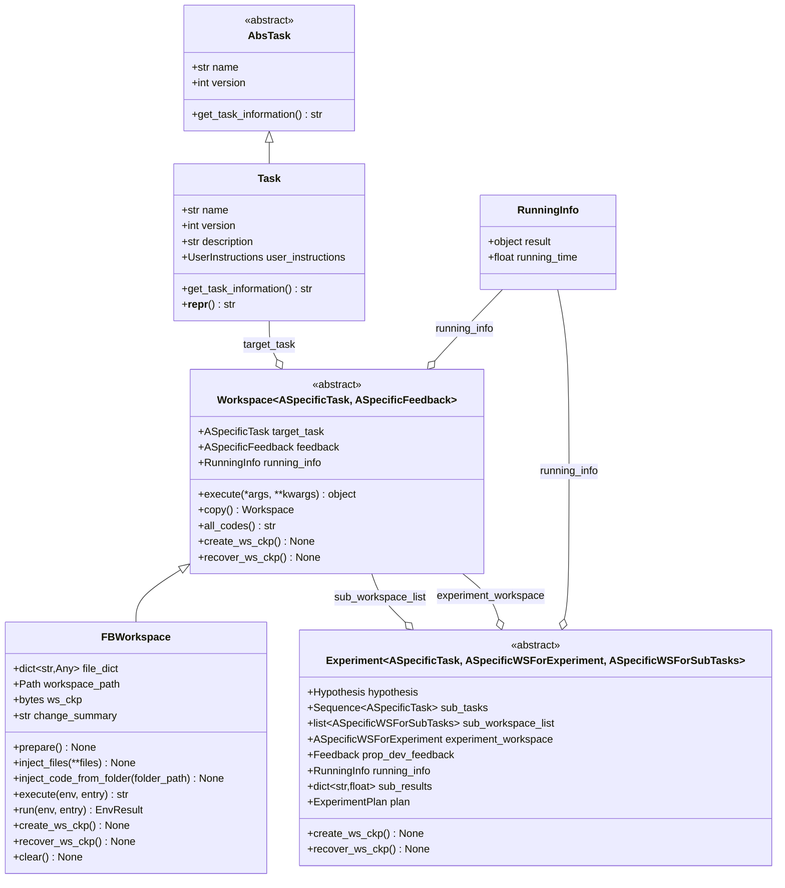
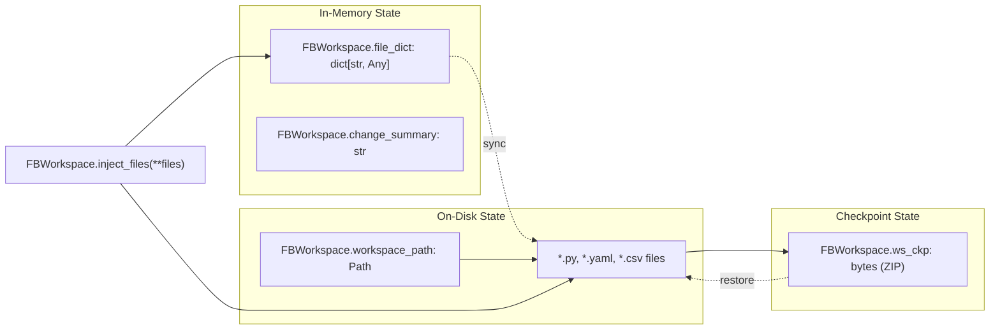
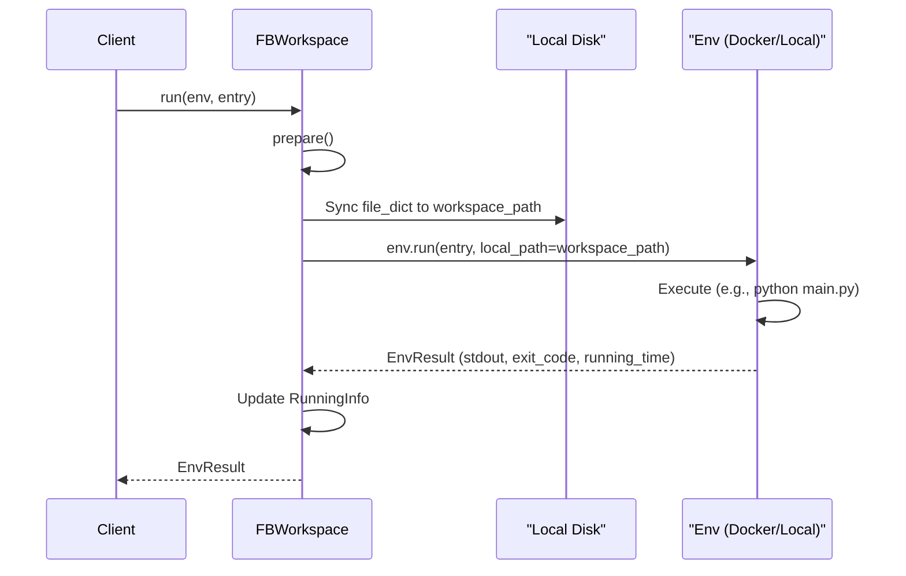
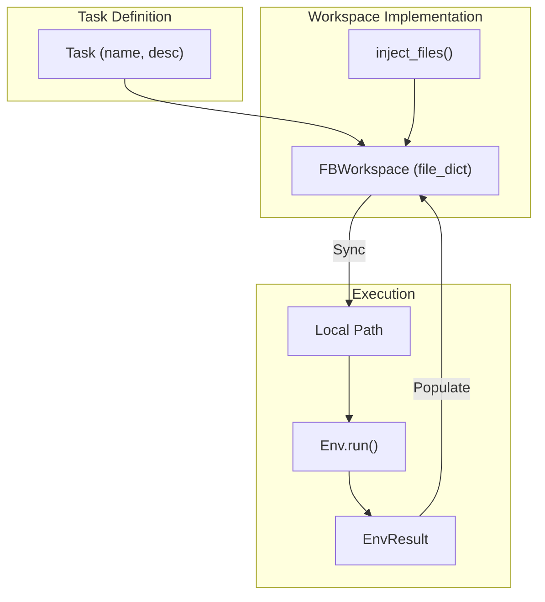

<!-- source: DeepWiki mcp.deepwiki.com · repo microsoft/RD-Agent · page 2.2 Experiment and Workspace Management · fetched 2026-10-26 -->

# Experiment and Workspace Management

<details>
<summary>Relevant source files</summary>

The following files were used as context for generating this wiki page:

- [rdagent/core/experiment.py](rdagent/core/experiment.py)
- [rdagent/core/scenario.py](rdagent/core/scenario.py)
- [rdagent/scenarios/general_model/scenario.py](rdagent/scenarios/general_model/scenario.py)
- [rdagent/scenarios/qlib/experiment/factor_from_report_experiment.py](rdagent/scenarios/qlib/experiment/factor_from_report_experiment.py)
- [rdagent/scenarios/qlib/experiment/factor_template/read_exp_res.py](rdagent/scenarios/qlib/experiment/factor_template/read_exp_res.py)
- [rdagent/scenarios/qlib/experiment/model_template/read_exp_res.py](rdagent/scenarios/qlib/experiment/model_template/read_exp_res.py)
- [rdagent/scenarios/qlib/experiment/workspace.py](rdagent/scenarios/qlib/experiment/workspace.py)
- [rdagent/utils/env.py](rdagent/utils/env.py)
- [rdagent/utils/repo/diff.py](rdagent/utils/repo/diff.py)
- [test/utils/env_tpl/read_exp.py](test/utils/env_tpl/read_exp.py)
- [test/utils/test_env.py](test/utils/test_env.py)

</details>


## Purpose and Scope

This document explains the core abstractions for managing experimental tasks and their implementations in RD-Agent. The **Experiment** and **Workspace** classes provide the foundational structure for organizing R&D workflows, managing code artifacts, and persisting state across development iterations.

**Key topics covered:**
- `Task`, `Workspace`, and `Experiment` abstract base classes.
- `FBWorkspace` file-based workspace implementation and the `DEL_KEY` pattern.
- Checkpoint mechanisms for workspace state persistence using ZIP archives.
- Integration with execution environments (`Env`) and result tracking (`RunningInfo`).

For information about execution environments (Docker/Local), see [Environment and Execution System](2.3). For the R&D loop workflow that orchestrates experiments, see [R&D Loop Framework](2.1).

---

## Core Class Hierarchy

The experiment management system is built on three primary abstractions that work together to organize tasks, implementations, and execution state.

Title: Core Experiment and Workspace Abstractions

Sources: [rdagent/core/experiment.py:34-48](), [rdagent/core/experiment.py:58-75](), [rdagent/core/experiment.py:87-127](), [rdagent/core/experiment.py:139-170](), [rdagent/core/experiment.py:379-445]()

---

## Task Abstraction

The `Task` class represents a unit of work to be implemented. Tasks contain metadata about what needs to be accomplished and serve as the specification for workspace implementations.

### Task Structure

| Field | Type | Description |
|-------|------|-------------|
| `name` | `str` | Identifier for the task [rdagent/core/experiment.py:42-42]() |
| `version` | `int` | Version number (default: 1) [rdagent/core/experiment.py:41-41]() |
| `description` | `str` | Detailed task specification [rdagent/core/experiment.py:67-67]() |
| `user_instructions` | `UserInstructions` | High-priority user guidance [rdagent/core/experiment.py:68-68]() |

### Task Information String

The `get_task_information()` method returns a formatted string combining all task metadata. This is used throughout the system for prompts, logging, and knowledge management [rdagent/core/experiment.py:70-71]().

Sources: [rdagent/core/experiment.py:34-75]()

---

## Workspace Abstraction

A `Workspace` is a stateful container for task implementations. It evolves as developers iteratively improve code, maintaining both in-memory state and on-disk artifacts [rdagent/core/experiment.py:87-91]().

### Key Methods

- **`execute()`**: Run the implementation and return results [rdagent/core/experiment.py:99-101]().
- **`copy()`**: Create a deep copy for parallel exploration [rdagent/core/experiment.py:103-106]().
- **`all_codes`**: Property returning all code as a formatted string [rdagent/core/experiment.py:108-114]().
- **`create_ws_ckp()`**: Capture current state for later rollback [rdagent/core/experiment.py:116-121]().
- **`recover_ws_ckp()`**: Restore workspace from checkpoint [rdagent/core/experiment.py:123-127]().

Sources: [rdagent/core/experiment.py:87-127]()

---

## FBWorkspace: File-Based Implementation

`FBWorkspace` is the primary workspace implementation, using a file-based approach with dual state management: an in-memory dictionary (`file_dict`) and on-disk files in a unique directory [rdagent/core/experiment.py:139-170]().

### Dual State Architecture

Title: FBWorkspace Dual State and Checkpointing

Sources: [rdagent/core/experiment.py:164-170](), [rdagent/core/experiment.py:223-243](), [rdagent/core/experiment.py:324-348]()

### Workspace Path Management

Each `FBWorkspace` instance creates a unique workspace directory using a UUID to ensure isolation between concurrent experiments [rdagent/core/experiment.py:167-167]().

### File Injection and the DEL_KEY Pattern

The `inject_files()` method is the primary interface for code management. It accepts a dictionary mapping file paths to content [rdagent/core/experiment.py:223-223]().

**The `DEL_KEY` pattern:**
RD-Agent uses a special constant `DEL_KEY = "__DEL__"` to handle file deletions during code evolution [rdagent/core/experiment.py:165-165]().

```python
# Example of deleting a file via injection
workspace.inject_files(**{"old_script.py": FBWorkspace.DEL_KEY})
```

When `inject_files` encounters `DEL_KEY`:
1. It removes the file entry from the in-memory `file_dict` [rdagent/core/experiment.py:231-232]().
2. It deletes the physical file from the disk at `workspace_path` [rdagent/core/experiment.py:233-234]().

Sources: [rdagent/core/experiment.py:164-168](), [rdagent/core/experiment.py:223-243]()

---

## Workspace Execution Flow

`FBWorkspace` integrates with the environment execution system to run code and capture results.

Title: FBWorkspace Execution and Result Capture

Sources: [rdagent/core/experiment.py:290-305](), [rdagent/utils/env.py:461-512]()

### Execution Methods

- **`run(env: Env, entry: str, ...)`**: Prepares the workspace, syncs all files from `file_dict` to disk, and calls `env.run` [rdagent/core/experiment.py:290-305]().
- **`execute(env: Env, entry: str, ...)`**: A wrapper around `run` that returns the truncated stdout as a string for simplified feedback [rdagent/core/experiment.py:307-313]().

### RunningInfo Data Class

The `RunningInfo` class tracks the outcome of an execution [rdagent/core/experiment.py:82-85]().

| Attribute | Type | Description |
|-----------|------|-------------|
| `result` | `object` | Scenario-specific results (e.g., IC, metrics) [rdagent/core/experiment.py:83-83]() |
| `running_time` | `float` | Duration of the execution in seconds [rdagent/core/experiment.py:84-84]() |

Sources: [rdagent/core/experiment.py:82-85](), [rdagent/core/experiment.py:290-313]()

---

## Checkpoint Mechanisms

Checkpoints enable rollback to previous workspace states, which is critical for evolutionary development where new code might introduce errors or performance regressions.

### Creating Checkpoints

The `create_ws_ckp()` method creates an in-memory ZIP archive of the current `workspace_path` [rdagent/core/experiment.py:324-348]().
- **Symlink Preservation**: It correctly handles symbolic links by preserving their targets [rdagent/core/experiment.py:328-333]().
- **Size Limits**: It filters files based on `RD_AGENT_SETTINGS.workspace_ckp_size_limit` to avoid bloating memory with large datasets [rdagent/core/experiment.py:336-343]().

### Recovering Checkpoints

The `recover_ws_ckp()` method restores the workspace from the ZIP archive [rdagent/core/experiment.py:350-378]().
1. It deletes the current `workspace_path` [rdagent/core/experiment.py:355-355]().
2. It extracts the ZIP content, restoring file modes and symlinks [rdagent/core/experiment.py:359-376]().
3. It sets `ws_ckp` back to `None` to free memory [rdagent/core/experiment.py:378-378]().

Sources: [rdagent/core/experiment.py:324-378]()

---

## Scenario-Specific Implementations

### QlibFBWorkspace
In the Quantitative Finance scenario, `QlibFBWorkspace` extends `FBWorkspace` to handle Qlib-specific execution and result parsing [rdagent/scenarios/qlib/experiment/workspace.py:13-13]().

- **Execution**: It runs `qrun conf.yaml` and then a post-processing script `read_exp_res.py` to extract metrics [rdagent/scenarios/qlib/experiment/workspace.py:29-40]().
- **Result Extraction**: It reads `qlib_res.csv` and `ret.pkl` from the workspace to populate the `RunningInfo.result` [rdagent/scenarios/qlib/experiment/workspace.py:42-59]().

Sources: [rdagent/scenarios/qlib/experiment/workspace.py:13-60]()

---

## Summary of Data Flow

Title: Data Flow from Task to Environment Result

Sources: [rdagent/core/experiment.py:58-75](), [rdagent/core/experiment.py:139-170](), [rdagent/core/experiment.py:290-305](), [rdagent/utils/env.py:461-512]()

---

