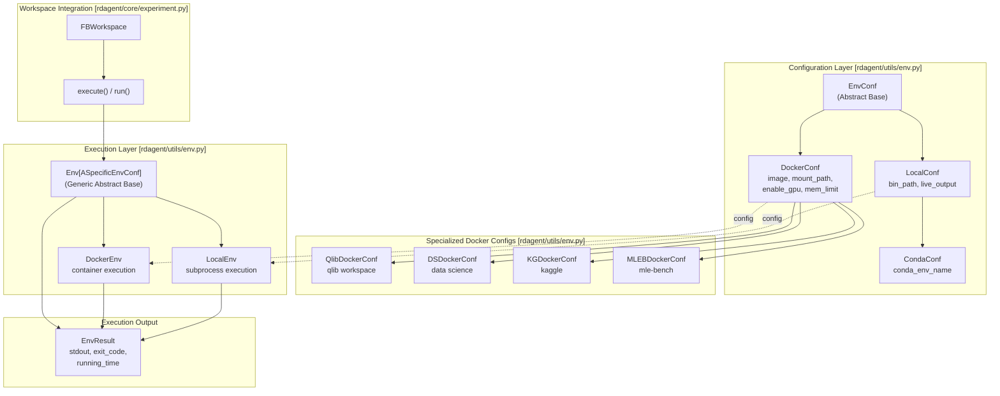
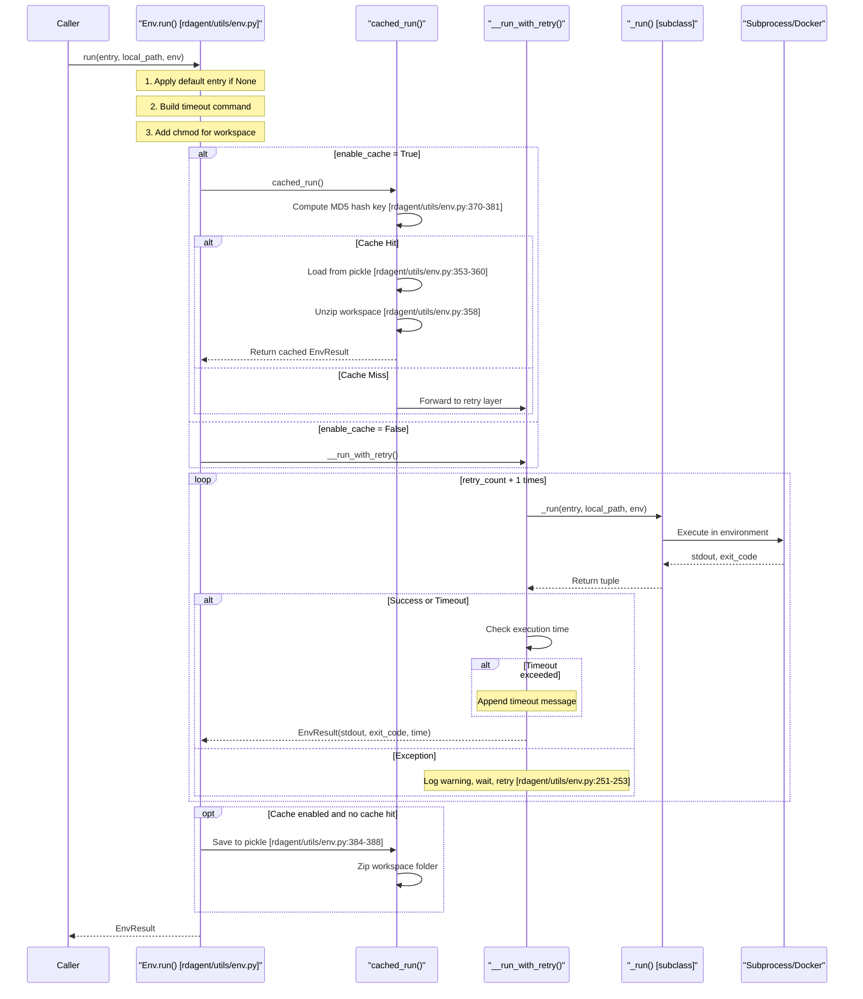
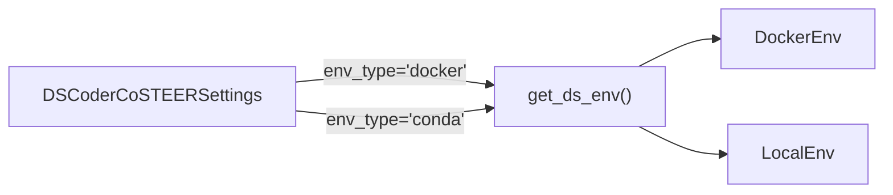

<!-- source: DeepWiki mcp.deepwiki.com · repo microsoft/RD-Agent · page 2.3 Environment and Execution System · fetched 2026-10-26 -->

# Environment and Execution System

<details>
<summary>Relevant source files</summary>

The following files were used as context for generating this wiki page:

- [rdagent/app/utils/ws.py](rdagent/app/utils/ws.py)
- [rdagent/components/coder/data_science/conf.py](rdagent/components/coder/data_science/conf.py)
- [rdagent/components/coder/data_science/pipeline/__init__.py](rdagent/components/coder/data_science/pipeline/__init__.py)
- [rdagent/core/experiment.py](rdagent/core/experiment.py)
- [rdagent/scenarios/qlib/docker/Dockerfile](rdagent/scenarios/qlib/docker/Dockerfile)
- [rdagent/scenarios/qlib/experiment/factor_template/conf_baseline.yaml](rdagent/scenarios/qlib/experiment/factor_template/conf_baseline.yaml)
- [rdagent/scenarios/qlib/experiment/factor_template/conf_combined_factors.yaml](rdagent/scenarios/qlib/experiment/factor_template/conf_combined_factors.yaml)
- [rdagent/scenarios/qlib/experiment/factor_template/conf_combined_factors_sota_model.yaml](rdagent/scenarios/qlib/experiment/factor_template/conf_combined_factors_sota_model.yaml)
- [rdagent/scenarios/qlib/experiment/model_template/conf_baseline_factors_model.yaml](rdagent/scenarios/qlib/experiment/model_template/conf_baseline_factors_model.yaml)
- [rdagent/scenarios/qlib/experiment/model_template/conf_sota_factors_model.yaml](rdagent/scenarios/qlib/experiment/model_template/conf_sota_factors_model.yaml)
- [rdagent/utils/env.py](rdagent/utils/env.py)
- [test/utils/env_tpl/read_exp.py](test/utils/env_tpl/read_exp.py)
- [test/utils/test_conf.py](test/utils/test_conf.py)
- [test/utils/test_env.py](test/utils/test_env.py)

</details>


## Purpose and Scope

This document describes the environment and execution system in RD-Agent, which provides a unified abstraction for running code in different execution contexts (local processes, conda environments, Docker containers). The system handles workspace mounting, resource limits, GPU configuration, timeout management, and execution caching. This infrastructure enables safe, isolated code execution for the CoSTEER framework and scenario-specific runners.

For information about workspace management and file-based state, see [Experiment and Workspace Management (2.2)](). For details on how the CoSTEER framework uses these environments for code evaluation, see [CoSTEER Framework (4.1)]().

---

## Environment Architecture Overview

The environment system provides a two-layer abstraction: configuration classes (`EnvConf`) that define environment parameters, and execution classes (`Env`) that implement the runtime behavior. This design separates environment specification from execution logic, enabling environment settings to be loaded from configuration files or environment variables.

### Core Components Diagram



**Sources:** [rdagent/utils/env.py:164-222](), [rdagent/utils/env.py:457-465](), [rdagent/utils/env.py:631-662](), [rdagent/core/experiment.py:290-305]()

---

## Core Abstractions

### Env Base Class

The `Env` class is a generic abstract base class parameterized by configuration type `ASpecificEnvConf`. It defines the contract for all execution environments.

| Method | Return Type | Description |
|--------|-------------|-------------|
| `prepare(*args, **kwargs)` | `None` | Download images, create conda environments, or perform other setup [rdagent/utils/env.py:214-216]() |
| `run(entry, local_path, env, **kwargs)` | `EnvResult` | Execute command and return stdout, exit code, and running time [rdagent/utils/env.py:256-343]() |
| `check_output(entry, local_path, env, **kwargs)` | `str` | Execute command and return only stdout (convenience wrapper) [rdagent/utils/env.py:393-397]() |
| `_run(entry, local_path, env, **kwargs)` | `tuple[str, int]` | Abstract method implemented by subclasses for actual execution [rdagent/utils/env.py:218-222]() |
| `cached_run(entry, local_path, env, **kwargs)` | `EnvResult` | Cache execution results based on code hash [rdagent/utils/env.py:345-391]() |

**Sources:** [rdagent/utils/env.py:158-222]()

### EnvConf Configuration Base

The `EnvConf` class extends `ExtendedBaseSettings` (Pydantic-based settings) to provide type-safe configuration with environment variable loading.

| Field | Type | Default | Description |
|-------|------|---------|-------------|
| `default_entry` | `str` | - | Default command to execute (e.g., `"python main.py"`) [rdagent/utils/env.py:165]() |
| `extra_volumes` | `dict` | `{}` | Additional volumes to mount [rdagent/utils/env.py:167]() |
| `running_timeout_period` | `int \| None` | `3600` | Timeout in seconds, `None` for no limit [rdagent/utils/env.py:168]() |
| `enable_cache` | `bool` | `True` | Enable execution result caching [rdagent/utils/env.py:197]() |
| `retry_count` | `int` | `5` | Number of retries on execution failure [rdagent/utils/env.py:198]() |
| `retry_wait_seconds` | `int` | `10` | Seconds to wait between retries [rdagent/utils/env.py:199]() |

**Sources:** [rdagent/utils/env.py:164-203]()

### EnvResult Data Structure

The `EnvResult` dataclass encapsulates execution outcomes:

```python
@dataclass
class EnvResult:
    stdout: str          # Combined stdout and stderr
    exit_code: int       # Process exit code
    running_time: float  # Execution time in seconds
```

The `get_truncated_stdout()` method applies context filtering and line truncation based on `RD_AGENT_SETTINGS` for inclusion in LLM prompts.

**Sources:** [rdagent/utils/env.py:139-156]()

---

## Execution Flow

### Run Method Execution Pipeline

The `run()` method orchestrates the complete execution flow with timeout handling, permission management, and caching.



**Sources:** [rdagent/utils/env.py:256-343](), [rdagent/utils/env.py:345-391](), [rdagent/utils/env.py:223-254]()

### Entry Point Transformation

The system wraps user-provided entry points with shell commands to handle timeout enforcement and permission management in `Env.run()` [rdagent/utils/env.py:314-331]():

```bash
/bin/sh -c 'timeout --kill-after=10 {timeout_period} {user_entry}; 
            entry_exit_code=$?; 
            find {workspace} -mindepth 1 -maxdepth 1 ! -name cache ! -name input -exec chmod -R 777 {} +; 
            exit $entry_exit_code'
```

**Sources:** [rdagent/utils/env.py:314-331]()

---

## Local Execution Environment

### LocalEnv Implementation

`LocalEnv` executes code directly on the host system using subprocess, with optional conda environment support. It handles volume mounting through symbolic links and provides live output streaming.

#### Configuration

**LocalConf Fields [rdagent/utils/env.py:457-463]():**

| Field | Type | Default | Description |
|-------|------|---------|-------------|
| `bin_path` | `str` | `""` | Colon-separated paths prepended to PATH |
| `retry_count` | `int` | `0` | No retries for local execution |
| `live_output` | `bool` | `True` | Stream output in real-time |

**Sources:** [rdagent/utils/env.py:457-463]()

#### Volume Handling with Symbolic Links

`LocalEnv` creates temporary symbolic links for volume mappings using the `_symlink_ctx` context manager [rdagent/utils/env.py:498-518]():

```python
@contextlib.contextmanager
def _symlink_ctx(vol_map: Mapping[str, str]) -> Generator[None, None, None]:
    created_links: list[Path] = []
    try:
        for real, link in vol_map.items():
            link_path.symlink_to(real_path)
            created_links.append(link_path)
        yield
    finally:
        for p in created_links:
            if p.is_symlink() or p.exists():
                p.unlink()
```

**Sources:** [rdagent/utils/env.py:498-518]()

### Conda Environment Support

`CondaConf` extends `LocalConf` to support conda-managed Python environments. It automatically resolves the conda environment's `PATH` using a validator [rdagent/utils/env.py:610-623]():

```python
@model_validator(mode="after")
def change_bin_path(self, **data: Any) -> "CondaConf":
    conda_path_result = subprocess.run(
        f"conda run -n {self.conda_env_name} --no-capture-output env | grep '^PATH='",
        capture_output=True, text=True, shell=True
    )
    self.bin_path = conda_path_result.stdout.strip().split("=")[1]
    return self
```

**Sources:** [rdagent/utils/env.py:610-623]()

---

## Docker Execution Environment

### DockerEnv Implementation

`DockerEnv` executes code in isolated Docker containers, providing reproducible environments with resource limits and GPU support.

#### Docker Configuration

**DockerConf Fields [rdagent/utils/env.py:631-661]():**

| Field | Type | Default | Description |
|-------|------|---------|-------------|
| `build_from_dockerfile` | `bool` | `False` | Build image from Dockerfile instead of pulling |
| `image` | `str` | - | Docker image name |
| `mount_path` | `str` | - | Container path for workspace mount |
| `enable_gpu` | `bool` | `True` | Enable GPU device access |
| `mem_limit` | `str \| None` | `"48g"` | Memory limit |

**Sources:** [rdagent/utils/env.py:631-661]()

### GPU Configuration and Detection

`DockerEnv` automatically detects GPU availability by running `nvidia-smi` in a test container in `_gpu_kwargs` [rdagent/utils/env.py:840-871]():

```python
def _gpu_kwargs(self, client: docker.DockerClient) -> dict:
    if not self.conf.enable_gpu:
        return {}
    
    gpu_kwargs = {
        "device_requests": [
            docker.types.DeviceRequest(count=-1, capabilities=[["gpu"]])
        ]
    }
    # ... test with nvidia-smi ...
```

**Sources:** [rdagent/utils/env.py:840-871]()

---

## Specialized Docker Configurations

The codebase provides domain-specific Docker configurations that extend `DockerConf` with scenario-appropriate defaults.

| Configuration | Class | Scenario |
|---------------|-------|----------|
| **QlibDockerConf** | `QlibDockerConf` | Quantitative finance backtesting [rdagent/utils/env.py:697-714]() |
| **DSDockerConf** | `DSDockerConf` | Data science competitions [rdagent/utils/env.py:736-748]() |
| **KGDockerConf** | `KGDockerConf` | Kaggle competitions [rdagent/utils/env.py:716-734]() |
| **MLEBDockerConf** | `MLEBDockerConf` | MLE-Bench evaluation [rdagent/utils/env.py:751-768]() |

**Sources:** [rdagent/utils/env.py:697-768]()

---

## Execution Caching Mechanism

The caching system stores execution results and workspace state to avoid redundant computation. Cache keys are computed in `Env.cached_run()` [rdagent/utils/env.py:370-381]().

### Cache Key Generation

The key includes:
1. **Code files**: Scanned via `get_workspace_content_for_hash` [rdagent/utils/env.py:172-193]().
2. **Data files**: Includes `.csv` and `.yaml` files to detect data/config changes.
3. **Execution parameters**: Entry command and volume mappings.

**Sources:** [rdagent/utils/env.py:172-193](), [rdagent/utils/env.py:370-381]()

---

## Integration with Workspace and Experiments

`FBWorkspace` in `rdagent/core/experiment.py` provides execution methods that delegate to `Env`:

```python
def run(self, env: Env, entry: str) -> EnvResult:
    self.prepare()
    self.inject_files(**self.file_dict)
    return env.run(entry, str(self.workspace_path), env={"PYTHONPATH": "./"})
```

**Sources:** [rdagent/core/experiment.py:290-305]()

### Scenario-Specific Env Factory

The Data Science scenario uses `get_ds_env` in `rdagent/components/coder/data_science/conf.py` to instantiate the correct environment based on `DSCoderCoSTEERSettings`.



**Sources:** [rdagent/components/coder/data_science/conf.py:41-75]()

---

