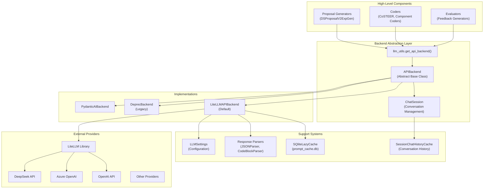
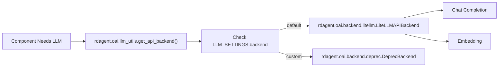
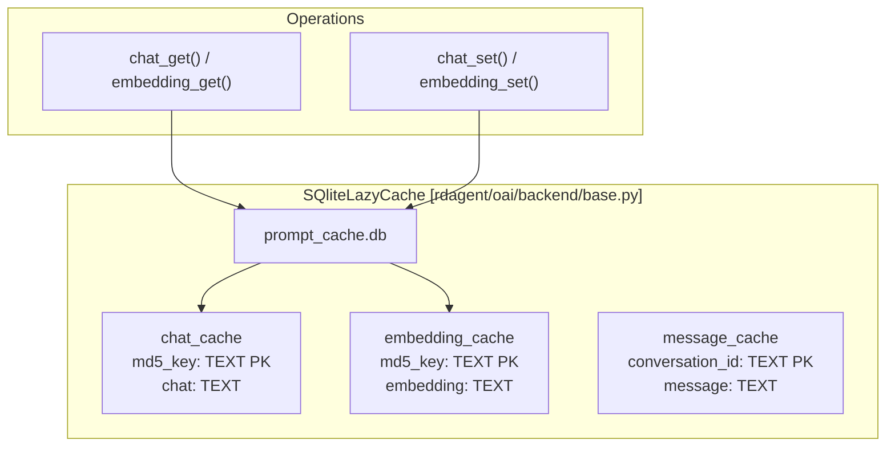
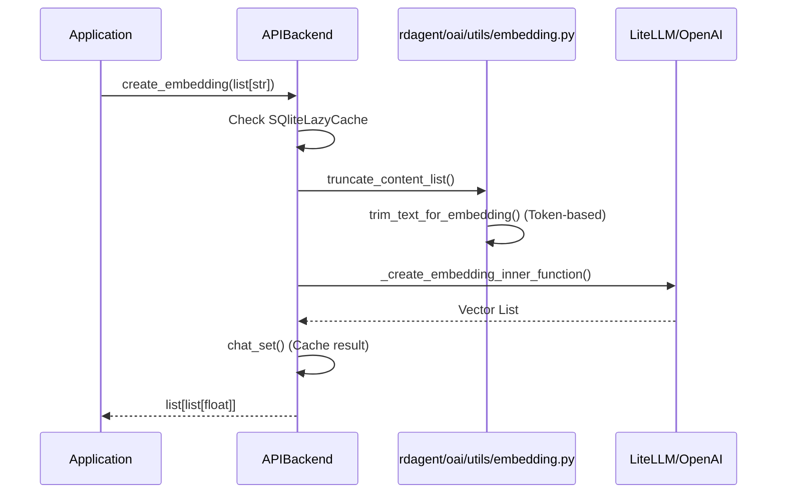

<!-- source: DeepWiki mcp.deepwiki.com · repo microsoft/RD-Agent · page 2.4 LLM Integration and Backends · fetched 2026-10-26 -->

# LLM Integration and Backends

<details>
<summary>Relevant source files</summary>

The following files were used as context for generating this wiki page:

- [rdagent/core/conf.py](rdagent/core/conf.py)
- [rdagent/core/utils.py](rdagent/core/utils.py)
- [rdagent/oai/backend/base.py](rdagent/oai/backend/base.py)
- [rdagent/oai/backend/deprec.py](rdagent/oai/backend/deprec.py)
- [rdagent/oai/backend/litellm.py](rdagent/oai/backend/litellm.py)
- [rdagent/oai/backend/pydantic_ai.py](rdagent/oai/backend/pydantic_ai.py)
- [rdagent/oai/llm_conf.py](rdagent/oai/llm_conf.py)
- [rdagent/oai/llm_utils.py](rdagent/oai/llm_utils.py)
- [rdagent/oai/utils/embedding.py](rdagent/oai/utils/embedding.py)
- [rdagent/scenarios/qlib/factor_experiment_loader/pdf_loader.py](rdagent/scenarios/qlib/factor_experiment_loader/pdf_loader.py)
- [rdagent/scenarios/qlib/factor_experiment_loader/prompts.yaml](rdagent/scenarios/qlib/factor_experiment_loader/prompts.yaml)
- [rdagent/utils/agent/apply_patch.py](rdagent/utils/agent/apply_patch.py)
- [rdagent/utils/agent/ret.py](rdagent/utils/agent/ret.py)
- [rdagent/utils/agent/tpl.py](rdagent/utils/agent/tpl.py)
- [rdagent/utils/agent/tpl.yaml](rdagent/utils/agent/tpl.yaml)
- [rdagent/utils/fmt.py](rdagent/utils/fmt.py)
- [test/oai/test_completion.py](test/oai/test_completion.py)
- [test/oai/test_embedding_and_similarity.py](test/oai/test_embedding_and_similarity.py)
- [test/utils/test_agent_infra.py](test/utils/test_agent_infra.py)

</details>


## Purpose and Scope

This document describes the LLM integration layer in RD-Agent, which provides a unified abstraction for interacting with multiple Large Language Model providers. The system supports both chat completion and embedding operations, automatic retry logic, response caching, and structured output parsing. 

For information about configuring LLM backends and API keys, see [Installation and Configuration](#1.1). For details on how prompts are constructed and used by higher-level components, see [Prompt Templates and LLM Interactions](#4.4).

The backend system consists of:
- An abstract `APIBackend` interface defining core LLM operations.
- A `LiteLLMAPIBackend` implementation supporting multiple providers via LiteLLM.
- A `PydanticAIBackend` for integration with the `pydantic-ai` framework.
- A legacy `DeprecBackend` for direct OpenAI/Azure/Llama integration.
- Caching mechanisms for chat and embedding responses using SQLite.
- Response parsers for JSON and code blocks.
- Configuration management via `LLMSettings`.

Sources: [rdagent/oai/backend/base.py:1-15](), [rdagent/oai/backend/litellm.py:48-49](), [rdagent/oai/llm_conf.py:11-13](), [rdagent/oai/backend/pydantic_ai.py:1-10]()

## Architecture Overview



**Backend Selection Flow**

The system dynamically selects the backend implementation based on the `backend` field in `LLMSettings`.



Sources: [rdagent/oai/llm_utils.py:35-44](), [rdagent/oai/llm_conf.py:11-13](), [rdagent/oai/backend/base.py:353-354]()

## APIBackend Abstract Interface

The `APIBackend` class provides the foundational abstraction for all LLM interactions. It defines the contract that all backend implementations must fulfill.

### Core API Methods

| Method | Purpose | Return Type |
|--------|---------|-------------|
| `build_messages_and_create_chat_completion()` | High-level entry point for chat | `str` |
| `create_embedding()` | Generate embeddings for text | `list[list[float]]` |
| `build_chat_session()` | Create stateful conversation session | `ChatSession` |
| `supports_response_schema()` | Check if structured output supported | `bool` |

### Key Features

**1. Automatic Retry Logic**

The backend implements robust retry mechanisms in `_try_create_chat_completion_or_embedding` with exponential backoff and error handling for rate limits, timeouts, and content policy violations.

```python
# From rdagent/oai/backend/base.py:530-550
max_retry = LLM_SETTINGS.max_retry  # Default: 10
retry_wait_seconds = self.retry_wait_seconds  # Default: 1
```

**2. Response Caching**

The backend supports caching at two levels:
- **Chat cache**: Stores complete chat responses in the `chat_cache` table.
- **Embedding cache**: Stores vector embeddings in the `embedding_cache` table.

Caching is controlled via `LLMSettings` flags like `use_chat_cache` and `use_embedding_cache`.

**3. Auto-Continue for Long Responses**

The `_create_chat_completion_auto_continue()` method handles responses that exceed model context limits by automatically continuing the generation when `finish_reason == "length"`.

Sources: [rdagent/oai/backend/base.py:353-782](), [rdagent/oai/llm_conf.py:41-51]()

## LiteLLM Backend Implementation

The `LiteLLMAPIBackend` is the default backend, providing unified access to multiple LLM providers through the LiteLLM library.

### Model-Specific Configuration

The `chat_model_map` setting allows per-tag model overrides. When a component logs with a specific tag, the backend automatically selects the corresponding model configuration in `get_complete_kwargs`.

```python
# From rdagent/oai/backend/litellm.py:106-119
if LITELLM_SETTINGS.chat_model_map:
    for t, mc in LITELLM_SETTINGS.chat_model_map.items():
        if t in logger._tag:
            model = mc["model"]
            # ... update temperature, max_tokens, reasoning_effort
```

### Response Format Support

The backend checks model capabilities at runtime using `litellm.supports_response_schema`. If a model (like some versions of DeepSeek) does not support structured output schemas, it falls back to raw text and manual parsing.

Sources: [rdagent/oai/backend/litellm.py:48-230](), [rdagent/oai/llm_conf.py:130-131]()

## Cache Management System

### SQLite-Based Cache

The `SQliteLazyCache` (a `SingletonBaseClass`) provides persistent caching using SQLite.



**Cache Key Generation**

For chat completions, the cache key is an MD5 hash of the messages combined with an optional seed. If `use_auto_chat_cache_seed_gen` is enabled, `LLM_CACHE_SEED_GEN` provides a unique seed for each call to ensure variety across different rounds while maintaining consistency within a single execution.

Sources: [rdagent/oai/backend/base.py:195-351](), [rdagent/core/utils.py:91-112]()

## Response Parsing System

### JSON Parser

The `JSONParser` implements a multi-strategy approach to handle inconsistent LLM outputs.

| Strategy | Function Name | Logic |
|----------|---------------|-------|
| 1. Direct | `_direct_parse` | Standard `json.loads`. Handles "Extra data" by extracting the first object. |
| 2. Markdown | `_extract_from_code_block` | Extracts content from ` ```json ... ``` `. |
| 3. Syntax Fix | `_fix_python_syntax` | Converts Python `True`/`False`/`None` to JSON `true`/`false`/`null`. |
| 4. Combined | `_extract_with_fix_combined` | Fixes syntax then extracts from code block. |

The `_fix_python_booleans` method uses the `tokenize` module to safely transform tokens without corrupting string contents.

Sources: [rdagent/oai/backend/base.py:37-137]()

### Code Block Parser

The `CodeBlockParser` extracts code from markdown blocks with language-specific tags.

```python
# From rdagent/oai/backend/base.py:145-148
SUPPORTED_LANGUAGES = {
    "python": ["python", "py", "python3", "Python", "Py"],
    "yaml": ["yaml", "yml"],
}
```

If extraction fails and `fallback_to_raw` is `False`, it raises a `CodeBlockParseError`, which the `APIBackend` catches to trigger an LLM retry.

Sources: [rdagent/oai/backend/base.py:139-193]()

## Structured Agent Outputs

The `AgentOut` hierarchy in `rdagent/utils/agent/ret.py` provides templates and extraction logic for specific agent interaction patterns.

| Class | Purpose | Extraction Logic |
|-------|---------|------------------|
| `PythonAgentOut` | Single Python block | Regex for ` ```[Pp]ython ... ``` ` |
| `BatchEditOut` | Multiple file edits (JSON) | `json.loads` |
| `PythonBatchEditOut` | Multiple code blocks | Parses blocks labeled with filenames |
| `PythonBatchPatchOut` | Diff-style patches | Extracts content between `*** Begin Patch` and `*** End Patch` |

Sources: [rdagent/utils/agent/ret.py:17-105](), [rdagent/utils/agent/tpl.yaml:1-113]()

## Embedding Operations

The `APIBackend` provides a high-level `create_embedding` method that handles batching and truncation.



### Token-Based Truncation
The system uses `rdagent.oai.utils.embedding.trim_text_for_embedding` to ensure inputs fit within the model's context window (e.g., 8191 tokens for `text-embedding-3-small`). It uses `tiktoken` (or LiteLLM's `encode`) to measure and slice tokens before sending to the API.

Sources: [rdagent/oai/backend/base.py:733-754](), [rdagent/oai/utils/embedding.py:1-135](), [test/oai/test_embedding_and_similarity.py:29-38]()

## Pydantic-AI Integration

The `PydanticAIBackend` integrates with the `pydantic-ai` library. It uses the `ModelAdapter` to wrap the `APIBackend` into a format compatible with `pydantic-ai` agents, allowing RD-Agent to leverage the structured validation and tool-calling features of that framework while maintaining RD-Agent's caching and configuration logic.

Sources: [rdagent/oai/backend/pydantic_ai.py:1-136]()

---

