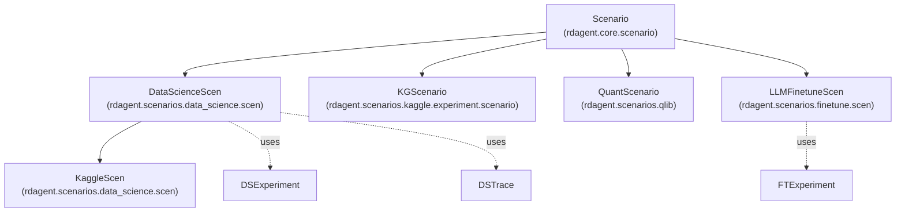
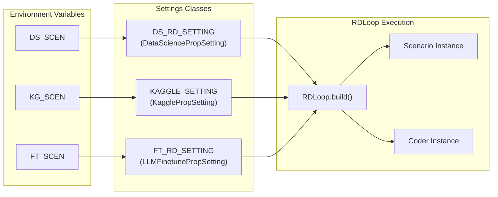
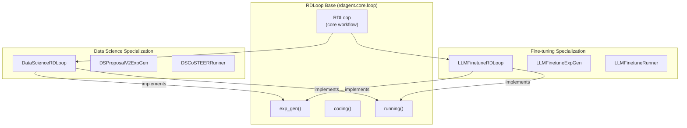

<!-- source: DeepWiki mcp.deepwiki.com · repo microsoft/RD-Agent · page 3 Scenarios and Applications · fetched 2026-10-26 -->

# Scenarios and Applications

Relevant source files

The following files were used as context for generating this wiki page:

- [.env.example](.env.example)
- [README.md](README.md)
- [docs/installation_and_configuration.rst](docs/installation_and_configuration.rst)
- [docs/scens/catalog.rst](docs/scens/catalog.rst)
- [docs/scens/data_agent_fin.rst](docs/scens/data_agent_fin.rst)
- [docs/scens/data_copilot_fin.rst](docs/scens/data_copilot_fin.rst)
- [docs/scens/data_science.rst](docs/scens/data_science.rst)
- [docs/scens/finetune.rst](docs/scens/finetune.rst)
- [docs/scens/kaggle_design.png](docs/scens/kaggle_design.png)
- [docs/scens/model_agent_fin.rst](docs/scens/model_agent_fin.rst)
- [docs/scens/model_copilot_general.rst](docs/scens/model_copilot_general.rst)
- [docs/ui.rst](docs/ui.rst)
- [rdagent/app/finetune/llm/README.md](rdagent/app/finetune/llm/README.md)
- [rdagent/app/finetune/llm/conf.py](rdagent/app/finetune/llm/conf.py)
- [rdagent/app/finetune/llm/job/README.md](rdagent/app/finetune/llm/job/README.md)
- [rdagent/app/finetune/llm/job/run_ft_job.sh](rdagent/app/finetune/llm/job/run_ft_job.sh)
- [rdagent/app/finetune/llm/job/tasks.json.example](rdagent/app/finetune/llm/job/tasks.json.example)
- [rdagent/app/finetune/llm/loop.py](rdagent/app/finetune/llm/loop.py)
- [rdagent/components/coder/finetune/prompts.yaml](rdagent/components/coder/finetune/prompts.yaml)
- [rdagent/scenarios/data_science/example/eval/playground-series-s4e9/grade.py](rdagent/scenarios/data_science/example/eval/playground-series-s4e9/grade.py)
- [rdagent/scenarios/finetune/benchmark/benchmark.py](rdagent/scenarios/finetune/benchmark/benchmark.py)

This page documents the different application domains supported by RD-Agent and how they leverage the core framework. RD-Agent provides specialized implementations for data science, Kaggle challenges, quantitative finance, LLM fine-tuning, and RL post-training, each built on top of the shared R&D loop architecture.

For detailed information about the core R&D loop framework that these scenarios utilize, see [R&D Loop Framework](#2.1). For configuration details, see [Configuration System Architecture](#6.3).

---

## Scenario Hierarchy and Design

RD-Agent implements a scenario-based architecture where different application domains share common infrastructure while providing domain-specific implementations. Each scenario extends the base `Scenario` class and integrates with the `RDLoop` workflow orchestrator.

**Scenario Class Hierarchy**

Sources: [rdagent/scenarios/data_science/scen/__init__.py:27-290](), [rdagent/scenarios/kaggle/experiment/scenario.py:36-282](), [rdagent/app/finetune/llm/conf.py:18-19]()

---

## Application Domains

RD-Agent is applied across several high-impact domains, each utilizing a specialized `RDLoop` and set of components.

### Data Science and Kaggle
The Data Science scenario automates the entire machine learning workflow: from hypothesis generation to feature engineering, model tuning, and validation [docs/scens/data_science.rst:14-18](). It is highly optimized for Kaggle competitions and has achieved state-of-the-art results on MLE-bench [README.md:50-60]().

*   **Key Components**: `DSProposalV2ExpGen`, `DSCoSTEERRunner`, and component-specific coders (e.g., `FeatureCoSTEER`, `ModelCoSTEER`).
*   **Workflow**: Iteratively proposes and implements features/models, validating them against leaderboards or local test sets [docs/scens/data_science.rst:20-49]().
*   **For details, see [Data Science Scenario](#3.1) and [Kaggle Competitions](#3.2).**

### Quantitative Trading and Finance
RD-Agent for Quantitative Finance (**RD-Agent(Q)**) is a data-centric framework designed to automate quantitative trading research [README.md:74-77](). It supports extracting factors from financial PDFs and evolving trading models using the Qlib library [docs/scens/data_copilot_fin.rst:38-40]().

*   **Key Components**: `QuantRDLoop`, `FactorTask`, `ModelTask`, and `QlibDockerEnv`.
*   **Workflow**: Extracts hypotheses from financial reports, implements factors/models, and conducts backtesting on historical data (e.g., CSI300) [docs/scens/data_agent_fin.rst:41-70]().
*   **For details, see [Quantitative Trading and Finance](#3.3).**

### LLM Fine-Tuning (FT-Agent)
The **FT-Agent** (introduced as **FT-Dojo**) automates autonomous LLM fine-tuning [README.md:34-34](). It handles benchmark-driven data processing, training configuration via LLaMA-Factory, and evaluation using OpenCompass [docs/scens/finetune.rst:7-13]().

*   **Key Components**: `LLMFinetuneRDLoop`, `LLMFinetuneCoSTEER`, and `LLMFinetuneRunner`.
*   **Workflow**: Proposes data processing and training strategies, executes training in GPU-enabled Docker containers, and evaluates on benchmarks like AIME or MMLU [rdagent/app/finetune/llm/conf.py:21-37]().
*   **For details, see [LLM Fine-Tuning Scenario](#3.4).**

### RL Post-Training
The RL post-training scenario focuses on automated reinforcement learning workflows (AutoRL-Bench), adapting LLMs through environment-based feedback.

*   **Key Components**: `RLPostTrainingRDLoop`, `OpenCompassEvaluator`, and `GradingServer`.
*   **For details, see [RL Post-Training Scenario](#3.5).**

---

## Configuration-Driven Component Selection

Each scenario is configured through environment variables that control which implementations are instantiated. This allows runtime selection of components (Scenario, ExpGen, Coder, Runner) without code changes.

**Configuration to Component Mapping**

Sources: [rdagent/app/data_science/conf.py:9-201](), [rdagent/app/kaggle/conf.py:6-97](), [rdagent/app/finetune/llm/conf.py:8-125]()

The configuration system uses Pydantic settings with environment variable prefixes:
- **Data Science**: `DS_*` prefix.
- **Kaggle**: `KG_*` prefix.
- **LLM Fine-tuning**: `FT_*` prefix [rdagent/app/finetune/llm/conf.py:15-15]().

| Scenario | CLI Command | Settings Class | Default Scenario Class |
|----------|-------------|----------------|-------------------------|
| Data Science | `rdagent data_science` | `DataScienceBasePropSetting` | `DataScienceScen` |
| Kaggle | `rdagent kaggle` | `KaggleBasePropSetting` | `KGScenario` |
| Finance | `rdagent fin_factor` | `FactorBasePropSetting` | `FactorScen` |
| LLM Fine-tune| `rdagent llm_finetune` | `LLMFinetunePropSetting` | `LLMFinetuneScen` |

Sources: [rdagent/app/data_science/conf.py:18-20](), [rdagent/app/kaggle/conf.py:10-15](), [rdagent/app/finetune/llm/conf.py:18-18](), [docs/scens/data_agent_fin.rst:118-118]()

---

## Scenario Integration with RD Loop

Each scenario integrates with the RD loop through specialized implementations of key components. The `RDLoop` base class orchestrates the workflow, while scenario-specific classes handle domain logic.

**RD Loop Integration Architecture**

Sources: [rdagent/scenarios/data_science/loop.py:87-240](), [rdagent/app/finetune/llm/conf.py:21-32]()

---

## Scenario-Specific Components

### Data Science Scenario Components
Supports component-based development with six types: `DataLoadSpec`, `FeatureEng`, `Model`, `Ensemble`, `Workflow`, and `Pipeline` [docs/scens/data_science.rst:20-49]().

### Kaggle Scenario Components
Uses an action-based workflow (e.g., "Feature engineering", "Model tuning") often guided by a UCB (Upper Confidence Bound) strategy to balance exploration and exploitation [rdagent/scenarios/kaggle/experiment/scenario.py:24-33]().

### Finance Scenario Components
Focuses on `FactorTask` and `ModelTask` evolution. It integrates with **Qlib** for backtesting and uses a `FactorFromReportPropSetting` to handle PDF report ingestion [docs/scens/data_copilot_fin.rst:155-155]().

### LLM Fine-Tuning Components
Leverages `LLMFinetuneCoSTEER` for code generation and a specialized `LLMFinetuneRunner` that manages long-running training jobs (up to 100 hours) in GPU-isolated Docker containers [rdagent/app/finetune/llm/conf.py:24-41]().

Sources: [rdagent/app/finetune/llm/conf.py:21-47](), [docs/scens/data_science.rst:20-49](), [rdagent/scenarios/kaggle/experiment/scenario.py:24-33]()

---

