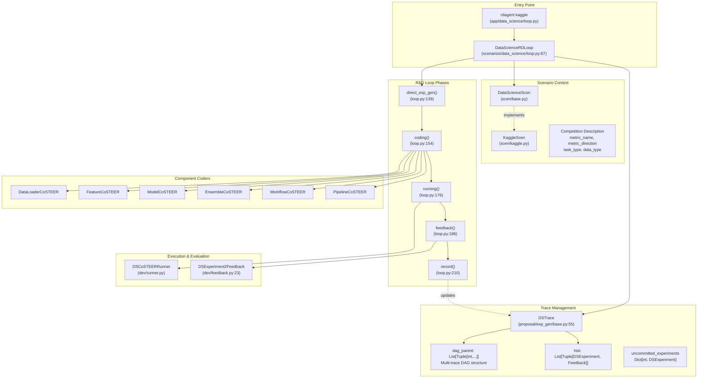
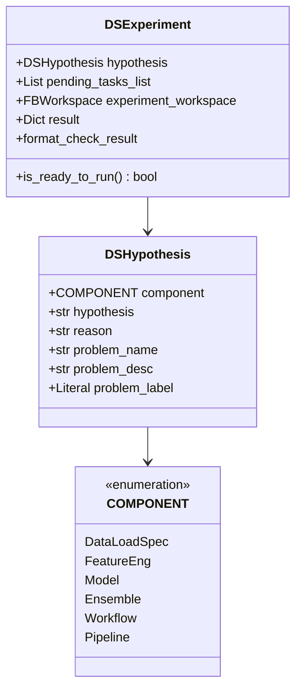

<!-- source: DeepWiki mcp.deepwiki.com · repo microsoft/RD-Agent · page 3.1 Data Science Scenario · fetched 2026-10-26 -->

# Data Science Scenario

Relevant source files

The following files were used as context for generating this wiki page:

- [rdagent/app/data_science/loop.py](rdagent/app/data_science/loop.py)
- [rdagent/components/coder/data_science/share/doc.py](rdagent/components/coder/data_science/share/doc.py)
- [rdagent/components/coder/data_science/share/eval.py](rdagent/components/coder/data_science/share/eval.py)
- [rdagent/components/coder/data_science/share/prompts.yaml](rdagent/components/coder/data_science/share/prompts.yaml)
- [rdagent/components/interactor/__init__.py](rdagent/components/interactor/__init__.py)
- [rdagent/components/workflow/conf.py](rdagent/components/workflow/conf.py)
- [rdagent/core/interactor.py](rdagent/core/interactor.py)
- [rdagent/log/ui/ds_user_interact.py](rdagent/log/ui/ds_user_interact.py)
- [rdagent/scenarios/data_science/debug/data.py](rdagent/scenarios/data_science/debug/data.py)
- [rdagent/scenarios/data_science/dev/feedback.py](rdagent/scenarios/data_science/dev/feedback.py)
- [rdagent/scenarios/data_science/dev/prompts.yaml](rdagent/scenarios/data_science/dev/prompts.yaml)
- [rdagent/scenarios/data_science/example/README.md](rdagent/scenarios/data_science/example/README.md)
- [rdagent/scenarios/data_science/experiment/experiment.py](rdagent/scenarios/data_science/experiment/experiment.py)
- [rdagent/scenarios/data_science/interactor/__init__.py](rdagent/scenarios/data_science/interactor/__init__.py)
- [rdagent/scenarios/data_science/loop.py](rdagent/scenarios/data_science/loop.py)
- [rdagent/scenarios/data_science/proposal/exp_gen/__init__.py](rdagent/scenarios/data_science/proposal/exp_gen/__init__.py)
- [rdagent/scenarios/data_science/proposal/exp_gen/draft/prompts_draft.yaml](rdagent/scenarios/data_science/proposal/exp_gen/draft/prompts_draft.yaml)
- [rdagent/scenarios/data_science/proposal/exp_gen/package_info.py](rdagent/scenarios/data_science/proposal/exp_gen/package_info.py)
- [rdagent/scenarios/data_science/proposal/exp_gen/utils.py](rdagent/scenarios/data_science/proposal/exp_gen/utils.py)
- [rdagent/scenarios/data_science/scen/utils.py](rdagent/scenarios/data_science/scen/utils.py)
- [rdagent/scenarios/shared/get_runtime_info.py](rdagent/scenarios/shared/get_runtime_info.py)

## Overview

The Data Science Scenario is a specialized implementation of the RD-Agent framework designed for automated research and development in data science competitions, primarily targeting Kaggle competitions and similar machine learning tasks. This scenario orchestrates an iterative workflow that proposes hypotheses, generates code implementations, executes experiments, and analyzes feedback to progressively improve model performance.

The Data Science Scenario extends the generic R&D framework (see [Core Architecture](#2)) with domain-specific features including:
- **DAG-based multi-trace exploration** via `DSTrace` for parallel hypothesis testing.
- **Component-based development** separating concerns across data loading, feature engineering, modeling, ensemble, and workflow stages.
- **Two-phase problem identification** distinguishing between scenario-driven and feedback-driven challenges.
- **SOTA selection and submission** mechanisms for competition leaderboard optimization.
- **MLE-Bench Integration** for standardized evaluation against established machine learning benchmarks.

For details on the underlying CoSTEER code generation framework, see [CoSTEER Framework](#4.1). For UI and monitoring capabilities, see [Streamlit UI and Visualization](#5.1).

**Sources:** [rdagent/scenarios/data_science/loop.py:87-137](), [rdagent/scenarios/data_science/proposal/exp_gen/base.py:55-150](), [rdagent/app/data_science/loop.py:13-60]()

## Architecture Overview

The Data Science Scenario implements a five-phase R&D loop that operates on experiment traces organized as a directed acyclic graph (DAG). Each iteration proposes a hypothesis targeting a specific component, develops code for that component, executes the experiment, and generates feedback to guide subsequent iterations.

### System Structure

**Sources:** [rdagent/scenarios/data_science/loop.py:87-250](), [rdagent/scenarios/data_science/proposal/exp_gen/base.py:55-150]()

## Core Data Structures

### DSTrace: DAG-Based Experiment History
`DSTrace` extends the generic `Trace` class to support multi-trace exploration where multiple hypotheses can be developed in parallel. It maintains a `dag_parent` list to track branching history and `uncommitted_experiments` for async generation. For details, see [DSTrace and Multi-Trace Exploration](#3.1.1).

**Sources:** [rdagent/scenarios/data_science/proposal/exp_gen/base.py:55-150](), [rdagent/scenarios/data_science/proposal/exp_gen/__init__.py:1-3]()

### DSExperiment and DSHypothesis
`DSExperiment` encapsulates a research trial, including its hypothesis, generated code workspace, and execution results.

**Sources:** [rdagent/scenarios/data_science/experiment/experiment.py:8-44](), [rdagent/scenarios/data_science/proposal/exp_gen/base.py:13-53]()

## R&D Workflow Pipeline

### Phase 1: Hypothesis Generation
The `DSProposalV2ExpGen` identifies problems from the scenario or previous feedback and proposes a `DSHypothesis`. For details, see [Hypothesis and Experiment Generation](#3.1.2).

**Sources:** [rdagent/scenarios/data_science/proposal/exp_gen/proposal.py:36-110](), [rdagent/scenarios/data_science/loop.py:139-152]()

### Phase 2: Component-Based Coding
Code is developed for specific components (e.g., `ModelTask`, `FeatureTask`) using specialized CoSTEER implementations. For details, see [Component-Based Development Pipeline](#3.1.3).

**Sources:** [rdagent/scenarios/data_science/loop.py:154-174](), [rdagent/scenarios/data_science/proposal/exp_gen/utils.py:16-53]()

### Phase 3: Execution and Evaluation
`DSCoSTEERRunner` executes the generated code in a `DSDockerEnv`. Results are analyzed by `DSExperiment2Feedback` to determine if the experiment improves upon the current SOTA. For details, see [Evaluation and Testing Framework](#3.1.4).

**Sources:** [rdagent/scenarios/data_science/dev/runner.py:1-100](), [rdagent/scenarios/data_science/dev/feedback.py:23-127](), [rdagent/components/coder/data_science/share/eval.py:29-166]()

## Configuration and Settings
The scenario behavior is controlled by `DS_RD_SETTING`, which manages timeouts, trace strategies, and feature flags like `enable_knowledge_base`. For details, see [Configuration and Settings](#3.1.5).

**Sources:** [rdagent/app/data_science/conf.py:7-200](), [rdagent/scenarios/data_science/loop.py:127-130]()

## Sub-Topics (Child Pages)

- [DSTrace and Multi-Trace Exploration](#3.1.1) — Explains the DAG structure, `TraceScheduler` strategies (RoundRobin, MCTS), and SOTA selection.
- [Hypothesis and Experiment Generation](#3.1.2) — Details the `DSProposalV2ExpGen` workflow, including problem identification and critique/rewrite cycles.
- [Component-Based Development Pipeline](#3.1.3) — Documents the six component types (DataLoadSpec, FeatureEng, etc.) and their specific `CoSTEER` coders.
- [Evaluation and Testing Framework](#3.1.4) — Covers the `DSExperiment2Feedback` logic, `ModelDumpEvaluator`, and MLE-Bench integration.
- [Configuration and Settings](#3.1.5) — Explains the `DS_RD_SETTING` hierarchy and runtime environment configuration.

---

