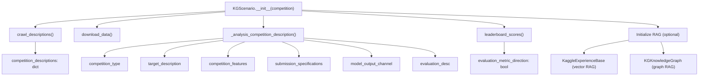
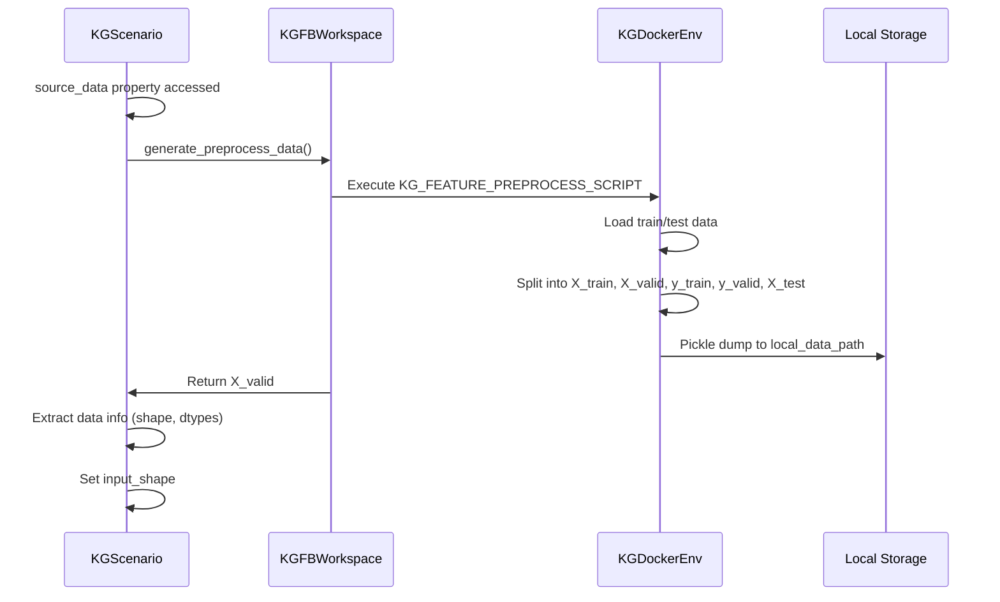
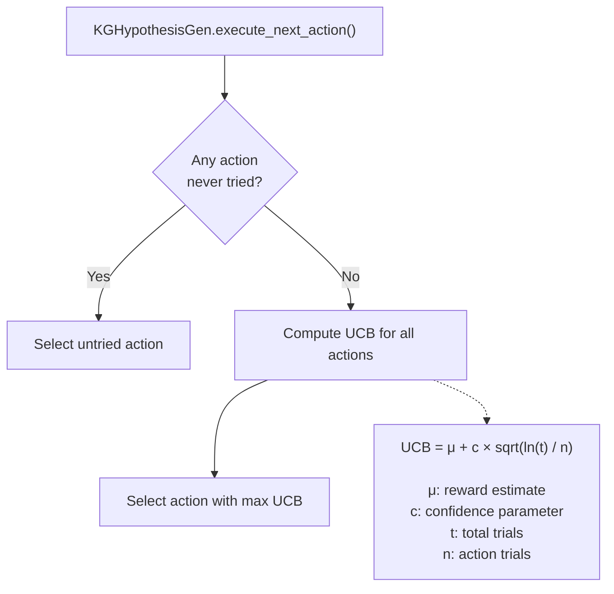
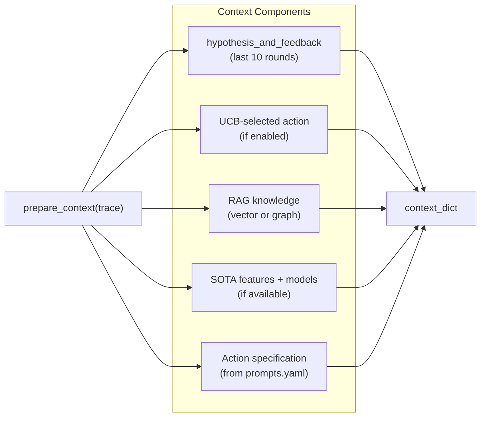
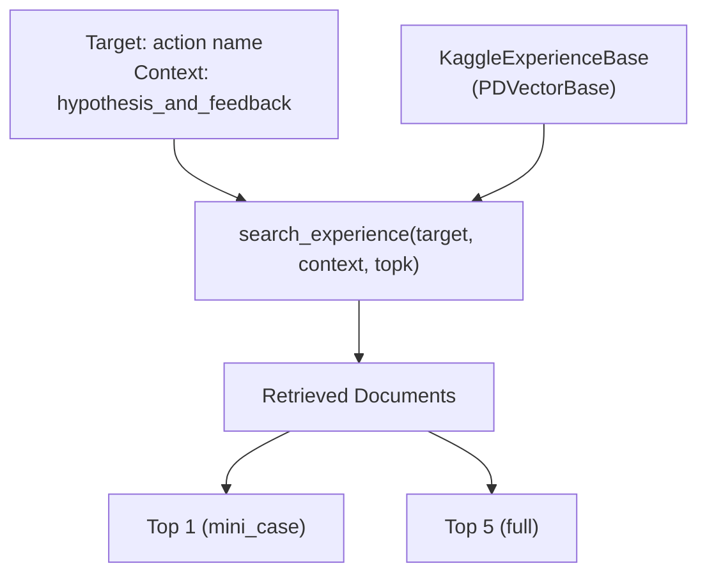
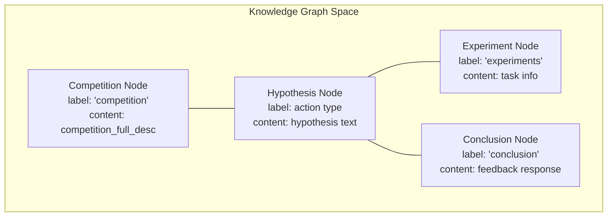
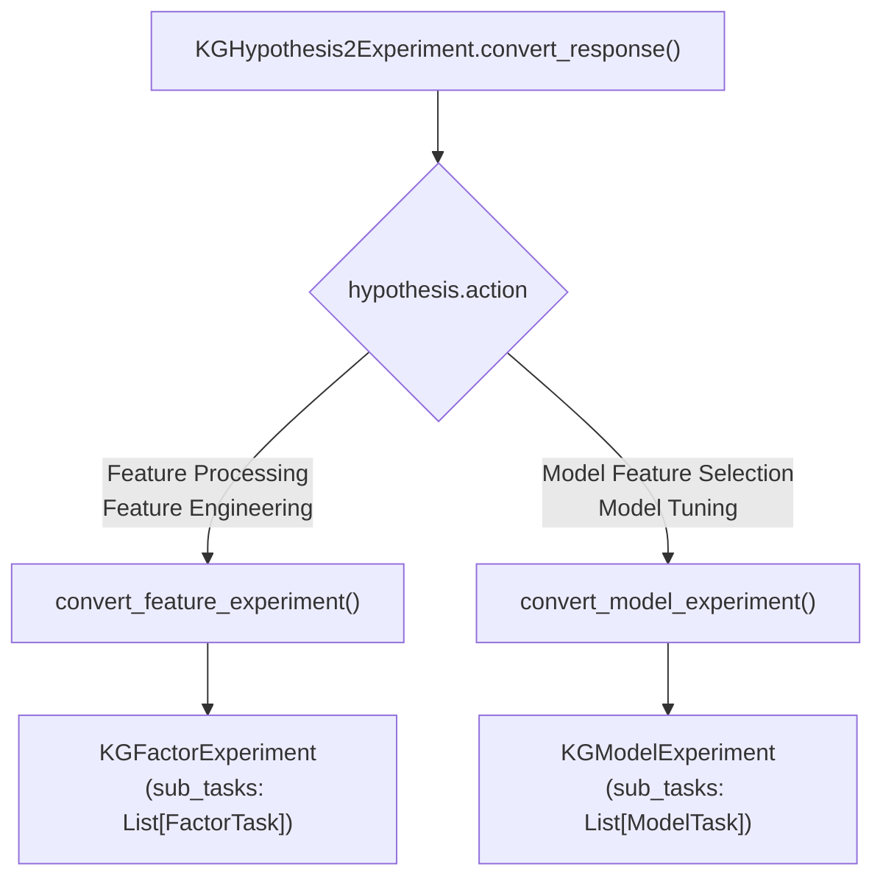
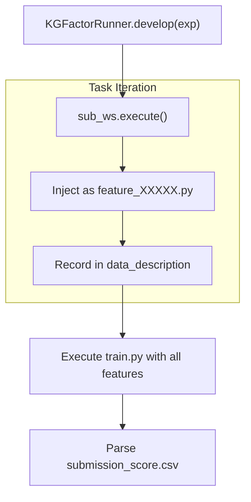
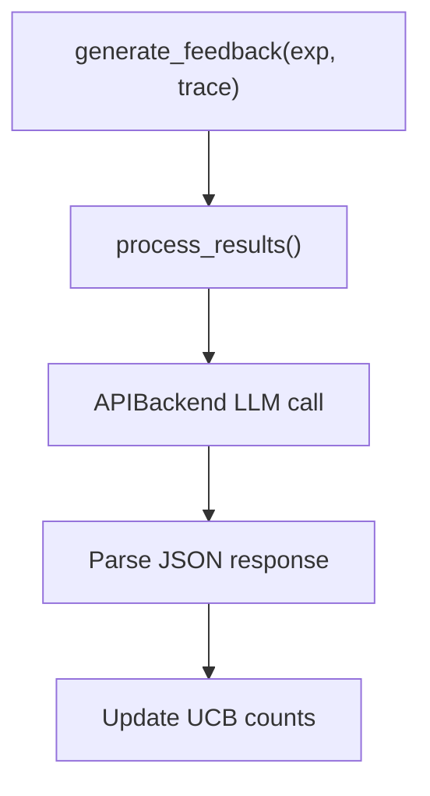
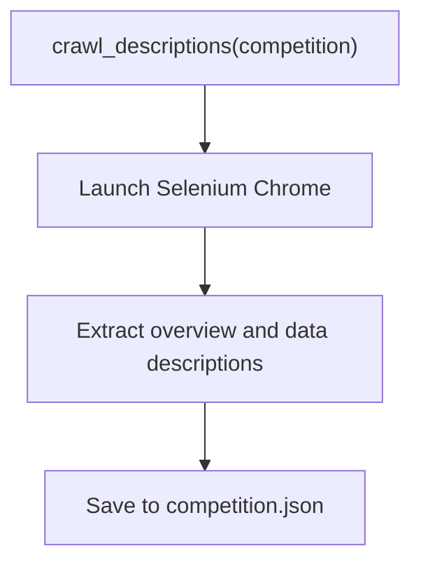

<!-- source: DeepWiki mcp.deepwiki.com · repo microsoft/RD-Agent · page 3.2 Kaggle Competitions · fetched 2026-10-26 -->

# Kaggle Competitions

<details>
<summary>Relevant source files</summary>

The following files were used as context for generating this wiki page:

- [rdagent/app/kaggle/conf.py](rdagent/app/kaggle/conf.py)
- [rdagent/app/kaggle/loop.py](rdagent/app/kaggle/loop.py)
- [rdagent/components/coder/factor_coder/factor_execution_template.txt](rdagent/components/coder/factor_coder/factor_execution_template.txt)
- [rdagent/core/knowledge_base.py](rdagent/core/knowledge_base.py)
- [rdagent/scenarios/kaggle/developer/feedback.py](rdagent/scenarios/kaggle/developer/feedback.py)
- [rdagent/scenarios/kaggle/developer/runner.py](rdagent/scenarios/kaggle/developer/runner.py)
- [rdagent/scenarios/kaggle/experiment/kaggle_experiment.py](rdagent/scenarios/kaggle/experiment/kaggle_experiment.py)
- [rdagent/scenarios/kaggle/experiment/prompts.yaml](rdagent/scenarios/kaggle/experiment/prompts.yaml)
- [rdagent/scenarios/kaggle/experiment/scenario.py](rdagent/scenarios/kaggle/experiment/scenario.py)
- [rdagent/scenarios/kaggle/experiment/spaceship-titanic_template/fea_share_preprocess.py](rdagent/scenarios/kaggle/experiment/spaceship-titanic_template/fea_share_preprocess.py)
- [rdagent/scenarios/kaggle/experiment/spaceship-titanic_template/model/model_randomforest.py](rdagent/scenarios/kaggle/experiment/spaceship-titanic_template/model/model_randomforest.py)
- [rdagent/scenarios/kaggle/experiment/spaceship-titanic_template/model/model_xgboost.py](rdagent/scenarios/kaggle/experiment/spaceship-titanic_template/model/model_xgboost.py)
- [rdagent/scenarios/kaggle/experiment/spaceship-titanic_template/train.py](rdagent/scenarios/kaggle/experiment/spaceship-titanic_template/train.py)
- [rdagent/scenarios/kaggle/experiment/workspace.py](rdagent/scenarios/kaggle/experiment/workspace.py)
- [rdagent/scenarios/kaggle/kaggle_crawler.py](rdagent/scenarios/kaggle/kaggle_crawler.py)
- [rdagent/scenarios/kaggle/knowledge_management/README.md](rdagent/scenarios/kaggle/knowledge_management/README.md)
- [rdagent/scenarios/kaggle/knowledge_management/extract_knowledge.py](rdagent/scenarios/kaggle/knowledge_management/extract_knowledge.py)
- [rdagent/scenarios/kaggle/knowledge_management/graph.py](rdagent/scenarios/kaggle/knowledge_management/graph.py)
- [rdagent/scenarios/kaggle/knowledge_management/prompts.yaml](rdagent/scenarios/kaggle/knowledge_management/prompts.yaml)
- [rdagent/scenarios/kaggle/knowledge_management/vector_base.py](rdagent/scenarios/kaggle/knowledge_management/vector_base.py)
- [rdagent/scenarios/kaggle/prompts.yaml](rdagent/scenarios/kaggle/prompts.yaml)
- [rdagent/scenarios/kaggle/proposal/proposal.py](rdagent/scenarios/kaggle/proposal/proposal.py)

</details>


This document covers the Kaggle competition scenario implementation, which enables autonomous R&D for Kaggle data science challenges. The scenario supports iterative feature engineering and model tuning through action-based hypothesis selection and retrieval-augmented generation (RAG).

For the broader data science scenario including MLE-Bench integration and multi-trace exploration, see [Data Science Scenario](3.1). For quantitative finance applications, see [Quantitative Trading and Finance](3.3).

---

## Overview

The Kaggle scenario implements a specialized R&D loop focused on four distinct action types: feature processing, feature engineering, model feature selection, and model tuning. Unlike the general data science scenario, it introduces **action-based decision making** using Upper Confidence Bound (UCB) algorithms and supports both vector-based and graph-based RAG for knowledge reuse across similar competitions.

The system crawls competition data from Kaggle, analyzes competition descriptions, manages evolving feature libraries and model ensembles, and optionally submits results back to the platform.

**Key Classes:**
- `KGScenario`: Competition context and description analysis. [rdagent/scenarios/kaggle/experiment/scenario.py:36-71]()
- `KGHypothesisGen`: Action selection and hypothesis generation. [rdagent/scenarios/kaggle/proposal/proposal.py:196-200]()
- `KGHypothesis2Experiment`: Converts hypotheses to executable experiments. [rdagent/scenarios/kaggle/proposal/proposal.py:307-308]()
- `KaggleRDLoop`: Main orchestration loop. [rdagent/app/kaggle/loop.py:29-56]()
- `KGFactorRunner` / `KGModelRunner`: Execution engines. [rdagent/scenarios/kaggle/developer/runner.py:60-131]()
- `KGExperiment2Feedback`: Result analysis and feedback. [rdagent/scenarios/kaggle/developer/feedback.py:16-17]()

Sources: [rdagent/scenarios/kaggle/experiment/scenario.py:1-282](), [rdagent/app/kaggle/loop.py:1-140]()

---

## KGScenario: Competition Context and Analysis

### Competition Setup and Data Crawling

The `KGScenario` class initializes a competition environment by crawling descriptions, downloading data, and extracting structured information about the task.

**Competition Data Flow**



**Competition Description Analysis**

The scenario uses an LLM to parse unstructured competition descriptions into structured fields:

| Field | Description | Source |
|-------|-------------|--------|
| `competition_type` | Classification, Regression, Time-Series, etc. | [rdagent/scenarios/kaggle/experiment/scenario.py:89]() |
| `competition_description` | Brief task summary | [rdagent/scenarios/kaggle/experiment/scenario.py:90]() |
| `target_description` | What the model should predict | [rdagent/scenarios/kaggle/experiment/scenario.py:91]() |
| `competition_features` | Overview of available features | [rdagent/scenarios/kaggle/experiment/scenario.py:92]() |
| `submission_specifications` | Output format requirements | [rdagent/scenarios/kaggle/experiment/scenario.py:93]() |
| `model_output_channel` | Number of outputs per sample | [rdagent/scenarios/kaggle/experiment/scenario.py:96]() |
| `evaluation_desc` | Metric explanation | [rdagent/scenarios/kaggle/experiment/scenario.py:97]() |
| `evaluation_metric_direction` | Higher or lower is better | [rdagent/scenarios/kaggle/experiment/scenario.py:51]() |

Sources: [rdagent/scenarios/kaggle/experiment/scenario.py:36-100](), [rdagent/scenarios/kaggle/experiment/prompts.yaml:1-26]()

### Data Preprocessing and Source Data

The scenario generates preprocessed data splits using the competition's template code:



The `source_data` property returns a string representation of the validation set's structure, used in prompts to inform feature engineering decisions. [rdagent/scenarios/kaggle/experiment/scenario.py:133-165]()

Sources: [rdagent/scenarios/kaggle/experiment/scenario.py:133-165](), [rdagent/scenarios/kaggle/experiment/workspace.py:42-70]()

---

## Action Types and UCB-Based Selection

### Four Action Categories

The Kaggle scenario organizes all R&D activities into four mutually exclusive actions: [rdagent/scenarios/kaggle/experiment/scenario.py:24-27]()

```python
KG_ACTION_FEATURE_PROCESSING = "Feature processing"
KG_ACTION_FEATURE_ENGINEERING = "Feature engineering"
KG_ACTION_MODEL_FEATURE_SELECTION = "Model feature selection"
KG_ACTION_MODEL_TUNING = "Model tuning"
```

| Action | Description | Workflow Type |
|--------|-------------|---------------|
| **Feature Processing** | Data transformations (normalization, encoding, imputation) | Factor |
| **Feature Engineering** | Create new features from existing data | Factor |
| **Model Feature Selection** | Choose feature subsets for specific model types | Model |
| **Model Tuning** | Adjust hyperparameters or architecture | Model |

Sources: [rdagent/scenarios/kaggle/experiment/scenario.py:24-33](), [rdagent/scenarios/kaggle/prompts.yaml:47-132]()

### Upper Confidence Bound (UCB) Action Selection

When `if_action_choosing_based_on_UCB` is enabled, the system uses a multi-armed bandit approach to select which action to pursue. [rdagent/scenarios/kaggle/proposal/proposal.py:200-248]()

**UCB Logic Flow**



**UCB Update Mechanism:**
After each experiment, the system updates reward estimates based on performance changes. [rdagent/scenarios/kaggle/proposal/proposal.py:235-248]()

Sources: [rdagent/scenarios/kaggle/proposal/proposal.py:200-248](), [rdagent/scenarios/kaggle/experiment/scenario.py:64-71]()

---

## Hypothesis Generation with RAG

### KGHypothesisGen: Context Preparation

The `KGHypothesisGen` class orchestrates hypothesis generation by combining historical feedback, RAG-retrieved knowledge, and action specifications. [rdagent/scenarios/kaggle/proposal/proposal.py:250-289]()

**Context Construction**



Sources: [rdagent/scenarios/kaggle/proposal/proposal.py:250-289]()

### RAG Integration: Vector and Graph-Based

#### Vector-Based RAG (`if_using_vector_rag`)
The `KaggleExperienceBase` uses `PDVectorBase` to manage embeddings of past competition experiences. [rdagent/scenarios/kaggle/knowledge_management/vector_base.py:106-122]()



Sources: [rdagent/scenarios/kaggle/proposal/proposal.py:66-71](), [rdagent/scenarios/kaggle/knowledge_management/vector_base.py:1-180]()

#### Graph-Based RAG (`if_using_graph_rag`)
The graph RAG uses `KGKnowledgeGraph` to store relationships between competitions, hypotheses, and experiments. [rdagent/scenarios/kaggle/knowledge_management/graph.py:1-10]()

**Graph Structure Retrieval**



Sources: [rdagent/scenarios/kaggle/proposal/proposal.py:72-182](), [rdagent/scenarios/kaggle/knowledge_management/graph.py:1-10]()

---

## Experiment Workflows: Factor vs Model

### KGHypothesis2Experiment: Conversion Logic

The `KGHypothesis2Experiment` class routes hypotheses to either factor or model experiment generation. [rdagent/scenarios/kaggle/proposal/proposal.py:307-308]()



Sources: [rdagent/scenarios/kaggle/proposal/proposal.py:307-416]()

---

## Code Development and Execution

### Development Flow: Coding and Running

The `KaggleRDLoop` orchestrates development by routing experiments to appropriate coders and runners. [rdagent/app/kaggle/loop.py:58-109]()

**Execution Architecture**

```mermaid
sequenceDiagram
    participant Loop as KaggleRDLoop
    participant Coder as Developer (Coder)
    participant Runner as Developer (Runner)
    participant WS as KGFBWorkspace
    participant Docker as KGDockerEnv
    
    Loop->>Loop: direct_exp_gen (hypothesis → experiment)
    
    alt Feature Actions
        Loop->>Coder: feature_coder.develop(exp)
        Coder-->>Loop: exp with sub_workspace_list
        Loop->>Runner: feature_runner.develop(exp)
    else Model Actions
        Loop->>Coder: model_coder.develop(exp)
        Coder-->>Loop: exp with sub_workspace_list
        Loop->>Runner: model_runner.develop(exp)
    end
    
    Runner->>WS: Inject generated code
    Runner->>Docker: Execute train.py via KGDockerEnv.check_output()
    Docker->>WS: Write submission_score.csv
    Runner-->>Loop: exp with results
```

Sources: [rdagent/app/kaggle/loop.py:58-109](), [rdagent/scenarios/kaggle/experiment/workspace.py:72-98]()

### KGFactorRunner: Feature Execution

The factor runner executes each generated feature engineering task and accumulates results. [rdagent/scenarios/kaggle/developer/runner.py:94-131]()

**Feature Workflow**



Sources: [rdagent/scenarios/kaggle/developer/runner.py:94-131]()

---

## Feedback Generation and Knowledge Management

### KGExperiment2Feedback: Result Analysis

The feedback generator compares current results with SOTA and generates structured feedback. [rdagent/scenarios/kaggle/developer/feedback.py:16-150]()

**Feedback Loop**



Sources: [rdagent/scenarios/kaggle/developer/feedback.py:16-191]()

---

## Configuration and Settings

### KaggleBasePropSetting

The configuration system uses environment variables prefixed with `KG_`. [rdagent/app/kaggle/conf.py:6-96]()

| Setting | Default | Description |
|---------|---------|-------------|
| `competition` | (required) | Kaggle competition name |
| `local_data_path` | (required) | Data storage folder |
| `if_action_choosing_based_on_UCB` | False | Enable UCB action selection |
| `if_using_vector_rag` | False | Enable vector-based RAG |
| `if_using_graph_rag` | False | Enable graph-based RAG |

Sources: [rdagent/app/kaggle/conf.py:1-96]()

### Data Download and Crawler

The `kaggle_crawler.py` module manages competition data acquisition. [rdagent/scenarios/kaggle/kaggle_crawler.py:35-110]()

**Crawler Pipeline**



Sources: [rdagent/scenarios/kaggle/kaggle_crawler.py:35-201]()

---

