<!-- source: DeepWiki mcp.deepwiki.com · repo microsoft/RD-Agent · page 3.3 Quantitative Trading and Finance · fetched 2026-10-26 -->

# Quantitative Trading and Finance

<details>
<summary>Relevant source files</summary>

The following files were used as context for generating this wiki page:

- [rdagent/app/cli.py](rdagent/app/cli.py)
- [rdagent/app/general_model/general_model.py](rdagent/app/general_model/general_model.py)
- [rdagent/app/qlib_rd_loop/conf.py](rdagent/app/qlib_rd_loop/conf.py)
- [rdagent/app/qlib_rd_loop/factor.py](rdagent/app/qlib_rd_loop/factor.py)
- [rdagent/app/qlib_rd_loop/factor_from_report.py](rdagent/app/qlib_rd_loop/factor_from_report.py)
- [rdagent/app/qlib_rd_loop/model.py](rdagent/app/qlib_rd_loop/model.py)
- [rdagent/app/qlib_rd_loop/prompts.yaml](rdagent/app/qlib_rd_loop/prompts.yaml)
- [rdagent/app/qlib_rd_loop/quant.py](rdagent/app/qlib_rd_loop/quant.py)
- [rdagent/components/proposal/prompts.yaml](rdagent/components/proposal/prompts.yaml)
- [rdagent/components/workflow/rd_loop.py](rdagent/components/workflow/rd_loop.py)
- [rdagent/core/scenario.py](rdagent/core/scenario.py)
- [rdagent/scenarios/general_model/scenario.py](rdagent/scenarios/general_model/scenario.py)
- [rdagent/scenarios/qlib/developer/factor_runner.py](rdagent/scenarios/qlib/developer/factor_runner.py)
- [rdagent/scenarios/qlib/developer/feedback.py](rdagent/scenarios/qlib/developer/feedback.py)
- [rdagent/scenarios/qlib/developer/model_runner.py](rdagent/scenarios/qlib/developer/model_runner.py)
- [rdagent/scenarios/qlib/docker/Dockerfile](rdagent/scenarios/qlib/docker/Dockerfile)
- [rdagent/scenarios/qlib/experiment/factor_experiment.py](rdagent/scenarios/qlib/experiment/factor_experiment.py)
- [rdagent/scenarios/qlib/experiment/factor_from_report_experiment.py](rdagent/scenarios/qlib/experiment/factor_from_report_experiment.py)
- [rdagent/scenarios/qlib/experiment/factor_template/conf_baseline.yaml](rdagent/scenarios/qlib/experiment/factor_template/conf_baseline.yaml)
- [rdagent/scenarios/qlib/experiment/factor_template/conf_combined_factors.yaml](rdagent/scenarios/qlib/experiment/factor_template/conf_combined_factors.yaml)
- [rdagent/scenarios/qlib/experiment/factor_template/conf_combined_factors_sota_model.yaml](rdagent/scenarios/qlib/experiment/factor_template/conf_combined_factors_sota_model.yaml)
- [rdagent/scenarios/qlib/experiment/factor_template/read_exp_res.py](rdagent/scenarios/qlib/experiment/factor_template/read_exp_res.py)
- [rdagent/scenarios/qlib/experiment/model_experiment.py](rdagent/scenarios/qlib/experiment/model_experiment.py)
- [rdagent/scenarios/qlib/experiment/model_template/conf_baseline_factors_model.yaml](rdagent/scenarios/qlib/experiment/model_template/conf_baseline_factors_model.yaml)
- [rdagent/scenarios/qlib/experiment/model_template/conf_sota_factors_model.yaml](rdagent/scenarios/qlib/experiment/model_template/conf_sota_factors_model.yaml)
- [rdagent/scenarios/qlib/experiment/model_template/read_exp_res.py](rdagent/scenarios/qlib/experiment/model_template/read_exp_res.py)
- [rdagent/scenarios/qlib/experiment/prompts.yaml](rdagent/scenarios/qlib/experiment/prompts.yaml)
- [rdagent/scenarios/qlib/experiment/quant_experiment.py](rdagent/scenarios/qlib/experiment/quant_experiment.py)
- [rdagent/scenarios/qlib/experiment/workspace.py](rdagent/scenarios/qlib/experiment/workspace.py)
- [rdagent/scenarios/qlib/prompts.yaml](rdagent/scenarios/qlib/prompts.yaml)
- [rdagent/scenarios/qlib/proposal/factor_proposal.py](rdagent/scenarios/qlib/proposal/factor_proposal.py)
- [rdagent/scenarios/qlib/proposal/model_proposal.py](rdagent/scenarios/qlib/proposal/model_proposal.py)
- [rdagent/scenarios/qlib/proposal/quant_proposal.py](rdagent/scenarios/qlib/proposal/quant_proposal.py)
- [rdagent/utils/workflow/loop.py](rdagent/utils/workflow/loop.py)
- [test/notebook/testfiles/main.py](test/notebook/testfiles/main.py)
- [test/notebook/testfiles/main2.py](test/notebook/testfiles/main2.py)
- [test/notebook/testfiles/main_missing_main_fn.py](test/notebook/testfiles/main_missing_main_fn.py)
- [test/notebook/testfiles/main_missing_sections.py](test/notebook/testfiles/main_missing_sections.py)
- [test/qlib/test_model_factor_proposal.py](test/qlib/test_model_factor_proposal.py)

</details>


This document describes the quantitative trading and finance scenario implementation in RD-Agent, which specializes the generic R&D loop framework for developing and testing trading factors and models. The system supports three main workflows: (1) co-evolution of factors and models using the `QuantRDLoop`, (2) iterative factor development using `FactorRDLoop`, and (3) automatic extraction and implementation of factors from research reports using the `FactorReportLoop`. All workflows integrate with the Qlib quantitative investment platform for backtesting and evaluation.

For information about the generic R&D loop framework that this scenario extends, see [2.1](). For data science competition workflows, see [3.1](). For Kaggle-specific workflows, see [3.2]().

## System Architecture Overview

The quantitative trading scenario consists of loop implementations that extend the base `RDLoop` class with specialized components for financial research.

**Quantitative Trading System Architecture**

```mermaid
graph TB
    subgraph "Loop Implementations"
        QuantLoop["QuantRDLoop<br/>[app/qlib_rd_loop/quant.py]"]
        FactorLoop["FactorRDLoop<br/>[app/qlib_rd_loop/factor.py]"]
        FactorReportLoop["FactorReportLoop<br/>[app/qlib_rd_loop/factor_from_report.py]"]
    end
    
    subgraph "Hypothesis Generation"
        QuantHypGen["QuantHypothesisGen<br/>Action Selection: factor/model"]
        FactorHypGen["generate_hypothesis()<br/>From PDF content"]
    end
    
    subgraph "Experiment Conversion"
        FactorH2E["QlibFactorHypothesis2Experiment<br/>Hypothesis2Experiment"]
        ModelH2E["QlibModelHypothesis2Experiment<br/>Hypothesis2Experiment"]
        PDFLoader["FactorExperimentLoaderFromPDFfiles<br/>PDF to QlibFactorExperiment"]
    end
    
    subgraph "Developers - Factor Track"
        FactorCoder["QlibFactorCoSTEER<br/>[scenarios/qlib/developer/factor_coder.py]"]
        FactorRunner["QlibFactorRunner<br/>[scenarios/qlib/developer/factor_runner.py]"]
        FactorSummarizer["QlibFactorExperiment2Feedback<br/>[scenarios/qlib/developer/feedback.py]"]
    end
    
    subgraph "Developers - Model Track"
        ModelCoder["QlibModelCoSTEER<br/>[scenarios/qlib/developer/model_coder.py]"]
        ModelRunner["QlibModelRunner<br/>[scenarios/qlib/developer/model_runner.py]"]
        ModelSummarizer["QlibModelExperiment2Feedback<br/>[scenarios/qlib/developer/feedback.py]"]
    end
    
    subgraph "Execution Environment"
        QlibEnv["QlibDockerEnv / QlibCondaEnv<br/>Backtesting Environment"]
        Dockerfile["Dockerfile<br/>[scenarios/qlib/docker/Dockerfile]"]
    end
    
    QuantLoop --> QuantHypGen
    QuantLoop --> FactorH2E
    QuantLoop --> ModelH2E
    QuantLoop --> FactorCoder
    QuantLoop --> ModelCoder
    QuantLoop --> FactorRunner
    QuantLoop --> ModelRunner
    
    FactorReportLoop --> PDFLoader
    FactorReportLoop --> FactorHypGen
    FactorReportLoop --> FactorCoder
    
    FactorRunner --> QlibEnv
    ModelRunner --> QlibEnv
    QlibEnv -.-> Dockerfile
```



Sources: [rdagent/app/qlib_rd_loop/quant.py:1-144](), [rdagent/app/qlib_rd_loop/factor_from_report.py:97-142](), [rdagent/app/qlib_rd_loop/conf.py:112-176](), [rdagent/scenarios/qlib/docker/Dockerfile:1-25]()

## QuantRDLoop: Factor-Model Co-Evolution

The `QuantRDLoop` class implements alternating optimization between factor engineering and model development. It routes tasks to either the factor track or the model track based on an LLM-determined action.

### Class Structure and Configuration

The loop is driven by `QuantBasePropSetting`, which defines the component mapping:

| Component Type | Factor Track | Model Track |
|---------------|--------------|-------------|
| Hypothesis Generator | `QlibQuantHypothesisGen` | (shared) |
| Hypothesis2Experiment | `QlibFactorHypothesis2Experiment` | `QlibModelHypothesis2Experiment` |
| Coder | `QlibFactorCoSTEER` | `QlibModelCoSTEER` |
| Runner | `QlibFactorRunner` | `QlibModelRunner` |
| Summarizer | `QlibFactorExperiment2Feedback` | `QlibModelExperiment2Feedback` |

Sources: [rdagent/app/qlib_rd_loop/conf.py:112-172](), [rdagent/app/qlib_rd_loop/quant.py:28-66]()

### Workflow Execution

The `QuantRDLoop` overrides the `RDLoop` steps to handle the dual-track logic.

**QuantRDLoop Routing Logic**

```mermaid
sequenceDiagram
    participant Loop as QuantRDLoop
    participant HypGen as QlibQuantHypothesisGen
    participant Runner as QlibFactorRunner / QlibModelRunner
    
    Loop->>HypGen: _propose()
    HypGen-->>Loop: Hypothesis (action: "factor" OR "model")
    
    alt action == "factor"
        Loop->>Runner: factor_runner.develop(exp)
        Note over Runner: Runs factor extraction & backtest
    else action == "model"
        Loop->>Runner: model_runner.develop(exp)
        Note over Runner: Runs PyTorch model training
    end
    
    Loop->>Loop: feedback() via track-specific summarizer
```

Sources: [rdagent/app/qlib_rd_loop/quant.py:68-118]()

## Factor Development Pipeline

### QlibFactorRunner
The `QlibFactorRunner` handles the execution of factor code. A critical feature is the `deduplicate_new_factors` method, which calculates the Information Coefficient (IC) between new factors and existing SOTA factors to ensure diversity.

- **IC Calculation**: It uses `pandarallel` for parallel correlation checks [rdagent/scenarios/qlib/developer/factor_runner.py:35-61]().
- **Data Persistence**: Combined factors are saved as `.parquet` files to avoid numpy versioning issues between the host and Docker [rdagent/scenarios/qlib/developer/factor_runner.py:124-130]().
- **Environment Injection**: It injects baseline Qlib configurations (`conf_baseline.yaml`) and code into the workspace before execution [rdagent/scenarios/qlib/developer/factor_runner.py:73-86]().

Sources: [rdagent/scenarios/qlib/developer/factor_runner.py:25-138]()

### Scenario and Prompts
Factor development is guided by the `QlibFactorScenario`. It provides the LLM with:
- **Background**: Explains factors as physics values for instruments [rdagent/scenarios/qlib/experiment/prompts.yaml:12-28]().
- **Interface**: Requires factors to be saved in HDF5 (`result.h5`) with MultiIndex `(datetime, instrument)` [rdagent/scenarios/qlib/experiment/prompts.yaml:30-34]().
- **Strategy**: Encourages specific pandas operations (multi-level indexing, groupby) to ensure code correctness [rdagent/scenarios/qlib/experiment/prompts.yaml:35-74]().

Sources: [rdagent/scenarios/qlib/experiment/factor_experiment.py:30-105](), [rdagent/scenarios/qlib/experiment/prompts.yaml:12-105]()

## Factor Extraction from Research Reports

The `FactorReportLoop` specializes in extracting factor implementations from PDF reports using a combination of document processing and LLM reasoning.

### Workflow
1. **PDF Loading**: `FactorExperimentLoaderFromPDFfiles` parses the document [rdagent/app/qlib_rd_loop/factor_from_report.py:72-73]().
2. **Visual Context**: `extract_first_page_screenshot_from_pdf` provides visual cues [rdagent/app/qlib_rd_loop/factor_from_report.py:76-77]().
3. **Text Processing**: `load_and_process_pdfs_by_langchain` extracts textual content [rdagent/app/qlib_rd_loop/factor_from_report.py:79-79]().
4. **Hypothesis Generation**: A specialized `generate_hypothesis` function creates a testable hypothesis from the PDF content [rdagent/app/qlib_rd_loop/factor_from_report.py:26-58]().

### Shift Mechanism
The loop includes a `shift_report` mechanism to handle non-viable reports. If a report doesn't contain extractable factors, the loop skips it and adjusts the remaining count to avoid infinite loops [rdagent/app/qlib_rd_loop/factor_from_report.py:113-123]().

Sources: [rdagent/app/qlib_rd_loop/factor_from_report.py:61-141]()

## Docker Environment Setup

RD-Agent uses a specialized Docker environment for Qlib execution to ensure reproducibility and GPU support.

**Dockerfile Configuration** (`rdagent/scenarios/qlib/docker/Dockerfile`):
- **Base Image**: `pytorch/pytorch:2.2.1-cuda12.1-cudnn8-runtime` [rdagent/scenarios/qlib/docker/Dockerfile:1-1]().
- **Qlib Version**: Locked to commit `2fb9380b342556ddb50a4b24e4fe8655d548b2b8` [rdagent/scenarios/qlib/docker/Dockerfile:17-17]().
- **Dependencies**: Includes `catboost`, `xgboost`, and `tables` (for HDF5 support) [rdagent/scenarios/qlib/docker/Dockerfile:22-24]().

Sources: [rdagent/scenarios/qlib/docker/Dockerfile:1-25]()

## CLI Entry Points

The `rdagent` CLI provides several commands for the finance scenario:

| Command | Function | Description |
|---------|----------|-------------|
| `fin_factor` | `fin_factor()` | Runs factor-only evolution loop [rdagent/app/cli.py:82-90](). |
| `fin_model` | `fin_model()` | Runs model-only evolution loop [rdagent/app/cli.py:93-101](). |
| `fin_quant` | `fin_quant()` | Runs joint factor-model evolution [rdagent/app/cli.py:104-112](). |
| `fin_factor_report` | `fin_factor_report()` | Extracts factors from PDF folder [rdagent/app/cli.py:115-123](). |
| `general_model` | `general_model()` | Implements models from a single paper [rdagent/app/cli.py:125-127](). |

Sources: [rdagent/app/cli.py:82-127]()

---

