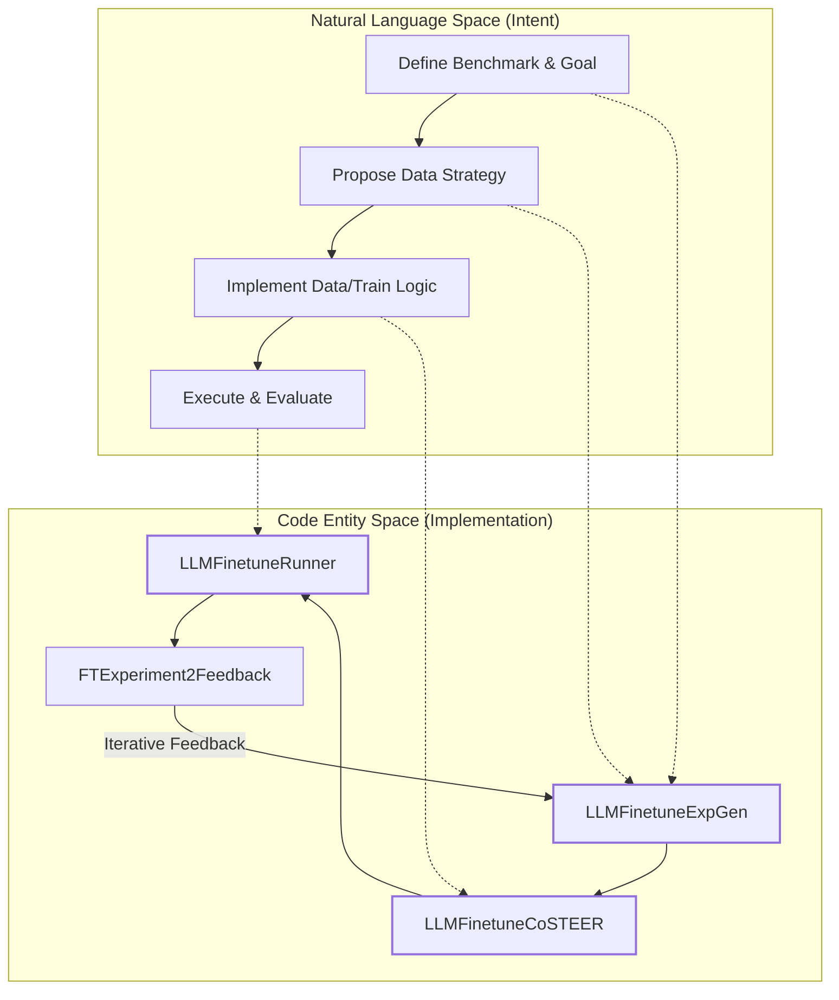

<!-- source: DeepWiki mcp.deepwiki.com · repo microsoft/RD-Agent · page 3.4 LLM Fine-Tuning Scenario · fetched 2026-10-26 -->

# LLM Fine-Tuning Scenario

<details>
<summary>Relevant source files</summary>

The following files were used as context for generating this wiki page:

- [docs/scens/catalog.rst](docs/scens/catalog.rst)
- [docs/scens/finetune.rst](docs/scens/finetune.rst)
- [rdagent/app/finetune/llm/README.md](rdagent/app/finetune/llm/README.md)
- [rdagent/app/finetune/llm/conf.py](rdagent/app/finetune/llm/conf.py)
- [rdagent/app/finetune/llm/job/README.md](rdagent/app/finetune/llm/job/README.md)
- [rdagent/app/finetune/llm/job/run_ft_job.sh](rdagent/app/finetune/llm/job/run_ft_job.sh)
- [rdagent/app/finetune/llm/job/tasks.json.example](rdagent/app/finetune/llm/job/tasks.json.example)
- [rdagent/app/finetune/llm/loop.py](rdagent/app/finetune/llm/loop.py)
- [rdagent/components/benchmark/configs/opencompass_template.yaml](rdagent/components/benchmark/configs/opencompass_template.yaml)
- [rdagent/components/coder/finetune/prompts.yaml](rdagent/components/coder/finetune/prompts.yaml)
- [rdagent/scenarios/finetune/benchmark/benchmark.py](rdagent/scenarios/finetune/benchmark/benchmark.py)
- [rdagent/scenarios/rl/autorl_bench/benchmarks/alfworld/eval.py](rdagent/scenarios/rl/autorl_bench/benchmarks/alfworld/eval.py)
- [rdagent/scenarios/rl/autorl_bench/core/__init__.py](rdagent/scenarios/rl/autorl_bench/core/__init__.py)
- [rdagent/scenarios/rl/autorl_bench/core/evaluator.py](rdagent/scenarios/rl/autorl_bench/core/evaluator.py)
- [rdagent/scenarios/rl/autorl_bench/core/opencompass.py](rdagent/scenarios/rl/autorl_bench/core/opencompass.py)
- [rdagent/scenarios/rl/autorl_bench/core/utils.py](rdagent/scenarios/rl/autorl_bench/core/utils.py)
- [rdagent/scenarios/rl/autorl_bench/test/test_fixes.py](rdagent/scenarios/rl/autorl_bench/test/test_fixes.py)

</details>


The LLM Fine-Tuning scenario, implemented as **FT-Agent**, is an autonomous system designed to optimize Large Language Models through benchmark-driven iteration. It automates the entire lifecycle of fine-tuning, including data processing, training configuration via LlamaFactory, fail-fast validation, and comprehensive evaluation using OpenCompass [docs/scens/finetune.rst:7-13]().

## Overview and Methodology

FT-Agent follows the core RD-Agent methodology by implementing an iterative research loop. It aims to bridge the gap between raw datasets and high-performance models by evolving both the data processing logic and the training hyperparameters based on quantitative feedback [rdagent/app/finetune/llm/README.md:5-11]().

### Supported Benchmarks
The scenario includes specialized adapters for a variety of domains:
| Domain | Benchmarks | Primary Raw Dataset |
| :--- | :--- | :--- |
| **Math** | `aime24`, `aime25` | `deepscaler` |
| **Chemistry** | `chemcotbench_mol_und`, `mol_edit`, `mol_opt`, `reaction` | `chemcot` |
| **Table QA** | `tablebench_data_analysis`, `fact_checking`, etc. | `tableinstruct` |
| **Finance** | `FinanceIQ_gen` | `financeiq` |
| **Patent** | `panorama_par4pc`, `pi4pc`, `noc4pc` | `panorama` |

Sources: [rdagent/app/finetune/llm/README.md:19-28]()

## System Architecture

The scenario is orchestrated by the `LLMFinetuneRDLoop`, which manages the transition between hypothesis generation, coding, and execution.

### Logic Flow: Natural Language to Code Entity Space
The following diagram maps the conceptual fine-tuning steps to the specific code entities responsible for their execution.


Sources: [rdagent/app/finetune/llm/conf.py:18-37](), [rdagent/scenarios/finetune/loop.py:14]()

### Data Flow and Component Interaction
The `LLMFinetuneRDLoop` coordinates the flow of information from the initial benchmark specification to the final evaluation results.

```mermaid
graph LR
    subgraph "Input"
        "FT_RD_SETTING" --> "LLMFinetuneRDLoop"
    end

    subgraph "Loop Components"
        "LLMFinetuneRDLoop" --> "LLMFinetuneExpGen"
        "LLMFinetuneExpGen" -- "Hypothesis" --> "LLMFinetuneCoSTEER"
        "LLMFinetuneCoSTEER" -- "Code (data.json/train.yaml)" --> "LLMFinetuneRunner"
        "LLMFinetuneRunner" -- "Docker/Conda Env" --> "run_benchmark"
    end

    subgraph "Evaluation"
        "run_benchmark" --> "OpenCompass"
        "OpenCompass" --> "FTExperiment2Feedback"
    end
```
Sources: [rdagent/app/finetune/llm/loop.py:93-97](), [rdagent/scenarios/finetune/benchmark/benchmark.py:116-127]()

## Key Components

### 1. Configuration (`LLMFinetunePropSetting`)
The scenario is heavily driven by the `FT_` environment prefix. Key settings include:
- `scen`: The scenario class `LLMFinetuneScen` [rdagent/app/finetune/llm/conf.py:18]().
- `coder`: `LLMFinetuneCoSTEER` for generating training and data scripts [rdagent/app/finetune/llm/conf.py:24]().
- `runner`: `LLMFinetuneRunner` for execution in isolated environments [rdagent/app/finetune/llm/conf.py:29]().
- `judge_model`: LLM used for evaluating complex tasks (e.g., `gpt-5.1`) [rdagent/app/finetune/llm/conf.py:59]().

### 2. Data Coding (`LLMFinetuneCoSTEER`)
The data coder generates Python scripts to transform raw data into the **Alpaca format** (`instruction`, `input`, `output`) [rdagent/components/coder/finetune/prompts.yaml:23-29](). 
- **Debug Mode**: Scripts must support a `--debug` flag to process a small sample (~100 items) for fast validation [rdagent/components/coder/finetune/prompts.yaml:78-82]().
- **Validation**: Includes answer consistency checks and over-length filtering [rdagent/components/coder/finetune/prompts.yaml:54-65]().

### 3. Execution and Evaluation (`run_benchmark`)
The evaluation phase uses **OpenCompass** to run inference on the fine-tuned model.
- **LoRA Support**: Automatically detects LoRA adapters and merges them if the inference engine (e.g., vLLM) requires a full model [rdagent/scenarios/finetune/benchmark/benchmark.py:157-195]().
- **Inference Configuration**: Dynamically loads `tensor_parallel_size` and `max_seq_len` based on the model and available GPUs [rdagent/scenarios/finetune/benchmark/benchmark.py:50-92]().
- **OpenCompass Template**: Generates a configuration file using `VLLMwithChatTemplate` for high-throughput evaluation [rdagent/components/benchmark/configs/opencompass_template.yaml:50-62]().

## Execution Entry Points

### Single Task
Users can trigger a fine-tuning loop via the CLI:
```bash
rdagent llm_finetune --base-model Qwen/Qwen2.5-7B-Instruct --benchmark aime25
```
This calls the `main` function in `rdagent/app/finetune/llm/loop.py` [rdagent/app/finetune/llm/loop.py:17-30]().

### Batch Job Runner
For multi-GPU machines, `run_ft_job.sh` allows running multiple benchmarks in parallel using `tmux` sessions [rdagent/app/finetune/llm/job/run_ft_job.sh:2-12]().
- **Task Definition**: Uses a `tasks.json` file to specify models, benchmarks, and GPU allocation [rdagent/app/finetune/llm/job/tasks.json.example:1-8]().
- **Resource Isolation**: Sets `CUDA_VISIBLE_DEVICES` per task to prevent GPU contention [rdagent/app/finetune/llm/job/run_ft_job.sh:128]().

Sources: [rdagent/app/finetune/llm/loop.py](), [rdagent/app/finetune/llm/job/run_ft_job.sh]()

---

