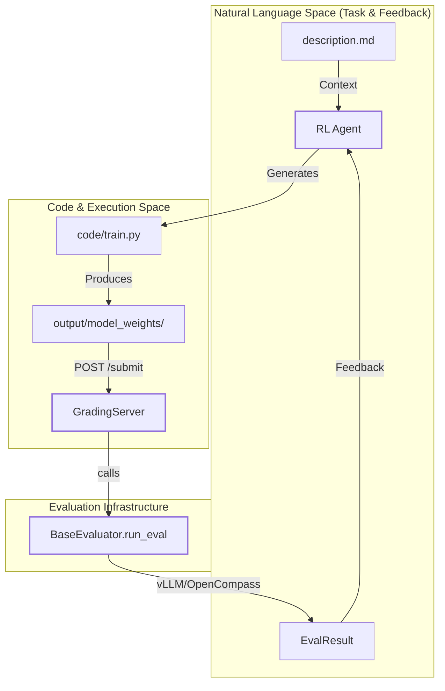
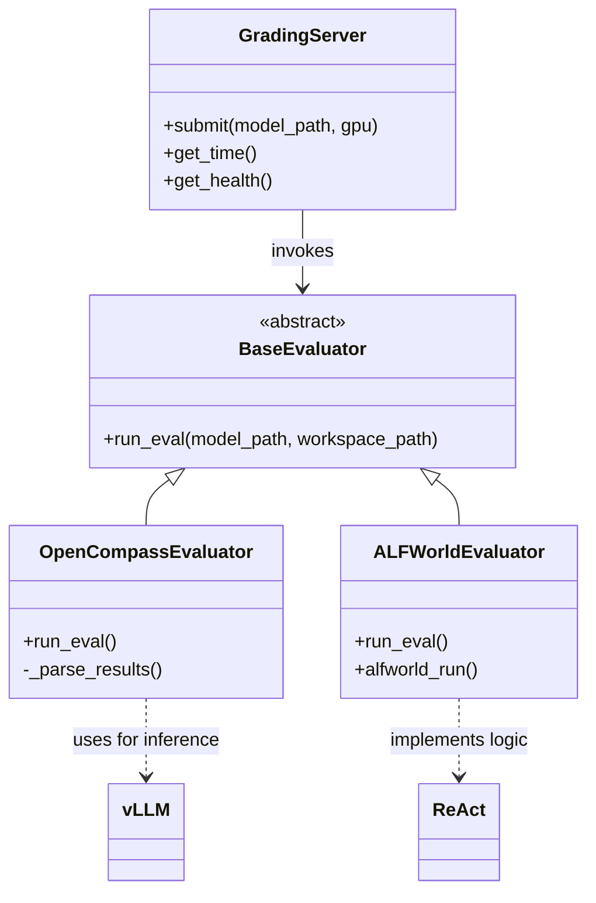

<!-- source: DeepWiki mcp.deepwiki.com · repo microsoft/RD-Agent · page 3.5 RL Post-Training Scenario · fetched 2026-10-26 -->

# RL Post-Training Scenario

Relevant source files

The following files were used as context for generating this wiki page:

- [rdagent/components/benchmark/configs/opencompass_template.yaml](rdagent/components/benchmark/configs/opencompass_template.yaml)
- [rdagent/scenarios/rl/autorl_bench/benchmarks/__init__.py](rdagent/scenarios/rl/autorl_bench/benchmarks/__init__.py)
- [rdagent/scenarios/rl/autorl_bench/benchmarks/alfworld/eval.py](rdagent/scenarios/rl/autorl_bench/benchmarks/alfworld/eval.py)
- [rdagent/scenarios/rl/autorl_bench/benchmarks/deepsearchqa/data.py](rdagent/scenarios/rl/autorl_bench/benchmarks/deepsearchqa/data.py)
- [rdagent/scenarios/rl/autorl_bench/benchmarks/deepsearchqa/description.md](rdagent/scenarios/rl/autorl_bench/benchmarks/deepsearchqa/description.md)
- [rdagent/scenarios/rl/autorl_bench/benchmarks/deepsearchqa/eval.py](rdagent/scenarios/rl/autorl_bench/benchmarks/deepsearchqa/eval.py)
- [rdagent/scenarios/rl/autorl_bench/core/__init__.py](rdagent/scenarios/rl/autorl_bench/core/__init__.py)
- [rdagent/scenarios/rl/autorl_bench/core/evaluator.py](rdagent/scenarios/rl/autorl_bench/core/evaluator.py)
- [rdagent/scenarios/rl/autorl_bench/core/instructions.md](rdagent/scenarios/rl/autorl_bench/core/instructions.md)
- [rdagent/scenarios/rl/autorl_bench/core/opencompass.py](rdagent/scenarios/rl/autorl_bench/core/opencompass.py)
- [rdagent/scenarios/rl/autorl_bench/core/utils.py](rdagent/scenarios/rl/autorl_bench/core/utils.py)
- [rdagent/scenarios/rl/autorl_bench/test/test_fixes.py](rdagent/scenarios/rl/autorl_bench/test/test_fixes.py)

The RL Post-Training scenario, also known as **AutoRL-Bench**, is a framework within RD-Agent designed for the autonomous optimization of Large Language Models (LLMs) through Reinforcement Learning. It provides a standardized environment where agents can perform Supervised Fine-Tuning (SFT), Proximal Policy Optimization (PPO), or Group Relative Policy Optimization (GRPO) to improve model performance on complex benchmarks.

## Overview and Loop Architecture

The scenario is orchestrated by the `RLPostTrainingRDLoop`, which manages the lifecycle of an RL experiment. Unlike traditional data science loops that focus on feature engineering, this loop focuses on the iteration of training code and model weights.

### Key Components
- **GradingServer**: A centralized service that handles model evaluation requests, GPU resource allocation, and score tracking [rdagent/scenarios/rl/autorl_bench/core/server.py:1-10]().
- **Evaluators**: Benchmark-specific classes that implement the `BaseEvaluator` interface to provide objective performance metrics [rdagent/scenarios/rl/autorl_bench/core/evaluator.py:54-140]().
- **Benchmark Adapters**: Integrations for various tasks including `GSM8K`, `HumanEval`, `AlfWorld`, and `DeepSearchQA` [rdagent/scenarios/rl/autorl_bench/benchmarks/__init__.py:38-106]().

### RL Post-Training Data Flow
The following diagram illustrates the flow from the RL Agent's code generation to the evaluation via the `GradingServer`.

**RL Post-Training System Flow**

Sources: [rdagent/scenarios/rl/autorl_bench/core/instructions.md:60-65](), [rdagent/scenarios/rl/autorl_bench/core/evaluator.py:116-138](), [rdagent/scenarios/rl/autorl_bench/core/server.py:32-33]()

---

## Benchmark Adapters and Evaluators

The system supports a diverse set of benchmarks, ranging from static reasoning tasks to interactive environments.

### OpenCompassEvaluator
For benchmarks like `GSM8K` and `HumanEval`, the system leverages the `OpenCompassEvaluator`. It dynamically generates an OpenCompass configuration using a Jinja2 template [rdagent/components/benchmark/configs/opencompass_template.yaml:4-118]() and executes the evaluation using the `opencompass` CLI [rdagent/scenarios/rl/autorl_bench/core/opencompass.py:99-109]().

### Interactive Benchmarks (AlfWorld & DeepSearchQA)
Interactive benchmarks require a stateful loop where the model acts as an agent.
- **AlfWorld**: Uses a `ReAct` agent pattern to interact with a text-based game environment [rdagent/scenarios/rl/autorl_bench/benchmarks/alfworld/eval.py:89-118]().
- **DeepSearchQA**: Implements a multi-step search-and-reasoning loop, utilizing search tools (e.g., DuckDuckGo) and an LLM Judge for scoring [rdagent/scenarios/rl/autorl_bench/benchmarks/deepsearchqa/eval.py:185-210]().

| Benchmark | Type | Evaluator Class | Primary Metric |
| :--- | :--- | :--- | :--- |
| `gsm8k` | Static Reasoning | `OpenCompassEvaluator` | Accuracy |
| `humaneval` | Code Generation | `OpenCompassEvaluator` | Pass@1 |
| `alfworld` | Interactive RL | `ALFWorldEvaluator` | Success Rate |
| `deepsearchqa` | RAG / Search | `DeepSearchQAEvaluator` | LLM Judge Score |

Sources: [rdagent/scenarios/rl/autorl_bench/benchmarks/__init__.py:38-106](), [rdagent/scenarios/rl/autorl_bench/core/opencompass.py:22-29](), [rdagent/scenarios/rl/autorl_bench/benchmarks/deepsearchqa/eval.py:49-60]()

---

## GradingServer Architecture

The `GradingServer` acts as the bridge between the RL Agent's workspace and the high-performance evaluation environment. It provides a REST API for model submission and status querying.

### Implementation Details
The server is created via `create_grading_server`, which sets up a context-managed environment for evaluation [rdagent/scenarios/rl/autorl_bench/core/server.py:32-33]().

**Key API Endpoints:**
- `POST /submit`: Receives a `model_path` and optional `gpu` IDs. It triggers the benchmark's `run_eval` method [rdagent/scenarios/rl/autorl_bench/core/instructions.md:69-83]().
- `GET /time`: Returns the remaining budget based on `run_meta.json` [rdagent/scenarios/rl/autorl_bench/core/instructions.md:84-85]().
- `GET /health`: Reports available GPU resources [rdagent/scenarios/rl/autorl_bench/core/instructions.md:87-88]().

### GPU and Process Management
To ensure reliability, the system includes robust process management. The `kill_process_tree` function is used to clean up evaluation processes (like vLLM workers) that may hang or leak memory [rdagent/scenarios/rl/autorl_bench/core/utils.py:28-79]().

**Component Association: Code to Architecture**

Sources: [rdagent/scenarios/rl/autorl_bench/core/evaluator.py:54-140](), [rdagent/scenarios/rl/autorl_bench/core/opencompass.py:22-42](), [rdagent/scenarios/rl/autorl_bench/benchmarks/alfworld/eval.py:217-220](), [rdagent/scenarios/rl/autorl_bench/core/server.py:32-33]()

---

## Data Management and Workspace

The RL Agent operates within a restricted workspace. All interactions with data and models must use relative paths [rdagent/scenarios/rl/autorl_bench/core/instructions.md:33-49]().

### Data Splitting and Persistence
Benchmarks often require deterministic data splits to prevent data leakage during RL. For example, `DeepSearchQA` implements a `split_dataset` function that creates a fixed 100/200 train/eval split from the source HuggingFace dataset [rdagent/scenarios/rl/autorl_bench/benchmarks/deepsearchqa/data.py:22-29]().

### Baseline Scoring
The system maintains a baseline score for each task/model combination. The `get_baseline_score` function checks a local cache before running an evaluation to save time and compute resources [rdagent/scenarios/rl/autorl_bench/core/utils.py:183-201]().

### Submission Constraints
1. **Full Model Requirement**: LoRA adapters are rejected; agents must merge weights before submission [rdagent/scenarios/rl/autorl_bench/core/opencompass.py:69-79]().
2. **Tokenizer Cleanup**: Agents are instructed to clean up `tokenizer_config.json` (specifically `extra_special_tokens`) to ensure compatibility with vLLM [rdagent/scenarios/rl/autorl_bench/core/instructions.md:113-115]().

Sources: [rdagent/scenarios/rl/autorl_bench/core/utils.py:103-116](), [rdagent/scenarios/rl/autorl_bench/benchmarks/deepsearchqa/data.py:32-54](), [rdagent/scenarios/rl/autorl_bench/core/opencompass.py:69-79]()

---

