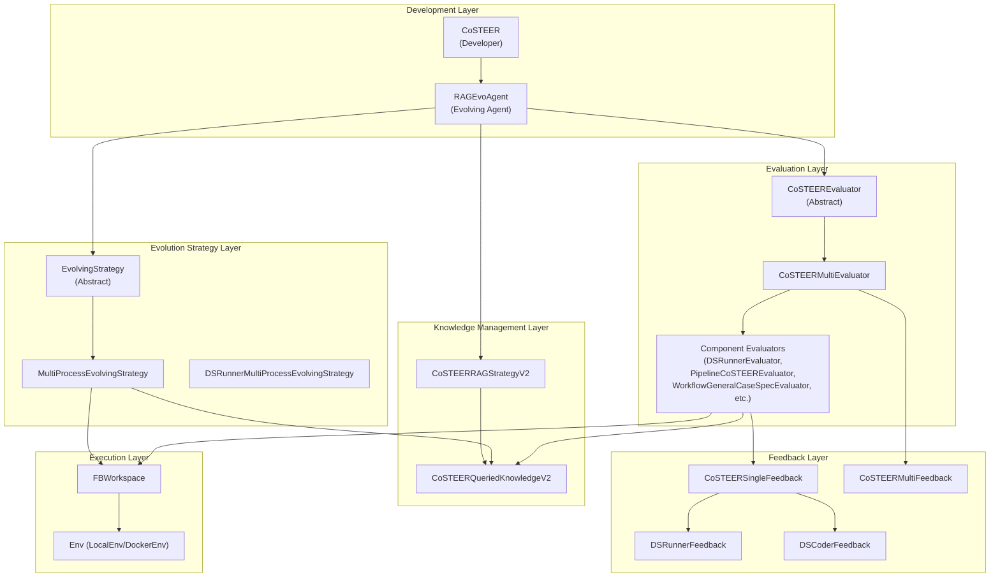
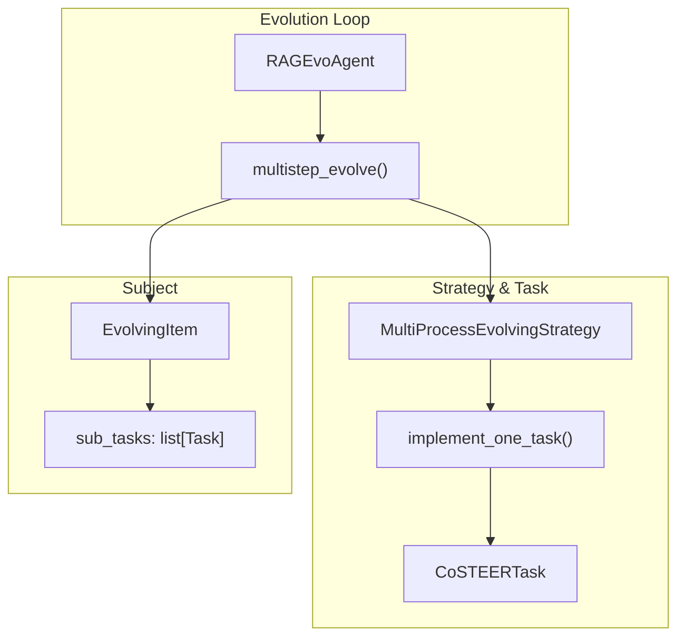
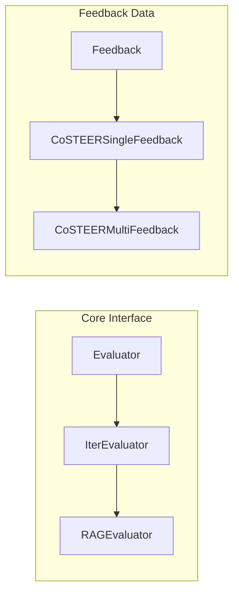

<!-- source: DeepWiki mcp.deepwiki.com · repo microsoft/RD-Agent · page 4 Components and Implementation · fetched 2026-10-26 -->

# Components and Implementation

Relevant source files

The following files were used as context for generating this wiki page:

- [rdagent/components/coder/CoSTEER/evaluators.py](rdagent/components/coder/CoSTEER/evaluators.py)
- [rdagent/components/coder/CoSTEER/evolvable_subjects.py](rdagent/components/coder/CoSTEER/evolvable_subjects.py)
- [rdagent/components/coder/CoSTEER/evolving_strategy.py](rdagent/components/coder/CoSTEER/evolving_strategy.py)
- [rdagent/components/coder/factor_coder/factor.py](rdagent/components/coder/factor_coder/factor.py)
- [rdagent/components/coder/model_coder/model.py](rdagent/components/coder/model_coder/model.py)
- [rdagent/core/evaluation.py](rdagent/core/evaluation.py)
- [rdagent/core/evolving_agent.py](rdagent/core/evolving_agent.py)
- [rdagent/core/evolving_framework.py](rdagent/core/evolving_framework.py)

This page provides a detailed examination of the core implementation components that power RD-Agent's automated R&D workflow. These components form the foundation upon which all scenario-specific implementations are built. We cover the **CoSTEER code evolution framework**, the **evaluation and feedback systems** that validate generated code, the **knowledge management infrastructure** for learning from past experiments, and the **prompt template system** that structures LLM interactions.

For scenario-specific implementations that use these components, see [Scenarios and Applications](#3). For the higher-level workflow orchestration, see [R&D Loop Framework](#2.1). For execution environment details, see [Environment and Execution System](#2.3).

---

## Overview of Component Architecture

The implementation components follow a layered architecture where abstract base classes define interfaces and concrete implementations provide scenario-specific behavior.

**Component Interaction Flow**

Sources: [rdagent/core/evolving_agent.py:78-118](), [rdagent/components/coder/CoSTEER/evolving_strategy.py:22-58](), [rdagent/components/coder/CoSTEER/evaluators.py:31-83]()

---

## 4.1 CoSTEER Framework

The **CoSTEER (Code Structure Evolution with Evaluation and Refinement)** framework is the core code generation and evolution system. It implements an iterative improvement loop where code is generated, evaluated, and refined based on feedback.

### Core CoSTEER Architecture

The framework relies on the interaction between `EvolvingStrategy`, `RAGEvoAgent`, and `EvolvingItem`.

**CoSTEER Evolution Flow**

Sources: [rdagent/core/evolving_agent.py:140-171](), [rdagent/components/coder/CoSTEER/evolving_strategy.py:108-171](), [rdagent/components/coder/CoSTEER/evolvable_subjects.py:6-32]()

### Evolving Strategy Implementation

The `MultiProcessEvolvingStrategy` provides a base for parallel code evolution. It iterates through sub-tasks and uses a `multiprocessing_wrapper` to call `implement_one_task` for each pending item [rdagent/components/coder/CoSTEER/evolving_strategy.py:152-171]().

**Key Strategy Behaviors:**
1. **Knowledge Integration**: Before implementation, it checks `queried_knowledge` to see if a task has already succeeded or failed [rdagent/components/coder/CoSTEER/evolving_strategy.py:129-145]().
2. **In-place Modification**: Modifications are applied directly to the `EvolvingItem` workspaces via `assign_code_list_to_evo` [rdagent/components/coder/CoSTEER/evolving_strategy.py:86-107]().
3. **Iterative Feedback**: Each step receives `prev_task_feedback` from the previous evolution loop to guide refinement [rdagent/components/coder/CoSTEER/evolving_strategy.py:30-58]().

For details, see [CoSTEER Framework](#4.1).

---

## 4.2 Evaluation and Feedback Systems

The evaluation system validates generated code through execution and structured feedback. RD-Agent uses iterative evaluators that yield feedback at each step of the evolution process.

### Evaluator and Feedback Structure

**Evaluation Class Hierarchy**

Sources: [rdagent/core/evaluation.py:8-58](), [rdagent/core/evolving_framework.py:94-138](), [rdagent/components/coder/CoSTEER/evaluators.py:31-83]()

**Feedback Components:**
- **Execution**: Summarized stdout/stderr from the environment [rdagent/components/coder/CoSTEER/evaluators.py:42]().
- **Return Checking**: Validation of the values generated by the code (e.g., shapes, types) [rdagent/components/coder/CoSTEER/evaluators.py:44]().
- **Final Decision**: A boolean indicating if the implementation is successful [rdagent/components/coder/CoSTEER/evaluators.py:47]().

For details, see [Evaluation and Feedback Systems](#4.2).

---

## 4.3 Knowledge Management and RAG

Knowledge management allows RD-Agent to learn from past iterations and avoid repeating errors.

### Knowledge Objects

- **EvolvingKnowledgeBase**: A specialized knowledge base that supports querying for `QueriedKnowledge` [rdagent/core/evolving_framework.py:25-32]().
- **EvoStep**: A container that records the state of `EvolvableSubjects`, the knowledge used, and the feedback received at a specific point in time [rdagent/core/evolving_framework.py:43-58]().
- **RAGStrategy**: Manages the lifecycle of knowledge, including loading, querying, generating new knowledge from traces, and dumping updates [rdagent/core/evolving_framework.py:141-188]().

For details, see [Knowledge Management and RAG](#4.3).

---

## 4.4 Prompt Templates and LLM Interactions

RD-Agent uses a structured prompt system (often referred to as `tpl.T`) to manage complex LLM interactions.

### Interaction Patterns
- **Pydantic-based Outputs**: Many evaluators use Pydantic models to ensure the LLM returns structured JSON that can be reliably parsed into Feedback objects [rdagent/components/coder/CoSTEER/evaluators.py:53-83]().
- **Session Management**: Interactions are often handled within sessions to maintain context during iterative refinement.
- **Task Information**: The `Task.get_task_information()` method provides the primary textual context for the LLM [rdagent/components/coder/factor_coder/factor.py:48-52]().

For details, see [Prompt Templates and LLM Interactions](#4.4).

---

## 4.5 Factor and Model Coders

Factor and Model coders are specialized components for quantitative finance and data science tasks. They implement the `CoSTEERTask` and `FBWorkspace` patterns.

### Specialized Tasks and Workspaces

| Component | Task Class | Workspace Class | Purpose |
|-----------|------------|-----------------|---------|
| **Factor Coder** | `FactorTask` | `FactorFBWorkspace` | Implements financial factors/features [rdagent/components/coder/factor_coder/factor.py:20-107]() |
| **Model Coder** | `ModelTask` | `ModelFBWorkspace` | Implements ML model architectures [rdagent/components/coder/model_coder/model.py:15-113]() |

**Execution Logic:**
- `FactorFBWorkspace.execute()` links source data, writes `factor.py`, and runs it via a Python binary [rdagent/components/coder/factor_coder/factor.py:107-170]().
- `ModelFBWorkspace.execute()` uses specialized environments like `QTDockerEnv` or `KGDockerEnv` to run model code and capture serialized outputs (`.pkl`) [rdagent/components/coder/model_coder/model.py:116-150]().

For details, see [Factor and Model Coders](#4.5).

---

