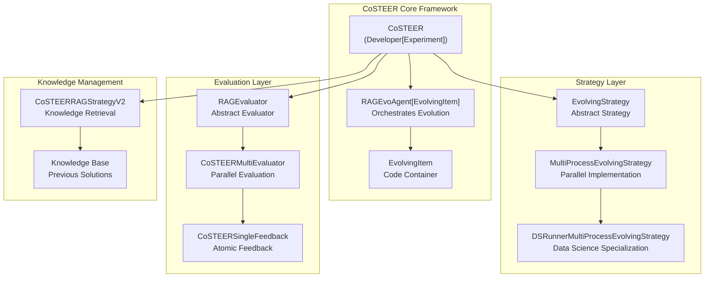
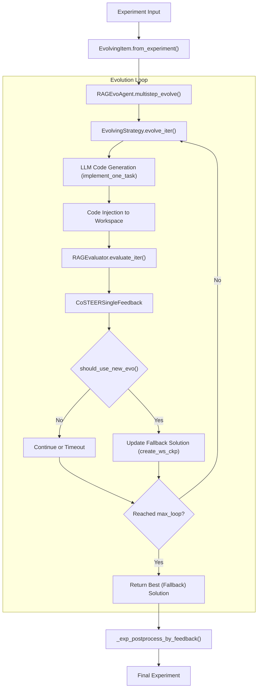
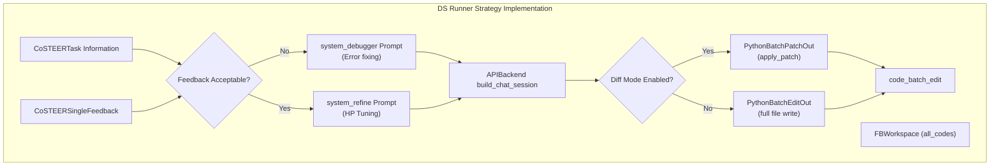

<!-- source: DeepWiki mcp.deepwiki.com · repo microsoft/RD-Agent · page 4.1 CoSTEER Framework · fetched 2026-10-26 -->

# CoSTEER Framework

Relevant source files

The following files were used as context for generating this wiki page:

- [rdagent/components/coder/CoSTEER/__init__.py](rdagent/components/coder/CoSTEER/__init__.py)
- [rdagent/components/coder/CoSTEER/config.py](rdagent/components/coder/CoSTEER/config.py)
- [rdagent/components/coder/CoSTEER/evaluators.py](rdagent/components/coder/CoSTEER/evaluators.py)
- [rdagent/components/coder/CoSTEER/evolvable_subjects.py](rdagent/components/coder/CoSTEER/evolvable_subjects.py)
- [rdagent/components/coder/CoSTEER/evolving_strategy.py](rdagent/components/coder/CoSTEER/evolving_strategy.py)
- [rdagent/components/coder/data_science/share/ds_costeer.py](rdagent/components/coder/data_science/share/ds_costeer.py)
- [rdagent/core/evaluation.py](rdagent/core/evaluation.py)
- [rdagent/core/evolving_agent.py](rdagent/core/evolving_agent.py)
- [rdagent/core/evolving_framework.py](rdagent/core/evolving_framework.py)
- [rdagent/scenarios/data_science/dev/runner/__init__.py](rdagent/scenarios/data_science/dev/runner/__init__.py)
- [rdagent/scenarios/data_science/dev/runner/prompts.yaml](rdagent/scenarios/data_science/dev/runner/prompts.yaml)
- [rdagent/utils/prompts.yaml](rdagent/utils/prompts.yaml)
- [rdagent/utils/workflow/tracking.py](rdagent/utils/workflow/tracking.py)

## Purpose and Scope

The CoSTEER (Code-oriented Self-improving Testing, Execution, and Evaluation with Retrieval) Framework is RD-Agent's core system for automated iterative code evolution. It implements a closed-loop development cycle where code is generated, executed in isolated environments, evaluated against task-specific criteria, and refined based on feedback and retrieved knowledge. This framework serves as the backbone for the "Coder" stage in the RD-Agent lifecycle.

## Framework Architecture Overview

The CoSTEER framework is built on the `Developer` abstraction and coordinates several specialized components to manage the evolution of code entities.

### Core Framework Components

**Sources:** [rdagent/components/coder/CoSTEER/__init__.py:20-67](), [rdagent/core/evolving_agent.py:78-119](), [rdagent/components/coder/CoSTEER/evaluators.py:31-52]()

### Iterative Development Process

The `CoSTEER.develop` method initiates the `RAGEvoAgent` to perform a multi-step evolution. Each step involves querying knowledge, evolving the code via a strategy, and evaluating the result.

**Sources:** [rdagent/components/coder/CoSTEER/__init__.py:93-155](), [rdagent/core/evolving_agent.py:140-185]()

## Code Generation and Evolution Strategy

### Multi-Process Evolving Strategy

The `MultiProcessEvolvingStrategy` enables parallel development of multiple sub-tasks (e.g., different features or models) within a single experiment. It uses `multiprocessing_wrapper` to call implementation functions concurrently.

| Key Method | Description |
|------------|-------------|
| `evolve_iter` | Orchestrates the iteration by identifying tasks to implement and calling implementation functions. [rdagent/components/coder/CoSTEER/evolving_strategy.py:108-175]() |
| `implement_one_task` | Abstract method for LLM-based code generation for a single task. [rdagent/components/coder/CoSTEER/evolving_strategy.py:30-59]() |
| `assign_code_list_to_evo` | Injects the generated code back into the `FBWorkspace` of the evolving item. [rdagent/components/coder/CoSTEER/evolving_strategy.py:86-106]() |

**Sources:** [rdagent/components/coder/CoSTEER/evolving_strategy.py:22-175]()

### Data Science Specialization

The `DSRunnerMultiProcessEvolvingStrategy` implements the iterative refinement logic specifically for Data Science workflows, choosing between debugging and refinement modes.

**Sources:** [rdagent/scenarios/data_science/dev/runner/__init__.py:42-114]()

## Evaluation and Feedback System

### CoSTEER Feedback Structure

The framework relies on structured feedback to decide whether to accept a code version or continue evolving.

*   **CoSTEERSingleFeedback**: Contains fields for `execution` (stdout/stderr), `return_checking` (validation of outputs), and `code` (quality assessment). [rdagent/components/coder/CoSTEER/evaluators.py:32-52]()
*   **Acceptance Logic**: The `final_decision` boolean determines if the code is valid. [rdagent/components/coder/CoSTEER/evaluators.py:47-52]()
*   **Merging**: `CoSTEERSingleFeedback.merge` allows aggregating feedback from multiple evaluators into a single object. [rdagent/components/coder/CoSTEER/evaluators.py:86-108]()

### DSCoSTEERRunner and Specialized Evaluation

The `DSCoSTEERRunner` is a specialized `CoSTEER` instance used in the Data Science scenario. It configures the loop with `DSRunnerEvaluator` and optionally `ModelDumpEvaluator`.

| Component | Role |
|-----------|------|
| `DSRunnerEvaluator` | Executes the DS workflow and uses LLM to parse stdout/results against `DSCoSTEER_eval` prompts. [rdagent/scenarios/data_science/dev/runner/__init__.py:147-152]() |
| `ModelDumpEvaluator` | Persists model artifacts if `enable_model_dump` is set. [rdagent/scenarios/data_science/dev/runner/__init__.py:148-149]() |
| `DSRunnerCoSTEERSettings` | Manages environment-specific settings like `diff_mode` and `env_type` (docker/conda). [rdagent/scenarios/data_science/dev/runner/__init__.py:29-38]() |

**Sources:** [rdagent/scenarios/data_science/dev/runner/__init__.py:135-167]()

## Iterative Refinement Patterns

### Diff Mode vs. Full Edit
CoSTEER supports two modes for updating the codebase:
1.  **Full Edit**: The LLM provides the complete content of the file. Extracted via `PythonBatchEditOut`. [rdagent/scenarios/data_science/dev/runner/__init__.py:62-63]()
2.  **Diff Mode**: The LLM provides patches. Extracted via `PythonBatchPatchOut`. This is more token-efficient for large files. [rdagent/scenarios/data_science/dev/runner/__init__.py:58-60]()

### Fallback Mechanism
During the `multistep_evolve` loop, CoSTEER maintains a "fallback" solution. If a new iteration produces an "acceptable" result (based on `should_use_new_evo`), the framework creates a workspace checkpoint (`create_ws_ckp`). If the loop finishes or times out without a better result, it recovers the best known checkpoint.

**Sources:** [rdagent/components/coder/CoSTEER/__init__.py:120-146]()

### Hyperparameter Tuning (HPT)
In the Data Science runner, if the previous execution was successful (`acceptable is True`), the strategy switches to `system_refine`. This prompt instructs the LLM to tune hyperparameters (e.g., `n_estimators`, `learning_rate`) based on the `hyperparameter_tuning_suggestion` provided by the evaluator.

**Sources:** [rdagent/scenarios/data_science/dev/runner/__init__.py:74-78](), [rdagent/scenarios/data_science/dev/runner/prompts.yaml:30-50]()

## Configuration

CoSTEER behavior is controlled via `CoSTEERSettings`.

| Setting | Default | Description |
|---------|---------|-------------|
| `max_loop` | 10 | Maximum number of refinement iterations. [rdagent/components/coder/CoSTEER/config.py:15]() |
| `evolving_version` | 2 | Selection between RAG Strategy V1 and V2. [rdagent/components/coder/CoSTEER/__init__.py:49]() |
| `knowledge_base_path` | None | Path to load historical successful implementations. [rdagent/components/coder/CoSTEER/config.py:30]() |
| `diff_mode` | False | Whether to use patch-based updates. [rdagent/scenarios/data_science/dev/runner/__init__.py:37]() |

**Sources:** [rdagent/components/coder/CoSTEER/config.py:6-42](), [rdagent/scenarios/data_science/dev/runner/__init__.py:29-38]()

---

