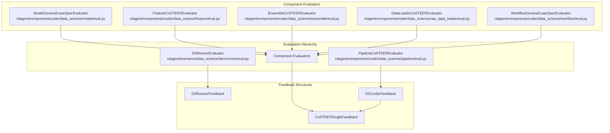
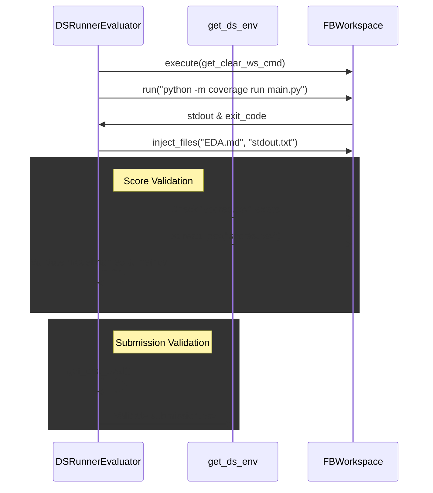

<!-- source: DeepWiki mcp.deepwiki.com · repo microsoft/RD-Agent · page 4.2 Evaluation and Feedback Systems · fetched 2026-10-26 -->

# Evaluation and Feedback Systems

<details>
<summary>Relevant source files</summary>

The following files were used as context for generating this wiki page:

- [rdagent/components/coder/CoSTEER/knowledge_management.py](rdagent/components/coder/CoSTEER/knowledge_management.py)
- [rdagent/components/coder/data_science/ensemble/eval.py](rdagent/components/coder/data_science/ensemble/eval.py)
- [rdagent/components/coder/data_science/feature/eval.py](rdagent/components/coder/data_science/feature/eval.py)
- [rdagent/components/coder/data_science/model/eval.py](rdagent/components/coder/data_science/model/eval.py)
- [rdagent/components/coder/data_science/pipeline/eval.py](rdagent/components/coder/data_science/pipeline/eval.py)
- [rdagent/components/coder/data_science/raw_data_loader/eval.py](rdagent/components/coder/data_science/raw_data_loader/eval.py)
- [rdagent/components/coder/data_science/workflow/eval.py](rdagent/components/coder/data_science/workflow/eval.py)
- [rdagent/components/coder/model_coder/eva_utils.py](rdagent/components/coder/model_coder/eva_utils.py)
- [rdagent/components/coder/model_coder/evaluators.py](rdagent/components/coder/model_coder/evaluators.py)
- [rdagent/components/coder/model_coder/prompts.yaml](rdagent/components/coder/model_coder/prompts.yaml)
- [rdagent/components/coder/model_coder/task_loader.py](rdagent/components/coder/model_coder/task_loader.py)
- [rdagent/scenarios/data_science/dev/runner/eval.py](rdagent/scenarios/data_science/dev/runner/eval.py)
- [rdagent/scenarios/kaggle/developer/coder.py](rdagent/scenarios/kaggle/developer/coder.py)
- [test/notebook/test_notebook_converter.py](test/notebook/test_notebook_converter.py)

</details>


This document covers the evaluation and feedback systems in RD-Agent, which assess code quality, execution correctness, and performance across different stages of the R&D process. The evaluation system operates at multiple levels: component-level validation during development, runner-level assessment during execution, and experiment-level feedback generation for iterative improvement.

## Evaluation Architecture

The evaluation system in RD-Agent is built around a hierarchical architecture that provides feedback at different granularities and stages of the development process.

Title: Evaluation Hierarchy and Feedback Flow

**Sources:** [rdagent/scenarios/data_science/dev/runner/eval.py:72-81](), [rdagent/components/coder/data_science/pipeline/eval.py:123-132](), [rdagent/components/coder/CoSTEER/evaluators.py:1-15]()

## Core Evaluation Framework

All evaluators inherit from `CoSTEEREvaluator` and return feedback objects that extend `CoSTEERSingleFeedback`. This provides a consistent interface across different evaluation contexts.

### Base Evaluator Interface

The core evaluation method signature is standardized across all evaluators:

```python
def evaluate(
    self,
    target_task: Task,
    implementation: FBWorkspace,
    gt_implementation: FBWorkspace,
    queried_knowledge: QueriedKnowledge = None,
    **kwargs,
) -> CoSTEERSingleFeedback
```
**Sources:** [rdagent/components/coder/CoSTEER/evaluators.py:1-15](), [rdagent/scenarios/data_science/dev/runner/eval.py:74-81]()

### Feedback Structure

All feedback objects contain several key assessment dimensions:

| Field | Purpose | Example Content |
|-------|---------|-----------------|
| `execution` | Runtime execution status | "Code executed successfully", "RuntimeError in model training" |
| `return_checking` | Output format validation | "Submission file format correct", "Missing scores.csv file" |
| `code` | Code quality assessment | "Clean implementation follows best practices" |
| `final_decision` | Overall acceptance status | `True` if passed all checks, `False` otherwise |

**Sources:** [rdagent/components/coder/CoSTEER/evaluators.py:1-15](), [rdagent/scenarios/data_science/dev/runner/eval.py:33-67]()

## Component-Level Evaluators

Component evaluators validate individual parts of the solution. They typically inject specialized test scripts into the workspace and run them using `FBWorkspace.run`.

### Model Evaluator
The `ModelGeneralCaseSpecEvaluator` tests model implementations by reading a template from `model_test.txt`, replacing placeholders with the task name, and executing it. It also checks if the model integrates with `main.py`.
**Sources:** [rdagent/components/coder/data_science/model/eval.py:29-124]()

### Feature Evaluator
The `FeatureCoSTEEREvaluator` validates feature engineering implementations by injecting `test/feature_test.py` and checking the exit code of the execution.
**Sources:** [rdagent/components/coder/data_science/feature/eval.py:19-81]()

### Ensemble Evaluator
The `EnsembleCoSTEEREvaluator` uses a Jinja2 template to generate `test/ensemble_test.txt`. It dynamically includes model names found in the implementation workspace to verify the ensemble logic.
**Sources:** [rdagent/components/coder/data_science/ensemble/eval.py:24-101]()

### Data Loader Evaluator
The `DataLoaderCoSTEEREvaluator` validates data loading and EDA generation. It specifically looks for EDA output markers in the stdout: `=== Start of EDA part ===` and `=== End of EDA part ===`.
**Sources:** [rdagent/components/coder/data_science/raw_data_loader/eval.py:26-95]()

### Workflow Evaluator
The `WorkflowGeneralCaseSpecEvaluator` ensures the entry point `main.py` is correctly implemented. It uses `coverage` to verify which scripts were actually executed during the run.
**Sources:** [rdagent/components/coder/data_science/workflow/eval.py:27-158]()

## Runner Evaluation System

The `DSRunnerEvaluator` provides comprehensive evaluation of the complete solution execution, including performance assessment and hyperparameter tuning suggestions.

Title: Runner Execution and Validation Flow

**Sources:** [rdagent/scenarios/data_science/dev/runner/eval.py:72-165]()

### Hyperparameter Tuning Logic

The evaluator includes logic for determining when to suggest hyperparameter improvements based on remaining time and resource ratios.

```python
# Conditions for enabling hyperparameter tuning check
c1 = len(queried_knowledge.task_to_former_failed_traces[task_info][0]) == 0
c2 = time_spent_ratio < DS_RD_SETTING.time_ratio_limit_to_enable_hyperparameter_tuning
c3 = res_time <= timedelta(hours=DS_RD_SETTING.merge_hours)
c4 = res_ratio <= DS_RD_SETTING.res_time_ratio_limit_to_enable_hyperparameter_tuning
```
**Sources:** [rdagent/scenarios/data_science/dev/runner/eval.py:172-199]()

## Pipeline and Advanced Feedback

### Pipeline Evaluator
The `PipelineCoSTEEREvaluator` provides comprehensive evaluation with advanced features:
- **Documentation Search**: If an implementation fails, it can set `requires_documentation_search` in `DSCoderFeedback`. This triggers a `DocAgent` (Context7) search to find relevant API documentation.
- **Error Analysis**: It captures and merges error messages from multiple feedback iterations.
**Sources:** [rdagent/components/coder/data_science/pipeline/eval.py:32-153](), [rdagent/components/coder/data_science/pipeline/eval.py:307-333]()

### Notebook Converter
RD-Agent includes a `NotebookConverter` utility that transforms Python scripts into Jupyter Notebooks for better visualization.
- **Validation**: It ensures the code has a `main` function and section dividers like `print("Section: <name>")`.
- **Transformation**: It converts code comments preceding sections into Markdown cells and maintains the execution order.
- **Argparse Support**: It injects a `sys.argv` hack to allow scripts using `argparse` to run within the notebook environment.
**Sources:** [rdagent/components/coder/data_science/share/notebook.py](), [test/notebook/test_notebook_converter.py:18-182]()

## Model Coder Specialized Evaluation
For quantitative finance scenarios, the system uses `ModelCoSTEEREvaluator` which performs:
1. **Shape Evaluation**: Compares `prediction.shape` against `target_shape` (e.g., `(batch_size, output_channel)`).
2. **Value Evaluation**: Calculates the Mean Absolute Difference (MAD) between model output and ground truth.
3. **LLM-based Code Feedback**: Uses `ModelCodeEvaluator` and `ModelFinalEvaluator` to generate natural language critiques of the implementation.
**Sources:** [rdagent/components/coder/model_coder/evaluators.py:20-105](), [rdagent/components/coder/model_coder/eva_utils.py:15-50]()

---

