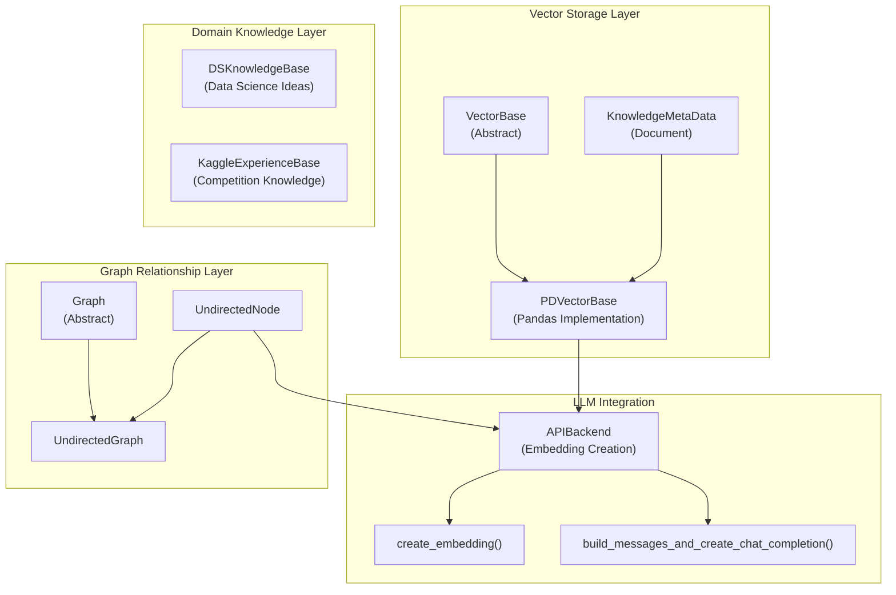
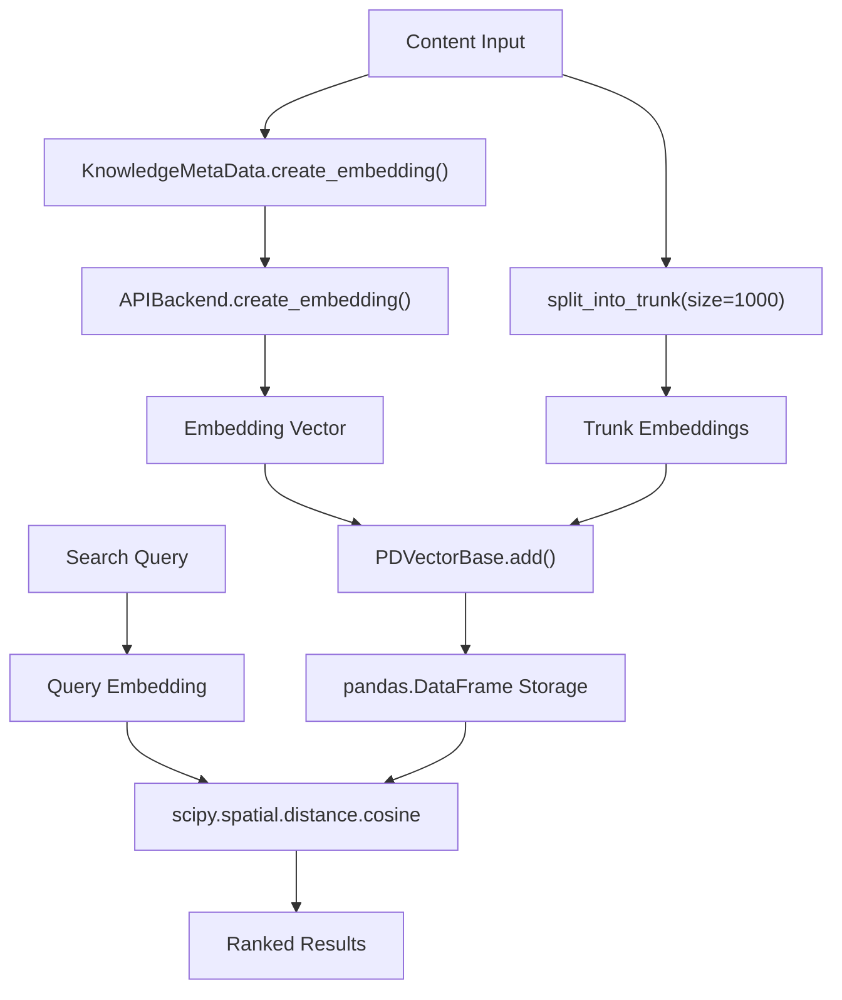
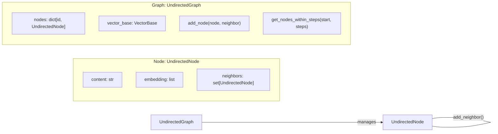
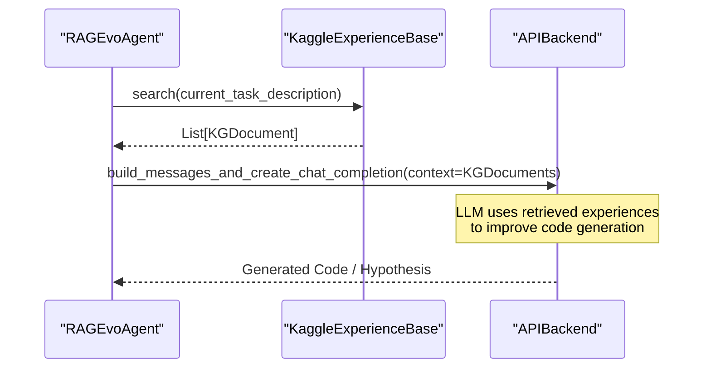

<!-- source: DeepWiki mcp.deepwiki.com · repo microsoft/RD-Agent · page 4.3 Knowledge Management and RAG · fetched 2026-10-26 -->

# Knowledge Management and RAG

Relevant source files

The following files were used as context for generating this wiki page:

- [rdagent/components/knowledge_management/graph.py](rdagent/components/knowledge_management/graph.py)
- [rdagent/components/knowledge_management/vector_base.py](rdagent/components/knowledge_management/vector_base.py)
- [rdagent/core/conf.py](rdagent/core/conf.py)
- [rdagent/core/knowledge_base.py](rdagent/core/knowledge_base.py)
- [rdagent/core/utils.py](rdagent/core/utils.py)
- [rdagent/log/timer.py](rdagent/log/timer.py)
- [rdagent/oai/llm_utils.py](rdagent/oai/llm_utils.py)
- [rdagent/scenarios/data_science/proposal/exp_gen/idea_pool.py](rdagent/scenarios/data_science/proposal/exp_gen/idea_pool.py)
- [rdagent/scenarios/kaggle/knowledge_management/README.md](rdagent/scenarios/kaggle/knowledge_management/README.md)
- [rdagent/scenarios/kaggle/knowledge_management/extract_knowledge.py](rdagent/scenarios/kaggle/knowledge_management/extract_knowledge.py)
- [rdagent/scenarios/kaggle/knowledge_management/graph.py](rdagent/scenarios/kaggle/knowledge_management/graph.py)
- [rdagent/scenarios/kaggle/knowledge_management/prompts.yaml](rdagent/scenarios/kaggle/knowledge_management/prompts.yaml)
- [rdagent/scenarios/kaggle/knowledge_management/vector_base.py](rdagent/scenarios/kaggle/knowledge_management/vector_base.py)
- [rdagent/scenarios/qlib/factor_experiment_loader/pdf_loader.py](rdagent/scenarios/qlib/factor_experiment_loader/pdf_loader.py)
- [rdagent/scenarios/qlib/factor_experiment_loader/prompts.yaml](rdagent/scenarios/qlib/factor_experiment_loader/prompts.yaml)
- [rdagent/utils/fmt.py](rdagent/utils/fmt.py)
- [test/oai/test_completion.py](test/oai/test_completion.py)

This document covers RD-Agent's knowledge management and Retrieval Augmented Generation (RAG) capabilities, including vector databases, knowledge graphs, and domain-specific idea pools. The system provides semantic search, relationship modeling, and context retrieval to enhance AI-driven research and development workflows.

For LLM integration and backends that power the RAG system, see [LLM Integration and Backends](2.4). For prompt template management used with retrieved knowledge, see [Prompt Templates and AI Interactions](4.4).

## Architecture Overview

The knowledge management system consists of three main layers: vector-based storage, graph-based relationships, and domain-specific knowledge bases. These components work together to provide comprehensive RAG capabilities for the research and development process.

### Knowledge Management System Architecture

Sources: [rdagent/components/knowledge_management/vector_base.py:72-104](), [rdagent/components/knowledge_management/graph.py:54-107](), [rdagent/scenarios/kaggle/knowledge_management/vector_base.py:106-127]()

## Vector-Based Knowledge Storage

The foundation of the knowledge management system is the vector storage layer, which handles document embedding and similarity search operations using `pandas` as the backend.

### Core Vector Components

| Component | Purpose | Implementation |
|-----------|---------|----------------|
| `VectorBase` | Abstract interface for vector operations | [rdagent/components/knowledge_management/vector_base.py:72-104]() |
| `PDVectorBase` | Pandas-based vector storage and cosine similarity search | [rdagent/components/knowledge_management/vector_base.py:106-209]() |
| `KnowledgeMetaData` | Base document class with ID generation and embedding support | [rdagent/components/knowledge_management/vector_base.py:13-57]() |
| `KGKnowledgeDocument` | Specialized Kaggle document with competition metadata | [rdagent/scenarios/kaggle/knowledge_management/vector_base.py:16-100]() |

### Document Processing and Embedding

The system supports both full-document and chunked embeddings. The `split_into_trunk` method breaks content into manageable segments for more granular retrieval.

Sources: [rdagent/components/knowledge_management/vector_base.py:22-38](), [rdagent/components/knowledge_management/vector_base.py:118-153](), [rdagent/oai/llm_utils.py:13-32]()

### Search Operations

The `PDVectorBase.search()` method provides flexible similarity search with multiple constraints:

- **Similarity Threshold**: Filter results by minimum cosine similarity score (1 - cosine distance).
- **Top-K Results**: Limit the number of returned documents using `nlargest`.
- **Label Constraints**: Restrict search to specific document types using pandas filtering.

Sources: [rdagent/components/knowledge_management/vector_base.py:158-209]()

## Graph-Based Knowledge Relationships

The graph layer extends vector storage with relationship modeling, enabling complex knowledge retrieval patterns that consider both semantic similarity and structural connections.

### Graph Structure and Operations

`UndirectedGraph` manages a collection of `UndirectedNode` objects. Each node maintains a `neighbors` set, creating a bidirectional relationship.

Sources: [rdagent/components/knowledge_management/graph.py:22-52](), [rdagent/components/knowledge_management/graph.py:108-151]()

### Advanced Graph Search Patterns

The `UndirectedGraph` supports sophisticated search patterns that combine semantic similarity with graph traversal:

1. **Multi-hop Traversal**: `get_nodes_within_steps()` performs a BFS to find nodes within N steps of a starting node, with optional label constraints.
2. **Semantic-Structural Search**: The graph uses its internal `vector_base` to find an initial entry point via `semantic_search`, then traverses neighbors.

Sources: [rdagent/components/knowledge_management/graph.py:197-234](), [rdagent/components/knowledge_management/graph.py:139-167]()

## Domain-Specific Knowledge Bases

RD-Agent implements specialized knowledge bases for Data Science and Kaggle scenarios, leveraging both vector and graph capabilities.

### KaggleExperienceBase

`KaggleExperienceBase` handles competition-specific knowledge, such as high-ranking notebook summaries and experiment feedback.

- **Extraction**: Uses `extract_knowledge_from_feedback` to convert raw text into structured JSON metadata.
- **Storage**: Maps Kaggle-specific fields (competition name, task category, ranking) to the vector store.
- **Prompts**: Uses `extract_kaggle_knowledge_prompts` defined in `prompts.yaml`.

Sources: [rdagent/scenarios/kaggle/knowledge_management/vector_base.py:106-127](), [rdagent/scenarios/kaggle/knowledge_management/prompts.yaml:1-16](), [rdagent/scenarios/kaggle/knowledge_management/extract_knowledge.py:12-40]()

### Qlib Factor Extraction (PDF Loader)

In the quantitative trading scenario, knowledge is extracted from PDF reports.

- **Classification**: `classify_report_from_dict` uses LLM voting to determine if a PDF is a relevant financial report.
- **Factor Extraction**: `__extract_factors_name_and_desc_from_content` and `__extract_factors_formulation_from_content` parse report text into factor definitions.
- **Deduplication**: Uses `KMeans` and `cosine_similarity` to group similar extracted factors before loading them into the system.

Sources: [rdagent/scenarios/qlib/factor_experiment_loader/pdf_loader.py:29-112](), [rdagent/scenarios/qlib/factor_experiment_loader/pdf_loader.py:115-179](), [rdagent/scenarios/qlib/factor_experiment_loader/pdf_loader.py:204-260]()

## RAG Integration and Strategy

RD-Agent uses specific strategies to inject retrieved knowledge into the R&D loop, primarily through the `CoSTEERRAGStrategy` and specialized idea sampling.

### Idea Sampling and Selection

The system often uses a two-stage process for idea generation:
1. **Retrieval**: Search the knowledge base for similar problems or hypotheses.
2. **Refinement**: An LLM evaluates the RAG results against the current target using the `refine_with_LLM` prompt.

Sources: [rdagent/scenarios/kaggle/knowledge_management/prompts.yaml:85-93](), [rdagent/scenarios/kaggle/knowledge_management/extract_knowledge.py:43-70]()

### Data Flow for RAG-Enhanced Coding

Sources: [rdagent/scenarios/kaggle/knowledge_management/vector_base.py:158-208](), [rdagent/oai/llm_utils.py:35-44]()

---

