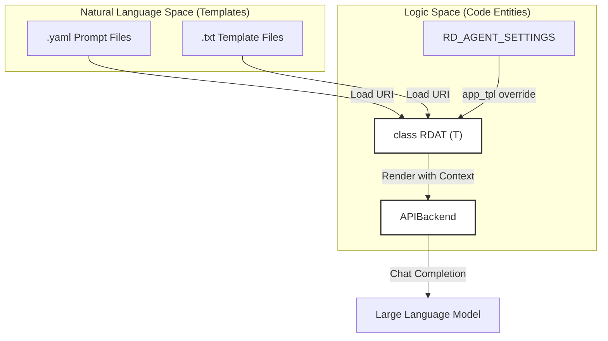
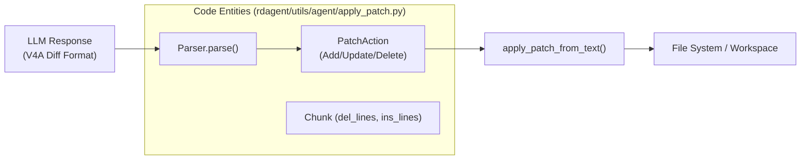

<!-- source: DeepWiki mcp.deepwiki.com · repo microsoft/RD-Agent · page 4.4 Prompt Templates and LLM Interactions · fetched 2026-10-26 -->

# Prompt Templates and LLM Interactions

<details>
<summary>Relevant source files</summary>

The following files were used as context for generating this wiki page:

- [rdagent/core/conf.py](rdagent/core/conf.py)
- [rdagent/core/utils.py](rdagent/core/utils.py)
- [rdagent/oai/llm_utils.py](rdagent/oai/llm_utils.py)
- [rdagent/scenarios/qlib/factor_experiment_loader/pdf_loader.py](rdagent/scenarios/qlib/factor_experiment_loader/pdf_loader.py)
- [rdagent/scenarios/qlib/factor_experiment_loader/prompts.yaml](rdagent/scenarios/qlib/factor_experiment_loader/prompts.yaml)
- [rdagent/utils/__init__.py](rdagent/utils/__init__.py)
- [rdagent/utils/agent/apply_patch.py](rdagent/utils/agent/apply_patch.py)
- [rdagent/utils/agent/ret.py](rdagent/utils/agent/ret.py)
- [rdagent/utils/agent/tpl.py](rdagent/utils/agent/tpl.py)
- [rdagent/utils/agent/tpl.yaml](rdagent/utils/agent/tpl.yaml)
- [rdagent/utils/fmt.py](rdagent/utils/fmt.py)
- [test/oai/test_completion.py](test/oai/test_completion.py)
- [test/utils/test_agent_infra.py](test/utils/test_agent_infra.py)

</details>


This page documents the prompt template system (`tpl.T`), structured LLM interaction patterns, and utility systems that power RD-Agent's autonomous research capabilities. The system bridges the gap between natural language research instructions and structured code/data entities.

## Template Architecture and Organization

RD-Agent uses a YAML-based prompt organization system that leverages Jinja2 for dynamic content injection. The core utility for this is the `RDAT` class (aliased as `T`).

### The `T` (RDAT) Template System
The `RDAT` class in `rdagent/utils/agent/tpl.py` provides a unified interface for loading and rendering templates from YAML or text files.

- **URI-based Loading**: Templates are referenced using a URI string like `path.to.file:key.subkey` [rdagent/utils/agent/tpl.py:94-101]().
- **Priority Resolution**: The system checks multiple locations, allowing application-specific templates (defined in `RD_AGENT_SETTINGS.app_tpl`) to override default framework templates [rdagent/utils/agent/tpl.py:44-62]().
- **Jinja2 Rendering**: The `r()` method renders the template using a `StrictUndefined` environment, ensuring that missing variables raise errors rather than failing silently [rdagent/utils/agent/tpl.py:122-132]().


**Sources:** [rdagent/utils/agent/tpl.py:85-148](), [rdagent/core/conf.py:105-107]()

## Structured LLM Interaction Patterns

RD-Agent enforces structured interactions using Pydantic models and specialized "Agent Output" classes to ensure the LLM's response can be reliably converted into code or data structures.

### APIBackend and Structured Outputs
The `APIBackend` class (retrieved via `get_api_backend`) manages the low-level communication. It supports several modes for structured output:
1.  **JSON Mode**: Setting `json_mode=True` forces the LLM to return a valid JSON string [rdagent/oai/llm_utils.py:35-44](), [test/oai/test_completion.py:29-36]().
2.  **Pydantic Models**: Users can pass a Pydantic `BaseModel` to `response_format` or specify a `json_target_type` for automatic validation [test/oai/test_completion.py:10-15](), [test/oai/test_completion.py:68-89]().

### AgentOut Hierarchy
The `AgentOut` classes in `rdagent/utils/agent/ret.py` define how different types of LLM responses should be extracted and parsed.

| Class | Purpose | Extraction Logic |
| :--- | :--- | :--- |
| `PythonAgentOut` | Single Python script | Extracts the first ` ```python ` block [rdagent/utils/agent/ret.py:29-42](). |
| `BatchEditOut` | Multi-file JSON edits | Parses JSON mapping filenames to code or `__DEL__` [rdagent/utils/agent/ret.py:59-68](). |
| `PythonBatchEditOut` | Multi-file code blocks | Uses regex to find multiple named code blocks [rdagent/utils/agent/ret.py:71-86](). |
| `PythonBatchPatchOut` | Diff-based updates | Uses `apply_patch` logic to modify existing files [rdagent/utils/agent/ret.py:89-105](). |

**Sources:** [rdagent/utils/agent/ret.py:17-105](), [rdagent/oai/llm_utils.py:35-44](), [test/oai/test_completion.py:10-15]()

## Code Entity Interaction: `apply_patch`

The `apply_patch` utility is a critical bridge between the LLM's "Natural Language Space" and the "Code Entity Space." It allows the LLM to perform precise edits on files without rewriting them entirely.



### Patch Mechanism
- **V4A Format**: A custom human-readable "pseudo-diff" format that uses context lines (`@@`) instead of line numbers to identify locations, making it robust to minor file changes [rdagent/utils/agent/tpl.yaml:59-96]().
- **Parser Class**: Handles the logic of finding `*** Begin Patch` and `*** End Patch` sentinels and interpreting `*** Update File`, `*** Add File`, and `*** Delete File` commands [rdagent/utils/agent/apply_patch.py:73-170]().
- **Fuzzy Matching**: While primarily exact, the system is designed to handle human-readable patches that specify `[context_before]`, `-[old_code]`, and `+[new_code]` [rdagent/utils/agent/tpl.yaml:71-76]().

**Sources:** [rdagent/utils/agent/apply_patch.py:1-170](), [rdagent/utils/agent/tpl.yaml:59-113]()

## Utility Systems for LLM Interaction

### Token Management and Text Shrinking
To handle context window limits, RD-Agent provides several utilities:
- **`APIBackend.build_messages_and_calculate_token`**: Pre-calculates token usage before sending requests [rdagent/oai/llm_utils.py:80-86]().
- **`shrink_text`**: Hides the middle of long strings (like logs or dataframes) to preserve the most important start/end context [rdagent/utils/fmt.py:6-48]().
- **`filter_redundant_text`**: Uses regex and recursive LLM calls to strip progress bars (tqdm) and repeated lines from stdout before passing them back to the agent [rdagent/utils/__init__.py:100-171]().

### Caching and Determinism
- **Pickle Cache**: The `cache_with_pickle` decorator allows caching LLM-heavy function results to disk [rdagent/core/utils.py:156-174]().
- **Seed Generation**: `CacheSeedGen` and `LLM_CACHE_SEED_GEN` ensure that even in multiprocessing environments, LLM interactions can maintain a level of reproducible trace behavior by managing chat cache seeds [rdagent/core/utils.py:91-112]().

**Sources:** [rdagent/utils/fmt.py:6-48](), [rdagent/utils/__init__.py:100-171](), [rdagent/core/utils.py:91-174]()

---

