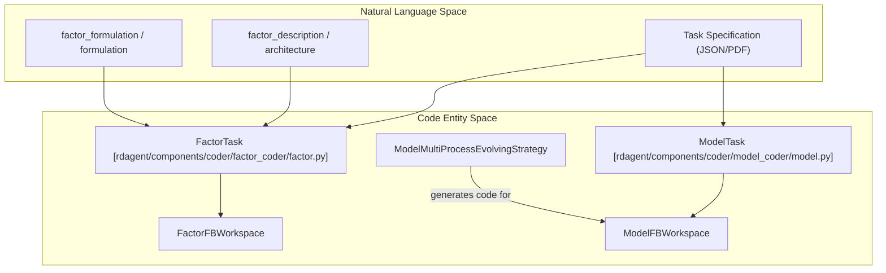
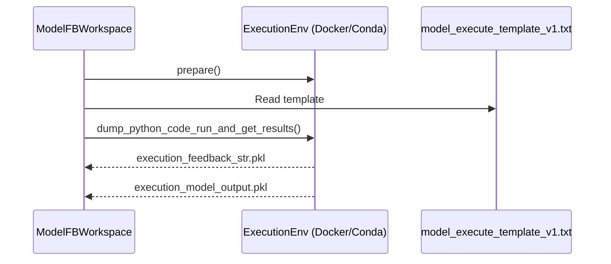

<!-- source: DeepWiki mcp.deepwiki.com · repo microsoft/RD-Agent · page 4.5 Factor and Model Coders · fetched 2026-10-26 -->

# Factor and Model Coders

Relevant source files

The following files were used as context for generating this wiki page:

- [rdagent/components/coder/CoSTEER/knowledge_management.py](rdagent/components/coder/CoSTEER/knowledge_management.py)
- [rdagent/components/coder/factor_coder/config.py](rdagent/components/coder/factor_coder/config.py)
- [rdagent/components/coder/factor_coder/factor.py](rdagent/components/coder/factor_coder/factor.py)
- [rdagent/components/coder/factor_coder/prompts.yaml](rdagent/components/coder/factor_coder/prompts.yaml)
- [rdagent/components/coder/model_coder/conf.py](rdagent/components/coder/model_coder/conf.py)
- [rdagent/components/coder/model_coder/eva_utils.py](rdagent/components/coder/model_coder/eva_utils.py)
- [rdagent/components/coder/model_coder/evaluators.py](rdagent/components/coder/model_coder/evaluators.py)
- [rdagent/components/coder/model_coder/evolving_strategy.py](rdagent/components/coder/model_coder/evolving_strategy.py)
- [rdagent/components/coder/model_coder/model.py](rdagent/components/coder/model_coder/model.py)
- [rdagent/components/coder/model_coder/model_execute_template_v1.txt](rdagent/components/coder/model_coder/model_execute_template_v1.txt)
- [rdagent/components/coder/model_coder/model_execute_template_v2.txt](rdagent/components/coder/model_coder/model_execute_template_v2.txt)
- [rdagent/components/coder/model_coder/prompts.yaml](rdagent/components/coder/model_coder/prompts.yaml)
- [rdagent/components/coder/model_coder/task_loader.py](rdagent/components/coder/model_coder/task_loader.py)
- [rdagent/scenarios/kaggle/developer/coder.py](rdagent/scenarios/kaggle/developer/coder.py)

The **Factor and Model Coders** are specialized components within the RD-Agent framework designed to automate the implementation of quantitative features (factors) and machine learning models. These coders leverage the CoSTEER (Code Evolution) framework to iteratively refine code based on execution feedback and domain-specific validation.

## 1. Overview and Architecture

Factor and Model coders follow a unified pattern where high-level specifications (Natural Language/Math) are transformed into executable code. They utilize `CoSTEERTask` for definition and `FBWorkspace` for file-based execution and testing.

### Component Relationship Diagram
This diagram illustrates how Natural Language specifications in the "Natural Language Space" are mapped to "Code Entity Space" through the Coder components.

**Sources:** [rdagent/components/coder/factor_coder/factor.py:20-41](), [rdagent/components/coder/model_coder/model.py:15-37](), [rdagent/components/coder/model_coder/evolving_strategy.py:20-28]()

---

## 2. Factor Coder Implementation

The Factor Coder is primarily used in Quantitative Trading scenarios (e.g., Qlib) and Kaggle competitions to generate data processing features.

### FactorTask and FactorFBWorkspace
- **FactorTask**: Stores metadata including `factor_name`, `factor_description`, and `factor_formulation` [rdagent/components/coder/factor_coder/factor.py:20-41]().
- **FactorFBWorkspace**: Manages the lifecycle of factor code. It handles the writing of `factor.py`, linking source data, and executing the code via a subprocess [rdagent/components/coder/factor_coder/factor.py:77-118]().

### Execution Flow
The factor execution supports two versions:
1.  **Version 1 (Qlib)**: Directly executes the generated `factor.py` [rdagent/components/coder/factor_coder/factor.py:156-157]().
2.  **Version 2 (Kaggle)**: Uses an execution template (`factor_execution_template.txt`) to import and run the factor logic [rdagent/components/coder/factor_coder/factor.py:158-161]().

**Sources:** [rdagent/components/coder/factor_coder/factor.py:107-170]()

---

## 3. Model Coder Implementation

The Model Coder focuses on Pytorch-based model architectures. It can extract model definitions from research papers (PDFs) or structured descriptions.

### ModelTask
The `ModelTask` class encapsulates the model's architectural details, hyperparameters, and training configurations [rdagent/components/coder/model_coder/model.py:15-37]().

| Attribute | Description |
| :--- | :--- |
| `architecture` | Detailed description of neural network layers or structures. |
| `hyperparameters` | Model-specific parameters (e.g., hidden layers, dropout). |
| `training_hyperparameters` | Optimization settings (e.g., epochs, learning rate). |
| `model_type` | One of `Tabular`, `TimeSeries`, `Graph`, or `XGBoost`. |

**Sources:** [rdagent/components/coder/model_coder/model.py:16-36]()

### Model Execution and Evaluation
`ModelFBWorkspace` executes the model within isolated environments (`QTDockerEnv`, `KGDockerEnv`, or `QlibCondaEnv`) [rdagent/components/coder/model_coder/model.py:116-125]().

#### Model Execution Logic

**Sources:** [rdagent/components/coder/model_coder/model.py:114-147](), [rdagent/components/coder/model_coder/model_execute_template_v1.txt:1-45]()

---

## 4. Evolving Strategies and Feedback

Both coders use `MultiProcessEvolvingStrategy` to refine code iteratively.

### Evolving Strategy Components
1.  **Knowledge Retrieval**: Queries similar successful implementations and former failed attempts to provide context to the LLM [rdagent/components/coder/model_coder/evolving_strategy.py:30-40]().
2.  **Prompting**: Uses Jinja2 templates (e.g., `evolving_strategy_model_coder`) to instruct the LLM on code generation [rdagent/components/coder/model_coder/prompts.yaml:30-88]().
3.  **Evaluators**: 
    - `ModelCodeEvaluator`: Checks if the code aligns with the provided formulation [rdagent/components/coder/model_coder/eva_utils.py:52-102]().
    - `shape_evaluator`: Validates the output tensor dimensions [rdagent/components/coder/model_coder/eva_utils.py:15-29]().
    - `value_evaluator`: Compares output values against a Ground Truth (GT) if available [rdagent/components/coder/model_coder/eva_utils.py:32-49]().

**Sources:** [rdagent/components/coder/model_coder/evolving_strategy.py:20-80](), [rdagent/components/coder/model_coder/evaluators.py:20-104]()

---

## 5. Task Loading from Documents

For the Finance scenario, `ModelExperimentLoaderFromPDFfiles` can automatically extract model tasks from research papers.

- **PDF Processing**: Uses `load_and_process_pdfs_by_langchain` to read document content [rdagent/components/coder/model_coder/task_loader.py:121]().
- **Information Extraction**: Employs the `extract_model_from_doc` function with a specialized prompt (`extract_model_formulation_system`) to parse LaTeX formulas and architecture descriptions into a structured JSON format [rdagent/components/coder/model_coder/task_loader.py:20-68]().

**Sources:** [rdagent/components/coder/model_coder/task_loader.py:118-129](), [rdagent/components/coder/model_coder/prompts.yaml:1-28]()

---

## 6. Configuration

Coders are configured via `FactorCoSTEERSettings` and `ModelCoSTEERSettings`.

| Setting | Env Prefix | Default / Options |
| :--- | :--- | :--- |
| `data_folder` | `FACTOR_CoSTEER_` | Path to financial data for factors [rdagent/components/coder/factor_coder/config.py:13](). |
| `env_type` | `MODEL_CoSTEER_` | `conda` or `docker` [rdagent/components/coder/model_coder/conf.py:12](). |
| `python_bin` | `FACTOR_CoSTEER_` | Path to the python binary [rdagent/components/coder/factor_coder/config.py:28](). |

**Sources:** [rdagent/components/coder/factor_coder/config.py:10-30](), [rdagent/components/coder/model_coder/conf.py:9-15]()

---

