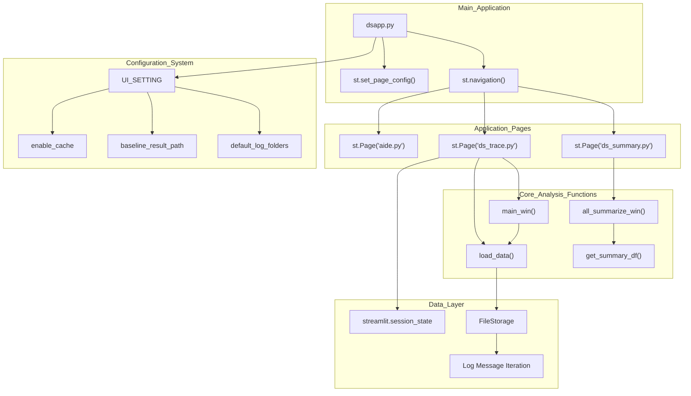
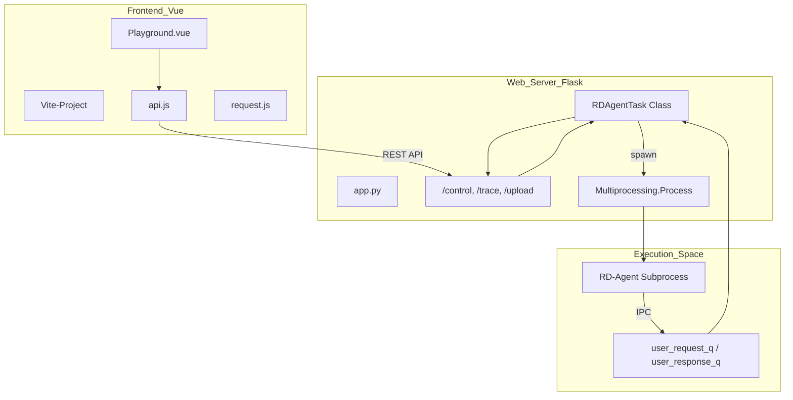

<!-- source: DeepWiki mcp.deepwiki.com · repo microsoft/RD-Agent · page 5 User Interface and Monitoring · fetched 2026-10-26 -->

# User Interface and Monitoring

Relevant source files

The following files were used as context for generating this wiki page:

- [rdagent/log/mle_summary.py](rdagent/log/mle_summary.py)
- [rdagent/log/server/README.md](rdagent/log/server/README.md)
- [rdagent/log/server/app.py](rdagent/log/server/app.py)
- [rdagent/log/server/debug_app.py](rdagent/log/server/debug_app.py)
- [rdagent/log/ui/ds_summary.py](rdagent/log/ui/ds_summary.py)
- [rdagent/log/ui/ds_trace.py](rdagent/log/ui/ds_trace.py)
- [rdagent/log/ui/dsapp.py](rdagent/log/ui/dsapp.py)
- [rdagent/log/ui/storage.py](rdagent/log/ui/storage.py)
- [rdagent/log/ui/utils.py](rdagent/log/ui/utils.py)
- [rdagent/scenarios/kaggle/experiment/templates/new-york-city-taxi-fare-prediction/model/model_linear.py](rdagent/scenarios/kaggle/experiment/templates/new-york-city-taxi-fare-prediction/model/model_linear.py)
- [test/utils/test_import.py](test/utils/test_import.py)
- [web/package-lock.json](web/package-lock.json)
- [web/package.json](web/package.json)
- [web/src/utils/api.js](web/src/utils/api.js)
- [web/src/views/Playground.vue](web/src/views/Playground.vue)

This document provides an overview of RD-Agent's user interface and monitoring capabilities, which offer comprehensive visibility into experiment execution, performance tracking, and debugging. The system consists of two primary visualization layers: a Streamlit-based web interface for interactive analysis and a Flask/Vue-based web server for real-time control and playground interaction.

The monitoring system enables users to visualize experiment traces, analyze performance metrics across competitions, debug LLM interactions, and track progress through multiple R&D iterations. The interface is designed for technical users who need detailed insights into automated research workflows.

For detailed information about the Streamlit interface components, see [Streamlit UI and Visualization](#5.1). For the underlying data management systems, see [Logging and Trace Management](#5.2). For the real-time control server, see [Web Server and Vue Frontend](#5.3).

## Web-based Monitoring Interface

RD-Agent provides a comprehensive Streamlit-based web interface for monitoring and analyzing experiments. The interface consists of multiple specialized pages for different aspects of analysis.

### Streamlit Application Architecture

The main application entry point `dsapp.py` orchestrates the Streamlit interface using `st.navigation()` to manage three specialized pages [rdagent/log/ui/dsapp.py:28-32](). The `UI_SETTING` configuration object controls log folder paths, caching behavior, and baseline comparison data [rdagent/log/ui/conf.py]().

**Sources:** [rdagent/log/ui/dsapp.py:28-32](), [rdagent/log/ui/dsapp.py:43-51](), [rdagent/log/ui/conf.py]()

## Real-time Control and Vue Playground

In addition to post-hoc analysis, RD-Agent includes a Flask-based web server (`app.py`) that hosts a Vue.js frontend for real-time interaction. This system allows users to start new tasks, upload materials, and interact with the agent during execution.

### Server and Frontend Architecture

The `RDAgentTask` class manages the lifecycle of an RD-Agent run, wrapping it in a separate process and providing IPC queues for bidirectional communication between the agent and the web UI [rdagent/log/server/app.py:52-87](). The Vue frontend uses `api.js` to communicate with Flask endpoints like `/control` to start/stop tasks and `/upload` for PDF or code materials [web/src/utils/api.js:5-48]().

**Sources:** [rdagent/log/server/app.py:52-116](), [web/src/utils/api.js:1-65](), [web/src/views/Playground.vue:1-186]()

## Experiment Trace Analysis

The trace analysis system provides detailed visibility into individual experiment execution, allowing users to examine each step of the R&D loop process.

### Trace Data Loading and Processing

The `load_data()` function processes `FileStorage.iter_msg()` results and uses `extract_loopid_func_name()` and `extract_evoid()` to organize messages into a hierarchical structure stored in Streamlit session state [rdagent/log/ui/ds_trace.py:74-157](). This enables loop-by-loop analysis of experiment execution.

**Sources:** [rdagent/log/ui/ds_trace.py:74-157](), [rdagent/log/utils.py:extract_loopid_func_name](), [rdagent/log/utils.py:extract_evoid]()

### Workspace and Code Visualization

The `workspace_win()` function provides detailed code inspection capabilities, including syntax-highlighted code display and diff comparison with previous versions [rdagent/log/ui/ds_trace.py:199-234]().

**Sources:** [rdagent/log/ui/ds_trace.py:199-234]()

## Performance Metrics and Statistics

The monitoring system provides comprehensive performance analysis across experiments and competitions.

### Summary Statistics Generation

The summary system processes log folders using `summarize_folder()` to generate `summary.pkl` files [rdagent/log/mle_summary.py:74-222](). Then, `get_summary_df()` creates comprehensive DataFrames with performance metrics such as medal counts and score improvements [rdagent/log/ui/utils.py:432-665]().

**Sources:** [rdagent/log/mle_summary.py:74-222](), [rdagent/log/ui/utils.py:432-665](), [rdagent/log/ui/utils.py:182-259]()

### Medal and Achievement Tracking

The system tracks competition performance using standardized medal categories (Gold, Silver, Bronze, Above Median) based on the `MLETestEval` results [rdagent/log/mle_summary.py:139-166](), [rdagent/log/ui/utils.py:146-161]().

**Sources:** [rdagent/log/mle_summary.py:139-166](), [rdagent/log/ui/utils.py:146-161]()

## LLM Debugging and Cost Analysis

The monitoring system provides detailed visibility into LLM interactions for debugging and cost analysis.

### LLM Interaction Tracking

The `llm_log_win()` function processes debug messages to display LLM interactions, including system prompts, user prompts, and raw responses [rdagent/log/ui/ds_trace.py:255-375](). Interactive testing via `APIBackend` allows users to re-run prompts with modified parameters directly from the UI [rdagent/log/ui/ds_trace.py:321-374]().

**Sources:** [rdagent/log/ui/ds_trace.py:255-375](), [rdagent/log/ui/ds_trace.py:599-618](), [rdagent/log/ui/ds_trace.py:321-374]()

## Log Storage and Management

The monitoring system builds on RD-Agent's `FileStorage` infrastructure to provide comprehensive analysis capabilities.

### Data Access and Processing Architecture

The monitoring system uses `FileStorage.iter_msg()` to process log messages, with `extract_loopid_func_name()` and `extract_evoid()` parsing message tags to organize data in Streamlit session state for interactive analysis [rdagent/log/ui/ds_trace.py:74-157](). For web-based logging, `WebStorage` sends messages to the Flask server via the `/receive` endpoint [rdagent/log/ui/storage.py:13-50]().

**Sources:** [rdagent/log/ui/ds_trace.py:74-157](), [rdagent/log/ui/storage.py:13-50](), [rdagent/log/utils.py:is_valid_session]()

---

