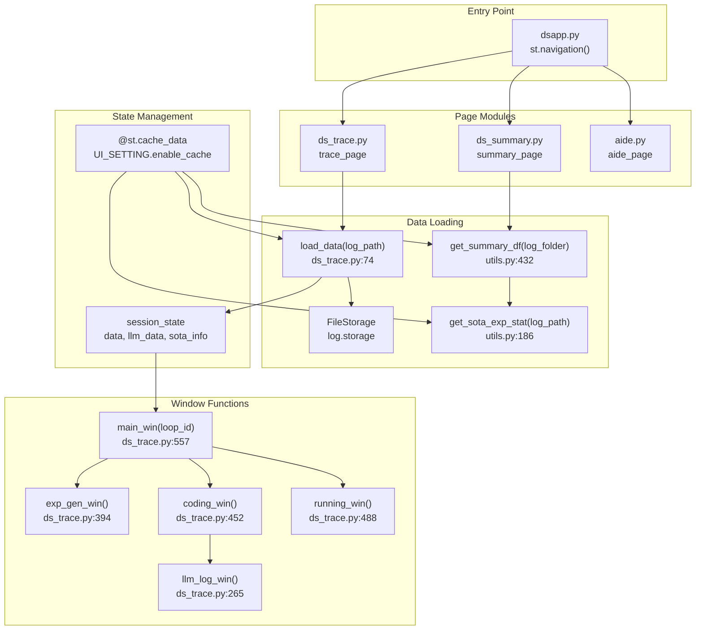
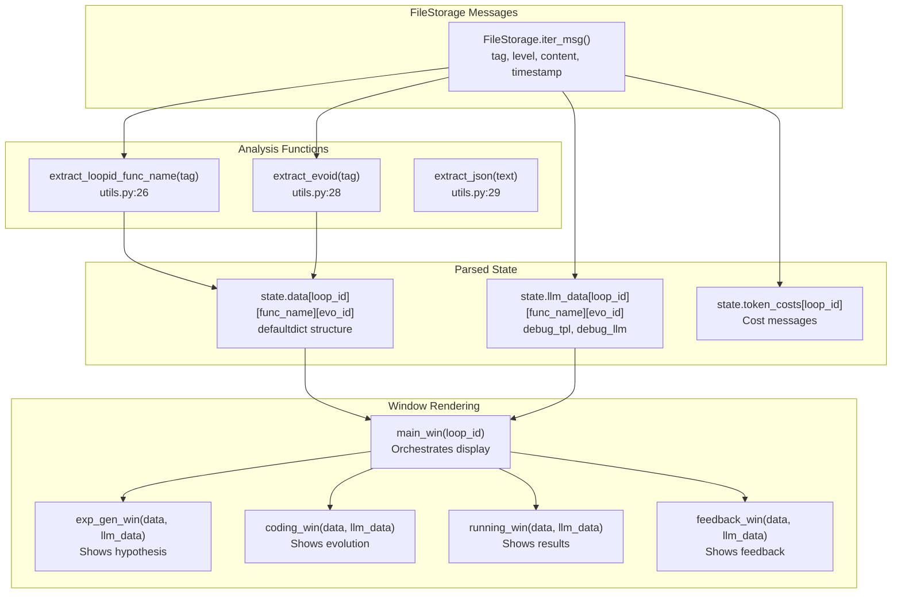
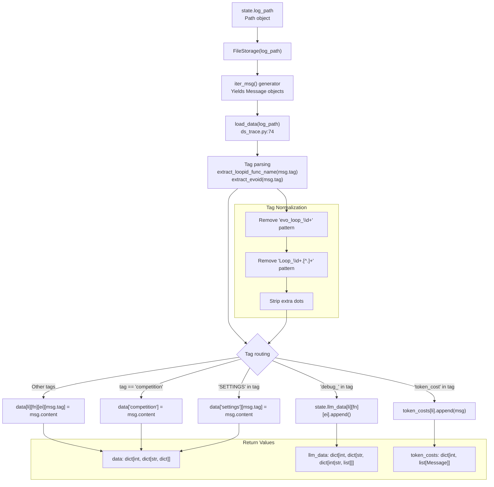
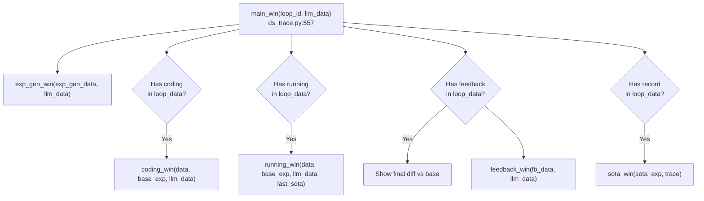
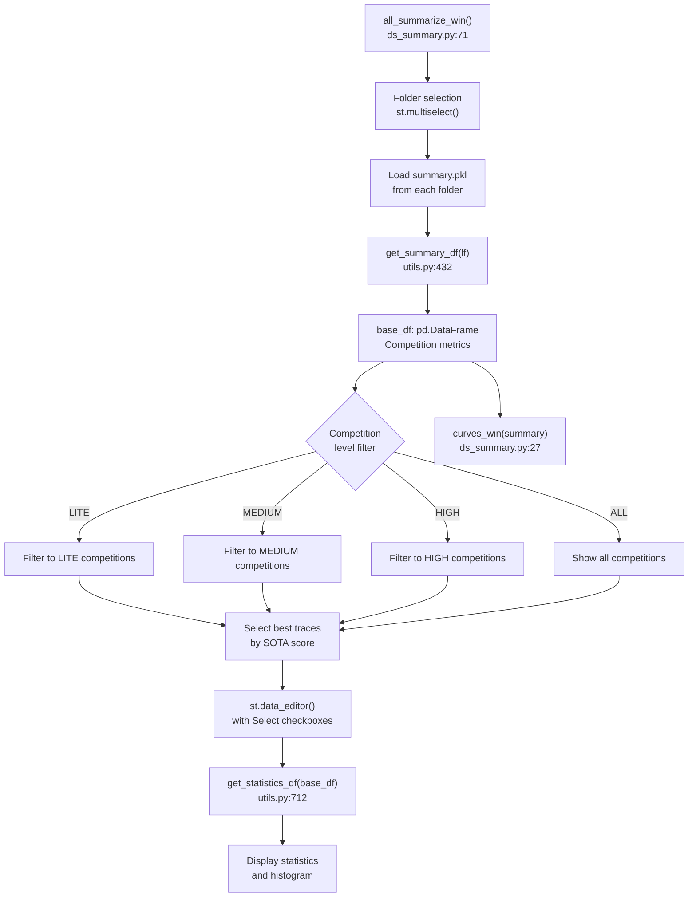
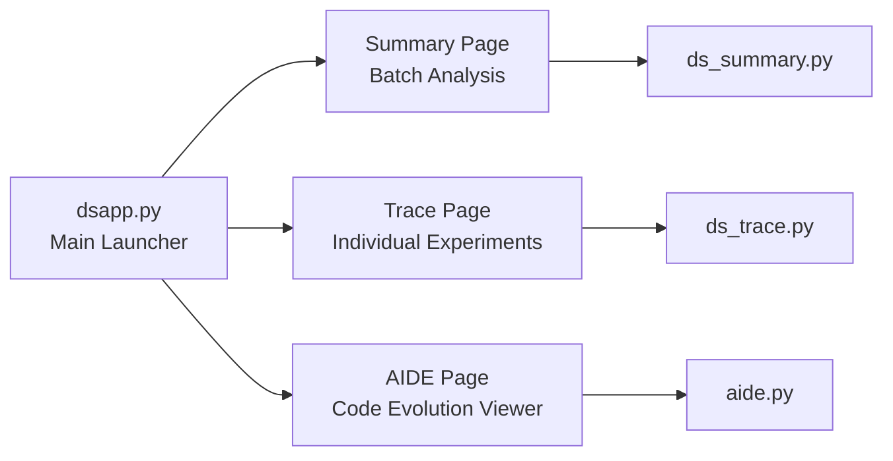

<!-- source: DeepWiki mcp.deepwiki.com · repo microsoft/RD-Agent · page 5.1 Streamlit UI and Visualization · fetched 2026-10-26 -->

# Streamlit UI and Visualization

<details>
<summary>Relevant source files</summary>

The following files were used as context for generating this wiki page:

- [rdagent/log/mle_summary.py](rdagent/log/mle_summary.py)
- [rdagent/log/ui/aide.py](rdagent/log/ui/aide.py)
- [rdagent/log/ui/app.py](rdagent/log/ui/app.py)
- [rdagent/log/ui/conf.py](rdagent/log/ui/conf.py)
- [rdagent/log/ui/ds_summary.py](rdagent/log/ui/ds_summary.py)
- [rdagent/log/ui/ds_trace.py](rdagent/log/ui/ds_trace.py)
- [rdagent/log/ui/dsapp.py](rdagent/log/ui/dsapp.py)
- [rdagent/log/ui/llm_st.py](rdagent/log/ui/llm_st.py)
- [rdagent/log/ui/st_fixed_container.py](rdagent/log/ui/st_fixed_container.py)
- [rdagent/log/ui/utils.py](rdagent/log/ui/utils.py)
- [rdagent/log/ui/web.py](rdagent/log/ui/web.py)
- [rdagent/scenarios/kaggle/experiment/templates/new-york-city-taxi-fare-prediction/model/model_linear.py](rdagent/scenarios/kaggle/experiment/templates/new-york-city-taxi-fare-prediction/model/model_linear.py)
- [rdagent/scenarios/qlib/experiment/utils.py](rdagent/scenarios/qlib/experiment/utils.py)
- [test/utils/test_import.py](test/utils/test_import.py)

</details>


The Streamlit UI system provides web-based visualization for RD-Agent experiment workflows. It consists of multiple Streamlit applications that read from `FileStorage` logs and display experiment traces, performance metrics, code evolution, and LLM interactions.

The UI is organized into three main pages launched from `dsapp.py`: the Trace page for detailed loop-by-loop inspection, the Summary page for aggregate statistics across multiple experiments, and the Aide page for code evolution analysis. These pages consume messages from `FileStorage` and render them using specialized window functions.

For the underlying logging system that produces the data visualized here, see [Logging and Trace Management](#5.2). For the R&D Loop that generates experiment data, see [R&D Loop Framework](#2.1).

## System Architecture

The Streamlit UI consists of specialized pages that load experiment data from `FileStorage` and render it using composable window functions. Each page maintains state using `streamlit.session_state` and can cache expensive operations.

### Overall Architecture



Sources: [rdagent/log/ui/dsapp.py:28-32](), [rdagent/log/ui/ds_trace.py:74-169](), [rdagent/log/ui/ds_trace.py:557-607](), [rdagent/log/ui/utils.py:432-661](), [rdagent/log/ui/utils.py:186-259]()

### Data Structure Flow



Sources: [rdagent/log/ui/ds_trace.py:74-139](), [rdagent/log/ui/ds_trace.py:557-607](), [rdagent/log/utils.py:26-31]()

## Data Loading and Processing

The UI loads experiment data from `FileStorage` logs using tag-based parsing and caches the results in `session_state`.

### Message Processing Pipeline



The `load_data()` function at [rdagent/log/ui/ds_trace.py:74-169]() iterates through messages and organizes them into three dictionaries:

1. **`data`**: Experiment content indexed by `[loop_id][function_name][evo_id]` or `[loop_id][function_name][tag]`
2. **`llm_data`**: Debug information for LLM calls with `"debug_tpl"` and `"debug_llm"` messages
3. **`token_costs`**: Token usage messages per loop for cost tracking

The function handles backward compatibility by also loading from `debug_llm.pkl` if it exists.

Sources: [rdagent/log/ui/ds_trace.py:74-169](), [rdagent/log/utils.py:26-31]()

### Tag Structure and Extraction

Messages are tagged hierarchically to enable routing:

| Tag Pattern | Extraction | Storage Location |
|-------------|------------|------------------|
| `Loop_X.direct_exp_gen` | `li=X, fn="direct_exp_gen", ei=None` | `data[X]["direct_exp_gen"]["no_tag"]` |
| `Loop_X.coding.evo_loop_Y` | `li=X, fn="coding", ei=Y` | `data[X]["coding"][Y]` |
| `Loop_X.coding.debug_tpl` | `li=X, fn="coding", ei=None` | `llm_data[X]["coding"]["no_tag"]` |
| `Loop_X.running.debug_llm.evo_loop_Y` | `li=X, fn="running", ei=Y` | `llm_data[X]["running"][Y]` |

The extraction functions `extract_loopid_func_name()` and `extract_evoid()` use regex patterns to parse these tags.

Sources: [rdagent/log/ui/ds_trace.py:91-139](), [rdagent/log/utils.py:26-31]()

### Session State Management

The UI uses `streamlit.session_state` to persist data across user interactions and page refreshes.

**Trace Page State** ([rdagent/log/ui/ds_trace.py:46-59]()):

| State Variable | Type | Purpose |
|----------------|------|---------|
| `state.data` | `defaultdict(lambda: defaultdict(dict))` | Experiment data indexed by `[loop_id][function][evo_id]` |
| `state.llm_data` | `defaultdict(lambda: defaultdict(lambda: defaultdict(list)))` | Debug logs for LLM calls |
| `state.log_path` | `Path | None` | Currently selected log directory |
| `state.log_folder` | `Path` | Base log folder containing all traces |
| `state.sota_info` | `tuple | None` | Cached SOTA experiment information |
| `state.show_stdout` | `bool` | Toggle for stdout display |
| `state.show_llm_log` | `bool` | Toggle for LLM debug display |

**Summary Page State** ([rdagent/log/ui/dsapp.py:23-26]()):

| State Variable | Type | Purpose |
|----------------|------|---------|
| `state.log_folder` | `Path` | Base folder for experiment logs |
| `state.log_folders` | `list[str]` | List of log directories to analyze |

State is initialized with `if "key" not in state:` checks to ensure default values are set on first load.

Sources: [rdagent/log/ui/ds_trace.py:46-59](), [rdagent/log/ui/dsapp.py:23-26]()

## Trace Page (`ds_trace.py`)

The Trace page provides detailed inspection of individual experiment runs, displaying each stage of the R&D loop with code diffs, LLM interactions, and execution results.

### Main Display Function

The `main_win(loop_id, llm_data)` function at [rdagent/log/ui/ds_trace.py:557-607]() orchestrates the display of a single loop iteration by calling specialized window functions:



### Window Functions

**`exp_gen_win(exp_gen_data, llm_data)`** [rdagent/log/ui/ds_trace.py:394-406]()
- Displays hypothesis from `exp_gen_data["no_tag"].hypothesis`
- Shows pending tasks using `task_win()` for each task in `pending_tasks_list`
- Renders experiment workspace with `workspace_win(exp_gen_data["no_tag"].experiment_workspace)`
- Optionally shows LLM debug info with `llm_log_win(llm_data["no_tag"])`

**`coding_win(data, base_exp, llm_data)`** [rdagent/log/ui/ds_trace.py:452-486]()
- Groups evolving data by task: `{k: v for k, v in data.items() if isinstance(k, int)}`
- For new-format traces with task tags, displays each task separately
- For old-format traces, displays all evolution in a single view
- Calls `evolving_win()` to show code evolution with feedback
- Shows final workspace with `workspace_win(data["no_tag"].experiment_workspace)`

**`running_win(data, base_exp, llm_data, last_sota_exp)`** [rdagent/log/ui/ds_trace.py:488-522]()
- Shows execution evolving with `evolving_win()`
- Displays final workspace with diff against `last_sota_exp` if available
- Shows `data["no_tag"].result` as experiment result
- Extracts and displays MLE score using `extract_json()` from `data.get("mle_score")`
- Indicates success with ✅ or failure with ❌ based on score validity

**`feedback_win(fb_data, llm_data)`** [rdagent/log/ui/ds_trace.py:524-538]()
- Displays `ExperimentFeedback` from `fb_data["no_tag"]`
- Shows feedback text with `str(fb).replace("\n", "\n\n")`
- Highlights exceptions in red if `fb.exception is not None`
- Indicates successful feedback with ✅ or failed with ❌ based on `bool(fb)`

**`workspace_win(workspace, cmp_workspace, cmp_name)`** [rdagent/log/ui/ds_trace.py:199-244]()
- Displays all files in `workspace.file_dict` (excluding test files)
- Shows diff with comparison workspace using `generate_diff_from_dict()` in a `st.popover()`
- Displays running time from `workspace.running_info.running_time`
- Shows each file in tabs with syntax highlighting
- Provides save functionality if `state.show_save_input` is enabled

**`sota_win(sota_exp, trace)`** [rdagent/log/ui/ds_trace.py:540-555]()
- Shows `trace.sota_exp_to_submit` if available, otherwise `trace.sota_experiment()`
- Displays SOTA hypothesis and workspace files

Sources: [rdagent/log/ui/ds_trace.py:557-607](), [rdagent/log/ui/ds_trace.py:394-406](), [rdagent/log/ui/ds_trace.py:452-486](), [rdagent/log/ui/ds_trace.py:488-522](), [rdagent/log/ui/ds_trace.py:199-244]()

### LLM Debug Interface

The `llm_log_win(llm_d)` function at [rdagent/log/ui/ds_trace.py:265-385]() provides interactive LLM debugging:

**Template Display** (`"debug_tpl"` messages):
- Shows prompt URI with `highlight_prompts_uri(uri)`
- Three tabs: Rendered prompt, Template with Django syntax, Context as JSON
- Filters out `"filter_redundant_text"` templates

**LLM Call Display** (`"debug_llm"` messages):
- Shows system prompt, user prompt, and response in separate tabs
- Displays timing information: start time, end time, duration
- Extracts code from JSON responses and displays with syntax highlighting
- Provides ChatBot tab with interactive re-run capability

**Interactive Re-run Features**:
- Model selection from `get_valid_models()` list
- Reasoning effort setting: `None`, `"low"`, `"medium"`, `"high"`
- Response format selection: `ScenarioChallenges`, `TraceChallenges`, `HypothesisList`, `CodingSketch`
- JSON mode toggle for structured output
- Editable system and user prompts
- "Call LLM" button to test with `APIBackend().build_messages_and_create_chat_completion()`

Sources: [rdagent/log/ui/ds_trace.py:265-385]()

### Statistics and Metrics

**`summarize_win()`** [rdagent/log/ui/ds_trace.py:677-893]()
- Creates summary table with loop data from `state.data`
- Calculates LLM call statistics using `get_llm_call_stats(state.llm_data)`
- Computes timeout percentages with `get_timeout_stats(state.llm_data)`
- Displays trace DAG visualization using `trace_figure(final_trace, merge_loops)`
- Shows DataFrame with columns: Component, Hypothesis, Reason, Run Score, Feedback, Time, Cost
- Identifies merge loops by checking for `"scenarios.data_science.proposal.exp_gen.merge"` in LLM data URIs

**`get_llm_call_stats(llm_data)`** [rdagent/log/ui/ds_trace.py:621-641]()
- Counts total LLM calls by iterating through `llm_data[li][fn][k]`
- Identifies filter calls by matching system prompt with `T("rdagent.utils.prompts:filter_redundant_text.system").r()`
- Computes total duration by summing `d["obj"]["end"] - d["obj"]["start"]`
- Returns `(total_llm_call, total_filter_call, total_call_duration, filter_call_duration)`

**`get_timeout_stats(llm_data)`** [rdagent/log/ui/ds_trace.py:643-665]()
- Tracks timeouts in coding and running phases
- Checks for `"The running time exceeds"` in stdout from `"eval.user"` templates
- Returns dictionary with `total` and `timeout` counts for each phase

Sources: [rdagent/log/ui/ds_trace.py:677-893](), [rdagent/log/ui/ds_trace.py:621-641](), [rdagent/log/ui/ds_trace.py:643-665]()

## Summary Page (`ds_summary.py`)

The Summary page aggregates statistics across multiple experiment runs, providing comparison tables, performance curves, and medal achievement rates.

### Main Function Flow



Sources: [rdagent/log/ui/ds_summary.py:71-198]()

### Summary DataFrame Structure

The `get_summary_df(log_folder, hours)` function at [rdagent/log/ui/utils.py:432-661]() loads `summary.pkl` and processes it into a structured DataFrame:

**Key Columns**:

| Column | Type | Source | Description |
|--------|------|--------|-------------|
| `Competition` | str | `summary[k]['competition']` | Competition identifier |
| `Total Loops` | int | `summary[k]['loop_num']` | Number of R&D iterations |
| `Best Result` | str | Derived | Highest achievement: gold/silver/bronze/above_median/valid_submission/made_submission |
| `SOTA Exp (to_submit)` | str | `get_sota_exp_stat(selector="auto")` | Medal level of submitted experiment |
| `SOTA Exp Score (to_submit)` | float | `sota_submit_report["score"]` | Test score of submitted experiment |
| `SOTA Exp Score (valid, to_submit)` | float | `sota_exp.result.loc["ensemble"].iloc[0]` | Valid score of submitted experiment |
| `SOTA Exp` | str | `get_sota_exp_stat(selector="best_valid")` | Medal level of best valid experiment |
| `SOTA Exp Score` | float | `sota_bv_report["score"]` | Test score of best valid experiment |
| `Successful Final Decision` | int | `success_loop_num` | Loops with positive feedback |
| `Made Submission` | int | `made_submission_num` | Loops that created submission files |
| `Valid Submission` | int | `valid_submission_num` | Submissions that passed validation |
| `Above Median` | int | `above_median_num` | Submissions scoring above median |
| `Bronze` | int | `bronze_num` | Bronze medal achievements |
| `Silver` | int | `silver_num` | Silver medal achievements |
| `Gold` | int | `gold_num` | Gold medal achievements |
| `Script Time` | str | `get_script_time(stdout_p)` | Total execution time from stdout |
| `Exec Time` | str | `max(end_times) - min(start_times)` | Time from first to last step |
| `Exp Gen` | str | Sum of `exp_gen` durations | Time spent in experiment generation |
| `Coding` | str | Sum of `coding` durations | Time spent in code evolution |
| `Running` | str | Sum of `running` durations | Time spent in execution |
| `Valid Improve` | bool | `get_score_stat()` | Valid score improved during merge period |
| `Test Improve` | bool | `get_score_stat()` | Test score improved during merge period |
| `Submit Merge` | bool | `get_score_stat()` | SOTA is from merge loop |
| `Merge Sota` | float | `get_score_stat()` | Fraction of merge loops achieving SOTA |

**Comparison Metrics**:
- `Ours - Base`: Difference between SOTA score and baseline
- `Ours vs Base`: `math.exp(abs(math.log(sota_score / baseline_score)))`
- `Ours vs Bronze/Silver/Gold`: Score ratios against medal thresholds

The function loads timing information using `load_times_info(log_folder / k)` which returns a dictionary structure `{loop_id: {step_name: {"start_time": datetime, "end_time": datetime}}}`.

Sources: [rdagent/log/ui/utils.py:432-661](), [rdagent/log/ui/utils.py:382-420]()

### SOTA Experiment Selection

The `get_sota_exp_stat(log_path, selector)` function at [rdagent/log/ui/utils.py:186-259]() extracts SOTA experiment information:

**Selector Modes**:
- `"auto"`: Returns `sota_exp_to_submit` from latest trace message with tag `"sota_exp_to_submit"`
- `"best_valid"`: Loads final trace, applies `BestValidSelector().get_sota_exp_to_submit(final_trace)`

**Return Tuple**:
1. `sota_exp`: `DSExperiment` object or `None`
2. `sota_loop_id`: Loop ID where SOTA experiment was generated
3. `sota_mle_score`: Dictionary from `extract_json()` of MLE grading output
4. `sota_exp_stat`: Medal status string (`"gold"`, `"silver"`, `"bronze"`, `"above_median"`, `"valid_submission"`, `"made_submission"`)

The function finds the loop ID by comparing `experiment_workspace.all_codes` and hypothesis attributes across all running messages.

Sources: [rdagent/log/ui/utils.py:186-259](), [rdagent/log/ui/utils.py:146-161]()

### Merge Performance Analysis

The `get_score_stat(log_path, sota_loop_id)` function at [rdagent/log/ui/utils.py:266-362]() analyzes the impact of merge operations:

**Algorithm**:
1. Load final trace and iterate through `final_trace.hist`
2. For each loop, check if it's a merge loop by scanning `direct_exp_gen` debug messages for `"scenarios.data_science.proposal.exp_gen.merge"` URI
3. Collect valid and test scores before and after merge period
4. Compare min/max scores (depending on `is_lower_better`) to determine improvement

**Returns**:
- `valid_improve`: `True` if valid score improved during merge period
- `test_improve`: `True` if test score improved during merge period
- `submit_is_merge`: `True` if SOTA loop is a merge loop
- `merge_sota_rate`: `len(test_after_merge) / total_merge_loops`

Sources: [rdagent/log/ui/utils.py:266-362]()

### Visualization Components

**`curves_win(summary)`** [rdagent/log/ui/ds_summary.py:27-68]()
- Shows performance curves with `curve_figure(vscores)` for detailed view
- Displays lite curves with `lite_curve_figure(summary)` for overview
- Handles non-unique indices by keeping last duplicate with warning
- Organizes scores by loop with ensemble row prioritized
- Adds test scores as final column in DataFrame

**`curve_figure(df)`** [rdagent/log/ui/utils.py:...]()
- Creates Plotly line chart with loop rounds on x-axis
- Each metric gets its own trace with markers
- Supports multiple metrics in subplots

**Competition Level Filtering**:
- `LITE`: 23 competitions defined in [rdagent/log/ui/utils.py:30-53]()
- `MEDIUM`: 39 competitions defined in [rdagent/log/ui/utils.py:73-112]()
- `HIGH`: 15 competitions defined in [rdagent/log/ui/utils.py:55-71]()
- `ALL`: Union of all three levels

Sources: [rdagent/log/ui/ds_summary.py:27-68](), [rdagent/log/ui/utils.py:30-114]()

## Multi-Scenario Support (`app.py`)

The `app.py` module provides UI support for multiple experiment types beyond data science scenarios, including quantitative finance and general model experiments.

### Scenario Detection and Display

The UI detects scenario type from `Scenario` objects in log messages and adapts the display accordingly:

```python
# From app.py:269-277
if not same_trace:
    get_msgs_until(lambda m: isinstance(m.content, Scenario))
    if state.last_msg is None or not isinstance(state.last_msg.content, Scenario):
        state.scenario = None
    else:
        state.scenario = state.last_msg.content
```

**Supported Scenario Classes** [rdagent/log/ui/app.py:63-69]():
- `QlibFactorScenario`: Factor development for quantitative trading
- `QlibModelScenario`: Model experiments with Qlib
- `QlibFactorFromReportScenario`: Factor extraction from research reports
- `QlibQuantScenario`: Combined factor and model development
- `KGScenario`: Kaggle competition workflows
- `GeneralModelScenario`: Academic paper model implementation

### Qlib-Specific Windows

**`summary_window()`** [rdagent/log/ui/app.py:424-500]()
- Displays metrics for Qlib scenarios using `QLIB_SELECTED_METRICS`:
  - `"IC"` - Information Coefficient
  - `"1day.excess_return_with_cost.annualized_return"`
  - `"1day.excess_return_with_cost.information_ratio"`
  - `"1day.excess_return_with_cost.max_drawdown"`
- Shows baseline metrics in `state.alpha_baseline_metrics` for factor scenarios
- Renders hypothesis table with `display_hypotheses(state.hypotheses, state.h_decisions)`
- Creates multi-metric plots with `metrics_window(df, R=1, C=4)`

**`research_window()`** [rdagent/log/ui/app.py:550-597]()
- For Qlib scenarios: displays PDF screenshots, hypothesis, and task information
- For `GeneralModelScenario`: shows PDF images and model extraction results
- Calls `tasks_window()` to display `FactorTask` or `ModelTask` objects

**`tasks_window(tasks)`** [rdagent/log/ui/app.py:508-548]()
- For `FactorTask`: displays factor name, description, formulation (LaTeX), and variables
- For `ModelTask`: displays model name, type, formulation, variables, and hyperparameters
- Creates tabs with task names and uses `st.latex()` for formula rendering

### Evolving Code Display

**`evolving_feedback_window(wsf)`** [rdagent/log/ui/app.py:292-325]()
- For `FactorSingleFeedback`: shows final, execution, code, and value feedback in tabs
- For `ModelSingleFeedback`: adds model shape feedback tab
- Uses `st.markdown()` for text feedback and `st.code()` for execution logs

The UI updates `state.metric_series` during message processing to track performance across loops, adding baseline and per-round metrics to `state.all_metric_series` for comprehensive visualization.

Sources: [rdagent/log/ui/app.py:269-277](), [rdagent/log/ui/app.py:424-500](), [rdagent/log/ui/app.py:550-597](), [rdagent/log/ui/app.py:292-325](), [rdagent/log/ui/app.py:56-61]()

## Configuration and Launch

### Configuration System

The UI is configured through the `UI_SETTING` object imported from `rdagent.log.ui.conf`:

**Caching Configuration**:
- `UI_SETTING.enable_cache`: Boolean flag controlling `@st.cache_data` decorator
- When enabled, caches results of `load_data()`, `get_sota_exp_stat()`, `get_summary_df()`, `load_times_info()`
- Cache invalidation based on file modification times using `_log_path_hash_func()`

**Path Configuration**:
- `UI_SETTING.baseline_result_path`: Path to baseline results CSV for comparison
- `UI_SETTING.default_log_folders`: List of default log directories
- `UI_SETTING.amlt_path`: Base path for Azure ML experiment logs

**Helper Functions** [rdagent/log/ui/dsapp.py:10-19]():

```python
def convert_log_folder_str(lf: str) -> str:
    """Converts short folder names to full AMLT paths"""
    if "/" not in lf:
        return f"{UI_SETTING.amlt_path}/{lf.strip()}/combined_logs"
    return lf.strip()

def extract_amlt_name(x: str) -> str:
    """Extracts readable names from AMLT paths"""
    if "amlt" not in x:
        return x
    return x[x.rfind("amlt") + 5 :].split("/")[0]
```

Sources: [rdagent/log/ui/ds_trace.py:172-173](), [rdagent/log/ui/utils.py:178-179](), [rdagent/log/ui/dsapp.py:10-19]()

### Application Launcher

The `dsapp.py` module at [rdagent/log/ui/dsapp.py:1-52]() configures the multi-page Streamlit app:

**Page Configuration**:
```python
summary_page = st.Page("ds_summary.py", title="Summary", icon="📊")
trace_page = st.Page("ds_trace.py", title="Trace", icon="📈")
aide_page = st.Page("aide.py", title="Aide", icon="🧑‍🏫")
st.set_page_config(layout="wide", page_title="RD-Agent", page_icon="🎓")
st.navigation([summary_page, trace_page, aide_page]).run()
```

**Sidebar Configuration** [rdagent/log/ui/dsapp.py:36-51]():
- Page navigation links
- Folder selection form with semicolon-separated input
- Converts folder names using `convert_log_folder_str()` on submission
- Updates `state.log_folders` and triggers rerun

**State Initialization** [rdagent/log/ui/dsapp.py:23-26]():
```python
if "log_folder" not in state:
    state.log_folder = Path("./log")
if "log_folders" not in state:
    state.log_folders = [convert_log_folder_str(i) for i in UI_SETTING.default_log_folders]
```

Sources: [rdagent/log/ui/dsapp.py:1-52]()

### Launch Configuration

The main app launcher (`dsapp.py`) provides navigation between different UI modes:



**Navigation Setup:**
- `st.navigation()` - Multi-page app configuration
- Sidebar folder selection and configuration forms
- Session state persistence across page transitions

Sources: [rdagent/log/ui/dsapp.py:28-32](), [rdagent/log/ui/dsapp.py:36-51]()

### Performance Optimization

The UI system implements several optimization strategies:

- **Caching**: `@st.cache_data` decorators on expensive data loading functions
- **Lazy Loading**: Data loaded on-demand per experiment loop
- **State Management**: Persistent UI state across user interactions
- **Memory Management**: Efficient defaultdict usage for sparse data structures

Sources: [rdagent/log/ui/ds_trace.py:159-161](), [rdagent/log/ui/utils.py:232-244]()

---

