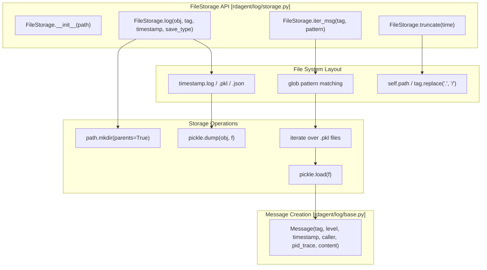
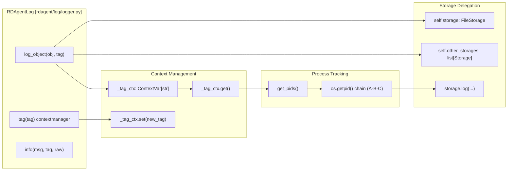
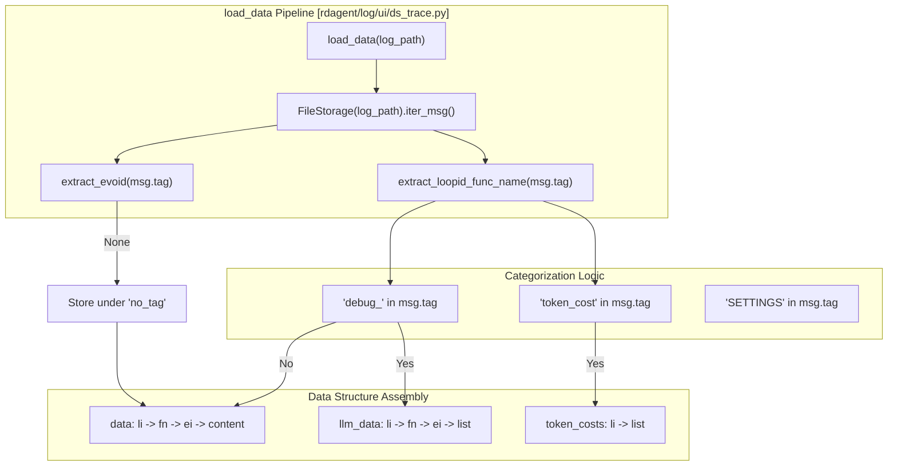
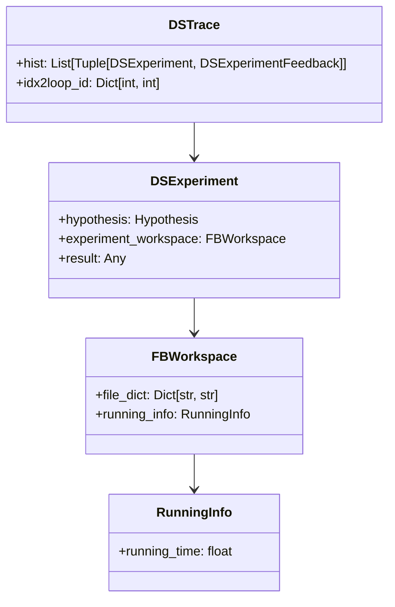
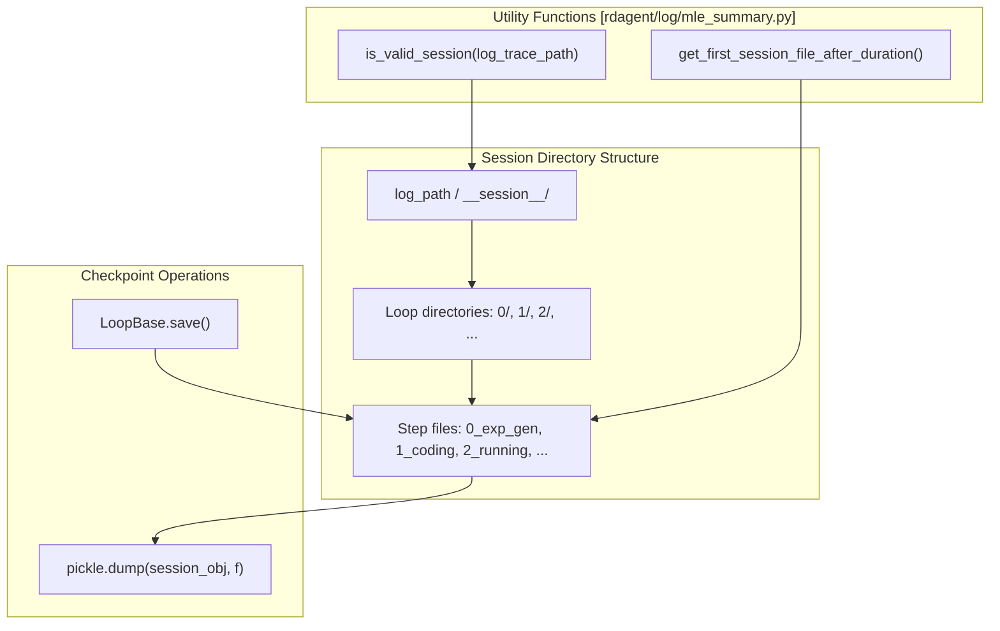
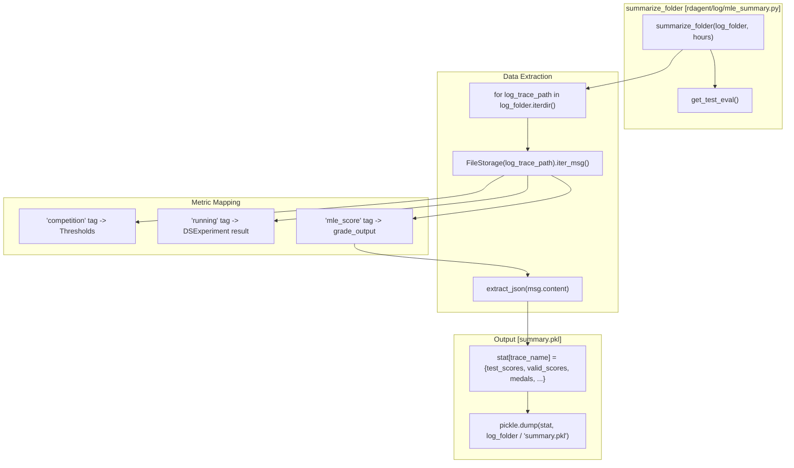
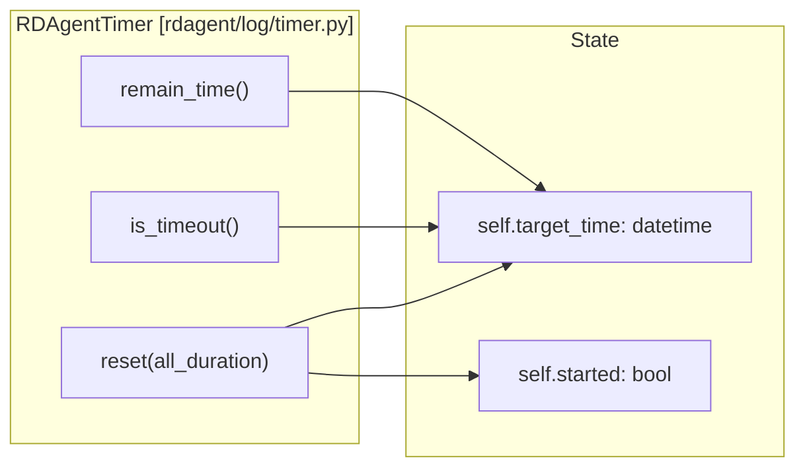

<!-- source: DeepWiki mcp.deepwiki.com · repo microsoft/RD-Agent · page 5.2 Logging and Trace Management · fetched 2026-10-26 -->

# Logging and Trace Management

Relevant source files

The following files were used as context for generating this wiki page:

- [rdagent/components/knowledge_management/graph.py](rdagent/components/knowledge_management/graph.py)
- [rdagent/components/knowledge_management/vector_base.py](rdagent/components/knowledge_management/vector_base.py)
- [rdagent/log/base.py](rdagent/log/base.py)
- [rdagent/log/logger.py](rdagent/log/logger.py)
- [rdagent/log/mle_summary.py](rdagent/log/mle_summary.py)
- [rdagent/log/storage.py](rdagent/log/storage.py)
- [rdagent/log/timer.py](rdagent/log/timer.py)
- [rdagent/log/ui/ds_summary.py](rdagent/log/ui/ds_summary.py)
- [rdagent/log/ui/ds_trace.py](rdagent/log/ui/ds_trace.py)
- [rdagent/log/ui/dsapp.py](rdagent/log/ui/dsapp.py)
- [rdagent/log/ui/utils.py](rdagent/log/ui/utils.py)
- [rdagent/log/utils/__init__.py](rdagent/log/utils/__init__.py)
- [rdagent/log/utils/folder.py](rdagent/log/utils/folder.py)
- [rdagent/scenarios/data_science/proposal/exp_gen/idea_pool.py](rdagent/scenarios/data_science/proposal/exp_gen/idea_pool.py)
- [rdagent/scenarios/kaggle/experiment/templates/new-york-city-taxi-fare-prediction/model/model_linear.py](rdagent/scenarios/kaggle/experiment/templates/new-york-city-taxi-fare-prediction/model/model_linear.py)
- [test/utils/test_import.py](test/utils/test_import.py)

This document covers RD-Agent's comprehensive logging and trace management system, which captures detailed execution traces of R&D experiments, LLM interactions, and performance metrics. The system provides both programmatic access to logs and web-based visualization tools for monitoring and analysis.

For information about the web-based monitoring interface, see [Streamlit UI and Visualization](#5.1). For details about the core experiment execution that generates these traces, see [R&D Loop Framework](#2.1).

## Core Logging Infrastructure

The logging system is built around the `RDAgentLog` singleton class (defined in `rdagent/log/logger.py`) and the `FileStorage` backend (defined in `rdagent/log/storage.py`), which provides persistent storage for structured experiment traces. The system captures multiple types of data including experiment results, LLM interactions, timing information, and system settings.

### FileStorage Implementation

The `FileStorage` class provides the core storage backend using pickle files organized in a hierarchical directory structure:

**File Path Structure:** Tags are converted to directory paths by replacing dots with slashes. For example, `Loop_1.coding.evolving_code` becomes `Loop_1/coding/evolving_code/{timestamp}.pkl` [rdagent/log/storage.py:49-52]().

**Sources:** [rdagent/log/storage.py:28-117](), [rdagent/log/base.py:12-23]()

### RDAgentLog Coordination Layer

The `RDAgentLog` singleton coordinates logging calls across the codebase and manages tag context using `ContextVar` [rdagent/log/logger.py:44-64]().

**Sources:** [rdagent/log/logger.py:20-154]()

### Data Loading and Processing

The `load_data` function in `rdagent/log/ui/ds_trace.py` processes raw log files into structured data for visualization. It handles the "no_tag" convention for entries without evolution IDs [rdagent/log/ui/ds_trace.py:74-169]().

**"no_tag" Convention:** Entries without an evolution ID (ei) are stored under the `"no_tag"` key. This includes base experiments and final results for specific stages [rdagent/log/ui/ds_trace.py:78-86]().

**Sources:** [rdagent/log/ui/ds_trace.py:74-169](), [rdagent/log/utils/__init__.py:87-98]()

### Message Tagging System

The logging system uses a hierarchical tagging scheme to organize and retrieve different types of logged data:

| Tag Pattern | Purpose | Example |
|-------------|---------|---------|
| `Loop_{id}.{function}.{tag}` | Core experiment phases | `Loop_1.direct_exp_gen.hypothesis` |
| `debug_llm` | LLM API calls and responses | `debug_llm.Loop_1.exp_gen.evo_0` |
| `debug_tpl` | Template rendering debug | `debug_tpl.Loop_1.coding.evo_0` |
| `token_cost` | LLM token usage | `Loop_1.exp_gen.token_cost` |
| `competition` | Dataset/competition info | `competition` |
| `SETTINGS` | System configuration | `SETTINGS.DS_RD_SETTING` |

**Sources:** [rdagent/log/ui/ds_trace.py:91-139](), [rdagent/log/utils/__init__.py:87-98]()

## Trace Data Model

### Experiment Trace Structure

Experiment traces are managed through the `DSTrace` class (referenced in UI logic) and contain sequences of `DSExperiment` and `ExperimentFeedback` [rdagent/log/ui/ds_trace.py:560-584]().

**Sources:** [rdagent/log/ui/ds_trace.py:560-584](), [rdagent/scenarios/data_science/experiment/experiment.py:24](), [rdagent/core/experiment.py:9]()

## Session Management and Checkpointing

The logging system supports session checkpointing for resuming interrupted experiments through the `__session__` directory structure [rdagent/log/utils/__init__.py:83-84]().

### Session Storage Layout

**Sources:** [rdagent/log/mle_summary.py:54-72](), [rdagent/log/utils/__init__.py:83-84](), [rdagent/log/utils/folder.py:13]()

## MLE Summary and Analytics

The `MLETestEval` system generates performance reports that are stored and aggregated for analysis.

### Summary Generation Process

The `summarize_folder` function iterates through experiment logs to extract scores and competition thresholds [rdagent/log/mle_summary.py:74-222]().

**Sources:** [rdagent/log/mle_summary.py:74-222](), [rdagent/log/ui/utils.py:146-161]()

### Key Analytics Metrics

| Metric | Code Source | Purpose |
|--------|-------------|---------|
| **SOTA Exp Stat** | `get_sota_exp_stat` [rdagent/log/ui/utils.py:186]() | Identifies the best experiment based on valid/test scores. |
| **Valid/Test Improve** | `get_score_stat` [rdagent/log/ui/utils.py:266]() | Calculates percentage improvement relative to baselines. |
| **Token Cost** | `load_data` [rdagent/log/ui/ds_trace.py:115]() | Tracks LLM spending per loop/function. |
| **Medal Thresholds** | `summarize_folder` [rdagent/log/mle_summary.py:134]() | Maps scores to MLE-Bench medal tiers (Gold, Silver, Bronze). |

**Sources:** [rdagent/log/ui/utils.py:186-362](), [rdagent/log/mle_summary.py:146-165]()

## Timer Management

The `RDAgentTimer` provides countdown functionality for experiments with time constraints, often used in MLE-Bench scenarios [rdagent/log/timer.py:8-74]().

**Sources:** [rdagent/log/timer.py:8-87]()

---

