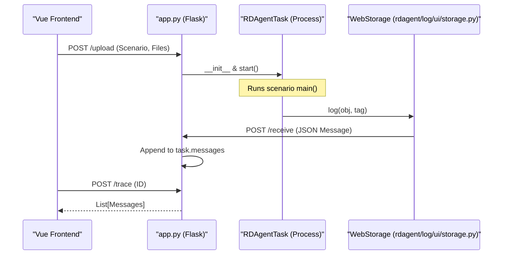
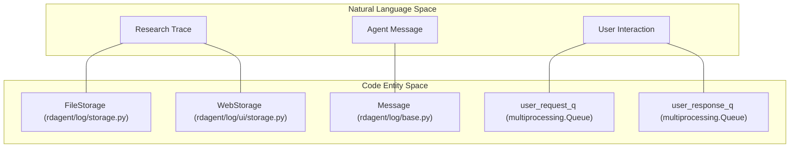
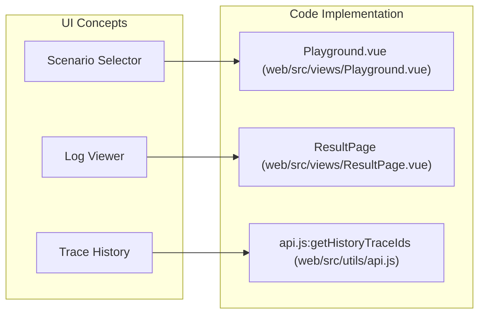

<!-- source: DeepWiki mcp.deepwiki.com · repo microsoft/RD-Agent · page 5.3 Web Server and Vue Frontend · fetched 2026-10-26 -->

# Web Server and Vue Frontend

Relevant source files

The following files were used as context for generating this wiki page:

- [rdagent/log/server/README.md](rdagent/log/server/README.md)
- [rdagent/log/server/app.py](rdagent/log/server/app.py)
- [rdagent/log/server/debug_app.py](rdagent/log/server/debug_app.py)
- [rdagent/log/ui/storage.py](rdagent/log/ui/storage.py)
- [web/package-lock.json](web/package-lock.json)
- [web/package.json](web/package.json)
- [web/src/utils/api.js](web/src/utils/api.js)
- [web/src/views/Playground.vue](web/src/views/Playground.vue)

The RD-Agent system provides a modern web interface for orchestrating autonomous research tasks and visualizing the multi-step evolution of code and hypotheses. This interface consists of a **Flask-based backend server** and a **Vue.js frontend**. The system supports real-time monitoring of agent progress, interactive user feedback loops, and historical trace exploration.

## Backend Architecture (Flask)

The backend server serves as the bridge between the frontend UI and the long-running RD-Agent subprocesses. It handles task lifecycle management, log streaming, and Inter-Process Communication (IPC) for user interactions.

### RDAgentTask Management
Each research session is encapsulated in an `RDAgentTask` object. This class manages a dedicated `multiprocessing.Process` to ensure that the heavy lifting of the RD-Agent (LLM calls, code execution in Docker/Conda) does not block the web server's responsiveness [rdagent/log/server/app.py:52-71]().

**Key Functions:**
- `start()`: Launches the subprocess [rdagent/log/server/app.py:88-90]().
- `stop()`: Terminates the subprocess and cleans up IPC queues [rdagent/log/server/app.py:100-115]().
- `_run()`: The entry point for the subprocess. It rebinds `stdout` and `stderr` to a file and initializes the specific scenario loop (e.g., `data_science`, `fin_quant`) [rdagent/log/server/app.py:116-169]().

### Inter-Process Communication (IPC)
The server uses two `multiprocessing.Queue` instances per task to facilitate human-in-the-loop interactions:
1. `user_request_q`: Used by the agent to send requests for information or approval to the frontend [rdagent/log/server/app.py:77]().
2. `user_response_q`: Used by the server to send user input back to the agent [rdagent/log/server/app.py:78]().

### REST API Endpoints
The server exposes several endpoints for frontend communication:

| Endpoint | Method | Description |
| :--- | :--- | :--- |
| `/upload` | POST | Starts a new agent task based on scenario and uploaded files [rdagent/log/server/app.py:302](). |
| `/trace` | POST | Fetches new log messages for a specific trace ID using a pointer mechanism [rdagent/log/server/app.py:228](). |
| `/control` | POST | Pauses, resumes, or stops a running agent task [rdagent/log/server/app.py:254](). |
| `/receive` | POST | Internal endpoint used by `WebStorage` to push messages into the server's memory [rdagent/log/server/app.py:276](). |
| `/user_interaction/submit` | POST | Submits user responses to the `user_response_q` [rdagent/log/server/app.py:288](). |

### Backend Process and Data Flow
This diagram illustrates how the `app.py` server manages the `RDAgentTask` and communicates with the `WebStorage` logging component.

**Sources:** [rdagent/log/server/app.py:52-171](), [rdagent/log/ui/storage.py:13-52](), [rdagent/log/server/README.md:5-53]()

---

## Message Protocol and Storage

The system uses a standardized JSON message protocol to communicate agent states. Messages are categorized by tags such as `research.hypothesis`, `evolving.codes`, and `feedback.metric` [rdagent/log/server/README.md:57-241]().

### WebStorage Implementation
The `WebStorage` class in `rdagent/log/ui/storage.py` is a specialized `Storage` implementation that converts complex Python objects (like `Hypothesis` or `FactorTask`) into JSON format suitable for the frontend [rdagent/log/ui/storage.py:13-72](). It uses the `/receive` endpoint to update the server's message buffer [rdagent/log/ui/storage.py:49]().

### Natural Language to Code Entity Mapping: Logging
This diagram maps the conceptual "Trace" to the specific code entities that handle its lifecycle.

**Sources:** [rdagent/log/ui/storage.py:13-107](), [rdagent/log/server/app.py:73-80](), [rdagent/log/base.py:1-20]()

---

## Frontend Architecture (Vue.js)

The frontend is a Vite-powered Vue 3 application utilizing `element-plus` for UI components and `echarts` for visualizations [web/package.json:12-29]().

### Key Views
1.  **Playground (`Playground.vue`)**:
    *   The entry point where users select a scenario (e.g., "Continuous Exploration" vs "Guided Implementation") [web/src/views/Playground.vue:81-102]().
    *   Handles file uploads for research reports (PDFs) or base factors (JSON/Python) [web/src/views/Playground.vue:128-180]().
    *   Manages the selection of Kaggle competitions or custom scenarios [web/src/views/Playground.vue:111-115]().
2.  **Result Page**:
    *   Displays the real-time execution trace.
    *   Visualizes the evolution of code and the resulting metrics (e.g., IC, Rank IC for finance; accuracy for DS).

### API Integration
The frontend communicates with the Flask server through a set of utility functions in `web/src/utils/api.js`. These functions use `axios` to perform REST requests [web/src/utils/api.js:1-59]().

| Function | API Endpoint |
| :--- | :--- |
| `uploadFile` | `/upload` |
| `trace` | `/trace` |
| `control` | `/control` |
| `submitUserInteraction` | `/user_interaction/submit` |

### Natural Language to Code Entity Mapping: UI
Mapping UI concepts to their implementation files.

**Sources:** [web/src/views/Playground.vue:1-180](), [web/src/utils/api.js:5-64](), [web/package.json:1-44]()

---

## Execution and Deployment

The web server can be started via the CLI, which configures the static folder to serve the compiled Vue assets.

- **Static Assets**: The Flask app is configured to serve static files from the path defined in `UI_SETTING.static_path` [rdagent/log/server/app.py:22]().
- **Build Process**: The Vue frontend is built using `vite build`, and the output is typically directed to a folder that the Flask app can access (e.g., `../git_ignore_folder/static`) [web/package.json:9]().
- **Development**: For development, `debug_app.py` provides a simplified server that can mock trace data by reading from existing log files [rdagent/log/server/debug_app.py:91-109]().

**Sources:** [rdagent/log/server/app.py:22-46](), [rdagent/log/server/debug_app.py:1-175](), [web/package.json:1-11]()

---

