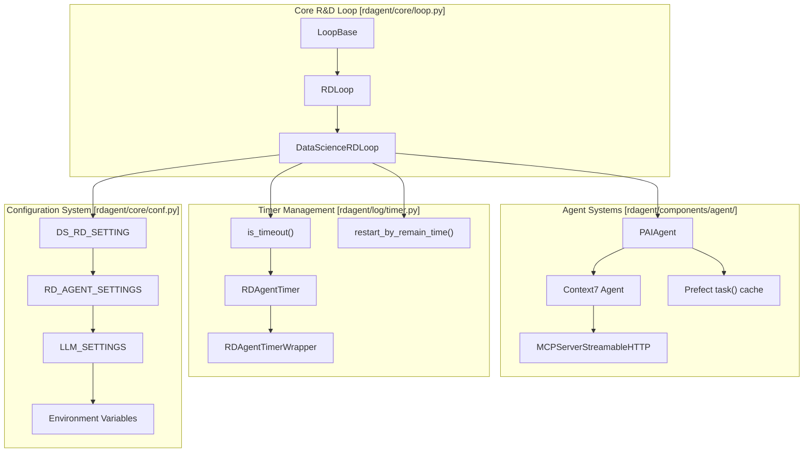
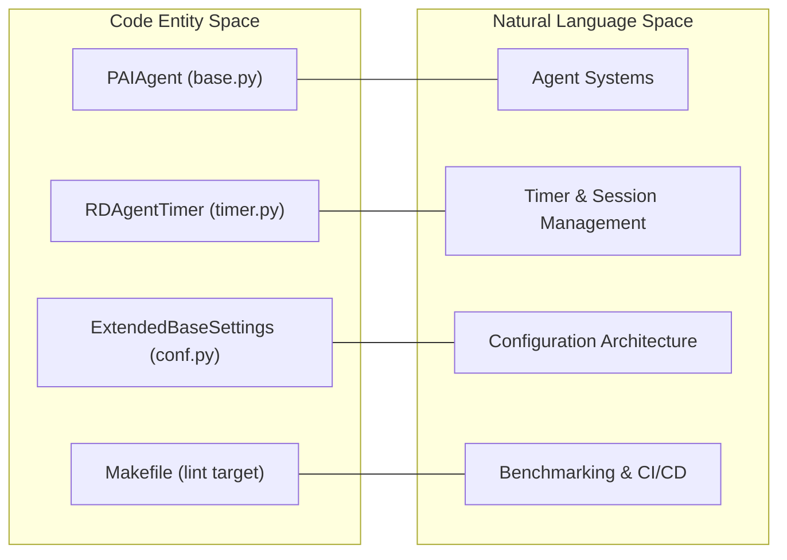

<!-- source: DeepWiki mcp.deepwiki.com · repo microsoft/RD-Agent · page 6 Advanced Topics · fetched 2026-10-26 -->

# Advanced Topics

Relevant source files

The following files were used as context for generating this wiki page:

- [.github/workflows/ci.yml](.github/workflows/ci.yml)
- [.gitignore](.gitignore)
- [Makefile](Makefile)
- [constraints/3.10.txt](constraints/3.10.txt)
- [constraints/3.11.txt](constraints/3.11.txt)
- [rdagent/app/CI/README.md](rdagent/app/CI/README.md)
- [rdagent/app/CI/run.py](rdagent/app/CI/run.py)
- [rdagent/components/agent/__init__.py](rdagent/components/agent/__init__.py)
- [rdagent/components/agent/base.py](rdagent/components/agent/base.py)
- [rdagent/components/agent/context7/prompts.yaml](rdagent/components/agent/context7/prompts.yaml)
- [rdagent/components/agent/mcp/__init__.py](rdagent/components/agent/mcp/__init__.py)
- [rdagent/core/prompts.py](rdagent/core/prompts.py)
- [rdagent/oai/backend/__init__.py](rdagent/oai/backend/__init__.py)
- [requirements.txt](requirements.txt)
- [test/oai/test_prefect_cache.py](test/oai/test_prefect_cache.py)
- [test/utils/test_misc.py](test/utils/test_misc.py)

This document covers specialized systems that extend RD-Agent's core R&D loop capabilities with advanced integrations, time management, configuration infrastructure, and benchmarking. These systems enable production-grade deployments with external tool integrations, controlled execution budgets, and flexible runtime configuration.

The four major advanced topics are:
- **Agent Systems and MCP Integration** ([Agent Systems and MCP Integration](#6.1)): External tool integration via `pydantic-ai` and Model Context Protocol (MCP) servers.
- **Timer and Session Management** ([Timer and Session Management](#6.2)): Time budget controls and session restoration with timer state preservation.
- **Configuration System Architecture** ([Configuration System Architecture](#6.3)): Pydantic-based settings hierarchy with environment variable overrides and dynamic component loading.
- **Benchmarking and CI/CD** ([Benchmarking and CI/CD](#6.4)): Automated testing, linting, and performance benchmarking for R&D components.

For basic setup, see [Installation and Configuration](). For core loop execution, see [R&D Loop Framework]().

## Integration with Core R&D Loop

The advanced systems integrate with the core R&D loop at specific control points, providing cross-cutting concerns that affect all scenarios (data science, Kaggle, quantitative finance).

**Diagram: Advanced Systems Integration Points**

Sources: [rdagent/app/data_science/loop.py:15-76](), [rdagent/log/timer.py:8-86](), [rdagent/components/agent/base.py:21-79](), [rdagent/core/conf.py:13-108]()

## Advanced System Overview

### Agent Systems and MCP Integration (#6.1)

The agent system provides external tool integration through `pydantic-ai`'s `Agent` framework and Model Context Protocol (MCP) servers. This enables RD-Agent to query documentation and access external knowledge bases during the R&D loop.

**Key Components:**
- `PAIAgent`: Base class wrapping `pydantic_ai.Agent` with optional Prefect caching [rdagent/components/agent/base.py:21-80]().
- `Context7 Agent`: Specialized agent for documentation search and error resolution.
- `MCPServerStreamableHTTP`: HTTP-based MCP server communication [rdagent/components/agent/base.py:7-48]().
- `Prefect` integration: Uses `@task(cache_policy=INPUTS)` for persistent caching of agent queries [rdagent/components/agent/base.py:53-54]().

For details, see [Agent Systems and MCP Integration](#6.1).

### Timer and Session Management (#6.2)

The timer system enforces time budgets across R&D loop execution and preserves remaining time during session checkpointing. This enables controlled experiments with deadline constraints and resumable long-running workflows.

**Key Components:**
- `RDAgentTimer`: Core timer with `is_timeout()` and `remain_time()` methods [rdagent/log/timer.py:8-40]().
- `RDAgentTimerWrapper`: Singleton wrapper managing global timer state [rdagent/log/timer.py:41-86]().
- Session integration: Timer state is serialized to allow loop resumption after interruptions [rdagent/app/data_science/loop.py:70-76]().

For details, see [Timer and Session Management](#6.2).

### Configuration System Architecture (#6.3)

The configuration system provides a Pydantic-based settings hierarchy with multi-source configuration merging and environment variable overrides.

**Key Components:**
- `ExtendedBaseSettings`: Base class for multi-source configuration [rdagent/core/conf.py:13-44]().
- `RD_AGENT_SETTINGS`: Global singleton for system-wide settings [rdagent/core/conf.py:46-108]().
- `LLM_SETTINGS`: Backend selection and API credentials management [rdagent/oai/llm_utils.py:35-44]().

For details, see [Configuration System Architecture](#6.3).

### Benchmarking and CI/CD (#6.4)

RD-Agent maintains a robust CI pipeline and benchmarking framework to ensure the quality of generated code and the reliability of R&D components.

**Key Components:**
- **CI Workflows**: Automated linting (`black`, `isort`, `mypy`, `ruff`) and testing via GitHub Actions [Makefile:85-112](), [.github/workflows/ci.yml:1-70]().
- **CI Fix Tool**: Uses `tree-sitter-python` to analyze and fix code errors detected by linters [rdagent/app/CI/run.py:38-182]().
- **Dependency Management**: Uses Python version-specific constraints (e.g., `constraints/3.10.txt`) to ensure environment reproducibility [constraints/3.10.txt:1-6]().

For details, see [Benchmarking and CI/CD](#6.4).

## Cross-Cutting Integration Patterns

**Diagram: Code Entity Space to Natural Language Space**

This diagram bridges the code-level identifiers with the high-level advanced concepts.

Sources: [rdagent/components/agent/base.py:21-29](), [rdagent/log/timer.py:8-12](), [rdagent/core/conf.py:13-15](), [Makefile:111-112]()

### System Integration and Extensibility

The advanced features of RD-Agent are designed to work together through standardized interfaces. For instance, `PAIAgent` utilizes the configuration system to determine if `enable_cache` is active [rdagent/components/agent/base.py:33-54](), while the CI tool `CodeFile` manages file operations during automated error correction [rdagent/app/CI/run.py:90-181]().

Sources: [rdagent/components/agent/base.py:21-79](), [rdagent/app/CI/run.py:90-181](), [rdagent/core/conf.py:13-108]()

---

