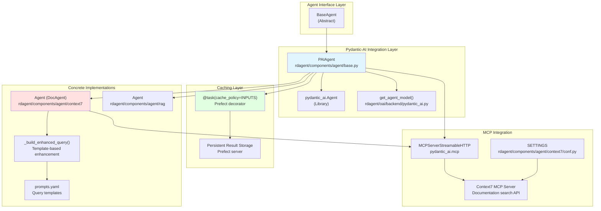
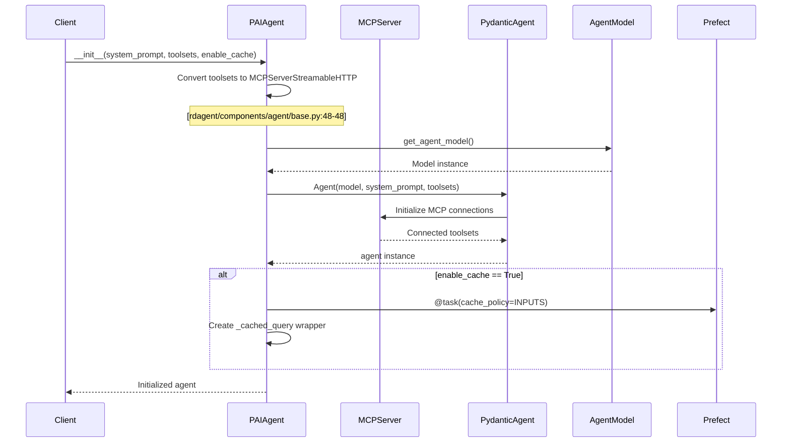
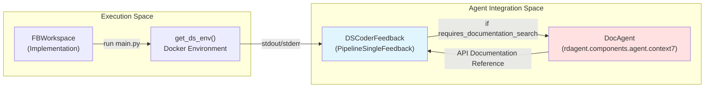

<!-- source: DeepWiki mcp.deepwiki.com · repo microsoft/RD-Agent · page 6.1 Agent Systems and MCP Integration · fetched 2026-10-26 -->

# Agent Systems and MCP Integration

Relevant source files

The following files were used as context for generating this wiki page:

- [.gitignore](.gitignore)
- [constraints/3.10.txt](constraints/3.10.txt)
- [constraints/3.11.txt](constraints/3.11.txt)
- [rdagent/components/agent/__init__.py](rdagent/components/agent/__init__.py)
- [rdagent/components/agent/base.py](rdagent/components/agent/base.py)
- [rdagent/components/agent/context7/__init__.py](rdagent/components/agent/context7/__init__.py)
- [rdagent/components/agent/context7/conf.py](rdagent/components/agent/context7/conf.py)
- [rdagent/components/agent/context7/prompts.yaml](rdagent/components/agent/context7/prompts.yaml)
- [rdagent/components/agent/mcp/__init__.py](rdagent/components/agent/mcp/__init__.py)
- [rdagent/components/agent/rag/__init__.py](rdagent/components/agent/rag/__init__.py)
- [rdagent/components/agent/rag/conf.py](rdagent/components/agent/rag/conf.py)
- [rdagent/components/coder/data_science/pipeline/eval.py](rdagent/components/coder/data_science/pipeline/eval.py)
- [rdagent/components/coder/data_science/workflow/eval.py](rdagent/components/coder/data_science/workflow/eval.py)
- [rdagent/oai/backend/__init__.py](rdagent/oai/backend/__init__.py)
- [rdagent/scenarios/data_science/dev/runner/eval.py](rdagent/scenarios/data_science/dev/runner/eval.py)
- [requirements.txt](requirements.txt)
- [test/oai/test_prefect_cache.py](test/oai/test_prefect_cache.py)

## Purpose and Scope

This document covers the agent framework built on Pydantic-AI that integrates with MCP (Model Context Protocol) servers and Prefect caching. The agent system provides a standardized interface for LLM-powered agents that can access external tools and services via MCP while leveraging persistent caching for performance optimization. It specifically details the `PAIAgent` base class, the `Context7` documentation search integration, the `RAGAgent` implementation, and the documentation search patterns used in Data Science pipelines.

**Sources:** [rdagent/components/agent/base.py:1-80](), [rdagent/components/agent/context7/__init__.py:1-60](), [requirements.txt:74-80]()

## Architecture Overview

The agent system consists of three main layers: the abstract agent interface, the Pydantic-AI implementation with MCP support, and concrete agent implementations like `Context7` and `RAGAgent`.

**Diagram: Agent System Architecture**

**Sources:** [rdagent/components/agent/base.py:1-80](), [rdagent/components/agent/context7/__init__.py:1-60](), [rdagent/components/agent/rag/__init__.py:1-18]()

## PAIAgent Framework

The `PAIAgent` class in [rdagent/components/agent/base.py:21-26]() provides a base implementation for all Pydantic-AI based agents. It wraps the Pydantic-AI agent library and adds RD-Agent specific functionality.

### Core Components

| Component | Type | Purpose |
|-----------|------|---------|
| `BaseAgent` | Abstract Base Class | Defines agent interface contract [rdagent/components/agent/base.py:12-20]() |
| `PAIAgent` | Concrete Implementation | Pydantic-AI wrapper with caching [rdagent/components/agent/base.py:21-80]() |
| `agent` | `pydantic_ai.Agent` | Underlying Pydantic-AI agent instance [rdagent/components/agent/base.py:26-26]() |
| `enable_cache` | `bool` | Flag to enable Prefect-based caching [rdagent/components/agent/base.py:27-27]() |
| `_cached_query` | Prefect Task | Cached version of query execution [rdagent/components/agent/base.py:54-54]() |

### Initialization Flow

The initialization process handles multiple toolset formats and conditionally wraps the query function with Prefect caching:

**Diagram: PAIAgent Initialization Sequence**

**Sources:** [rdagent/components/agent/base.py:29-80](), [rdagent/oai/backend/pydantic_ai.py]()

### Query Execution

The `query()` method [rdagent/components/agent/base.py:64-80]() provides two execution paths depending on whether caching is enabled. Key implementation details include:
- `nest_asyncio.apply()` is used in `_run_query` [rdagent/components/agent/base.py:60-60]() to support synchronous execution of asynchronous Pydantic-AI logic.
- Pydantic-AI's `run_sync()` [rdagent/components/agent/base.py:61-61]() executes the agent.
- Prefect's `@task` decorator [rdagent/components/agent/base.py:54-54]() manages the cache lookup.

**Sources:** [rdagent/components/agent/base.py:56-79]()

## MCP Integration

The system uses `MCPServerStreamableHTTP` to connect to MCP servers via HTTP.

### MCP Server Configuration

Each MCP-based agent has a configuration class inheriting from `pydantic_settings.BaseSettings`. For example, Context7 configuration:

| Setting | Type | Default | Env Prefix |
|---------|------|---------|------------|
| `url` | `str` | `http://localhost:8124/mcp` | `CONTEXT7_URL` |
| `timeout` | `int` | `120` | `CONTEXT7_TIMEOUT` |
| `enable_cache` | `bool` | `False` | `CONTEXT7_ENABLE_CACHE` |

**Sources:** [rdagent/components/agent/context7/conf.py:17-31](), [rdagent/components/agent/rag/conf.py]()

### Toolset Initialization

The `PAIAgent` constructor normalizes toolset inputs:
`toolsets = [(ts if isinstance(ts, MCPServerStreamableHTTP) else MCPServerStreamableHTTP(ts)) for ts in toolsets]` [rdagent/components/agent/base.py:48-48]().

This allows callers to pass either string URLs or pre-configured `MCPServerStreamableHTTP` instances.

**Sources:** [rdagent/components/agent/base.py:32-49]()

## Context7 and RAG Agents

### Context7 Documentation Agent
`Context7` is a specialized agent defined in [rdagent/components/agent/context7/__init__.py:11-14]() (often aliased as `DocAgent`) used for searching external library documentation when errors occur during pipeline execution.

It enhances queries by detecting specific libraries (like `timm`) and providing code context:
- `_build_enhanced_query`: Uses `context7_enhanced_query_template` and `code_context_template` [rdagent/components/agent/context7/__init__.py:25-44]().
- `query`: Wraps the input error message with context before calling the base query [rdagent/components/agent/context7/__init__.py:46-59]().

### RAGAgent
The `RAGAgent` in [rdagent/components/agent/rag/__init__.py:8-11]() provides a general Retrieval-Augmented Generation interface. It uses its own MCP server URL defined in `SETTINGS.url` from [rdagent/components/agent/rag/conf.py]().

**Sources:** [rdagent/components/agent/context7/__init__.py:1-60](), [rdagent/components/agent/rag/__init__.py:1-18]()

## Integration in Data Science Pipeline

The agent system is integrated into the Data Science evaluation flow to provide automated documentation search when code fails.

### Pipeline Feedback and Search

In `PipelineCoSTEEREvaluator`, the `DSCoderFeedback` class (aliased as `PipelineSingleFeedback`) tracks if documentation search is required:
- `requires_documentation_search`: A boolean field in `DSCoderFeedback` [rdagent/components/coder/data_science/pipeline/eval.py:39-39]().
- `error_message`: Stores analysis results or Context7 API documentation references [rdagent/components/coder/data_science/pipeline/eval.py:40-40]().

### Data Science Evaluation Data Flow

**Diagram: Data Science Evaluation and Agent Integration**

**Sources:** [rdagent/components/coder/data_science/pipeline/eval.py:32-132](), [rdagent/scenarios/data_science/dev/runner/eval.py:72-160]()

## Prefect Caching System

Prefect caching provides persistent LLM response caching. When `enable_cache` is `True`, `PAIAgent` wraps the query in a Prefect task:
`self._cached_query = task(cache_policy=INPUTS, persist_result=True)(self._run_query)` [rdagent/components/agent/base.py:54-54]().

### Configuration Requirements
1. **Prefect Server**: Must be running (`prefect server start`).
2. **API URL**: `PREFECT_API_URL` must be set in the environment [rdagent/components/agent/base.py:45-46]().
3. **Policy**: Uses `INPUTS` policy, meaning it caches based on the input query string [rdagent/components/agent/base.py:54-54]().

**Sources:** [rdagent/components/agent/base.py:29-79](), [test/oai/test_prefect_cache.py:1-55]()

## Summary of Agent Classes

| Class | File | Role |
|-------|------|------|
| `BaseAgent` | `rdagent/components/agent/base.py` | Abstract interface |
| `PAIAgent` | `rdagent/components/agent/base.py` | Core logic for Pydantic-AI + MCP + Prefect |
| `Agent` (DocAgent) | `rdagent/components/agent/context7/__init__.py` | Documentation search specialist |
| `Agent` (RAG) | `rdagent/components/agent/rag/__init__.py` | General RAG agent |

**Sources:** [rdagent/components/agent/base.py:1-80](), [rdagent/components/agent/context7/__init__.py:1-60](), [rdagent/components/agent/rag/__init__.py:1-18]()

---

