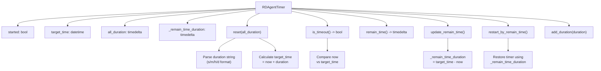
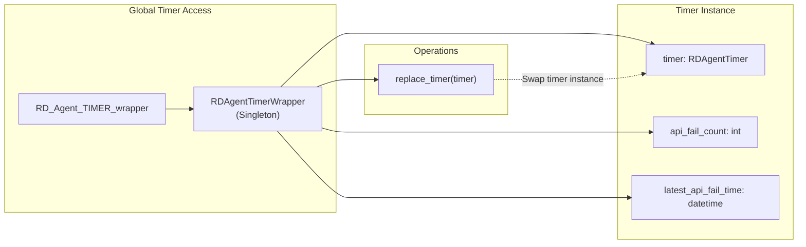
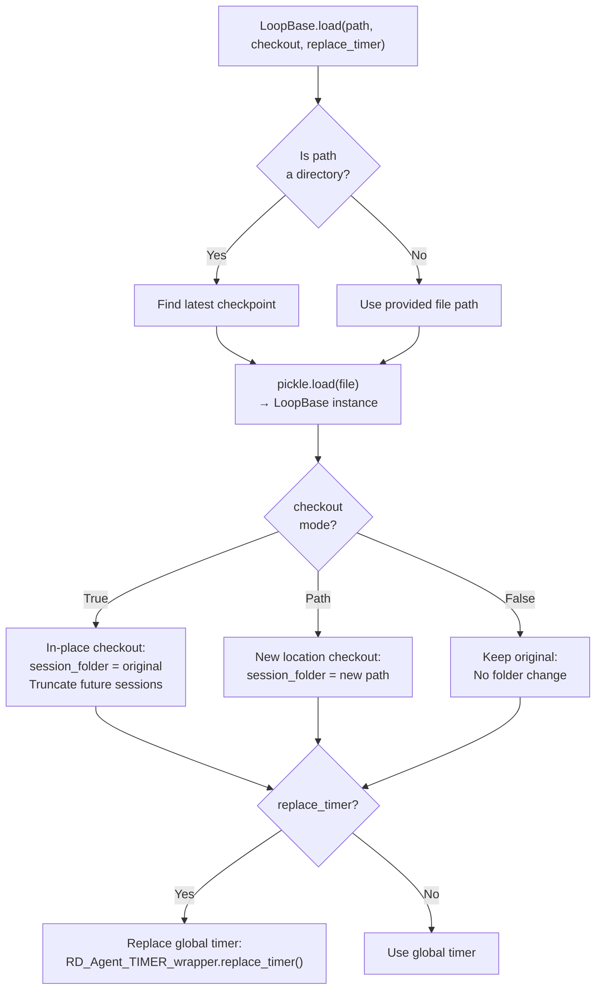
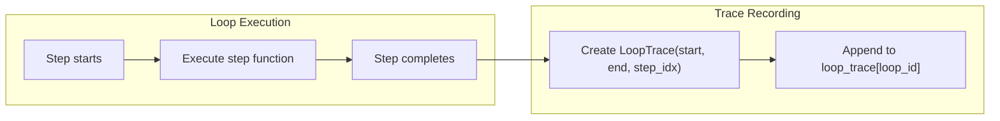
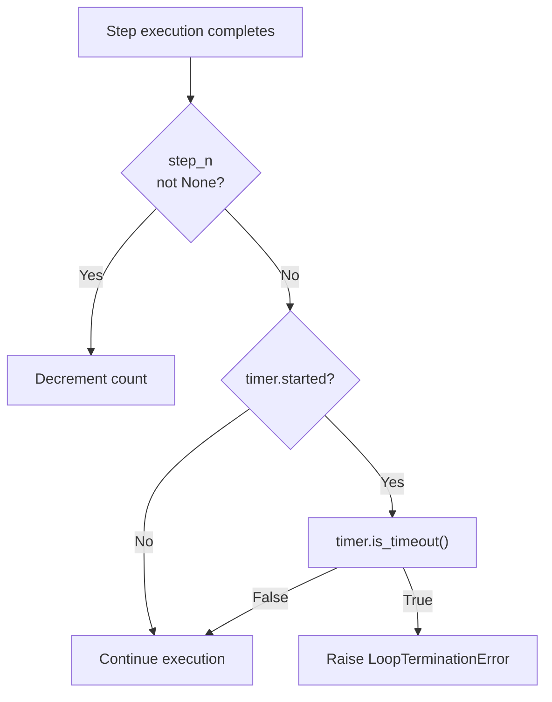
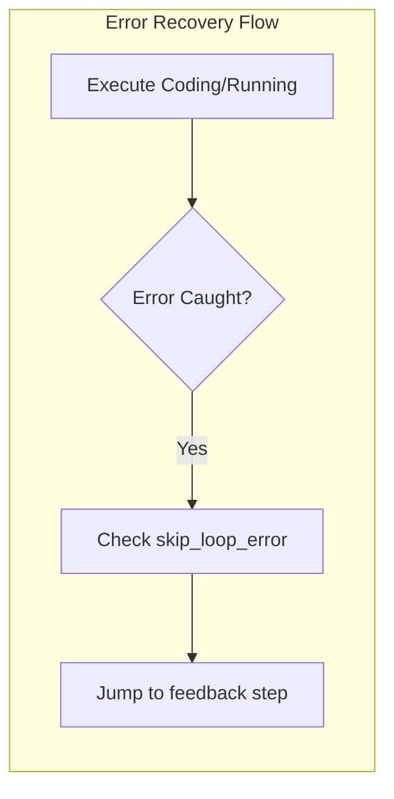

<!-- source: DeepWiki mcp.deepwiki.com · repo microsoft/RD-Agent · page 6.2 Timer and Session Management · fetched 2026-10-26 -->

# Timer and Session Management

<details>
<summary>Relevant source files</summary>

The following files were used as context for generating this wiki page:

- [rdagent/app/cli.py](rdagent/app/cli.py)
- [rdagent/app/data_science/loop.py](rdagent/app/data_science/loop.py)
- [rdagent/app/general_model/general_model.py](rdagent/app/general_model/general_model.py)
- [rdagent/app/qlib_rd_loop/factor.py](rdagent/app/qlib_rd_loop/factor.py)
- [rdagent/app/qlib_rd_loop/factor_from_report.py](rdagent/app/qlib_rd_loop/factor_from_report.py)
- [rdagent/app/qlib_rd_loop/model.py](rdagent/app/qlib_rd_loop/model.py)
- [rdagent/app/qlib_rd_loop/quant.py](rdagent/app/qlib_rd_loop/quant.py)
- [rdagent/components/interactor/__init__.py](rdagent/components/interactor/__init__.py)
- [rdagent/components/knowledge_management/graph.py](rdagent/components/knowledge_management/graph.py)
- [rdagent/components/knowledge_management/vector_base.py](rdagent/components/knowledge_management/vector_base.py)
- [rdagent/components/workflow/conf.py](rdagent/components/workflow/conf.py)
- [rdagent/components/workflow/rd_loop.py](rdagent/components/workflow/rd_loop.py)
- [rdagent/core/interactor.py](rdagent/core/interactor.py)
- [rdagent/log/timer.py](rdagent/log/timer.py)
- [rdagent/log/ui/ds_user_interact.py](rdagent/log/ui/ds_user_interact.py)
- [rdagent/scenarios/data_science/experiment/experiment.py](rdagent/scenarios/data_science/experiment/experiment.py)
- [rdagent/scenarios/data_science/interactor/__init__.py](rdagent/scenarios/data_science/interactor/__init__.py)
- [rdagent/scenarios/data_science/proposal/exp_gen/idea_pool.py](rdagent/scenarios/data_science/proposal/exp_gen/idea_pool.py)
- [rdagent/scenarios/qlib/proposal/quant_proposal.py](rdagent/scenarios/qlib/proposal/quant_proposal.py)
- [rdagent/utils/workflow/loop.py](rdagent/utils/workflow/loop.py)

</details>


This document describes the timer and session management systems in RD-Agent, which provide time-constrained execution and stateful checkpoint/resume capabilities for R&D loops. The timer system enforces duration limits on experiments, while the session management system enables saving and restoring workflow state at any point during execution.

For information about the overall loop execution framework, see [R&D Loop Framework](). For details about workflow tracking and visualization, see [Logging and Trace Management]().

## Purpose and Scope

The timer and session management subsystems serve two critical functions:

1. **Timer Management**: Control execution duration through `RDAgentTimer`, which tracks elapsed time, enforces timeout limits, and can be serialized for persistent state across sessions.
2. **Session Checkpointing**: Enable workflow resumption through `LoopBase`'s dump/load mechanism, which saves complete loop state to disk at each step and supports flexible restoration strategies.

These systems are tightly integrated with the core workflow execution in `LoopBase` and are essential for long-running experiments that may need to be interrupted, resumed, or extended.

Sources: [rdagent/log/timer.py:1-87](), [rdagent/utils/workflow/loop.py:1-32]()

## Timer System Architecture

### RDAgentTimer Class

The `RDAgentTimer` class provides duration-based execution control with support for various time units and persistent state management.



**Key Attributes:**
- `started`: Boolean flag indicating if timer is active [rdagent/log/timer.py:10]().
- `target_time`: Absolute datetime when timer expires [rdagent/log/timer.py:11]().
- `all_duration`: Original duration set for the timer [rdagent/log/timer.py:12]().
- `_remain_time_duration`: Cached remaining time, updated periodically [rdagent/log/timer.py:13]().

**Duration Format**: The `reset()` method accepts strings like `"3600s"`, `"60m"`, `"24h"`, `"7d"` or raw `timedelta` objects [rdagent/log/timer.py:15-35]().

Sources: [rdagent/log/timer.py:8-73]()

### RDAgentTimerWrapper Singleton

The `RDAgentTimerWrapper` provides global access to a single timer instance and supports timer replacement during session restoration.



The singleton pattern ensures all components reference the same timer instance [rdagent/log/timer.py:86](), which is critical when checking timeout conditions across different parts of the codebase.

Sources: [rdagent/log/timer.py:75-86]()

## Session Checkpointing System

### Session Folder Structure

Sessions are stored in a hierarchical folder structure under the log path's `__session__` directory [rdagent/utils/workflow/loop.py:127]():

```
{LOG_PATH}/__session__/
├── 0/                          # Loop 0
│   ├── 0_direct_exp_gen        # Step 0 checkpoint
│   ├── 1_coding                # Step 1 checkpoint
│   ├── 2_running               # Step 2 checkpoint
│   ├── 3_feedback              # Step 3 checkpoint
│   └── 4_record                # Step 4 checkpoint
├── 1/                          # Loop 1
│   ├── 0_direct_exp_gen
│   ├── 1_coding
│   └── ...
```

Each checkpoint file is a pickled `LoopBase` instance containing the complete state at that execution point.

Sources: [rdagent/utils/workflow/loop.py:127]()

### Dump Mechanism

The `dump()` method serializes the entire `LoopBase` instance to disk using Python's pickle module. It captures the `loop_idx`, `step_idx`, `loop_prev_out`, and the `timer` state [rdagent/utils/workflow/loop.py:115-134]().

**Excluded from Serialization**:
- `queue`: asyncio.Queue instance (recreated on load).
- `semaphores`: asyncio.Semaphore dict (recreated on load).
- `_pbar`: tqdm progress bar (recreated on demand) [rdagent/utils/workflow/loop.py:161-165]().

Sources: [rdagent/utils/workflow/loop.py:115-136]()

### Load and Restore Process

The `load()` classmethod restores a session from disk with flexible checkout options. This is extensively used in the CLI applications to resume interrupted research loops.



**Checkout Modes (CLI usage):**
- **In-place** (`checkout=True`): The new loop will use the existing folder and clear logs for sessions after the restoration point [rdagent/app/data_science/loop.py:30-32]().
- **New Location** (`checkout_path`): If a path is provided, the new loop will be saved there, leaving the original path unchanged [rdagent/app/data_science/loop.py:34-35]().

Sources: [rdagent/app/data_science/loop.py:13-60](), [rdagent/app/qlib_rd_loop/factor.py:30-57]()

## Loop State Management

### Core State Attributes

The `LoopBase` class maintains several key data structures for tracking execution progress:

| Attribute | Type | Purpose |
|-----------|------|---------|
| `loop_idx` | `int` | Current loop index [rdagent/utils/workflow/loop.py:118](). |
| `step_idx` | `defaultdict[int, int]` | Maps loop index to next step index [rdagent/utils/workflow/loop.py:119](). |
| `loop_prev_out` | `dict[int, dict]` | Stores step results for all loops [rdagent/utils/workflow/loop.py:125](). |
| `loop_trace` | `dict[int, list[LoopTrace]]` | Records start/end times for each step [rdagent/utils/workflow/loop.py:126](). |
| `timer` | `RDAgentTimer` | The timer instance associated with the session [rdagent/utils/workflow/loop.py:128](). |

Sources: [rdagent/utils/workflow/loop.py:116-130]()

### Progress Tracking with LoopTrace

`LoopTrace` objects record timing information for each executed step:



Sources: [rdagent/utils/workflow/loop.py:77-82]()

## Timer-Session Integration

### Timeout Checking During Execution

The timer is checked at the end of each step. If `is_timeout()` returns true, the loop raises a `LoopTerminationError` [rdagent/utils/workflow/loop.py:110]().



Sources: [rdagent/log/timer.py:56-61](), [rdagent/utils/workflow/loop.py:172-182]()

## Error Handling and Loop Recovery

### Skip and Withdraw Strategies

`LoopBase` defines mechanisms to handle errors by either skipping a loop or withdrawing to a previous state:

- **Skip Loop**: Define `skip_loop_error` (e.g., `FactorEmptyError`, `CoderError`) to skip the current iteration and jump to a specific step, usually `feedback` [rdagent/app/qlib_rd_loop/factor.py:18-19]().
- **Withdraw Loop**: Define `withdraw_loop_error` to revert the loop state to a previous checkpoint [rdagent/utils/workflow/loop.py:100-102]().

### Consecutive Error Recovery

In `QuantRDLoop`, if factor extraction or model training fails, the system raises specific errors that trigger the skip mechanism to ensure the loop continues without crashing the entire session [rdagent/app/qlib_rd_loop/quant.py:31-34]().



Sources: [rdagent/app/qlib_rd_loop/factor.py:18-19](), [rdagent/app/qlib_rd_loop/quant.py:31-34]()

## CLI Entrypoints for Session Management

The CLI provides parameters to manage sessions directly from the terminal:

- `--path`: Restore state after finishing a specific step (e.g., `$LOG_PATH/__session__/1/0_propose`) [rdagent/app/data_science/loop.py:28-29]().
- `--checkout`: Boolean to control log session path behavior [rdagent/app/data_science/loop.py:30-33]().
- `--step_n` / `--loop_n`: Limits for the resumed run [rdagent/app/data_science/loop.py:36-41]().
- `--timeout`: Maximum duration for the loop execution [rdagent/app/data_science/loop.py:42-44]().

Sources: [rdagent/app/data_science/loop.py:13-60](), [rdagent/app/cli.py:82-173]()

---

