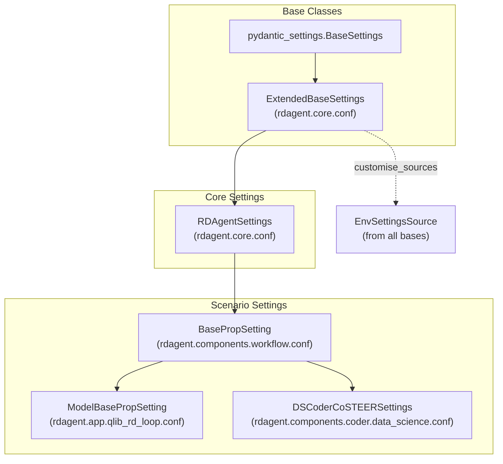
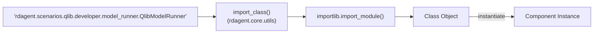
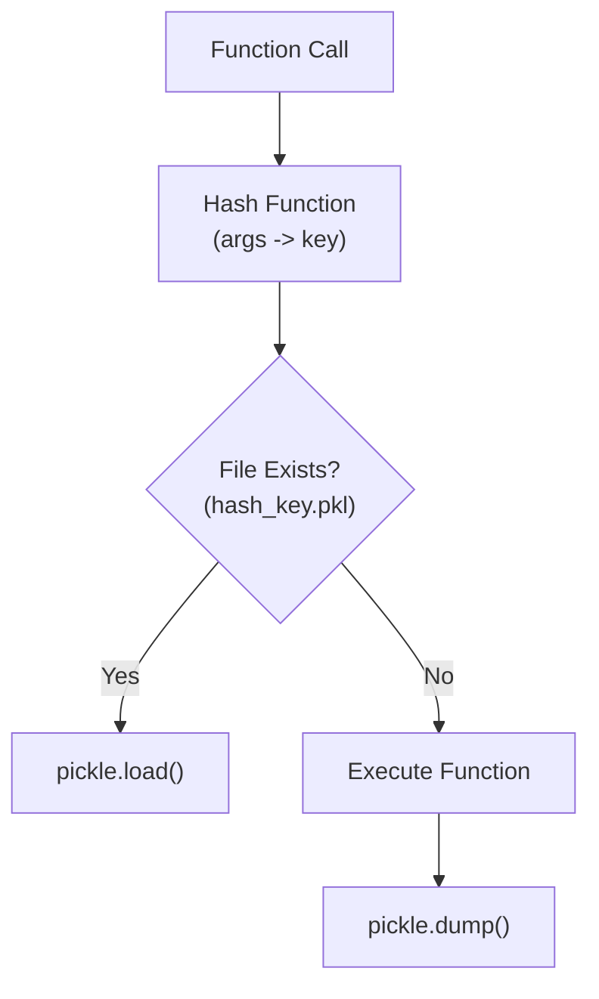

<!-- source: DeepWiki mcp.deepwiki.com · repo microsoft/RD-Agent · page 6.3 Configuration System Architecture · fetched 2026-10-26 -->

# Configuration System Architecture

<details>
<summary>Relevant source files</summary>

The following files were used as context for generating this wiki page:

- [rdagent/app/qlib_rd_loop/conf.py](rdagent/app/qlib_rd_loop/conf.py)
- [rdagent/app/utils/ws.py](rdagent/app/utils/ws.py)
- [rdagent/components/coder/data_science/conf.py](rdagent/components/coder/data_science/conf.py)
- [rdagent/components/coder/data_science/pipeline/__init__.py](rdagent/components/coder/data_science/pipeline/__init__.py)
- [rdagent/core/conf.py](rdagent/core/conf.py)
- [rdagent/core/utils.py](rdagent/core/utils.py)
- [rdagent/oai/llm_utils.py](rdagent/oai/llm_utils.py)
- [rdagent/scenarios/qlib/developer/factor_runner.py](rdagent/scenarios/qlib/developer/factor_runner.py)
- [rdagent/scenarios/qlib/developer/model_runner.py](rdagent/scenarios/qlib/developer/model_runner.py)
- [rdagent/scenarios/qlib/factor_experiment_loader/pdf_loader.py](rdagent/scenarios/qlib/factor_experiment_loader/pdf_loader.py)
- [rdagent/scenarios/qlib/factor_experiment_loader/prompts.yaml](rdagent/scenarios/qlib/factor_experiment_loader/prompts.yaml)
- [rdagent/utils/fmt.py](rdagent/utils/fmt.py)
- [test/oai/test_completion.py](test/oai/test_completion.py)
- [test/utils/test_conf.py](test/utils/test_conf.py)

</details>


## Purpose and Scope

This document describes the configuration system architecture in RD-Agent, which provides a flexible, hierarchical mechanism for managing application behavior through environment variables, settings classes, and feature flags. The system enables dynamic component loading, scenario-specific customization, and configuration-driven component injection.

The architecture is built upon `pydantic-settings`, extending it to support multi-level inheritance where child classes can inherit and override environment variable prefixes from their parents.

## Configuration System Fundamentals

### ExtendedBaseSettings and Inheritance

The core of the configuration system is `ExtendedBaseSettings`, which modifies the standard Pydantic settings resolution to walk up the class hierarchy and collect environment variable sources from all parent classes.



**Implementation Detail: Source Customization**

Sources: [rdagent/core/conf.py:13-43]()

The `settings_customise_sources` method in `ExtendedBaseSettings` uses a recursive `base_iter` function to find all subclasses of `ExtendedBaseSettings`. It then creates an `EnvSettingsSource` for each, ensuring that environment variables defined for a parent class (like `RDAgentSettings`) are still respected by a child class (like `ModelBasePropSetting`), even if the child defines its own `env_prefix`.

### RDAgentSettings Base Class

The `RDAgentSettings` class provides global configurations shared across all RD-Agent scenarios.

| Setting | Type | Description |
|---------|------|-------------|
| `workspace_path` | `Path` | Root directory for experiment workspaces. Default: `git_ignore_folder/RD-Agent_workspace`. |
| `multi_proc_n` | `int` | Number of processes for parallel execution. |
| `cache_with_pickle` | `bool` | Toggle for the pickle-based function result caching system. |
| `step_semaphore` | `int \| dict` | Controls parallelism per step (e.g., `{"coding": 3, "running": 2}`). |
| `stdout_context_len` | `int` | Limit for captured stdout lines in context. |

Sources: [rdagent/core/conf.py:46-108]()

## Component Injection via Configuration

RD-Agent uses a "Configuration-Driven Component Injection" pattern. Instead of hard-coding class dependencies, components are specified as importable string paths in the settings.

### Dynamic Loading Mechanism

The utility function `import_class` is the engine for this injection, converting configuration strings into executable class objects.



Sources: [rdagent/core/utils.py:75-88](), [rdagent/oai/llm_utils.py:35-40]()

### Example: LLM Backend Injection

The LLM system uses `LLM_SETTINGS.backend` (a string path) to decide which API provider to use at runtime.

```python
def get_api_backend(*args: Any, **kwargs: Any) -> BaseAPIBackend:
    api_backend_cls: Type[BaseAPIBackend] = import_class(LLM_SETTINGS.backend)
    return api_backend_cls(*args, **kwargs)
```

Sources: [rdagent/oai/llm_utils.py:35-40]()

## Settings Hierarchies and Prefixes

RD-Agent organizes settings into functional hierarchies, often using `env_prefix` to isolate environment variables for different components.

### Qlib Scenario Settings

The Qlib scenario demonstrates complex prefix management to avoid variable collisions.

| Class | Prefix | File |
|-------|--------|------|
| `ModelBasePropSetting` | `QLIB_MODEL_` | [rdagent/app/qlib_rd_loop/conf.py:9]() |
| `FactorBasePropSetting` | `QLIB_FACTOR_` | [rdagent/app/qlib_rd_loop/conf.py:53]() |
| `QuantBasePropSetting` | `QLIB_QUANT_` | [rdagent/app/qlib_rd_loop/conf.py:113]() |

These settings define the specific classes for `scen`, `hypothesis_gen`, `coder`, and `runner` for each Qlib sub-task.

### Data Science Settings

The Data Science scenario utilizes `DSCoderCoSTEERSettings` to manage environment-specific configurations like Docker vs. Conda.

Sources: [rdagent/components/coder/data_science/conf.py:16-40]()

## Caching and Performance Configuration

### Pickle Cache System

RD-Agent implements a persistent cache for expensive function calls (like LLM generations or data processing) using `cache_with_pickle`.



Sources: [rdagent/core/utils.py:156-200]()

**Configurable Cache Parameters:**
- `RD_AGENT_SETTINGS.cache_with_pickle`: Global toggle. [rdagent/core/conf.py:69]()
- `RD_AGENT_SETTINGS.pickle_cache_folder_path_str`: Location of cache files. [rdagent/core/conf.py:70]()
- `RD_AGENT_SETTINGS.use_file_lock`: Prevents race conditions during cache writes. [rdagent/core/conf.py:73]()

### Parallelism and Semaphores

The configuration system manages concurrency through semaphores, allowing users to limit resource-intensive steps.

Sources: [rdagent/core/conf.py:88-96]()

- `get_max_parallel()`: Returns the maximum concurrency allowed based on the `step_semaphore` setting.
- `is_force_subproc()`: Logic that forces subprocess execution if parallel loops are active.

## Environment Management Configuration

The `get_ds_env` function in `rdagent/components/coder/data_science/conf.py` acts as a factory that uses settings to instantiate the correct execution environment (`DockerEnv` or `LocalEnv`).

```python
def get_ds_env(conf_type: Literal["kaggle", "mlebench"] = "kaggle", ...) -> Env:
    conf = DSCoderCoSTEERSettings()
    if conf.env_type == "docker":
        env_conf = DSDockerConf() if conf_type == "kaggle" else MLEBDockerConf()
        env = DockerEnv(conf=env_conf)
    elif conf.env_type == "conda":
        env = LocalEnv(...)
    # ...
```

Sources: [rdagent/components/coder/data_science/conf.py:41-75]()

## Key Classes and Functions Summary

| Entity | Role | Source |
|--------|------|--------|
| `ExtendedBaseSettings` | Enables recursive environment variable source resolution. | [rdagent/core/conf.py:13]() |
| `RDAgentSettings` | Global base settings for the entire RD-Agent system. | [rdagent/core/conf.py:46]() |
| `import_class` | Dynamic importer for configuration-driven component injection. | [rdagent/core/utils.py:75]() |
| `cache_with_pickle` | Decorator for persisting function results based on config. | [rdagent/core/utils.py:156]() |
| `BasePropSetting` | Base class for scenario-specific property settings. | [rdagent/app/qlib_rd_loop/conf.py:5]() |
| `RD_AGENT_SETTINGS` | Singleton instance of the global configuration. | [rdagent/core/conf.py:109]() |

Sources: [rdagent/core/conf.py](), [rdagent/core/utils.py](), [rdagent/app/qlib_rd_loop/conf.py]()

---

