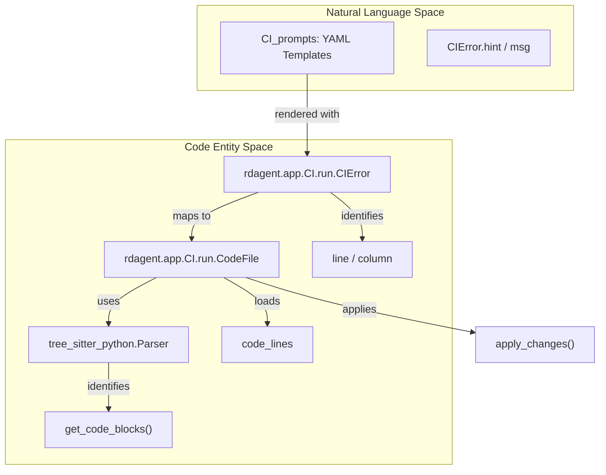
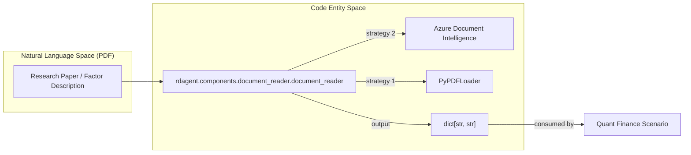

<!-- source: DeepWiki mcp.deepwiki.com · repo microsoft/RD-Agent · page 6.4 Benchmarking and CI/CD · fetched 2026-10-26 -->

# Benchmarking and CI/CD

Relevant source files

The following files were used as context for generating this wiki page:

- [.bumpversion.cfg](.bumpversion.cfg)
- [.commitlintrc.js](.commitlintrc.js)
- [.github/PULL_REQUEST_TEMPLATE.md](.github/PULL_REQUEST_TEMPLATE.md)
- [.github/workflows/ci.yml](.github/workflows/ci.yml)
- [.github/workflows/pr.yml](.github/workflows/pr.yml)
- [.github/workflows/release.yml](.github/workflows/release.yml)
- [Makefile](Makefile)
- [docs/_static/RD2bench.json](docs/_static/RD2bench.json)
- [docs/changelog.md](docs/changelog.md)
- [docs/research/benchmark.rst](docs/research/benchmark.rst)
- [pyproject.toml](pyproject.toml)
- [rdagent/app/CI/README.md](rdagent/app/CI/README.md)
- [rdagent/app/CI/run.py](rdagent/app/CI/run.py)
- [rdagent/app/benchmark/factor/analysis.py](rdagent/app/benchmark/factor/analysis.py)
- [rdagent/app/benchmark/factor/eval.py](rdagent/app/benchmark/factor/eval.py)
- [rdagent/app/benchmark/model/eval.py](rdagent/app/benchmark/model/eval.py)
- [rdagent/app/utils/health_check.py](rdagent/app/utils/health_check.py)
- [rdagent/components/benchmark/conf.py](rdagent/components/benchmark/conf.py)
- [rdagent/components/benchmark/eval_method.py](rdagent/components/benchmark/eval_method.py)
- [rdagent/components/benchmark/example.json](rdagent/components/benchmark/example.json)
- [rdagent/components/coder/factor_coder/eva_utils.py](rdagent/components/coder/factor_coder/eva_utils.py)
- [rdagent/components/coder/factor_coder/evolving_strategy.py](rdagent/components/coder/factor_coder/evolving_strategy.py)
- [rdagent/components/document_reader/document_reader.py](rdagent/components/document_reader/document_reader.py)
- [rdagent/components/loader/task_loader.py](rdagent/components/loader/task_loader.py)
- [rdagent/core/prompts.py](rdagent/core/prompts.py)
- [rdagent/scenarios/qlib/factor_experiment_loader/json_loader.py](rdagent/scenarios/qlib/factor_experiment_loader/json_loader.py)
- [requirements/package.txt](requirements/package.txt)
- [test/utils/test_misc.py](test/utils/test_misc.py)

This page documents the benchmarking framework used to evaluate RD-Agent's performance across different research tasks, the continuous integration (CI) pipelines, and the utilities for health checks and document processing.

## Benchmarking Framework

RD-Agent includes a dedicated benchmarking system to measure the quality of generated code entities (factors and models). This is primarily used in the Quantitative Finance and Data Science scenarios to validate the efficacy of the `Developer` agents.

### Factor Benchmarking
The factor benchmarking system evaluates the agent's ability to implement financial factors based on natural language descriptions or formulas.

*   **Test Cases**: Managed by the `TestCases` class [rdagent/components/benchmark/eval_method.py:41-62](), which pairs a `Task` (description) with a `Workspace` containing ground truth code [rdagent/components/benchmark/eval_method.py:31-39]().
*   **Evaluation Logic**: The `FactorImplementEval` class [rdagent/components/benchmark/eval_method.py:140-198]() orchestrates multiple rounds of development and evaluation. It uses a suite of specialized evaluators:
    *   `FactorSingleColumnEvaluator`: Validates output format.
    *   `FactorRowCountEvaluator`: Checks data consistency.
    *   `FactorIndexEvaluator`: Ensures alignment with market indices.
    *   `FactorCorrelationEvaluator`: Measures the statistical correlation between generated factors and ground truth [rdagent/components/benchmark/eval_method.py:150-156]().

### Model Benchmarking
Similar to factors, model benchmarks evaluate the predictive performance and training stability of generated models [rdagent/app/benchmark/model/eval.py]().

### Data Flow and Analysis
The benchmark results are typically stored as pickle files and analyzed using the `BenchmarkAnalyzer` [rdagent/app/benchmark/factor/analysis.py:15-176]().

| Component | Responsibility |
| :--- | :--- |
| `FactorExperimentLoaderFromJsonFile` | Loads benchmark tasks from JSON definitions [rdagent/scenarios/qlib/factor_experiment_loader/json_loader.py:31-36](). |
| `FactorImplementEval.summarize_res` | Aggregates results across multiple runs to calculate success rates [rdagent/components/benchmark/eval_method.py:200-210](). |
| `BenchmarkAnalyzer.analyze_data` | Calculates "Avg Run SR", "Avg Format SR", and "Max Correlation" [rdagent/app/benchmark/factor/analysis.py:96-176](). |

**Sources:** [rdagent/components/benchmark/eval_method.py:31-210](), [rdagent/app/benchmark/factor/analysis.py:15-176](), [rdagent/scenarios/qlib/factor_experiment_loader/json_loader.py:31-63]().

---

## CI/CD and Automation

RD-Agent uses GitHub Actions and a `Makefile` to automate testing, linting, and releases.

### GitHub Actions Workflows
1.  **CI Workflow (`ci.yml`)**: Triggered on pull requests and pushes to `main`. It sets up Python environments (3.10, 3.11), installs dependencies via `make dev`, and runs `make lint docs-gen test-offline` [.github/workflows/ci.yml:1-70]().
2.  **PR Title Linting (`pr.yml`)**: Uses `commitlint` to ensure PR titles follow conventional commit standards [.github/workflows/pr.yml:1-36]().
3.  **Release Workflow (`release.yml`)**: Uses `google-github-actions/release-please-action` to automate versioning and changelog generation. Upon release, it builds the package and uploads it to PyPI using `twine` [.github/workflows/release.yml:1-49]().

### Makefile Commands
The `Makefile` serves as the entry point for local development and CI steps:
*   `make install`: Editable installation with constraints [Makefile:53-54]().
*   `make lint`: Runs `mypy`, `ruff`, `isort`, `black`, and `toml-sort` [Makefile:111-112]().
*   `make test-offline`: Executes tests marked as "offline" (no LLM API calls required) and generates coverage reports [Makefile:158-161]().
*   `make build`: Packages the project using `setuptools` [Makefile:167-168]().

**Sources:** [.github/workflows/ci.yml:1-70](), [.github/workflows/release.yml:1-49](), [Makefile:53-168]().

---

## CI Agent and Code Correction

RD-Agent includes an experimental "CI Agent" capable of autonomously fixing linting and type errors (ruff/mypy) discovered during CI runs.

### Implementation Space to Code Entity Mapping

The following diagram illustrates how the CI Agent processes code files to resolve errors.

**Sources:** [rdagent/app/CI/run.py:42-182](), [rdagent/app/CI/run.py:38-40]().

---

## Health Checks and Document Reading

### Health Check Utility
The `rdagent/app/utils/health_check.py` utility validates the system's operational status:
*   **LLM Connectivity**: Tests the configured `APIBackend` to ensure the LLM provider is reachable.
*   **Environment Validation**: Checks for required environment variables and Docker/Conda availability.

### Document Reader
The `DocumentReader` component bridges the gap between research papers (PDFs) and the agent's knowledge base.

*   **Azure Integration**: Uses `DocumentAnalysisClient` for high-fidelity PDF parsing [rdagent/components/document_reader/document_reader.py:67-85]().
*   **LangChain Integration**: Provides a fallback using `PyPDFLoader` [rdagent/components/document_reader/document_reader.py:20-33]().
*   **Visual Extraction**: Includes `extract_first_page_screenshot_from_pdf` to capture visual context for multimodal agents [rdagent/components/document_reader/document_reader.py:112-121]().

**Sources:** [rdagent/components/document_reader/document_reader.py:20-121](), [rdagent/app/utils/health_check.py]().

---

