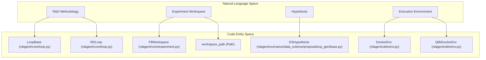
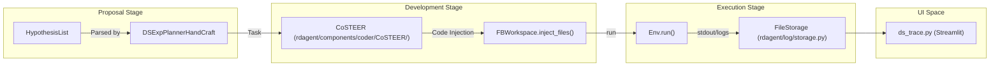

<!-- source: DeepWiki mcp.deepwiki.com · repo microsoft/RD-Agent · page 7 Glossary · fetched 2026-10-26 -->

# Glossary

Relevant source files

The following files were used as context for generating this wiki page:

- [.env.example](.env.example)
- [README.md](README.md)
- [docs/installation_and_configuration.rst](docs/installation_and_configuration.rst)
- [rdagent/app/data_science/conf.py](rdagent/app/data_science/conf.py)
- [rdagent/components/coder/CoSTEER/__init__.py](rdagent/components/coder/CoSTEER/__init__.py)
- [rdagent/components/coder/data_science/pipeline/prompts.yaml](rdagent/components/coder/data_science/pipeline/prompts.yaml)
- [rdagent/core/experiment.py](rdagent/core/experiment.py)
- [rdagent/log/mle_summary.py](rdagent/log/mle_summary.py)
- [rdagent/log/ui/ds_summary.py](rdagent/log/ui/ds_summary.py)
- [rdagent/log/ui/ds_trace.py](rdagent/log/ui/ds_trace.py)
- [rdagent/log/ui/dsapp.py](rdagent/log/ui/dsapp.py)
- [rdagent/log/ui/utils.py](rdagent/log/ui/utils.py)
- [rdagent/oai/backend/base.py](rdagent/oai/backend/base.py)
- [rdagent/oai/backend/deprec.py](rdagent/oai/backend/deprec.py)
- [rdagent/oai/backend/litellm.py](rdagent/oai/backend/litellm.py)
- [rdagent/oai/llm_conf.py](rdagent/oai/llm_conf.py)
- [rdagent/oai/utils/embedding.py](rdagent/oai/utils/embedding.py)
- [rdagent/scenarios/data_science/dev/runner/__init__.py](rdagent/scenarios/data_science/dev/runner/__init__.py)
- [rdagent/scenarios/data_science/dev/runner/prompts.yaml](rdagent/scenarios/data_science/dev/runner/prompts.yaml)
- [rdagent/scenarios/data_science/proposal/exp_gen/prompts_v2.yaml](rdagent/scenarios/data_science/proposal/exp_gen/prompts_v2.yaml)
- [rdagent/scenarios/data_science/proposal/exp_gen/proposal.py](rdagent/scenarios/data_science/proposal/exp_gen/proposal.py)
- [rdagent/scenarios/data_science/scen/__init__.py](rdagent/scenarios/data_science/scen/__init__.py)
- [rdagent/scenarios/data_science/scen/prompts.yaml](rdagent/scenarios/data_science/scen/prompts.yaml)
- [rdagent/scenarios/data_science/share.yaml](rdagent/scenarios/data_science/share.yaml)
- [rdagent/scenarios/kaggle/experiment/templates/new-york-city-taxi-fare-prediction/model/model_linear.py](rdagent/scenarios/kaggle/experiment/templates/new-york-city-taxi-fare-prediction/model/model_linear.py)
- [rdagent/utils/env.py](rdagent/utils/env.py)
- [rdagent/utils/prompts.yaml](rdagent/utils/prompts.yaml)
- [rdagent/utils/workflow/tracking.py](rdagent/utils/workflow/tracking.py)
- [test/oai/test_embedding_and_similarity.py](test/oai/test_embedding_and_similarity.py)
- [test/utils/env_tpl/read_exp.py](test/utils/env_tpl/read_exp.py)
- [test/utils/test_env.py](test/utils/test_env.py)
- [test/utils/test_import.py](test/utils/test_import.py)

This glossary provides definitions for codebase-specific terms, jargon, and domain concepts used throughout the RD-Agent system. It is designed to help onboarding engineers navigate the specialized vocabulary and locate corresponding implementations.

## Core Abstractions

### Loop / RDLoop
The fundamental iterative process in RD-Agent. It encapsulates the R&D methodology: proposing a hypothesis, developing code, and evaluating results.
- **Implementation**: `LoopBase` in `rdagent/core/loop.py` and specialized versions like `DataScienceRDLoop` [rdagent/app/data_science/loop.py:16-16]().
- **Mechanism**: Uses `LoopMeta` to register steps like `propose`, `develop`, and `summarize`.

### Workspace
A container for the task implementation, including code files, data, and execution results.
- **Implementation**: `Workspace` (Abstract) and `FBWorkspace` (File-Based) [rdagent/core/experiment.py:87-160]().
- **Key Feature**: `inject_files` allows the agent to write code into the workspace, and `execute` runs the code within a controlled environment.

### Scenario
Defines the problem domain, including data descriptions, target metrics, and evaluation logic.
- **Implementation**: `Scenario` base class [rdagent/core/scenario.py]().
- **Examples**: `DataScienceScen` [rdagent/scenarios/data_science/scen/__init__.py:27-27]() and `KaggleScen`.

### Trace
A single branch or path of exploration within an R&D loop. In multi-trace scenarios, the agent may explore multiple hypotheses in parallel.
- **Implementation**: `DSTrace` [rdagent/scenarios/data_science/proposal/exp_gen/base.py]().
- **Data Structure**: Often represented as a Directed Acyclic Graph (DAG) of experiments [rdagent/log/ui/ds_trace.py:24-24]().

---

## Data Science Specific Terms

### Component-Based Development
RD-Agent decomposes Data Science tasks into six distinct functional components. This allows for modular evolution and targeted debugging.

| Component | Description | Implementation Task |
| :--- | :--- | :--- |
| **DataLoadSpec** | Loads raw data and generates EDA summaries. | `DataLoaderTask` [rdagent/scenarios/data_science/proposal/exp_gen/proposal.py:46-51]() |
| **FeatureEng** | Transforms raw data into model-agnostic features. | `FeatureTask` [rdagent/scenarios/data_science/proposal/exp_gen/proposal.py:52-57]() |
| **Model** | Architecture definition and hyperparameter tuning. | `ModelTask` [rdagent/scenarios/data_science/proposal/exp_gen/proposal.py:58-63]() |
| **Ensemble** | Strategies for combining multiple model outputs. | `EnsembleTask` [rdagent/scenarios/data_science/proposal/exp_gen/proposal.py:64-69]() |
| **Workflow** | The glue code (usually `main.py`) connecting all parts. | `WorkflowTask` [rdagent/scenarios/data_science/proposal/exp_gen/proposal.py:70-75]() |
| **Pipeline** | The end-to-end execution flow. | `PipelineTask` [rdagent/scenarios/data_science/proposal/exp_gen/proposal.py:76-81]() |

### SOTA (State-of-the-Art)
The best-performing experiment found so far in a session. Subsequent experiments are often "improvements" based on the current SOTA workspace.
- **Logic**: Managed by `GlobalSOTASelector` [rdagent/app/data_science/conf.py:120-120]() and visualized in the UI [rdagent/log/ui/ds_trace.py:58-59]().

### CoSTEER
**Co**de **S**trategy for **T**ask **E**volution and **E**fficient **R**efinement. It is the framework's core code-generation and evolution engine.
- **Implementation**: `rdagent/components/coder/CoSTEER/` [rdagent/components/coder/CoSTEER/__init__.py]().

---

## Technical & Infrastructure Terms

### Env (Execution Environment)
The abstraction for where code is executed. It handles isolation, resource limits, and log tailing.
- **Implementation**: `Env` [rdagent/utils/env.py]().
- **Types**: `DockerEnv` (preferred for isolation), `CondaEnv`, and `LocalEnv`.
- **Logic**: `normalize_volumes` [rdagent/utils/env.py:117-117]() maps host paths to container paths.

### APIBackend
The interface for LLM interactions. It handles prompt construction, response parsing, and caching.
- **Implementation**: `APIBackend` [rdagent/oai/backend/base.py]() and `LiteLLMAPIBackend` [rdagent/oai/backend/litellm.py]().
- **Caching**: Uses `SQliteLazyCache` [rdagent/oai/backend/base.py:195-195]() to store LLM responses based on a hash of the prompt.

### DEL_KEY
A special marker used in file injection. If a file's content is set to this key, the system deletes that file from the workspace.
- **Implementation**: Defined in `rdagent/core/experiment.py`.

---

## System Mapping Diagrams

### From Concepts to Code Entities
This diagram maps high-level R&D concepts to the specific Python classes and file structures that implement them.

**Sources**: [rdagent/core/loop.py](), [rdagent/core/experiment.py:139-167](), [rdagent/utils/env.py](), [rdagent/scenarios/data_science/proposal/exp_gen/base.py:27-27]().

### Data Flow: Proposal to Execution
This diagram shows how a conceptual "Hypothesis" is transformed into code and executed via specific system components.

**Sources**: [rdagent/scenarios/data_science/proposal/exp_gen/proposal.py:39-42](), [rdagent/core/experiment.py:139-160](), [rdagent/utils/env.py:164-202](), [rdagent/log/ui/ds_trace.py:74-90]().

---

## Common Abbreviations

| Abbreviation | Full Term | Context |
| :--- | :--- | :--- |
| **EDA** | Exploratory Data Analysis | Part of the `DataLoadSpec` component output [rdagent/scenarios/shared/share.yaml:129-131](). |
| **SOTA** | State-of-the-Art | Refers to the best experiment in the current trace history [rdagent/log/ui/utils.py:186-188](). |
| **MCP** | Model Context Protocol | Integration for documentation search and external tools [rdagent/app/data_science/conf.py:53-54](). |
| **MLE** | Machine Learning Engineering | Often used in reference to `mle-bench` or `mle_summary.py` [rdagent/log/mle_summary.py](). |
| **TPL** | Template | Refers to the Jinja2-based prompt template system `tpl.T` [rdagent/utils/agent/tpl.py](). |

**Sources**: [rdagent/scenarios/data_science/proposal/exp_gen/proposal.py](), [rdagent/app/data_science/conf.py](), [rdagent/log/ui/utils.py](), [rdagent/core/experiment.py]().