# Page: Overview

# Overview

<details>
<summary>Relevant source files</summary>

The following files were used as context for generating this wiki page:

- [.env.example](.env.example)
- [README.md](README.md)
- [docs/_static/Framework-RDAgent.png](docs/_static/Framework-RDAgent.png)
- [docs/_static/demo.png](docs/_static/demo.png)
- [docs/_static/favicon.ico](docs/_static/favicon.ico)
- [docs/_static/logo.png](docs/_static/logo.png)
- [docs/_static/scen.jpg](docs/_static/scen.jpg)
- [docs/_static/scen.png](docs/_static/scen.png)
- [docs/api_reference.rst](docs/api_reference.rst)
- [docs/conf.py](docs/conf.py)
- [docs/development.rst](docs/development.rst)
- [docs/index.rst](docs/index.rst)
- [docs/installation_and_configuration.rst](docs/installation_and_configuration.rst)
- [docs/introduction.rst](docs/introduction.rst)
- [docs/project_framework_introduction.rst](docs/project_framework_introduction.rst)
- [rdagent/app/cli.py](rdagent/app/cli.py)
- [rdagent/app/general_model/general_model.py](rdagent/app/general_model/general_model.py)
- [rdagent/app/qlib_rd_loop/factor.py](rdagent/app/qlib_rd_loop/factor.py)
- [rdagent/app/qlib_rd_loop/factor_from_report.py](rdagent/app/qlib_rd_loop/factor_from_report.py)
- [rdagent/app/qlib_rd_loop/model.py](rdagent/app/qlib_rd_loop/model.py)
- [rdagent/app/qlib_rd_loop/quant.py](rdagent/app/qlib_rd_loop/quant.py)
- [rdagent/components/workflow/rd_loop.py](rdagent/components/workflow/rd_loop.py)
- [rdagent/scenarios/qlib/proposal/quant_proposal.py](rdagent/scenarios/qlib/proposal/quant_proposal.py)
- [rdagent/utils/workflow/loop.py](rdagent/utils/workflow/loop.py)

</details>


RD-Agent is an LLM-powered autonomous research and development framework designed to automate data-driven R&D workflows. The system implements a complete "Research → Development" cycle where AI agents propose hypotheses, generate implementation code, execute experiments in isolated environments, and learn from feedback to iteratively improve solutions.

This page provides a high-level overview of the RD-Agent architecture, its core execution model, and supported application scenarios. For detailed installation instructions, see [Installation and Configuration](#1.1). For command-line usage, see [Command Line Interface](#1.2). For in-depth documentation of specific subsystems, refer to the relevant sections: [Core Architecture](#2), [Scenarios and Applications](#3), [Components and Implementation](#4), and [User Interface and Monitoring](#5).

## Purpose and Scope

RD-Agent targets data-driven research scenarios including:
- **Quantitative Finance**: Automated factor discovery and model development for algorithmic trading [rdagent/app/qlib_rd_loop/quant.py:1-40]().
- **Data Science Competitions**: End-to-end pipeline development for Kaggle and MLE-bench tasks [README.md:50-73]().
- **LLM Fine-Tuning**: Autonomous fine-tuning (FT-Agent) using the FT-Dojo methodology [README.md:31-34]().
- **Research Automation**: Extracting and implementing models/factors from academic papers and financial reports [rdagent/app/qlib_rd_loop/factor_from_report.py:61-94]().

The framework is **not** a ready-to-use production system for financial investment, but rather a research tool for automating iterative experimentation workflows. It achieves state-of-the-art results on MLE-bench (30.22% average accuracy) using a combination of reasoning models (o3) for research and development agents (GPT-4.1) [README.md:50-71]().

**Sources**: [README.md:1-91](), [rdagent/app/qlib_rd_loop/factor_from_report.py:61-94]()

## System Architecture Overview

The RD-Agent architecture consists of interconnected subsystems organized in a layered structure, bridging the gap between Natural Language research ideas and executable Code Entities.

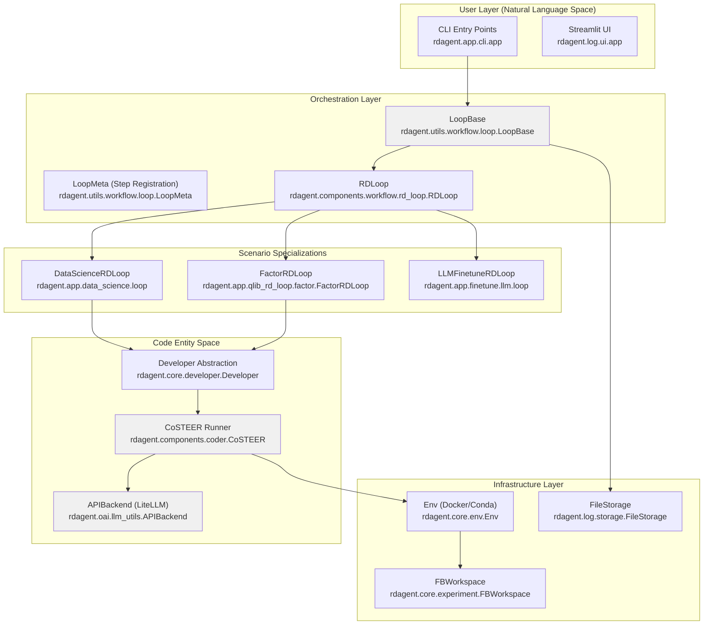

**Architecture Layers**:

| Layer | Purpose | Key Components |
|-------|---------|----------------|
| **User Layer** | Entry points for users | CLI commands (`rdagent` via `typer`), Streamlit UI (`dsapp.py`, `app.py`) |
| **Orchestration Layer** | Workflow execution | `LoopBase` (session management), `LoopMeta` (metaclass for steps), `RDLoop` |
| **Scenario Specializations** | Domain-specific loops | `FactorRDLoop`, `ModelRDLoop`, `DataScienceRDLoop`, `LLMFinetuneRDLoop` |
| **Code Entity Space** | LLM-to-Code mapping | `APIBackend` (LiteLLM integration), `CoSTEER` (code evolution), `Developer` |
| **Infrastructure Layer** | Execution & Persistence | `Env` (sandboxing), `FBWorkspace` (file tracking), `FileStorage` (logs) |

**Sources**: [rdagent/utils/workflow/loop.py:33-115](), [rdagent/app/cli.py:37-182](), [rdagent/components/workflow/rd_loop.py:31-68]()

## Core R&D Loop Execution Model

RD-Agent implements an iterative workflow that bridges "Natural Language Space" (Hypotheses) to "Code Entity Space" (Implementation & Results).

```mermaid
sequenceDiagram
    participant User
    participant CLI["CLI<br/>rdagent.app.cli"]
    participant Loop["RDLoop<br/>rdagent.components.workflow.rd_loop"]
    participant Propose["HypothesisGen<br/>propose()"]
    participant Coder["Developer/CoSTEER<br/>develop()"]
    participant Env["Env<br/>execute()"]
    participant Eval["Evaluator<br/>feedback()"]
    
    User->>CLI: "rdagent fin_factor"
    CLI->>Loop: "run(step_n, loop_n)"
    
    loop "R&D Iteration"
        Loop->>Propose: "generate hypothesis (NL)"
        Propose-->>Loop: "Hypothesis object"
        
        Loop->>Coder: "develop(hypothesis) -> Code"
        loop "Evolution (CoSTEER)"
            Coder->>Env: "execute(workspace)"
            Env-->>Coder: "stdout/stderr/metrics"
            Coder->>Eval: "evaluate(results)"
            Eval-->>Coder: "Feedback (NL)"
            Note over Coder: Refine code based on feedback
        end
        
        Loop->>Eval: "summarize experiment"
        Loop->>Loop: "update Trace/KnowledgeBase"
    end
```

**Phase Descriptions**:

1. **Hypothesis Generation** (`propose`): LLM generates research ideas (`Hypothesis`) based on the current `Scenario` and prior `Trace` history [rdagent/components/workflow/rd_loop.py:38-42]().
2. **Coding/Development** (`coding`): The `Developer` (often `CoSTEER`) converts the hypothesis into executable code within a `FBWorkspace` [rdagent/components/workflow/rd_loop.py:55-57]().
3. **Execution** (`running`): Code is executed in an isolated `Env` (e.g., `DockerEnv`) to produce results and metrics [rdagent/app/qlib_rd_loop/factor.py:21-27]().
4. **Feedback & Summary** (`feedback`): Evaluators analyze execution logs and metrics to provide structured feedback for the next loop iteration [rdagent/components/workflow/rd_loop.py:62-66]().

**Sources**: [rdagent/utils/workflow/loop.py:85-115](), [rdagent/components/workflow/rd_loop.py:31-68](), [rdagent/app/qlib_rd_loop/factor.py:21-27]()

## Key Component Summary

### LLM Integration
The system uses `LiteLLMAPIBackend` as the default provider, enabling seamless switching between OpenAI, Azure, DeepSeek, and other backends [README.md:41](). It supports `json_mode` for structured outputs and implements a `SQliteLazyCache` to reduce costs and latency [rdagent/app/qlib_rd_loop/factor_from_report.py:42-48]().

### Workflow Session Management
`LoopBase` handles the complexity of long-running R&D processes, including:
- **Checkpointing**: Saving state to `__session__` folders for resumption [rdagent/utils/workflow/loop.py:127-129]().
- **Step Registration**: Using `LoopMeta` to automatically discover methods as workflow steps [rdagent/utils/workflow/loop.py:33-74]().
- **Parallelism**: Managing `asyncio.Semaphore` for concurrent step execution [rdagent/utils/workflow/loop.py:144-158]().

### Scenario Specializations
RD-Agent is designed to be extensible through the `Scenario` and `RDLoop` abstractions:
- **Quant Finance**: `FactorRDLoop` and `ModelRDLoop` for Qlib-based trading research [rdagent/app/qlib_rd_loop/factor.py:17-27]().
- **General Research**: `FactorReportLoop` for extracting ideas directly from PDF reports/papers [rdagent/app/qlib_rd_loop/factor_from_report.py:97-141]().
- **Data Science**: `DataScienceRDLoop` for competition-style end-to-end modeling [rdagent/app/cli.py:130-147]().

**Sources**: [rdagent/utils/workflow/loop.py:11-31](), [rdagent/components/workflow/rd_loop.py:31-68](), [rdagent/app/cli.py:82-161]()

## User Interface and Monitoring

RD-Agent provides multiple ways to monitor autonomous progress:
- **CLI**: Real-time progress bars and logs via `rdagent` commands [rdagent/utils/workflow/loop.py:161-165]().
- **Streamlit UI**: Visualize traces, experiment DAGs, and metrics using `rdagent ui` [rdagent/app/cli.py:45-62]().
- **Real-time Server**: A Flask-based backend for live monitoring via `rdagent server_ui` [rdagent/app/cli.py:65-71]().

**Sources**: [rdagent/app/cli.py:45-80](), [README.md:36]()

## Next Steps

- **[Installation and Configuration](#1.1)**: Set up your environment, Docker, and LLM API keys.
- **[Command Line Interface](#1.2)**: Learn how to launch different R&D scenarios.
- **[Core Architecture](#2)**: Understand the deep technical design of the R&D loops and environments.

---

# Page: Installation and Configuration

# Installation and Configuration

<details>
<summary>Relevant source files</summary>

The following files were used as context for generating this wiki page:

- [.devcontainer/Dockerfile](.devcontainer/Dockerfile)
- [.devcontainer/README.md](.devcontainer/README.md)
- [.devcontainer/devcontainer.json](.devcontainer/devcontainer.json)
- [.devcontainer/env](.devcontainer/env)
- [.env.example](.env.example)
- [.readthedocs.yaml](.readthedocs.yaml)
- [README.md](README.md)
- [docs/installation_and_configuration.rst](docs/installation_and_configuration.rst)
- [rdagent/core/conf.py](rdagent/core/conf.py)
- [rdagent/core/utils.py](rdagent/core/utils.py)
- [rdagent/oai/llm_utils.py](rdagent/oai/llm_utils.py)
- [rdagent/scenarios/qlib/factor_experiment_loader/pdf_loader.py](rdagent/scenarios/qlib/factor_experiment_loader/pdf_loader.py)
- [rdagent/scenarios/qlib/factor_experiment_loader/prompts.yaml](rdagent/scenarios/qlib/factor_experiment_loader/prompts.yaml)
- [rdagent/utils/fmt.py](rdagent/utils/fmt.py)
- [requirements/docs.txt](requirements/docs.txt)
- [requirements/torch.txt](requirements/torch.txt)
- [test/oai/test_completion.py](test/oai/test_completion.py)

</details>


## Purpose and Scope

This document provides comprehensive instructions for installing RD-Agent and configuring its execution environment. It covers system prerequisites, installation procedures, environment setup, Docker configuration, and LLM backend integration. 

RD-Agent operates as an automated research and development system that executes code in isolated environments and communicates with LLM backends. Proper installation and configuration are essential prerequisites for all scenarios.

**Platform Support**: RD-Agent currently supports **Linux only** [README.md:17-17](). Windows and macOS are not officially supported.

---

## Installation Flow Overview

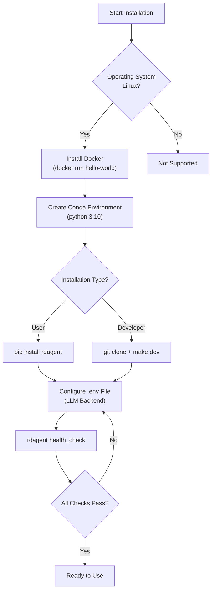

**Diagram**: Installation workflow from system requirements through verification.

Sources: [docs/installation_and_configuration.rst:5-15](), [README.md:17-17]()

---

## System Requirements

### Operating System
RD-Agent is designed exclusively for **Linux** platforms [README.md:17-17](). This constraint exists because the execution environment relies on Docker containerization and Linux-specific system calls for process isolation.

### Python Environment
Supported Python versions:
- **Python 3.10** (Recommended) [README.md:19-19](), [.readthedocs.yaml:12-12]()

### Docker Requirement
Docker is **mandatory** for most scenarios as RD-Agent executes generated code in isolated containers.

**Critical Setup Steps**:
1. Install Docker following [official Docker documentation](https://docs.docker.com/engine/install/).
2. Configure Docker to run **without sudo** for the current user [docs/installation_and_configuration.rst:14-14]().
3. Verify installation: `docker run hello-world` [docs/installation_and_configuration.rst:14-14]().

Sources: [docs/installation_and_configuration.rst:13-14](), [README.md:17-19]()

---

## Installation Methods

### User Installation (PyPI)
For users who want to run RD-Agent scenarios without modifying the codebase:
```bash
pip install rdagent
```
Sources: [docs/installation_and_configuration.rst:10-10]()

### Developer Installation (Source)
For contributors or users wanting the latest features:
```bash
git clone https://github.com/microsoft/RD-Agent
cd RD-Agent
# Devcontainer users: the postCreateCommand runs 'make dev' automatically
make dev
```
Sources: [docs/installation_and_configuration.rst:11-11](), [.devcontainer/devcontainer.json:28-28]()

---

## Environment Setup

### Conda Environment Creation
Create an isolated Python environment using Conda:
```bash
# Create environment (Python 3.10 recommended)
conda create -n rdagent python=3.10
# Activate environment
conda activate rdagent
```

### Configuration Architecture
RD-Agent uses a sophisticated configuration system based on `Pydantic` and `ExtendedBaseSettings`.

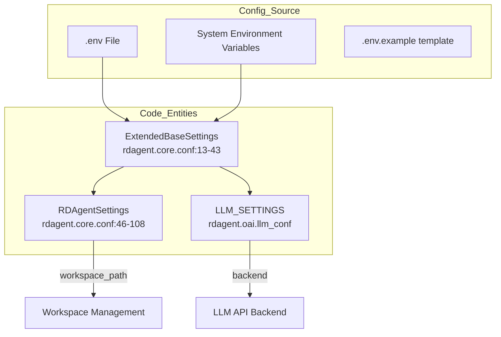

**Diagram**: Configuration inheritance and data flow. `ExtendedBaseSettings` customizes Pydantic sources to walk up the class hierarchy for environment variable prefixes [rdagent/core/conf.py:16-43]().

Sources: [rdagent/core/conf.py:13-109](), [.env.example:1-8]()

---

## LLM Backend Configuration

RD-Agent integrates with LLMs primarily through `LiteLLM`, allowing support for OpenAI, Azure, DeepSeek, and many others.

### Backend Architecture

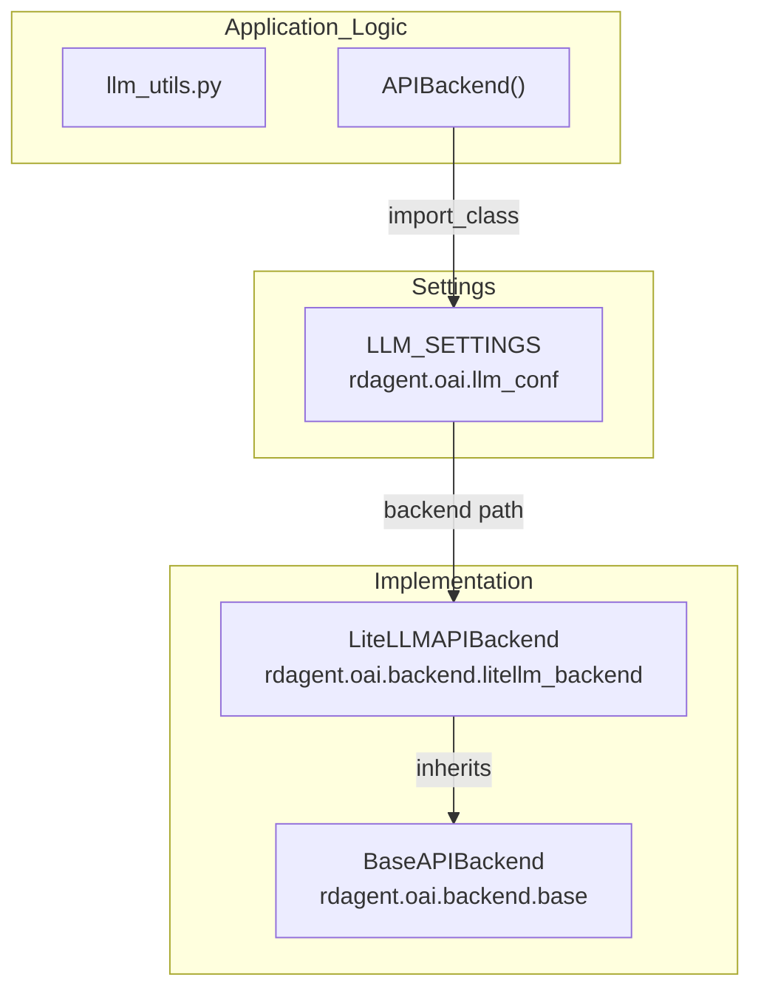

**Diagram**: Dynamic backend selection. `get_api_backend` uses `import_class` to instantiate the backend specified in `LLM_SETTINGS.backend` [rdagent/oai/llm_utils.py:35-41]().

Sources: [rdagent/oai/llm_utils.py:35-45](), [rdagent/core/utils.py:75-88]()

### Configuration Examples

#### Pattern 1: Unified OpenAI Base
```bash
CHAT_MODEL=gpt-4o 
EMBEDDING_MODEL=text-embedding-3-small
OPENAI_API_BASE=<your_unified_api_base>
OPENAI_API_KEY=<your_openai_api_key>
```
Sources: [docs/installation_and_configuration.rst:28-33]()

#### Pattern 2: DeepSeek with SiliconFlow Embeddings
DeepSeek often requires specific environment variables for `LiteLLM`.
```bash
CHAT_MODEL=deepseek/deepseek-chat 
DEEPSEEK_API_KEY=<your_deepseek_api_key>

# SiliconFlow for embeddings (prefixed with litellm_proxy/)
EMBEDDING_MODEL=litellm_proxy/BAAI/bge-m3
LITELLM_PROXY_API_KEY=<your_siliconflow_api_key>
LITELLM_PROXY_API_BASE=https://api.siliconflow.cn/v1
```
Sources: [docs/installation_and_configuration.rst:62-69]()

---

## Execution Environment Selection

RD-Agent supports different environments for running generated code, controlled by environment variables like `DS_CODER_COSTEER_ENV_TYPE` [.devcontainer/env:41-41]().

### Docker vs Conda

| Feature | Docker Environment | Conda Environment |
| :--- | :--- | :--- |
| **Isolation** | High (Containerized) | Medium (Process-level) |
| **Config Key** | `docker` | `conda` |
| **GPU Support** | Supported [rdagent/utils/env.py] | Local system dependent |
| **Use Case** | Data Science, Quant [rdagent/utils/env.py] | Local dev/debugging |

### Devcontainer Setup
For a seamless development experience, a `.devcontainer` is provided. It mounts the host workspace and configures GPU access.
- **Dockerfile**: Based on `ubuntu:22.04` with Python 3.10 [.devcontainer/Dockerfile]().
- **Mounts**: Mounts local Kaggle data paths to `/tmp/kaggle` [.devcontainer/devcontainer.json:13-15]().
- **Environment**: Loads default settings from `.devcontainer/env` [.devcontainer/devcontainer.json:24-24]().

Sources: [.devcontainer/devcontainer.json:1-30](), [.devcontainer/env:1-48]()

---

## Configuration Reference

### Global Settings (`RD_AGENT_SETTINGS`)
Defined in [rdagent/core/conf.py:46-108]().

| Variable | Description | Default |
| :--- | :--- | :--- |
| `WORKSPACE_PATH` | Base directory for R&D workspaces | `./git_ignore_folder/RD-Agent_workspace` |
| `MULTI_PROC_N` | Number of processes for parallel execution | `1` |
| `CACHE_WITH_PICKLE` | Whether to use pickle-based result caching | `True` |
| `STDOUT_CONTEXT_LEN` | Max lines of stdout to keep in context | `400` |

### LLM Settings (`LLM_SETTINGS`)
Managed via `LLM_SETTINGS` singleton [rdagent/oai/llm_conf.py]().

| Variable | Description |
| :--- | :--- |
| `CHAT_MODEL` | The model name passed to LiteLLM |
| `EMBEDDING_MODEL` | The model name for vectorization |
| `REASONING_THINK_RM` | If `True`, removes `<think>` tags from reasoning models |

Sources: [rdagent/core/conf.py:46-109](), [docs/installation_and_configuration.rst:102-106](), [.env.example:1-61]()

---

# Page: Command Line Interface

# Command Line Interface

<details>
<summary>Relevant source files</summary>

The following files were used as context for generating this wiki page:

- [.bumpversion.cfg](.bumpversion.cfg)
- [.commitlintrc.js](.commitlintrc.js)
- [.env.example](.env.example)
- [.github/PULL_REQUEST_TEMPLATE.md](.github/PULL_REQUEST_TEMPLATE.md)
- [.github/workflows/pr.yml](.github/workflows/pr.yml)
- [.github/workflows/release.yml](.github/workflows/release.yml)
- [README.md](README.md)
- [docs/changelog.md](docs/changelog.md)
- [docs/installation_and_configuration.rst](docs/installation_and_configuration.rst)
- [pyproject.toml](pyproject.toml)
- [rdagent/app/cli.py](rdagent/app/cli.py)
- [rdagent/app/data_science/loop.py](rdagent/app/data_science/loop.py)
- [rdagent/app/general_model/general_model.py](rdagent/app/general_model/general_model.py)
- [rdagent/app/qlib_rd_loop/factor.py](rdagent/app/qlib_rd_loop/factor.py)
- [rdagent/app/qlib_rd_loop/factor_from_report.py](rdagent/app/qlib_rd_loop/factor_from_report.py)
- [rdagent/app/qlib_rd_loop/model.py](rdagent/app/qlib_rd_loop/model.py)
- [rdagent/app/qlib_rd_loop/quant.py](rdagent/app/qlib_rd_loop/quant.py)
- [rdagent/app/utils/health_check.py](rdagent/app/utils/health_check.py)
- [rdagent/components/document_reader/document_reader.py](rdagent/components/document_reader/document_reader.py)
- [rdagent/components/interactor/__init__.py](rdagent/components/interactor/__init__.py)
- [rdagent/components/workflow/conf.py](rdagent/components/workflow/conf.py)
- [rdagent/components/workflow/rd_loop.py](rdagent/components/workflow/rd_loop.py)
- [rdagent/core/interactor.py](rdagent/core/interactor.py)
- [rdagent/log/ui/ds_user_interact.py](rdagent/log/ui/ds_user_interact.py)
- [rdagent/scenarios/data_science/experiment/experiment.py](rdagent/scenarios/data_science/experiment/experiment.py)
- [rdagent/scenarios/data_science/interactor/__init__.py](rdagent/scenarios/data_science/interactor/__init__.py)
- [rdagent/scenarios/qlib/proposal/quant_proposal.py](rdagent/scenarios/qlib/proposal/quant_proposal.py)
- [rdagent/utils/workflow/loop.py](rdagent/utils/workflow/loop.py)
- [requirements/package.txt](requirements/package.txt)

</details>


This document covers the `rdagent` command-line interface, which serves as the primary entry point for executing automated R&D workflows across different scenarios. The CLI provides access to specialized agents for financial quantitative research, data science competitions, general model extraction, and system monitoring capabilities.

For information about system configuration and environment setup, see [Installation and Configuration](#1.1). For details about the core R&D loop orchestration that these commands execute, see [R&D Loop Framework](#2.1).

## CLI Architecture and Entry Point

The RD-Agent CLI is built using the `typer` framework and provides a unified interface to all RD-Agent scenarios. The CLI automatically loads environment configuration from a `.env` file in the current directory through the `load_dotenv(".env")` call at module initialization, ensuring all configuration is available before any RD-Agent components are instantiated [rdagent/app/cli.py:11-15]().

The main entry point is defined in [rdagent/app/cli.py:37-204]() and is registered as the `rdagent` script in the project metadata [pyproject.toml:34-35]().

### Available CLI Commands

**Command Registration in `cli.py`**

| Command | Function Import | Target Module |
|---------|----------------|---------------|
| `fin_factor` | `rdagent.app.qlib_rd_loop.factor.main` | Factor evolution loop [rdagent/app/cli.py:82-90]() |
| `fin_model` | `rdagent.app.qlib_rd_loop.model.main` | Model evolution loop [rdagent/app/cli.py:93-101]() |
| `fin_quant` | `rdagent.app.qlib_rd_loop.quant.main` | Joint factor-model optimization [rdagent/app/cli.py:104-112]() |
| `fin_factor_report` | `rdagent.app.qlib_rd_loop.factor_from_report.main` | PDF report factor extraction [rdagent/app/cli.py:115-122]() |
| `general_model` | `rdagent.app.general_model.general_model.extract_models_and_implement` | Paper-to-model implementation [rdagent/app/cli.py:125-127]() |
| `data_science` | `rdagent.app.data_science.loop.main` | Data science competition agent [rdagent/app/cli.py:130-146]() |
| `llm_finetune` | `rdagent.app.finetune.llm.loop.main` | LLM fine-tuning agent [rdagent/app/cli.py:149-173]() |
| `grade_summary` | `rdagent.log.mle_summary.grade_summary` | MLE-bench result grading [rdagent/app/cli.py:176-178]() |
| `ui` | Local function | Streamlit trace viewer [rdagent/app/cli.py:45-62]() |
| `server_ui` | Local function | Real-time Flask log server [rdagent/app/cli.py:65-71]() |
| `health_check` | `rdagent.app.utils.health_check.health_check` | System validation [rdagent/app/cli.py:185-191]() |
| `collect_info` | `rdagent.app.utils.info.collect_info` | System information [rdagent/app/cli.py:194-196]() |
| `ds_user_interact` | Local function | Data science interaction UI [rdagent/app/cli.py:74-79]() |

### CLI Command Registration Architecture

Title: CLI Command Registration Architecture

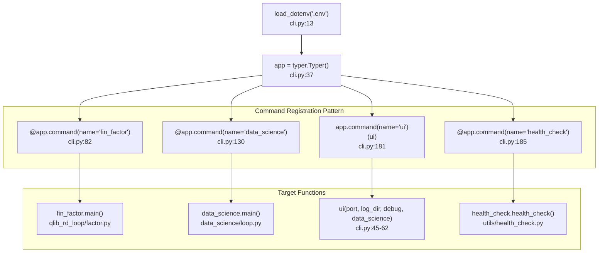

Sources: [rdagent/app/cli.py:11-203](), [pyproject.toml:34-35]()

## Financial Quantitative Research Commands

### Command Overview and Loop Classes

Title: Financial R&D Command to Loop Class Mapping

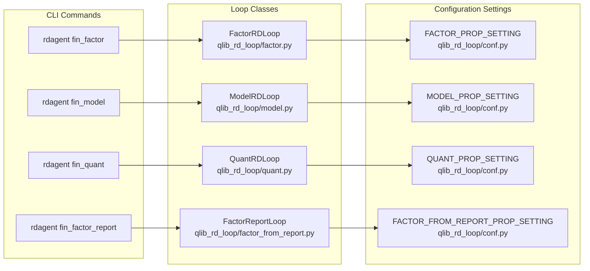

### `fin_factor` - Iterative Factor Evolution

**Purpose:** Automates the research and development of quantitative trading factors through iterative hypothesis generation, implementation, and evaluation.

**Parameters:** [rdagent/app/qlib_rd_loop/factor.py:30-39]()

| Parameter | Type | Default | Description |
|-----------|------|---------|-------------|
| `path` | str | None | Path to resume from previous session |
| `step_n` | int | None | Maximum number of steps to execute |
| `loop_n` | int | None | Maximum number of R&D loops to execute |
| `all_duration` | str | None | Maximum execution time (e.g., "2h", "30m") |
| `checkout` | bool | True | Whether to truncate logs when resuming |
| `base_features_path` | str | None | Path to base features file |

**Usage Examples:**
```bash
# Start new factor evolution session
rdagent fin_factor

# Resume from specific session checkpoint
rdagent fin_factor --path=log/__session__/1/0_propose --checkout=True
```

### `fin_model` - Iterative Model Evolution

**Purpose:** Automates the development of quantitative trading models through iterative proposal and implementation cycles.

**Parameters:** Same as `fin_factor` [rdagent/app/qlib_rd_loop/model.py:18-26]()

### `fin_quant` - Joint Factor-Model Optimization

**Purpose:** Co-evolves factors and models through coordinated optimization. The `QuantRDLoop` class implements action selection between factor and model evolution.

**Implementation Details:**
- Uses `QuantRDLoop` class [rdagent/app/qlib_rd_loop/quant.py:28-119]()
- Action selection in `direct_exp_gen` determines whether to generate factor or model hypothesis [rdagent/app/qlib_rd_loop/quant.py:68-79]()

### `fin_factor_report` - Factor Extraction from PDFs

**Purpose:** Extracts factor definitions from financial research reports (PDF format) and implements them as runnable code [rdagent/app/qlib_rd_loop/factor_from_report.py:61-94]().

**Parameters:** [rdagent/app/qlib_rd_loop/factor_from_report.py:143-151]()

| Parameter | Type | Default | Description |
|-----------|------|---------|-------------|
| `report_folder` | str | None | Directory containing PDF files to process |
| `path` | str | None | Path to resume from previous session |
| `all_duration` | str | None | Maximum execution time |
| `checkout` | bool | True | Whether to truncate logs when resuming |

**Implementation Notes:**
- Uses `FactorExperimentLoaderFromPDFfiles` to parse PDF reports [rdagent/app/qlib_rd_loop/factor_from_report.py:72]().
- Sequentially processes reports with `shift_report` to handle failures [rdagent/app/qlib_rd_loop/factor_from_report.py:113-123]().

Sources: [rdagent/app/cli.py:82-122](), [rdagent/app/qlib_rd_loop/factor.py:30-66](), [rdagent/app/qlib_rd_loop/model.py:18-49](), [rdagent/app/qlib_rd_loop/factor_from_report.py:97-163]()

## Data Science Competition Commands

### `data_science` - Automated Competition Agent

**Purpose:** Automates participation in data science competitions (Kaggle, MLE-bench). Supports the complete R&D workflow from data understanding to model submission [rdagent/app/data_science/loop.py:53-60]().

**Parameters:** [rdagent/app/data_science/loop.py:13-23]()

| Parameter | Type | Default | Description |
|-----------|------|---------|-------------|
| `competition` | str | "bms-molecular-translation" | Name of the competition to run |
| `path` | str | None | Path to resume from previous session |
| `step_n` | int | None | Maximum number of steps to execute |
| `loop_n` | int | None | Maximum number of R&D loops |
| `timeout` | str | None | Maximum execution time |
| `checkout` | bool | True | Control the log session path |

**Scenario Configuration:** Behavior is controlled by `DS_RD_SETTING` [rdagent/app/data_science/loop.py:7-10]().

### `general_model` - Research Paper Implementation

**Purpose:** Extracts model architectures from research papers (PDF format) and generates implementation code [rdagent/app/general_model/general_model.py:34-45]().

**Parameters:** `report_file_path` (str) - URL or local path to PDF paper [rdagent/app/cli.py:126]().

Sources: [rdagent/app/data_science/loop.py:13-83](), [rdagent/app/cli.py:130-146](), [rdagent/app/general_model/general_model.py:14-45]()

## System Monitoring and Utility Commands

### `ui` - Streamlit Log Viewer

**Purpose:** Launches a Streamlit web interface to visualize execution logs and experiment results [rdagent/app/cli.py:45-48]().

**Parameters:** [rdagent/app/cli.py:45]()

| Parameter | Type | Default | Description |
|-----------|------|---------|-------------|
| `port` | int | 19899 | Port for Streamlit server |
| `log_dir` | str | "" | Directory containing log files |
| `debug` | bool | False | Enable debug mode |
| `data_science` | bool | False | Use data science UI variant (`dsapp.py`) |

### `server_ui` - Real-time Log Server

**Purpose:** Launches a Flask-based server for real-time interaction and trace viewing [rdagent/app/cli.py:65-71]().

### `health_check` - System Validation

**Purpose:** Validates Docker installation, port availability, and environment variables [rdagent/app/utils/health_check.py:11-20]().

**Parameters:** [rdagent/app/cli.py:186-190]()

| Parameter | Type | Default | Description |
|-----------|------|---------|-------------|
| `check_env` | bool | True | Check environment variables |
| `check_docker` | bool | True | Check Docker installation |
| `check_ports` | bool | True | Check port availability |

Sources: [rdagent/app/cli.py:45-81](), [rdagent/app/cli.py:185-200](), [rdagent/app/utils/health_check.py:11-45]()

## Session Management and Resumption

### Session Persistence Mechanism

RD-Agent uses a checkpointing mechanism implemented in `LoopBase`. Snapshots are saved to `self.session_folder` (defaulting to `LOG_SETTINGS.trace_path / "__session__"`) after each step [rdagent/utils/workflow/loop.py:127-128]().

**Automatic Snapshot Saving:**
```python
# From loop.py lines 287-290
if name in self.loop_prev_out[li]:
    self.dump(self.session_folder / f"{li}" / f"{si}_{name}")
```

### Session Loading and Resumption Flow

Title: Session Loading and Resumption Workflow

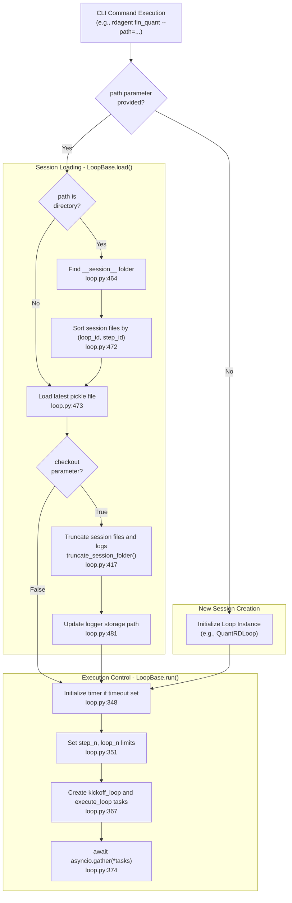

Sources: [rdagent/utils/workflow/loop.py:33-514](), [rdagent/app/data_science/loop.py:13-79]()

---

# Page: Core Architecture

# Core Architecture

<details>
<summary>Relevant source files</summary>

The following files were used as context for generating this wiki page:

- [rdagent/app/cli.py](rdagent/app/cli.py)
- [rdagent/app/general_model/general_model.py](rdagent/app/general_model/general_model.py)
- [rdagent/app/qlib_rd_loop/factor.py](rdagent/app/qlib_rd_loop/factor.py)
- [rdagent/app/qlib_rd_loop/factor_from_report.py](rdagent/app/qlib_rd_loop/factor_from_report.py)
- [rdagent/app/qlib_rd_loop/model.py](rdagent/app/qlib_rd_loop/model.py)
- [rdagent/app/qlib_rd_loop/quant.py](rdagent/app/qlib_rd_loop/quant.py)
- [rdagent/components/workflow/rd_loop.py](rdagent/components/workflow/rd_loop.py)
- [rdagent/core/conf.py](rdagent/core/conf.py)
- [rdagent/core/exception.py](rdagent/core/exception.py)
- [rdagent/core/proposal.py](rdagent/core/proposal.py)
- [rdagent/core/utils.py](rdagent/core/utils.py)
- [rdagent/oai/llm_utils.py](rdagent/oai/llm_utils.py)
- [rdagent/scenarios/data_science/proposal/exp_gen/base.py](rdagent/scenarios/data_science/proposal/exp_gen/base.py)
- [rdagent/scenarios/data_science/proposal/exp_gen/merge.py](rdagent/scenarios/data_science/proposal/exp_gen/merge.py)
- [rdagent/scenarios/data_science/proposal/exp_gen/merge.yaml](rdagent/scenarios/data_science/proposal/exp_gen/merge.yaml)
- [rdagent/scenarios/qlib/factor_experiment_loader/pdf_loader.py](rdagent/scenarios/qlib/factor_experiment_loader/pdf_loader.py)
- [rdagent/scenarios/qlib/factor_experiment_loader/prompts.yaml](rdagent/scenarios/qlib/factor_experiment_loader/prompts.yaml)
- [rdagent/scenarios/qlib/proposal/quant_proposal.py](rdagent/scenarios/qlib/proposal/quant_proposal.py)
- [rdagent/utils/fmt.py](rdagent/utils/fmt.py)
- [rdagent/utils/workflow/loop.py](rdagent/utils/workflow/loop.py)
- [test/oai/test_completion.py](test/oai/test_completion.py)

</details>


This document explains the fundamental systems and abstractions that power RD-Agent's automated research and development capabilities. It covers the environment abstraction layer, workspace management system, experiment model, and configuration architecture that form the foundation for all R&D scenarios.

For specific R&D workflows and domain applications, see [R&D Loop Framework](#2.1). For execution environment details, see [Environment and Execution System](#2.3). For LLM integration patterns, see [LLM Integration and Backends](#2.4).

## Environment Abstraction Layer

RD-Agent provides a unified environment abstraction that allows code execution across different computational environments while maintaining consistent interfaces. The core abstraction is built around the `Env` class hierarchy.

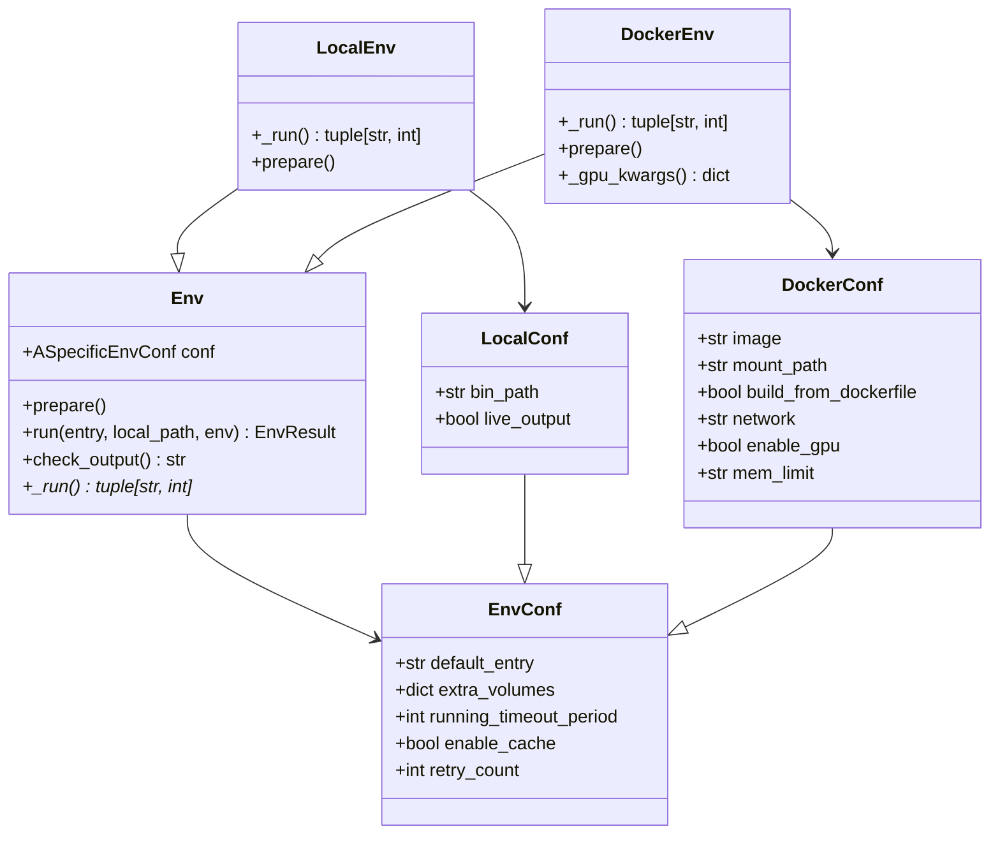

**Environment Execution Flow**

The environment system supports both local and containerized execution with automatic retry, caching, and timeout handling.

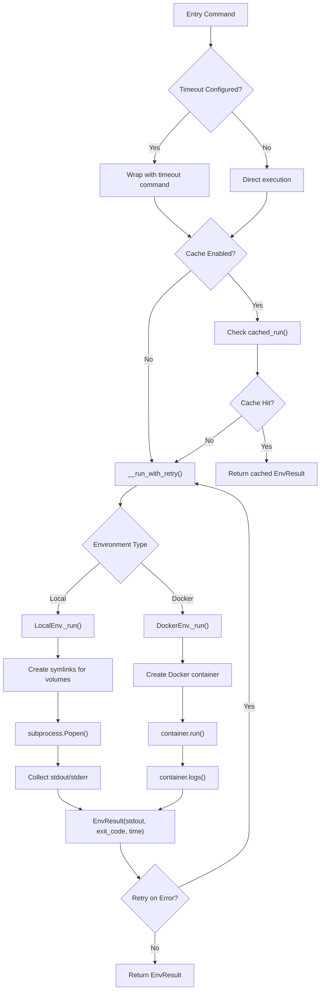

**Sources:** [rdagent/utils/env.py:149-412](), [rdagent/utils/env.py:459-599](), [rdagent/utils/env.py:762-930]()

## Workspace Management System

The workspace system manages code, data, and execution state through the `Workspace` abstraction, with `FBWorkspace` providing file-based implementation for most scenarios.

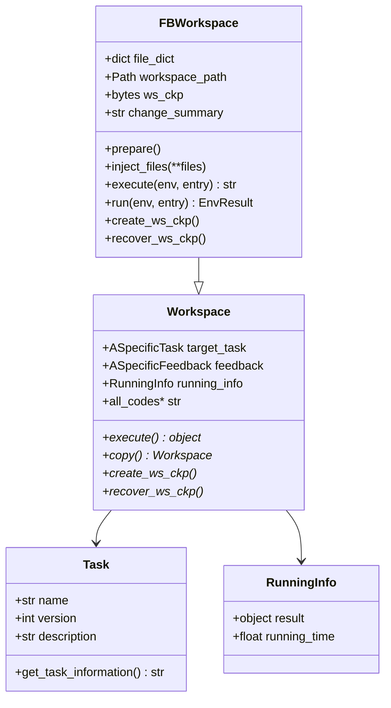

**Workspace Lifecycle and File Management**

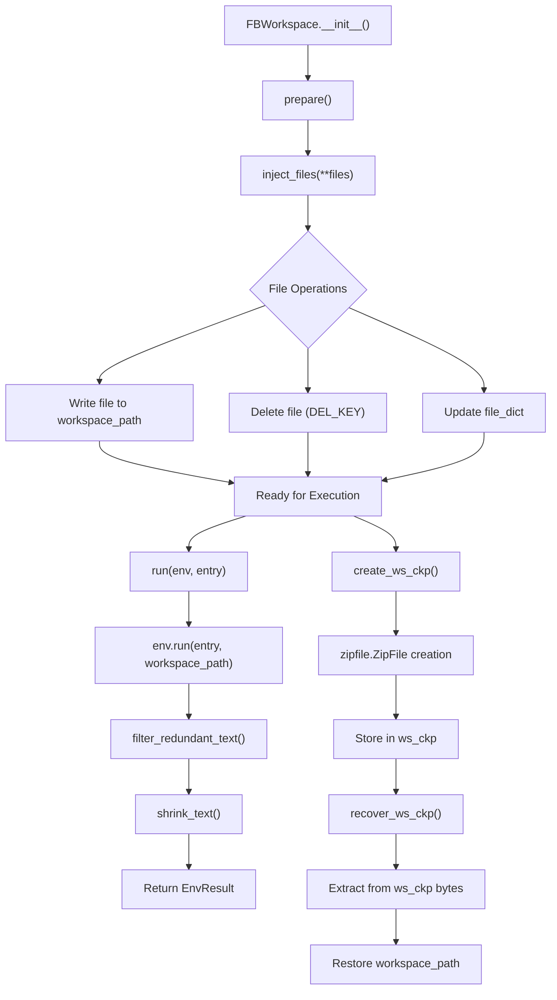

**Sources:** [rdagent/core/experiment.py:75-116](), [rdagent/core/experiment.py:127-362]()

## Experiment and Task Model

The experiment model organizes research work through `Task` and `Experiment` abstractions that coordinate multiple sub-tasks and their implementations.

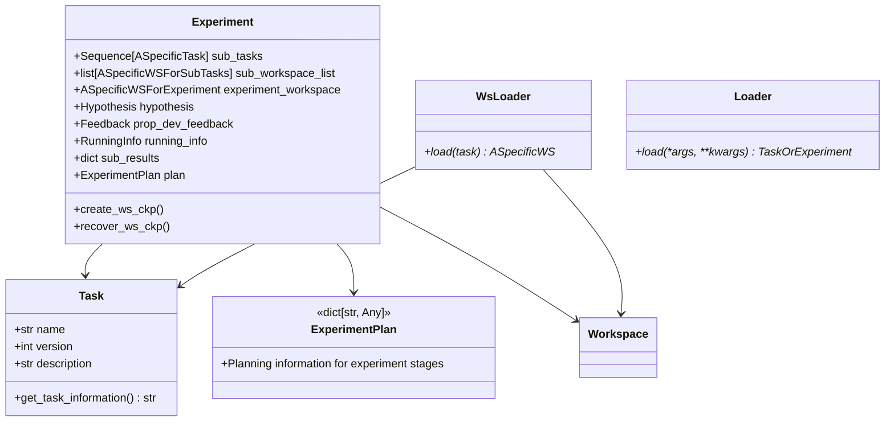

**Experiment Execution Coordination**

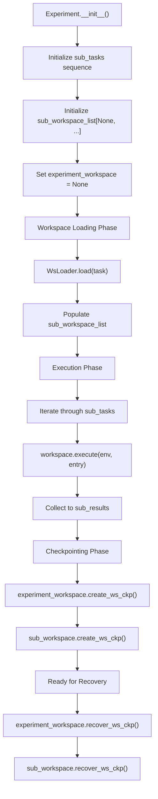

**Sources:** [rdagent/core/experiment.py:36-63](), [rdagent/core/experiment.py:374-450]()

## Configuration Architecture

RD-Agent uses a hierarchical configuration system based on `pydantic-settings` that supports environment variables and type validation for different execution contexts. The `ExtendedBaseSettings` class allows for prefix-based overrides across class hierarchies.

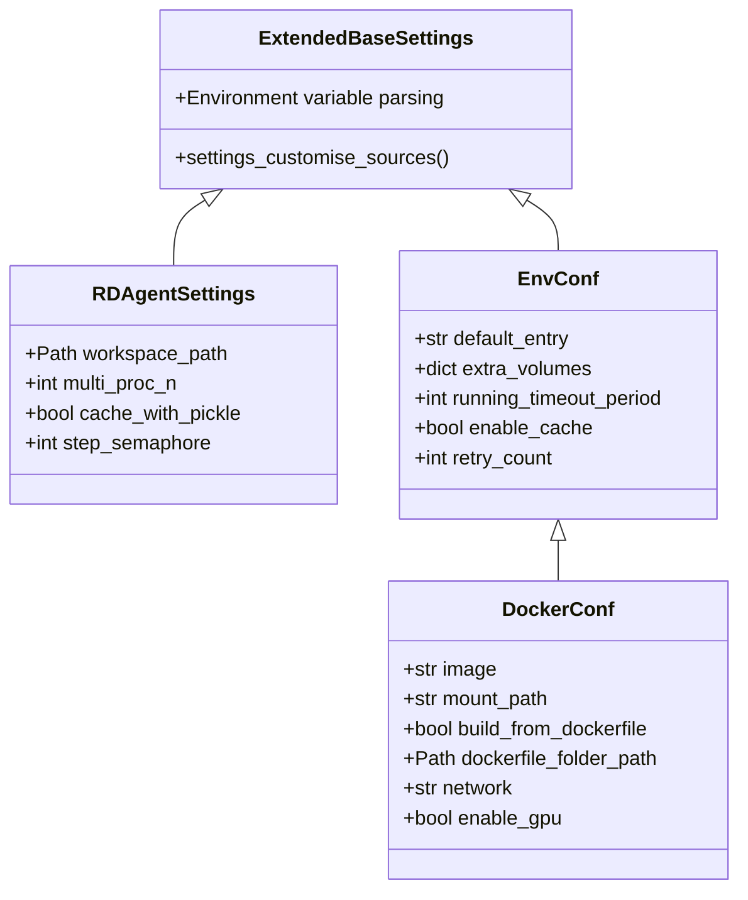

**Configuration Resolution Flow**

The configuration system resolves settings from environment variables with prefix matching, allowing per-scenario customization. Classes like `RDAgentSettings` manage global execution parameters such as parallelism and workspace paths.

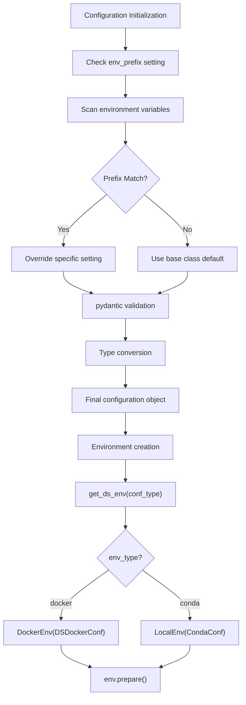

**Sources:** [rdagent/core/conf.py:13-43](), [rdagent/core/conf.py:46-109](), [rdagent/utils/env.py:119-133](), [rdagent/utils/env.py:622-759]()

## Integration Points

The core architecture provides standardized integration points for higher-level systems:

| Integration Point | Interface | Purpose |
|------------------|-----------|---------|
| **Environment Factory** | `get_ds_env(conf_type, extra_volumes, ...)` | Creates configured environments for scenarios |
| **Workspace Loading** | `WsLoader.load(task) -> Workspace` | Loads task-specific workspaces |
| **Execution Interface** | `workspace.run(env, entry) -> EnvResult` | Executes code in isolated environments |
| **State Management** | `create_ws_ckp()` / `recover_ws_ckp()` | Checkpoints and restores workspace state |
| **LLM Backend** | `APIBackend()` | Dynamic LLM provider selection and chat completion |

This architecture enables the R&D loop system to orchestrate complex multi-stage experiments while maintaining isolation, reproducibility, and configurability across different computational environments.

**Sources:** [rdagent/core/experiment.py:120-125](), [rdagent/utils/env.py:182-245](), [rdagent/oai/llm_utils.py:35-44]()

---

# Page: R&D Loop Framework

# R&D Loop Framework

<details>
<summary>Relevant source files</summary>

The following files were used as context for generating this wiki page:

- [rdagent/app/cli.py](rdagent/app/cli.py)
- [rdagent/app/general_model/general_model.py](rdagent/app/general_model/general_model.py)
- [rdagent/app/qlib_rd_loop/factor.py](rdagent/app/qlib_rd_loop/factor.py)
- [rdagent/app/qlib_rd_loop/factor_from_report.py](rdagent/app/qlib_rd_loop/factor_from_report.py)
- [rdagent/app/qlib_rd_loop/model.py](rdagent/app/qlib_rd_loop/model.py)
- [rdagent/app/qlib_rd_loop/quant.py](rdagent/app/qlib_rd_loop/quant.py)
- [rdagent/components/coder/CoSTEER/evaluators.py](rdagent/components/coder/CoSTEER/evaluators.py)
- [rdagent/components/coder/CoSTEER/evolvable_subjects.py](rdagent/components/coder/CoSTEER/evolvable_subjects.py)
- [rdagent/components/coder/CoSTEER/evolving_strategy.py](rdagent/components/coder/CoSTEER/evolving_strategy.py)
- [rdagent/components/workflow/rd_loop.py](rdagent/components/workflow/rd_loop.py)
- [rdagent/core/evaluation.py](rdagent/core/evaluation.py)
- [rdagent/core/evolving_agent.py](rdagent/core/evolving_agent.py)
- [rdagent/core/evolving_framework.py](rdagent/core/evolving_framework.py)
- [rdagent/core/proposal.py](rdagent/core/proposal.py)
- [rdagent/scenarios/data_science/proposal/exp_gen/base.py](rdagent/scenarios/data_science/proposal/exp_gen/base.py)
- [rdagent/scenarios/data_science/proposal/exp_gen/merge.py](rdagent/scenarios/data_science/proposal/exp_gen/merge.py)
- [rdagent/scenarios/data_science/proposal/exp_gen/merge.yaml](rdagent/scenarios/data_science/proposal/exp_gen/merge.yaml)
- [rdagent/scenarios/qlib/proposal/quant_proposal.py](rdagent/scenarios/qlib/proposal/quant_proposal.py)
- [rdagent/utils/agent/workflow.py](rdagent/utils/agent/workflow.py)
- [rdagent/utils/workflow/loop.py](rdagent/utils/workflow/loop.py)

</details>


## Purpose and Scope

The R&D Loop Framework provides the core workflow orchestration system for autonomous research and development in RD-Agent. It implements a generic, resumable, async execution pattern where a sequence of steps is repeatedly executed across multiple loops. The framework handles session persistence, parallel execution, timeout management, and error recovery.

This page covers:
- The `LoopBase` abstraction and its metaclass-driven step discovery mechanism.
- Async execution model with parallel workers and semaphore-based concurrency control.
- Session management (checkpoint, resume, withdraw).
- The `RDLoop` pattern that specializes `LoopBase` for hypothesis-driven R&D workflows.

---

## Core Architecture

### Class Hierarchy

The framework uses a metaclass-driven approach to define workflow steps dynamically.

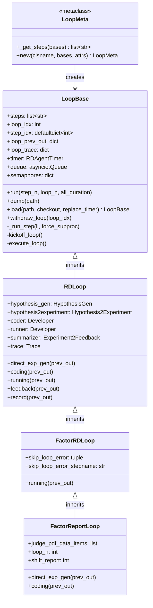

Sources: `[rdagent/utils/workflow/loop.py:33-136]()`, `[rdagent/components/workflow/rd_loop.py:31-68]()`, `[rdagent/app/qlib_rd_loop/factor.py:17-28]()`, `[rdagent/app/qlib_rd_loop/factor_from_report.py:97-141]()`

### LoopMeta Metaclass and Step Discovery

The `LoopMeta` metaclass automatically discovers workflow steps by introspecting class methods. Any callable, non-private method (not starting with `_`) becomes a step in the workflow sequence. Steps are inherited and combined from base classes in method resolution order (MRO).

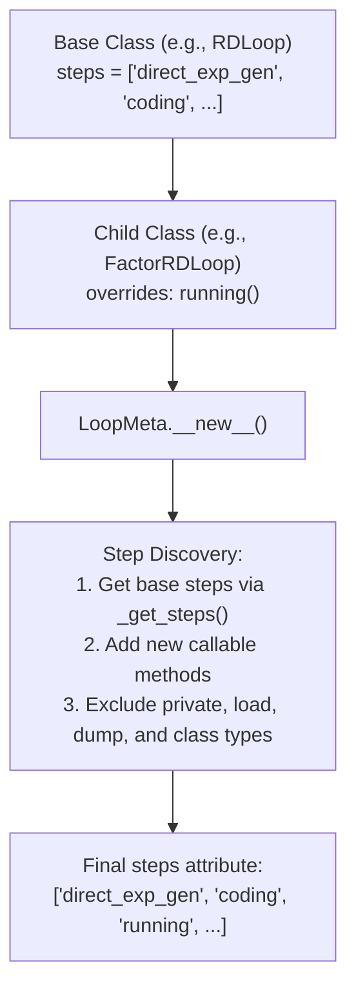

**Step Discovery Algorithm:**
1. **Base Recursion**: Recursively collect steps from all base classes using `_get_steps` `[rdagent/utils/workflow/loop.py:35-51]()`.
2. **Method Scan**: Identify new callable methods in the current class attributes `[rdagent/utils/workflow/loop.py:66-72]()`.
3. **Exclusion**: Skip `load`, `dump`, private methods (`_*`), and class types to avoid accidental step registration `[rdagent/utils/workflow/loop.py:49-69]()`.
4. **Assignment**: Set the `steps` class attribute with the combined, ordered list `[rdagent/utils/workflow/loop.py:73]()`.

Sources: `[rdagent/utils/workflow/loop.py:33-74]()`

### LoopBase State Management

The `LoopBase` class maintains the execution state for all concurrent loops.

| State Variable | Type | Purpose |
|---------------|------|---------|
| `loop_idx` | `int` | Current loop index / next loop index to kickoff `[rdagent/utils/workflow/loop.py:118]()`. |
| `step_idx` | `defaultdict[int, int]` | Maps loop index → next step index to execute `[rdagent/utils/workflow/loop.py:119]()`. |
| `loop_prev_out` | `dict[int, dict[str, Any]]` | Storage for step results: `loop_index` → `{step_name: output}` `[rdagent/utils/workflow/loop.py:125]()`. |
| `loop_trace` | `dict[int, list[LoopTrace]]` | Timing information (start/end) for each step `[rdagent/utils/workflow/loop.py:126]()`. |
| `queue` | `asyncio.Queue` | Orchestrates loop indices for worker coroutines `[rdagent/utils/workflow/loop.py:120]()`. |
| `semaphores` | `dict[str, asyncio.Semaphore]` | Per-step concurrency limits `[rdagent/utils/workflow/loop.py:135]()`. |

Sources: `[rdagent/utils/workflow/loop.py:116-136]()`

---

## Async Execution Model

### Parallel Worker Architecture

RD-Agent uses a producer-consumer model where `kickoff_loop` produces loop indices and `execute_loop` workers consume them.

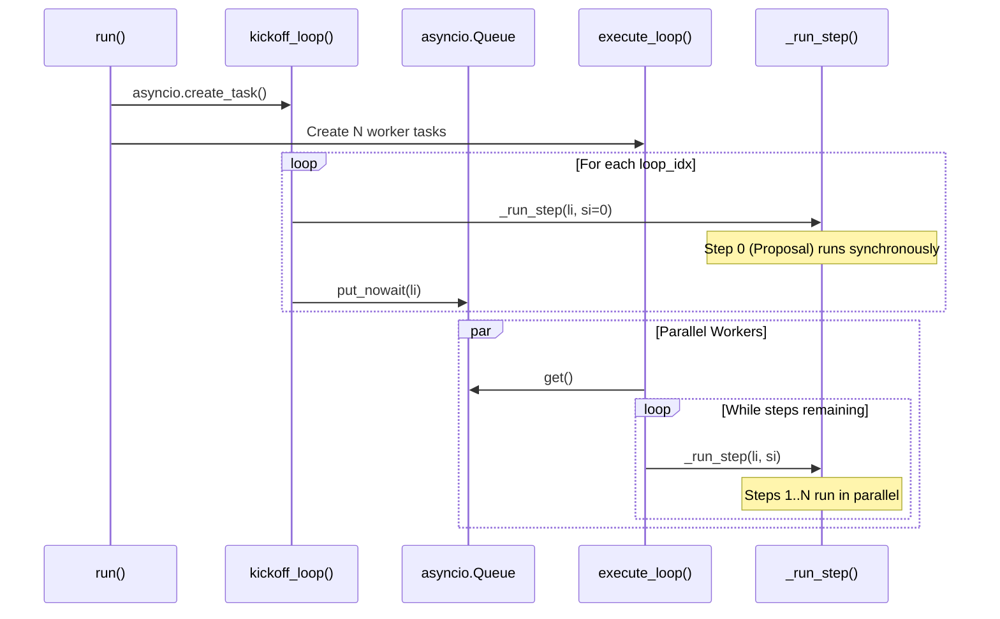

**Key Execution Constraints:**
- **Step 0 Synchronicity**: The first step (typically `direct_exp_gen`) is executed synchronously in the kickoff loop to ensure sequential proposal generation `[rdagent/utils/workflow/loop.py:333-339]()`.
- **Final Step Seriality**: Steps named `record` or `feedback` are forced to a semaphore limit of 1 to prevent race conditions when updating the global `Trace` `[rdagent/utils/workflow/loop.py:153-155]()`.
- **Subprocess Forking**: Middle steps can be forced into subprocesses using `ProcessPoolExecutor` if `force_subproc` is enabled in settings `[rdagent/utils/workflow/loop.py:224-245]()`.

Sources: `[rdagent/utils/workflow/loop.py:144-159]()`, `[rdagent/utils/workflow/loop.py:312-403]()`

### Semaphore-Based Concurrency Control

Concurrency is managed via `get_semaphore(step_name)`. It reads limits from `RD_AGENT_SETTINGS.step_semaphore` `[rdagent/utils/workflow/loop.py:145-146]()`. If a step name is not specified, it defaults to 1 `[rdagent/utils/workflow/loop.py:146]()`.

Sources: `[rdagent/utils/workflow/loop.py:144-159]()`

---

## Session Management

### Checkpoint and Resume

RD-Agent automatically saves a session checkpoint after every step completion in `_run_step` `[rdagent/utils/workflow/loop.py:302-304]()`.

- **Persistence**: Checkpoints are stored in the `__session__` folder within the trace path `[rdagent/utils/workflow/loop.py:127]()`.
- **Serialization**: The entire `LoopBase` instance is pickled `[rdagent/utils/workflow/loop.py:433-442]()`.
- **Loading**: The `load` method restores the instance. If `checkout=True`, it truncates the session folder and storage logs to the specific checkpoint time to ensure a clean state for resumption `[rdagent/utils/workflow/loop.py:476-499]()`.

### Error Recovery and Withdrawal

The framework differentiates between errors that skip a loop and errors that require a full state rollback.

1. **Skip Loop Error**: Defined in `skip_loop_error`. If caught, the loop jumps to `skip_loop_error_stepname` (usually `feedback`) `[rdagent/utils/workflow/loop.py:252-261]()`.
2. **Withdraw Loop Error**: Defined in `withdraw_loop_error`. If caught, `withdraw_loop(loop_idx)` is called, which loads the checkpoint from the *previous* loop and raises `LoopResumeError` to trigger a full system restart from that state `[rdagent/utils/workflow/loop.py:263-270]()`, `[rdagent/utils/workflow/loop.py:405-423]()`.

Sources: `[rdagent/utils/workflow/loop.py:250-271]()`, `[rdagent/utils/workflow/loop.py:405-423]()`, `[rdagent/utils/workflow/loop.py:452-527]()`

---

## RDLoop Pattern

`RDLoop` is the base implementation for standard R&D cycles (Propose -> Code -> Run -> Feedback -> Record).

### Generic Workflow Steps

| Method | Role | Source |
|---|---|---|
| `direct_exp_gen` | Generates the `Experiment` and `Hypothesis` | `[rdagent/components/workflow/rd_loop.py:82-84]()` |
| `coding` | Uses `Developer` (Coder) to implement logic in the `Workspace` | `[rdagent/components/workflow/rd_loop.py:86-89]()` |
| `running` | Uses `Developer` (Runner) to execute the code and collect results | `[rdagent/components/workflow/rd_loop.py:91-94]()` |
| `feedback` | Uses `Experiment2Feedback` to summarize performance | `[rdagent/components/workflow/rd_loop.py:96-103]()` |
| `record` | Synchronizes the experiment and feedback into the `Trace` DAG | `[rdagent/components/workflow/rd_loop.py:105-109]()` |

### Natural Language to Code Mapping (RDLoop)

The following diagram maps high-level R&D concepts to the specific code entities in the RDLoop framework.

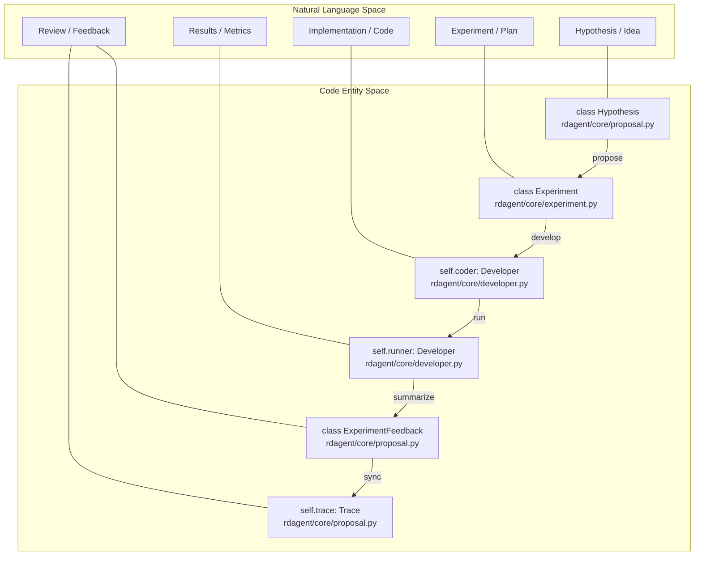

Sources: `[rdagent/core/proposal.py:24-134]()`, `[rdagent/core/experiment.py:1-20]()`, `[rdagent/components/workflow/rd_loop.py:31-68]()`

---

## Implementation Details

### Multi-Step Evolution (EvoAgent)

While `RDLoop` handles the high-level loop, internal coding/running steps often use `RAGEvoAgent` for iterative refinement.

```mermaid
sequenceDiagram
    participant Loop as RDLoop.coding()
    participant Agent as RAGEvoAgent.multistep_evolve()
    participant Strat as EvolvingStrategy.evolve_iter()
    participant Eval as RAGEvaluator.evaluate_iter()

    Loop->>Agent: multistep_evolve(evo, eva)
    loop max_loop
        Agent->>Strat: evolve_iter()
        Strat-->>Agent: yield EvolvingItem (Code)
        Agent->>Eval: send(EvolvingItem)
        Eval-->>Agent: yield Feedback
        Note over Agent: Check if refinement needed
    end
    Agent-->>Loop: Final EvolvingItem
```

Sources: `[rdagent/core/evolving_agent.py:78-185]()`, `[rdagent/components/coder/CoSTEER/evolving_strategy.py:108-171]()`

### Scenario Specialization: FactorReportLoop

`FactorReportLoop` demonstrates how to customize the R&D loop for document-driven research. It overrides `direct_exp_gen` to extract hypotheses from PDF reports instead of using an LLM-based proposer.

- **Initialization**: Loads PDFs and calculates `loop_n` based on report count `[rdagent/app/qlib_rd_loop/factor_from_report.py:100-107]()`.
- **Custom Proposer**: `extract_hypothesis_and_exp_from_reports` uses `FactorExperimentLoaderFromPDFfiles` and `generate_hypothesis` to populate the experiment `[rdagent/app/qlib_rd_loop/factor_from_report.py:61-94]()`.
- **Parallel Control**: Checks `get_unfinished_loop_cnt` to respect `max_parallel` settings during report processing `[rdagent/app/qlib_rd_loop/factor_from_report.py:114]()`.

Sources: `[rdagent/app/qlib_rd_loop/factor_from_report.py:61-141]()`

---

# Page: Experiment and Workspace Management

# Experiment and Workspace Management

<details>
<summary>Relevant source files</summary>

The following files were used as context for generating this wiki page:

- [rdagent/core/experiment.py](rdagent/core/experiment.py)
- [rdagent/core/scenario.py](rdagent/core/scenario.py)
- [rdagent/scenarios/general_model/scenario.py](rdagent/scenarios/general_model/scenario.py)
- [rdagent/scenarios/qlib/experiment/factor_from_report_experiment.py](rdagent/scenarios/qlib/experiment/factor_from_report_experiment.py)
- [rdagent/scenarios/qlib/experiment/factor_template/read_exp_res.py](rdagent/scenarios/qlib/experiment/factor_template/read_exp_res.py)
- [rdagent/scenarios/qlib/experiment/model_template/read_exp_res.py](rdagent/scenarios/qlib/experiment/model_template/read_exp_res.py)
- [rdagent/scenarios/qlib/experiment/workspace.py](rdagent/scenarios/qlib/experiment/workspace.py)
- [rdagent/utils/env.py](rdagent/utils/env.py)
- [rdagent/utils/repo/diff.py](rdagent/utils/repo/diff.py)
- [test/utils/env_tpl/read_exp.py](test/utils/env_tpl/read_exp.py)
- [test/utils/test_env.py](test/utils/test_env.py)

</details>


## Purpose and Scope

This document explains the core abstractions for managing experimental tasks and their implementations in RD-Agent. The **Experiment** and **Workspace** classes provide the foundational structure for organizing R&D workflows, managing code artifacts, and persisting state across development iterations.

**Key topics covered:**
- `Task`, `Workspace`, and `Experiment` abstract base classes.
- `FBWorkspace` file-based workspace implementation and the `DEL_KEY` pattern.
- Checkpoint mechanisms for workspace state persistence using ZIP archives.
- Integration with execution environments (`Env`) and result tracking (`RunningInfo`).

For information about execution environments (Docker/Local), see [Environment and Execution System](2.3). For the R&D loop workflow that orchestrates experiments, see [R&D Loop Framework](2.1).

---

## Core Class Hierarchy

The experiment management system is built on three primary abstractions that work together to organize tasks, implementations, and execution state.

Title: Core Experiment and Workspace Abstractions
```mermaid
classDiagram
    class AbsTask {
        <<abstract>>
        +str name
        +int version
        +get_task_information() str
    }
    
    class Task {
        +str name
        +int version
        +str description
        +UserInstructions user_instructions
        +get_task_information() str
        +__repr__() str
    }
    
    class Workspace~ASpecificTask, ASpecificFeedback~ {
        <<abstract>>
        +ASpecificTask target_task
        +ASpecificFeedback feedback
        +RunningInfo running_info
        +execute(*args, **kwargs) object
        +copy() Workspace
        +all_codes() str
        +create_ws_ckp() None
        +recover_ws_ckp() None
    }
    
    class FBWorkspace {
        +dict~str,Any~ file_dict
        +Path workspace_path
        +bytes ws_ckp
        +str change_summary
        +prepare() None
        +inject_files(**files) None
        +inject_code_from_folder(folder_path) None
        +execute(env, entry) str
        +run(env, entry) EnvResult
        +create_ws_ckp() None
        +recover_ws_ckp() None
        +clear() None
    }
    
    class Experiment~ASpecificTask, ASpecificWSForExperiment, ASpecificWSForSubTasks~ {
        <<abstract>>
        +Hypothesis hypothesis
        +Sequence~ASpecificTask~ sub_tasks
        +list~ASpecificWSForSubTasks~ sub_workspace_list
        +ASpecificWSForExperiment experiment_workspace
        +Feedback prop_dev_feedback
        +RunningInfo running_info
        +dict~str,float~ sub_results
        +ExperimentPlan plan
        +create_ws_ckp() None
        +recover_ws_ckp() None
    }
    
    class RunningInfo {
        +object result
        +float running_time
    }
    
    AbsTask <|-- Task
    Workspace <|-- FBWorkspace
    Task --o Workspace : target_task
    Workspace --o Experiment : sub_workspace_list
    Workspace --o Experiment : experiment_workspace
    RunningInfo --o Workspace : running_info
    RunningInfo --o Experiment : running_info
```
Sources: [rdagent/core/experiment.py:34-48](), [rdagent/core/experiment.py:58-75](), [rdagent/core/experiment.py:87-127](), [rdagent/core/experiment.py:139-170](), [rdagent/core/experiment.py:379-445]()

---

## Task Abstraction

The `Task` class represents a unit of work to be implemented. Tasks contain metadata about what needs to be accomplished and serve as the specification for workspace implementations.

### Task Structure

| Field | Type | Description |
|-------|------|-------------|
| `name` | `str` | Identifier for the task [rdagent/core/experiment.py:42-42]() |
| `version` | `int` | Version number (default: 1) [rdagent/core/experiment.py:41-41]() |
| `description` | `str` | Detailed task specification [rdagent/core/experiment.py:67-67]() |
| `user_instructions` | `UserInstructions` | High-priority user guidance [rdagent/core/experiment.py:68-68]() |

### Task Information String

The `get_task_information()` method returns a formatted string combining all task metadata. This is used throughout the system for prompts, logging, and knowledge management [rdagent/core/experiment.py:70-71]().

Sources: [rdagent/core/experiment.py:34-75]()

---

## Workspace Abstraction

A `Workspace` is a stateful container for task implementations. It evolves as developers iteratively improve code, maintaining both in-memory state and on-disk artifacts [rdagent/core/experiment.py:87-91]().

### Key Methods

- **`execute()`**: Run the implementation and return results [rdagent/core/experiment.py:99-101]().
- **`copy()`**: Create a deep copy for parallel exploration [rdagent/core/experiment.py:103-106]().
- **`all_codes`**: Property returning all code as a formatted string [rdagent/core/experiment.py:108-114]().
- **`create_ws_ckp()`**: Capture current state for later rollback [rdagent/core/experiment.py:116-121]().
- **`recover_ws_ckp()`**: Restore workspace from checkpoint [rdagent/core/experiment.py:123-127]().

Sources: [rdagent/core/experiment.py:87-127]()

---

## FBWorkspace: File-Based Implementation

`FBWorkspace` is the primary workspace implementation, using a file-based approach with dual state management: an in-memory dictionary (`file_dict`) and on-disk files in a unique directory [rdagent/core/experiment.py:139-170]().

### Dual State Architecture

Title: FBWorkspace Dual State and Checkpointing
```mermaid
graph LR
    subgraph "In-Memory State"
        file_dict["FBWorkspace.file_dict: dict[str, Any]"]
        change_summary["FBWorkspace.change_summary: str"]
    end
    
    subgraph "On-Disk State"
        workspace_path["FBWorkspace.workspace_path: Path"]
        files["*.py, *.yaml, *.csv files"]
    end
    
    subgraph "Checkpoint State"
        ws_ckp["FBWorkspace.ws_ckp: bytes (ZIP)"]
    end
    
    inject["FBWorkspace.inject_files(**files)"] --> file_dict
    inject --> files
    file_dict -.sync.-> files
    workspace_path --> files
    files --> ws_ckp
    ws_ckp -.restore.-> files
```
Sources: [rdagent/core/experiment.py:164-170](), [rdagent/core/experiment.py:223-243](), [rdagent/core/experiment.py:324-348]()

### Workspace Path Management

Each `FBWorkspace` instance creates a unique workspace directory using a UUID to ensure isolation between concurrent experiments [rdagent/core/experiment.py:167-167]().

### File Injection and the DEL_KEY Pattern

The `inject_files()` method is the primary interface for code management. It accepts a dictionary mapping file paths to content [rdagent/core/experiment.py:223-223]().

**The `DEL_KEY` pattern:**
RD-Agent uses a special constant `DEL_KEY = "__DEL__"` to handle file deletions during code evolution [rdagent/core/experiment.py:165-165]().

```python
# Example of deleting a file via injection
workspace.inject_files(**{"old_script.py": FBWorkspace.DEL_KEY})
```

When `inject_files` encounters `DEL_KEY`:
1. It removes the file entry from the in-memory `file_dict` [rdagent/core/experiment.py:231-232]().
2. It deletes the physical file from the disk at `workspace_path` [rdagent/core/experiment.py:233-234]().

Sources: [rdagent/core/experiment.py:164-168](), [rdagent/core/experiment.py:223-243]()

---

## Workspace Execution Flow

`FBWorkspace` integrates with the environment execution system to run code and capture results.

Title: FBWorkspace Execution and Result Capture
```mermaid
sequenceDiagram
    participant Client
    participant FBWorkspace
    participant FileSystem as "Local Disk"
    participant Env as "Env (Docker/Local)"
    
    Client->>FBWorkspace: run(env, entry)
    FBWorkspace->>FBWorkspace: prepare()
    FBWorkspace->>FileSystem: Sync file_dict to workspace_path
    FBWorkspace->>Env: env.run(entry, local_path=workspace_path)
    Env->>Env: Execute (e.g., python main.py)
    Env-->>FBWorkspace: EnvResult (stdout, exit_code, running_time)
    FBWorkspace->>FBWorkspace: Update RunningInfo
    FBWorkspace-->>Client: EnvResult
```
Sources: [rdagent/core/experiment.py:290-305](), [rdagent/utils/env.py:461-512]()

### Execution Methods

- **`run(env: Env, entry: str, ...)`**: Prepares the workspace, syncs all files from `file_dict` to disk, and calls `env.run` [rdagent/core/experiment.py:290-305]().
- **`execute(env: Env, entry: str, ...)`**: A wrapper around `run` that returns the truncated stdout as a string for simplified feedback [rdagent/core/experiment.py:307-313]().

### RunningInfo Data Class

The `RunningInfo` class tracks the outcome of an execution [rdagent/core/experiment.py:82-85]().

| Attribute | Type | Description |
|-----------|------|-------------|
| `result` | `object` | Scenario-specific results (e.g., IC, metrics) [rdagent/core/experiment.py:83-83]() |
| `running_time` | `float` | Duration of the execution in seconds [rdagent/core/experiment.py:84-84]() |

Sources: [rdagent/core/experiment.py:82-85](), [rdagent/core/experiment.py:290-313]()

---

## Checkpoint Mechanisms

Checkpoints enable rollback to previous workspace states, which is critical for evolutionary development where new code might introduce errors or performance regressions.

### Creating Checkpoints

The `create_ws_ckp()` method creates an in-memory ZIP archive of the current `workspace_path` [rdagent/core/experiment.py:324-348]().
- **Symlink Preservation**: It correctly handles symbolic links by preserving their targets [rdagent/core/experiment.py:328-333]().
- **Size Limits**: It filters files based on `RD_AGENT_SETTINGS.workspace_ckp_size_limit` to avoid bloating memory with large datasets [rdagent/core/experiment.py:336-343]().

### Recovering Checkpoints

The `recover_ws_ckp()` method restores the workspace from the ZIP archive [rdagent/core/experiment.py:350-378]().
1. It deletes the current `workspace_path` [rdagent/core/experiment.py:355-355]().
2. It extracts the ZIP content, restoring file modes and symlinks [rdagent/core/experiment.py:359-376]().
3. It sets `ws_ckp` back to `None` to free memory [rdagent/core/experiment.py:378-378]().

Sources: [rdagent/core/experiment.py:324-378]()

---

## Scenario-Specific Implementations

### QlibFBWorkspace
In the Quantitative Finance scenario, `QlibFBWorkspace` extends `FBWorkspace` to handle Qlib-specific execution and result parsing [rdagent/scenarios/qlib/experiment/workspace.py:13-13]().

- **Execution**: It runs `qrun conf.yaml` and then a post-processing script `read_exp_res.py` to extract metrics [rdagent/scenarios/qlib/experiment/workspace.py:29-40]().
- **Result Extraction**: It reads `qlib_res.csv` and `ret.pkl` from the workspace to populate the `RunningInfo.result` [rdagent/scenarios/qlib/experiment/workspace.py:42-59]().

Sources: [rdagent/scenarios/qlib/experiment/workspace.py:13-60]()

---

## Summary of Data Flow

Title: Data Flow from Task to Environment Result
```mermaid
graph TD
    subgraph "Task Definition"
        Task["Task (name, desc)"]
    end
    
    subgraph "Workspace Implementation"
        WS["FBWorkspace (file_dict)"]
        Inject["inject_files()"]
    end
    
    subgraph "Execution"
        Env["Env.run()"]
        Disk["Local Path"]
        Result["EnvResult"]
    end
    
    Task --> WS
    Inject --> WS
    WS -->|"Sync"| Disk
    Disk --> Env
    Env --> Result
    Result -->|"Populate"| WS
```
Sources: [rdagent/core/experiment.py:58-75](), [rdagent/core/experiment.py:139-170](), [rdagent/core/experiment.py:290-305](), [rdagent/utils/env.py:461-512]()

---

# Page: Environment and Execution System

# Environment and Execution System

<details>
<summary>Relevant source files</summary>

The following files were used as context for generating this wiki page:

- [rdagent/app/utils/ws.py](rdagent/app/utils/ws.py)
- [rdagent/components/coder/data_science/conf.py](rdagent/components/coder/data_science/conf.py)
- [rdagent/components/coder/data_science/pipeline/__init__.py](rdagent/components/coder/data_science/pipeline/__init__.py)
- [rdagent/core/experiment.py](rdagent/core/experiment.py)
- [rdagent/scenarios/qlib/docker/Dockerfile](rdagent/scenarios/qlib/docker/Dockerfile)
- [rdagent/scenarios/qlib/experiment/factor_template/conf_baseline.yaml](rdagent/scenarios/qlib/experiment/factor_template/conf_baseline.yaml)
- [rdagent/scenarios/qlib/experiment/factor_template/conf_combined_factors.yaml](rdagent/scenarios/qlib/experiment/factor_template/conf_combined_factors.yaml)
- [rdagent/scenarios/qlib/experiment/factor_template/conf_combined_factors_sota_model.yaml](rdagent/scenarios/qlib/experiment/factor_template/conf_combined_factors_sota_model.yaml)
- [rdagent/scenarios/qlib/experiment/model_template/conf_baseline_factors_model.yaml](rdagent/scenarios/qlib/experiment/model_template/conf_baseline_factors_model.yaml)
- [rdagent/scenarios/qlib/experiment/model_template/conf_sota_factors_model.yaml](rdagent/scenarios/qlib/experiment/model_template/conf_sota_factors_model.yaml)
- [rdagent/utils/env.py](rdagent/utils/env.py)
- [test/utils/env_tpl/read_exp.py](test/utils/env_tpl/read_exp.py)
- [test/utils/test_conf.py](test/utils/test_conf.py)
- [test/utils/test_env.py](test/utils/test_env.py)

</details>


## Purpose and Scope

This document describes the environment and execution system in RD-Agent, which provides a unified abstraction for running code in different execution contexts (local processes, conda environments, Docker containers). The system handles workspace mounting, resource limits, GPU configuration, timeout management, and execution caching. This infrastructure enables safe, isolated code execution for the CoSTEER framework and scenario-specific runners.

For information about workspace management and file-based state, see [Experiment and Workspace Management (2.2)](). For details on how the CoSTEER framework uses these environments for code evaluation, see [CoSTEER Framework (4.1)]().

---

## Environment Architecture Overview

The environment system provides a two-layer abstraction: configuration classes (`EnvConf`) that define environment parameters, and execution classes (`Env`) that implement the runtime behavior. This design separates environment specification from execution logic, enabling environment settings to be loaded from configuration files or environment variables.

### Core Components Diagram

```mermaid
graph TB
    subgraph "Configuration Layer [rdagent/utils/env.py]"
        EnvConf["EnvConf<br/>(Abstract Base)"]
        LocalConf["LocalConf<br/>bin_path, live_output"]
        CondaConf["CondaConf<br/>conda_env_name"]
        DockerConf["DockerConf<br/>image, mount_path,<br/>enable_gpu, mem_limit"]
    end
    
    subgraph "Specialized Docker Configs [rdagent/utils/env.py]"
        QlibDockerConf["QlibDockerConf<br/>qlib workspace"]
        DSDockerConf["DSDockerConf<br/>data science"]
        KGDockerConf["KGDockerConf<br/>kaggle"]
        MLEBDockerConf["MLEBDockerConf<br/>mle-bench"]
    end
    
    subgraph "Execution Layer [rdagent/utils/env.py]"
        Env["Env[ASpecificEnvConf]<br/>(Generic Abstract Base)"]
        LocalEnv["LocalEnv<br/>subprocess execution"]
        DockerEnv["DockerEnv<br/>container execution"]
    end
    
    subgraph "Execution Output"
        EnvResult["EnvResult<br/>stdout, exit_code,<br/>running_time"]
    end
    
    subgraph "Workspace Integration [rdagent/core/experiment.py]"
        FBWorkspace["FBWorkspace"]
        ExecuteMethod["execute() / run()"]
    end
    
    EnvConf --> LocalConf
    EnvConf --> DockerConf
    LocalConf --> CondaConf
    DockerConf --> QlibDockerConf
    DockerConf --> DSDockerConf
    DockerConf --> KGDockerConf
    DockerConf --> MLEBDockerConf
    
    LocalConf -.config.-> LocalEnv
    DockerConf -.config.-> DockerEnv
    
    Env --> LocalEnv
    Env --> DockerEnv
    
    LocalEnv --> EnvResult
    DockerEnv --> EnvResult
    
    FBWorkspace --> ExecuteMethod
    ExecuteMethod --> Env
    Env --> EnvResult
```

**Sources:** [rdagent/utils/env.py:164-222](), [rdagent/utils/env.py:457-465](), [rdagent/utils/env.py:631-662](), [rdagent/core/experiment.py:290-305]()

---

## Core Abstractions

### Env Base Class

The `Env` class is a generic abstract base class parameterized by configuration type `ASpecificEnvConf`. It defines the contract for all execution environments.

| Method | Return Type | Description |
|--------|-------------|-------------|
| `prepare(*args, **kwargs)` | `None` | Download images, create conda environments, or perform other setup [rdagent/utils/env.py:214-216]() |
| `run(entry, local_path, env, **kwargs)` | `EnvResult` | Execute command and return stdout, exit code, and running time [rdagent/utils/env.py:256-343]() |
| `check_output(entry, local_path, env, **kwargs)` | `str` | Execute command and return only stdout (convenience wrapper) [rdagent/utils/env.py:393-397]() |
| `_run(entry, local_path, env, **kwargs)` | `tuple[str, int]` | Abstract method implemented by subclasses for actual execution [rdagent/utils/env.py:218-222]() |
| `cached_run(entry, local_path, env, **kwargs)` | `EnvResult` | Cache execution results based on code hash [rdagent/utils/env.py:345-391]() |

**Sources:** [rdagent/utils/env.py:158-222]()

### EnvConf Configuration Base

The `EnvConf` class extends `ExtendedBaseSettings` (Pydantic-based settings) to provide type-safe configuration with environment variable loading.

| Field | Type | Default | Description |
|-------|------|---------|-------------|
| `default_entry` | `str` | - | Default command to execute (e.g., `"python main.py"`) [rdagent/utils/env.py:165]() |
| `extra_volumes` | `dict` | `{}` | Additional volumes to mount [rdagent/utils/env.py:167]() |
| `running_timeout_period` | `int \| None` | `3600` | Timeout in seconds, `None` for no limit [rdagent/utils/env.py:168]() |
| `enable_cache` | `bool` | `True` | Enable execution result caching [rdagent/utils/env.py:197]() |
| `retry_count` | `int` | `5` | Number of retries on execution failure [rdagent/utils/env.py:198]() |
| `retry_wait_seconds` | `int` | `10` | Seconds to wait between retries [rdagent/utils/env.py:199]() |

**Sources:** [rdagent/utils/env.py:164-203]()

### EnvResult Data Structure

The `EnvResult` dataclass encapsulates execution outcomes:

```python
@dataclass
class EnvResult:
    stdout: str          # Combined stdout and stderr
    exit_code: int       # Process exit code
    running_time: float  # Execution time in seconds
```

The `get_truncated_stdout()` method applies context filtering and line truncation based on `RD_AGENT_SETTINGS` for inclusion in LLM prompts.

**Sources:** [rdagent/utils/env.py:139-156]()

---

## Execution Flow

### Run Method Execution Pipeline

The `run()` method orchestrates the complete execution flow with timeout handling, permission management, and caching.

```mermaid
sequenceDiagram
    participant Caller
    participant Env as "Env.run() [rdagent/utils/env.py]"
    participant CacheLayer as "cached_run()"
    participant RetryLayer as "__run_with_retry()"
    participant ImplLayer as "_run() [subclass]"
    participant Process as "Subprocess/Docker"
    
    Caller->>Env: run(entry, local_path, env)
    
    Note over Env: 1. Apply default entry if None
    Note over Env: 2. Build timeout command
    Note over Env: 3. Add chmod for workspace
    
    alt enable_cache = True
        Env->>CacheLayer: cached_run()
        CacheLayer->>CacheLayer: Compute MD5 hash key [rdagent/utils/env.py:370-381]
        alt Cache Hit
            CacheLayer->>CacheLayer: Load from pickle [rdagent/utils/env.py:353-360]
            CacheLayer->>CacheLayer: Unzip workspace [rdagent/utils/env.py:358]
            CacheLayer-->>Env: Return cached EnvResult
        else Cache Miss
            CacheLayer->>RetryLayer: Forward to retry layer
        end
    else enable_cache = False
        Env->>RetryLayer: __run_with_retry()
    end
    
    loop retry_count + 1 times
        RetryLayer->>ImplLayer: _run(entry, local_path, env)
        ImplLayer->>Process: Execute in environment
        Process-->>ImplLayer: stdout, exit_code
        ImplLayer-->>RetryLayer: Return tuple
        
        alt Success or Timeout
            RetryLayer->>RetryLayer: Check execution time
            alt Timeout exceeded
                Note over RetryLayer: Append timeout message
            end
            RetryLayer-->>Env: EnvResult(stdout, exit_code, time)
        else Exception
            Note over RetryLayer: Log warning, wait, retry [rdagent/utils/env.py:251-253]
        end
    end
    
    opt Cache enabled and no cache hit
        Env->>CacheLayer: Save to pickle [rdagent/utils/env.py:384-388]
        CacheLayer->>CacheLayer: Zip workspace folder
    end
    
    Env-->>Caller: EnvResult
```

**Sources:** [rdagent/utils/env.py:256-343](), [rdagent/utils/env.py:345-391](), [rdagent/utils/env.py:223-254]()

### Entry Point Transformation

The system wraps user-provided entry points with shell commands to handle timeout enforcement and permission management in `Env.run()` [rdagent/utils/env.py:314-331]():

```bash
/bin/sh -c 'timeout --kill-after=10 {timeout_period} {user_entry}; 
            entry_exit_code=$?; 
            find {workspace} -mindepth 1 -maxdepth 1 ! -name cache ! -name input -exec chmod -R 777 {} +; 
            exit $entry_exit_code'
```

**Sources:** [rdagent/utils/env.py:314-331]()

---

## Local Execution Environment

### LocalEnv Implementation

`LocalEnv` executes code directly on the host system using subprocess, with optional conda environment support. It handles volume mounting through symbolic links and provides live output streaming.

#### Configuration

**LocalConf Fields [rdagent/utils/env.py:457-463]():**

| Field | Type | Default | Description |
|-------|------|---------|-------------|
| `bin_path` | `str` | `""` | Colon-separated paths prepended to PATH |
| `retry_count` | `int` | `0` | No retries for local execution |
| `live_output` | `bool` | `True` | Stream output in real-time |

**Sources:** [rdagent/utils/env.py:457-463]()

#### Volume Handling with Symbolic Links

`LocalEnv` creates temporary symbolic links for volume mappings using the `_symlink_ctx` context manager [rdagent/utils/env.py:498-518]():

```python
@contextlib.contextmanager
def _symlink_ctx(vol_map: Mapping[str, str]) -> Generator[None, None, None]:
    created_links: list[Path] = []
    try:
        for real, link in vol_map.items():
            link_path.symlink_to(real_path)
            created_links.append(link_path)
        yield
    finally:
        for p in created_links:
            if p.is_symlink() or p.exists():
                p.unlink()
```

**Sources:** [rdagent/utils/env.py:498-518]()

### Conda Environment Support

`CondaConf` extends `LocalConf` to support conda-managed Python environments. It automatically resolves the conda environment's `PATH` using a validator [rdagent/utils/env.py:610-623]():

```python
@model_validator(mode="after")
def change_bin_path(self, **data: Any) -> "CondaConf":
    conda_path_result = subprocess.run(
        f"conda run -n {self.conda_env_name} --no-capture-output env | grep '^PATH='",
        capture_output=True, text=True, shell=True
    )
    self.bin_path = conda_path_result.stdout.strip().split("=")[1]
    return self
```

**Sources:** [rdagent/utils/env.py:610-623]()

---

## Docker Execution Environment

### DockerEnv Implementation

`DockerEnv` executes code in isolated Docker containers, providing reproducible environments with resource limits and GPU support.

#### Docker Configuration

**DockerConf Fields [rdagent/utils/env.py:631-661]():**

| Field | Type | Default | Description |
|-------|------|---------|-------------|
| `build_from_dockerfile` | `bool` | `False` | Build image from Dockerfile instead of pulling |
| `image` | `str` | - | Docker image name |
| `mount_path` | `str` | - | Container path for workspace mount |
| `enable_gpu` | `bool` | `True` | Enable GPU device access |
| `mem_limit` | `str \| None` | `"48g"` | Memory limit |

**Sources:** [rdagent/utils/env.py:631-661]()

### GPU Configuration and Detection

`DockerEnv` automatically detects GPU availability by running `nvidia-smi` in a test container in `_gpu_kwargs` [rdagent/utils/env.py:840-871]():

```python
def _gpu_kwargs(self, client: docker.DockerClient) -> dict:
    if not self.conf.enable_gpu:
        return {}
    
    gpu_kwargs = {
        "device_requests": [
            docker.types.DeviceRequest(count=-1, capabilities=[["gpu"]])
        ]
    }
    # ... test with nvidia-smi ...
```

**Sources:** [rdagent/utils/env.py:840-871]()

---

## Specialized Docker Configurations

The codebase provides domain-specific Docker configurations that extend `DockerConf` with scenario-appropriate defaults.

| Configuration | Class | Scenario |
|---------------|-------|----------|
| **QlibDockerConf** | `QlibDockerConf` | Quantitative finance backtesting [rdagent/utils/env.py:697-714]() |
| **DSDockerConf** | `DSDockerConf` | Data science competitions [rdagent/utils/env.py:736-748]() |
| **KGDockerConf** | `KGDockerConf` | Kaggle competitions [rdagent/utils/env.py:716-734]() |
| **MLEBDockerConf** | `MLEBDockerConf` | MLE-Bench evaluation [rdagent/utils/env.py:751-768]() |

**Sources:** [rdagent/utils/env.py:697-768]()

---

## Execution Caching Mechanism

The caching system stores execution results and workspace state to avoid redundant computation. Cache keys are computed in `Env.cached_run()` [rdagent/utils/env.py:370-381]().

### Cache Key Generation

The key includes:
1. **Code files**: Scanned via `get_workspace_content_for_hash` [rdagent/utils/env.py:172-193]().
2. **Data files**: Includes `.csv` and `.yaml` files to detect data/config changes.
3. **Execution parameters**: Entry command and volume mappings.

**Sources:** [rdagent/utils/env.py:172-193](), [rdagent/utils/env.py:370-381]()

---

## Integration with Workspace and Experiments

`FBWorkspace` in `rdagent/core/experiment.py` provides execution methods that delegate to `Env`:

```python
def run(self, env: Env, entry: str) -> EnvResult:
    self.prepare()
    self.inject_files(**self.file_dict)
    return env.run(entry, str(self.workspace_path), env={"PYTHONPATH": "./"})
```

**Sources:** [rdagent/core/experiment.py:290-305]()

### Scenario-Specific Env Factory

The Data Science scenario uses `get_ds_env` in `rdagent/components/coder/data_science/conf.py` to instantiate the correct environment based on `DSCoderCoSTEERSettings`.

```mermaid
graph LR
    Settings["DSCoderCoSTEERSettings"]
    Factory["get_ds_env()"]
    Docker["DockerEnv"]
    Local["LocalEnv"]
    
    Settings -- "env_type='docker'" --> Factory
    Settings -- "env_type='conda'" --> Factory
    Factory --> Docker
    Factory --> Local
```

**Sources:** [rdagent/components/coder/data_science/conf.py:41-75]()

---

# Page: LLM Integration and Backends

# LLM Integration and Backends

<details>
<summary>Relevant source files</summary>

The following files were used as context for generating this wiki page:

- [rdagent/core/conf.py](rdagent/core/conf.py)
- [rdagent/core/utils.py](rdagent/core/utils.py)
- [rdagent/oai/backend/base.py](rdagent/oai/backend/base.py)
- [rdagent/oai/backend/deprec.py](rdagent/oai/backend/deprec.py)
- [rdagent/oai/backend/litellm.py](rdagent/oai/backend/litellm.py)
- [rdagent/oai/backend/pydantic_ai.py](rdagent/oai/backend/pydantic_ai.py)
- [rdagent/oai/llm_conf.py](rdagent/oai/llm_conf.py)
- [rdagent/oai/llm_utils.py](rdagent/oai/llm_utils.py)
- [rdagent/oai/utils/embedding.py](rdagent/oai/utils/embedding.py)
- [rdagent/scenarios/qlib/factor_experiment_loader/pdf_loader.py](rdagent/scenarios/qlib/factor_experiment_loader/pdf_loader.py)
- [rdagent/scenarios/qlib/factor_experiment_loader/prompts.yaml](rdagent/scenarios/qlib/factor_experiment_loader/prompts.yaml)
- [rdagent/utils/agent/apply_patch.py](rdagent/utils/agent/apply_patch.py)
- [rdagent/utils/agent/ret.py](rdagent/utils/agent/ret.py)
- [rdagent/utils/agent/tpl.py](rdagent/utils/agent/tpl.py)
- [rdagent/utils/agent/tpl.yaml](rdagent/utils/agent/tpl.yaml)
- [rdagent/utils/fmt.py](rdagent/utils/fmt.py)
- [test/oai/test_completion.py](test/oai/test_completion.py)
- [test/oai/test_embedding_and_similarity.py](test/oai/test_embedding_and_similarity.py)
- [test/utils/test_agent_infra.py](test/utils/test_agent_infra.py)

</details>


## Purpose and Scope

This document describes the LLM integration layer in RD-Agent, which provides a unified abstraction for interacting with multiple Large Language Model providers. The system supports both chat completion and embedding operations, automatic retry logic, response caching, and structured output parsing. 

For information about configuring LLM backends and API keys, see [Installation and Configuration](#1.1). For details on how prompts are constructed and used by higher-level components, see [Prompt Templates and LLM Interactions](#4.4).

The backend system consists of:
- An abstract `APIBackend` interface defining core LLM operations.
- A `LiteLLMAPIBackend` implementation supporting multiple providers via LiteLLM.
- A `PydanticAIBackend` for integration with the `pydantic-ai` framework.
- A legacy `DeprecBackend` for direct OpenAI/Azure/Llama integration.
- Caching mechanisms for chat and embedding responses using SQLite.
- Response parsers for JSON and code blocks.
- Configuration management via `LLMSettings`.

Sources: [rdagent/oai/backend/base.py:1-15](), [rdagent/oai/backend/litellm.py:48-49](), [rdagent/oai/llm_conf.py:11-13](), [rdagent/oai/backend/pydantic_ai.py:1-10]()

## Architecture Overview

```mermaid
graph TB
    subgraph "High-Level Components"
        Proposals["Proposal Generators<br/>(DSProposalV2ExpGen)"]
        Coders["Coders<br/>(CoSTEER, Component Coders)"]
        Evaluators["Evaluators<br/>(Feedback Generators)"]
    end
    
    subgraph "Backend Abstraction Layer"
        APIBackend["APIBackend<br/>(Abstract Base Class)"]
        ChatSession["ChatSession<br/>(Conversation Management)"]
        LLMUtils["llm_utils.get_api_backend()"]
    end
    
    subgraph "Implementations"
        LiteLLMBackend["LiteLLMAPIBackend<br/>(Default)"]
        DeprecBackend["DeprecBackend<br/>(Legacy)"]
        PydanticAI["PydanticAIBackend"]
    end
    
    subgraph "Support Systems"
        Cache["SQliteLazyCache<br/>(prompt_cache.db)"]
        SessionCache["SessionChatHistoryCache<br/>(Conversation History)"]
        Parsers["Response Parsers<br/>(JSONParser, CodeBlockParser)"]
        Settings["LLMSettings<br/>(Configuration)"]
    end
    
    subgraph "External Providers"
        LiteLLM["LiteLLM Library"]
        OpenAI["OpenAI API"]
        Azure["Azure OpenAI"]
        DeepSeek["DeepSeek API"]
        Others["Other Providers"]
    end
    
    Proposals --> LLMUtils
    Coders --> LLMUtils
    Evaluators --> LLMUtils
    LLMUtils --> APIBackend
    
    APIBackend --> ChatSession
    APIBackend --> LiteLLMBackend
    APIBackend --> DeprecBackend
    APIBackend --> PydanticAI
    
    LiteLLMBackend --> Cache
    LiteLLMBackend --> Parsers
    LiteLLMBackend --> Settings
    
    ChatSession --> SessionCache
    
    LiteLLMBackend --> LiteLLM
    LiteLLM --> OpenAI
    LiteLLM --> Azure
    LiteLLM --> DeepSeek
```

**Backend Selection Flow**

The system dynamically selects the backend implementation based on the `backend` field in `LLMSettings`.

```mermaid
graph LR
    Start["Component Needs LLM"]
    GetBackend["rdagent.oai.llm_utils.get_api_backend()"]
    CheckConfig["Check LLM_SETTINGS.backend"]
    
    UseLiteLLM["rdagent.oai.backend.litellm.LiteLLMAPIBackend"]
    UseDeprec["rdagent.oai.backend.deprec.DeprecBackend"]
    
    ChatOp["Chat Completion"]
    EmbedOp["Embedding"]
    
    Start --> GetBackend
    GetBackend --> CheckConfig
    CheckConfig -->|"default"| UseLiteLLM
    CheckConfig -->|"custom"| UseDeprec
    
    UseLiteLLM --> ChatOp
    UseLiteLLM --> EmbedOp
```

Sources: [rdagent/oai/llm_utils.py:35-44](), [rdagent/oai/llm_conf.py:11-13](), [rdagent/oai/backend/base.py:353-354]()

## APIBackend Abstract Interface

The `APIBackend` class provides the foundational abstraction for all LLM interactions. It defines the contract that all backend implementations must fulfill.

### Core API Methods

| Method | Purpose | Return Type |
|--------|---------|-------------|
| `build_messages_and_create_chat_completion()` | High-level entry point for chat | `str` |
| `create_embedding()` | Generate embeddings for text | `list[list[float]]` |
| `build_chat_session()` | Create stateful conversation session | `ChatSession` |
| `supports_response_schema()` | Check if structured output supported | `bool` |

### Key Features

**1. Automatic Retry Logic**

The backend implements robust retry mechanisms in `_try_create_chat_completion_or_embedding` with exponential backoff and error handling for rate limits, timeouts, and content policy violations.

```python
# From rdagent/oai/backend/base.py:530-550
max_retry = LLM_SETTINGS.max_retry  # Default: 10
retry_wait_seconds = self.retry_wait_seconds  # Default: 1
```

**2. Response Caching**

The backend supports caching at two levels:
- **Chat cache**: Stores complete chat responses in the `chat_cache` table.
- **Embedding cache**: Stores vector embeddings in the `embedding_cache` table.

Caching is controlled via `LLMSettings` flags like `use_chat_cache` and `use_embedding_cache`.

**3. Auto-Continue for Long Responses**

The `_create_chat_completion_auto_continue()` method handles responses that exceed model context limits by automatically continuing the generation when `finish_reason == "length"`.

Sources: [rdagent/oai/backend/base.py:353-782](), [rdagent/oai/llm_conf.py:41-51]()

## LiteLLM Backend Implementation

The `LiteLLMAPIBackend` is the default backend, providing unified access to multiple LLM providers through the LiteLLM library.

### Model-Specific Configuration

The `chat_model_map` setting allows per-tag model overrides. When a component logs with a specific tag, the backend automatically selects the corresponding model configuration in `get_complete_kwargs`.

```python
# From rdagent/oai/backend/litellm.py:106-119
if LITELLM_SETTINGS.chat_model_map:
    for t, mc in LITELLM_SETTINGS.chat_model_map.items():
        if t in logger._tag:
            model = mc["model"]
            # ... update temperature, max_tokens, reasoning_effort
```

### Response Format Support

The backend checks model capabilities at runtime using `litellm.supports_response_schema`. If a model (like some versions of DeepSeek) does not support structured output schemas, it falls back to raw text and manual parsing.

Sources: [rdagent/oai/backend/litellm.py:48-230](), [rdagent/oai/llm_conf.py:130-131]()

## Cache Management System

### SQLite-Based Cache

The `SQliteLazyCache` (a `SingletonBaseClass`) provides persistent caching using SQLite.

```mermaid
graph TB
    subgraph "SQliteLazyCache [rdagent/oai/backend/base.py]"
        DB["prompt_cache.db"]
        
        ChatTable["chat_cache<br/>md5_key: TEXT PK<br/>chat: TEXT"]
        EmbedTable["embedding_cache<br/>md5_key: TEXT PK<br/>embedding: TEXT"]
        MsgTable["message_cache<br/>conversation_id: TEXT PK<br/>message: TEXT"]
    end
    
    subgraph "Operations"
        Get["chat_get() / embedding_get()"]
        Set["chat_set() / embedding_set()"]
    end
    
    Get --> DB
    Set --> DB
    DB --> ChatTable
    DB --> EmbedTable
```

**Cache Key Generation**

For chat completions, the cache key is an MD5 hash of the messages combined with an optional seed. If `use_auto_chat_cache_seed_gen` is enabled, `LLM_CACHE_SEED_GEN` provides a unique seed for each call to ensure variety across different rounds while maintaining consistency within a single execution.

Sources: [rdagent/oai/backend/base.py:195-351](), [rdagent/core/utils.py:91-112]()

## Response Parsing System

### JSON Parser

The `JSONParser` implements a multi-strategy approach to handle inconsistent LLM outputs.

| Strategy | Function Name | Logic |
|----------|---------------|-------|
| 1. Direct | `_direct_parse` | Standard `json.loads`. Handles "Extra data" by extracting the first object. |
| 2. Markdown | `_extract_from_code_block` | Extracts content from ` ```json ... ``` `. |
| 3. Syntax Fix | `_fix_python_syntax` | Converts Python `True`/`False`/`None` to JSON `true`/`false`/`null`. |
| 4. Combined | `_extract_with_fix_combined` | Fixes syntax then extracts from code block. |

The `_fix_python_booleans` method uses the `tokenize` module to safely transform tokens without corrupting string contents.

Sources: [rdagent/oai/backend/base.py:37-137]()

### Code Block Parser

The `CodeBlockParser` extracts code from markdown blocks with language-specific tags.

```python
# From rdagent/oai/backend/base.py:145-148
SUPPORTED_LANGUAGES = {
    "python": ["python", "py", "python3", "Python", "Py"],
    "yaml": ["yaml", "yml"],
}
```

If extraction fails and `fallback_to_raw` is `False`, it raises a `CodeBlockParseError`, which the `APIBackend` catches to trigger an LLM retry.

Sources: [rdagent/oai/backend/base.py:139-193]()

## Structured Agent Outputs

The `AgentOut` hierarchy in `rdagent/utils/agent/ret.py` provides templates and extraction logic for specific agent interaction patterns.

| Class | Purpose | Extraction Logic |
|-------|---------|------------------|
| `PythonAgentOut` | Single Python block | Regex for ` ```[Pp]ython ... ``` ` |
| `BatchEditOut` | Multiple file edits (JSON) | `json.loads` |
| `PythonBatchEditOut` | Multiple code blocks | Parses blocks labeled with filenames |
| `PythonBatchPatchOut` | Diff-style patches | Extracts content between `*** Begin Patch` and `*** End Patch` |

Sources: [rdagent/utils/agent/ret.py:17-105](), [rdagent/utils/agent/tpl.yaml:1-113]()

## Embedding Operations

The `APIBackend` provides a high-level `create_embedding` method that handles batching and truncation.

```mermaid
sequenceDiagram
    participant App as Application
    participant Backend as APIBackend
    participant Utils as rdagent/oai/utils/embedding.py
    participant LLM as LiteLLM/OpenAI
    
    App->>Backend: create_embedding(list[str])
    Backend->>Backend: Check SQliteLazyCache
    Backend->>Utils: truncate_content_list()
    Utils->>Utils: trim_text_for_embedding() (Token-based)
    Backend->>LLM: _create_embedding_inner_function()
    LLM-->>Backend: Vector List
    Backend->>Backend: chat_set() (Cache result)
    Backend-->>App: list[list[float]]
```

### Token-Based Truncation
The system uses `rdagent.oai.utils.embedding.trim_text_for_embedding` to ensure inputs fit within the model's context window (e.g., 8191 tokens for `text-embedding-3-small`). It uses `tiktoken` (or LiteLLM's `encode`) to measure and slice tokens before sending to the API.

Sources: [rdagent/oai/backend/base.py:733-754](), [rdagent/oai/utils/embedding.py:1-135](), [test/oai/test_embedding_and_similarity.py:29-38]()

## Pydantic-AI Integration

The `PydanticAIBackend` integrates with the `pydantic-ai` library. It uses the `ModelAdapter` to wrap the `APIBackend` into a format compatible with `pydantic-ai` agents, allowing RD-Agent to leverage the structured validation and tool-calling features of that framework while maintaining RD-Agent's caching and configuration logic.

Sources: [rdagent/oai/backend/pydantic_ai.py:1-136]()

---

# Page: Scenarios and Applications

# Scenarios and Applications

<details>
<summary>Relevant source files</summary>

The following files were used as context for generating this wiki page:

- [.env.example](.env.example)
- [README.md](README.md)
- [docs/installation_and_configuration.rst](docs/installation_and_configuration.rst)
- [docs/scens/catalog.rst](docs/scens/catalog.rst)
- [docs/scens/data_agent_fin.rst](docs/scens/data_agent_fin.rst)
- [docs/scens/data_copilot_fin.rst](docs/scens/data_copilot_fin.rst)
- [docs/scens/data_science.rst](docs/scens/data_science.rst)
- [docs/scens/finetune.rst](docs/scens/finetune.rst)
- [docs/scens/kaggle_design.png](docs/scens/kaggle_design.png)
- [docs/scens/model_agent_fin.rst](docs/scens/model_agent_fin.rst)
- [docs/scens/model_copilot_general.rst](docs/scens/model_copilot_general.rst)
- [docs/ui.rst](docs/ui.rst)
- [rdagent/app/finetune/llm/README.md](rdagent/app/finetune/llm/README.md)
- [rdagent/app/finetune/llm/conf.py](rdagent/app/finetune/llm/conf.py)
- [rdagent/app/finetune/llm/job/README.md](rdagent/app/finetune/llm/job/README.md)
- [rdagent/app/finetune/llm/job/run_ft_job.sh](rdagent/app/finetune/llm/job/run_ft_job.sh)
- [rdagent/app/finetune/llm/job/tasks.json.example](rdagent/app/finetune/llm/job/tasks.json.example)
- [rdagent/app/finetune/llm/loop.py](rdagent/app/finetune/llm/loop.py)
- [rdagent/components/coder/finetune/prompts.yaml](rdagent/components/coder/finetune/prompts.yaml)
- [rdagent/scenarios/data_science/example/eval/playground-series-s4e9/grade.py](rdagent/scenarios/data_science/example/eval/playground-series-s4e9/grade.py)
- [rdagent/scenarios/finetune/benchmark/benchmark.py](rdagent/scenarios/finetune/benchmark/benchmark.py)

</details>


This page documents the different application domains supported by RD-Agent and how they leverage the core framework. RD-Agent provides specialized implementations for data science, Kaggle challenges, quantitative finance, LLM fine-tuning, and RL post-training, each built on top of the shared R&D loop architecture.

For detailed information about the core R&D loop framework that these scenarios utilize, see [R&D Loop Framework](#2.1). For configuration details, see [Configuration System Architecture](#6.3).

---

## Scenario Hierarchy and Design

RD-Agent implements a scenario-based architecture where different application domains share common infrastructure while providing domain-specific implementations. Each scenario extends the base `Scenario` class and integrates with the `RDLoop` workflow orchestrator.

**Scenario Class Hierarchy**

```mermaid
graph TB
    Scenario["Scenario<br/>(rdagent.core.scenario)"]
    DataScienceScen["DataScienceScen<br/>(rdagent.scenarios.data_science.scen)"]
    KaggleScen["KaggleScen<br/>(rdagent.scenarios.data_science.scen)"]
    KGScenario["KGScenario<br/>(rdagent.scenarios.kaggle.experiment.scenario)"]
    QuantScenario["QuantScenario<br/>(rdagent.scenarios.qlib)"]
    LLMFinetuneScen["LLMFinetuneScen<br/>(rdagent.scenarios.finetune.scen)"]
    
    Scenario --> DataScienceScen
    DataScienceScen --> KaggleScen
    Scenario --> KGScenario
    Scenario --> QuantScenario
    Scenario --> LLMFinetuneScen
    
    DataScienceScen -.uses.-> DSExperiment["DSExperiment"]
    DataScienceScen -.uses.-> DSTrace["DSTrace"]
    LLMFinetuneScen -.uses.-> FTExperiment["FTExperiment"]
```

Sources: [rdagent/scenarios/data_science/scen/__init__.py:27-290](), [rdagent/scenarios/kaggle/experiment/scenario.py:36-282](), [rdagent/app/finetune/llm/conf.py:18-19]()

---

## Application Domains

RD-Agent is applied across several high-impact domains, each utilizing a specialized `RDLoop` and set of components.

### Data Science and Kaggle
The Data Science scenario automates the entire machine learning workflow: from hypothesis generation to feature engineering, model tuning, and validation [docs/scens/data_science.rst:14-18](). It is highly optimized for Kaggle competitions and has achieved state-of-the-art results on MLE-bench [README.md:50-60]().

*   **Key Components**: `DSProposalV2ExpGen`, `DSCoSTEERRunner`, and component-specific coders (e.g., `FeatureCoSTEER`, `ModelCoSTEER`).
*   **Workflow**: Iteratively proposes and implements features/models, validating them against leaderboards or local test sets [docs/scens/data_science.rst:20-49]().
*   **For details, see [Data Science Scenario](#3.1) and [Kaggle Competitions](#3.2).**

### Quantitative Trading and Finance
RD-Agent for Quantitative Finance (**RD-Agent(Q)**) is a data-centric framework designed to automate quantitative trading research [README.md:74-77](). It supports extracting factors from financial PDFs and evolving trading models using the Qlib library [docs/scens/data_copilot_fin.rst:38-40]().

*   **Key Components**: `QuantRDLoop`, `FactorTask`, `ModelTask`, and `QlibDockerEnv`.
*   **Workflow**: Extracts hypotheses from financial reports, implements factors/models, and conducts backtesting on historical data (e.g., CSI300) [docs/scens/data_agent_fin.rst:41-70]().
*   **For details, see [Quantitative Trading and Finance](#3.3).**

### LLM Fine-Tuning (FT-Agent)
The **FT-Agent** (introduced as **FT-Dojo**) automates autonomous LLM fine-tuning [README.md:34-34](). It handles benchmark-driven data processing, training configuration via LLaMA-Factory, and evaluation using OpenCompass [docs/scens/finetune.rst:7-13]().

*   **Key Components**: `LLMFinetuneRDLoop`, `LLMFinetuneCoSTEER`, and `LLMFinetuneRunner`.
*   **Workflow**: Proposes data processing and training strategies, executes training in GPU-enabled Docker containers, and evaluates on benchmarks like AIME or MMLU [rdagent/app/finetune/llm/conf.py:21-37]().
*   **For details, see [LLM Fine-Tuning Scenario](#3.4).**

### RL Post-Training
The RL post-training scenario focuses on automated reinforcement learning workflows (AutoRL-Bench), adapting LLMs through environment-based feedback.

*   **Key Components**: `RLPostTrainingRDLoop`, `OpenCompassEvaluator`, and `GradingServer`.
*   **For details, see [RL Post-Training Scenario](#3.5).**

---

## Configuration-Driven Component Selection

Each scenario is configured through environment variables that control which implementations are instantiated. This allows runtime selection of components (Scenario, ExpGen, Coder, Runner) without code changes.

**Configuration to Component Mapping**

```mermaid
graph LR
    subgraph "Environment Variables"
        DS_SCEN["DS_SCEN"]
        KG_SCEN["KG_SCEN"]
        FT_SCEN["FT_SCEN"]
    end
    
    subgraph "Settings Classes"
        DS_SETTING["DS_RD_SETTING<br/>(DataSciencePropSetting)"]
        KG_SETTING["KAGGLE_SETTING<br/>(KagglePropSetting)"]
        FT_SETTING["FT_RD_SETTING<br/>(LLMFinetunePropSetting)"]
    end
    
    subgraph "RDLoop Execution"
        Loop["RDLoop.build()"]
        ScenInst["Scenario Instance"]
        CoderInst["Coder Instance"]
    end
    
    DS_SCEN --> DS_SETTING
    KG_SCEN --> KG_SETTING
    FT_SCEN --> FT_SETTING
    
    DS_SETTING --> Loop
    KG_SETTING --> Loop
    FT_SETTING --> Loop
    
    Loop --> ScenInst
    Loop --> CoderInst
```

Sources: [rdagent/app/data_science/conf.py:9-201](), [rdagent/app/kaggle/conf.py:6-97](), [rdagent/app/finetune/llm/conf.py:8-125]()

The configuration system uses Pydantic settings with environment variable prefixes:
- **Data Science**: `DS_*` prefix.
- **Kaggle**: `KG_*` prefix.
- **LLM Fine-tuning**: `FT_*` prefix [rdagent/app/finetune/llm/conf.py:15-15]().

| Scenario | CLI Command | Settings Class | Default Scenario Class |
|----------|-------------|----------------|-------------------------|
| Data Science | `rdagent data_science` | `DataScienceBasePropSetting` | `DataScienceScen` |
| Kaggle | `rdagent kaggle` | `KaggleBasePropSetting` | `KGScenario` |
| Finance | `rdagent fin_factor` | `FactorBasePropSetting` | `FactorScen` |
| LLM Fine-tune| `rdagent llm_finetune` | `LLMFinetunePropSetting` | `LLMFinetuneScen` |

Sources: [rdagent/app/data_science/conf.py:18-20](), [rdagent/app/kaggle/conf.py:10-15](), [rdagent/app/finetune/llm/conf.py:18-18](), [docs/scens/data_agent_fin.rst:118-118]()

---

## Scenario Integration with RD Loop

Each scenario integrates with the RD loop through specialized implementations of key components. The `RDLoop` base class orchestrates the workflow, while scenario-specific classes handle domain logic.

**RD Loop Integration Architecture**

```mermaid
graph TB
    subgraph "RDLoop Base (rdagent.core.loop)"
        RDLoop["RDLoop<br/>(core workflow)"]
        exp_gen["exp_gen()"]
        coding["coding()"]
        running["running()"]
    end
    
    subgraph "Data Science Specialization"
        DSLoop["DataScienceRDLoop"]
        DSPV2["DSProposalV2ExpGen"]
        DSRunner["DSCoSTEERRunner"]
    end
    
    subgraph "Fine-tuning Specialization"
        FTLoop["LLMFinetuneRDLoop"]
        FTExpGen["LLMFinetuneExpGen"]
        FTRunner["LLMFinetuneRunner"]
    end
    
    RDLoop --> DSLoop
    RDLoop --> FTLoop
    
    DSLoop -- implements --> exp_gen
    DSLoop -- implements --> running
    FTLoop -- implements --> exp_gen
    FTLoop -- implements --> running
```

Sources: [rdagent/scenarios/data_science/loop.py:87-240](), [rdagent/app/finetune/llm/conf.py:21-32]()

---

## Scenario-Specific Components

### Data Science Scenario Components
Supports component-based development with six types: `DataLoadSpec`, `FeatureEng`, `Model`, `Ensemble`, `Workflow`, and `Pipeline` [docs/scens/data_science.rst:20-49]().

### Kaggle Scenario Components
Uses an action-based workflow (e.g., "Feature engineering", "Model tuning") often guided by a UCB (Upper Confidence Bound) strategy to balance exploration and exploitation [rdagent/scenarios/kaggle/experiment/scenario.py:24-33]().

### Finance Scenario Components
Focuses on `FactorTask` and `ModelTask` evolution. It integrates with **Qlib** for backtesting and uses a `FactorFromReportPropSetting` to handle PDF report ingestion [docs/scens/data_copilot_fin.rst:155-155]().

### LLM Fine-Tuning Components
Leverages `LLMFinetuneCoSTEER` for code generation and a specialized `LLMFinetuneRunner` that manages long-running training jobs (up to 100 hours) in GPU-isolated Docker containers [rdagent/app/finetune/llm/conf.py:24-41]().

Sources: [rdagent/app/finetune/llm/conf.py:21-47](), [docs/scens/data_science.rst:20-49](), [rdagent/scenarios/kaggle/experiment/scenario.py:24-33]()

---

# Page: Data Science Scenario

# Data Science Scenario

<details>
<summary>Relevant source files</summary>

The following files were used as context for generating this wiki page:

- [rdagent/app/data_science/loop.py](rdagent/app/data_science/loop.py)
- [rdagent/components/coder/data_science/share/doc.py](rdagent/components/coder/data_science/share/doc.py)
- [rdagent/components/coder/data_science/share/eval.py](rdagent/components/coder/data_science/share/eval.py)
- [rdagent/components/coder/data_science/share/prompts.yaml](rdagent/components/coder/data_science/share/prompts.yaml)
- [rdagent/components/interactor/__init__.py](rdagent/components/interactor/__init__.py)
- [rdagent/components/workflow/conf.py](rdagent/components/workflow/conf.py)
- [rdagent/core/interactor.py](rdagent/core/interactor.py)
- [rdagent/log/ui/ds_user_interact.py](rdagent/log/ui/ds_user_interact.py)
- [rdagent/scenarios/data_science/debug/data.py](rdagent/scenarios/data_science/debug/data.py)
- [rdagent/scenarios/data_science/dev/feedback.py](rdagent/scenarios/data_science/dev/feedback.py)
- [rdagent/scenarios/data_science/dev/prompts.yaml](rdagent/scenarios/data_science/dev/prompts.yaml)
- [rdagent/scenarios/data_science/example/README.md](rdagent/scenarios/data_science/example/README.md)
- [rdagent/scenarios/data_science/experiment/experiment.py](rdagent/scenarios/data_science/experiment/experiment.py)
- [rdagent/scenarios/data_science/interactor/__init__.py](rdagent/scenarios/data_science/interactor/__init__.py)
- [rdagent/scenarios/data_science/loop.py](rdagent/scenarios/data_science/loop.py)
- [rdagent/scenarios/data_science/proposal/exp_gen/__init__.py](rdagent/scenarios/data_science/proposal/exp_gen/__init__.py)
- [rdagent/scenarios/data_science/proposal/exp_gen/draft/prompts_draft.yaml](rdagent/scenarios/data_science/proposal/exp_gen/draft/prompts_draft.yaml)
- [rdagent/scenarios/data_science/proposal/exp_gen/package_info.py](rdagent/scenarios/data_science/proposal/exp_gen/package_info.py)
- [rdagent/scenarios/data_science/proposal/exp_gen/utils.py](rdagent/scenarios/data_science/proposal/exp_gen/utils.py)
- [rdagent/scenarios/data_science/scen/utils.py](rdagent/scenarios/data_science/scen/utils.py)
- [rdagent/scenarios/shared/get_runtime_info.py](rdagent/scenarios/shared/get_runtime_info.py)

</details>


## Overview

The Data Science Scenario is a specialized implementation of the RD-Agent framework designed for automated research and development in data science competitions, primarily targeting Kaggle competitions and similar machine learning tasks. This scenario orchestrates an iterative workflow that proposes hypotheses, generates code implementations, executes experiments, and analyzes feedback to progressively improve model performance.

The Data Science Scenario extends the generic R&D framework (see [Core Architecture](#2)) with domain-specific features including:
- **DAG-based multi-trace exploration** via `DSTrace` for parallel hypothesis testing.
- **Component-based development** separating concerns across data loading, feature engineering, modeling, ensemble, and workflow stages.
- **Two-phase problem identification** distinguishing between scenario-driven and feedback-driven challenges.
- **SOTA selection and submission** mechanisms for competition leaderboard optimization.
- **MLE-Bench Integration** for standardized evaluation against established machine learning benchmarks.

For details on the underlying CoSTEER code generation framework, see [CoSTEER Framework](#4.1). For UI and monitoring capabilities, see [Streamlit UI and Visualization](#5.1).

**Sources:** [rdagent/scenarios/data_science/loop.py:87-137](), [rdagent/scenarios/data_science/proposal/exp_gen/base.py:55-150](), [rdagent/app/data_science/loop.py:13-60]()

## Architecture Overview

The Data Science Scenario implements a five-phase R&D loop that operates on experiment traces organized as a directed acyclic graph (DAG). Each iteration proposes a hypothesis targeting a specific component, develops code for that component, executes the experiment, and generates feedback to guide subsequent iterations.

### System Structure

```mermaid
graph TB
    subgraph "Entry Point"
        CLI["rdagent kaggle<br/>(app/data_science/loop.py)"]
        LoopMain["DataScienceRDLoop<br/>(scenarios/data_science/loop.py:87)"]
    end
    
    subgraph "Scenario Context"
        Scen["DataScienceScen<br/>(scen/base.py)"]
        KGScen["KaggleScen<br/>(scen/kaggle.py)"]
        ScenDesc["Competition Description<br/>metric_name, metric_direction<br/>task_type, data_type"]
    end
    
    subgraph "Trace Management"
        DSTrace["DSTrace<br/>(proposal/exp_gen/base.py:55)"]
        DAGParent["dag_parent: List[Tuple[int,...]]<br/>Multi-trace DAG structure"]
        Hist["hist: List[Tuple[DSExperiment, Feedback]]"]
        UncommittedExp["uncommitted_experiments<br/>Dict[int, DSExperiment]"]
    end
    
    subgraph "R&D Loop Phases"
        DirectExpGen["direct_exp_gen()<br/>(loop.py:139)"]
        Coding["coding()<br/>(loop.py:154)"]
        Running["running()<br/>(loop.py:176)"]
        Feedback["feedback()<br/>(loop.py:186)"]
        Record["record()<br/>(loop.py:210)"]
    end
    
    subgraph "Component Coders"
        DataLoaderCoder["DataLoaderCoSTEER"]
        FeatureCoder["FeatureCoSTEER"]
        ModelCoder["ModelCoSTEER"]
        EnsembleCoder["EnsembleCoSTEER"]
        WorkflowCoder["WorkflowCoSTEER"]
        PipelineCoder["PipelineCoSTEER"]
    end
    
    subgraph "Execution & Evaluation"
        Runner["DSCoSTEERRunner<br/>(dev/runner.py)"]
        Summarizer["DSExperiment2Feedback<br/>(dev/feedback.py:23)"]
    end
    
    CLI --> LoopMain
    LoopMain --> Scen
    Scen -.implements.-> KGScen
    
    LoopMain --> DSTrace
    DSTrace --> DAGParent
    DSTrace --> Hist
    
    LoopMain --> DirectExpGen
    DirectExpGen --> Coding
    Coding --> Running
    Running --> Feedback
    Feedback --> Record
    Record -.updates.-> DSTrace
    
    Coding --> DataLoaderCoder
    Coding --> FeatureCoder
    Coding --> ModelCoder
    Coding --> EnsembleCoder
    Coding --> WorkflowCoder
    Coding --> PipelineCoder
    
    Running --> Runner
    Feedback --> Summarizer
```

**Sources:** [rdagent/scenarios/data_science/loop.py:87-250](), [rdagent/scenarios/data_science/proposal/exp_gen/base.py:55-150]()

## Core Data Structures

### DSTrace: DAG-Based Experiment History
`DSTrace` extends the generic `Trace` class to support multi-trace exploration where multiple hypotheses can be developed in parallel. It maintains a `dag_parent` list to track branching history and `uncommitted_experiments` for async generation. For details, see [DSTrace and Multi-Trace Exploration](#3.1.1).

**Sources:** [rdagent/scenarios/data_science/proposal/exp_gen/base.py:55-150](), [rdagent/scenarios/data_science/proposal/exp_gen/__init__.py:1-3]()

### DSExperiment and DSHypothesis
`DSExperiment` encapsulates a research trial, including its hypothesis, generated code workspace, and execution results.

```mermaid
classDiagram
    class DSExperiment {
        +DSHypothesis hypothesis
        +List pending_tasks_list
        +FBWorkspace experiment_workspace
        +Dict result
        +format_check_result
        +is_ready_to_run() bool
    }
    
    class DSHypothesis {
        +COMPONENT component
        +str hypothesis
        +str reason
        +str problem_name
        +str problem_desc
        +Literal problem_label
    }
    
    class COMPONENT {
        <<enumeration>>
        DataLoadSpec
        FeatureEng
        Model
        Ensemble
        Workflow
        Pipeline
    }
    
    DSExperiment --> DSHypothesis
    DSHypothesis --> COMPONENT
```

**Sources:** [rdagent/scenarios/data_science/experiment/experiment.py:8-44](), [rdagent/scenarios/data_science/proposal/exp_gen/base.py:13-53]()

## R&D Workflow Pipeline

### Phase 1: Hypothesis Generation
The `DSProposalV2ExpGen` identifies problems from the scenario or previous feedback and proposes a `DSHypothesis`. For details, see [Hypothesis and Experiment Generation](#3.1.2).

**Sources:** [rdagent/scenarios/data_science/proposal/exp_gen/proposal.py:36-110](), [rdagent/scenarios/data_science/loop.py:139-152]()

### Phase 2: Component-Based Coding
Code is developed for specific components (e.g., `ModelTask`, `FeatureTask`) using specialized CoSTEER implementations. For details, see [Component-Based Development Pipeline](#3.1.3).

**Sources:** [rdagent/scenarios/data_science/loop.py:154-174](), [rdagent/scenarios/data_science/proposal/exp_gen/utils.py:16-53]()

### Phase 3: Execution and Evaluation
`DSCoSTEERRunner` executes the generated code in a `DSDockerEnv`. Results are analyzed by `DSExperiment2Feedback` to determine if the experiment improves upon the current SOTA. For details, see [Evaluation and Testing Framework](#3.1.4).

**Sources:** [rdagent/scenarios/data_science/dev/runner.py:1-100](), [rdagent/scenarios/data_science/dev/feedback.py:23-127](), [rdagent/components/coder/data_science/share/eval.py:29-166]()

## Configuration and Settings
The scenario behavior is controlled by `DS_RD_SETTING`, which manages timeouts, trace strategies, and feature flags like `enable_knowledge_base`. For details, see [Configuration and Settings](#3.1.5).

**Sources:** [rdagent/app/data_science/conf.py:7-200](), [rdagent/scenarios/data_science/loop.py:127-130]()

## Sub-Topics (Child Pages)

- [DSTrace and Multi-Trace Exploration](#3.1.1) — Explains the DAG structure, `TraceScheduler` strategies (RoundRobin, MCTS), and SOTA selection.
- [Hypothesis and Experiment Generation](#3.1.2) — Details the `DSProposalV2ExpGen` workflow, including problem identification and critique/rewrite cycles.
- [Component-Based Development Pipeline](#3.1.3) — Documents the six component types (DataLoadSpec, FeatureEng, etc.) and their specific `CoSTEER` coders.
- [Evaluation and Testing Framework](#3.1.4) — Covers the `DSExperiment2Feedback` logic, `ModelDumpEvaluator`, and MLE-Bench integration.
- [Configuration and Settings](#3.1.5) — Explains the `DS_RD_SETTING` hierarchy and runtime environment configuration.

---

# Page: DSTrace and Multi-Trace Exploration

# DSTrace and Multi-Trace Exploration

<details>
<summary>Relevant source files</summary>

The following files were used as context for generating this wiki page:

- [rdagent/components/coder/data_science/share/notebook.py](rdagent/components/coder/data_science/share/notebook.py)
- [rdagent/components/coder/data_science/share/util.py](rdagent/components/coder/data_science/share/util.py)
- [rdagent/core/proposal.py](rdagent/core/proposal.py)
- [rdagent/scenarios/data_science/proposal/exp_gen/base.py](rdagent/scenarios/data_science/proposal/exp_gen/base.py)
- [rdagent/scenarios/data_science/proposal/exp_gen/diversity_strategy.py](rdagent/scenarios/data_science/proposal/exp_gen/diversity_strategy.py)
- [rdagent/scenarios/data_science/proposal/exp_gen/draft/draft.py](rdagent/scenarios/data_science/proposal/exp_gen/draft/draft.py)
- [rdagent/scenarios/data_science/proposal/exp_gen/merge.py](rdagent/scenarios/data_science/proposal/exp_gen/merge.py)
- [rdagent/scenarios/data_science/proposal/exp_gen/merge.yaml](rdagent/scenarios/data_science/proposal/exp_gen/merge.yaml)
- [rdagent/scenarios/data_science/proposal/exp_gen/router/__init__.py](rdagent/scenarios/data_science/proposal/exp_gen/router/__init__.py)
- [rdagent/scenarios/data_science/proposal/exp_gen/select/expand.py](rdagent/scenarios/data_science/proposal/exp_gen/select/expand.py)
- [rdagent/scenarios/data_science/proposal/exp_gen/select/prompts.yaml](rdagent/scenarios/data_science/proposal/exp_gen/select/prompts.yaml)
- [rdagent/scenarios/data_science/proposal/exp_gen/select/submit.py](rdagent/scenarios/data_science/proposal/exp_gen/select/submit.py)
- [rdagent/scenarios/data_science/proposal/exp_gen/trace_scheduler.py](rdagent/scenarios/data_science/proposal/exp_gen/trace_scheduler.py)

</details>


This document explains the `DSTrace` class and the multi-trace exploration system used in the Data Science scenario. `DSTrace` maintains a Directed Acyclic Graph (DAG) of experiments, enabling parallel exploration of multiple hypothesis branches simultaneously. This architecture allows the system to test diverse approaches concurrently rather than exploring a single linear sequence of experiments.

For information about the overall Data Science R&D workflow, see [Data Science Scenario](#3.1). For details on hypothesis generation that populates these traces, see [Hypothesis and Experiment Generation](#3.1.2).

## DSTrace Class and DAG Structure

The `DSTrace` class extends the core `Trace` abstraction to provide DAG-based experiment tracking. Unlike a linear trace, `DSTrace` organizes experiments as nodes in a directed acyclic graph where each node represents an experiment-feedback pair and edges represent "built upon" relationships.

The core data structures are defined in `DSTrace` and its parent `Trace`:

| Field | Type | Purpose |
|-------|------|---------|
| `hist` | `list[tuple[DSExperiment, ExperimentFeedback]]` | Sequential list of all experiment-feedback pairs (nodes) [[rdagent/core/proposal.py:150-152](), [rdagent/scenarios/data_science/proposal/exp_gen/base.py:60]()] |
| `dag_parent` | `list[tuple[int, ...]]` | Parent indices for each node in `hist` [[rdagent/core/proposal.py:153]()] |
| `current_selection` | `tuple[int, ...]` | Current position in the DAG for next experiment [[rdagent/core/proposal.py:176]()] |
| `uncommitted_experiments` | `dict[int, DSExperiment]` | Experiments being developed in parallel (loop_id -> DSExperiment) [[rdagent/scenarios/data_science/proposal/exp_gen/base.py:64]()] |
| `sota_exp_to_submit` | `DSExperiment \| None` | Globally best experiment selected for submission [[rdagent/scenarios/data_science/proposal/exp_gen/base.py:62]()] |
| `idx2loop_id` | `dict[int, int]` | Maps `hist` index to the loop iteration that created it [[rdagent/core/proposal.py:165]()] |

**DAG Node Indexing**: Each experiment in `hist` has an index `i`. The `dag_parent[i]` tuple contains the indices of parent experiments that this experiment builds upon. An empty tuple `()` represents `NEW_ROOT`, indicating a root node [[rdagent/core/proposal.py:143](), [rdagent/scenarios/data_science/proposal/exp_gen/base.py:151]()].

### Example DAG Structure

```mermaid
graph TD
    Root0["Node 0: Initial Baseline<br/>(dag_parent=())"]
    Exp1["Node 1: Feature Eng A<br/>(dag_parent=(0,))"]
    Exp2["Node 2: Model Tuning B<br/>(dag_parent=(0,))"]
    Exp3["Node 3: Ensemble C<br/>(dag_parent=(1,))"]
    Exp4["Node 4: Feature Eng D<br/>(dag_parent=(1,))"]
    Exp5["Node 5: Model E<br/>(dag_parent=(2,))"]
    
    Root0 --> Exp1
    Root0 --> Exp2
    Exp1 --> Exp3
    Exp1 --> Exp4
    Exp2 --> Exp5
    
    classDef rootNode fill:#e1f5ff
    classDef leafNode fill:#ffe1e1
    class Root0 rootNode
    class Exp3,Exp4,Exp5 leafNode
```

**Sources:** [rdagent/core/proposal.py:141-177](), [rdagent/scenarios/data_science/proposal/exp_gen/base.py:55-65]()

## Trace Scheduling and Multi-Trace Exploration

When `DS_RD_SETTING.max_trace_num` is greater than 1, the system enables parallel multi-trace exploration via `ParallelMultiTraceExpGen` [[rdagent/scenarios/data_science/proposal/exp_gen/router/__init__.py:36-56]()]. This uses a `TraceScheduler` to determine which parent node to expand next.

### TraceScheduler Strategies

The `TraceScheduler` abstract base class defines the `next(trace)` method to select the next parent node for expansion [[rdagent/scenarios/data_science/proposal/exp_gen/trace_scheduler.py:18-48]()].

| Scheduler | Strategy | Logic |
|-----------|----------|-------|
| `RoundRobinScheduler` | Cycle through active traces | Starts a new root if `sub_trace_count < max_trace_num`, otherwise picks a leaf that isn't currently expanding [[rdagent/scenarios/data_science/proposal/exp_gen/trace_scheduler.py:102-131]()]. |
| `ProbabilisticScheduler` | Sample based on potential | Uses a potential function and softmax to select leaves. Higher potential nodes are more likely to be selected [[rdagent/scenarios/data_science/proposal/exp_gen/trace_scheduler.py:139-204]()]. |
| `MCTSScheduler` | Monte Carlo Tree Search | Selects leaves based on PUCT (Predictor + Upper Confidence Bound applied to Trees) formula, balancing exploitation (scores) and exploration [[rdagent/scenarios/data_science/proposal/exp_gen/trace_scheduler.py:280-340]()]. |
| `SOTABasedScheduler` | Prioritize success | Specifically targets nodes that have shown SOTA potential [[rdagent/scenarios/data_science/proposal/exp_gen/router/__init__.py:26](), [rdagent/scenarios/data_science/proposal/exp_gen/trace_scheduler.py:207-277]()]. |

### Multi-Trace Async Generation Flow

The `ParallelMultiTraceExpGen.async_gen` method orchestrates the creation of experiments across different branches [[rdagent/scenarios/data_science/proposal/exp_gen/router/__init__.py:70-143]()]:

```mermaid
sequenceDiagram
    participant Loop as LoopBase
    participant MultiGen as ParallelMultiTraceExpGen
    participant Scheduler as TraceScheduler
    participant Trace as DSTrace
    participant Draft as DSDraftV2ExpGen
    participant Merge as ExpGen2Hypothesis
    
    Loop->>MultiGen: async_gen(trace, loop)
    Note over MultiGen: Wait for parallel slot
    MultiGen->>Scheduler: next(trace)
    Scheduler-->>MultiGen: local_selection (e.g. (2,))
    MultiGen->>Trace: set_current_selection(local_selection)
    
    alt Time to Merge
        MultiGen->>Merge: gen(trace, plan)
    else First SOTA missing
        MultiGen->>Draft: gen(trace, plan)
    else Standard Improvement
        MultiGen->>ExpGen: gen(trace, plan)
    end
    
    MultiGen->>Trace: register_uncommitted_exp(exp, loop_idx)
    MultiGen-->>Loop: return DSExperiment
```

**Sources:** [rdagent/scenarios/data_science/proposal/exp_gen/router/__init__.py:70-143](), [rdagent/scenarios/data_science/proposal/exp_gen/trace_scheduler.py:50-131]()

## SOTA Selection Strategies

`DSTrace` tracks "State-of-the-Art" (SOTA) experiments—those that successfully improve performance. The `SOTAexpSelector` interface defines how the system chooses which experiment to ultimately submit or build upon [[rdagent/scenarios/data_science/proposal/exp_gen/select/submit.py:19-20]()].

| Selector | Implementation | Logic |
|----------|----------------|-------|
| `GlobalSOTASelector` | `trace.sota_experiment(search_type="all")` | Returns the single best experiment found in the entire history [[rdagent/scenarios/data_science/proposal/exp_gen/select/submit.py:43-56]()]. |
| `AutoSOTAexpSelector` | LLM-based | Collects candidates from all leaves and uses an LLM to pick the most promising one based on score, generalizability, and risk [[rdagent/scenarios/data_science/proposal/exp_gen/select/submit.py:58-128]()]. |
| `BestValidSelector` | Performance-based | Selects the top N experiments based on their validation score [[rdagent/scenarios/data_science/proposal/exp_gen/select/submit.py:158-180]()]. |

### SOTA Identification in DAG

```mermaid
graph TD
    A["sota_experiment(selection, search_type)"] --> B{search_type?}
    B -->|"ancestors"| C["Traverse parent chain from selection"]
    B -->|"all"| D["Search entire hist (backwards)"]
    
    C --> E{decision == True?}
    D --> E
    
    E -->|Yes| F["Return Experiment (SOTA)"]
    E -->|No| G["Continue Search"]
```

**Sources:** [rdagent/core/proposal.py:267-295](), [rdagent/scenarios/data_science/proposal/exp_gen/select/submit.py:39-180]()

## Merging Traces

As the experiment timer nears expiration (controlled by `DS_RD_SETTING.merge_hours`), the system transitions from branch expansion to merging [[rdagent/scenarios/data_science/proposal/exp_gen/router/__init__.py:84-100]()].

The `MergeExpGen` and `ExpGen2Hypothesis` classes handle this by taking the best results from different branches and proposing a "merged" solution that combines their strengths [[rdagent/scenarios/data_science/proposal/exp_gen/merge.py:26-96]()].

### Merge Workflow
1. **Leaf Selection**: Identify the most promising leaf nodes in the DAG [[rdagent/scenarios/data_science/proposal/exp_gen/base.py:95-112]()].
2. **Context Retrieval**: Extract the successful iterations and code changes from both branches [[rdagent/scenarios/data_science/proposal/exp_gen/merge.py:60-76]()].
3. **Hypothesis Proposal**: The LLM proposes how to merge the codebases (e.g., merging feature engineering from Branch A with the model architecture of Branch B) [[rdagent/scenarios/data_science/proposal/exp_gen/merge.py:88-91]()].
4. **Code Injection**: Inject the code from the primary SOTA branch into the new experiment's workspace as a baseline [[rdagent/scenarios/data_science/proposal/exp_gen/merge.py:94-96]()].

**Sources:** [rdagent/scenarios/data_science/proposal/exp_gen/merge.py:26-152](), [rdagent/scenarios/data_science/proposal/exp_gen/router/__init__.py:113-121]()

## Key Methods Summary

| Class | Method | Description |
|-------|--------|-------------|
| `DSTrace` | `get_leaves()` | Identifies nodes with no children in the DAG [[rdagent/scenarios/data_science/proposal/exp_gen/base.py:95-112]()]. |
| `DSTrace` | `sync_dag_parent_and_hist()` | Atomically adds an experiment and its feedback to the DAG, establishing parentage [[rdagent/scenarios/data_science/proposal/exp_gen/base.py:139-163]()]. |
| `DSTrace` | `retrieve_search_list()` | Traverses ancestors or the whole history to provide context for new proposals [[rdagent/scenarios/data_science/proposal/exp_gen/base.py:165-202]()]. |
| `DSTrace` | `get_sibling_exps()` | Finds experiments running in other branches to maintain diversity [[rdagent/scenarios/data_science/proposal/exp_gen/base.py:114-137]()]. |
| `TraceScheduler` | `next()` | Asynchronously waits for a slot and returns the next selection index [[rdagent/scenarios/data_science/proposal/exp_gen/trace_scheduler.py:25-40]()]. |

**Sources:** [rdagent/core/proposal.py:141-295](), [rdagent/scenarios/data_science/proposal/exp_gen/base.py:55-202](), [rdagent/scenarios/data_science/proposal/exp_gen/trace_scheduler.py:18-48]()

---

# Page: Hypothesis and Experiment Generation

# Hypothesis and Experiment Generation

<details>
<summary>Relevant source files</summary>

The following files were used as context for generating this wiki page:

- [rdagent/app/data_science/conf.py](rdagent/app/data_science/conf.py)
- [rdagent/components/coder/data_science/pipeline/exp.py](rdagent/components/coder/data_science/pipeline/exp.py)
- [rdagent/components/coder/data_science/pipeline/prompts.yaml](rdagent/components/coder/data_science/pipeline/prompts.yaml)
- [rdagent/components/coder/data_science/workflow/exp.py](rdagent/components/coder/data_science/workflow/exp.py)
- [rdagent/components/proposal/__init__.py](rdagent/components/proposal/__init__.py)
- [rdagent/scenarios/data_science/proposal/exp_gen/README.md](rdagent/scenarios/data_science/proposal/exp_gen/README.md)
- [rdagent/scenarios/data_science/proposal/exp_gen/naive.py](rdagent/scenarios/data_science/proposal/exp_gen/naive.py)
- [rdagent/scenarios/data_science/proposal/exp_gen/naive.yaml](rdagent/scenarios/data_science/proposal/exp_gen/naive.yaml)
- [rdagent/scenarios/data_science/proposal/exp_gen/planner/__init__.py](rdagent/scenarios/data_science/proposal/exp_gen/planner/__init__.py)
- [rdagent/scenarios/data_science/proposal/exp_gen/prompts.yaml](rdagent/scenarios/data_science/proposal/exp_gen/prompts.yaml)
- [rdagent/scenarios/data_science/proposal/exp_gen/prompts_v2.yaml](rdagent/scenarios/data_science/proposal/exp_gen/prompts_v2.yaml)
- [rdagent/scenarios/data_science/proposal/exp_gen/proposal.py](rdagent/scenarios/data_science/proposal/exp_gen/proposal.py)
- [rdagent/scenarios/data_science/scen/__init__.py](rdagent/scenarios/data_science/scen/__init__.py)
- [rdagent/scenarios/data_science/scen/prompts.yaml](rdagent/scenarios/data_science/scen/prompts.yaml)
- [rdagent/scenarios/data_science/share.yaml](rdagent/scenarios/data_science/share.yaml)

</details>


## Purpose and Scope

This page documents the hypothesis and experiment generation system for the Data Science scenario, specifically focusing on the `DSProposalV2ExpGen` class and its multi-stage workflow. This component is responsible for analyzing the current state-of-the-art (SOTA) implementation, identifying improvement challenges, generating testable hypotheses, and converting them into executable experiments.

For information about the overall Data Science R&D loop that invokes this system, see [Data Science Scenario](#3.1). For details on how experiments are tracked and organized, see [DSTrace and Multi-Trace Exploration](#3.1.1). For the coding implementation of hypotheses, see [Component-Based Development Pipeline](#3.1.3).

## Overview

The hypothesis and experiment generation system transforms historical experiment data and scenario context into actionable development tasks. The primary entry point is `DSProposalV2ExpGen.gen()`, which orchestrates a multi-stage pipeline:

1.  **Problem Identification** - Analyze scenario and feedback to identify challenges.
2.  **Hypothesis Generation** - Propose solutions for each identified challenge.
3.  **Hypothesis Critique** (optional) - Identify flaws in proposed hypotheses.
4.  **Hypothesis Rewrite** (optional) - Improve hypotheses based on critiques.
5.  **Hypothesis Selection** - Choose the most promising hypothesis.
6.  **Task Generation** - Convert hypothesis into executable coding tasks.

**Key Classes:**
- `DSProposalV2ExpGen`: Main experiment generator implementing the multi-stage workflow [rdagent/scenarios/data_science/proposal/exp_gen/proposal.py:492-492]().
- `DSHypothesis`: Structured representation of a hypothesis with component, problem, and solution [rdagent/scenarios/data_science/proposal/exp_gen/base.py:13-13]().
- `CodingSketch`: Detailed implementation plan with structure, modifications, and packages [rdagent/scenarios/data_science/proposal/exp_gen/proposal.py:276-276]().
- `DSExperiment`: Container for hypothesis and pending tasks [rdagent/scenarios/data_science/experiment/experiment.py:14-14]().

**Sources:** [rdagent/scenarios/data_science/proposal/exp_gen/proposal.py:492-1397]()

## Workflow Architecture

Hypothesis and experiment generation bridges the **Natural Language Space** (problem statements and ideas) to the **Code Entity Space** (specific tasks for file modifications).

### System Component Interaction Diagram
Title: DSProposalV2ExpGen Workflow

```mermaid
graph TB
    subgraph "Input Context"
        Trace["DSTrace (SOTA + History)"]
        Scen["Scenario Description"]
        ExpGen["DSProposalV2ExpGen"]
    end
    
    subgraph "Stage 1: Problem Identification"
        IdentProb["identify_problem()"]
        ScenProb["identify_scenario_problem()"]
        FBProb["identify_feedback_problem()"]
        
        IdentProb --> ScenProb
        IdentProb --> FBProb
    end
    
    subgraph "Stage 2: Hypothesis Generation"
        HypGen["hypothesis_gen()"]
        RAG["RAG Knowledge (if enabled)"]
        IdeaPool["Idea Pool Sampling (if enabled)"]
        
        HypGen -.-> RAG
        HypGen -.-> IdeaPool
    end
    
    subgraph "Stage 3: Optional Refinement"
        Critique["hypothesis_critique()"]
        Rewrite["hypothesis_rewrite()"]
        
        Critique --> Rewrite
    end
    
    subgraph "Stage 4: Selection"
        Select["select_hypothesis()"]
    end
    
    subgraph "Stage 5: Task Generation"
        TaskGen["task_gen()"]
        Sketch["CodingSketch Pydantic Model"]
        
        TaskGen --> Sketch
    end
    
    subgraph "Output: Code Entity Space"
        DSExp["DSExperiment"]
        Task["PipelineTask / ModelTask / etc."]
    end
    
    Trace --> IdentProb
    Scen --> IdentProb
    
    IdentProb --> HypGen
    HypGen --> Critique
    Critique --> Rewrite
    Rewrite --> Select
    HypGen --> Select
    
    Select --> TaskGen
    TaskGen --> Sketch
    Sketch --> Task
    Task --> DSExp
    
    ExpGen -.orchestrates.-> IdentProb
    ExpGen -.orchestrates.-> HypGen
    ExpGen -.orchestrates.-> Select
    ExpGen -.orchestrates.-> TaskGen
```
**Sources:** [rdagent/scenarios/data_science/proposal/exp_gen/proposal.py:492-703](), [rdagent/scenarios/data_science/proposal/exp_gen/proposal.py:1020-1206]()

## Problem Identification

Problem identification analyzes the current competition state to determine what challenges need to be addressed. The system identifies two types of problems, weighted dynamically based on experiment history [rdagent/scenarios/data_science/proposal/exp_gen/proposal.py:569-606]().

### Dynamic Weighting Strategy
Early experiments focus heavily on scenario-level challenges to establish a baseline. As SOTA experiments accumulate, the system shifts toward feedback-based problems that refine existing implementations.

- **Scenario Challenges**: Identified via `identify_scenario_problem` [rdagent/scenarios/data_science/proposal/exp_gen/proposal.py:497-530](). Focuses on dataset properties and domain knowledge.
- **Feedback Challenges**: Identified via `identify_feedback_problem` [rdagent/scenarios/data_science/proposal/exp_gen/proposal.py:532-567](). Extracts learnings from experiment history and explicit feedback.

**Multiplier Formula:** `max(0, 3 - weighted_exp_num // 4)` where `weighted_exp_num = (sota * 3 + failed * 2) // 2` [rdagent/scenarios/data_science/proposal/exp_gen/proposal.py:575-581]().

**Sources:** [rdagent/scenarios/data_science/proposal/exp_gen/proposal.py:569-606](), [rdagent/scenarios/data_science/proposal/exp_gen/prompts_v2.yaml:1-134]()

## Hypothesis Generation

The `hypothesis_gen` method takes identified problems and generates one hypothesis per unique challenge [rdagent/scenarios/data_science/proposal/exp_gen/proposal.py:608-702]().

### Hypothesis Structure and Evaluation
Each hypothesis includes multi-dimensional scoring (1-10 scale) to assist in selection [rdagent/scenarios/data_science/proposal/exp_gen/proposal.py:218-241]():
- **Alignment**: How directly it addresses the challenge.
- **Impact**: Expected magnitude of improvement.
- **Novelty**: Originality compared to previous attempts.
- **Feasibility**: Likelihood of successful implementation.

**Component Assignment:** Each hypothesis is tagged with a target component (e.g., `FeatureEng`, `Model`, `Ensemble`) which determines which part of the code will be modified [rdagent/scenarios/data_science/proposal/exp_gen/proposal.py:212-216]().

**Sources:** [rdagent/scenarios/data_science/proposal/exp_gen/proposal.py:218-258](), [rdagent/scenarios/data_science/proposal/exp_gen/prompts_v2.yaml:135-301]()

## Hypothesis Critique and Rewrite

An optional refinement process improves hypothesis quality through self-reflection, enabled via `DS_RD_SETTING.enable_hypo_critique_rewrite` [rdagent/app/data_science/conf.py:182-182]().

1.  **Critique Stage**: `hypothesis_critique` analyzes technical risk, alignment, and potential improvement directions [rdagent/scenarios/data_science/proposal/exp_gen/proposal.py:704-771]().
2.  **Rewrite Stage**: `hypothesis_rewrite` generates improved versions based on critiques [rdagent/scenarios/data_science/proposal/exp_gen/proposal.py:773-868](). It also considers remaining time if `enable_scale_check` is true [rdagent/scenarios/data_science/proposal/exp_gen/proposal.py:781-787]().

**Sources:** [rdagent/scenarios/data_science/proposal/exp_gen/proposal.py:704-868](), [rdagent/scenarios/data_science/proposal/exp_gen/prompts_v2.yaml:302-455]()

## Task Generation

The `task_gen` method converts the selected hypothesis into executable coding tasks by creating a `CodingSketch` [rdagent/scenarios/data_science/proposal/exp_gen/proposal.py:1020-1206]().

### From Sketch to Code Entity
Title: Mapping Hypotheses to Code Entities

```mermaid
graph LR
    subgraph "Natural Language Space"
        Hyp["DSHypothesis"]
        Sketch["CodingSketch"]
    end

    subgraph "Code Entity Space"
        Task["CoSTEERTask (PipelineTask/ModelTask)"]
        Files["Target Files (feature.py, model_*.py, main.py)"]
    end

    Hyp -- "task_gen()" --> Sketch
    Sketch -- "sketch narrative" --> Task
    Sketch -- "modifications" --> Task
    Task -- "CoSTEER Coding" --> Files
```

**CodingSketch Fields:**
- `current_state`: Summary of relevant baseline code [rdagent/scenarios/data_science/proposal/exp_gen/proposal.py:278-280]().
- `modifications`: Specific targeted changes to existing files [rdagent/scenarios/data_science/proposal/exp_gen/proposal.py:281-285]().
- `structure`: Function/class blueprints for new code [rdagent/scenarios/data_science/proposal/exp_gen/proposal.py:286-291]().
- `packages`: Required third-party dependencies [rdagent/scenarios/data_science/proposal/exp_gen/proposal.py:298-300]().

**Component Metadata Mapping:**
The system uses `_COMPONENT_META` to instantiate the correct task class (e.g., `ModelTask` for the "Model" component) and apply component-specific prompts [rdagent/scenarios/data_science/proposal/exp_gen/proposal.py:45-82]().

**Sources:** [rdagent/scenarios/data_science/proposal/exp_gen/proposal.py:45-96](), [rdagent/scenarios/data_science/proposal/exp_gen/proposal.py:1129-1206]()

## Configuration

Key configuration settings from `DS_RD_SETTING` [rdagent/app/data_science/conf.py:9-195]():

| Setting | Type | Purpose |
| :--- | :--- | :--- |
| `hypothesis_gen` | str | Entry point router for generation (e.g., `ParallelMultiTraceExpGen`) |
| `enable_hypo_critique_rewrite` | bool | Enables the optional critique/rewrite refinement stages |
| `llm_select_hypothesis` | bool | Uses LLM-based selection instead of the default ranking algorithm |
| `enable_knowledge_base` | bool | Enables sampling ideas from the `DSKnowledgeBase` |
| `enable_research_rag` | bool | Enables RAG search of community knowledge via `RAGAgent` |

**Sources:** [rdagent/app/data_science/conf.py:9-195]()

---

# Page: Component-Based Development Pipeline

# Component-Based Development Pipeline

<details>
<summary>Relevant source files</summary>

The following files were used as context for generating this wiki page:

- [rdagent/components/coder/data_science/ensemble/__init__.py](rdagent/components/coder/data_science/ensemble/__init__.py)
- [rdagent/components/coder/data_science/ensemble/eval_tests/ensemble_test.txt](rdagent/components/coder/data_science/ensemble/eval_tests/ensemble_test.txt)
- [rdagent/components/coder/data_science/ensemble/prompts.yaml](rdagent/components/coder/data_science/ensemble/prompts.yaml)
- [rdagent/components/coder/data_science/feature/__init__.py](rdagent/components/coder/data_science/feature/__init__.py)
- [rdagent/components/coder/data_science/feature/eval_tests/feature_test.txt](rdagent/components/coder/data_science/feature/eval_tests/feature_test.txt)
- [rdagent/components/coder/data_science/feature/prompts.yaml](rdagent/components/coder/data_science/feature/prompts.yaml)
- [rdagent/components/coder/data_science/model/__init__.py](rdagent/components/coder/data_science/model/__init__.py)
- [rdagent/components/coder/data_science/model/eval_tests/model_test.txt](rdagent/components/coder/data_science/model/eval_tests/model_test.txt)
- [rdagent/components/coder/data_science/model/exp.py](rdagent/components/coder/data_science/model/exp.py)
- [rdagent/components/coder/data_science/model/prompts.yaml](rdagent/components/coder/data_science/model/prompts.yaml)
- [rdagent/components/coder/data_science/raw_data_loader/__init__.py](rdagent/components/coder/data_science/raw_data_loader/__init__.py)
- [rdagent/components/coder/data_science/raw_data_loader/eval_tests/data_loader_test.txt](rdagent/components/coder/data_science/raw_data_loader/eval_tests/data_loader_test.txt)
- [rdagent/components/coder/data_science/raw_data_loader/exp.py](rdagent/components/coder/data_science/raw_data_loader/exp.py)
- [rdagent/components/coder/data_science/raw_data_loader/prompts.yaml](rdagent/components/coder/data_science/raw_data_loader/prompts.yaml)
- [rdagent/components/coder/data_science/workflow/__init__.py](rdagent/components/coder/data_science/workflow/__init__.py)
- [rdagent/components/coder/data_science/workflow/prompts.yaml](rdagent/components/coder/data_science/workflow/prompts.yaml)

</details>


## Purpose and Scope

This document describes the component-based development system used in the data science scenario to structure machine learning pipeline development. The system defines six distinct component types (`DataLoadSpec`, `FeatureEng`, `Model`, `Ensemble`, `Workflow`, `Pipeline`) that represent modular, testable units of a complete ML solution. Each component type has associated metadata, task classes, specifications, and evaluation criteria implemented through the CoSTEER framework.

For information about how these components are used in the R&D loop workflow, see [Data Science Scenario](#3.1). For details on the CoSTEER code evolution framework that develops these components, see [CoSTEER Framework](#4.1).

## Component Type System

The system defines six component types organized in a logical execution order:

```mermaid
graph LR
    DataLoadSpec["DataLoadSpec<br/>(load_data.py)"]
    FeatureEng["FeatureEng<br/>(feature.py)"]
    Model["Model<br/>(model_*.py)"]
    Ensemble["Ensemble<br/>(ensemble.py)"]
    Workflow["Workflow<br/>(main.py)"]
    Pipeline["Pipeline<br/>(main.py standalone)"]
    
    DataLoadSpec --> FeatureEng
    FeatureEng --> Model
    Model --> Ensemble
    Ensemble --> Workflow
    
    Pipeline -.replaces all.-> DataLoadSpec
    Pipeline -.replaces all.-> FeatureEng
    Pipeline -.replaces all.-> Model
    Pipeline -.replaces all.-> Ensemble
    Pipeline -.replaces all.-> Workflow
```

**Sources:** [rdagent/components/coder/data_science/raw_data_loader/prompts.yaml:16-21](), [rdagent/components/coder/data_science/workflow/__init__.py:64-68]()

### Component Execution Modes

The system supports two development modes controlled by `DS_RD_SETTING.coder_on_whole_pipeline`:

| Mode | Setting Value | Behavior | Component Focus |
|------|---------------|----------|-----------------|
| **Component-Based** | `False` | Develops components incrementally in order: DataLoadSpec → FeatureEng → Model → Ensemble → Workflow | Individual modular components |
| **Pipeline-Based** | `True` | Develops entire solution in single `main.py` file | Pipeline component only |

**Sources:** [rdagent/app/data_science/conf.py:67](), [rdagent/components/coder/data_science/raw_data_loader/__init__.py:28-29]()

## Component Metadata and Task Classes

Each component is represented by a specific Task class which holds the requirements for implementation.

### Task Class Hierarchy

```mermaid
graph TB
    Task["Task<br/>(base class)"]
    
    DataLoaderTask["DataLoaderTask"]
    FeatureTask["FeatureTask"]
    ModelTask["ModelTask"]
    EnsembleTask["EnsembleTask"]
    WorkflowTask["WorkflowTask"]
    
    Task --> DataLoaderTask
    Task --> FeatureTask
    Task --> ModelTask
    Task --> EnsembleTask
    Task --> WorkflowTask
    
    DataLoaderTask -.implemented by.-> DataLoaderCoSTEER["DataLoaderCoSTEER<br/>(raw_data_loader/__init__.py)"]
    FeatureTask -.implemented by.-> FeatureCoSTEER["FeatureCoSTEER<br/>(feature/__init__.py)"]
    ModelTask -.implemented by.-> ModelCoSTEER["ModelCoSTEER<br/>(model/__init__.py)"]
    EnsembleTask -.implemented by.-> EnsembleCoSTEER["EnsembleCoSTEER<br/>(ensemble/__init__.py)"]
    WorkflowTask -.implemented by.-> WorkflowCoSTEER["WorkflowCoSTEER<br/>(workflow/__init__.py)"]
```

**Sources:** [rdagent/components/coder/data_science/raw_data_loader/__init__.py:46-47](), [rdagent/components/coder/data_science/feature/__init__.py:16-17](), [rdagent/components/coder/data_science/model/__init__.py:18-19](), [rdagent/components/coder/data_science/ensemble/__init__.py:31-32](), [rdagent/components/coder/data_science/workflow/__init__.py:17-18]()

## Individual Component Specifications

### DataLoadSpec Component

**Purpose:** Loads raw competition data and generates specifications for the entire pipeline.

**Target Files:** `load_data.py`, `spec/data_loader.md`, `spec/feature.md`, `spec/model.md`, `spec/ensemble.md`, `spec/workflow.md`

**Key Requirements:**
- Function Interface: `load_data() -> (X, y, X_test, test_ids)` [rdagent/components/coder/data_science/raw_data_loader/prompts.yaml:42-48]().
- Responsible for generating the initial markdown specifications for all subsequent components if `DS_RD_SETTING.spec_enabled` is true [rdagent/components/coder/data_science/raw_data_loader/__init__.py:93-121]().

**Sources:** [rdagent/components/coder/data_science/raw_data_loader/prompts.yaml:39-68](), [rdagent/components/coder/data_science/raw_data_loader/__init__.py:115-121]()

### FeatureEng Component

**Purpose:** Transforms raw data into meaningful features.

**Target Files:** `feature.py`

**Key Requirements:**
- Function Interface: `feat_eng(X, y, X_test) -> (X_transformed, y_transformed, X_test_transformed)` [rdagent/components/coder/data_science/raw_data_loader/prompts.yaml:73-81]().
- Must handle missing values, prevent data leakage, and ensure scalability [rdagent/components/coder/data_science/raw_data_loader/prompts.yaml:96-101]().
- Encouraged to use GPU and multiprocessing [rdagent/components/coder/data_science/raw_data_loader/prompts.yaml:110]().

**Sources:** [rdagent/components/coder/data_science/raw_data_loader/prompts.yaml:70-120](), [rdagent/components/coder/data_science/feature/eval_tests/feature_test.txt:1-115]()

### Model Component

**Purpose:** Develops and tunes machine learning models.

**Target Files:** `model_*.py` (e.g., `model_01.py`)

**Key Requirements:**
- Function Interface: `model_workflow(X, y, val_X, val_y, test_X, hyper_params) -> (val_pred, test_pred, hyper_params)` [rdagent/components/coder/data_science/raw_data_loader/prompts.yaml:126-133]().
- Supports a retraining phase where hyperparameters from the initial validation phase are passed back [rdagent/components/coder/data_science/model/prompts.yaml:101-104]().
- Must include early stopping rounds in returned hyperparameters [rdagent/components/coder/data_science/model/prompts.yaml:109-111]().

**Sources:** [rdagent/components/coder/data_science/model/__init__.py:85-91](), [rdagent/components/coder/data_science/model/prompts.yaml:95-113]()

### Ensemble Component

**Purpose:** Combines predictions from multiple models.

**Target Files:** `ensemble.py`

**Key Requirements:**
- Function Interface: `ensemble_workflow(test_preds_dict, val_preds_dict, val_y) -> final_pred` [rdagent/components/coder/data_science/raw_data_loader/prompts.yaml:148-154]().
- Must generate a `scores.csv` file containing metrics for all individual models and the final ensemble [rdagent/components/coder/data_science/ensemble/eval_tests/ensemble_test.txt:121-127]().
- The column name in `scores.csv` must match the specific competition metric [rdagent/components/coder/data_science/ensemble/eval_tests/ensemble_test.txt:129]().

**Sources:** [rdagent/components/coder/data_science/ensemble/__init__.py:90-102](), [rdagent/components/coder/data_science/ensemble/eval_tests/ensemble_test.txt:1-138]()

### Workflow Component

**Purpose:** Integrates all previous components into a single executable pipeline.

**Target Files:** `main.py`

**Key Requirements:**
- Orchestrates `load_data`, `feat_eng`, multiple `model_workflow` calls, and `ensemble_workflow` [rdagent/components/coder/data_science/workflow/prompts.yaml:39]().
- Must implement cross-validation for training data [rdagent/components/coder/data_science/workflow/prompts.yaml:118]().
- Responsible for generating the final `submission.csv` in the format required by the competition [rdagent/components/coder/data_science/workflow/prompts.yaml:113]().

**Sources:** [rdagent/components/coder/data_science/workflow/__init__.py:64-76](), [rdagent/components/coder/data_science/workflow/prompts.yaml:87-131]()

## Component-Specific CoSTEER Implementation

Each component type implements its own `MultiProcessEvolvingStrategy` and `DSCoSTEER` class to handle its specific coding and evaluation logic.

### Data Flow in CoSTEER Coding Phase

The diagram below illustrates how a component (using `Model` as an example) moves from Natural Language space (Task/Knowledge) to Code Entity space (Files).

```mermaid
graph TD
    subgraph "Natural Language Space"
        TaskInfo["target_task.get_task_information()"]
        CompInfo["scen.get_scenario_all_desc()"]
        Knowledge["CoSTEERQueriedKnowledge<br/>(Similar successful/failed)"]
    end

    subgraph "LLM / Prompt Space"
        SystemPrompt["T('.prompts:model_coder.system')"]
        UserPrompt["T('.prompts:model_coder.user_general')"]
    end

    subgraph "Code Entity Space"
        PythonBatchEdit["PythonBatchEditOut.extract_output()"]
        FBWorkspace["FBWorkspace.inject_files()"]
        ModelFile["model_{task_name}.py"]
        SpecFile["spec/model.md"]
    end

    TaskInfo --> SystemPrompt
    CompInfo --> SystemPrompt
    Knowledge --> SystemPrompt
    
    SystemPrompt --> PythonBatchEdit
    UserPrompt --> PythonBatchEdit
    
    PythonBatchEdit --> FBWorkspace
    FBWorkspace --> ModelFile
    FBWorkspace --> SpecFile
```

**Sources:** [rdagent/components/coder/data_science/model/__init__.py:38-110](), [rdagent/components/coder/data_science/raw_data_loader/__init__.py:129-158]()

### Evaluation and Testing Framework

Components are evaluated using specific test scripts that are injected into the execution environment.

| Component | Test Script Path | Key Functions Tested |
|-----------|------------------|----------------------|
| DataLoadSpec | `raw_data_loader/eval_tests/data_loader_test.txt` | `load_data` |
| FeatureEng | `feature/eval_tests/feature_test.txt` | `feat_eng` |
| Model | `model/eval_tests/model_test.txt` | `model_workflow` |
| Ensemble | `ensemble/eval_tests/ensemble_test.txt` | `ensemble_workflow` |

**Testing Logic Example (Ensemble):**
The `ensemble_test.txt` script performs the following:
1. Loads data and features [rdagent/components/coder/data_science/ensemble/eval_tests/ensemble_test.txt:40-41]().
2. Iterates through all available models in the workspace to get validation and test predictions [rdagent/components/coder/data_science/ensemble/eval_tests/ensemble_test.txt:49-60]().
3. Calls the generated `ensemble_workflow` [rdagent/components/coder/data_science/ensemble/eval_tests/ensemble_test.txt:103]().
4. Asserts that `scores.csv` is created and formatted correctly [rdagent/components/coder/data_science/ensemble/eval_tests/ensemble_test.txt:121-134]().

**Sources:** [rdagent/components/coder/data_science/ensemble/eval_tests/ensemble_test.txt:1-138](), [rdagent/components/coder/data_science/feature/eval_tests/feature_test.txt:1-115]()

### Common Constraints and Guidelines

Across all component coders, several guidelines are enforced via prompts:
- **No Logging:** Use `print()` instead of the `logging` module for output [rdagent/components/coder/data_science/model/prompts.yaml:41]().
- **Caching:** Use `joblib.Memory` to cache heavy computations (Feature Engineering, Model Training) [rdagent/components/coder/data_science/feature/prompts.yaml:46-50](), [rdagent/components/coder/data_science/model/prompts.yaml:43-47]().
- **Framework Preference:** Use PyTorch over TensorFlow if both are applicable [rdagent/components/coder/data_science/model/prompts.yaml:42]().

**Sources:** [rdagent/components/coder/data_science/model/prompts.yaml:35-49](), [rdagent/components/coder/data_science/feature/prompts.yaml:35-54]()

---

# Page: Evaluation and Testing Framework

# Evaluation and Testing Framework

<details>
<summary>Relevant source files</summary>

The following files were used as context for generating this wiki page:

- [rdagent/components/coder/CoSTEER/__init__.py](rdagent/components/coder/CoSTEER/__init__.py)
- [rdagent/components/coder/data_science/ensemble/eval.py](rdagent/components/coder/data_science/ensemble/eval.py)
- [rdagent/components/coder/data_science/feature/eval.py](rdagent/components/coder/data_science/feature/eval.py)
- [rdagent/components/coder/data_science/model/eval.py](rdagent/components/coder/data_science/model/eval.py)
- [rdagent/components/coder/data_science/pipeline/eval.py](rdagent/components/coder/data_science/pipeline/eval.py)
- [rdagent/components/coder/data_science/raw_data_loader/eval.py](rdagent/components/coder/data_science/raw_data_loader/eval.py)
- [rdagent/components/coder/data_science/workflow/eval.py](rdagent/components/coder/data_science/workflow/eval.py)
- [rdagent/scenarios/data_science/dev/runner/__init__.py](rdagent/scenarios/data_science/dev/runner/__init__.py)
- [rdagent/scenarios/data_science/dev/runner/eval.py](rdagent/scenarios/data_science/dev/runner/eval.py)
- [rdagent/scenarios/data_science/dev/runner/prompts.yaml](rdagent/scenarios/data_science/dev/runner/prompts.yaml)
- [rdagent/scenarios/data_science/test_eval.py](rdagent/scenarios/data_science/test_eval.py)
- [rdagent/utils/prompts.yaml](rdagent/utils/prompts.yaml)
- [rdagent/utils/workflow/tracking.py](rdagent/utils/workflow/tracking.py)

</details>


## Purpose and Scope

The Evaluation and Testing Framework provides a comprehensive system for validating generated code in the data science scenario. This framework evaluates code at two levels: individual component validation during development and full pipeline validation during final execution. Each component type (data loader, feature, model, ensemble, workflow, pipeline) has a specialized evaluator that executes test code, validates outputs, and uses LLM-based reasoning to assess correctness.

For information about the CoSTEER code generation framework that produces implementations evaluated by this system, see [CoSTEER Framework](#4.1). For details on the component-based development pipeline structure, see [Component-Based Development Pipeline](#3.1.3).

## Evaluator Class Hierarchy

All evaluators in the data science scenario inherit from the `CoSTEEREvaluator` base class and implement a standardized `evaluate()` method that executes code, validates outputs, and returns structured feedback.

### Class Structure

```mermaid
classDiagram
    class CoSTEEREvaluator {
        <<abstract>>
        +evaluate(target_task, implementation, gt_implementation, queried_knowledge) CoSTEERSingleFeedback
        +scen: Scenario
    }
    
    class DataLoaderCoSTEEREvaluator {
        +evaluate() DataLoaderEvalFeedback
    }
    
    class FeatureCoSTEEREvaluator {
        +evaluate() FeatureEvalFeedback
    }
    
    class ModelGeneralCaseSpecEvaluator {
        +evaluate() ModelSingleFeedback
    }
    
    class EnsembleCoSTEEREvaluator {
        +evaluate() EnsembleEvalFeedback
    }
    
    class WorkflowGeneralCaseSpecEvaluator {
        +evaluate() WorkflowSingleFeedback
    }
    
    class PipelineCoSTEEREvaluator {
        +evaluate() DSCoderFeedback
    }
    
    class DSRunnerEvaluator {
        +evaluate() DSRunnerFeedback
    }
    
    CoSTEEREvaluator <|-- DataLoaderCoSTEEREvaluator
    CoSTEEREvaluator <|-- FeatureCoSTEEREvaluator
    CoSTEEREvaluator <|-- ModelGeneralCaseSpecEvaluator
    CoSTEEREvaluator <|-- EnsembleCoSTEEREvaluator
    CoSTEEREvaluator <|-- WorkflowGeneralCaseSpecEvaluator
    CoSTEEREvaluator <|-- PipelineCoSTEEREvaluator
    CoSTEEREvaluator <|-- DSRunnerEvaluator
```

**Sources:** [rdagent/components/coder/data_science/raw_data_loader/eval.py:26-27](), [rdagent/components/coder/data_science/feature/eval.py:19-20](), [rdagent/components/coder/data_science/model/eval.py:29-30](), [rdagent/components/coder/data_science/ensemble/eval.py:24-25](), [rdagent/components/coder/data_science/workflow/eval.py:27-28](), [rdagent/components/coder/data_science/pipeline/eval.py:123-124](), [rdagent/scenarios/data_science/dev/runner/eval.py:72-73]()

## Feedback Structures

Feedback objects encapsulate evaluation results and provide structured information to guide code improvement iterations. All feedback classes extend `CoSTEERSingleFeedback` with scenario-specific fields.

### Base Feedback Structure

The `CoSTEERSingleFeedback` class provides the foundation with three evaluation dimensions:

| Field | Type | Description |
|-------|------|-------------|
| `execution` | `str` | Runtime behavior and stdout analysis |
| `return_checking` | `str` | Output format and data validation |
| `code` | `str` | Code quality and implementation issues |
| `final_decision` | `bool` | Whether implementation is acceptable |

**Sources:** [rdagent/components/coder/data_science/workflow/eval.py:23](), [rdagent/components/coder/CoSTEER/evaluators.py]()

### DSRunnerFeedback

The `DSRunnerFeedback` class extends base feedback with execution-specific fields for full pipeline validation:

| Field | Type | Description |
|-------|------|-------------|
| `acceptable` | `bool \| None` | Override for final acceptance decision |
| `hyperparameter_tuning_decision` | `bool \| None` | Whether hyperparameter tuning is recommended |
| `hyperparameter_tuning_suggestion` | `str \| None` | Specific tuning recommendations |
| `score` | `str \| None` | Validation score from `scores.csv` |

**Sources:** [rdagent/scenarios/data_science/dev/runner/eval.py:33-48]()

### DSCoderFeedback

The `DSCoderFeedback` class (used by `PipelineCoSTEEREvaluator`) adds documentation search integration:

| Field | Type | Description |
|-------|------|-------------|
| `requires_documentation_search` | `bool \| None` | Whether MCP documentation search should be triggered |
| `error_message` | `str \| None` | Detailed error analysis, potentially enriched with API documentation |

**Sources:** [rdagent/components/coder/data_science/pipeline/eval.py:32-41]()

## Evaluation Workflow

The evaluation process follows a consistent pattern across all evaluators, consisting of execution, validation, and LLM-based assessment phases.

### Standard Evaluation Flow

```mermaid
sequenceDiagram
    participant Coder as "CoSTEER Developer"
    participant Evaluator as "Component Evaluator"
    participant Env as "Execution Environment"
    participant WS as "FBWorkspace"
    participant LLM as "APIBackend"
    participant Test as "Test Scripts"
    
    Coder->>Evaluator: "evaluate(target_task, implementation)"
    
    Note over Evaluator: "Check queried_knowledge cache"
    alt "Task cached as success"
        Evaluator-->>Coder: "Return cached feedback"
    else "Task cached as failed"
        Evaluator-->>Coder: "Skip implementation feedback"
    end
    
    Evaluator->>Env: "get_ds_env(extra_volumes, timeout)"
    Evaluator->>WS: "inject_files(test_code)"
    Evaluator->>WS: "run(entry='python test/..._test.py')"
    WS->>Env: "Execute test script"
    Env-->>WS: "stdout, exit_code"
    WS-->>Evaluator: "ExecutionResult"
    
    opt "Workflow execution on success"
        Evaluator->>WS: "execute(entry='python main.py')"
        WS->>Env: "Execute main workflow"
        Env-->>WS: "workflow_stdout"
    end
    
    Evaluator->>Test: "Validate output files"
    Note over Test: "Check scores.csv, submission files"
    Test-->>Evaluator: "validation_results"
    
    Evaluator->>LLM: "build_cls_from_json_with_retry()"
    Note over LLM: "Analyze stdout, code, test results"
    LLM-->>Evaluator: "FeedbackObject"
    
    Evaluator->>Evaluator: "Apply validation gate logic"
    Note over Evaluator: "final_decision = llm_decision && validation_checks"
    
    Evaluator-->>Coder: "Return Feedback"
```

**Sources:** [rdagent/components/coder/data_science/raw_data_loader/eval.py:26-94](), [rdagent/components/coder/data_science/feature/eval.py:19-81](), [rdagent/components/coder/data_science/model/eval.py:29-123]()

## Component-Specific Evaluators

Each component type has a specialized evaluator that validates adherence to component specifications and integration contracts.

### DataLoaderCoSTEEREvaluator

Evaluates data loading implementations by executing `test/data_loader_test.py`, which validates the `load_data()` function interface.

**Key Validations:**
- Correct return structure (train_data, valid_data, test_data dictionaries)
- Data loading executes without errors
- EDA output generation and length constraints (truncated if > 10000 words) [rdagent/components/coder/data_science/raw_data_loader/eval.py:64-65]()
- Integration with workflow execution

**Test Script Location:** [rdagent/components/coder/data_science/raw_data_loader/eval.py:56]() (references `data_loader_test.txt`)

**Implementation:** [rdagent/components/coder/data_science/raw_data_loader/eval.py:26-94]()

**Sources:** [rdagent/components/coder/data_science/raw_data_loader/eval.py:26-94]()

### FeatureCoSTEEREvaluator

Evaluates feature engineering implementations by executing `test/feature_test.py`, which validates the `feature_engineering()` function.

**Key Validations:**
- Correct input/output data structure transformations
- Feature engineering executes without errors
- Generated features integrate with downstream workflow
- No data leakage between train/valid/test splits

**Test Script Location:** [rdagent/components/coder/data_science/feature/eval.py:49]() (references `feature_test.txt`)

**Implementation:** [rdagent/components/coder/data_science/feature/eval.py:19-81]()

**Sources:** [rdagent/components/coder/data_science/feature/eval.py:19-81]()

### ModelGeneralCaseSpecEvaluator

Evaluates individual model implementations by executing dynamically generated test scripts that validate the model class interface.

**Key Validations:**
- Model class implements required `fit()` and `predict()` methods
- Model training executes without errors
- Model predictions have correct shape and format
- Model integrates with ensemble workflow

**Special Case:** If the model file is removed (model deletion task), the evaluator validates that the workflow continues to function without that model [rdagent/components/coder/data_science/model/eval.py:92-101]().

**Test Script Generation:** [rdagent/components/coder/data_science/model/eval.py:69-71]()

**Implementation:** [rdagent/components/coder/data_science/model/eval.py:29-123]()

**Sources:** [rdagent/components/coder/data_science/model/eval.py:29-123]()

### EnsembleCoSTEEREvaluator

Evaluates ensemble implementations by executing `test/ensemble_test.py`, which validates the ensemble's ability to combine predictions from all models.

**Key Validations:**
- Ensemble class implements `fit_ensemble()` and `predict_ensemble()` methods
- Ensemble correctly loads and combines predictions from all available models
- Ensemble produces predictions with correct shape and format
- Ensemble integrates with workflow submission generation

**Dynamic Test Generation:** Test code is rendered via Jinja2 template with model names extracted from workspace files matching pattern `model_(?!test)\w+\.py`.

**Template Rendering:** [rdagent/components/coder/data_science/ensemble/eval.py:57-66]()

**Implementation:** [rdagent/components/coder/data_science/ensemble/eval.py:24-100]()

**Sources:** [rdagent/components/coder/data_science/ensemble/eval.py:24-100]()

### WorkflowGeneralCaseSpecEvaluator

Evaluates workflow implementations (the `main.py` entry point) by executing the complete pipeline on debug data.

**Key Validations:**
- `scores.csv` file is generated with correct structure
- Submission file matches expected format
- Model names in `scores.csv` match available model files
- Metric name matches competition requirements (case-insensitive)
- No NaN values in scores [rdagent/components/coder/data_science/workflow/eval.py:114-117]()

**Submission Format Test:** [rdagent/components/coder/data_science/workflow/eval.py:124-130]()

**Implementation:** [rdagent/components/coder/data_science/workflow/eval.py:27-158]()

**Sources:** [rdagent/components/coder/data_science/workflow/eval.py:27-158]()

### PipelineCoSTEEREvaluator

Evaluates complete pipeline implementations that combine all components into a single `main.py` file. This evaluator is used when `DS_RD_SETTING.coder_on_whole_pipeline` is enabled.

**Key Validations:**
- Pipeline executes successfully (optionally with `--debug` flag for sampled data)
- `scores.csv` contains ensemble scores with correct structure
- Submission file passes MLEBench validation if enabled
- Code never opens sample submission files (detected via `strace`) [rdagent/components/coder/data_science/pipeline/eval.py:186-198]()
- Notebook conversion succeeds if enabled [rdagent/components/coder/data_science/pipeline/eval.py:204-207]()

**MCP Documentation Search Integration:**

When `DS_RD_SETTING.enable_mcp_documentation_search` is enabled and the LLM sets `requires_documentation_search=True`, the evaluator queries the `DocAgent` (Context7) for API documentation:

```python
doc_agent = DocAgent()
context7_result = doc_agent.query(query=wfb.error_message)
if context7_result:
    wfb.error_message += f"\n\n### API Documentation Reference:\n{context7_result}"
```

**Implementation:** [rdagent/components/coder/data_science/pipeline/eval.py:123-348]()

**Sources:** [rdagent/components/coder/data_science/pipeline/eval.py:123-348](), [rdagent/components/coder/data_science/pipeline/eval.py:306-333]()

## Full Pipeline Evaluator (DSRunnerEvaluator)

The `DSRunnerEvaluator` performs comprehensive validation of complete experiment implementations, executing the full workflow on real competition data and evaluating performance.

### Execution Flow

```mermaid
graph TB
    Start["evaluate(target_task, implementation)"] --> GetEnv["get_ds_env(extra_volumes, timeout)"]
    GetEnv --> ClearWS["execute(get_clear_ws_cmd())"]
    ClearWS --> RunMain["run('python -m coverage run main.py')"]
    RunMain --> ExtractEDA["Extract EDA output from stdout"]
    ExtractEDA --> InjectFiles["inject_files(EDA.md, stdout.txt)"]
    
    InjectFiles --> CheckScores{"scores.csv exists?"}
    CheckScores -->|No| FailScores["score_ret_code = 1"]
    CheckScores -->|Yes| ValidateScores["Validate DataFrame structure"]
    
    ValidateScores --> CheckModelNames{"Model names correct?"}
    CheckModelNames -->|No| FailScores
    CheckModelNames -->|Yes| CheckMetric{"Metric name correct?"}
    CheckMetric -->|No| FailScores
    CheckMetric -->|Yes| ScoresOK["score_ret_code = 0"]
    
    FailScores --> CheckSubmission
    ScoresOK --> CheckSubmission
    
    CheckSubmission["get_test_eval().valid()"] --> CheckSubmResult{"Submission valid?"}
    CheckSubmResult -->|No| FailSubmission["submission_ret_code = 1"]
    CheckSubmResult -->|Yes| SubmissionOK["submission_ret_code = 0"]
    
    FailSubmission --> CheckTuning
    SubmissionOK --> CheckTuning
    
    CheckTuning["Check hyperparameter tuning conditions"] --> BuildPrompt["Build system/user prompts"]
    BuildPrompt --> LLMEval["build_cls_from_json_with_retry(DSRunnerFeedback)"]
    LLMEval --> ExtractScore["Extract ensemble score from scores.csv"]
    ExtractScore --> SetDecision["final_decision = acceptable && !hyperparameter_tuning_decision"]
    
    SetDecision --> CheckCoverage{"coder_on_whole_pipeline?"}
    CheckCoverage -->|No| RunCoverage["execute('python -m coverage json')"]
    RunCoverage --> CheckUsedFiles{"All required files used?"}
    CheckUsedFiles -->|No| FailFinal["Set final_decision = False"]
    CheckUsedFiles -->|Yes| RemoveUnused["inject_files(unused_files: DEL_KEY)"]
    
    CheckCoverage -->|Yes| ApplyGates
    RemoveUnused --> ApplyGates
    FailFinal --> ApplyGates
    
    ApplyGates["Apply validation gates"] --> Return["Return DSRunnerFeedback"]
```

**Sources:** [rdagent/scenarios/data_science/dev/runner/eval.py:72-276]()

### Hyperparameter Tuning Assessment

The evaluator assesses whether hyperparameter tuning is recommended based on configuration and resource usage [rdagent/scenarios/data_science/dev/runner/eval.py:171-199]():

| Condition | Configuration Flag | Description |
|-----------|-------------------|-------------|
| `c1` | `only_first_loop_enable_hyperparameter_tuning` | Only enable on first evaluation loop |
| `c2` | `time_ratio_limit_to_enable_hyperparameter_tuning` | Execution time < threshold ratio of timeout |
| `c3` | `only_enable_tuning_in_merge` | Only enable during merge phase (final hours) |
| `c4` | `res_time_ratio_limit_to_enable_hyperparameter_tuning` | Remaining global time > threshold ratio |

**Final Decision Calculation:**
```python
feedback.final_decision = feedback.acceptable and (not feedback.hyperparameter_tuning_decision)
```

If the LLM recommends hyperparameter tuning, the implementation is rejected to trigger another evolution cycle with tuning incorporated [rdagent/scenarios/data_science/dev/runner/eval.py:228-229]().

**Sources:** [rdagent/scenarios/data_science/dev/runner/eval.py:171-229]()

## Validation Mechanisms

### Execution Validation

All evaluators execute code in isolated environments (LocalEnv or DockerEnv) with timeout constraints.

**Exit Code Enforcement:** If `result.exit_code != 0`, the `final_decision` is typically set to `False` regardless of LLM assessment [rdagent/components/coder/data_science/model/eval.py:121](), [rdagent/components/coder/data_science/feature/eval.py:78]().

**Sources:** [rdagent/components/coder/data_science/raw_data_loader/eval.py:49-60](), [rdagent/components/coder/data_science/feature/eval.py:42-45]()

### Output File Validation

#### scores.csv Validation
The `scores.csv` file must conform to strict structural requirements [rdagent/scenarios/data_science/dev/runner/eval.py:120-160]():
1. **Index:** Must contain all model names plus "ensemble".
2. **Column:** Must match the scenario's `metric_name` (case-insensitive).
3. **Values:** Must not contain NaN values [rdagent/components/coder/data_science/workflow/eval.py:114-117]().

#### Submission File Validation
1. **Format Test:** A script `test/submission_format_test.py` is injected to verify structure [rdagent/components/coder/data_science/workflow/eval.py:124-130]().
2. **MLE Benchmark:** `MLETestEval` class performs competition-specific validation [rdagent/scenarios/data_science/test_eval.py:107-140]().

**Sources:** [rdagent/scenarios/data_science/dev/runner/eval.py:120-160](), [rdagent/components/coder/data_science/workflow/eval.py:79-121](), [rdagent/components/coder/data_science/pipeline/eval.py:216-250]()

### Code Coverage and Anti-Cheating

The `DSRunnerEvaluator` uses Python's `coverage` module to ensure all required components (load, feature, ensemble) are actually used in the workflow [rdagent/scenarios/data_science/dev/runner/eval.py:232-268]().

**Anti-Cheating:** `PipelineCoSTEEREvaluator` uses `strace` to detect if the agent attempts to read the sample submission file directly [rdagent/components/coder/data_science/pipeline/eval.py:186-198]().

**Sources:** [rdagent/scenarios/data_science/dev/runner/eval.py:232-268](), [rdagent/components/coder/data_science/pipeline/eval.py:186-198]()

## MLEBench/MLETestEval Integration

The framework provides specialized evaluation for the MLE-Bench benchmark through the `MLETestEval` class.

### MLETestEval Implementation

```mermaid
graph LR
    Evaluator["DSRunnerEvaluator"] --> GetTestEval["get_test_eval()"]
    GetTestEval --> MLETestEval["MLETestEval"]
    
    MLETestEval --> Prepare["env.prepare()"]
    Prepare --> DockerEnv["DockerEnv (mlebench conf)"]
    
    MLETestEval --> Eval["eval(competition, workspace)"]
    Eval --> RunMle["mlebench grade-sample submission.csv"]
    RunMle --> Score["mle_score.txt"]
    
    MLETestEval --> Valid["valid(competition, workspace)"]
    Valid --> RunMleCheck["python test/mle_submission_format_test.py"]
```

**Key Functions:**
- `eval()`: Uses the `mlebench` CLI inside a Docker environment to grade `submission.csv` against the ground truth [rdagent/scenarios/data_science/test_eval.py:117-124]().
- `valid()`: Executes a competition-specific Python script to check submission format [rdagent/scenarios/data_science/test_eval.py:126-136]().
- `get_test_eval()`: Factory function that returns `MLETestEval` if `DS_RD_SETTING.if_using_mle_data` is true [rdagent/scenarios/data_science/test_eval.py:142-146]().

**Sources:** [rdagent/scenarios/data_science/test_eval.py:107-146]()

---

# Page: Configuration and Settings

# Configuration and Settings

<details>
<summary>Relevant source files</summary>

The following files were used as context for generating this wiki page:

- [rdagent/app/data_science/conf.py](rdagent/app/data_science/conf.py)
- [rdagent/app/data_science/loop.py](rdagent/app/data_science/loop.py)
- [rdagent/app/utils/ws.py](rdagent/app/utils/ws.py)
- [rdagent/components/coder/data_science/conf.py](rdagent/components/coder/data_science/conf.py)
- [rdagent/components/coder/data_science/pipeline/__init__.py](rdagent/components/coder/data_science/pipeline/__init__.py)
- [rdagent/components/coder/data_science/pipeline/prompts.yaml](rdagent/components/coder/data_science/pipeline/prompts.yaml)
- [rdagent/components/interactor/__init__.py](rdagent/components/interactor/__init__.py)
- [rdagent/components/workflow/conf.py](rdagent/components/workflow/conf.py)
- [rdagent/core/interactor.py](rdagent/core/interactor.py)
- [rdagent/log/ui/ds_user_interact.py](rdagent/log/ui/ds_user_interact.py)
- [rdagent/scenarios/data_science/experiment/experiment.py](rdagent/scenarios/data_science/experiment/experiment.py)
- [rdagent/scenarios/data_science/interactor/__init__.py](rdagent/scenarios/data_science/interactor/__init__.py)
- [rdagent/scenarios/data_science/proposal/exp_gen/prompts_v2.yaml](rdagent/scenarios/data_science/proposal/exp_gen/prompts_v2.yaml)
- [rdagent/scenarios/data_science/proposal/exp_gen/proposal.py](rdagent/scenarios/data_science/proposal/exp_gen/proposal.py)
- [rdagent/scenarios/data_science/scen/__init__.py](rdagent/scenarios/data_science/scen/__init__.py)
- [rdagent/scenarios/data_science/scen/prompts.yaml](rdagent/scenarios/data_science/scen/prompts.yaml)
- [rdagent/scenarios/data_science/share.yaml](rdagent/scenarios/data_science/share.yaml)
- [test/utils/test_conf.py](test/utils/test_conf.py)

</details>


This page documents the configuration system for the Data Science scenario, including the `DS_RD_SETTING` global configuration object, feature flags, timeout management, multi-trace settings, and component selection options. For overall RD-Agent configuration, see [Configuration System Architecture](6.3). For loop execution and workflow, see [R&D Loop Framework](2.1).

---

## Overview

The Data Science scenario uses a centralized configuration system based on `pydantic-settings` that controls all aspects of the R&D loop behavior. The primary configuration class `DataScienceBasePropSetting` extends `KaggleBasePropSetting` and provides over 80 configurable parameters accessible through the global `DS_RD_SETTING` object. Configuration values can be set via environment variables with the `DS_` prefix.

Sources: [rdagent/app/data_science/conf.py:1-207]()

---

## Configuration Architecture

### Configuration Class Hierarchy

```mermaid
graph TB
    BaseSettings["pydantic_settings.BaseSettings"]
    KaggleBaseProp["KaggleBasePropSetting"]
    DSBaseProp["DataScienceBasePropSetting"]
    DSRDSetting["DS_RD_SETTING<br/>(Global Instance)"]
    
    BaseSettings --> KaggleBaseProp
    KaggleBaseProp --> DSBaseProp
    DSBaseProp --> DSRDSetting
    
    EnvVars["Environment Variables<br/>(DS_* prefix)"]
    ConfigInit["Initialization Parameters"]
    
    EnvVars -.->|Override| DSBaseProp
    ConfigInit -.->|Direct Set| DSBaseProp
    
    DSRDSetting -->|Used By| RDLoop["DataScienceRDLoop"]
    DSRDSetting -->|Used By| ExpGen["DSProposalV2ExpGen"]
    DSRDSetting -->|Used By| Scen["DataScienceScen"]
    DSRDSetting -->|Used By| Coders["Component Coders"]
```

**Configuration Flow**: The `DataScienceBasePropSetting` class defines configuration schema with validation rules. At initialization, it reads from environment variables (with `DS_` prefix) and explicit parameters. The global `DS_RD_SETTING` instance is created at module load time and accessed throughout the codebase.

Sources: [rdagent/app/data_science/conf.py:9-201]()

---

## Core Component Configuration

These settings define which classes are used for major system components. Values are fully qualified class paths that are dynamically imported.

| Configuration Key | Default Value | Description |
|------------------|---------------|-------------|
| `scen` | `rdagent.scenarios.data_science.scen.KaggleScen` | Scenario class - use `DataScienceScen` for custom scenarios |
| `planner` | `rdagent.scenarios.data_science.proposal.exp_gen.planner.DSExpPlannerHandCraft` | Experiment planner implementation |
| `hypothesis_gen` | `rdagent.scenarios.data_science.proposal.exp_gen.router.ParallelMultiTraceExpGen` | Hypothesis generation class |
| `interactor` | `rdagent.components.interactor.SkipInteractor` | User interaction handler |
| `trace_scheduler` | `rdagent.scenarios.data_science.proposal.exp_gen.trace_scheduler.RoundRobinScheduler` | Trace scheduling strategy |
| `summarizer` | `rdagent.scenarios.data_science.dev.feedback.DSExperiment2Feedback` | Feedback generator class |

Sources: [rdagent/app/data_science/conf.py:14-28]()

---

## Timeout and Resource Management

### Timeout Configuration

The system uses a two-tier timeout system: **debug mode** (for quick validation on sampled data) and **full mode** (for complete training). Timeouts can dynamically increase based on failure patterns and competition requirements.

```mermaid
graph LR
    subgraph "Timeout Calculation"
        BaseDebug["debug_timeout<br/>600s default"]
        BaseFull["full_timeout<br/>3600s default"]
        
        LLMDecision{"LLM Analysis<br/>Longer time required?"}
        ScenAnalysis["DataScienceScen<br/>._analysis_competition_description()"]
        
        TimeoutCounter["timeout_increase_count"]
        
        ScenAnalysis -->|Sets| LLMDecision
        LLMDecision -->|Yes| LongerTimeFlag["coder_longer_time_limit_required<br/>runner_longer_time_limit_required"]
        LLMDecision -->|No| LongerTimeFlag
        
        BaseDebug --> RealDebug["real_debug_timeout()"]
        LongerTimeFlag -->|If True| RealDebug
        TimeoutCounter -->|Multiplier| RealDebug
        
        BaseFull --> RealFull["real_full_timeout()"]
        LongerTimeFlag -->|If True| RealFull
        TimeoutCounter -->|Multiplier| RealFull
    end
    
    RealDebug -->|Used By| CoderEval["CoSTEER Development<br/>Debug Execution"]
    RealFull -->|Used By| RunnerEval["Runner Development<br/>Full Execution"]
```

**Timeout Parameters:**

| Parameter | Default | Description |
|-----------|---------|-------------|
| `debug_timeout` | 600 | Base timeout for debug mode execution (seconds) |
| `debug_recommend_timeout` | 600 | Recommended debug timeout (seconds) |
| `full_timeout` | 3600 | Base timeout for full execution (seconds) |
| `full_recommend_timeout` | 3600 | Recommended full timeout (seconds) |
| `allow_longer_timeout` | False | Enable dynamic timeout extension |
| `coder_enable_llm_decide_longer_timeout` | False | Let LLM decide coder timeout needs |
| `runner_enable_llm_decide_longer_timeout` | False | Let LLM decide runner timeout needs |
| `coder_longer_timeout_multiplier_upper` | 3 | Maximum timeout multiplier for coder |
| `runner_longer_timeout_multiplier_upper` | 2 | Maximum timeout multiplier for runner |
| `coder_timeout_increase_stage` | 0.3 | Timeout increment step for coder |
| `runner_timeout_increase_stage` | 0.3 | Timeout increment step for runner |
| `runner_timeout_increase_stage_patience` | 2 | Failures before timeout increase |

**Dynamic Timeout Logic**: The scenario analyzes competition description via LLM to determine if longer timeouts are needed (CV/NLP tasks typically require more time). When `allow_longer_timeout=True`, failures increment `timeout_increase_count` in the scenario, which multiplies the base timeout by incremental stages up to the multiplier upper bound.

Sources: [rdagent/app/data_science/conf.py:38-165](), [rdagent/scenarios/data_science/scen/__init__.py:121-182]()

---

## Feature Flags and Switches

### Code Development Features

| Flag | Default | Description |
|------|---------|-------------|
| `spec_enabled` | True | Use specification files from workspace (`spec/*.md`) |
| `coder_on_whole_pipeline` | True | Code entire pipeline vs. component-by-component |
| `enable_notebook_conversion` | False | Structure code for notebook export with sections |
| `sample_data_by_LLM` | True | Use full data vs. pre-sampled debug data |
| `enable_model_dump` | False | Save trained models to disk |
| `enable_doc_dev` | False | Generate documentation for experiments |
| `model_dump_check_level` | "medium" | Validation level for model dumps ("medium" or "high") |

**Pipeline Coding Mode**: When `coder_on_whole_pipeline=True`, the system generates complete end-to-end pipelines in `PipelineTask` objects. When False, it builds components sequentially (DataLoader → Feature → Model → Ensemble → Workflow).

Sources: [rdagent/app/data_science/conf.py:47-62](), [rdagent/scenarios/data_science/proposal/exp_gen/proposal.py:45-82]()

### LLM Integration Features

| Flag | Default | Description |
|------|---------|-------------|
| `enable_mcp_documentation_search` | False | Use MCP for error resolution documentation lookup |
| `enable_research_rag` | False | Enable RAG agent for hypothesis generation |

Sources: [rdagent/app/data_science/conf.py:53-54](), [rdagent/app/data_science/conf.py:178-179]()

---

## Multi-Trace Configuration

Multi-trace settings control parallel exploration of multiple hypothesis branches.

### Core Multi-Trace Settings

```mermaid
graph TB
    subgraph "Multi-Trace Configuration"
        MaxTraces["max_trace_num<br/>Default: 1"]
        Scheduler["trace_scheduler<br/>RoundRobinScheduler"]
        Temperature["scheduler_temperature<br/>Default: 1.0"]
        CPUCT["scheduler_c_puct<br/>Default: 1.0"]
        
        MaxTraces -->|Limits| TraceGrowth["Number of concurrent traces"]
        Scheduler -->|Selects| NextTrace["Next trace to expand"]
        Temperature -->|Softmax| ProbScheduler["ProbabilisticScheduler"]
        CPUCT -->|PUCT| MCTSScheduler["MCTSScheduler"]
        
        Selector["selector_name<br/>LatestCKPSelector"]
        SOTASelector["sota_exp_selector_name<br/>GlobalSOTASelector"]
        
        Selector -->|Chooses| StartPoint["Expansion checkpoint"]
        SOTASelector -->|Picks| BestExp["Best experiment to submit"]
    end
    
    subgraph "Diversity Settings"
        EnableDiv["enable_cross_trace_diversity<br/>Default: True"]
        DivStrategy["diversity_injection_strategy<br/>InjectUntilSOTAGainedStrategy"]
        
        EnableDiv -->|Gates| DivStrategy
        DivStrategy -->|Injects| SiblingContext["Sibling trace context<br/>to prompts"]
    end
    
    TraceGrowth --> EnableDiv
```

| Parameter | Default | Description |
|-----------|---------|-------------|
| `max_trace_num` | 1 | Maximum concurrent traces before merging |
| `scheduler_temperature` | 1.0 | Temperature for softmax in ProbabilisticScheduler |
| `scheduler_c_puct` | 1.0 | PUCT exploration constant for MCTSScheduler |
| `enable_score_reward` | False | Use score-based rewards in trace selection |

Sources: [rdagent/app/data_science/conf.py:95-109]()

### Checkpoint and SOTA Selection

| Parameter | Default | Description |
|-----------|---------|-------------|
| `selector_name` | `rdagent.scenarios.data_science.proposal.exp_gen.select.expand.LatestCKPSelector` | Checkpoint selector class |
| `sota_count_window` | 5 | Number of trials for SOTA count calculation |
| `sota_count_threshold` | 1 | Threshold for SOTA count metric |
| `sota_exp_selector_name` | `rdagent.scenarios.data_science.proposal.exp_gen.select.submit.GlobalSOTASelector` | SOTA experiment selector class |
| `max_sota_retrieved_num` | 10 | Max SOTA experiments in single LLM call to avoid context overflow |

Sources: [rdagent/app/data_science/conf.py:111-149]()

### Diversity Injection

| Parameter | Default | Description |
|-----------|---------|-------------|
| `enable_inject_diverse` | False | Inject diversity for non-parallel single-trace case |
| `enable_cross_trace_diversity` | True | Inject sibling trace context in parallel mode |
| `diversity_injection_strategy` | `rdagent.scenarios.data_science.proposal.exp_gen.diversity_strategy.InjectUntilSOTAGainedStrategy` | Strategy determining when to inject diversity |

Sources: [rdagent/app/data_science/conf.py:123-135]()

---

## Hypothesis Generation Configuration

### Proposal Workflow Settings

| Parameter | Default | Description |
|-----------|---------|-------------|
| `enable_planner` | False | Enable experiment planning stage |
| `enable_draft_before_first_sota` | False | Draft components before first complete pipeline |
| `enable_hypo_critique_rewrite` | False | Enable hypothesis critique and rewrite stages |
| `enable_scale_check` | False | Include time budget status in prompts |
| `enable_simple_hypothesis` | False | Generate concise hypotheses (≤2 sentences) |
| `enable_generate_unique_hypothesis` | False | Generate unique hypothesis per component at start |

Sources: [rdagent/app/data_science/conf.py:151-186]()

### Hypothesis Selection

| Parameter | Default | Description |
|-----------|---------|-------------|
| `llm_select_hypothesis` | False | Use LLM to select hypothesis vs. ranking method |
| `ratio_merge_or_ensemble` | 70 | Time percentage threshold for merge/ensemble phase |
| `model_architecture_suggestion_time_percent` | 0.75 | Time percentage when model architecture focus kicks in |

Sources: [rdagent/app/data_science/conf.py:187-195]()

---

## Coder and Runner Configuration

### Iteration Limits

| Parameter | Default | Description |
|-----------|---------|-------------|
| `coder_max_loop` | 10 | Maximum evolution iterations for code generation |
| `runner_max_loop` | 3 | Maximum attempts for running experiments |
| `coding_fail_reanalyze_threshold` | 3 | Failures before reanalyzing competition description |
| `consecutive_errors` | 5 | Consecutive errors before trace restart |

Sources: [rdagent/app/data_science/conf.py:33-71]()

### Runner Configuration

| Parameter | Default | Description |
|-----------|---------|-------------|
| `runner_enable_code_change_summary` | True | Generate summaries of code changes by runner |

Sources: [rdagent/app/data_science/conf.py:166-167]()

---

## Knowledge Base Configuration

| Parameter | Default | Description |
|-----------|---------|-------------|
| `enable_knowledge_base` | False | Enable knowledge base for idea sampling |
| `knowledge_base_version` | "v1" | Knowledge base version |
| `knowledge_base_path` | None | Path to knowledge base storage |
| `idea_pool_json_path` | None | Path to idea pool JSON file |

Sources: [rdagent/app/data_science/conf.py:77-82]()

---

## Logging and Archive Configuration

| Parameter | Default | Description |
|-----------|---------|-------------|
| `enable_log_archive` | True | Archive logs after each loop |
| `log_archive_path` | None | Target path for log archives |
| `log_archive_temp_path` | None | Temporary storage for tar files before copying |
| `eval_sub_dir` | "eval" | Subdirectory for evaluation scripts |

Sources: [rdagent/app/data_science/conf.py:83-94]()

---

## Advanced Configuration

### Multi-Version Experiment Generation

| Parameter | Default | Description |
|-----------|---------|-------------|
| `enable_multi_version_exp_gen` | False | Enable multiple ExpGen versions in parallel |
| `exp_gen_version_list` | "v3,v2" | Comma-separated list of ExpGen versions |

Sources: [rdagent/app/data_science/conf.py:137-140]()

### Trace History Management

| Parameter | Default | Description |
|-----------|---------|-------------|
| `max_trace_hist` | 3 | Maximum number of historical traces to consider |
| `use_raw_description` | False | Use raw competition description vs. processed |
| `show_nan_columns` | False | Include NaN columns in data descriptions |

Sources: [rdagent/app/data_science/conf.py:68-75]()

---

## Configuration Usage Pattern

```mermaid
graph TB
    subgraph "Configuration Initialization"
        EnvFile[".env File<br/>DS_*=value"]
        PyCode["Python Initialization<br/>DataScienceBasePropSetting(...)"]
        
        EnvFile -->|Read| GlobalSettings["DS_RD_SETTING<br/>(Global Instance)"]
        PyCode -->|Override| GlobalSettings
    end
    
    subgraph "Configuration Consumers"
        GlobalSettings --> Loop["DataScienceRDLoop.__init__()"]
        GlobalSettings --> ScenInit["DataScienceScen.__init__()"]
        GlobalSettings --> ExpGenInit["DSProposalV2ExpGen"]
        GlobalSettings --> Prompts["Prompt Templates<br/>(prompts_v2.yaml)"]
        
        Loop -->|Reads| CompSelection["Component Selection<br/>(scen, hypothesis_gen)"]
        Loop -->|Reads| LoopBehavior["Loop Behavior<br/>(max iterations)"]
        
        ScenInit -->|Reads| TimeoutCalc["Timeout Calculation<br/>(real_debug_timeout)"]
        
        ExpGenInit -->|Reads| HypoSettings["Hypothesis Flags<br/>(critique, diversity)"]
        
        Prompts -->|Conditionals| PromptContent["Conditional Prompt Sections"]
    end
    
    subgraph "Runtime Modifications"
        Loop -->|Increments| TimeoutCount["scen.timeout_increase_count"]
        TimeoutCount -.->|Affects| TimeoutCalc
    end
```

**Typical Access Pattern**:
```python
from rdagent.app.data_science.conf import DS_RD_SETTING

# Check feature flag
if DS_RD_SETTING.enable_knowledge_base:
    # logic for knowledge base
    pass

# Get timeout
timeout = DS_RD_SETTING.debug_timeout
```

Sources: [rdagent/app/data_science/conf.py:11](), [rdagent/scenarios/data_science/proposal/exp_gen/proposal.py:11]()

---

## Environment Variable Configuration

All settings can be overridden via environment variables with the `DS_` prefix:

```bash
# Component selection
export DS_SCEN="rdagent.scenarios.data_science.scen.DataScienceScen"
export DS_HYPOTHESIS_GEN="rdagent.scenarios.data_science.proposal.exp_gen.router.ParallelMultiTraceExpGen"

# Timeout configuration
export DS_DEBUG_TIMEOUT=900
export DS_FULL_TIMEOUT=7200
export DS_ALLOW_LONGER_TIMEOUT=true

# Multi-trace settings
export DS_MAX_TRACE_NUM=3
export DS_ENABLE_CROSS_TRACE_DIVERSITY=true
export DS_SCHEDULER_TEMPERATURE=0.8
```

Sources: [rdagent/app/data_science/conf.py:11](), [rdagent/app/data_science/conf.py:203-206]()

---

# Page: Kaggle Competitions

# Kaggle Competitions

<details>
<summary>Relevant source files</summary>

The following files were used as context for generating this wiki page:

- [rdagent/app/kaggle/conf.py](rdagent/app/kaggle/conf.py)
- [rdagent/app/kaggle/loop.py](rdagent/app/kaggle/loop.py)
- [rdagent/components/coder/factor_coder/factor_execution_template.txt](rdagent/components/coder/factor_coder/factor_execution_template.txt)
- [rdagent/core/knowledge_base.py](rdagent/core/knowledge_base.py)
- [rdagent/scenarios/kaggle/developer/feedback.py](rdagent/scenarios/kaggle/developer/feedback.py)
- [rdagent/scenarios/kaggle/developer/runner.py](rdagent/scenarios/kaggle/developer/runner.py)
- [rdagent/scenarios/kaggle/experiment/kaggle_experiment.py](rdagent/scenarios/kaggle/experiment/kaggle_experiment.py)
- [rdagent/scenarios/kaggle/experiment/prompts.yaml](rdagent/scenarios/kaggle/experiment/prompts.yaml)
- [rdagent/scenarios/kaggle/experiment/scenario.py](rdagent/scenarios/kaggle/experiment/scenario.py)
- [rdagent/scenarios/kaggle/experiment/spaceship-titanic_template/fea_share_preprocess.py](rdagent/scenarios/kaggle/experiment/spaceship-titanic_template/fea_share_preprocess.py)
- [rdagent/scenarios/kaggle/experiment/spaceship-titanic_template/model/model_randomforest.py](rdagent/scenarios/kaggle/experiment/spaceship-titanic_template/model/model_randomforest.py)
- [rdagent/scenarios/kaggle/experiment/spaceship-titanic_template/model/model_xgboost.py](rdagent/scenarios/kaggle/experiment/spaceship-titanic_template/model/model_xgboost.py)
- [rdagent/scenarios/kaggle/experiment/spaceship-titanic_template/train.py](rdagent/scenarios/kaggle/experiment/spaceship-titanic_template/train.py)
- [rdagent/scenarios/kaggle/experiment/workspace.py](rdagent/scenarios/kaggle/experiment/workspace.py)
- [rdagent/scenarios/kaggle/kaggle_crawler.py](rdagent/scenarios/kaggle/kaggle_crawler.py)
- [rdagent/scenarios/kaggle/knowledge_management/README.md](rdagent/scenarios/kaggle/knowledge_management/README.md)
- [rdagent/scenarios/kaggle/knowledge_management/extract_knowledge.py](rdagent/scenarios/kaggle/knowledge_management/extract_knowledge.py)
- [rdagent/scenarios/kaggle/knowledge_management/graph.py](rdagent/scenarios/kaggle/knowledge_management/graph.py)
- [rdagent/scenarios/kaggle/knowledge_management/prompts.yaml](rdagent/scenarios/kaggle/knowledge_management/prompts.yaml)
- [rdagent/scenarios/kaggle/knowledge_management/vector_base.py](rdagent/scenarios/kaggle/knowledge_management/vector_base.py)
- [rdagent/scenarios/kaggle/prompts.yaml](rdagent/scenarios/kaggle/prompts.yaml)
- [rdagent/scenarios/kaggle/proposal/proposal.py](rdagent/scenarios/kaggle/proposal/proposal.py)

</details>


This document covers the Kaggle competition scenario implementation, which enables autonomous R&D for Kaggle data science challenges. The scenario supports iterative feature engineering and model tuning through action-based hypothesis selection and retrieval-augmented generation (RAG).

For the broader data science scenario including MLE-Bench integration and multi-trace exploration, see [Data Science Scenario](3.1). For quantitative finance applications, see [Quantitative Trading and Finance](3.3).

---

## Overview

The Kaggle scenario implements a specialized R&D loop focused on four distinct action types: feature processing, feature engineering, model feature selection, and model tuning. Unlike the general data science scenario, it introduces **action-based decision making** using Upper Confidence Bound (UCB) algorithms and supports both vector-based and graph-based RAG for knowledge reuse across similar competitions.

The system crawls competition data from Kaggle, analyzes competition descriptions, manages evolving feature libraries and model ensembles, and optionally submits results back to the platform.

**Key Classes:**
- `KGScenario`: Competition context and description analysis. [rdagent/scenarios/kaggle/experiment/scenario.py:36-71]()
- `KGHypothesisGen`: Action selection and hypothesis generation. [rdagent/scenarios/kaggle/proposal/proposal.py:196-200]()
- `KGHypothesis2Experiment`: Converts hypotheses to executable experiments. [rdagent/scenarios/kaggle/proposal/proposal.py:307-308]()
- `KaggleRDLoop`: Main orchestration loop. [rdagent/app/kaggle/loop.py:29-56]()
- `KGFactorRunner` / `KGModelRunner`: Execution engines. [rdagent/scenarios/kaggle/developer/runner.py:60-131]()
- `KGExperiment2Feedback`: Result analysis and feedback. [rdagent/scenarios/kaggle/developer/feedback.py:16-17]()

Sources: [rdagent/scenarios/kaggle/experiment/scenario.py:1-282](), [rdagent/app/kaggle/loop.py:1-140]()

---

## KGScenario: Competition Context and Analysis

### Competition Setup and Data Crawling

The `KGScenario` class initializes a competition environment by crawling descriptions, downloading data, and extracting structured information about the task.

**Competition Data Flow**

```mermaid
graph TB
    Init["KGScenario.__init__(competition)"]
    Crawl["crawl_descriptions()"]
    Download["download_data()"]
    Analyze["_analysis_competition_description()"]
    Leaderboard["leaderboard_scores()"]
    RAG["Initialize RAG (optional)"]
    
    Init --> Crawl
    Init --> Download
    Init --> Analyze
    Init --> Leaderboard
    Init --> RAG
    
    Crawl --> DescDict["competition_descriptions: dict"]
    Analyze --> CompType["competition_type"]
    Analyze --> TargetDesc["target_description"]
    Analyze --> Features["competition_features"]
    Analyze --> Submission["submission_specifications"]
    Analyze --> Output["model_output_channel"]
    Analyze --> Metric["evaluation_desc"]
    
    Leaderboard --> Direction["evaluation_metric_direction: bool"]
    
    RAG --> VectorBase["KaggleExperienceBase (vector RAG)"]
    RAG --> GraphKB["KGKnowledgeGraph (graph RAG)"]
```

**Competition Description Analysis**

The scenario uses an LLM to parse unstructured competition descriptions into structured fields:

| Field | Description | Source |
|-------|-------------|--------|
| `competition_type` | Classification, Regression, Time-Series, etc. | [rdagent/scenarios/kaggle/experiment/scenario.py:89]() |
| `competition_description` | Brief task summary | [rdagent/scenarios/kaggle/experiment/scenario.py:90]() |
| `target_description` | What the model should predict | [rdagent/scenarios/kaggle/experiment/scenario.py:91]() |
| `competition_features` | Overview of available features | [rdagent/scenarios/kaggle/experiment/scenario.py:92]() |
| `submission_specifications` | Output format requirements | [rdagent/scenarios/kaggle/experiment/scenario.py:93]() |
| `model_output_channel` | Number of outputs per sample | [rdagent/scenarios/kaggle/experiment/scenario.py:96]() |
| `evaluation_desc` | Metric explanation | [rdagent/scenarios/kaggle/experiment/scenario.py:97]() |
| `evaluation_metric_direction` | Higher or lower is better | [rdagent/scenarios/kaggle/experiment/scenario.py:51]() |

Sources: [rdagent/scenarios/kaggle/experiment/scenario.py:36-100](), [rdagent/scenarios/kaggle/experiment/prompts.yaml:1-26]()

### Data Preprocessing and Source Data

The scenario generates preprocessed data splits using the competition's template code:

```mermaid
sequenceDiagram
    participant Scen as KGScenario
    participant WS as KGFBWorkspace
    participant Docker as KGDockerEnv
    participant Storage as Local Storage
    
    Scen->>Scen: source_data property accessed
    Scen->>WS: generate_preprocess_data()
    WS->>Docker: Execute KG_FEATURE_PREPROCESS_SCRIPT
    Docker->>Docker: Load train/test data
    Docker->>Docker: Split into X_train, X_valid, y_train, y_valid, X_test
    Docker->>Storage: Pickle dump to local_data_path
    WS->>Scen: Return X_valid
    Scen->>Scen: Extract data info (shape, dtypes)
    Scen->>Scen: Set input_shape
```

The `source_data` property returns a string representation of the validation set's structure, used in prompts to inform feature engineering decisions. [rdagent/scenarios/kaggle/experiment/scenario.py:133-165]()

Sources: [rdagent/scenarios/kaggle/experiment/scenario.py:133-165](), [rdagent/scenarios/kaggle/experiment/workspace.py:42-70]()

---

## Action Types and UCB-Based Selection

### Four Action Categories

The Kaggle scenario organizes all R&D activities into four mutually exclusive actions: [rdagent/scenarios/kaggle/experiment/scenario.py:24-27]()

```python
KG_ACTION_FEATURE_PROCESSING = "Feature processing"
KG_ACTION_FEATURE_ENGINEERING = "Feature engineering"
KG_ACTION_MODEL_FEATURE_SELECTION = "Model feature selection"
KG_ACTION_MODEL_TUNING = "Model tuning"
```

| Action | Description | Workflow Type |
|--------|-------------|---------------|
| **Feature Processing** | Data transformations (normalization, encoding, imputation) | Factor |
| **Feature Engineering** | Create new features from existing data | Factor |
| **Model Feature Selection** | Choose feature subsets for specific model types | Model |
| **Model Tuning** | Adjust hyperparameters or architecture | Model |

Sources: [rdagent/scenarios/kaggle/experiment/scenario.py:24-33](), [rdagent/scenarios/kaggle/prompts.yaml:47-132]()

### Upper Confidence Bound (UCB) Action Selection

When `if_action_choosing_based_on_UCB` is enabled, the system uses a multi-armed bandit approach to select which action to pursue. [rdagent/scenarios/kaggle/proposal/proposal.py:200-248]()

**UCB Logic Flow**

```mermaid
graph TB
    Start["KGHypothesisGen.execute_next_action()"]
    CheckFirst{"Any action<br/>never tried?"}
    SelectUntried["Select untried action"]
    ComputeUCB["Compute UCB for all actions"]
    SelectMax["Select action with max UCB"]
    
    Start --> CheckFirst
    CheckFirst -->|Yes| SelectUntried
    CheckFirst -->|No| ComputeUCB
    ComputeUCB --> SelectMax
    
    ComputeUCB -.-> Formula["UCB = μ + c × sqrt(ln(t) / n)<br/><br/>μ: reward estimate<br/>c: confidence parameter<br/>t: total trials<br/>n: action trials"]
```

**UCB Update Mechanism:**
After each experiment, the system updates reward estimates based on performance changes. [rdagent/scenarios/kaggle/proposal/proposal.py:235-248]()

Sources: [rdagent/scenarios/kaggle/proposal/proposal.py:200-248](), [rdagent/scenarios/kaggle/experiment/scenario.py:64-71]()

---

## Hypothesis Generation with RAG

### KGHypothesisGen: Context Preparation

The `KGHypothesisGen` class orchestrates hypothesis generation by combining historical feedback, RAG-retrieved knowledge, and action specifications. [rdagent/scenarios/kaggle/proposal/proposal.py:250-289]()

**Context Construction**

```mermaid
graph LR
    PrepContext["prepare_context(trace)"]
    
    subgraph "Context Components"
        HypFeedback["hypothesis_and_feedback<br/>(last 10 rounds)"]
        UCBAction["UCB-selected action<br/>(if enabled)"]
        RAGContent["RAG knowledge<br/>(vector or graph)"]
        SOTAInfo["SOTA features + models<br/>(if available)"]
        Spec["Action specification<br/>(from prompts.yaml)"]
    end
    
    PrepContext --> HypFeedback
    PrepContext --> UCBAction
    PrepContext --> RAGContent
    PrepContext --> SOTAInfo
    PrepContext --> Spec
    
    HypFeedback --> ContextDict["context_dict"]
    UCBAction --> ContextDict
    RAGContent --> ContextDict
    SOTAInfo --> ContextDict
    Spec --> ContextDict
```

Sources: [rdagent/scenarios/kaggle/proposal/proposal.py:250-289]()

### RAG Integration: Vector and Graph-Based

#### Vector-Based RAG (`if_using_vector_rag`)
The `KaggleExperienceBase` uses `PDVectorBase` to manage embeddings of past competition experiences. [rdagent/scenarios/kaggle/knowledge_management/vector_base.py:106-122]()

```mermaid
graph TB
    Query["Target: action name<br/>Context: hypothesis_and_feedback"]
    VectorBase["KaggleExperienceBase<br/>(PDVectorBase)"]
    Search["search_experience(target, context, topk)"]
    Results["Retrieved Documents"]
    
    Query --> Search
    VectorBase --> Search
    Search --> Results
    
    Results --> TopK1["Top 1 (mini_case)"]
    Results --> TopK5["Top 5 (full)"]
```

Sources: [rdagent/scenarios/kaggle/proposal/proposal.py:66-71](), [rdagent/scenarios/kaggle/knowledge_management/vector_base.py:1-180]()

#### Graph-Based RAG (`if_using_graph_rag`)
The graph RAG uses `KGKnowledgeGraph` to store relationships between competitions, hypotheses, and experiments. [rdagent/scenarios/kaggle/knowledge_management/graph.py:1-10]()

**Graph Structure Retrieval**

```mermaid
graph TB
    subgraph "Knowledge Graph Space"
        CompNode["Competition Node<br/>label: 'competition'<br/>content: competition_full_desc"]
        HypNode1["Hypothesis Node<br/>label: action type<br/>content: hypothesis text"]
        ExpNode["Experiment Node<br/>label: 'experiments'<br/>content: task info"]
        ConcNode["Conclusion Node<br/>label: 'conclusion'<br/>content: feedback response"]
    end
    
    CompNode --- HypNode1
    HypNode1 --- ExpNode
    HypNode1 --- ConcNode
```

Sources: [rdagent/scenarios/kaggle/proposal/proposal.py:72-182](), [rdagent/scenarios/kaggle/knowledge_management/graph.py:1-10]()

---

## Experiment Workflows: Factor vs Model

### KGHypothesis2Experiment: Conversion Logic

The `KGHypothesis2Experiment` class routes hypotheses to either factor or model experiment generation. [rdagent/scenarios/kaggle/proposal/proposal.py:307-308]()

```mermaid
graph TB
    H2E["KGHypothesis2Experiment.convert_response()"]
    CheckAction{"hypothesis.action"}
    
    FactorConv["convert_feature_experiment()"]
    ModelConv["convert_model_experiment()"]
    
    FactorExp["KGFactorExperiment<br/>(sub_tasks: List[FactorTask])"]
    ModelExp["KGModelExperiment<br/>(sub_tasks: List[ModelTask])"]
    
    H2E --> CheckAction
    CheckAction -->|Feature Processing<br/>Feature Engineering| FactorConv
    CheckAction -->|Model Feature Selection<br/>Model Tuning| ModelConv
    
    FactorConv --> FactorExp
    ModelConv --> ModelExp
```

Sources: [rdagent/scenarios/kaggle/proposal/proposal.py:307-416]()

---

## Code Development and Execution

### Development Flow: Coding and Running

The `KaggleRDLoop` orchestrates development by routing experiments to appropriate coders and runners. [rdagent/app/kaggle/loop.py:58-109]()

**Execution Architecture**

```mermaid
sequenceDiagram
    participant Loop as KaggleRDLoop
    participant Coder as Developer (Coder)
    participant Runner as Developer (Runner)
    participant WS as KGFBWorkspace
    participant Docker as KGDockerEnv
    
    Loop->>Loop: direct_exp_gen (hypothesis → experiment)
    
    alt Feature Actions
        Loop->>Coder: feature_coder.develop(exp)
        Coder-->>Loop: exp with sub_workspace_list
        Loop->>Runner: feature_runner.develop(exp)
    else Model Actions
        Loop->>Coder: model_coder.develop(exp)
        Coder-->>Loop: exp with sub_workspace_list
        Loop->>Runner: model_runner.develop(exp)
    end
    
    Runner->>WS: Inject generated code
    Runner->>Docker: Execute train.py via KGDockerEnv.check_output()
    Docker->>WS: Write submission_score.csv
    Runner-->>Loop: exp with results
```

Sources: [rdagent/app/kaggle/loop.py:58-109](), [rdagent/scenarios/kaggle/experiment/workspace.py:72-98]()

### KGFactorRunner: Feature Execution

The factor runner executes each generated feature engineering task and accumulates results. [rdagent/scenarios/kaggle/developer/runner.py:94-131]()

**Feature Workflow**

```mermaid
graph TB
    Start["KGFactorRunner.develop(exp)"]
    
    subgraph "Task Iteration"
        Execute["sub_ws.execute()"]
        Inject["Inject as feature_XXXXX.py"]
        Record["Record in data_description"]
    end
    
    FinalExec["Execute train.py with all features"]
    ParseResult["Parse submission_score.csv"]
    
    Start --> Execute
    Execute --> Inject
    Inject --> Record
    Record --> FinalExec
    FinalExec --> ParseResult
```

Sources: [rdagent/scenarios/kaggle/developer/runner.py:94-131]()

---

## Feedback Generation and Knowledge Management

### KGExperiment2Feedback: Result Analysis

The feedback generator compares current results with SOTA and generates structured feedback. [rdagent/scenarios/kaggle/developer/feedback.py:16-150]()

**Feedback Loop**

```mermaid
graph TB
    GenFeedback["generate_feedback(exp, trace)"]
    ProcessResults["process_results()"]
    LLM["APIBackend LLM call"]
    ParseResponse["Parse JSON response"]
    UpdateUCB["Update UCB counts"]
    
    GenFeedback --> ProcessResults
    ProcessResults --> LLM
    LLM --> ParseResponse
    ParseResponse --> UpdateUCB
```

Sources: [rdagent/scenarios/kaggle/developer/feedback.py:16-191]()

---

## Configuration and Settings

### KaggleBasePropSetting

The configuration system uses environment variables prefixed with `KG_`. [rdagent/app/kaggle/conf.py:6-96]()

| Setting | Default | Description |
|---------|---------|-------------|
| `competition` | (required) | Kaggle competition name |
| `local_data_path` | (required) | Data storage folder |
| `if_action_choosing_based_on_UCB` | False | Enable UCB action selection |
| `if_using_vector_rag` | False | Enable vector-based RAG |
| `if_using_graph_rag` | False | Enable graph-based RAG |

Sources: [rdagent/app/kaggle/conf.py:1-96]()

### Data Download and Crawler

The `kaggle_crawler.py` module manages competition data acquisition. [rdagent/scenarios/kaggle/kaggle_crawler.py:35-110]()

**Crawler Pipeline**

```mermaid
graph TB
    Crawl["crawl_descriptions(competition)"]
    Selenium["Launch Selenium Chrome"]
    Extract["Extract overview and data descriptions"]
    SaveJSON["Save to competition.json"]
    
    Crawl --> Selenium
    Selenium --> Extract
    Extract --> SaveJSON
```

Sources: [rdagent/scenarios/kaggle/kaggle_crawler.py:35-201]()

---

# Page: Quantitative Trading and Finance

# Quantitative Trading and Finance

<details>
<summary>Relevant source files</summary>

The following files were used as context for generating this wiki page:

- [rdagent/app/cli.py](rdagent/app/cli.py)
- [rdagent/app/general_model/general_model.py](rdagent/app/general_model/general_model.py)
- [rdagent/app/qlib_rd_loop/conf.py](rdagent/app/qlib_rd_loop/conf.py)
- [rdagent/app/qlib_rd_loop/factor.py](rdagent/app/qlib_rd_loop/factor.py)
- [rdagent/app/qlib_rd_loop/factor_from_report.py](rdagent/app/qlib_rd_loop/factor_from_report.py)
- [rdagent/app/qlib_rd_loop/model.py](rdagent/app/qlib_rd_loop/model.py)
- [rdagent/app/qlib_rd_loop/prompts.yaml](rdagent/app/qlib_rd_loop/prompts.yaml)
- [rdagent/app/qlib_rd_loop/quant.py](rdagent/app/qlib_rd_loop/quant.py)
- [rdagent/components/proposal/prompts.yaml](rdagent/components/proposal/prompts.yaml)
- [rdagent/components/workflow/rd_loop.py](rdagent/components/workflow/rd_loop.py)
- [rdagent/core/scenario.py](rdagent/core/scenario.py)
- [rdagent/scenarios/general_model/scenario.py](rdagent/scenarios/general_model/scenario.py)
- [rdagent/scenarios/qlib/developer/factor_runner.py](rdagent/scenarios/qlib/developer/factor_runner.py)
- [rdagent/scenarios/qlib/developer/feedback.py](rdagent/scenarios/qlib/developer/feedback.py)
- [rdagent/scenarios/qlib/developer/model_runner.py](rdagent/scenarios/qlib/developer/model_runner.py)
- [rdagent/scenarios/qlib/docker/Dockerfile](rdagent/scenarios/qlib/docker/Dockerfile)
- [rdagent/scenarios/qlib/experiment/factor_experiment.py](rdagent/scenarios/qlib/experiment/factor_experiment.py)
- [rdagent/scenarios/qlib/experiment/factor_from_report_experiment.py](rdagent/scenarios/qlib/experiment/factor_from_report_experiment.py)
- [rdagent/scenarios/qlib/experiment/factor_template/conf_baseline.yaml](rdagent/scenarios/qlib/experiment/factor_template/conf_baseline.yaml)
- [rdagent/scenarios/qlib/experiment/factor_template/conf_combined_factors.yaml](rdagent/scenarios/qlib/experiment/factor_template/conf_combined_factors.yaml)
- [rdagent/scenarios/qlib/experiment/factor_template/conf_combined_factors_sota_model.yaml](rdagent/scenarios/qlib/experiment/factor_template/conf_combined_factors_sota_model.yaml)
- [rdagent/scenarios/qlib/experiment/factor_template/read_exp_res.py](rdagent/scenarios/qlib/experiment/factor_template/read_exp_res.py)
- [rdagent/scenarios/qlib/experiment/model_experiment.py](rdagent/scenarios/qlib/experiment/model_experiment.py)
- [rdagent/scenarios/qlib/experiment/model_template/conf_baseline_factors_model.yaml](rdagent/scenarios/qlib/experiment/model_template/conf_baseline_factors_model.yaml)
- [rdagent/scenarios/qlib/experiment/model_template/conf_sota_factors_model.yaml](rdagent/scenarios/qlib/experiment/model_template/conf_sota_factors_model.yaml)
- [rdagent/scenarios/qlib/experiment/model_template/read_exp_res.py](rdagent/scenarios/qlib/experiment/model_template/read_exp_res.py)
- [rdagent/scenarios/qlib/experiment/prompts.yaml](rdagent/scenarios/qlib/experiment/prompts.yaml)
- [rdagent/scenarios/qlib/experiment/quant_experiment.py](rdagent/scenarios/qlib/experiment/quant_experiment.py)
- [rdagent/scenarios/qlib/experiment/workspace.py](rdagent/scenarios/qlib/experiment/workspace.py)
- [rdagent/scenarios/qlib/prompts.yaml](rdagent/scenarios/qlib/prompts.yaml)
- [rdagent/scenarios/qlib/proposal/factor_proposal.py](rdagent/scenarios/qlib/proposal/factor_proposal.py)
- [rdagent/scenarios/qlib/proposal/model_proposal.py](rdagent/scenarios/qlib/proposal/model_proposal.py)
- [rdagent/scenarios/qlib/proposal/quant_proposal.py](rdagent/scenarios/qlib/proposal/quant_proposal.py)
- [rdagent/utils/workflow/loop.py](rdagent/utils/workflow/loop.py)
- [test/notebook/testfiles/main.py](test/notebook/testfiles/main.py)
- [test/notebook/testfiles/main2.py](test/notebook/testfiles/main2.py)
- [test/notebook/testfiles/main_missing_main_fn.py](test/notebook/testfiles/main_missing_main_fn.py)
- [test/notebook/testfiles/main_missing_sections.py](test/notebook/testfiles/main_missing_sections.py)
- [test/qlib/test_model_factor_proposal.py](test/qlib/test_model_factor_proposal.py)

</details>


This document describes the quantitative trading and finance scenario implementation in RD-Agent, which specializes the generic R&D loop framework for developing and testing trading factors and models. The system supports three main workflows: (1) co-evolution of factors and models using the `QuantRDLoop`, (2) iterative factor development using `FactorRDLoop`, and (3) automatic extraction and implementation of factors from research reports using the `FactorReportLoop`. All workflows integrate with the Qlib quantitative investment platform for backtesting and evaluation.

For information about the generic R&D loop framework that this scenario extends, see [2.1](). For data science competition workflows, see [3.1](). For Kaggle-specific workflows, see [3.2]().

## System Architecture Overview

The quantitative trading scenario consists of loop implementations that extend the base `RDLoop` class with specialized components for financial research.

**Quantitative Trading System Architecture**

```mermaid
graph TB
    subgraph "Loop Implementations"
        QuantLoop["QuantRDLoop<br/>[app/qlib_rd_loop/quant.py]"]
        FactorLoop["FactorRDLoop<br/>[app/qlib_rd_loop/factor.py]"]
        FactorReportLoop["FactorReportLoop<br/>[app/qlib_rd_loop/factor_from_report.py]"]
    end
    
    subgraph "Hypothesis Generation"
        QuantHypGen["QuantHypothesisGen<br/>Action Selection: factor/model"]
        FactorHypGen["generate_hypothesis()<br/>From PDF content"]
    end
    
    subgraph "Experiment Conversion"
        FactorH2E["QlibFactorHypothesis2Experiment<br/>Hypothesis2Experiment"]
        ModelH2E["QlibModelHypothesis2Experiment<br/>Hypothesis2Experiment"]
        PDFLoader["FactorExperimentLoaderFromPDFfiles<br/>PDF to QlibFactorExperiment"]
    end
    
    subgraph "Developers - Factor Track"
        FactorCoder["QlibFactorCoSTEER<br/>[scenarios/qlib/developer/factor_coder.py]"]
        FactorRunner["QlibFactorRunner<br/>[scenarios/qlib/developer/factor_runner.py]"]
        FactorSummarizer["QlibFactorExperiment2Feedback<br/>[scenarios/qlib/developer/feedback.py]"]
    end
    
    subgraph "Developers - Model Track"
        ModelCoder["QlibModelCoSTEER<br/>[scenarios/qlib/developer/model_coder.py]"]
        ModelRunner["QlibModelRunner<br/>[scenarios/qlib/developer/model_runner.py]"]
        ModelSummarizer["QlibModelExperiment2Feedback<br/>[scenarios/qlib/developer/feedback.py]"]
    end
    
    subgraph "Execution Environment"
        QlibEnv["QlibDockerEnv / QlibCondaEnv<br/>Backtesting Environment"]
        Dockerfile["Dockerfile<br/>[scenarios/qlib/docker/Dockerfile]"]
    end
    
    QuantLoop --> QuantHypGen
    QuantLoop --> FactorH2E
    QuantLoop --> ModelH2E
    QuantLoop --> FactorCoder
    QuantLoop --> ModelCoder
    QuantLoop --> FactorRunner
    QuantLoop --> ModelRunner
    
    FactorReportLoop --> PDFLoader
    FactorReportLoop --> FactorHypGen
    FactorReportLoop --> FactorCoder
    
    FactorRunner --> QlibEnv
    ModelRunner --> QlibEnv
    QlibEnv -.-> Dockerfile
```

Sources: [rdagent/app/qlib_rd_loop/quant.py:1-144](), [rdagent/app/qlib_rd_loop/factor_from_report.py:97-142](), [rdagent/app/qlib_rd_loop/conf.py:112-176](), [rdagent/scenarios/qlib/docker/Dockerfile:1-25]()

## QuantRDLoop: Factor-Model Co-Evolution

The `QuantRDLoop` class implements alternating optimization between factor engineering and model development. It routes tasks to either the factor track or the model track based on an LLM-determined action.

### Class Structure and Configuration

The loop is driven by `QuantBasePropSetting`, which defines the component mapping:

| Component Type | Factor Track | Model Track |
|---------------|--------------|-------------|
| Hypothesis Generator | `QlibQuantHypothesisGen` | (shared) |
| Hypothesis2Experiment | `QlibFactorHypothesis2Experiment` | `QlibModelHypothesis2Experiment` |
| Coder | `QlibFactorCoSTEER` | `QlibModelCoSTEER` |
| Runner | `QlibFactorRunner` | `QlibModelRunner` |
| Summarizer | `QlibFactorExperiment2Feedback` | `QlibModelExperiment2Feedback` |

Sources: [rdagent/app/qlib_rd_loop/conf.py:112-172](), [rdagent/app/qlib_rd_loop/quant.py:28-66]()

### Workflow Execution

The `QuantRDLoop` overrides the `RDLoop` steps to handle the dual-track logic.

**QuantRDLoop Routing Logic**

```mermaid
sequenceDiagram
    participant Loop as QuantRDLoop
    participant HypGen as QlibQuantHypothesisGen
    participant Runner as QlibFactorRunner / QlibModelRunner
    
    Loop->>HypGen: _propose()
    HypGen-->>Loop: Hypothesis (action: "factor" OR "model")
    
    alt action == "factor"
        Loop->>Runner: factor_runner.develop(exp)
        Note over Runner: Runs factor extraction & backtest
    else action == "model"
        Loop->>Runner: model_runner.develop(exp)
        Note over Runner: Runs PyTorch model training
    end
    
    Loop->>Loop: feedback() via track-specific summarizer
```

Sources: [rdagent/app/qlib_rd_loop/quant.py:68-118]()

## Factor Development Pipeline

### QlibFactorRunner
The `QlibFactorRunner` handles the execution of factor code. A critical feature is the `deduplicate_new_factors` method, which calculates the Information Coefficient (IC) between new factors and existing SOTA factors to ensure diversity.

- **IC Calculation**: It uses `pandarallel` for parallel correlation checks [rdagent/scenarios/qlib/developer/factor_runner.py:35-61]().
- **Data Persistence**: Combined factors are saved as `.parquet` files to avoid numpy versioning issues between the host and Docker [rdagent/scenarios/qlib/developer/factor_runner.py:124-130]().
- **Environment Injection**: It injects baseline Qlib configurations (`conf_baseline.yaml`) and code into the workspace before execution [rdagent/scenarios/qlib/developer/factor_runner.py:73-86]().

Sources: [rdagent/scenarios/qlib/developer/factor_runner.py:25-138]()

### Scenario and Prompts
Factor development is guided by the `QlibFactorScenario`. It provides the LLM with:
- **Background**: Explains factors as physics values for instruments [rdagent/scenarios/qlib/experiment/prompts.yaml:12-28]().
- **Interface**: Requires factors to be saved in HDF5 (`result.h5`) with MultiIndex `(datetime, instrument)` [rdagent/scenarios/qlib/experiment/prompts.yaml:30-34]().
- **Strategy**: Encourages specific pandas operations (multi-level indexing, groupby) to ensure code correctness [rdagent/scenarios/qlib/experiment/prompts.yaml:35-74]().

Sources: [rdagent/scenarios/qlib/experiment/factor_experiment.py:30-105](), [rdagent/scenarios/qlib/experiment/prompts.yaml:12-105]()

## Factor Extraction from Research Reports

The `FactorReportLoop` specializes in extracting factor implementations from PDF reports using a combination of document processing and LLM reasoning.

### Workflow
1. **PDF Loading**: `FactorExperimentLoaderFromPDFfiles` parses the document [rdagent/app/qlib_rd_loop/factor_from_report.py:72-73]().
2. **Visual Context**: `extract_first_page_screenshot_from_pdf` provides visual cues [rdagent/app/qlib_rd_loop/factor_from_report.py:76-77]().
3. **Text Processing**: `load_and_process_pdfs_by_langchain` extracts textual content [rdagent/app/qlib_rd_loop/factor_from_report.py:79-79]().
4. **Hypothesis Generation**: A specialized `generate_hypothesis` function creates a testable hypothesis from the PDF content [rdagent/app/qlib_rd_loop/factor_from_report.py:26-58]().

### Shift Mechanism
The loop includes a `shift_report` mechanism to handle non-viable reports. If a report doesn't contain extractable factors, the loop skips it and adjusts the remaining count to avoid infinite loops [rdagent/app/qlib_rd_loop/factor_from_report.py:113-123]().

Sources: [rdagent/app/qlib_rd_loop/factor_from_report.py:61-141]()

## Docker Environment Setup

RD-Agent uses a specialized Docker environment for Qlib execution to ensure reproducibility and GPU support.

**Dockerfile Configuration** (`rdagent/scenarios/qlib/docker/Dockerfile`):
- **Base Image**: `pytorch/pytorch:2.2.1-cuda12.1-cudnn8-runtime` [rdagent/scenarios/qlib/docker/Dockerfile:1-1]().
- **Qlib Version**: Locked to commit `2fb9380b342556ddb50a4b24e4fe8655d548b2b8` [rdagent/scenarios/qlib/docker/Dockerfile:17-17]().
- **Dependencies**: Includes `catboost`, `xgboost`, and `tables` (for HDF5 support) [rdagent/scenarios/qlib/docker/Dockerfile:22-24]().

Sources: [rdagent/scenarios/qlib/docker/Dockerfile:1-25]()

## CLI Entry Points

The `rdagent` CLI provides several commands for the finance scenario:

| Command | Function | Description |
|---------|----------|-------------|
| `fin_factor` | `fin_factor()` | Runs factor-only evolution loop [rdagent/app/cli.py:82-90](). |
| `fin_model` | `fin_model()` | Runs model-only evolution loop [rdagent/app/cli.py:93-101](). |
| `fin_quant` | `fin_quant()` | Runs joint factor-model evolution [rdagent/app/cli.py:104-112](). |
| `fin_factor_report` | `fin_factor_report()` | Extracts factors from PDF folder [rdagent/app/cli.py:115-123](). |
| `general_model` | `general_model()` | Implements models from a single paper [rdagent/app/cli.py:125-127](). |

Sources: [rdagent/app/cli.py:82-127]()

---

# Page: LLM Fine-Tuning Scenario

# LLM Fine-Tuning Scenario

<details>
<summary>Relevant source files</summary>

The following files were used as context for generating this wiki page:

- [docs/scens/catalog.rst](docs/scens/catalog.rst)
- [docs/scens/finetune.rst](docs/scens/finetune.rst)
- [rdagent/app/finetune/llm/README.md](rdagent/app/finetune/llm/README.md)
- [rdagent/app/finetune/llm/conf.py](rdagent/app/finetune/llm/conf.py)
- [rdagent/app/finetune/llm/job/README.md](rdagent/app/finetune/llm/job/README.md)
- [rdagent/app/finetune/llm/job/run_ft_job.sh](rdagent/app/finetune/llm/job/run_ft_job.sh)
- [rdagent/app/finetune/llm/job/tasks.json.example](rdagent/app/finetune/llm/job/tasks.json.example)
- [rdagent/app/finetune/llm/loop.py](rdagent/app/finetune/llm/loop.py)
- [rdagent/components/benchmark/configs/opencompass_template.yaml](rdagent/components/benchmark/configs/opencompass_template.yaml)
- [rdagent/components/coder/finetune/prompts.yaml](rdagent/components/coder/finetune/prompts.yaml)
- [rdagent/scenarios/finetune/benchmark/benchmark.py](rdagent/scenarios/finetune/benchmark/benchmark.py)
- [rdagent/scenarios/rl/autorl_bench/benchmarks/alfworld/eval.py](rdagent/scenarios/rl/autorl_bench/benchmarks/alfworld/eval.py)
- [rdagent/scenarios/rl/autorl_bench/core/__init__.py](rdagent/scenarios/rl/autorl_bench/core/__init__.py)
- [rdagent/scenarios/rl/autorl_bench/core/evaluator.py](rdagent/scenarios/rl/autorl_bench/core/evaluator.py)
- [rdagent/scenarios/rl/autorl_bench/core/opencompass.py](rdagent/scenarios/rl/autorl_bench/core/opencompass.py)
- [rdagent/scenarios/rl/autorl_bench/core/utils.py](rdagent/scenarios/rl/autorl_bench/core/utils.py)
- [rdagent/scenarios/rl/autorl_bench/test/test_fixes.py](rdagent/scenarios/rl/autorl_bench/test/test_fixes.py)

</details>


The LLM Fine-Tuning scenario, implemented as **FT-Agent**, is an autonomous system designed to optimize Large Language Models through benchmark-driven iteration. It automates the entire lifecycle of fine-tuning, including data processing, training configuration via LlamaFactory, fail-fast validation, and comprehensive evaluation using OpenCompass [docs/scens/finetune.rst:7-13]().

## Overview and Methodology

FT-Agent follows the core RD-Agent methodology by implementing an iterative research loop. It aims to bridge the gap between raw datasets and high-performance models by evolving both the data processing logic and the training hyperparameters based on quantitative feedback [rdagent/app/finetune/llm/README.md:5-11]().

### Supported Benchmarks
The scenario includes specialized adapters for a variety of domains:
| Domain | Benchmarks | Primary Raw Dataset |
| :--- | :--- | :--- |
| **Math** | `aime24`, `aime25` | `deepscaler` |
| **Chemistry** | `chemcotbench_mol_und`, `mol_edit`, `mol_opt`, `reaction` | `chemcot` |
| **Table QA** | `tablebench_data_analysis`, `fact_checking`, etc. | `tableinstruct` |
| **Finance** | `FinanceIQ_gen` | `financeiq` |
| **Patent** | `panorama_par4pc`, `pi4pc`, `noc4pc` | `panorama` |

Sources: [rdagent/app/finetune/llm/README.md:19-28]()

## System Architecture

The scenario is orchestrated by the `LLMFinetuneRDLoop`, which manages the transition between hypothesis generation, coding, and execution.

### Logic Flow: Natural Language to Code Entity Space
The following diagram maps the conceptual fine-tuning steps to the specific code entities responsible for their execution.

```mermaid
graph TD
    subgraph "Natural Language Space (Intent)"
        A["Define Benchmark & Goal"] --> B["Propose Data Strategy"]
        B --> C["Implement Data/Train Logic"]
        C --> D["Execute & Evaluate"]
    end

    subgraph "Code Entity Space (Implementation)"
        B1["LLMFinetuneExpGen"] --> C1["LLMFinetuneCoSTEER"]
        C1 --> D1["LLMFinetuneRunner"]
        D1 --> E1["FTExperiment2Feedback"]
        E1 -- "Iterative Feedback" --> B1
    end

    A -.-> B1
    B -.-> B1
    C -.-> C1
    D -.-> D1
    
    style B1 stroke-width:2px
    style C1 stroke-width:2px
    style D1 stroke-width:2px
```
Sources: [rdagent/app/finetune/llm/conf.py:18-37](), [rdagent/scenarios/finetune/loop.py:14]()

### Data Flow and Component Interaction
The `LLMFinetuneRDLoop` coordinates the flow of information from the initial benchmark specification to the final evaluation results.

```mermaid
graph LR
    subgraph "Input"
        "FT_RD_SETTING" --> "LLMFinetuneRDLoop"
    end

    subgraph "Loop Components"
        "LLMFinetuneRDLoop" --> "LLMFinetuneExpGen"
        "LLMFinetuneExpGen" -- "Hypothesis" --> "LLMFinetuneCoSTEER"
        "LLMFinetuneCoSTEER" -- "Code (data.json/train.yaml)" --> "LLMFinetuneRunner"
        "LLMFinetuneRunner" -- "Docker/Conda Env" --> "run_benchmark"
    end

    subgraph "Evaluation"
        "run_benchmark" --> "OpenCompass"
        "OpenCompass" --> "FTExperiment2Feedback"
    end
```
Sources: [rdagent/app/finetune/llm/loop.py:93-97](), [rdagent/scenarios/finetune/benchmark/benchmark.py:116-127]()

## Key Components

### 1. Configuration (`LLMFinetunePropSetting`)
The scenario is heavily driven by the `FT_` environment prefix. Key settings include:
- `scen`: The scenario class `LLMFinetuneScen` [rdagent/app/finetune/llm/conf.py:18]().
- `coder`: `LLMFinetuneCoSTEER` for generating training and data scripts [rdagent/app/finetune/llm/conf.py:24]().
- `runner`: `LLMFinetuneRunner` for execution in isolated environments [rdagent/app/finetune/llm/conf.py:29]().
- `judge_model`: LLM used for evaluating complex tasks (e.g., `gpt-5.1`) [rdagent/app/finetune/llm/conf.py:59]().

### 2. Data Coding (`LLMFinetuneCoSTEER`)
The data coder generates Python scripts to transform raw data into the **Alpaca format** (`instruction`, `input`, `output`) [rdagent/components/coder/finetune/prompts.yaml:23-29](). 
- **Debug Mode**: Scripts must support a `--debug` flag to process a small sample (~100 items) for fast validation [rdagent/components/coder/finetune/prompts.yaml:78-82]().
- **Validation**: Includes answer consistency checks and over-length filtering [rdagent/components/coder/finetune/prompts.yaml:54-65]().

### 3. Execution and Evaluation (`run_benchmark`)
The evaluation phase uses **OpenCompass** to run inference on the fine-tuned model.
- **LoRA Support**: Automatically detects LoRA adapters and merges them if the inference engine (e.g., vLLM) requires a full model [rdagent/scenarios/finetune/benchmark/benchmark.py:157-195]().
- **Inference Configuration**: Dynamically loads `tensor_parallel_size` and `max_seq_len` based on the model and available GPUs [rdagent/scenarios/finetune/benchmark/benchmark.py:50-92]().
- **OpenCompass Template**: Generates a configuration file using `VLLMwithChatTemplate` for high-throughput evaluation [rdagent/components/benchmark/configs/opencompass_template.yaml:50-62]().

## Execution Entry Points

### Single Task
Users can trigger a fine-tuning loop via the CLI:
```bash
rdagent llm_finetune --base-model Qwen/Qwen2.5-7B-Instruct --benchmark aime25
```
This calls the `main` function in `rdagent/app/finetune/llm/loop.py` [rdagent/app/finetune/llm/loop.py:17-30]().

### Batch Job Runner
For multi-GPU machines, `run_ft_job.sh` allows running multiple benchmarks in parallel using `tmux` sessions [rdagent/app/finetune/llm/job/run_ft_job.sh:2-12]().
- **Task Definition**: Uses a `tasks.json` file to specify models, benchmarks, and GPU allocation [rdagent/app/finetune/llm/job/tasks.json.example:1-8]().
- **Resource Isolation**: Sets `CUDA_VISIBLE_DEVICES` per task to prevent GPU contention [rdagent/app/finetune/llm/job/run_ft_job.sh:128]().

Sources: [rdagent/app/finetune/llm/loop.py](), [rdagent/app/finetune/llm/job/run_ft_job.sh]()

---

# Page: RL Post-Training Scenario

# RL Post-Training Scenario

<details>
<summary>Relevant source files</summary>

The following files were used as context for generating this wiki page:

- [rdagent/components/benchmark/configs/opencompass_template.yaml](rdagent/components/benchmark/configs/opencompass_template.yaml)
- [rdagent/scenarios/rl/autorl_bench/benchmarks/__init__.py](rdagent/scenarios/rl/autorl_bench/benchmarks/__init__.py)
- [rdagent/scenarios/rl/autorl_bench/benchmarks/alfworld/eval.py](rdagent/scenarios/rl/autorl_bench/benchmarks/alfworld/eval.py)
- [rdagent/scenarios/rl/autorl_bench/benchmarks/deepsearchqa/data.py](rdagent/scenarios/rl/autorl_bench/benchmarks/deepsearchqa/data.py)
- [rdagent/scenarios/rl/autorl_bench/benchmarks/deepsearchqa/description.md](rdagent/scenarios/rl/autorl_bench/benchmarks/deepsearchqa/description.md)
- [rdagent/scenarios/rl/autorl_bench/benchmarks/deepsearchqa/eval.py](rdagent/scenarios/rl/autorl_bench/benchmarks/deepsearchqa/eval.py)
- [rdagent/scenarios/rl/autorl_bench/core/__init__.py](rdagent/scenarios/rl/autorl_bench/core/__init__.py)
- [rdagent/scenarios/rl/autorl_bench/core/evaluator.py](rdagent/scenarios/rl/autorl_bench/core/evaluator.py)
- [rdagent/scenarios/rl/autorl_bench/core/instructions.md](rdagent/scenarios/rl/autorl_bench/core/instructions.md)
- [rdagent/scenarios/rl/autorl_bench/core/opencompass.py](rdagent/scenarios/rl/autorl_bench/core/opencompass.py)
- [rdagent/scenarios/rl/autorl_bench/core/utils.py](rdagent/scenarios/rl/autorl_bench/core/utils.py)
- [rdagent/scenarios/rl/autorl_bench/test/test_fixes.py](rdagent/scenarios/rl/autorl_bench/test/test_fixes.py)

</details>


The RL Post-Training scenario, also known as **AutoRL-Bench**, is a framework within RD-Agent designed for the autonomous optimization of Large Language Models (LLMs) through Reinforcement Learning. It provides a standardized environment where agents can perform Supervised Fine-Tuning (SFT), Proximal Policy Optimization (PPO), or Group Relative Policy Optimization (GRPO) to improve model performance on complex benchmarks.

## Overview and Loop Architecture

The scenario is orchestrated by the `RLPostTrainingRDLoop`, which manages the lifecycle of an RL experiment. Unlike traditional data science loops that focus on feature engineering, this loop focuses on the iteration of training code and model weights.

### Key Components
- **GradingServer**: A centralized service that handles model evaluation requests, GPU resource allocation, and score tracking [rdagent/scenarios/rl/autorl_bench/core/server.py:1-10]().
- **Evaluators**: Benchmark-specific classes that implement the `BaseEvaluator` interface to provide objective performance metrics [rdagent/scenarios/rl/autorl_bench/core/evaluator.py:54-140]().
- **Benchmark Adapters**: Integrations for various tasks including `GSM8K`, `HumanEval`, `AlfWorld`, and `DeepSearchQA` [rdagent/scenarios/rl/autorl_bench/benchmarks/__init__.py:38-106]().

### RL Post-Training Data Flow
The following diagram illustrates the flow from the RL Agent's code generation to the evaluation via the `GradingServer`.

**RL Post-Training System Flow**
```mermaid
graph TD
    subgraph "Natural Language Space (Task & Feedback)"
        A["description.md"] -- "Context" --> B["RL Agent"]
        G["EvalResult"] -- "Feedback" --> B
    end

    subgraph "Code & Execution Space"
        B -- "Generates" --> C["code/train.py"]
        C -- "Produces" --> D["output/model_weights/"]
        D -- "POST /submit" --> E["GradingServer"]
    end

    subgraph "Evaluation Infrastructure"
        E -- "calls" --> F["BaseEvaluator.run_eval"]
        F -- "vLLM/OpenCompass" --> G
    end

    style B stroke-width:2px
    style E stroke-width:2px
    style F stroke-width:2px
```
Sources: [rdagent/scenarios/rl/autorl_bench/core/instructions.md:60-65](), [rdagent/scenarios/rl/autorl_bench/core/evaluator.py:116-138](), [rdagent/scenarios/rl/autorl_bench/core/server.py:32-33]()

---

## Benchmark Adapters and Evaluators

The system supports a diverse set of benchmarks, ranging from static reasoning tasks to interactive environments.

### OpenCompassEvaluator
For benchmarks like `GSM8K` and `HumanEval`, the system leverages the `OpenCompassEvaluator`. It dynamically generates an OpenCompass configuration using a Jinja2 template [rdagent/components/benchmark/configs/opencompass_template.yaml:4-118]() and executes the evaluation using the `opencompass` CLI [rdagent/scenarios/rl/autorl_bench/core/opencompass.py:99-109]().

### Interactive Benchmarks (AlfWorld & DeepSearchQA)
Interactive benchmarks require a stateful loop where the model acts as an agent.
- **AlfWorld**: Uses a `ReAct` agent pattern to interact with a text-based game environment [rdagent/scenarios/rl/autorl_bench/benchmarks/alfworld/eval.py:89-118]().
- **DeepSearchQA**: Implements a multi-step search-and-reasoning loop, utilizing search tools (e.g., DuckDuckGo) and an LLM Judge for scoring [rdagent/scenarios/rl/autorl_bench/benchmarks/deepsearchqa/eval.py:185-210]().

| Benchmark | Type | Evaluator Class | Primary Metric |
| :--- | :--- | :--- | :--- |
| `gsm8k` | Static Reasoning | `OpenCompassEvaluator` | Accuracy |
| `humaneval` | Code Generation | `OpenCompassEvaluator` | Pass@1 |
| `alfworld` | Interactive RL | `ALFWorldEvaluator` | Success Rate |
| `deepsearchqa` | RAG / Search | `DeepSearchQAEvaluator` | LLM Judge Score |

Sources: [rdagent/scenarios/rl/autorl_bench/benchmarks/__init__.py:38-106](), [rdagent/scenarios/rl/autorl_bench/core/opencompass.py:22-29](), [rdagent/scenarios/rl/autorl_bench/benchmarks/deepsearchqa/eval.py:49-60]()

---

## GradingServer Architecture

The `GradingServer` acts as the bridge between the RL Agent's workspace and the high-performance evaluation environment. It provides a REST API for model submission and status querying.

### Implementation Details
The server is created via `create_grading_server`, which sets up a context-managed environment for evaluation [rdagent/scenarios/rl/autorl_bench/core/server.py:32-33]().

**Key API Endpoints:**
- `POST /submit`: Receives a `model_path` and optional `gpu` IDs. It triggers the benchmark's `run_eval` method [rdagent/scenarios/rl/autorl_bench/core/instructions.md:69-83]().
- `GET /time`: Returns the remaining budget based on `run_meta.json` [rdagent/scenarios/rl/autorl_bench/core/instructions.md:84-85]().
- `GET /health`: Reports available GPU resources [rdagent/scenarios/rl/autorl_bench/core/instructions.md:87-88]().

### GPU and Process Management
To ensure reliability, the system includes robust process management. The `kill_process_tree` function is used to clean up evaluation processes (like vLLM workers) that may hang or leak memory [rdagent/scenarios/rl/autorl_bench/core/utils.py:28-79]().

**Component Association: Code to Architecture**
```mermaid
classDiagram
    class GradingServer {
        +submit(model_path, gpu)
        +get_time()
        +get_health()
    }
    class BaseEvaluator {
        <<abstract>>
        +run_eval(model_path, workspace_path)
    }
    class OpenCompassEvaluator {
        +run_eval()
        -_parse_results()
    }
    class ALFWorldEvaluator {
        +run_eval()
        +alfworld_run()
    }
    
    GradingServer --> BaseEvaluator : invokes
    BaseEvaluator <|-- OpenCompassEvaluator
    BaseEvaluator <|-- ALFWorldEvaluator
    OpenCompassEvaluator ..> vLLM : uses for inference
    ALFWorldEvaluator ..> ReAct : implements logic
```
Sources: [rdagent/scenarios/rl/autorl_bench/core/evaluator.py:54-140](), [rdagent/scenarios/rl/autorl_bench/core/opencompass.py:22-42](), [rdagent/scenarios/rl/autorl_bench/benchmarks/alfworld/eval.py:217-220](), [rdagent/scenarios/rl/autorl_bench/core/server.py:32-33]()

---

## Data Management and Workspace

The RL Agent operates within a restricted workspace. All interactions with data and models must use relative paths [rdagent/scenarios/rl/autorl_bench/core/instructions.md:33-49]().

### Data Splitting and Persistence
Benchmarks often require deterministic data splits to prevent data leakage during RL. For example, `DeepSearchQA` implements a `split_dataset` function that creates a fixed 100/200 train/eval split from the source HuggingFace dataset [rdagent/scenarios/rl/autorl_bench/benchmarks/deepsearchqa/data.py:22-29]().

### Baseline Scoring
The system maintains a baseline score for each task/model combination. The `get_baseline_score` function checks a local cache before running an evaluation to save time and compute resources [rdagent/scenarios/rl/autorl_bench/core/utils.py:183-201]().

### Submission Constraints
1. **Full Model Requirement**: LoRA adapters are rejected; agents must merge weights before submission [rdagent/scenarios/rl/autorl_bench/core/opencompass.py:69-79]().
2. **Tokenizer Cleanup**: Agents are instructed to clean up `tokenizer_config.json` (specifically `extra_special_tokens`) to ensure compatibility with vLLM [rdagent/scenarios/rl/autorl_bench/core/instructions.md:113-115]().

Sources: [rdagent/scenarios/rl/autorl_bench/core/utils.py:103-116](), [rdagent/scenarios/rl/autorl_bench/benchmarks/deepsearchqa/data.py:32-54](), [rdagent/scenarios/rl/autorl_bench/core/opencompass.py:69-79]()

---

# Page: Components and Implementation

# Components and Implementation

<details>
<summary>Relevant source files</summary>

The following files were used as context for generating this wiki page:

- [rdagent/components/coder/CoSTEER/evaluators.py](rdagent/components/coder/CoSTEER/evaluators.py)
- [rdagent/components/coder/CoSTEER/evolvable_subjects.py](rdagent/components/coder/CoSTEER/evolvable_subjects.py)
- [rdagent/components/coder/CoSTEER/evolving_strategy.py](rdagent/components/coder/CoSTEER/evolving_strategy.py)
- [rdagent/components/coder/factor_coder/factor.py](rdagent/components/coder/factor_coder/factor.py)
- [rdagent/components/coder/model_coder/model.py](rdagent/components/coder/model_coder/model.py)
- [rdagent/core/evaluation.py](rdagent/core/evaluation.py)
- [rdagent/core/evolving_agent.py](rdagent/core/evolving_agent.py)
- [rdagent/core/evolving_framework.py](rdagent/core/evolving_framework.py)

</details>


This page provides a detailed examination of the core implementation components that power RD-Agent's automated R&D workflow. These components form the foundation upon which all scenario-specific implementations are built. We cover the **CoSTEER code evolution framework**, the **evaluation and feedback systems** that validate generated code, the **knowledge management infrastructure** for learning from past experiments, and the **prompt template system** that structures LLM interactions.

For scenario-specific implementations that use these components, see [Scenarios and Applications](#3). For the higher-level workflow orchestration, see [R&D Loop Framework](#2.1). For execution environment details, see [Environment and Execution System](#2.3).

---

## Overview of Component Architecture

The implementation components follow a layered architecture where abstract base classes define interfaces and concrete implementations provide scenario-specific behavior.

**Component Interaction Flow**

```mermaid
graph TB
    subgraph "Development Layer"
        CoSTEER["CoSTEER<br/>(Developer)"]
        RAGEvoAgent["RAGEvoAgent<br/>(Evolving Agent)"]
    end
    
    subgraph "Evolution Strategy Layer"
        EvolvingStrategy["EvolvingStrategy<br/>(Abstract)"]
        MultiProcessEvolvingStrategy["MultiProcessEvolvingStrategy"]
        DSRunnerMultiProcessEvolvingStrategy["DSRunnerMultiProcessEvolvingStrategy"]
    end
    
    subgraph "Evaluation Layer"
        CoSTEEREvaluator["CoSTEEREvaluator<br/>(Abstract)"]
        CoSTEERMultiEvaluator["CoSTEERMultiEvaluator"]
        ComponentEvaluators["Component Evaluators<br/>(DSRunnerEvaluator,<br/>PipelineCoSTEEREvaluator,<br/>WorkflowGeneralCaseSpecEvaluator, etc.)"]
    end
    
    subgraph "Feedback Layer"
        CoSTEERSingleFeedback["CoSTEERSingleFeedback"]
        CoSTEERMultiFeedback["CoSTEERMultiFeedback"]
        DSRunnerFeedback["DSRunnerFeedback"]
        DSCoderFeedback["DSCoderFeedback"]
    end
    
    subgraph "Knowledge Management Layer"
        CoSTEERRAGStrategyV2["CoSTEERRAGStrategyV2"]
        CoSTEERQueriedKnowledgeV2["CoSTEERQueriedKnowledgeV2"]
    end
    
    subgraph "Execution Layer"
        FBWorkspace["FBWorkspace"]
        Env["Env (LocalEnv/DockerEnv)"]
    end
    
    CoSTEER --> RAGEvoAgent
    RAGEvoAgent --> EvolvingStrategy
    RAGEvoAgent --> CoSTEERRAGStrategyV2
    EvolvingStrategy --> MultiProcessEvolvingStrategy
    
    RAGEvoAgent --> CoSTEEREvaluator
    CoSTEEREvaluator --> CoSTEERMultiEvaluator
    CoSTEERMultiEvaluator --> ComponentEvaluators
    
    ComponentEvaluators --> CoSTEERSingleFeedback
    CoSTEERSingleFeedback --> DSRunnerFeedback
    CoSTEERSingleFeedback --> DSCoderFeedback
    CoSTEERMultiEvaluator --> CoSTEERMultiFeedback
    
    MultiProcessEvolvingStrategy --> FBWorkspace
    ComponentEvaluators --> FBWorkspace
    FBWorkspace --> Env
    
    CoSTEERRAGStrategyV2 --> CoSTEERQueriedKnowledgeV2
    MultiProcessEvolvingStrategy --> CoSTEERQueriedKnowledgeV2
    ComponentEvaluators --> CoSTEERQueriedKnowledgeV2
```

Sources: [rdagent/core/evolving_agent.py:78-118](), [rdagent/components/coder/CoSTEER/evolving_strategy.py:22-58](), [rdagent/components/coder/CoSTEER/evaluators.py:31-83]()

---

## 4.1 CoSTEER Framework

The **CoSTEER (Code Structure Evolution with Evaluation and Refinement)** framework is the core code generation and evolution system. It implements an iterative improvement loop where code is generated, evaluated, and refined based on feedback.

### Core CoSTEER Architecture

The framework relies on the interaction between `EvolvingStrategy`, `RAGEvoAgent`, and `EvolvingItem`.

**CoSTEER Evolution Flow**

```mermaid
graph TB
    subgraph "Evolution Loop"
        RAGEvoAgent["RAGEvoAgent"]
        multistep_evolve["multistep_evolve()"]
    end
    
    subgraph "Strategy & Task"
        MultiProcessEvolvingStrategy["MultiProcessEvolvingStrategy"]
        CoSTEERTask["CoSTEERTask"]
        implement_one_task["implement_one_task()"]
    end
    
    subgraph "Subject"
        EvolvingItem["EvolvingItem"]
        sub_tasks["sub_tasks: list[Task]"]
    end
    
    RAGEvoAgent --> multistep_evolve
    multistep_evolve --> MultiProcessEvolvingStrategy
    MultiProcessEvolvingStrategy --> implement_one_task
    implement_one_task --> CoSTEERTask
    multistep_evolve --> EvolvingItem
    EvolvingItem --> sub_tasks
```

Sources: [rdagent/core/evolving_agent.py:140-171](), [rdagent/components/coder/CoSTEER/evolving_strategy.py:108-171](), [rdagent/components/coder/CoSTEER/evolvable_subjects.py:6-32]()

### Evolving Strategy Implementation

The `MultiProcessEvolvingStrategy` provides a base for parallel code evolution. It iterates through sub-tasks and uses a `multiprocessing_wrapper` to call `implement_one_task` for each pending item [rdagent/components/coder/CoSTEER/evolving_strategy.py:152-171]().

**Key Strategy Behaviors:**
1. **Knowledge Integration**: Before implementation, it checks `queried_knowledge` to see if a task has already succeeded or failed [rdagent/components/coder/CoSTEER/evolving_strategy.py:129-145]().
2. **In-place Modification**: Modifications are applied directly to the `EvolvingItem` workspaces via `assign_code_list_to_evo` [rdagent/components/coder/CoSTEER/evolving_strategy.py:86-107]().
3. **Iterative Feedback**: Each step receives `prev_task_feedback` from the previous evolution loop to guide refinement [rdagent/components/coder/CoSTEER/evolving_strategy.py:30-58]().

For details, see [CoSTEER Framework](#4.1).

---

## 4.2 Evaluation and Feedback Systems

The evaluation system validates generated code through execution and structured feedback. RD-Agent uses iterative evaluators that yield feedback at each step of the evolution process.

### Evaluator and Feedback Structure

**Evaluation Class Hierarchy**

```mermaid
graph LR
    subgraph "Core Interface"
        Evaluator["Evaluator"]
        IterEvaluator["IterEvaluator"]
        RAGEvaluator["RAGEvaluator"]
    end
    
    subgraph "Feedback Data"
        Feedback["Feedback"]
        CoSTEERSingleFeedback["CoSTEERSingleFeedback"]
        CoSTEERMultiFeedback["CoSTEERMultiFeedback"]
    end
    
    Evaluator --> IterEvaluator
    IterEvaluator --> RAGEvaluator
    Feedback --> CoSTEERSingleFeedback
    CoSTEERSingleFeedback --> CoSTEERMultiFeedback
```

Sources: [rdagent/core/evaluation.py:8-58](), [rdagent/core/evolving_framework.py:94-138](), [rdagent/components/coder/CoSTEER/evaluators.py:31-83]()

**Feedback Components:**
- **Execution**: Summarized stdout/stderr from the environment [rdagent/components/coder/CoSTEER/evaluators.py:42]().
- **Return Checking**: Validation of the values generated by the code (e.g., shapes, types) [rdagent/components/coder/CoSTEER/evaluators.py:44]().
- **Final Decision**: A boolean indicating if the implementation is successful [rdagent/components/coder/CoSTEER/evaluators.py:47]().

For details, see [Evaluation and Feedback Systems](#4.2).

---

## 4.3 Knowledge Management and RAG

Knowledge management allows RD-Agent to learn from past iterations and avoid repeating errors.

### Knowledge Objects

- **EvolvingKnowledgeBase**: A specialized knowledge base that supports querying for `QueriedKnowledge` [rdagent/core/evolving_framework.py:25-32]().
- **EvoStep**: A container that records the state of `EvolvableSubjects`, the knowledge used, and the feedback received at a specific point in time [rdagent/core/evolving_framework.py:43-58]().
- **RAGStrategy**: Manages the lifecycle of knowledge, including loading, querying, generating new knowledge from traces, and dumping updates [rdagent/core/evolving_framework.py:141-188]().

For details, see [Knowledge Management and RAG](#4.3).

---

## 4.4 Prompt Templates and LLM Interactions

RD-Agent uses a structured prompt system (often referred to as `tpl.T`) to manage complex LLM interactions.

### Interaction Patterns
- **Pydantic-based Outputs**: Many evaluators use Pydantic models to ensure the LLM returns structured JSON that can be reliably parsed into Feedback objects [rdagent/components/coder/CoSTEER/evaluators.py:53-83]().
- **Session Management**: Interactions are often handled within sessions to maintain context during iterative refinement.
- **Task Information**: The `Task.get_task_information()` method provides the primary textual context for the LLM [rdagent/components/coder/factor_coder/factor.py:48-52]().

For details, see [Prompt Templates and LLM Interactions](#4.4).

---

## 4.5 Factor and Model Coders

Factor and Model coders are specialized components for quantitative finance and data science tasks. They implement the `CoSTEERTask` and `FBWorkspace` patterns.

### Specialized Tasks and Workspaces

| Component | Task Class | Workspace Class | Purpose |
|-----------|------------|-----------------|---------|
| **Factor Coder** | `FactorTask` | `FactorFBWorkspace` | Implements financial factors/features [rdagent/components/coder/factor_coder/factor.py:20-107]() |
| **Model Coder** | `ModelTask` | `ModelFBWorkspace` | Implements ML model architectures [rdagent/components/coder/model_coder/model.py:15-113]() |

**Execution Logic:**
- `FactorFBWorkspace.execute()` links source data, writes `factor.py`, and runs it via a Python binary [rdagent/components/coder/factor_coder/factor.py:107-170]().
- `ModelFBWorkspace.execute()` uses specialized environments like `QTDockerEnv` or `KGDockerEnv` to run model code and capture serialized outputs (`.pkl`) [rdagent/components/coder/model_coder/model.py:116-150]().

For details, see [Factor and Model Coders](#4.5).

---

# Page: CoSTEER Framework

# CoSTEER Framework

<details>
<summary>Relevant source files</summary>

The following files were used as context for generating this wiki page:

- [rdagent/components/coder/CoSTEER/__init__.py](rdagent/components/coder/CoSTEER/__init__.py)
- [rdagent/components/coder/CoSTEER/config.py](rdagent/components/coder/CoSTEER/config.py)
- [rdagent/components/coder/CoSTEER/evaluators.py](rdagent/components/coder/CoSTEER/evaluators.py)
- [rdagent/components/coder/CoSTEER/evolvable_subjects.py](rdagent/components/coder/CoSTEER/evolvable_subjects.py)
- [rdagent/components/coder/CoSTEER/evolving_strategy.py](rdagent/components/coder/CoSTEER/evolving_strategy.py)
- [rdagent/components/coder/data_science/share/ds_costeer.py](rdagent/components/coder/data_science/share/ds_costeer.py)
- [rdagent/core/evaluation.py](rdagent/core/evaluation.py)
- [rdagent/core/evolving_agent.py](rdagent/core/evolving_agent.py)
- [rdagent/core/evolving_framework.py](rdagent/core/evolving_framework.py)
- [rdagent/scenarios/data_science/dev/runner/__init__.py](rdagent/scenarios/data_science/dev/runner/__init__.py)
- [rdagent/scenarios/data_science/dev/runner/prompts.yaml](rdagent/scenarios/data_science/dev/runner/prompts.yaml)
- [rdagent/utils/prompts.yaml](rdagent/utils/prompts.yaml)
- [rdagent/utils/workflow/tracking.py](rdagent/utils/workflow/tracking.py)

</details>


## Purpose and Scope

The CoSTEER (Code-oriented Self-improving Testing, Execution, and Evaluation with Retrieval) Framework is RD-Agent's core system for automated iterative code evolution. It implements a closed-loop development cycle where code is generated, executed in isolated environments, evaluated against task-specific criteria, and refined based on feedback and retrieved knowledge. This framework serves as the backbone for the "Coder" stage in the RD-Agent lifecycle.

## Framework Architecture Overview

The CoSTEER framework is built on the `Developer` abstraction and coordinates several specialized components to manage the evolution of code entities.

### Core Framework Components

```mermaid
graph TB
    subgraph "CoSTEER Core Framework"
        CoSTEER["CoSTEER<br/>(Developer[Experiment])"]
        RAGEvoAgent["RAGEvoAgent[EvolvingItem]<br/>Orchestrates Evolution"]
        EvolvingItem["EvolvingItem<br/>Code Container"]
    end
    
    subgraph "Strategy Layer"
        EvolvingStrategy["EvolvingStrategy<br/>Abstract Strategy"]
        MultiProcessEvolvingStrategy["MultiProcessEvolvingStrategy<br/>Parallel Implementation"]
        DSRunnerMultiProcessEvolvingStrategy["DSRunnerMultiProcessEvolvingStrategy<br/>Data Science Specialization"]
    end
    
    subgraph "Evaluation Layer"
        RAGEvaluator["RAGEvaluator<br/>Abstract Evaluator"]
        CoSTEERMultiEvaluator["CoSTEERMultiEvaluator<br/>Parallel Evaluation"]
        CoSTEERSingleFeedback["CoSTEERSingleFeedback<br/>Atomic Feedback"]
    end
    
    subgraph "Knowledge Management"
        CoSTEERRAGStrategyV2["CoSTEERRAGStrategyV2<br/>Knowledge Retrieval"]
        KnowledgeBase["Knowledge Base<br/>Previous Solutions"]
    end
    
    CoSTEER --> RAGEvoAgent
    CoSTEER --> EvolvingStrategy
    CoSTEER --> RAGEvaluator
    CoSTEER --> CoSTEERRAGStrategyV2
    
    RAGEvoAgent --> EvolvingItem
    EvolvingStrategy --> MultiProcessEvolvingStrategy
    MultiProcessEvolvingStrategy --> DSRunnerMultiProcessEvolvingStrategy
    
    RAGEvaluator --> CoSTEERMultiEvaluator
    CoSTEERMultiEvaluator --> CoSTEERSingleFeedback
    
    CoSTEERRAGStrategyV2 --> KnowledgeBase
```

**Sources:** [rdagent/components/coder/CoSTEER/__init__.py:20-67](), [rdagent/core/evolving_agent.py:78-119](), [rdagent/components/coder/CoSTEER/evaluators.py:31-52]()

### Iterative Development Process

The `CoSTEER.develop` method initiates the `RAGEvoAgent` to perform a multi-step evolution. Each step involves querying knowledge, evolving the code via a strategy, and evaluating the result.

```mermaid
flowchart TD
    A["Experiment Input"] --> B["EvolvingItem.from_experiment()"]
    B --> C["RAGEvoAgent.multistep_evolve()"]
    
    subgraph "Evolution Loop"
        C --> D["EvolvingStrategy.evolve_iter()"]
        D --> E["LLM Code Generation (implement_one_task)"]
        E --> F["Code Injection to Workspace"]
        F --> G["RAGEvaluator.evaluate_iter()"]
        G --> H["CoSTEERSingleFeedback"]
        H --> I{"should_use_new_evo()"}
        I -->|No| J["Continue or Timeout"]
        I -->|Yes| K["Update Fallback Solution (create_ws_ckp)"]
        J --> L{"Reached max_loop?"}
        K --> L
        L -->|No| D
        L -->|Yes| M["Return Best (Fallback) Solution"]
    end
    
    M --> N["_exp_postprocess_by_feedback()"]
    N --> O["Final Experiment"]
```

**Sources:** [rdagent/components/coder/CoSTEER/__init__.py:93-155](), [rdagent/core/evolving_agent.py:140-185]()

## Code Generation and Evolution Strategy

### Multi-Process Evolving Strategy

The `MultiProcessEvolvingStrategy` enables parallel development of multiple sub-tasks (e.g., different features or models) within a single experiment. It uses `multiprocessing_wrapper` to call implementation functions concurrently.

| Key Method | Description |
|------------|-------------|
| `evolve_iter` | Orchestrates the iteration by identifying tasks to implement and calling implementation functions. [rdagent/components/coder/CoSTEER/evolving_strategy.py:108-175]() |
| `implement_one_task` | Abstract method for LLM-based code generation for a single task. [rdagent/components/coder/CoSTEER/evolving_strategy.py:30-59]() |
| `assign_code_list_to_evo` | Injects the generated code back into the `FBWorkspace` of the evolving item. [rdagent/components/coder/CoSTEER/evolving_strategy.py:86-106]() |

**Sources:** [rdagent/components/coder/CoSTEER/evolving_strategy.py:22-175]()

### Data Science Specialization

The `DSRunnerMultiProcessEvolvingStrategy` implements the iterative refinement logic specifically for Data Science workflows, choosing between debugging and refinement modes.

```mermaid
graph TB
    subgraph "DS Runner Strategy Implementation"
        TaskInfo["CoSTEERTask Information"]
        PrevFB["CoSTEERSingleFeedback"]
        Workspace["FBWorkspace (all_codes)"]
        
        TaskInfo --> Logic{"Feedback Acceptable?"}
        PrevFB --> Logic
        
        Logic -->|No| Debugger["system_debugger Prompt<br/>(Error fixing)"]
        Logic -->|Yes| Refine["system_refine Prompt<br/>(HP Tuning)"]
        
        Debugger --> LLM["APIBackend build_chat_session"]
        Refine --> LLM
        
        LLM --> DiffCheck{"Diff Mode Enabled?"}
        DiffCheck -->|Yes| Patch["PythonBatchPatchOut<br/>(apply_patch)"]
        DiffCheck -->|No| Edit["PythonBatchEditOut<br/>(full file write)"]
        
        Patch --> FinalCode["code_batch_edit"]
        Edit --> FinalCode
    end
```

**Sources:** [rdagent/scenarios/data_science/dev/runner/__init__.py:42-114]()

## Evaluation and Feedback System

### CoSTEER Feedback Structure

The framework relies on structured feedback to decide whether to accept a code version or continue evolving.

*   **CoSTEERSingleFeedback**: Contains fields for `execution` (stdout/stderr), `return_checking` (validation of outputs), and `code` (quality assessment). [rdagent/components/coder/CoSTEER/evaluators.py:32-52]()
*   **Acceptance Logic**: The `final_decision` boolean determines if the code is valid. [rdagent/components/coder/CoSTEER/evaluators.py:47-52]()
*   **Merging**: `CoSTEERSingleFeedback.merge` allows aggregating feedback from multiple evaluators into a single object. [rdagent/components/coder/CoSTEER/evaluators.py:86-108]()

### DSCoSTEERRunner and Specialized Evaluation

The `DSCoSTEERRunner` is a specialized `CoSTEER` instance used in the Data Science scenario. It configures the loop with `DSRunnerEvaluator` and optionally `ModelDumpEvaluator`.

| Component | Role |
|-----------|------|
| `DSRunnerEvaluator` | Executes the DS workflow and uses LLM to parse stdout/results against `DSCoSTEER_eval` prompts. [rdagent/scenarios/data_science/dev/runner/__init__.py:147-152]() |
| `ModelDumpEvaluator` | Persists model artifacts if `enable_model_dump` is set. [rdagent/scenarios/data_science/dev/runner/__init__.py:148-149]() |
| `DSRunnerCoSTEERSettings` | Manages environment-specific settings like `diff_mode` and `env_type` (docker/conda). [rdagent/scenarios/data_science/dev/runner/__init__.py:29-38]() |

**Sources:** [rdagent/scenarios/data_science/dev/runner/__init__.py:135-167]()

## Iterative Refinement Patterns

### Diff Mode vs. Full Edit
CoSTEER supports two modes for updating the codebase:
1.  **Full Edit**: The LLM provides the complete content of the file. Extracted via `PythonBatchEditOut`. [rdagent/scenarios/data_science/dev/runner/__init__.py:62-63]()
2.  **Diff Mode**: The LLM provides patches. Extracted via `PythonBatchPatchOut`. This is more token-efficient for large files. [rdagent/scenarios/data_science/dev/runner/__init__.py:58-60]()

### Fallback Mechanism
During the `multistep_evolve` loop, CoSTEER maintains a "fallback" solution. If a new iteration produces an "acceptable" result (based on `should_use_new_evo`), the framework creates a workspace checkpoint (`create_ws_ckp`). If the loop finishes or times out without a better result, it recovers the best known checkpoint.

**Sources:** [rdagent/components/coder/CoSTEER/__init__.py:120-146]()

### Hyperparameter Tuning (HPT)
In the Data Science runner, if the previous execution was successful (`acceptable is True`), the strategy switches to `system_refine`. This prompt instructs the LLM to tune hyperparameters (e.g., `n_estimators`, `learning_rate`) based on the `hyperparameter_tuning_suggestion` provided by the evaluator.

**Sources:** [rdagent/scenarios/data_science/dev/runner/__init__.py:74-78](), [rdagent/scenarios/data_science/dev/runner/prompts.yaml:30-50]()

## Configuration

CoSTEER behavior is controlled via `CoSTEERSettings`.

| Setting | Default | Description |
|---------|---------|-------------|
| `max_loop` | 10 | Maximum number of refinement iterations. [rdagent/components/coder/CoSTEER/config.py:15]() |
| `evolving_version` | 2 | Selection between RAG Strategy V1 and V2. [rdagent/components/coder/CoSTEER/__init__.py:49]() |
| `knowledge_base_path` | None | Path to load historical successful implementations. [rdagent/components/coder/CoSTEER/config.py:30]() |
| `diff_mode` | False | Whether to use patch-based updates. [rdagent/scenarios/data_science/dev/runner/__init__.py:37]() |

**Sources:** [rdagent/components/coder/CoSTEER/config.py:6-42](), [rdagent/scenarios/data_science/dev/runner/__init__.py:29-38]()

---

# Page: Evaluation and Feedback Systems

# Evaluation and Feedback Systems

<details>
<summary>Relevant source files</summary>

The following files were used as context for generating this wiki page:

- [rdagent/components/coder/CoSTEER/knowledge_management.py](rdagent/components/coder/CoSTEER/knowledge_management.py)
- [rdagent/components/coder/data_science/ensemble/eval.py](rdagent/components/coder/data_science/ensemble/eval.py)
- [rdagent/components/coder/data_science/feature/eval.py](rdagent/components/coder/data_science/feature/eval.py)
- [rdagent/components/coder/data_science/model/eval.py](rdagent/components/coder/data_science/model/eval.py)
- [rdagent/components/coder/data_science/pipeline/eval.py](rdagent/components/coder/data_science/pipeline/eval.py)
- [rdagent/components/coder/data_science/raw_data_loader/eval.py](rdagent/components/coder/data_science/raw_data_loader/eval.py)
- [rdagent/components/coder/data_science/workflow/eval.py](rdagent/components/coder/data_science/workflow/eval.py)
- [rdagent/components/coder/model_coder/eva_utils.py](rdagent/components/coder/model_coder/eva_utils.py)
- [rdagent/components/coder/model_coder/evaluators.py](rdagent/components/coder/model_coder/evaluators.py)
- [rdagent/components/coder/model_coder/prompts.yaml](rdagent/components/coder/model_coder/prompts.yaml)
- [rdagent/components/coder/model_coder/task_loader.py](rdagent/components/coder/model_coder/task_loader.py)
- [rdagent/scenarios/data_science/dev/runner/eval.py](rdagent/scenarios/data_science/dev/runner/eval.py)
- [rdagent/scenarios/kaggle/developer/coder.py](rdagent/scenarios/kaggle/developer/coder.py)
- [test/notebook/test_notebook_converter.py](test/notebook/test_notebook_converter.py)

</details>


This document covers the evaluation and feedback systems in RD-Agent, which assess code quality, execution correctness, and performance across different stages of the R&D process. The evaluation system operates at multiple levels: component-level validation during development, runner-level assessment during execution, and experiment-level feedback generation for iterative improvement.

## Evaluation Architecture

The evaluation system in RD-Agent is built around a hierarchical architecture that provides feedback at different granularities and stages of the development process.

Title: Evaluation Hierarchy and Feedback Flow
```mermaid
graph TB
    subgraph "Evaluation Hierarchy"
        RunnerEval["DSRunnerEvaluator<br/>rdagent/scenarios/data_science/dev/runner/eval.py"]
        PipelineEval["PipelineCoSTEEREvaluator<br/>rdagent/components/coder/data_science/pipeline/eval.py"]
        CompEvals["Component Evaluators"]
    end
    
    subgraph "Component Evaluators"
        ModelEval["ModelGeneralCaseSpecEvaluator<br/>rdagent/components/coder/data_science/model/eval.py"]
        FeatureEval["FeatureCoSTEEREvaluator<br/>rdagent/components/coder/data_science/feature/eval.py"] 
        EnsembleEval["EnsembleCoSTEEREvaluator<br/>rdagent/components/coder/data_science/ensemble/eval.py"]
        DataLoaderEval["DataLoaderCoSTEEREvaluator<br/>rdagent/components/coder/data_science/raw_data_loader/eval.py"]
        WorkflowEval["WorkflowGeneralCaseSpecEvaluator<br/>rdagent/components/coder/data_science/workflow/eval.py"]
    end
    
    subgraph "Feedback Structures"
        DSRunnerFeedback["DSRunnerFeedback"]
        DSCoderFeedback["DSCoderFeedback"]
        CoSTEERSingleFeedback["CoSTEERSingleFeedback"]
    end
    
    CompEvals --> CoSTEERSingleFeedback
    RunnerEval --> DSRunnerFeedback
    PipelineEval --> DSCoderFeedback
    DSCoderFeedback --> CoSTEERSingleFeedback
    
    ModelEval --> CompEvals
    FeatureEval --> CompEvals
    EnsembleEval --> CompEvals
    DataLoaderEval --> CompEvals
    WorkflowEval --> CompEvals
```
**Sources:** [rdagent/scenarios/data_science/dev/runner/eval.py:72-81](), [rdagent/components/coder/data_science/pipeline/eval.py:123-132](), [rdagent/components/coder/CoSTEER/evaluators.py:1-15]()

## Core Evaluation Framework

All evaluators inherit from `CoSTEEREvaluator` and return feedback objects that extend `CoSTEERSingleFeedback`. This provides a consistent interface across different evaluation contexts.

### Base Evaluator Interface

The core evaluation method signature is standardized across all evaluators:

```python
def evaluate(
    self,
    target_task: Task,
    implementation: FBWorkspace,
    gt_implementation: FBWorkspace,
    queried_knowledge: QueriedKnowledge = None,
    **kwargs,
) -> CoSTEERSingleFeedback
```
**Sources:** [rdagent/components/coder/CoSTEER/evaluators.py:1-15](), [rdagent/scenarios/data_science/dev/runner/eval.py:74-81]()

### Feedback Structure

All feedback objects contain several key assessment dimensions:

| Field | Purpose | Example Content |
|-------|---------|-----------------|
| `execution` | Runtime execution status | "Code executed successfully", "RuntimeError in model training" |
| `return_checking` | Output format validation | "Submission file format correct", "Missing scores.csv file" |
| `code` | Code quality assessment | "Clean implementation follows best practices" |
| `final_decision` | Overall acceptance status | `True` if passed all checks, `False` otherwise |

**Sources:** [rdagent/components/coder/CoSTEER/evaluators.py:1-15](), [rdagent/scenarios/data_science/dev/runner/eval.py:33-67]()

## Component-Level Evaluators

Component evaluators validate individual parts of the solution. They typically inject specialized test scripts into the workspace and run them using `FBWorkspace.run`.

### Model Evaluator
The `ModelGeneralCaseSpecEvaluator` tests model implementations by reading a template from `model_test.txt`, replacing placeholders with the task name, and executing it. It also checks if the model integrates with `main.py`.
**Sources:** [rdagent/components/coder/data_science/model/eval.py:29-124]()

### Feature Evaluator
The `FeatureCoSTEEREvaluator` validates feature engineering implementations by injecting `test/feature_test.py` and checking the exit code of the execution.
**Sources:** [rdagent/components/coder/data_science/feature/eval.py:19-81]()

### Ensemble Evaluator
The `EnsembleCoSTEEREvaluator` uses a Jinja2 template to generate `test/ensemble_test.txt`. It dynamically includes model names found in the implementation workspace to verify the ensemble logic.
**Sources:** [rdagent/components/coder/data_science/ensemble/eval.py:24-101]()

### Data Loader Evaluator
The `DataLoaderCoSTEEREvaluator` validates data loading and EDA generation. It specifically looks for EDA output markers in the stdout: `=== Start of EDA part ===` and `=== End of EDA part ===`.
**Sources:** [rdagent/components/coder/data_science/raw_data_loader/eval.py:26-95]()

### Workflow Evaluator
The `WorkflowGeneralCaseSpecEvaluator` ensures the entry point `main.py` is correctly implemented. It uses `coverage` to verify which scripts were actually executed during the run.
**Sources:** [rdagent/components/coder/data_science/workflow/eval.py:27-158]()

## Runner Evaluation System

The `DSRunnerEvaluator` provides comprehensive evaluation of the complete solution execution, including performance assessment and hyperparameter tuning suggestions.

Title: Runner Execution and Validation Flow
```mermaid
sequenceDiagram
    participant Runner as DSRunnerEvaluator
    participant Env as get_ds_env
    participant Files as FBWorkspace
    
    Runner->>Files: execute(get_clear_ws_cmd)
    Runner->>Files: run("python -m coverage run main.py")
    Files->>Runner: stdout & exit_code
    Runner->>Files: inject_files("EDA.md", "stdout.txt")
    
    rect Secondary
    Note right of Runner: Score Validation
    Runner->>Files: Check "scores.csv" exists
    Runner->>Files: pd.read_csv("scores.csv")
    Runner->>Runner: Validate model names & metrics
    end

    rect Secondary
    Note right of Runner: Submission Validation
    Runner->>Runner: get_test_eval()
    Runner->>Env: Validate submission.csv
    end
```
**Sources:** [rdagent/scenarios/data_science/dev/runner/eval.py:72-165]()

### Hyperparameter Tuning Logic

The evaluator includes logic for determining when to suggest hyperparameter improvements based on remaining time and resource ratios.

```python
# Conditions for enabling hyperparameter tuning check
c1 = len(queried_knowledge.task_to_former_failed_traces[task_info][0]) == 0
c2 = time_spent_ratio < DS_RD_SETTING.time_ratio_limit_to_enable_hyperparameter_tuning
c3 = res_time <= timedelta(hours=DS_RD_SETTING.merge_hours)
c4 = res_ratio <= DS_RD_SETTING.res_time_ratio_limit_to_enable_hyperparameter_tuning
```
**Sources:** [rdagent/scenarios/data_science/dev/runner/eval.py:172-199]()

## Pipeline and Advanced Feedback

### Pipeline Evaluator
The `PipelineCoSTEEREvaluator` provides comprehensive evaluation with advanced features:
- **Documentation Search**: If an implementation fails, it can set `requires_documentation_search` in `DSCoderFeedback`. This triggers a `DocAgent` (Context7) search to find relevant API documentation.
- **Error Analysis**: It captures and merges error messages from multiple feedback iterations.
**Sources:** [rdagent/components/coder/data_science/pipeline/eval.py:32-153](), [rdagent/components/coder/data_science/pipeline/eval.py:307-333]()

### Notebook Converter
RD-Agent includes a `NotebookConverter` utility that transforms Python scripts into Jupyter Notebooks for better visualization.
- **Validation**: It ensures the code has a `main` function and section dividers like `print("Section: <name>")`.
- **Transformation**: It converts code comments preceding sections into Markdown cells and maintains the execution order.
- **Argparse Support**: It injects a `sys.argv` hack to allow scripts using `argparse` to run within the notebook environment.
**Sources:** [rdagent/components/coder/data_science/share/notebook.py](), [test/notebook/test_notebook_converter.py:18-182]()

## Model Coder Specialized Evaluation
For quantitative finance scenarios, the system uses `ModelCoSTEEREvaluator` which performs:
1. **Shape Evaluation**: Compares `prediction.shape` against `target_shape` (e.g., `(batch_size, output_channel)`).
2. **Value Evaluation**: Calculates the Mean Absolute Difference (MAD) between model output and ground truth.
3. **LLM-based Code Feedback**: Uses `ModelCodeEvaluator` and `ModelFinalEvaluator` to generate natural language critiques of the implementation.
**Sources:** [rdagent/components/coder/model_coder/evaluators.py:20-105](), [rdagent/components/coder/model_coder/eva_utils.py:15-50]()

---

# Page: Knowledge Management and RAG

# Knowledge Management and RAG

<details>
<summary>Relevant source files</summary>

The following files were used as context for generating this wiki page:

- [rdagent/components/knowledge_management/graph.py](rdagent/components/knowledge_management/graph.py)
- [rdagent/components/knowledge_management/vector_base.py](rdagent/components/knowledge_management/vector_base.py)
- [rdagent/core/conf.py](rdagent/core/conf.py)
- [rdagent/core/knowledge_base.py](rdagent/core/knowledge_base.py)
- [rdagent/core/utils.py](rdagent/core/utils.py)
- [rdagent/log/timer.py](rdagent/log/timer.py)
- [rdagent/oai/llm_utils.py](rdagent/oai/llm_utils.py)
- [rdagent/scenarios/data_science/proposal/exp_gen/idea_pool.py](rdagent/scenarios/data_science/proposal/exp_gen/idea_pool.py)
- [rdagent/scenarios/kaggle/knowledge_management/README.md](rdagent/scenarios/kaggle/knowledge_management/README.md)
- [rdagent/scenarios/kaggle/knowledge_management/extract_knowledge.py](rdagent/scenarios/kaggle/knowledge_management/extract_knowledge.py)
- [rdagent/scenarios/kaggle/knowledge_management/graph.py](rdagent/scenarios/kaggle/knowledge_management/graph.py)
- [rdagent/scenarios/kaggle/knowledge_management/prompts.yaml](rdagent/scenarios/kaggle/knowledge_management/prompts.yaml)
- [rdagent/scenarios/kaggle/knowledge_management/vector_base.py](rdagent/scenarios/kaggle/knowledge_management/vector_base.py)
- [rdagent/scenarios/qlib/factor_experiment_loader/pdf_loader.py](rdagent/scenarios/qlib/factor_experiment_loader/pdf_loader.py)
- [rdagent/scenarios/qlib/factor_experiment_loader/prompts.yaml](rdagent/scenarios/qlib/factor_experiment_loader/prompts.yaml)
- [rdagent/utils/fmt.py](rdagent/utils/fmt.py)
- [test/oai/test_completion.py](test/oai/test_completion.py)

</details>


This document covers RD-Agent's knowledge management and Retrieval Augmented Generation (RAG) capabilities, including vector databases, knowledge graphs, and domain-specific idea pools. The system provides semantic search, relationship modeling, and context retrieval to enhance AI-driven research and development workflows.

For LLM integration and backends that power the RAG system, see [LLM Integration and Backends](2.4). For prompt template management used with retrieved knowledge, see [Prompt Templates and AI Interactions](4.4).

## Architecture Overview

The knowledge management system consists of three main layers: vector-based storage, graph-based relationships, and domain-specific knowledge bases. These components work together to provide comprehensive RAG capabilities for the research and development process.

### Knowledge Management System Architecture

```mermaid
graph TB
    subgraph "Vector Storage Layer"
        VectorBase["VectorBase<br/>(Abstract)"]
        PDVectorBase["PDVectorBase<br/>(Pandas Implementation)"]
        KnowledgeMetaData["KnowledgeMetaData<br/>(Document)"]
    end
    
    subgraph "Graph Relationship Layer"
        Graph["Graph<br/>(Abstract)"]
        UndirectedGraph["UndirectedGraph"]
        UndirectedNode["UndirectedNode"]
    end
    
    subgraph "Domain Knowledge Layer"
        DSKnowledgeBase["DSKnowledgeBase<br/>(Data Science Ideas)"]
        KaggleExperienceBase["KaggleExperienceBase<br/>(Competition Knowledge)"]
    end
    
    subgraph "LLM Integration"
        APIBackend["APIBackend<br/>(Embedding Creation)"]
        EmbeddingAPI["create_embedding()"]
        ChatCompletion["build_messages_and_create_chat_completion()"]
    end
    
    VectorBase --> PDVectorBase
    KnowledgeMetaData --> PDVectorBase
    Graph --> UndirectedGraph
    UndirectedNode --> UndirectedGraph
    
    PDVectorBase --> APIBackend
    UndirectedNode --> APIBackend
    APIBackend --> EmbeddingAPI
    APIBackend --> ChatCompletion
```

Sources: [rdagent/components/knowledge_management/vector_base.py:72-104](), [rdagent/components/knowledge_management/graph.py:54-107](), [rdagent/scenarios/kaggle/knowledge_management/vector_base.py:106-127]()

## Vector-Based Knowledge Storage

The foundation of the knowledge management system is the vector storage layer, which handles document embedding and similarity search operations using `pandas` as the backend.

### Core Vector Components

| Component | Purpose | Implementation |
|-----------|---------|----------------|
| `VectorBase` | Abstract interface for vector operations | [rdagent/components/knowledge_management/vector_base.py:72-104]() |
| `PDVectorBase` | Pandas-based vector storage and cosine similarity search | [rdagent/components/knowledge_management/vector_base.py:106-209]() |
| `KnowledgeMetaData` | Base document class with ID generation and embedding support | [rdagent/components/knowledge_management/vector_base.py:13-57]() |
| `KGKnowledgeDocument` | Specialized Kaggle document with competition metadata | [rdagent/scenarios/kaggle/knowledge_management/vector_base.py:16-100]() |

### Document Processing and Embedding

The system supports both full-document and chunked embeddings. The `split_into_trunk` method breaks content into manageable segments for more granular retrieval.

```mermaid
flowchart TD
    Content["Content Input"] --> KnowledgeMetaData["KnowledgeMetaData.create_embedding()"]
    KnowledgeMetaData --> APIBackend["APIBackend.create_embedding()"]
    APIBackend --> Embedding["Embedding Vector"]
    
    Content --> TrunkSplit["split_into_trunk(size=1000)"]
    TrunkSplit --> TrunkEmbedding["Trunk Embeddings"]
    
    Embedding --> PDVectorBase["PDVectorBase.add()"]
    TrunkEmbedding --> PDVectorBase
    PDVectorBase --> DataFrame["pandas.DataFrame Storage"]
    
    Query["Search Query"] --> SearchEmbedding["Query Embedding"]
    SearchEmbedding --> CosineSimilarity["scipy.spatial.distance.cosine"]
    DataFrame --> CosineSimilarity
    CosineSimilarity --> Results["Ranked Results"]
```

Sources: [rdagent/components/knowledge_management/vector_base.py:22-38](), [rdagent/components/knowledge_management/vector_base.py:118-153](), [rdagent/oai/llm_utils.py:13-32]()

### Search Operations

The `PDVectorBase.search()` method provides flexible similarity search with multiple constraints:

- **Similarity Threshold**: Filter results by minimum cosine similarity score (1 - cosine distance).
- **Top-K Results**: Limit the number of returned documents using `nlargest`.
- **Label Constraints**: Restrict search to specific document types using pandas filtering.

Sources: [rdagent/components/knowledge_management/vector_base.py:158-209]()

## Graph-Based Knowledge Relationships

The graph layer extends vector storage with relationship modeling, enabling complex knowledge retrieval patterns that consider both semantic similarity and structural connections.

### Graph Structure and Operations

`UndirectedGraph` manages a collection of `UndirectedNode` objects. Each node maintains a `neighbors` set, creating a bidirectional relationship.

```mermaid
graph LR
    subgraph "Node: UndirectedNode"
        Content["content: str"]
        Embedding["embedding: list"]
        Neighbors["neighbors: set[UndirectedNode]"]
    end
    
    subgraph "Graph: UndirectedGraph"
        NodesDict["nodes: dict[id, UndirectedNode]"]
        VectorBase["vector_base: VectorBase"]
        AddNode["add_node(node, neighbor)"]
        GetWithinSteps["get_nodes_within_steps(start, steps)"]
    end
    
    UndirectedNode -- "add_neighbor()" --- UndirectedNode
    UndirectedGraph -- "manages" --> UndirectedNode
```

Sources: [rdagent/components/knowledge_management/graph.py:22-52](), [rdagent/components/knowledge_management/graph.py:108-151]()

### Advanced Graph Search Patterns

The `UndirectedGraph` supports sophisticated search patterns that combine semantic similarity with graph traversal:

1. **Multi-hop Traversal**: `get_nodes_within_steps()` performs a BFS to find nodes within N steps of a starting node, with optional label constraints.
2. **Semantic-Structural Search**: The graph uses its internal `vector_base` to find an initial entry point via `semantic_search`, then traverses neighbors.

Sources: [rdagent/components/knowledge_management/graph.py:197-234](), [rdagent/components/knowledge_management/graph.py:139-167]()

## Domain-Specific Knowledge Bases

RD-Agent implements specialized knowledge bases for Data Science and Kaggle scenarios, leveraging both vector and graph capabilities.

### KaggleExperienceBase

`KaggleExperienceBase` handles competition-specific knowledge, such as high-ranking notebook summaries and experiment feedback.

- **Extraction**: Uses `extract_knowledge_from_feedback` to convert raw text into structured JSON metadata.
- **Storage**: Maps Kaggle-specific fields (competition name, task category, ranking) to the vector store.
- **Prompts**: Uses `extract_kaggle_knowledge_prompts` defined in `prompts.yaml`.

Sources: [rdagent/scenarios/kaggle/knowledge_management/vector_base.py:106-127](), [rdagent/scenarios/kaggle/knowledge_management/prompts.yaml:1-16](), [rdagent/scenarios/kaggle/knowledge_management/extract_knowledge.py:12-40]()

### Qlib Factor Extraction (PDF Loader)

In the quantitative trading scenario, knowledge is extracted from PDF reports.

- **Classification**: `classify_report_from_dict` uses LLM voting to determine if a PDF is a relevant financial report.
- **Factor Extraction**: `__extract_factors_name_and_desc_from_content` and `__extract_factors_formulation_from_content` parse report text into factor definitions.
- **Deduplication**: Uses `KMeans` and `cosine_similarity` to group similar extracted factors before loading them into the system.

Sources: [rdagent/scenarios/qlib/factor_experiment_loader/pdf_loader.py:29-112](), [rdagent/scenarios/qlib/factor_experiment_loader/pdf_loader.py:115-179](), [rdagent/scenarios/qlib/factor_experiment_loader/pdf_loader.py:204-260]()

## RAG Integration and Strategy

RD-Agent uses specific strategies to inject retrieved knowledge into the R&D loop, primarily through the `CoSTEERRAGStrategy` and specialized idea sampling.

### Idea Sampling and Selection

The system often uses a two-stage process for idea generation:
1. **Retrieval**: Search the knowledge base for similar problems or hypotheses.
2. **Refinement**: An LLM evaluates the RAG results against the current target using the `refine_with_LLM` prompt.

Sources: [rdagent/scenarios/kaggle/knowledge_management/prompts.yaml:85-93](), [rdagent/scenarios/kaggle/knowledge_management/extract_knowledge.py:43-70]()

### Data Flow for RAG-Enhanced Coding

```mermaid
sequenceDiagram
    participant Agent as "RAGEvoAgent"
    participant RAG as "KaggleExperienceBase"
    participant LLM as "APIBackend"
    
    Agent->>RAG: search(current_task_description)
    RAG-->>Agent: List[KGDocument]
    Agent->>LLM: build_messages_and_create_chat_completion(context=KGDocuments)
    Note over LLM: LLM uses retrieved experiences<br/>to improve code generation
    LLM-->>Agent: Generated Code / Hypothesis
```

Sources: [rdagent/scenarios/kaggle/knowledge_management/vector_base.py:158-208](), [rdagent/oai/llm_utils.py:35-44]()

---

# Page: Prompt Templates and LLM Interactions

# Prompt Templates and LLM Interactions

<details>
<summary>Relevant source files</summary>

The following files were used as context for generating this wiki page:

- [rdagent/core/conf.py](rdagent/core/conf.py)
- [rdagent/core/utils.py](rdagent/core/utils.py)
- [rdagent/oai/llm_utils.py](rdagent/oai/llm_utils.py)
- [rdagent/scenarios/qlib/factor_experiment_loader/pdf_loader.py](rdagent/scenarios/qlib/factor_experiment_loader/pdf_loader.py)
- [rdagent/scenarios/qlib/factor_experiment_loader/prompts.yaml](rdagent/scenarios/qlib/factor_experiment_loader/prompts.yaml)
- [rdagent/utils/__init__.py](rdagent/utils/__init__.py)
- [rdagent/utils/agent/apply_patch.py](rdagent/utils/agent/apply_patch.py)
- [rdagent/utils/agent/ret.py](rdagent/utils/agent/ret.py)
- [rdagent/utils/agent/tpl.py](rdagent/utils/agent/tpl.py)
- [rdagent/utils/agent/tpl.yaml](rdagent/utils/agent/tpl.yaml)
- [rdagent/utils/fmt.py](rdagent/utils/fmt.py)
- [test/oai/test_completion.py](test/oai/test_completion.py)
- [test/utils/test_agent_infra.py](test/utils/test_agent_infra.py)

</details>


This page documents the prompt template system (`tpl.T`), structured LLM interaction patterns, and utility systems that power RD-Agent's autonomous research capabilities. The system bridges the gap between natural language research instructions and structured code/data entities.

## Template Architecture and Organization

RD-Agent uses a YAML-based prompt organization system that leverages Jinja2 for dynamic content injection. The core utility for this is the `RDAT` class (aliased as `T`).

### The `T` (RDAT) Template System
The `RDAT` class in `rdagent/utils/agent/tpl.py` provides a unified interface for loading and rendering templates from YAML or text files.

- **URI-based Loading**: Templates are referenced using a URI string like `path.to.file:key.subkey` [rdagent/utils/agent/tpl.py:94-101]().
- **Priority Resolution**: The system checks multiple locations, allowing application-specific templates (defined in `RD_AGENT_SETTINGS.app_tpl`) to override default framework templates [rdagent/utils/agent/tpl.py:44-62]().
- **Jinja2 Rendering**: The `r()` method renders the template using a `StrictUndefined` environment, ensuring that missing variables raise errors rather than failing silently [rdagent/utils/agent/tpl.py:122-132]().

```mermaid
graph TD
    subgraph "Natural Language Space (Templates)"
        YAML[".yaml Prompt Files"]
        TXT[".txt Template Files"]
    end

    subgraph "Logic Space (Code Entities)"
        RDAT["class RDAT (T)"]
        API["APIBackend"]
        Settings["RD_AGENT_SETTINGS"]
    end

    YAML -->|Load URI| RDAT
    TXT -->|Load URI| RDAT
    Settings -->|app_tpl override| RDAT
    RDAT -->|Render with Context| API
    API -->|Chat Completion| LLM["Large Language Model"]

    style RDAT fill:#fff,stroke:#333,stroke-width:2px
    style API fill:#fff,stroke:#333,stroke-width:2px
```
**Sources:** [rdagent/utils/agent/tpl.py:85-148](), [rdagent/core/conf.py:105-107]()

## Structured LLM Interaction Patterns

RD-Agent enforces structured interactions using Pydantic models and specialized "Agent Output" classes to ensure the LLM's response can be reliably converted into code or data structures.

### APIBackend and Structured Outputs
The `APIBackend` class (retrieved via `get_api_backend`) manages the low-level communication. It supports several modes for structured output:
1.  **JSON Mode**: Setting `json_mode=True` forces the LLM to return a valid JSON string [rdagent/oai/llm_utils.py:35-44](), [test/oai/test_completion.py:29-36]().
2.  **Pydantic Models**: Users can pass a Pydantic `BaseModel` to `response_format` or specify a `json_target_type` for automatic validation [test/oai/test_completion.py:10-15](), [test/oai/test_completion.py:68-89]().

### AgentOut Hierarchy
The `AgentOut` classes in `rdagent/utils/agent/ret.py` define how different types of LLM responses should be extracted and parsed.

| Class | Purpose | Extraction Logic |
| :--- | :--- | :--- |
| `PythonAgentOut` | Single Python script | Extracts the first ` ```python ` block [rdagent/utils/agent/ret.py:29-42](). |
| `BatchEditOut` | Multi-file JSON edits | Parses JSON mapping filenames to code or `__DEL__` [rdagent/utils/agent/ret.py:59-68](). |
| `PythonBatchEditOut` | Multi-file code blocks | Uses regex to find multiple named code blocks [rdagent/utils/agent/ret.py:71-86](). |
| `PythonBatchPatchOut` | Diff-based updates | Uses `apply_patch` logic to modify existing files [rdagent/utils/agent/ret.py:89-105](). |

**Sources:** [rdagent/utils/agent/ret.py:17-105](), [rdagent/oai/llm_utils.py:35-44](), [test/oai/test_completion.py:10-15]()

## Code Entity Interaction: `apply_patch`

The `apply_patch` utility is a critical bridge between the LLM's "Natural Language Space" and the "Code Entity Space." It allows the LLM to perform precise edits on files without rewriting them entirely.

```mermaid
graph LR
    LLM_Resp["LLM Response<br/>(V4A Diff Format)"] --> Parser["Parser.parse()"]
    Parser --> Action["PatchAction<br/>(Add/Update/Delete)"]
    Action --> Apply["apply_patch_from_text()"]
    Apply --> Workspace["File System / Workspace"]

    subgraph "Code Entities (rdagent/utils/agent/apply_patch.py)"
        Parser
        Action
        Chunk["Chunk (del_lines, ins_lines)"]
    end
```

### Patch Mechanism
- **V4A Format**: A custom human-readable "pseudo-diff" format that uses context lines (`@@`) instead of line numbers to identify locations, making it robust to minor file changes [rdagent/utils/agent/tpl.yaml:59-96]().
- **Parser Class**: Handles the logic of finding `*** Begin Patch` and `*** End Patch` sentinels and interpreting `*** Update File`, `*** Add File`, and `*** Delete File` commands [rdagent/utils/agent/apply_patch.py:73-170]().
- **Fuzzy Matching**: While primarily exact, the system is designed to handle human-readable patches that specify `[context_before]`, `-[old_code]`, and `+[new_code]` [rdagent/utils/agent/tpl.yaml:71-76]().

**Sources:** [rdagent/utils/agent/apply_patch.py:1-170](), [rdagent/utils/agent/tpl.yaml:59-113]()

## Utility Systems for LLM Interaction

### Token Management and Text Shrinking
To handle context window limits, RD-Agent provides several utilities:
- **`APIBackend.build_messages_and_calculate_token`**: Pre-calculates token usage before sending requests [rdagent/oai/llm_utils.py:80-86]().
- **`shrink_text`**: Hides the middle of long strings (like logs or dataframes) to preserve the most important start/end context [rdagent/utils/fmt.py:6-48]().
- **`filter_redundant_text`**: Uses regex and recursive LLM calls to strip progress bars (tqdm) and repeated lines from stdout before passing them back to the agent [rdagent/utils/__init__.py:100-171]().

### Caching and Determinism
- **Pickle Cache**: The `cache_with_pickle` decorator allows caching LLM-heavy function results to disk [rdagent/core/utils.py:156-174]().
- **Seed Generation**: `CacheSeedGen` and `LLM_CACHE_SEED_GEN` ensure that even in multiprocessing environments, LLM interactions can maintain a level of reproducible trace behavior by managing chat cache seeds [rdagent/core/utils.py:91-112]().

**Sources:** [rdagent/utils/fmt.py:6-48](), [rdagent/utils/__init__.py:100-171](), [rdagent/core/utils.py:91-174]()

---

# Page: Factor and Model Coders

# Factor and Model Coders

<details>
<summary>Relevant source files</summary>

The following files were used as context for generating this wiki page:

- [rdagent/components/coder/CoSTEER/knowledge_management.py](rdagent/components/coder/CoSTEER/knowledge_management.py)
- [rdagent/components/coder/factor_coder/config.py](rdagent/components/coder/factor_coder/config.py)
- [rdagent/components/coder/factor_coder/factor.py](rdagent/components/coder/factor_coder/factor.py)
- [rdagent/components/coder/factor_coder/prompts.yaml](rdagent/components/coder/factor_coder/prompts.yaml)
- [rdagent/components/coder/model_coder/conf.py](rdagent/components/coder/model_coder/conf.py)
- [rdagent/components/coder/model_coder/eva_utils.py](rdagent/components/coder/model_coder/eva_utils.py)
- [rdagent/components/coder/model_coder/evaluators.py](rdagent/components/coder/model_coder/evaluators.py)
- [rdagent/components/coder/model_coder/evolving_strategy.py](rdagent/components/coder/model_coder/evolving_strategy.py)
- [rdagent/components/coder/model_coder/model.py](rdagent/components/coder/model_coder/model.py)
- [rdagent/components/coder/model_coder/model_execute_template_v1.txt](rdagent/components/coder/model_coder/model_execute_template_v1.txt)
- [rdagent/components/coder/model_coder/model_execute_template_v2.txt](rdagent/components/coder/model_coder/model_execute_template_v2.txt)
- [rdagent/components/coder/model_coder/prompts.yaml](rdagent/components/coder/model_coder/prompts.yaml)
- [rdagent/components/coder/model_coder/task_loader.py](rdagent/components/coder/model_coder/task_loader.py)
- [rdagent/scenarios/kaggle/developer/coder.py](rdagent/scenarios/kaggle/developer/coder.py)

</details>


The **Factor and Model Coders** are specialized components within the RD-Agent framework designed to automate the implementation of quantitative features (factors) and machine learning models. These coders leverage the CoSTEER (Code Evolution) framework to iteratively refine code based on execution feedback and domain-specific validation.

## 1. Overview and Architecture

Factor and Model coders follow a unified pattern where high-level specifications (Natural Language/Math) are transformed into executable code. They utilize `CoSTEERTask` for definition and `FBWorkspace` for file-based execution and testing.

### Component Relationship Diagram
This diagram illustrates how Natural Language specifications in the "Natural Language Space" are mapped to "Code Entity Space" through the Coder components.

```mermaid
graph TD
    subgraph "Natural Language Space"
        spec["Task Specification (JSON/PDF)"]
        desc["factor_description / architecture"]
        form["factor_formulation / formulation"]
    end

    subgraph "Code Entity Space"
        FT["FactorTask [rdagent/components/coder/factor_coder/factor.py]"]
        MT["ModelTask [rdagent/components/coder/model_coder/model.py]"]
        FFB["FactorFBWorkspace"]
        MFB["ModelFBWorkspace"]
        ESM["ModelMultiProcessEvolvingStrategy"]
    end

    spec --> FT
    spec --> MT
    desc --> FT
    form --> FT
    FT --> FFB
    MT --> MFB
    ESM -- "generates code for" --> MFB
```
**Sources:** [rdagent/components/coder/factor_coder/factor.py:20-41](), [rdagent/components/coder/model_coder/model.py:15-37](), [rdagent/components/coder/model_coder/evolving_strategy.py:20-28]()

---

## 2. Factor Coder Implementation

The Factor Coder is primarily used in Quantitative Trading scenarios (e.g., Qlib) and Kaggle competitions to generate data processing features.

### FactorTask and FactorFBWorkspace
- **FactorTask**: Stores metadata including `factor_name`, `factor_description`, and `factor_formulation` [rdagent/components/coder/factor_coder/factor.py:20-41]().
- **FactorFBWorkspace**: Manages the lifecycle of factor code. It handles the writing of `factor.py`, linking source data, and executing the code via a subprocess [rdagent/components/coder/factor_coder/factor.py:77-118]().

### Execution Flow
The factor execution supports two versions:
1.  **Version 1 (Qlib)**: Directly executes the generated `factor.py` [rdagent/components/coder/factor_coder/factor.py:156-157]().
2.  **Version 2 (Kaggle)**: Uses an execution template (`factor_execution_template.txt`) to import and run the factor logic [rdagent/components/coder/factor_coder/factor.py:158-161]().

**Sources:** [rdagent/components/coder/factor_coder/factor.py:107-170]()

---

## 3. Model Coder Implementation

The Model Coder focuses on Pytorch-based model architectures. It can extract model definitions from research papers (PDFs) or structured descriptions.

### ModelTask
The `ModelTask` class encapsulates the model's architectural details, hyperparameters, and training configurations [rdagent/components/coder/model_coder/model.py:15-37]().

| Attribute | Description |
| :--- | :--- |
| `architecture` | Detailed description of neural network layers or structures. |
| `hyperparameters` | Model-specific parameters (e.g., hidden layers, dropout). |
| `training_hyperparameters` | Optimization settings (e.g., epochs, learning rate). |
| `model_type` | One of `Tabular`, `TimeSeries`, `Graph`, or `XGBoost`. |

**Sources:** [rdagent/components/coder/model_coder/model.py:16-36]()

### Model Execution and Evaluation
`ModelFBWorkspace` executes the model within isolated environments (`QTDockerEnv`, `KGDockerEnv`, or `QlibCondaEnv`) [rdagent/components/coder/model_coder/model.py:116-125]().

#### Model Execution Logic
```mermaid
sequenceDiagram
    participant W as ModelFBWorkspace
    participant E as ExecutionEnv (Docker/Conda)
    participant T as model_execute_template_v1.txt
    
    W->>E: prepare()
    W->>T: Read template
    W->>E: dump_python_code_run_and_get_results()
    E-->>W: execution_feedback_str.pkl
    E-->>W: execution_model_output.pkl
```
**Sources:** [rdagent/components/coder/model_coder/model.py:114-147](), [rdagent/components/coder/model_coder/model_execute_template_v1.txt:1-45]()

---

## 4. Evolving Strategies and Feedback

Both coders use `MultiProcessEvolvingStrategy` to refine code iteratively.

### Evolving Strategy Components
1.  **Knowledge Retrieval**: Queries similar successful implementations and former failed attempts to provide context to the LLM [rdagent/components/coder/model_coder/evolving_strategy.py:30-40]().
2.  **Prompting**: Uses Jinja2 templates (e.g., `evolving_strategy_model_coder`) to instruct the LLM on code generation [rdagent/components/coder/model_coder/prompts.yaml:30-88]().
3.  **Evaluators**: 
    - `ModelCodeEvaluator`: Checks if the code aligns with the provided formulation [rdagent/components/coder/model_coder/eva_utils.py:52-102]().
    - `shape_evaluator`: Validates the output tensor dimensions [rdagent/components/coder/model_coder/eva_utils.py:15-29]().
    - `value_evaluator`: Compares output values against a Ground Truth (GT) if available [rdagent/components/coder/model_coder/eva_utils.py:32-49]().

**Sources:** [rdagent/components/coder/model_coder/evolving_strategy.py:20-80](), [rdagent/components/coder/model_coder/evaluators.py:20-104]()

---

## 5. Task Loading from Documents

For the Finance scenario, `ModelExperimentLoaderFromPDFfiles` can automatically extract model tasks from research papers.

- **PDF Processing**: Uses `load_and_process_pdfs_by_langchain` to read document content [rdagent/components/coder/model_coder/task_loader.py:121]().
- **Information Extraction**: Employs the `extract_model_from_doc` function with a specialized prompt (`extract_model_formulation_system`) to parse LaTeX formulas and architecture descriptions into a structured JSON format [rdagent/components/coder/model_coder/task_loader.py:20-68]().

**Sources:** [rdagent/components/coder/model_coder/task_loader.py:118-129](), [rdagent/components/coder/model_coder/prompts.yaml:1-28]()

---

## 6. Configuration

Coders are configured via `FactorCoSTEERSettings` and `ModelCoSTEERSettings`.

| Setting | Env Prefix | Default / Options |
| :--- | :--- | :--- |
| `data_folder` | `FACTOR_CoSTEER_` | Path to financial data for factors [rdagent/components/coder/factor_coder/config.py:13](). |
| `env_type` | `MODEL_CoSTEER_` | `conda` or `docker` [rdagent/components/coder/model_coder/conf.py:12](). |
| `python_bin` | `FACTOR_CoSTEER_` | Path to the python binary [rdagent/components/coder/factor_coder/config.py:28](). |

**Sources:** [rdagent/components/coder/factor_coder/config.py:10-30](), [rdagent/components/coder/model_coder/conf.py:9-15]()

---

# Page: User Interface and Monitoring

# User Interface and Monitoring

<details>
<summary>Relevant source files</summary>

The following files were used as context for generating this wiki page:

- [rdagent/log/mle_summary.py](rdagent/log/mle_summary.py)
- [rdagent/log/server/README.md](rdagent/log/server/README.md)
- [rdagent/log/server/app.py](rdagent/log/server/app.py)
- [rdagent/log/server/debug_app.py](rdagent/log/server/debug_app.py)
- [rdagent/log/ui/ds_summary.py](rdagent/log/ui/ds_summary.py)
- [rdagent/log/ui/ds_trace.py](rdagent/log/ui/ds_trace.py)
- [rdagent/log/ui/dsapp.py](rdagent/log/ui/dsapp.py)
- [rdagent/log/ui/storage.py](rdagent/log/ui/storage.py)
- [rdagent/log/ui/utils.py](rdagent/log/ui/utils.py)
- [rdagent/scenarios/kaggle/experiment/templates/new-york-city-taxi-fare-prediction/model/model_linear.py](rdagent/scenarios/kaggle/experiment/templates/new-york-city-taxi-fare-prediction/model/model_linear.py)
- [test/utils/test_import.py](test/utils/test_import.py)
- [web/package-lock.json](web/package-lock.json)
- [web/package.json](web/package.json)
- [web/src/utils/api.js](web/src/utils/api.js)
- [web/src/views/Playground.vue](web/src/views/Playground.vue)

</details>


This document provides an overview of RD-Agent's user interface and monitoring capabilities, which offer comprehensive visibility into experiment execution, performance tracking, and debugging. The system consists of two primary visualization layers: a Streamlit-based web interface for interactive analysis and a Flask/Vue-based web server for real-time control and playground interaction.

The monitoring system enables users to visualize experiment traces, analyze performance metrics across competitions, debug LLM interactions, and track progress through multiple R&D iterations. The interface is designed for technical users who need detailed insights into automated research workflows.

For detailed information about the Streamlit interface components, see [Streamlit UI and Visualization](#5.1). For the underlying data management systems, see [Logging and Trace Management](#5.2). For the real-time control server, see [Web Server and Vue Frontend](#5.3).

## Web-based Monitoring Interface

RD-Agent provides a comprehensive Streamlit-based web interface for monitoring and analyzing experiments. The interface consists of multiple specialized pages for different aspects of analysis.

### Streamlit Application Architecture

```mermaid
graph TB
    subgraph "Main_Application"
        dsapp["dsapp.py"]
        st_navigation["st.navigation()"]
        st_page_config["st.set_page_config()"]
    end
    
    subgraph "Application_Pages"
        summary_page["st.Page('ds_summary.py')"]
        trace_page["st.Page('ds_trace.py')"] 
        aide_page["st.Page('aide.py')"]
    end
    
    subgraph "Configuration_System"
        UI_SETTING["UI_SETTING"]
        default_log_folders["default_log_folders"]
        baseline_result_path["baseline_result_path"]
        enable_cache["enable_cache"]
    end
    
    subgraph "Core_Analysis_Functions"
        load_data["load_data()"]
        get_summary_df["get_summary_df()"]
        all_summarize_win["all_summarize_win()"]
        main_win["main_win()"]
    end
    
    subgraph "Data_Layer"
        FileStorage["FileStorage"]
        session_state["streamlit.session_state"]
        log_storage["Log Message Iteration"]
    end
    
    dsapp --> st_navigation
    dsapp --> st_page_config
    st_navigation --> summary_page
    st_navigation --> trace_page
    st_navigation --> aide_page
    
    summary_page --> all_summarize_win
    trace_page --> main_win
    trace_page --> load_data
    
    all_summarize_win --> get_summary_df
    main_win --> load_data
    load_data --> FileStorage
    
    UI_SETTING --> default_log_folders
    UI_SETTING --> baseline_result_path
    UI_SETTING --> enable_cache
    
    dsapp --> UI_SETTING
    FileStorage --> log_storage
    trace_page --> session_state
```

The main application entry point `dsapp.py` orchestrates the Streamlit interface using `st.navigation()` to manage three specialized pages [rdagent/log/ui/dsapp.py:28-32](). The `UI_SETTING` configuration object controls log folder paths, caching behavior, and baseline comparison data [rdagent/log/ui/conf.py]().

**Sources:** [rdagent/log/ui/dsapp.py:28-32](), [rdagent/log/ui/dsapp.py:43-51](), [rdagent/log/ui/conf.py]()

## Real-time Control and Vue Playground

In addition to post-hoc analysis, RD-Agent includes a Flask-based web server (`app.py`) that hosts a Vue.js frontend for real-time interaction. This system allows users to start new tasks, upload materials, and interact with the agent during execution.

### Server and Frontend Architecture

```mermaid
graph TB
    subgraph "Web_Server_Flask"
        Flask_App["app.py"]
        RDAgentTask["RDAgentTask Class"]
        API_Endpoints["/control, /trace, /upload"]
        Process_Mgmt["Multiprocessing.Process"]
    end

    subgraph "Frontend_Vue"
        Vue_App["Vite-Project"]
        Playground["Playground.vue"]
        API_JS["api.js"]
        Request_JS["request.js"]
    end

    subgraph "Execution_Space"
        Subprocess["RD-Agent Subprocess"]
        IPC_Queues["user_request_q / user_response_q"]
    end

    Playground --> API_JS
    API_JS -- "REST API" --> API_Endpoints
    API_Endpoints --> RDAgentTask
    RDAgentTask -- "spawn" --> Process_Mgmt
    Process_Mgmt --> Subprocess
    Subprocess -- "IPC" --> IPC_Queues
    IPC_Queues --> RDAgentTask
    RDAgentTask --> API_Endpoints
```

The `RDAgentTask` class manages the lifecycle of an RD-Agent run, wrapping it in a separate process and providing IPC queues for bidirectional communication between the agent and the web UI [rdagent/log/server/app.py:52-87](). The Vue frontend uses `api.js` to communicate with Flask endpoints like `/control` to start/stop tasks and `/upload` for PDF or code materials [web/src/utils/api.js:5-48]().

**Sources:** [rdagent/log/server/app.py:52-116](), [web/src/utils/api.js:1-65](), [web/src/views/Playground.vue:1-186]()

## Experiment Trace Analysis

The trace analysis system provides detailed visibility into individual experiment execution, allowing users to examine each step of the R&D loop process.

### Trace Data Loading and Processing

The `load_data()` function processes `FileStorage.iter_msg()` results and uses `extract_loopid_func_name()` and `extract_evoid()` to organize messages into a hierarchical structure stored in Streamlit session state [rdagent/log/ui/ds_trace.py:74-157](). This enables loop-by-loop analysis of experiment execution.

**Sources:** [rdagent/log/ui/ds_trace.py:74-157](), [rdagent/log/utils.py:extract_loopid_func_name](), [rdagent/log/utils.py:extract_evoid]()

### Workspace and Code Visualization

The `workspace_win()` function provides detailed code inspection capabilities, including syntax-highlighted code display and diff comparison with previous versions [rdagent/log/ui/ds_trace.py:199-234]().

**Sources:** [rdagent/log/ui/ds_trace.py:199-234]()

## Performance Metrics and Statistics

The monitoring system provides comprehensive performance analysis across experiments and competitions.

### Summary Statistics Generation

The summary system processes log folders using `summarize_folder()` to generate `summary.pkl` files [rdagent/log/mle_summary.py:74-222](). Then, `get_summary_df()` creates comprehensive DataFrames with performance metrics such as medal counts and score improvements [rdagent/log/ui/utils.py:432-665]().

**Sources:** [rdagent/log/mle_summary.py:74-222](), [rdagent/log/ui/utils.py:432-665](), [rdagent/log/ui/utils.py:182-259]()

### Medal and Achievement Tracking

The system tracks competition performance using standardized medal categories (Gold, Silver, Bronze, Above Median) based on the `MLETestEval` results [rdagent/log/mle_summary.py:139-166](), [rdagent/log/ui/utils.py:146-161]().

**Sources:** [rdagent/log/mle_summary.py:139-166](), [rdagent/log/ui/utils.py:146-161]()

## LLM Debugging and Cost Analysis

The monitoring system provides detailed visibility into LLM interactions for debugging and cost analysis.

### LLM Interaction Tracking

The `llm_log_win()` function processes debug messages to display LLM interactions, including system prompts, user prompts, and raw responses [rdagent/log/ui/ds_trace.py:255-375](). Interactive testing via `APIBackend` allows users to re-run prompts with modified parameters directly from the UI [rdagent/log/ui/ds_trace.py:321-374]().

**Sources:** [rdagent/log/ui/ds_trace.py:255-375](), [rdagent/log/ui/ds_trace.py:599-618](), [rdagent/log/ui/ds_trace.py:321-374]()

## Log Storage and Management

The monitoring system builds on RD-Agent's `FileStorage` infrastructure to provide comprehensive analysis capabilities.

### Data Access and Processing Architecture

The monitoring system uses `FileStorage.iter_msg()` to process log messages, with `extract_loopid_func_name()` and `extract_evoid()` parsing message tags to organize data in Streamlit session state for interactive analysis [rdagent/log/ui/ds_trace.py:74-157](). For web-based logging, `WebStorage` sends messages to the Flask server via the `/receive` endpoint [rdagent/log/ui/storage.py:13-50]().

**Sources:** [rdagent/log/ui/ds_trace.py:74-157](), [rdagent/log/ui/storage.py:13-50](), [rdagent/log/utils.py:is_valid_session]()

---

# Page: Streamlit UI and Visualization

# Streamlit UI and Visualization

<details>
<summary>Relevant source files</summary>

The following files were used as context for generating this wiki page:

- [rdagent/log/mle_summary.py](rdagent/log/mle_summary.py)
- [rdagent/log/ui/aide.py](rdagent/log/ui/aide.py)
- [rdagent/log/ui/app.py](rdagent/log/ui/app.py)
- [rdagent/log/ui/conf.py](rdagent/log/ui/conf.py)
- [rdagent/log/ui/ds_summary.py](rdagent/log/ui/ds_summary.py)
- [rdagent/log/ui/ds_trace.py](rdagent/log/ui/ds_trace.py)
- [rdagent/log/ui/dsapp.py](rdagent/log/ui/dsapp.py)
- [rdagent/log/ui/llm_st.py](rdagent/log/ui/llm_st.py)
- [rdagent/log/ui/st_fixed_container.py](rdagent/log/ui/st_fixed_container.py)
- [rdagent/log/ui/utils.py](rdagent/log/ui/utils.py)
- [rdagent/log/ui/web.py](rdagent/log/ui/web.py)
- [rdagent/scenarios/kaggle/experiment/templates/new-york-city-taxi-fare-prediction/model/model_linear.py](rdagent/scenarios/kaggle/experiment/templates/new-york-city-taxi-fare-prediction/model/model_linear.py)
- [rdagent/scenarios/qlib/experiment/utils.py](rdagent/scenarios/qlib/experiment/utils.py)
- [test/utils/test_import.py](test/utils/test_import.py)

</details>


The Streamlit UI system provides web-based visualization for RD-Agent experiment workflows. It consists of multiple Streamlit applications that read from `FileStorage` logs and display experiment traces, performance metrics, code evolution, and LLM interactions.

The UI is organized into three main pages launched from `dsapp.py`: the Trace page for detailed loop-by-loop inspection, the Summary page for aggregate statistics across multiple experiments, and the Aide page for code evolution analysis. These pages consume messages from `FileStorage` and render them using specialized window functions.

For the underlying logging system that produces the data visualized here, see [Logging and Trace Management](#5.2). For the R&D Loop that generates experiment data, see [R&D Loop Framework](#2.1).

## System Architecture

The Streamlit UI consists of specialized pages that load experiment data from `FileStorage` and render it using composable window functions. Each page maintains state using `streamlit.session_state` and can cache expensive operations.

### Overall Architecture

```mermaid
graph TB
    subgraph "Entry Point"
        DSAPP["dsapp.py<br/>st.navigation()"]
    end
    
    subgraph "Page Modules"
        DSTRACE["ds_trace.py<br/>trace_page"]
        DSSUMMARY["ds_summary.py<br/>summary_page"]
        AIDE["aide.py<br/>aide_page"]
    end
    
    subgraph "Data Loading"
        FILESTORAGE["FileStorage<br/>log.storage"]
        LOADDATA["load_data(log_path)<br/>ds_trace.py:74"]
        GETSUMMARY["get_summary_df(log_folder)<br/>utils.py:432"]
        GETSOTA["get_sota_exp_stat(log_path)<br/>utils.py:186"]
    end
    
    subgraph "State Management"
        STATE["session_state<br/>data, llm_data, sota_info"]
        CACHE["@st.cache_data<br/>UI_SETTING.enable_cache"]
    end
    
    subgraph "Window Functions"
        MAINWIN["main_win(loop_id)<br/>ds_trace.py:557"]
        EXPGEN["exp_gen_win()<br/>ds_trace.py:394"]
        CODING["coding_win()<br/>ds_trace.py:452"]
        RUNNING["running_win()<br/>ds_trace.py:488"]
        LLMLOG["llm_log_win()<br/>ds_trace.py:265"]
    end
    
    DSAPP --> DSTRACE
    DSAPP --> DSSUMMARY
    DSAPP --> AIDE
    
    DSTRACE --> LOADDATA
    DSSUMMARY --> GETSUMMARY
    
    LOADDATA --> FILESTORAGE
    GETSUMMARY --> GETSOTA
    
    LOADDATA --> STATE
    STATE --> MAINWIN
    
    MAINWIN --> EXPGEN
    MAINWIN --> CODING
    MAINWIN --> RUNNING
    CODING --> LLMLOG
    
    CACHE --> LOADDATA
    CACHE --> GETSUMMARY
    CACHE --> GETSOTA
```

Sources: [rdagent/log/ui/dsapp.py:28-32](), [rdagent/log/ui/ds_trace.py:74-169](), [rdagent/log/ui/ds_trace.py:557-607](), [rdagent/log/ui/utils.py:432-661](), [rdagent/log/ui/utils.py:186-259]()

### Data Structure Flow

```mermaid
graph TB
    subgraph "FileStorage Messages"
        MSGS["FileStorage.iter_msg()<br/>tag, level, content, timestamp"]
    end
    
    subgraph "Parsed State"
        DATA["state.data[loop_id][func_name][evo_id]<br/>defaultdict structure"]
        LLMDATA["state.llm_data[loop_id][func_name][evo_id]<br/>debug_tpl, debug_llm"]
        TOKENCOSTS["state.token_costs[loop_id]<br/>Cost messages"]
    end
    
    subgraph "Analysis Functions"
        EXTRACTLOOP["extract_loopid_func_name(tag)<br/>utils.py:26"]
        EXTRACTEVO["extract_evoid(tag)<br/>utils.py:28"]
        EXTRACTJSON["extract_json(text)<br/>utils.py:29"]
    end
    
    subgraph "Window Rendering"
        MAINWIN["main_win(loop_id)<br/>Orchestrates display"]
        EXPGENWIN["exp_gen_win(data, llm_data)<br/>Shows hypothesis"]
        CODINGWIN["coding_win(data, llm_data)<br/>Shows evolution"]
        RUNNINGWIN["running_win(data, llm_data)<br/>Shows results"]
        FEEDBACKWIN["feedback_win(data, llm_data)<br/>Shows feedback"]
    end
    
    MSGS --> EXTRACTLOOP
    MSGS --> EXTRACTEVO
    EXTRACTLOOP --> DATA
    EXTRACTEVO --> DATA
    MSGS --> LLMDATA
    MSGS --> TOKENCOSTS
    
    DATA --> MAINWIN
    LLMDATA --> MAINWIN
    
    MAINWIN --> EXPGENWIN
    MAINWIN --> CODINGWIN
    MAINWIN --> RUNNINGWIN
    MAINWIN --> FEEDBACKWIN
```

Sources: [rdagent/log/ui/ds_trace.py:74-139](), [rdagent/log/ui/ds_trace.py:557-607](), [rdagent/log/utils.py:26-31]()

## Data Loading and Processing

The UI loads experiment data from `FileStorage` logs using tag-based parsing and caches the results in `session_state`.

### Message Processing Pipeline

```mermaid
flowchart TD
    LOGPATH["state.log_path<br/>Path object"] --> FS["FileStorage(log_path)"]
    
    FS --> ITERMSG["iter_msg() generator<br/>Yields Message objects"]
    
    ITERMSG --> LOADDATA["load_data(log_path)<br/>ds_trace.py:74"]
    
    LOADDATA --> TAGPARSE["Tag parsing<br/>extract_loopid_func_name(msg.tag)<br/>extract_evoid(msg.tag)"]
    
    TAGPARSE --> ROUTING{Tag routing}
    
    ROUTING -->|"'debug_' in tag"| LLMDATA["state.llm_data[li][fn][ei].append()"]
    ROUTING -->|"'token_cost' in tag"| TOKENCOST["token_costs[li].append(msg)"]
    ROUTING -->|"tag == 'competition'"| COMPDATA["data['competition'] = msg.content"]
    ROUTING -->|"'SETTINGS' in tag"| SETTINGS["data['settings'][msg.tag] = msg.content"]
    ROUTING -->|Other tags| EXPDATA["data[li][fn][ei][msg.tag] = msg.content"]
    
    subgraph "Tag Normalization"
        NORM1["Remove 'evo_loop_\\d+' pattern"]
        NORM2["Remove 'Loop_\\d+.[^.]+' pattern"]
        NORM3["Strip extra dots"]
    end
    
    TAGPARSE --> NORM1
    NORM1 --> NORM2
    NORM2 --> NORM3
    NORM3 --> ROUTING
    
    subgraph "Return Values"
        DATADICT["data: dict[int, dict[str, dict]]"]
        LLMDICT["llm_data: dict[int, dict[str, dict[int|str, list]]]"]
        COSTDICT["token_costs: dict[int, list[Message]]"]
    end
    
    LLMDATA --> LLMDICT
    TOKENCOST --> COSTDICT
    EXPDATA --> DATADICT
    COMPDATA --> DATADICT
    SETTINGS --> DATADICT
```

The `load_data()` function at [rdagent/log/ui/ds_trace.py:74-169]() iterates through messages and organizes them into three dictionaries:

1. **`data`**: Experiment content indexed by `[loop_id][function_name][evo_id]` or `[loop_id][function_name][tag]`
2. **`llm_data`**: Debug information for LLM calls with `"debug_tpl"` and `"debug_llm"` messages
3. **`token_costs`**: Token usage messages per loop for cost tracking

The function handles backward compatibility by also loading from `debug_llm.pkl` if it exists.

Sources: [rdagent/log/ui/ds_trace.py:74-169](), [rdagent/log/utils.py:26-31]()

### Tag Structure and Extraction

Messages are tagged hierarchically to enable routing:

| Tag Pattern | Extraction | Storage Location |
|-------------|------------|------------------|
| `Loop_X.direct_exp_gen` | `li=X, fn="direct_exp_gen", ei=None` | `data[X]["direct_exp_gen"]["no_tag"]` |
| `Loop_X.coding.evo_loop_Y` | `li=X, fn="coding", ei=Y` | `data[X]["coding"][Y]` |
| `Loop_X.coding.debug_tpl` | `li=X, fn="coding", ei=None` | `llm_data[X]["coding"]["no_tag"]` |
| `Loop_X.running.debug_llm.evo_loop_Y` | `li=X, fn="running", ei=Y` | `llm_data[X]["running"][Y]` |

The extraction functions `extract_loopid_func_name()` and `extract_evoid()` use regex patterns to parse these tags.

Sources: [rdagent/log/ui/ds_trace.py:91-139](), [rdagent/log/utils.py:26-31]()

### Session State Management

The UI uses `streamlit.session_state` to persist data across user interactions and page refreshes.

**Trace Page State** ([rdagent/log/ui/ds_trace.py:46-59]()):

| State Variable | Type | Purpose |
|----------------|------|---------|
| `state.data` | `defaultdict(lambda: defaultdict(dict))` | Experiment data indexed by `[loop_id][function][evo_id]` |
| `state.llm_data` | `defaultdict(lambda: defaultdict(lambda: defaultdict(list)))` | Debug logs for LLM calls |
| `state.log_path` | `Path | None` | Currently selected log directory |
| `state.log_folder` | `Path` | Base log folder containing all traces |
| `state.sota_info` | `tuple | None` | Cached SOTA experiment information |
| `state.show_stdout` | `bool` | Toggle for stdout display |
| `state.show_llm_log` | `bool` | Toggle for LLM debug display |

**Summary Page State** ([rdagent/log/ui/dsapp.py:23-26]()):

| State Variable | Type | Purpose |
|----------------|------|---------|
| `state.log_folder` | `Path` | Base folder for experiment logs |
| `state.log_folders` | `list[str]` | List of log directories to analyze |

State is initialized with `if "key" not in state:` checks to ensure default values are set on first load.

Sources: [rdagent/log/ui/ds_trace.py:46-59](), [rdagent/log/ui/dsapp.py:23-26]()

## Trace Page (`ds_trace.py`)

The Trace page provides detailed inspection of individual experiment runs, displaying each stage of the R&D loop with code diffs, LLM interactions, and execution results.

### Main Display Function

The `main_win(loop_id, llm_data)` function at [rdagent/log/ui/ds_trace.py:557-607]() orchestrates the display of a single loop iteration by calling specialized window functions:

```mermaid
graph TB
    MAINWIN["main_win(loop_id, llm_data)<br/>ds_trace.py:557"] --> EXPGEN["exp_gen_win(exp_gen_data, llm_data)"]
    MAINWIN --> CODINGCHECK{Has coding<br/>in loop_data?}
    CODINGCHECK -->|Yes| CODING["coding_win(data, base_exp, llm_data)"]
    MAINWIN --> RUNNINGCHECK{Has running<br/>in loop_data?}
    RUNNINGCHECK -->|Yes| RUNNING["running_win(data, base_exp, llm_data, last_sota)"]
    MAINWIN --> FEEDBACKCHECK{Has feedback<br/>in loop_data?}
    FEEDBACKCHECK -->|Yes| FINALDIFF["Show final diff vs base"]
    FEEDBACKCHECK --> FEEDBACK["feedback_win(fb_data, llm_data)"]
    MAINWIN --> RECORDCHECK{Has record<br/>in loop_data?}
    RECORDCHECK -->|Yes| SOTA["sota_win(sota_exp, trace)"]
```

### Window Functions

**`exp_gen_win(exp_gen_data, llm_data)`** [rdagent/log/ui/ds_trace.py:394-406]()
- Displays hypothesis from `exp_gen_data["no_tag"].hypothesis`
- Shows pending tasks using `task_win()` for each task in `pending_tasks_list`
- Renders experiment workspace with `workspace_win(exp_gen_data["no_tag"].experiment_workspace)`
- Optionally shows LLM debug info with `llm_log_win(llm_data["no_tag"])`

**`coding_win(data, base_exp, llm_data)`** [rdagent/log/ui/ds_trace.py:452-486]()
- Groups evolving data by task: `{k: v for k, v in data.items() if isinstance(k, int)}`
- For new-format traces with task tags, displays each task separately
- For old-format traces, displays all evolution in a single view
- Calls `evolving_win()` to show code evolution with feedback
- Shows final workspace with `workspace_win(data["no_tag"].experiment_workspace)`

**`running_win(data, base_exp, llm_data, last_sota_exp)`** [rdagent/log/ui/ds_trace.py:488-522]()
- Shows execution evolving with `evolving_win()`
- Displays final workspace with diff against `last_sota_exp` if available
- Shows `data["no_tag"].result` as experiment result
- Extracts and displays MLE score using `extract_json()` from `data.get("mle_score")`
- Indicates success with ✅ or failure with ❌ based on score validity

**`feedback_win(fb_data, llm_data)`** [rdagent/log/ui/ds_trace.py:524-538]()
- Displays `ExperimentFeedback` from `fb_data["no_tag"]`
- Shows feedback text with `str(fb).replace("\n", "\n\n")`
- Highlights exceptions in red if `fb.exception is not None`
- Indicates successful feedback with ✅ or failed with ❌ based on `bool(fb)`

**`workspace_win(workspace, cmp_workspace, cmp_name)`** [rdagent/log/ui/ds_trace.py:199-244]()
- Displays all files in `workspace.file_dict` (excluding test files)
- Shows diff with comparison workspace using `generate_diff_from_dict()` in a `st.popover()`
- Displays running time from `workspace.running_info.running_time`
- Shows each file in tabs with syntax highlighting
- Provides save functionality if `state.show_save_input` is enabled

**`sota_win(sota_exp, trace)`** [rdagent/log/ui/ds_trace.py:540-555]()
- Shows `trace.sota_exp_to_submit` if available, otherwise `trace.sota_experiment()`
- Displays SOTA hypothesis and workspace files

Sources: [rdagent/log/ui/ds_trace.py:557-607](), [rdagent/log/ui/ds_trace.py:394-406](), [rdagent/log/ui/ds_trace.py:452-486](), [rdagent/log/ui/ds_trace.py:488-522](), [rdagent/log/ui/ds_trace.py:199-244]()

### LLM Debug Interface

The `llm_log_win(llm_d)` function at [rdagent/log/ui/ds_trace.py:265-385]() provides interactive LLM debugging:

**Template Display** (`"debug_tpl"` messages):
- Shows prompt URI with `highlight_prompts_uri(uri)`
- Three tabs: Rendered prompt, Template with Django syntax, Context as JSON
- Filters out `"filter_redundant_text"` templates

**LLM Call Display** (`"debug_llm"` messages):
- Shows system prompt, user prompt, and response in separate tabs
- Displays timing information: start time, end time, duration
- Extracts code from JSON responses and displays with syntax highlighting
- Provides ChatBot tab with interactive re-run capability

**Interactive Re-run Features**:
- Model selection from `get_valid_models()` list
- Reasoning effort setting: `None`, `"low"`, `"medium"`, `"high"`
- Response format selection: `ScenarioChallenges`, `TraceChallenges`, `HypothesisList`, `CodingSketch`
- JSON mode toggle for structured output
- Editable system and user prompts
- "Call LLM" button to test with `APIBackend().build_messages_and_create_chat_completion()`

Sources: [rdagent/log/ui/ds_trace.py:265-385]()

### Statistics and Metrics

**`summarize_win()`** [rdagent/log/ui/ds_trace.py:677-893]()
- Creates summary table with loop data from `state.data`
- Calculates LLM call statistics using `get_llm_call_stats(state.llm_data)`
- Computes timeout percentages with `get_timeout_stats(state.llm_data)`
- Displays trace DAG visualization using `trace_figure(final_trace, merge_loops)`
- Shows DataFrame with columns: Component, Hypothesis, Reason, Run Score, Feedback, Time, Cost
- Identifies merge loops by checking for `"scenarios.data_science.proposal.exp_gen.merge"` in LLM data URIs

**`get_llm_call_stats(llm_data)`** [rdagent/log/ui/ds_trace.py:621-641]()
- Counts total LLM calls by iterating through `llm_data[li][fn][k]`
- Identifies filter calls by matching system prompt with `T("rdagent.utils.prompts:filter_redundant_text.system").r()`
- Computes total duration by summing `d["obj"]["end"] - d["obj"]["start"]`
- Returns `(total_llm_call, total_filter_call, total_call_duration, filter_call_duration)`

**`get_timeout_stats(llm_data)`** [rdagent/log/ui/ds_trace.py:643-665]()
- Tracks timeouts in coding and running phases
- Checks for `"The running time exceeds"` in stdout from `"eval.user"` templates
- Returns dictionary with `total` and `timeout` counts for each phase

Sources: [rdagent/log/ui/ds_trace.py:677-893](), [rdagent/log/ui/ds_trace.py:621-641](), [rdagent/log/ui/ds_trace.py:643-665]()

## Summary Page (`ds_summary.py`)

The Summary page aggregates statistics across multiple experiment runs, providing comparison tables, performance curves, and medal achievement rates.

### Main Function Flow

```mermaid
graph TB
    ALLSUM["all_summarize_win()<br/>ds_summary.py:71"] --> FOLDERSEL["Folder selection<br/>st.multiselect()"]
    
    FOLDERSEL --> LOADSUMMARY["Load summary.pkl<br/>from each folder"]
    
    LOADSUMMARY --> GETSUMMARYDF["get_summary_df(lf)<br/>utils.py:432"]
    
    GETSUMMARYDF --> BASEDF["base_df: pd.DataFrame<br/>Competition metrics"]
    
    BASEDF --> FILTER{Competition<br/>level filter}
    
    FILTER -->|LITE| LITECOMP["Filter to LITE competitions"]
    FILTER -->|MEDIUM| MEDCOMP["Filter to MEDIUM competitions"]
    FILTER -->|HIGH| HIGHCOMP["Filter to HIGH competitions"]
    FILTER -->|ALL| ALLCOMP["Show all competitions"]
    
    LITECOMP --> SELECTBEST
    MEDCOMP --> SELECTBEST
    HIGHCOMP --> SELECTBEST
    ALLCOMP --> SELECTBEST
    
    SELECTBEST["Select best traces<br/>by SOTA score"] --> DATAEDITOR["st.data_editor()<br/>with Select checkboxes"]
    
    DATAEDITOR --> STATDF["get_statistics_df(base_df)<br/>utils.py:712"]
    
    STATDF --> DISPLAY["Display statistics<br/>and histogram"]
    
    BASEDF --> CURVES["curves_win(summary)<br/>ds_summary.py:27"]
```

Sources: [rdagent/log/ui/ds_summary.py:71-198]()

### Summary DataFrame Structure

The `get_summary_df(log_folder, hours)` function at [rdagent/log/ui/utils.py:432-661]() loads `summary.pkl` and processes it into a structured DataFrame:

**Key Columns**:

| Column | Type | Source | Description |
|--------|------|--------|-------------|
| `Competition` | str | `summary[k]['competition']` | Competition identifier |
| `Total Loops` | int | `summary[k]['loop_num']` | Number of R&D iterations |
| `Best Result` | str | Derived | Highest achievement: gold/silver/bronze/above_median/valid_submission/made_submission |
| `SOTA Exp (to_submit)` | str | `get_sota_exp_stat(selector="auto")` | Medal level of submitted experiment |
| `SOTA Exp Score (to_submit)` | float | `sota_submit_report["score"]` | Test score of submitted experiment |
| `SOTA Exp Score (valid, to_submit)` | float | `sota_exp.result.loc["ensemble"].iloc[0]` | Valid score of submitted experiment |
| `SOTA Exp` | str | `get_sota_exp_stat(selector="best_valid")` | Medal level of best valid experiment |
| `SOTA Exp Score` | float | `sota_bv_report["score"]` | Test score of best valid experiment |
| `Successful Final Decision` | int | `success_loop_num` | Loops with positive feedback |
| `Made Submission` | int | `made_submission_num` | Loops that created submission files |
| `Valid Submission` | int | `valid_submission_num` | Submissions that passed validation |
| `Above Median` | int | `above_median_num` | Submissions scoring above median |
| `Bronze` | int | `bronze_num` | Bronze medal achievements |
| `Silver` | int | `silver_num` | Silver medal achievements |
| `Gold` | int | `gold_num` | Gold medal achievements |
| `Script Time` | str | `get_script_time(stdout_p)` | Total execution time from stdout |
| `Exec Time` | str | `max(end_times) - min(start_times)` | Time from first to last step |
| `Exp Gen` | str | Sum of `exp_gen` durations | Time spent in experiment generation |
| `Coding` | str | Sum of `coding` durations | Time spent in code evolution |
| `Running` | str | Sum of `running` durations | Time spent in execution |
| `Valid Improve` | bool | `get_score_stat()` | Valid score improved during merge period |
| `Test Improve` | bool | `get_score_stat()` | Test score improved during merge period |
| `Submit Merge` | bool | `get_score_stat()` | SOTA is from merge loop |
| `Merge Sota` | float | `get_score_stat()` | Fraction of merge loops achieving SOTA |

**Comparison Metrics**:
- `Ours - Base`: Difference between SOTA score and baseline
- `Ours vs Base`: `math.exp(abs(math.log(sota_score / baseline_score)))`
- `Ours vs Bronze/Silver/Gold`: Score ratios against medal thresholds

The function loads timing information using `load_times_info(log_folder / k)` which returns a dictionary structure `{loop_id: {step_name: {"start_time": datetime, "end_time": datetime}}}`.

Sources: [rdagent/log/ui/utils.py:432-661](), [rdagent/log/ui/utils.py:382-420]()

### SOTA Experiment Selection

The `get_sota_exp_stat(log_path, selector)` function at [rdagent/log/ui/utils.py:186-259]() extracts SOTA experiment information:

**Selector Modes**:
- `"auto"`: Returns `sota_exp_to_submit` from latest trace message with tag `"sota_exp_to_submit"`
- `"best_valid"`: Loads final trace, applies `BestValidSelector().get_sota_exp_to_submit(final_trace)`

**Return Tuple**:
1. `sota_exp`: `DSExperiment` object or `None`
2. `sota_loop_id`: Loop ID where SOTA experiment was generated
3. `sota_mle_score`: Dictionary from `extract_json()` of MLE grading output
4. `sota_exp_stat`: Medal status string (`"gold"`, `"silver"`, `"bronze"`, `"above_median"`, `"valid_submission"`, `"made_submission"`)

The function finds the loop ID by comparing `experiment_workspace.all_codes` and hypothesis attributes across all running messages.

Sources: [rdagent/log/ui/utils.py:186-259](), [rdagent/log/ui/utils.py:146-161]()

### Merge Performance Analysis

The `get_score_stat(log_path, sota_loop_id)` function at [rdagent/log/ui/utils.py:266-362]() analyzes the impact of merge operations:

**Algorithm**:
1. Load final trace and iterate through `final_trace.hist`
2. For each loop, check if it's a merge loop by scanning `direct_exp_gen` debug messages for `"scenarios.data_science.proposal.exp_gen.merge"` URI
3. Collect valid and test scores before and after merge period
4. Compare min/max scores (depending on `is_lower_better`) to determine improvement

**Returns**:
- `valid_improve`: `True` if valid score improved during merge period
- `test_improve`: `True` if test score improved during merge period
- `submit_is_merge`: `True` if SOTA loop is a merge loop
- `merge_sota_rate`: `len(test_after_merge) / total_merge_loops`

Sources: [rdagent/log/ui/utils.py:266-362]()

### Visualization Components

**`curves_win(summary)`** [rdagent/log/ui/ds_summary.py:27-68]()
- Shows performance curves with `curve_figure(vscores)` for detailed view
- Displays lite curves with `lite_curve_figure(summary)` for overview
- Handles non-unique indices by keeping last duplicate with warning
- Organizes scores by loop with ensemble row prioritized
- Adds test scores as final column in DataFrame

**`curve_figure(df)`** [rdagent/log/ui/utils.py:...]()
- Creates Plotly line chart with loop rounds on x-axis
- Each metric gets its own trace with markers
- Supports multiple metrics in subplots

**Competition Level Filtering**:
- `LITE`: 23 competitions defined in [rdagent/log/ui/utils.py:30-53]()
- `MEDIUM`: 39 competitions defined in [rdagent/log/ui/utils.py:73-112]()
- `HIGH`: 15 competitions defined in [rdagent/log/ui/utils.py:55-71]()
- `ALL`: Union of all three levels

Sources: [rdagent/log/ui/ds_summary.py:27-68](), [rdagent/log/ui/utils.py:30-114]()

## Multi-Scenario Support (`app.py`)

The `app.py` module provides UI support for multiple experiment types beyond data science scenarios, including quantitative finance and general model experiments.

### Scenario Detection and Display

The UI detects scenario type from `Scenario` objects in log messages and adapts the display accordingly:

```python
# From app.py:269-277
if not same_trace:
    get_msgs_until(lambda m: isinstance(m.content, Scenario))
    if state.last_msg is None or not isinstance(state.last_msg.content, Scenario):
        state.scenario = None
    else:
        state.scenario = state.last_msg.content
```

**Supported Scenario Classes** [rdagent/log/ui/app.py:63-69]():
- `QlibFactorScenario`: Factor development for quantitative trading
- `QlibModelScenario`: Model experiments with Qlib
- `QlibFactorFromReportScenario`: Factor extraction from research reports
- `QlibQuantScenario`: Combined factor and model development
- `KGScenario`: Kaggle competition workflows
- `GeneralModelScenario`: Academic paper model implementation

### Qlib-Specific Windows

**`summary_window()`** [rdagent/log/ui/app.py:424-500]()
- Displays metrics for Qlib scenarios using `QLIB_SELECTED_METRICS`:
  - `"IC"` - Information Coefficient
  - `"1day.excess_return_with_cost.annualized_return"`
  - `"1day.excess_return_with_cost.information_ratio"`
  - `"1day.excess_return_with_cost.max_drawdown"`
- Shows baseline metrics in `state.alpha_baseline_metrics` for factor scenarios
- Renders hypothesis table with `display_hypotheses(state.hypotheses, state.h_decisions)`
- Creates multi-metric plots with `metrics_window(df, R=1, C=4)`

**`research_window()`** [rdagent/log/ui/app.py:550-597]()
- For Qlib scenarios: displays PDF screenshots, hypothesis, and task information
- For `GeneralModelScenario`: shows PDF images and model extraction results
- Calls `tasks_window()` to display `FactorTask` or `ModelTask` objects

**`tasks_window(tasks)`** [rdagent/log/ui/app.py:508-548]()
- For `FactorTask`: displays factor name, description, formulation (LaTeX), and variables
- For `ModelTask`: displays model name, type, formulation, variables, and hyperparameters
- Creates tabs with task names and uses `st.latex()` for formula rendering

### Evolving Code Display

**`evolving_feedback_window(wsf)`** [rdagent/log/ui/app.py:292-325]()
- For `FactorSingleFeedback`: shows final, execution, code, and value feedback in tabs
- For `ModelSingleFeedback`: adds model shape feedback tab
- Uses `st.markdown()` for text feedback and `st.code()` for execution logs

The UI updates `state.metric_series` during message processing to track performance across loops, adding baseline and per-round metrics to `state.all_metric_series` for comprehensive visualization.

Sources: [rdagent/log/ui/app.py:269-277](), [rdagent/log/ui/app.py:424-500](), [rdagent/log/ui/app.py:550-597](), [rdagent/log/ui/app.py:292-325](), [rdagent/log/ui/app.py:56-61]()

## Configuration and Launch

### Configuration System

The UI is configured through the `UI_SETTING` object imported from `rdagent.log.ui.conf`:

**Caching Configuration**:
- `UI_SETTING.enable_cache`: Boolean flag controlling `@st.cache_data` decorator
- When enabled, caches results of `load_data()`, `get_sota_exp_stat()`, `get_summary_df()`, `load_times_info()`
- Cache invalidation based on file modification times using `_log_path_hash_func()`

**Path Configuration**:
- `UI_SETTING.baseline_result_path`: Path to baseline results CSV for comparison
- `UI_SETTING.default_log_folders`: List of default log directories
- `UI_SETTING.amlt_path`: Base path for Azure ML experiment logs

**Helper Functions** [rdagent/log/ui/dsapp.py:10-19]():

```python
def convert_log_folder_str(lf: str) -> str:
    """Converts short folder names to full AMLT paths"""
    if "/" not in lf:
        return f"{UI_SETTING.amlt_path}/{lf.strip()}/combined_logs"
    return lf.strip()

def extract_amlt_name(x: str) -> str:
    """Extracts readable names from AMLT paths"""
    if "amlt" not in x:
        return x
    return x[x.rfind("amlt") + 5 :].split("/")[0]
```

Sources: [rdagent/log/ui/ds_trace.py:172-173](), [rdagent/log/ui/utils.py:178-179](), [rdagent/log/ui/dsapp.py:10-19]()

### Application Launcher

The `dsapp.py` module at [rdagent/log/ui/dsapp.py:1-52]() configures the multi-page Streamlit app:

**Page Configuration**:
```python
summary_page = st.Page("ds_summary.py", title="Summary", icon="📊")
trace_page = st.Page("ds_trace.py", title="Trace", icon="📈")
aide_page = st.Page("aide.py", title="Aide", icon="🧑‍🏫")
st.set_page_config(layout="wide", page_title="RD-Agent", page_icon="🎓")
st.navigation([summary_page, trace_page, aide_page]).run()
```

**Sidebar Configuration** [rdagent/log/ui/dsapp.py:36-51]():
- Page navigation links
- Folder selection form with semicolon-separated input
- Converts folder names using `convert_log_folder_str()` on submission
- Updates `state.log_folders` and triggers rerun

**State Initialization** [rdagent/log/ui/dsapp.py:23-26]():
```python
if "log_folder" not in state:
    state.log_folder = Path("./log")
if "log_folders" not in state:
    state.log_folders = [convert_log_folder_str(i) for i in UI_SETTING.default_log_folders]
```

Sources: [rdagent/log/ui/dsapp.py:1-52]()

### Launch Configuration

The main app launcher (`dsapp.py`) provides navigation between different UI modes:

```mermaid
graph LR
    DSAPP["dsapp.py<br/>Main Launcher"] --> SUMMARY["Summary Page<br/>Batch Analysis"]
    DSAPP --> TRACE["Trace Page<br/>Individual Experiments"] 
    DSAPP --> AIDE["AIDE Page<br/>Code Evolution Viewer"]
    
    SUMMARY --> DSSUMMARY["ds_summary.py"]
    TRACE --> DSTRACE["ds_trace.py"]
    AIDE --> AIDEUI["aide.py"]
```

**Navigation Setup:**
- `st.navigation()` - Multi-page app configuration
- Sidebar folder selection and configuration forms
- Session state persistence across page transitions

Sources: [rdagent/log/ui/dsapp.py:28-32](), [rdagent/log/ui/dsapp.py:36-51]()

### Performance Optimization

The UI system implements several optimization strategies:

- **Caching**: `@st.cache_data` decorators on expensive data loading functions
- **Lazy Loading**: Data loaded on-demand per experiment loop
- **State Management**: Persistent UI state across user interactions
- **Memory Management**: Efficient defaultdict usage for sparse data structures

Sources: [rdagent/log/ui/ds_trace.py:159-161](), [rdagent/log/ui/utils.py:232-244]()

---

# Page: Logging and Trace Management

# Logging and Trace Management

<details>
<summary>Relevant source files</summary>

The following files were used as context for generating this wiki page:

- [rdagent/components/knowledge_management/graph.py](rdagent/components/knowledge_management/graph.py)
- [rdagent/components/knowledge_management/vector_base.py](rdagent/components/knowledge_management/vector_base.py)
- [rdagent/log/base.py](rdagent/log/base.py)
- [rdagent/log/logger.py](rdagent/log/logger.py)
- [rdagent/log/mle_summary.py](rdagent/log/mle_summary.py)
- [rdagent/log/storage.py](rdagent/log/storage.py)
- [rdagent/log/timer.py](rdagent/log/timer.py)
- [rdagent/log/ui/ds_summary.py](rdagent/log/ui/ds_summary.py)
- [rdagent/log/ui/ds_trace.py](rdagent/log/ui/ds_trace.py)
- [rdagent/log/ui/dsapp.py](rdagent/log/ui/dsapp.py)
- [rdagent/log/ui/utils.py](rdagent/log/ui/utils.py)
- [rdagent/log/utils/__init__.py](rdagent/log/utils/__init__.py)
- [rdagent/log/utils/folder.py](rdagent/log/utils/folder.py)
- [rdagent/scenarios/data_science/proposal/exp_gen/idea_pool.py](rdagent/scenarios/data_science/proposal/exp_gen/idea_pool.py)
- [rdagent/scenarios/kaggle/experiment/templates/new-york-city-taxi-fare-prediction/model/model_linear.py](rdagent/scenarios/kaggle/experiment/templates/new-york-city-taxi-fare-prediction/model/model_linear.py)
- [test/utils/test_import.py](test/utils/test_import.py)

</details>


This document covers RD-Agent's comprehensive logging and trace management system, which captures detailed execution traces of R&D experiments, LLM interactions, and performance metrics. The system provides both programmatic access to logs and web-based visualization tools for monitoring and analysis.

For information about the web-based monitoring interface, see [Streamlit UI and Visualization](#5.1). For details about the core experiment execution that generates these traces, see [R&D Loop Framework](#2.1).

## Core Logging Infrastructure

The logging system is built around the `RDAgentLog` singleton class (defined in `rdagent/log/logger.py`) and the `FileStorage` backend (defined in `rdagent/log/storage.py`), which provides persistent storage for structured experiment traces. The system captures multiple types of data including experiment results, LLM interactions, timing information, and system settings.

### FileStorage Implementation

The `FileStorage` class provides the core storage backend using pickle files organized in a hierarchical directory structure:

```mermaid
flowchart TD
    subgraph "FileStorage API [rdagent/log/storage.py]"
        FSInit["FileStorage.__init__(path)"]
        FSLog["FileStorage.log(obj, tag, timestamp, save_type)"]
        FSIterMsg["FileStorage.iter_msg(tag, pattern)"]
        FSTruncate["FileStorage.truncate(time)"]
    end
    
    subgraph "Message Creation [rdagent/log/base.py]"
        MsgCreate["Message(tag, level, timestamp, caller, pid_trace, content)"]
    end
    
    subgraph "File System Layout"
        RootPath["self.path / tag.replace('.', '/')"]
        TimestampPkl["timestamp.log / .pkl / .json"]
        PatternGlob["glob pattern matching"]
    end
    
    subgraph "Storage Operations"
        PickleDump["pickle.dump(obj, f)"]
        PickleLoad["pickle.load(f)"]
        PathMkdir["path.mkdir(parents=True)"]
        FileIter["iterate over .pkl files"]
    end
    
    FSLog --> PathMkdir
    FSLog --> TimestampPkl
    TimestampPkl --> PickleDump
    
    FSIterMsg --> PatternGlob
    PatternGlob --> FileIter
    FileIter --> PickleLoad
    PickleLoad --> MsgCreate
    
    FSTruncate --> RootPath
```

**File Path Structure:** Tags are converted to directory paths by replacing dots with slashes. For example, `Loop_1.coding.evolving_code` becomes `Loop_1/coding/evolving_code/{timestamp}.pkl` [rdagent/log/storage.py:49-52]().

**Sources:** [rdagent/log/storage.py:28-117](), [rdagent/log/base.py:12-23]()

### RDAgentLog Coordination Layer

The `RDAgentLog` singleton coordinates logging calls across the codebase and manages tag context using `ContextVar` [rdagent/log/logger.py:44-64]().

```mermaid
flowchart LR
    subgraph "RDAgentLog [rdagent/log/logger.py]"
        LogMethod["log_object(obj, tag)"]
        TagContext["tag(tag) contextmanager"]
        Info["info(msg, tag, raw)"]
    end
    
    subgraph "Context Management"
        TagCtxVar["_tag_ctx: ContextVar[str]"]
        ContextVarGet["_tag_ctx.get()"]
        ContextVarSet["_tag_ctx.set(new_tag)"]
    end
    
    subgraph "Storage Delegation"
        FileStorageInstance["self.storage: FileStorage"]
        OtherStorages["self.other_storages: list[Storage]"]
        StorageLog["storage.log(...)"]
    end
    
    subgraph "Process Tracking"
        GetPids["get_pids()"]
        PIDChain["os.getpid() chain (A-B-C)"]
    end
    
    LogMethod --> TagCtxVar
    TagContext --> ContextVarSet
    TagCtxVar --> ContextVarGet
    ContextVarGet --> GetPids
    GetPids --> PIDChain
    PIDChain --> StorageLog
    
    LogMethod --> FileStorageInstance
    LogMethod --> OtherStorages
```

**Sources:** [rdagent/log/logger.py:20-154]()

### Data Loading and Processing

The `load_data` function in `rdagent/log/ui/ds_trace.py` processes raw log files into structured data for visualization. It handles the "no_tag" convention for entries without evolution IDs [rdagent/log/ui/ds_trace.py:74-169]().

```mermaid
flowchart TD
    subgraph "load_data Pipeline [rdagent/log/ui/ds_trace.py]"
        LoadDataFunc["load_data(log_path)"]
        FSIterMsg["FileStorage(log_path).iter_msg()"]
        ExtractLoopID["extract_loopid_func_name(msg.tag)"]
        ExtractEvoID["extract_evoid(msg.tag)"]
    end
    
    subgraph "Categorization Logic"
        CheckDebug["'debug_' in msg.tag"]
        CheckToken["'token_cost' in msg.tag"]
        CheckSettings["'SETTINGS' in msg.tag"]
    end
    
    subgraph "Data Structure Assembly"
        DataDict["data: li -> fn -> ei -> content"]
        LLMDict["llm_data: li -> fn -> ei -> list"]
        TokenDict["token_costs: li -> list"]
    end
    
    LoadDataFunc --> FSIterMsg
    FSIterMsg --> ExtractLoopID
    FSIterMsg --> ExtractEvoID
    
    ExtractLoopID --> CheckDebug
    CheckDebug -- "Yes" --> LLMDict
    CheckDebug -- "No" --> DataDict
    
    ExtractLoopID --> CheckToken
    CheckToken -- "Yes" --> TokenDict
    
    ExtractEvoID -- "None" --> NoTag["Store under 'no_tag'"]
    NoTag --> DataDict
```

**"no_tag" Convention:** Entries without an evolution ID (ei) are stored under the `"no_tag"` key. This includes base experiments and final results for specific stages [rdagent/log/ui/ds_trace.py:78-86]().

**Sources:** [rdagent/log/ui/ds_trace.py:74-169](), [rdagent/log/utils/__init__.py:87-98]()

### Message Tagging System

The logging system uses a hierarchical tagging scheme to organize and retrieve different types of logged data:

| Tag Pattern | Purpose | Example |
|-------------|---------|---------|
| `Loop_{id}.{function}.{tag}` | Core experiment phases | `Loop_1.direct_exp_gen.hypothesis` |
| `debug_llm` | LLM API calls and responses | `debug_llm.Loop_1.exp_gen.evo_0` |
| `debug_tpl` | Template rendering debug | `debug_tpl.Loop_1.coding.evo_0` |
| `token_cost` | LLM token usage | `Loop_1.exp_gen.token_cost` |
| `competition` | Dataset/competition info | `competition` |
| `SETTINGS` | System configuration | `SETTINGS.DS_RD_SETTING` |

**Sources:** [rdagent/log/ui/ds_trace.py:91-139](), [rdagent/log/utils/__init__.py:87-98]()

## Trace Data Model

### Experiment Trace Structure

Experiment traces are managed through the `DSTrace` class (referenced in UI logic) and contain sequences of `DSExperiment` and `ExperimentFeedback` [rdagent/log/ui/ds_trace.py:560-584]().

```mermaid
classDiagram
    class DSTrace {
        +hist: List[Tuple[DSExperiment, DSExperimentFeedback]]
        +idx2loop_id: Dict[int, int]
    }
    
    class DSExperiment {
        +hypothesis: Hypothesis
        +experiment_workspace: FBWorkspace
        +result: Any
    }
    
    class FBWorkspace {
        +file_dict: Dict[str, str]
        +running_info: RunningInfo
    }
    
    class RunningInfo {
        +running_time: float
    }
    
    DSTrace --> DSExperiment
    DSExperiment --> FBWorkspace
    FBWorkspace --> RunningInfo
```

**Sources:** [rdagent/log/ui/ds_trace.py:560-584](), [rdagent/scenarios/data_science/experiment/experiment.py:24](), [rdagent/core/experiment.py:9]()

## Session Management and Checkpointing

The logging system supports session checkpointing for resuming interrupted experiments through the `__session__` directory structure [rdagent/log/utils/__init__.py:83-84]().

### Session Storage Layout

```mermaid
flowchart TD
    subgraph "Session Directory Structure"
        SessionRoot["log_path / __session__/"]
        LoopDirs["Loop directories: 0/, 1/, 2/, ..."]
        StepFiles["Step files: 0_exp_gen, 1_coding, 2_running, ..."]
    end
    
    subgraph "Checkpoint Operations"
        LoopBaseSave["LoopBase.save()"]
        PickleObj["pickle.dump(session_obj, f)"]
    end
    
    subgraph "Utility Functions [rdagent/log/mle_summary.py]"
        IsValidSession["is_valid_session(log_trace_path)"]
        GetFirstSession["get_first_session_file_after_duration()"]
    end
    
    SessionRoot --> LoopDirs
    LoopDirs --> StepFiles
    LoopBaseSave --> StepFiles
    StepFiles --> PickleObj
    IsValidSession --> SessionRoot
    GetFirstSession --> StepFiles
```

**Sources:** [rdagent/log/mle_summary.py:54-72](), [rdagent/log/utils/__init__.py:83-84](), [rdagent/log/utils/folder.py:13]()

## MLE Summary and Analytics

The `MLETestEval` system generates performance reports that are stored and aggregated for analysis.

### Summary Generation Process

The `summarize_folder` function iterates through experiment logs to extract scores and competition thresholds [rdagent/log/mle_summary.py:74-222]().

```mermaid
flowchart TD
    subgraph "summarize_folder [rdagent/log/mle_summary.py]"
        SummarizeFunc["summarize_folder(log_folder, hours)"]
        GetTestEval["get_test_eval()"]
    end
    
    subgraph "Data Extraction"
        IterTraces["for log_trace_path in log_folder.iterdir()"]
        FSIterMsg["FileStorage(log_trace_path).iter_msg()"]
        ExtractJSON["extract_json(msg.content)"]
    end
    
    subgraph "Metric Mapping"
        CompetitionTag["'competition' tag -> Thresholds"]
        RunningTag["'running' tag -> DSExperiment result"]
        MLEScoreTag["'mle_score' tag -> grade_output"]
    end
    
    subgraph "Output [summary.pkl]"
        StatDict["stat[trace_name] = {test_scores, valid_scores, medals, ...}"]
        SavePickle["pickle.dump(stat, log_folder / 'summary.pkl')"]
    end
    
    SummarizeFunc --> GetTestEval
    SummarizeFunc --> IterTraces
    IterTraces --> FSIterMsg
    FSIterMsg --> CompetitionTag
    FSIterMsg --> RunningTag
    FSIterMsg --> MLEScoreTag
    MLEScoreTag --> ExtractJSON
    ExtractJSON --> StatDict
    StatDict --> SavePickle
```

**Sources:** [rdagent/log/mle_summary.py:74-222](), [rdagent/log/ui/utils.py:146-161]()

### Key Analytics Metrics

| Metric | Code Source | Purpose |
|--------|-------------|---------|
| **SOTA Exp Stat** | `get_sota_exp_stat` [rdagent/log/ui/utils.py:186]() | Identifies the best experiment based on valid/test scores. |
| **Valid/Test Improve** | `get_score_stat` [rdagent/log/ui/utils.py:266]() | Calculates percentage improvement relative to baselines. |
| **Token Cost** | `load_data` [rdagent/log/ui/ds_trace.py:115]() | Tracks LLM spending per loop/function. |
| **Medal Thresholds** | `summarize_folder` [rdagent/log/mle_summary.py:134]() | Maps scores to MLE-Bench medal tiers (Gold, Silver, Bronze). |

**Sources:** [rdagent/log/ui/utils.py:186-362](), [rdagent/log/mle_summary.py:146-165]()

## Timer Management

The `RDAgentTimer` provides countdown functionality for experiments with time constraints, often used in MLE-Bench scenarios [rdagent/log/timer.py:8-74]().

```mermaid
flowchart LR
    subgraph "RDAgentTimer [rdagent/log/timer.py]"
        Reset["reset(all_duration)"]
        IsTimeout["is_timeout()"]
        RemainTime["remain_time()"]
    end
    
    subgraph "State"
        TargetTime["self.target_time: datetime"]
        Started["self.started: bool"]
    end
    
    Reset --> TargetTime
    Reset --> Started
    IsTimeout --> TargetTime
    RemainTime --> TargetTime
```

**Sources:** [rdagent/log/timer.py:8-87]()

---

# Page: Web Server and Vue Frontend

# Web Server and Vue Frontend

<details>
<summary>Relevant source files</summary>

The following files were used as context for generating this wiki page:

- [rdagent/log/server/README.md](rdagent/log/server/README.md)
- [rdagent/log/server/app.py](rdagent/log/server/app.py)
- [rdagent/log/server/debug_app.py](rdagent/log/server/debug_app.py)
- [rdagent/log/ui/storage.py](rdagent/log/ui/storage.py)
- [web/package-lock.json](web/package-lock.json)
- [web/package.json](web/package.json)
- [web/src/utils/api.js](web/src/utils/api.js)
- [web/src/views/Playground.vue](web/src/views/Playground.vue)

</details>


The RD-Agent system provides a modern web interface for orchestrating autonomous research tasks and visualizing the multi-step evolution of code and hypotheses. This interface consists of a **Flask-based backend server** and a **Vue.js frontend**. The system supports real-time monitoring of agent progress, interactive user feedback loops, and historical trace exploration.

## Backend Architecture (Flask)

The backend server serves as the bridge between the frontend UI and the long-running RD-Agent subprocesses. It handles task lifecycle management, log streaming, and Inter-Process Communication (IPC) for user interactions.

### RDAgentTask Management
Each research session is encapsulated in an `RDAgentTask` object. This class manages a dedicated `multiprocessing.Process` to ensure that the heavy lifting of the RD-Agent (LLM calls, code execution in Docker/Conda) does not block the web server's responsiveness [rdagent/log/server/app.py:52-71]().

**Key Functions:**
- `start()`: Launches the subprocess [rdagent/log/server/app.py:88-90]().
- `stop()`: Terminates the subprocess and cleans up IPC queues [rdagent/log/server/app.py:100-115]().
- `_run()`: The entry point for the subprocess. It rebinds `stdout` and `stderr` to a file and initializes the specific scenario loop (e.g., `data_science`, `fin_quant`) [rdagent/log/server/app.py:116-169]().

### Inter-Process Communication (IPC)
The server uses two `multiprocessing.Queue` instances per task to facilitate human-in-the-loop interactions:
1. `user_request_q`: Used by the agent to send requests for information or approval to the frontend [rdagent/log/server/app.py:77]().
2. `user_response_q`: Used by the server to send user input back to the agent [rdagent/log/server/app.py:78]().

### REST API Endpoints
The server exposes several endpoints for frontend communication:

| Endpoint | Method | Description |
| :--- | :--- | :--- |
| `/upload` | POST | Starts a new agent task based on scenario and uploaded files [rdagent/log/server/app.py:302](). |
| `/trace` | POST | Fetches new log messages for a specific trace ID using a pointer mechanism [rdagent/log/server/app.py:228](). |
| `/control` | POST | Pauses, resumes, or stops a running agent task [rdagent/log/server/app.py:254](). |
| `/receive` | POST | Internal endpoint used by `WebStorage` to push messages into the server's memory [rdagent/log/server/app.py:276](). |
| `/user_interaction/submit` | POST | Submits user responses to the `user_response_q` [rdagent/log/server/app.py:288](). |

### Backend Process and Data Flow
This diagram illustrates how the `app.py` server manages the `RDAgentTask` and communicates with the `WebStorage` logging component.

```mermaid
sequenceDiagram
    participant FE as "Vue Frontend"
    participant App as "app.py (Flask)"
    participant Task as "RDAgentTask (Process)"
    participant WS as "WebStorage (rdagent/log/ui/storage.py)"

    FE->>App: POST /upload (Scenario, Files)
    App->>Task: __init__ & start()
    Note over Task: Runs scenario main()
    Task->>WS: log(obj, tag)
    WS->>App: POST /receive (JSON Message)
    App->>App: Append to task.messages
    FE->>App: POST /trace (ID)
    App-->>FE: List[Messages]
```
**Sources:** [rdagent/log/server/app.py:52-171](), [rdagent/log/ui/storage.py:13-52](), [rdagent/log/server/README.md:5-53]()

---

## Message Protocol and Storage

The system uses a standardized JSON message protocol to communicate agent states. Messages are categorized by tags such as `research.hypothesis`, `evolving.codes`, and `feedback.metric` [rdagent/log/server/README.md:57-241]().

### WebStorage Implementation
The `WebStorage` class in `rdagent/log/ui/storage.py` is a specialized `Storage` implementation that converts complex Python objects (like `Hypothesis` or `FactorTask`) into JSON format suitable for the frontend [rdagent/log/ui/storage.py:13-72](). It uses the `/receive` endpoint to update the server's message buffer [rdagent/log/ui/storage.py:49]().

### Natural Language to Code Entity Mapping: Logging
This diagram maps the conceptual "Trace" to the specific code entities that handle its lifecycle.

```mermaid
graph TD
    subgraph "Natural Language Space"
        A["Research Trace"]
        B["Agent Message"]
        C["User Interaction"]
    end

    subgraph "Code Entity Space"
        A --- D["FileStorage (rdagent/log/storage.py)"]
        A --- E["WebStorage (rdagent/log/ui/storage.py)"]
        B --- F["Message (rdagent/log/base.py)"]
        C --- G["user_request_q (multiprocessing.Queue)"]
        C --- H["user_response_q (multiprocessing.Queue)"]
    end
```
**Sources:** [rdagent/log/ui/storage.py:13-107](), [rdagent/log/server/app.py:73-80](), [rdagent/log/base.py:1-20]()

---

## Frontend Architecture (Vue.js)

The frontend is a Vite-powered Vue 3 application utilizing `element-plus` for UI components and `echarts` for visualizations [web/package.json:12-29]().

### Key Views
1.  **Playground (`Playground.vue`)**:
    *   The entry point where users select a scenario (e.g., "Continuous Exploration" vs "Guided Implementation") [web/src/views/Playground.vue:81-102]().
    *   Handles file uploads for research reports (PDFs) or base factors (JSON/Python) [web/src/views/Playground.vue:128-180]().
    *   Manages the selection of Kaggle competitions or custom scenarios [web/src/views/Playground.vue:111-115]().
2.  **Result Page**:
    *   Displays the real-time execution trace.
    *   Visualizes the evolution of code and the resulting metrics (e.g., IC, Rank IC for finance; accuracy for DS).

### API Integration
The frontend communicates with the Flask server through a set of utility functions in `web/src/utils/api.js`. These functions use `axios` to perform REST requests [web/src/utils/api.js:1-59]().

| Function | API Endpoint |
| :--- | :--- |
| `uploadFile` | `/upload` |
| `trace` | `/trace` |
| `control` | `/control` |
| `submitUserInteraction` | `/user_interaction/submit` |

### Natural Language to Code Entity Mapping: UI
Mapping UI concepts to their implementation files.

```mermaid
graph LR
    subgraph "UI Concepts"
        UI1["Scenario Selector"]
        UI2["Log Viewer"]
        UI3["Trace History"]
    end

    subgraph "Code Implementation"
        UI1 --> V1["Playground.vue (web/src/views/Playground.vue)"]
        UI2 --> V2["ResultPage (web/src/views/ResultPage.vue)"]
        UI3 --> V3["api.js:getHistoryTraceIds (web/src/utils/api.js)"]
    end
```
**Sources:** [web/src/views/Playground.vue:1-180](), [web/src/utils/api.js:5-64](), [web/package.json:1-44]()

---

## Execution and Deployment

The web server can be started via the CLI, which configures the static folder to serve the compiled Vue assets.

- **Static Assets**: The Flask app is configured to serve static files from the path defined in `UI_SETTING.static_path` [rdagent/log/server/app.py:22]().
- **Build Process**: The Vue frontend is built using `vite build`, and the output is typically directed to a folder that the Flask app can access (e.g., `../git_ignore_folder/static`) [web/package.json:9]().
- **Development**: For development, `debug_app.py` provides a simplified server that can mock trace data by reading from existing log files [rdagent/log/server/debug_app.py:91-109]().

**Sources:** [rdagent/log/server/app.py:22-46](), [rdagent/log/server/debug_app.py:1-175](), [web/package.json:1-11]()

---

# Page: Advanced Topics

# Advanced Topics

<details>
<summary>Relevant source files</summary>

The following files were used as context for generating this wiki page:

- [.github/workflows/ci.yml](.github/workflows/ci.yml)
- [.gitignore](.gitignore)
- [Makefile](Makefile)
- [constraints/3.10.txt](constraints/3.10.txt)
- [constraints/3.11.txt](constraints/3.11.txt)
- [rdagent/app/CI/README.md](rdagent/app/CI/README.md)
- [rdagent/app/CI/run.py](rdagent/app/CI/run.py)
- [rdagent/components/agent/__init__.py](rdagent/components/agent/__init__.py)
- [rdagent/components/agent/base.py](rdagent/components/agent/base.py)
- [rdagent/components/agent/context7/prompts.yaml](rdagent/components/agent/context7/prompts.yaml)
- [rdagent/components/agent/mcp/__init__.py](rdagent/components/agent/mcp/__init__.py)
- [rdagent/core/prompts.py](rdagent/core/prompts.py)
- [rdagent/oai/backend/__init__.py](rdagent/oai/backend/__init__.py)
- [requirements.txt](requirements.txt)
- [test/oai/test_prefect_cache.py](test/oai/test_prefect_cache.py)
- [test/utils/test_misc.py](test/utils/test_misc.py)

</details>


This document covers specialized systems that extend RD-Agent's core R&D loop capabilities with advanced integrations, time management, configuration infrastructure, and benchmarking. These systems enable production-grade deployments with external tool integrations, controlled execution budgets, and flexible runtime configuration.

The four major advanced topics are:
- **Agent Systems and MCP Integration** ([Agent Systems and MCP Integration](#6.1)): External tool integration via `pydantic-ai` and Model Context Protocol (MCP) servers.
- **Timer and Session Management** ([Timer and Session Management](#6.2)): Time budget controls and session restoration with timer state preservation.
- **Configuration System Architecture** ([Configuration System Architecture](#6.3)): Pydantic-based settings hierarchy with environment variable overrides and dynamic component loading.
- **Benchmarking and CI/CD** ([Benchmarking and CI/CD](#6.4)): Automated testing, linting, and performance benchmarking for R&D components.

For basic setup, see [Installation and Configuration](). For core loop execution, see [R&D Loop Framework]().

## Integration with Core R&D Loop

The advanced systems integrate with the core R&D loop at specific control points, providing cross-cutting concerns that affect all scenarios (data science, Kaggle, quantitative finance).

**Diagram: Advanced Systems Integration Points**

```mermaid
graph TB
    subgraph "Core R&D Loop [rdagent/core/loop.py]"
        LoopBase["LoopBase"]
        RDLoop["RDLoop"]
        DSLoop["DataScienceRDLoop"]
    end
    
    subgraph "Agent Systems [rdagent/components/agent/]"
        PAIAgent["PAIAgent"]
        Context7["Context7 Agent"]
        MCPServers["MCPServerStreamableHTTP"]
        PrefectCache["Prefect task() cache"]
    end
    
    subgraph "Timer Management [rdagent/log/timer.py]"
        RDAgentTimer["RDAgentTimer"]
        TimerWrapper["RDAgentTimerWrapper"]
        TimeoutCheck["is_timeout()"]
        SessionRestore["restart_by_remain_time()"]
    end
    
    subgraph "Configuration System [rdagent/core/conf.py]"
        RDSettings["RD_AGENT_SETTINGS"]
        DSSettings["DS_RD_SETTING"]
        LLMSettings["LLM_SETTINGS"]
        EnvVars["Environment Variables"]
    end
    
    LoopBase --> RDLoop
    RDLoop --> DSLoop
    
    DSLoop --> TimeoutCheck
    TimeoutCheck --> RDAgentTimer
    RDAgentTimer --> TimerWrapper
    
    DSLoop --> SessionRestore
    
    DSLoop --> PAIAgent
    PAIAgent --> Context7
    Context7 --> MCPServers
    PAIAgent --> PrefectCache
    
    DSLoop --> DSSettings
    DSSettings --> RDSettings
    RDSettings --> LLMSettings
    LLMSettings --> EnvVars
```

Sources: [rdagent/app/data_science/loop.py:15-76](), [rdagent/log/timer.py:8-86](), [rdagent/components/agent/base.py:21-79](), [rdagent/core/conf.py:13-108]()

## Advanced System Overview

### Agent Systems and MCP Integration (#6.1)

The agent system provides external tool integration through `pydantic-ai`'s `Agent` framework and Model Context Protocol (MCP) servers. This enables RD-Agent to query documentation and access external knowledge bases during the R&D loop.

**Key Components:**
- `PAIAgent`: Base class wrapping `pydantic_ai.Agent` with optional Prefect caching [rdagent/components/agent/base.py:21-80]().
- `Context7 Agent`: Specialized agent for documentation search and error resolution.
- `MCPServerStreamableHTTP`: HTTP-based MCP server communication [rdagent/components/agent/base.py:7-48]().
- `Prefect` integration: Uses `@task(cache_policy=INPUTS)` for persistent caching of agent queries [rdagent/components/agent/base.py:53-54]().

For details, see [Agent Systems and MCP Integration](#6.1).

### Timer and Session Management (#6.2)

The timer system enforces time budgets across R&D loop execution and preserves remaining time during session checkpointing. This enables controlled experiments with deadline constraints and resumable long-running workflows.

**Key Components:**
- `RDAgentTimer`: Core timer with `is_timeout()` and `remain_time()` methods [rdagent/log/timer.py:8-40]().
- `RDAgentTimerWrapper`: Singleton wrapper managing global timer state [rdagent/log/timer.py:41-86]().
- Session integration: Timer state is serialized to allow loop resumption after interruptions [rdagent/app/data_science/loop.py:70-76]().

For details, see [Timer and Session Management](#6.2).

### Configuration System Architecture (#6.3)

The configuration system provides a Pydantic-based settings hierarchy with multi-source configuration merging and environment variable overrides.

**Key Components:**
- `ExtendedBaseSettings`: Base class for multi-source configuration [rdagent/core/conf.py:13-44]().
- `RD_AGENT_SETTINGS`: Global singleton for system-wide settings [rdagent/core/conf.py:46-108]().
- `LLM_SETTINGS`: Backend selection and API credentials management [rdagent/oai/llm_utils.py:35-44]().

For details, see [Configuration System Architecture](#6.3).

### Benchmarking and CI/CD (#6.4)

RD-Agent maintains a robust CI pipeline and benchmarking framework to ensure the quality of generated code and the reliability of R&D components.

**Key Components:**
- **CI Workflows**: Automated linting (`black`, `isort`, `mypy`, `ruff`) and testing via GitHub Actions [Makefile:85-112](), [.github/workflows/ci.yml:1-70]().
- **CI Fix Tool**: Uses `tree-sitter-python` to analyze and fix code errors detected by linters [rdagent/app/CI/run.py:38-182]().
- **Dependency Management**: Uses Python version-specific constraints (e.g., `constraints/3.10.txt`) to ensure environment reproducibility [constraints/3.10.txt:1-6]().

For details, see [Benchmarking and CI/CD](#6.4).

## Cross-Cutting Integration Patterns

**Diagram: Code Entity Space to Natural Language Space**

This diagram bridges the code-level identifiers with the high-level advanced concepts.

```mermaid
graph LR
    subgraph "Code Entity Space"
        PAI["PAIAgent (base.py)"]
        RAT["RDAgentTimer (timer.py)"]
        EBS["ExtendedBaseSettings (conf.py)"]
        LINT["Makefile (lint target)"]
    end
    
    subgraph "Natural Language Space"
        AgentSys["Agent Systems"]
        TimeMgmt["Timer & Session Management"]
        ConfigArch["Configuration Architecture"]
        CICD["Benchmarking & CI/CD"]
    end
    
    PAI --- AgentSys
    RAT --- TimeMgmt
    EBS --- ConfigArch
    LINT --- CICD
```

Sources: [rdagent/components/agent/base.py:21-29](), [rdagent/log/timer.py:8-12](), [rdagent/core/conf.py:13-15](), [Makefile:111-112]()

### System Integration and Extensibility

The advanced features of RD-Agent are designed to work together through standardized interfaces. For instance, `PAIAgent` utilizes the configuration system to determine if `enable_cache` is active [rdagent/components/agent/base.py:33-54](), while the CI tool `CodeFile` manages file operations during automated error correction [rdagent/app/CI/run.py:90-181]().

Sources: [rdagent/components/agent/base.py:21-79](), [rdagent/app/CI/run.py:90-181](), [rdagent/core/conf.py:13-108]()

---

# Page: Agent Systems and MCP Integration

# Agent Systems and MCP Integration

<details>
<summary>Relevant source files</summary>

The following files were used as context for generating this wiki page:

- [.gitignore](.gitignore)
- [constraints/3.10.txt](constraints/3.10.txt)
- [constraints/3.11.txt](constraints/3.11.txt)
- [rdagent/components/agent/__init__.py](rdagent/components/agent/__init__.py)
- [rdagent/components/agent/base.py](rdagent/components/agent/base.py)
- [rdagent/components/agent/context7/__init__.py](rdagent/components/agent/context7/__init__.py)
- [rdagent/components/agent/context7/conf.py](rdagent/components/agent/context7/conf.py)
- [rdagent/components/agent/context7/prompts.yaml](rdagent/components/agent/context7/prompts.yaml)
- [rdagent/components/agent/mcp/__init__.py](rdagent/components/agent/mcp/__init__.py)
- [rdagent/components/agent/rag/__init__.py](rdagent/components/agent/rag/__init__.py)
- [rdagent/components/agent/rag/conf.py](rdagent/components/agent/rag/conf.py)
- [rdagent/components/coder/data_science/pipeline/eval.py](rdagent/components/coder/data_science/pipeline/eval.py)
- [rdagent/components/coder/data_science/workflow/eval.py](rdagent/components/coder/data_science/workflow/eval.py)
- [rdagent/oai/backend/__init__.py](rdagent/oai/backend/__init__.py)
- [rdagent/scenarios/data_science/dev/runner/eval.py](rdagent/scenarios/data_science/dev/runner/eval.py)
- [requirements.txt](requirements.txt)
- [test/oai/test_prefect_cache.py](test/oai/test_prefect_cache.py)

</details>


## Purpose and Scope

This document covers the agent framework built on Pydantic-AI that integrates with MCP (Model Context Protocol) servers and Prefect caching. The agent system provides a standardized interface for LLM-powered agents that can access external tools and services via MCP while leveraging persistent caching for performance optimization. It specifically details the `PAIAgent` base class, the `Context7` documentation search integration, the `RAGAgent` implementation, and the documentation search patterns used in Data Science pipelines.

**Sources:** [rdagent/components/agent/base.py:1-80](), [rdagent/components/agent/context7/__init__.py:1-60](), [requirements.txt:74-80]()

## Architecture Overview

The agent system consists of three main layers: the abstract agent interface, the Pydantic-AI implementation with MCP support, and concrete agent implementations like `Context7` and `RAGAgent`.

```mermaid
graph TB
    subgraph "Agent Interface Layer"
        BaseAgent["BaseAgent<br/>(Abstract)"]
    end
    
    subgraph "Pydantic-AI Integration Layer"
        PAIAgent["PAIAgent<br/>rdagent/components/agent/base.py"]
        PydanticAgent["pydantic_ai.Agent<br/>(Library)"]
        AgentModel["get_agent_model()<br/>rdagent/oai/backend/pydantic_ai.py"]
    end
    
    subgraph "MCP Integration"
        MCPServer["MCPServerStreamableHTTP<br/>pydantic_ai.mcp"]
        Context7Server["Context7 MCP Server<br/>Documentation search API"]
        MCPSettings["SETTINGS<br/>rdagent/components/agent/context7/conf.py"]
    end
    
    subgraph "Caching Layer"
        PrefectTask["@task(cache_policy=INPUTS)<br/>Prefect decorator"]
        CacheStorage["Persistent Result Storage<br/>Prefect server"]
    end
    
    subgraph "Concrete Implementations"
        Context7Agent["Agent (DocAgent)<br/>rdagent/components/agent/context7"]
        RAGAgent["Agent<br/>rdagent/components/agent/rag"]
        QueryBuilder["_build_enhanced_query()<br/>Template-based enhancement"]
        Prompts["prompts.yaml<br/>Query templates"]
    end
    
    BaseAgent --> PAIAgent
    PAIAgent --> PydanticAgent
    PAIAgent --> AgentModel
    PAIAgent --> MCPServer
    
    MCPServer --> Context7Server
    MCPSettings --> Context7Server
    
    PAIAgent --> PrefectTask
    PrefectTask --> CacheStorage
    
    PAIAgent --> Context7Agent
    PAIAgent --> RAGAgent
    Context7Agent --> QueryBuilder
    QueryBuilder --> Prompts
    Context7Agent --> MCPServer
    
    style PAIAgent fill:#e1f5ff
    style Context7Agent fill:#ffe1e1
    style PrefectTask fill:#e1ffe1
```

**Diagram: Agent System Architecture**

**Sources:** [rdagent/components/agent/base.py:1-80](), [rdagent/components/agent/context7/__init__.py:1-60](), [rdagent/components/agent/rag/__init__.py:1-18]()

## PAIAgent Framework

The `PAIAgent` class in [rdagent/components/agent/base.py:21-26]() provides a base implementation for all Pydantic-AI based agents. It wraps the Pydantic-AI agent library and adds RD-Agent specific functionality.

### Core Components

| Component | Type | Purpose |
|-----------|------|---------|
| `BaseAgent` | Abstract Base Class | Defines agent interface contract [rdagent/components/agent/base.py:12-20]() |
| `PAIAgent` | Concrete Implementation | Pydantic-AI wrapper with caching [rdagent/components/agent/base.py:21-80]() |
| `agent` | `pydantic_ai.Agent` | Underlying Pydantic-AI agent instance [rdagent/components/agent/base.py:26-26]() |
| `enable_cache` | `bool` | Flag to enable Prefect-based caching [rdagent/components/agent/base.py:27-27]() |
| `_cached_query` | Prefect Task | Cached version of query execution [rdagent/components/agent/base.py:54-54]() |

### Initialization Flow

The initialization process handles multiple toolset formats and conditionally wraps the query function with Prefect caching:

```mermaid
sequenceDiagram
    participant Client
    participant PAIAgent
    participant MCPServer
    participant PydanticAgent
    participant AgentModel
    participant Prefect
    
    Client->>PAIAgent: __init__(system_prompt, toolsets, enable_cache)
    
    PAIAgent->>PAIAgent: Convert toolsets to MCPServerStreamableHTTP
    Note over PAIAgent: [rdagent/components/agent/base.py:48-48]
    
    PAIAgent->>AgentModel: get_agent_model()
    AgentModel-->>PAIAgent: Model instance
    
    PAIAgent->>PydanticAgent: Agent(model, system_prompt, toolsets)
    PydanticAgent->>MCPServer: Initialize MCP connections
    MCPServer-->>PydanticAgent: Connected toolsets
    PydanticAgent-->>PAIAgent: agent instance
    
    alt enable_cache == True
        PAIAgent->>Prefect: @task(cache_policy=INPUTS)
        PAIAgent->>PAIAgent: Create _cached_query wrapper
    end
    
    PAIAgent-->>Client: Initialized agent
```

**Diagram: PAIAgent Initialization Sequence**

**Sources:** [rdagent/components/agent/base.py:29-80](), [rdagent/oai/backend/pydantic_ai.py]()

### Query Execution

The `query()` method [rdagent/components/agent/base.py:64-80]() provides two execution paths depending on whether caching is enabled. Key implementation details include:
- `nest_asyncio.apply()` is used in `_run_query` [rdagent/components/agent/base.py:60-60]() to support synchronous execution of asynchronous Pydantic-AI logic.
- Pydantic-AI's `run_sync()` [rdagent/components/agent/base.py:61-61]() executes the agent.
- Prefect's `@task` decorator [rdagent/components/agent/base.py:54-54]() manages the cache lookup.

**Sources:** [rdagent/components/agent/base.py:56-79]()

## MCP Integration

The system uses `MCPServerStreamableHTTP` to connect to MCP servers via HTTP.

### MCP Server Configuration

Each MCP-based agent has a configuration class inheriting from `pydantic_settings.BaseSettings`. For example, Context7 configuration:

| Setting | Type | Default | Env Prefix |
|---------|------|---------|------------|
| `url` | `str` | `http://localhost:8124/mcp` | `CONTEXT7_URL` |
| `timeout` | `int` | `120` | `CONTEXT7_TIMEOUT` |
| `enable_cache` | `bool` | `False` | `CONTEXT7_ENABLE_CACHE` |

**Sources:** [rdagent/components/agent/context7/conf.py:17-31](), [rdagent/components/agent/rag/conf.py]()

### Toolset Initialization

The `PAIAgent` constructor normalizes toolset inputs:
`toolsets = [(ts if isinstance(ts, MCPServerStreamableHTTP) else MCPServerStreamableHTTP(ts)) for ts in toolsets]` [rdagent/components/agent/base.py:48-48]().

This allows callers to pass either string URLs or pre-configured `MCPServerStreamableHTTP` instances.

**Sources:** [rdagent/components/agent/base.py:32-49]()

## Context7 and RAG Agents

### Context7 Documentation Agent
`Context7` is a specialized agent defined in [rdagent/components/agent/context7/__init__.py:11-14]() (often aliased as `DocAgent`) used for searching external library documentation when errors occur during pipeline execution.

It enhances queries by detecting specific libraries (like `timm`) and providing code context:
- `_build_enhanced_query`: Uses `context7_enhanced_query_template` and `code_context_template` [rdagent/components/agent/context7/__init__.py:25-44]().
- `query`: Wraps the input error message with context before calling the base query [rdagent/components/agent/context7/__init__.py:46-59]().

### RAGAgent
The `RAGAgent` in [rdagent/components/agent/rag/__init__.py:8-11]() provides a general Retrieval-Augmented Generation interface. It uses its own MCP server URL defined in `SETTINGS.url` from [rdagent/components/agent/rag/conf.py]().

**Sources:** [rdagent/components/agent/context7/__init__.py:1-60](), [rdagent/components/agent/rag/__init__.py:1-18]()

## Integration in Data Science Pipeline

The agent system is integrated into the Data Science evaluation flow to provide automated documentation search when code fails.

### Pipeline Feedback and Search

In `PipelineCoSTEEREvaluator`, the `DSCoderFeedback` class (aliased as `PipelineSingleFeedback`) tracks if documentation search is required:
- `requires_documentation_search`: A boolean field in `DSCoderFeedback` [rdagent/components/coder/data_science/pipeline/eval.py:39-39]().
- `error_message`: Stores analysis results or Context7 API documentation references [rdagent/components/coder/data_science/pipeline/eval.py:40-40]().

### Data Science Evaluation Data Flow

```mermaid
graph LR
    subgraph "Execution Space"
        FBWorkspace["FBWorkspace<br/>(Implementation)"]
        DockerEnv["get_ds_env()<br/>Docker Environment"]
    end

    subgraph "Agent Integration Space"
        DocAgent["DocAgent<br/>(rdagent.components.agent.context7)"]
        DSCoderFeedback["DSCoderFeedback<br/>(PipelineSingleFeedback)"]
    end

    FBWorkspace -- "run main.py" --> DockerEnv
    DockerEnv -- "stdout/stderr" --> DSCoderFeedback
    
    DSCoderFeedback -- "if requires_documentation_search" --> DocAgent
    DocAgent -- "API Documentation Reference" --> DSCoderFeedback
    
    style DocAgent fill:#ffe1e1
    style DSCoderFeedback fill:#e1f5ff
```

**Diagram: Data Science Evaluation and Agent Integration**

**Sources:** [rdagent/components/coder/data_science/pipeline/eval.py:32-132](), [rdagent/scenarios/data_science/dev/runner/eval.py:72-160]()

## Prefect Caching System

Prefect caching provides persistent LLM response caching. When `enable_cache` is `True`, `PAIAgent` wraps the query in a Prefect task:
`self._cached_query = task(cache_policy=INPUTS, persist_result=True)(self._run_query)` [rdagent/components/agent/base.py:54-54]().

### Configuration Requirements
1. **Prefect Server**: Must be running (`prefect server start`).
2. **API URL**: `PREFECT_API_URL` must be set in the environment [rdagent/components/agent/base.py:45-46]().
3. **Policy**: Uses `INPUTS` policy, meaning it caches based on the input query string [rdagent/components/agent/base.py:54-54]().

**Sources:** [rdagent/components/agent/base.py:29-79](), [test/oai/test_prefect_cache.py:1-55]()

## Summary of Agent Classes

| Class | File | Role |
|-------|------|------|
| `BaseAgent` | `rdagent/components/agent/base.py` | Abstract interface |
| `PAIAgent` | `rdagent/components/agent/base.py` | Core logic for Pydantic-AI + MCP + Prefect |
| `Agent` (DocAgent) | `rdagent/components/agent/context7/__init__.py` | Documentation search specialist |
| `Agent` (RAG) | `rdagent/components/agent/rag/__init__.py` | General RAG agent |

**Sources:** [rdagent/components/agent/base.py:1-80](), [rdagent/components/agent/context7/__init__.py:1-60](), [rdagent/components/agent/rag/__init__.py:1-18]()

---

# Page: Timer and Session Management

# Timer and Session Management

<details>
<summary>Relevant source files</summary>

The following files were used as context for generating this wiki page:

- [rdagent/app/cli.py](rdagent/app/cli.py)
- [rdagent/app/data_science/loop.py](rdagent/app/data_science/loop.py)
- [rdagent/app/general_model/general_model.py](rdagent/app/general_model/general_model.py)
- [rdagent/app/qlib_rd_loop/factor.py](rdagent/app/qlib_rd_loop/factor.py)
- [rdagent/app/qlib_rd_loop/factor_from_report.py](rdagent/app/qlib_rd_loop/factor_from_report.py)
- [rdagent/app/qlib_rd_loop/model.py](rdagent/app/qlib_rd_loop/model.py)
- [rdagent/app/qlib_rd_loop/quant.py](rdagent/app/qlib_rd_loop/quant.py)
- [rdagent/components/interactor/__init__.py](rdagent/components/interactor/__init__.py)
- [rdagent/components/knowledge_management/graph.py](rdagent/components/knowledge_management/graph.py)
- [rdagent/components/knowledge_management/vector_base.py](rdagent/components/knowledge_management/vector_base.py)
- [rdagent/components/workflow/conf.py](rdagent/components/workflow/conf.py)
- [rdagent/components/workflow/rd_loop.py](rdagent/components/workflow/rd_loop.py)
- [rdagent/core/interactor.py](rdagent/core/interactor.py)
- [rdagent/log/timer.py](rdagent/log/timer.py)
- [rdagent/log/ui/ds_user_interact.py](rdagent/log/ui/ds_user_interact.py)
- [rdagent/scenarios/data_science/experiment/experiment.py](rdagent/scenarios/data_science/experiment/experiment.py)
- [rdagent/scenarios/data_science/interactor/__init__.py](rdagent/scenarios/data_science/interactor/__init__.py)
- [rdagent/scenarios/data_science/proposal/exp_gen/idea_pool.py](rdagent/scenarios/data_science/proposal/exp_gen/idea_pool.py)
- [rdagent/scenarios/qlib/proposal/quant_proposal.py](rdagent/scenarios/qlib/proposal/quant_proposal.py)
- [rdagent/utils/workflow/loop.py](rdagent/utils/workflow/loop.py)

</details>


This document describes the timer and session management systems in RD-Agent, which provide time-constrained execution and stateful checkpoint/resume capabilities for R&D loops. The timer system enforces duration limits on experiments, while the session management system enables saving and restoring workflow state at any point during execution.

For information about the overall loop execution framework, see [R&D Loop Framework](). For details about workflow tracking and visualization, see [Logging and Trace Management]().

## Purpose and Scope

The timer and session management subsystems serve two critical functions:

1. **Timer Management**: Control execution duration through `RDAgentTimer`, which tracks elapsed time, enforces timeout limits, and can be serialized for persistent state across sessions.
2. **Session Checkpointing**: Enable workflow resumption through `LoopBase`'s dump/load mechanism, which saves complete loop state to disk at each step and supports flexible restoration strategies.

These systems are tightly integrated with the core workflow execution in `LoopBase` and are essential for long-running experiments that may need to be interrupted, resumed, or extended.

Sources: [rdagent/log/timer.py:1-87](), [rdagent/utils/workflow/loop.py:1-32]()

## Timer System Architecture

### RDAgentTimer Class

The `RDAgentTimer` class provides duration-based execution control with support for various time units and persistent state management.

```mermaid
graph TB
    RDAgentTimer["RDAgentTimer"]
    
    RDAgentTimer --> started["started: bool"]
    RDAgentTimer --> target_time["target_time: datetime"]
    RDAgentTimer --> all_duration["all_duration: timedelta"]
    RDAgentTimer --> remain_time_duration["_remain_time_duration: timedelta"]
    
    RDAgentTimer --> reset["reset(all_duration)"]
    RDAgentTimer --> is_timeout["is_timeout() -> bool"]
    RDAgentTimer --> remain_time["remain_time() -> timedelta"]
    RDAgentTimer --> update_remain_time["update_remain_time()"]
    RDAgentTimer --> restart_by_remain_time["restart_by_remain_time()"]
    RDAgentTimer --> add_duration["add_duration(duration)"]
    
    reset --> parse["Parse duration string<br/>(s/m/h/d format)"]
    reset --> calculate["Calculate target_time<br/>= now + duration"]
    
    is_timeout --> check["Compare now<br/>vs target_time"]
    
    update_remain_time --> compute["_remain_time_duration<br/>= target_time - now"]
    
    restart_by_remain_time --> restore["Restore timer using<br/>_remain_time_duration"]
```

**Key Attributes:**
- `started`: Boolean flag indicating if timer is active [rdagent/log/timer.py:10]().
- `target_time`: Absolute datetime when timer expires [rdagent/log/timer.py:11]().
- `all_duration`: Original duration set for the timer [rdagent/log/timer.py:12]().
- `_remain_time_duration`: Cached remaining time, updated periodically [rdagent/log/timer.py:13]().

**Duration Format**: The `reset()` method accepts strings like `"3600s"`, `"60m"`, `"24h"`, `"7d"` or raw `timedelta` objects [rdagent/log/timer.py:15-35]().

Sources: [rdagent/log/timer.py:8-73]()

### RDAgentTimerWrapper Singleton

The `RDAgentTimerWrapper` provides global access to a single timer instance and supports timer replacement during session restoration.

```mermaid
graph LR
    subgraph "Global Timer Access"
        Wrapper["RDAgentTimerWrapper<br/>(Singleton)"]
        GlobalTimer["RD_Agent_TIMER_wrapper"]
    end
    
    subgraph "Timer Instance"
        Timer["timer: RDAgentTimer"]
        API["api_fail_count: int"]
        FailTime["latest_api_fail_time: datetime"]
    end
    
    subgraph "Operations"
        Replace["replace_timer(timer)"]
    end
    
    GlobalTimer --> Wrapper
    Wrapper --> Timer
    Wrapper --> API
    Wrapper --> FailTime
    Wrapper --> Replace
    
    Replace -.-> |"Swap timer instance"| Timer
```

The singleton pattern ensures all components reference the same timer instance [rdagent/log/timer.py:86](), which is critical when checking timeout conditions across different parts of the codebase.

Sources: [rdagent/log/timer.py:75-86]()

## Session Checkpointing System

### Session Folder Structure

Sessions are stored in a hierarchical folder structure under the log path's `__session__` directory [rdagent/utils/workflow/loop.py:127]():

```
{LOG_PATH}/__session__/
├── 0/                          # Loop 0
│   ├── 0_direct_exp_gen        # Step 0 checkpoint
│   ├── 1_coding                # Step 1 checkpoint
│   ├── 2_running               # Step 2 checkpoint
│   ├── 3_feedback              # Step 3 checkpoint
│   └── 4_record                # Step 4 checkpoint
├── 1/                          # Loop 1
│   ├── 0_direct_exp_gen
│   ├── 1_coding
│   └── ...
```

Each checkpoint file is a pickled `LoopBase` instance containing the complete state at that execution point.

Sources: [rdagent/utils/workflow/loop.py:127]()

### Dump Mechanism

The `dump()` method serializes the entire `LoopBase` instance to disk using Python's pickle module. It captures the `loop_idx`, `step_idx`, `loop_prev_out`, and the `timer` state [rdagent/utils/workflow/loop.py:115-134]().

**Excluded from Serialization**:
- `queue`: asyncio.Queue instance (recreated on load).
- `semaphores`: asyncio.Semaphore dict (recreated on load).
- `_pbar`: tqdm progress bar (recreated on demand) [rdagent/utils/workflow/loop.py:161-165]().

Sources: [rdagent/utils/workflow/loop.py:115-136]()

### Load and Restore Process

The `load()` classmethod restores a session from disk with flexible checkout options. This is extensively used in the CLI applications to resume interrupted research loops.

```mermaid
graph TB
    LoadCall["LoopBase.load(path, checkout, replace_timer)"]
    
    LoadCall --> PathCheck{"Is path<br/>a directory?"}
    
    PathCheck -->|Yes| FindLatest["Find latest checkpoint"]
    PathCheck -->|No| UsePath["Use provided file path"]
    
    FindLatest --> Deserialize
    UsePath --> Deserialize["pickle.load(file)<br/>→ LoopBase instance"]
    
    Deserialize --> CheckoutCheck{"checkout<br/>mode?"}
    
    CheckoutCheck -->|"True"| InPlace["In-place checkout:<br/>session_folder = original<br/>Truncate future sessions"]
    
    CheckoutCheck -->|"Path"| NewLocation["New location checkout:<br/>session_folder = new path"]
    
    CheckoutCheck -->|"False"| KeepOriginal["Keep original:<br/>No folder change"]
    
    InPlace --> TimerCheck
    NewLocation --> TimerCheck
    KeepOriginal --> TimerCheck
    
    TimerCheck{"replace_timer?"}
    
    TimerCheck -->|Yes| ReplaceTimer["Replace global timer:<br/>RD_Agent_TIMER_wrapper.replace_timer()"]
    
    TimerCheck -->|No| UseGlobal["Use global timer"]
```

**Checkout Modes (CLI usage):**
- **In-place** (`checkout=True`): The new loop will use the existing folder and clear logs for sessions after the restoration point [rdagent/app/data_science/loop.py:30-32]().
- **New Location** (`checkout_path`): If a path is provided, the new loop will be saved there, leaving the original path unchanged [rdagent/app/data_science/loop.py:34-35]().

Sources: [rdagent/app/data_science/loop.py:13-60](), [rdagent/app/qlib_rd_loop/factor.py:30-57]()

## Loop State Management

### Core State Attributes

The `LoopBase` class maintains several key data structures for tracking execution progress:

| Attribute | Type | Purpose |
|-----------|------|---------|
| `loop_idx` | `int` | Current loop index [rdagent/utils/workflow/loop.py:118](). |
| `step_idx` | `defaultdict[int, int]` | Maps loop index to next step index [rdagent/utils/workflow/loop.py:119](). |
| `loop_prev_out` | `dict[int, dict]` | Stores step results for all loops [rdagent/utils/workflow/loop.py:125](). |
| `loop_trace` | `dict[int, list[LoopTrace]]` | Records start/end times for each step [rdagent/utils/workflow/loop.py:126](). |
| `timer` | `RDAgentTimer` | The timer instance associated with the session [rdagent/utils/workflow/loop.py:128](). |

Sources: [rdagent/utils/workflow/loop.py:116-130]()

### Progress Tracking with LoopTrace

`LoopTrace` objects record timing information for each executed step:

```mermaid
graph LR
    subgraph "Loop Execution"
        Start["Step starts"]
        Execute["Execute step function"]
        End["Step completes"]
    end
    
    subgraph "Trace Recording"
        Create["Create LoopTrace(start, end, step_idx)"]
        Append["Append to loop_trace[loop_id]"]
    end
    
    Start --> Execute
    Execute --> End
    End --> Create
    Create --> Append
```

Sources: [rdagent/utils/workflow/loop.py:77-82]()

## Timer-Session Integration

### Timeout Checking During Execution

The timer is checked at the end of each step. If `is_timeout()` returns true, the loop raises a `LoopTerminationError` [rdagent/utils/workflow/loop.py:110]().

```mermaid
graph TB
    StepComplete["Step execution completes"]
    
    StepComplete --> CheckStepN{"step_n<br/>not None?"}
    CheckStepN -->|Yes| DecrementStep["Decrement count"]
    CheckStepN -->|No| CheckTimer
    
    CheckTimer{"timer.started?"}
    CheckTimer -->|No| Continue["Continue execution"]
    CheckTimer -->|Yes| IsTimeout["timer.is_timeout()"]
    
    IsTimeout -->|True| RaiseTimeout["Raise LoopTerminationError"]
    IsTimeout -->|False| Continue
```

Sources: [rdagent/log/timer.py:56-61](), [rdagent/utils/workflow/loop.py:172-182]()

## Error Handling and Loop Recovery

### Skip and Withdraw Strategies

`LoopBase` defines mechanisms to handle errors by either skipping a loop or withdrawing to a previous state:

- **Skip Loop**: Define `skip_loop_error` (e.g., `FactorEmptyError`, `CoderError`) to skip the current iteration and jump to a specific step, usually `feedback` [rdagent/app/qlib_rd_loop/factor.py:18-19]().
- **Withdraw Loop**: Define `withdraw_loop_error` to revert the loop state to a previous checkpoint [rdagent/utils/workflow/loop.py:100-102]().

### Consecutive Error Recovery

In `QuantRDLoop`, if factor extraction or model training fails, the system raises specific errors that trigger the skip mechanism to ensure the loop continues without crashing the entire session [rdagent/app/qlib_rd_loop/quant.py:31-34]().

```mermaid
graph LR
    subgraph "Error Recovery Flow"
        Step["Execute Coding/Running"]
        Error{"Error Caught?"}
        Skip["Check skip_loop_error"]
        Feedback["Jump to feedback step"]
    end
    
    Step --> Error
    Error -->|Yes| Skip
    Skip --> Feedback
```

Sources: [rdagent/app/qlib_rd_loop/factor.py:18-19](), [rdagent/app/qlib_rd_loop/quant.py:31-34]()

## CLI Entrypoints for Session Management

The CLI provides parameters to manage sessions directly from the terminal:

- `--path`: Restore state after finishing a specific step (e.g., `$LOG_PATH/__session__/1/0_propose`) [rdagent/app/data_science/loop.py:28-29]().
- `--checkout`: Boolean to control log session path behavior [rdagent/app/data_science/loop.py:30-33]().
- `--step_n` / `--loop_n`: Limits for the resumed run [rdagent/app/data_science/loop.py:36-41]().
- `--timeout`: Maximum duration for the loop execution [rdagent/app/data_science/loop.py:42-44]().

Sources: [rdagent/app/data_science/loop.py:13-60](), [rdagent/app/cli.py:82-173]()

---

# Page: Configuration System Architecture

# Configuration System Architecture

<details>
<summary>Relevant source files</summary>

The following files were used as context for generating this wiki page:

- [rdagent/app/qlib_rd_loop/conf.py](rdagent/app/qlib_rd_loop/conf.py)
- [rdagent/app/utils/ws.py](rdagent/app/utils/ws.py)
- [rdagent/components/coder/data_science/conf.py](rdagent/components/coder/data_science/conf.py)
- [rdagent/components/coder/data_science/pipeline/__init__.py](rdagent/components/coder/data_science/pipeline/__init__.py)
- [rdagent/core/conf.py](rdagent/core/conf.py)
- [rdagent/core/utils.py](rdagent/core/utils.py)
- [rdagent/oai/llm_utils.py](rdagent/oai/llm_utils.py)
- [rdagent/scenarios/qlib/developer/factor_runner.py](rdagent/scenarios/qlib/developer/factor_runner.py)
- [rdagent/scenarios/qlib/developer/model_runner.py](rdagent/scenarios/qlib/developer/model_runner.py)
- [rdagent/scenarios/qlib/factor_experiment_loader/pdf_loader.py](rdagent/scenarios/qlib/factor_experiment_loader/pdf_loader.py)
- [rdagent/scenarios/qlib/factor_experiment_loader/prompts.yaml](rdagent/scenarios/qlib/factor_experiment_loader/prompts.yaml)
- [rdagent/utils/fmt.py](rdagent/utils/fmt.py)
- [test/oai/test_completion.py](test/oai/test_completion.py)
- [test/utils/test_conf.py](test/utils/test_conf.py)

</details>


## Purpose and Scope

This document describes the configuration system architecture in RD-Agent, which provides a flexible, hierarchical mechanism for managing application behavior through environment variables, settings classes, and feature flags. The system enables dynamic component loading, scenario-specific customization, and configuration-driven component injection.

The architecture is built upon `pydantic-settings`, extending it to support multi-level inheritance where child classes can inherit and override environment variable prefixes from their parents.

## Configuration System Fundamentals

### ExtendedBaseSettings and Inheritance

The core of the configuration system is `ExtendedBaseSettings`, which modifies the standard Pydantic settings resolution to walk up the class hierarchy and collect environment variable sources from all parent classes.

```mermaid
graph TD
    subgraph "Base Classes"
        BaseSettings["pydantic_settings.BaseSettings"]
        ExtendedBase["ExtendedBaseSettings<br/>(rdagent.core.conf)"]
    end

    subgraph "Core Settings"
        RDASettings["RDAgentSettings<br/>(rdagent.core.conf)"]
    end

    subgraph "Scenario Settings"
        BaseProp["BasePropSetting<br/>(rdagent.components.workflow.conf)"]
        QlibModel["ModelBasePropSetting<br/>(rdagent.app.qlib_rd_loop.conf)"]
        DSCoder["DSCoderCoSTEERSettings<br/>(rdagent.components.coder.data_science.conf)"]
    end

    BaseSettings --> ExtendedBase
    ExtendedBase --> RDASettings
    RDASettings --> BaseProp
    BaseProp --> QlibModel
    BaseProp --> DSCoder

    ExtendedBase -.->|"customise_sources"| EnvSources["EnvSettingsSource<br/>(from all bases)"]
```

**Implementation Detail: Source Customization**

Sources: [rdagent/core/conf.py:13-43]()

The `settings_customise_sources` method in `ExtendedBaseSettings` uses a recursive `base_iter` function to find all subclasses of `ExtendedBaseSettings`. It then creates an `EnvSettingsSource` for each, ensuring that environment variables defined for a parent class (like `RDAgentSettings`) are still respected by a child class (like `ModelBasePropSetting`), even if the child defines its own `env_prefix`.

### RDAgentSettings Base Class

The `RDAgentSettings` class provides global configurations shared across all RD-Agent scenarios.

| Setting | Type | Description |
|---------|------|-------------|
| `workspace_path` | `Path` | Root directory for experiment workspaces. Default: `git_ignore_folder/RD-Agent_workspace`. |
| `multi_proc_n` | `int` | Number of processes for parallel execution. |
| `cache_with_pickle` | `bool` | Toggle for the pickle-based function result caching system. |
| `step_semaphore` | `int \| dict` | Controls parallelism per step (e.g., `{"coding": 3, "running": 2}`). |
| `stdout_context_len` | `int` | Limit for captured stdout lines in context. |

Sources: [rdagent/core/conf.py:46-108]()

## Component Injection via Configuration

RD-Agent uses a "Configuration-Driven Component Injection" pattern. Instead of hard-coding class dependencies, components are specified as importable string paths in the settings.

### Dynamic Loading Mechanism

The utility function `import_class` is the engine for this injection, converting configuration strings into executable class objects.

```mermaid
graph LR
    ConfigValue["'rdagent.scenarios.qlib.developer.model_runner.QlibModelRunner'"]
    ImportClass["import_class()<br/>(rdagent.core.utils)"]
    ModuleLoad["importlib.import_module()"]
    TargetClass["Class Object"]
    Instance["Component Instance"]

    ConfigValue --> ImportClass
    ImportClass --> ModuleLoad
    ModuleLoad --> TargetClass
    TargetClass -->|"instantiate"| Instance
```

Sources: [rdagent/core/utils.py:75-88](), [rdagent/oai/llm_utils.py:35-40]()

### Example: LLM Backend Injection

The LLM system uses `LLM_SETTINGS.backend` (a string path) to decide which API provider to use at runtime.

```python
def get_api_backend(*args: Any, **kwargs: Any) -> BaseAPIBackend:
    api_backend_cls: Type[BaseAPIBackend] = import_class(LLM_SETTINGS.backend)
    return api_backend_cls(*args, **kwargs)
```

Sources: [rdagent/oai/llm_utils.py:35-40]()

## Settings Hierarchies and Prefixes

RD-Agent organizes settings into functional hierarchies, often using `env_prefix` to isolate environment variables for different components.

### Qlib Scenario Settings

The Qlib scenario demonstrates complex prefix management to avoid variable collisions.

| Class | Prefix | File |
|-------|--------|------|
| `ModelBasePropSetting` | `QLIB_MODEL_` | [rdagent/app/qlib_rd_loop/conf.py:9]() |
| `FactorBasePropSetting` | `QLIB_FACTOR_` | [rdagent/app/qlib_rd_loop/conf.py:53]() |
| `QuantBasePropSetting` | `QLIB_QUANT_` | [rdagent/app/qlib_rd_loop/conf.py:113]() |

These settings define the specific classes for `scen`, `hypothesis_gen`, `coder`, and `runner` for each Qlib sub-task.

### Data Science Settings

The Data Science scenario utilizes `DSCoderCoSTEERSettings` to manage environment-specific configurations like Docker vs. Conda.

Sources: [rdagent/components/coder/data_science/conf.py:16-40]()

## Caching and Performance Configuration

### Pickle Cache System

RD-Agent implements a persistent cache for expensive function calls (like LLM generations or data processing) using `cache_with_pickle`.

```mermaid
graph TD
    Call["Function Call"]
    HashFunc["Hash Function<br/>(args -> key)"]
    CacheCheck{"File Exists?<br/>(hash_key.pkl)"}
    Load["pickle.load()"]
    Exec["Execute Function"]
    Save["pickle.dump()"]
    
    Call --> HashFunc
    HashFunc --> CacheCheck
    CacheCheck -- Yes --> Load
    CacheCheck -- No --> Exec
    Exec --> Save
```

Sources: [rdagent/core/utils.py:156-200]()

**Configurable Cache Parameters:**
- `RD_AGENT_SETTINGS.cache_with_pickle`: Global toggle. [rdagent/core/conf.py:69]()
- `RD_AGENT_SETTINGS.pickle_cache_folder_path_str`: Location of cache files. [rdagent/core/conf.py:70]()
- `RD_AGENT_SETTINGS.use_file_lock`: Prevents race conditions during cache writes. [rdagent/core/conf.py:73]()

### Parallelism and Semaphores

The configuration system manages concurrency through semaphores, allowing users to limit resource-intensive steps.

Sources: [rdagent/core/conf.py:88-96]()

- `get_max_parallel()`: Returns the maximum concurrency allowed based on the `step_semaphore` setting.
- `is_force_subproc()`: Logic that forces subprocess execution if parallel loops are active.

## Environment Management Configuration

The `get_ds_env` function in `rdagent/components/coder/data_science/conf.py` acts as a factory that uses settings to instantiate the correct execution environment (`DockerEnv` or `LocalEnv`).

```python
def get_ds_env(conf_type: Literal["kaggle", "mlebench"] = "kaggle", ...) -> Env:
    conf = DSCoderCoSTEERSettings()
    if conf.env_type == "docker":
        env_conf = DSDockerConf() if conf_type == "kaggle" else MLEBDockerConf()
        env = DockerEnv(conf=env_conf)
    elif conf.env_type == "conda":
        env = LocalEnv(...)
    # ...
```

Sources: [rdagent/components/coder/data_science/conf.py:41-75]()

## Key Classes and Functions Summary

| Entity | Role | Source |
|--------|------|--------|
| `ExtendedBaseSettings` | Enables recursive environment variable source resolution. | [rdagent/core/conf.py:13]() |
| `RDAgentSettings` | Global base settings for the entire RD-Agent system. | [rdagent/core/conf.py:46]() |
| `import_class` | Dynamic importer for configuration-driven component injection. | [rdagent/core/utils.py:75]() |
| `cache_with_pickle` | Decorator for persisting function results based on config. | [rdagent/core/utils.py:156]() |
| `BasePropSetting` | Base class for scenario-specific property settings. | [rdagent/app/qlib_rd_loop/conf.py:5]() |
| `RD_AGENT_SETTINGS` | Singleton instance of the global configuration. | [rdagent/core/conf.py:109]() |

Sources: [rdagent/core/conf.py](), [rdagent/core/utils.py](), [rdagent/app/qlib_rd_loop/conf.py]()

---

# Page: Benchmarking and CI/CD

# Benchmarking and CI/CD

<details>
<summary>Relevant source files</summary>

The following files were used as context for generating this wiki page:

- [.bumpversion.cfg](.bumpversion.cfg)
- [.commitlintrc.js](.commitlintrc.js)
- [.github/PULL_REQUEST_TEMPLATE.md](.github/PULL_REQUEST_TEMPLATE.md)
- [.github/workflows/ci.yml](.github/workflows/ci.yml)
- [.github/workflows/pr.yml](.github/workflows/pr.yml)
- [.github/workflows/release.yml](.github/workflows/release.yml)
- [Makefile](Makefile)
- [docs/_static/RD2bench.json](docs/_static/RD2bench.json)
- [docs/changelog.md](docs/changelog.md)
- [docs/research/benchmark.rst](docs/research/benchmark.rst)
- [pyproject.toml](pyproject.toml)
- [rdagent/app/CI/README.md](rdagent/app/CI/README.md)
- [rdagent/app/CI/run.py](rdagent/app/CI/run.py)
- [rdagent/app/benchmark/factor/analysis.py](rdagent/app/benchmark/factor/analysis.py)
- [rdagent/app/benchmark/factor/eval.py](rdagent/app/benchmark/factor/eval.py)
- [rdagent/app/benchmark/model/eval.py](rdagent/app/benchmark/model/eval.py)
- [rdagent/app/utils/health_check.py](rdagent/app/utils/health_check.py)
- [rdagent/components/benchmark/conf.py](rdagent/components/benchmark/conf.py)
- [rdagent/components/benchmark/eval_method.py](rdagent/components/benchmark/eval_method.py)
- [rdagent/components/benchmark/example.json](rdagent/components/benchmark/example.json)
- [rdagent/components/coder/factor_coder/eva_utils.py](rdagent/components/coder/factor_coder/eva_utils.py)
- [rdagent/components/coder/factor_coder/evolving_strategy.py](rdagent/components/coder/factor_coder/evolving_strategy.py)
- [rdagent/components/document_reader/document_reader.py](rdagent/components/document_reader/document_reader.py)
- [rdagent/components/loader/task_loader.py](rdagent/components/loader/task_loader.py)
- [rdagent/core/prompts.py](rdagent/core/prompts.py)
- [rdagent/scenarios/qlib/factor_experiment_loader/json_loader.py](rdagent/scenarios/qlib/factor_experiment_loader/json_loader.py)
- [requirements/package.txt](requirements/package.txt)
- [test/utils/test_misc.py](test/utils/test_misc.py)

</details>


This page documents the benchmarking framework used to evaluate RD-Agent's performance across different research tasks, the continuous integration (CI) pipelines, and the utilities for health checks and document processing.

## Benchmarking Framework

RD-Agent includes a dedicated benchmarking system to measure the quality of generated code entities (factors and models). This is primarily used in the Quantitative Finance and Data Science scenarios to validate the efficacy of the `Developer` agents.

### Factor Benchmarking
The factor benchmarking system evaluates the agent's ability to implement financial factors based on natural language descriptions or formulas.

*   **Test Cases**: Managed by the `TestCases` class [rdagent/components/benchmark/eval_method.py:41-62](), which pairs a `Task` (description) with a `Workspace` containing ground truth code [rdagent/components/benchmark/eval_method.py:31-39]().
*   **Evaluation Logic**: The `FactorImplementEval` class [rdagent/components/benchmark/eval_method.py:140-198]() orchestrates multiple rounds of development and evaluation. It uses a suite of specialized evaluators:
    *   `FactorSingleColumnEvaluator`: Validates output format.
    *   `FactorRowCountEvaluator`: Checks data consistency.
    *   `FactorIndexEvaluator`: Ensures alignment with market indices.
    *   `FactorCorrelationEvaluator`: Measures the statistical correlation between generated factors and ground truth [rdagent/components/benchmark/eval_method.py:150-156]().

### Model Benchmarking
Similar to factors, model benchmarks evaluate the predictive performance and training stability of generated models [rdagent/app/benchmark/model/eval.py]().

### Data Flow and Analysis
The benchmark results are typically stored as pickle files and analyzed using the `BenchmarkAnalyzer` [rdagent/app/benchmark/factor/analysis.py:15-176]().

| Component | Responsibility |
| :--- | :--- |
| `FactorExperimentLoaderFromJsonFile` | Loads benchmark tasks from JSON definitions [rdagent/scenarios/qlib/factor_experiment_loader/json_loader.py:31-36](). |
| `FactorImplementEval.summarize_res` | Aggregates results across multiple runs to calculate success rates [rdagent/components/benchmark/eval_method.py:200-210](). |
| `BenchmarkAnalyzer.analyze_data` | Calculates "Avg Run SR", "Avg Format SR", and "Max Correlation" [rdagent/app/benchmark/factor/analysis.py:96-176](). |

**Sources:** [rdagent/components/benchmark/eval_method.py:31-210](), [rdagent/app/benchmark/factor/analysis.py:15-176](), [rdagent/scenarios/qlib/factor_experiment_loader/json_loader.py:31-63]().

---

## CI/CD and Automation

RD-Agent uses GitHub Actions and a `Makefile` to automate testing, linting, and releases.

### GitHub Actions Workflows
1.  **CI Workflow (`ci.yml`)**: Triggered on pull requests and pushes to `main`. It sets up Python environments (3.10, 3.11), installs dependencies via `make dev`, and runs `make lint docs-gen test-offline` [.github/workflows/ci.yml:1-70]().
2.  **PR Title Linting (`pr.yml`)**: Uses `commitlint` to ensure PR titles follow conventional commit standards [.github/workflows/pr.yml:1-36]().
3.  **Release Workflow (`release.yml`)**: Uses `google-github-actions/release-please-action` to automate versioning and changelog generation. Upon release, it builds the package and uploads it to PyPI using `twine` [.github/workflows/release.yml:1-49]().

### Makefile Commands
The `Makefile` serves as the entry point for local development and CI steps:
*   `make install`: Editable installation with constraints [Makefile:53-54]().
*   `make lint`: Runs `mypy`, `ruff`, `isort`, `black`, and `toml-sort` [Makefile:111-112]().
*   `make test-offline`: Executes tests marked as "offline" (no LLM API calls required) and generates coverage reports [Makefile:158-161]().
*   `make build`: Packages the project using `setuptools` [Makefile:167-168]().

**Sources:** [.github/workflows/ci.yml:1-70](), [.github/workflows/release.yml:1-49](), [Makefile:53-168]().

---

## CI Agent and Code Correction

RD-Agent includes an experimental "CI Agent" capable of autonomously fixing linting and type errors (ruff/mypy) discovered during CI runs.

### Implementation Space to Code Entity Mapping

The following diagram illustrates how the CI Agent processes code files to resolve errors.

```mermaid
graph TD
    subgraph "Natural Language Space"
        UserPrompt["CI_prompts: YAML Templates"]
        ErrorHint["CIError.hint / msg"]
    end

    subgraph "Code Entity Space"
        CodeFile["rdagent.app.CI.run.CodeFile"]
        CIError["rdagent.app.CI.run.CIError"]
        Parser["tree_sitter_python.Parser"]
        
        CodeFile -->|loads| RawLines["code_lines"]
        CodeFile -->|uses| Parser
        Parser -->|identifies| Blocks["get_code_blocks()"]
        CIError -->|identifies| TargetLine["line / column"]
    end

    UserPrompt -->|rendered with| CIError
    CIError -->|maps to| CodeFile
    CodeFile -->|applies| Changes["apply_changes()"]
```

**Sources:** [rdagent/app/CI/run.py:42-182](), [rdagent/app/CI/run.py:38-40]().

---

## Health Checks and Document Reading

### Health Check Utility
The `rdagent/app/utils/health_check.py` utility validates the system's operational status:
*   **LLM Connectivity**: Tests the configured `APIBackend` to ensure the LLM provider is reachable.
*   **Environment Validation**: Checks for required environment variables and Docker/Conda availability.

### Document Reader
The `DocumentReader` component bridges the gap between research papers (PDFs) and the agent's knowledge base.

```mermaid
graph LR
    subgraph "Natural Language Space (PDF)"
        PDF["Research Paper / Factor Description"]
    end

    subgraph "Code Entity Space"
        DR["rdagent.components.document_reader.document_reader"]
        AzureDI["Azure Document Intelligence"]
        LangChain["PyPDFLoader"]
        
        DR -->|strategy 1| LangChain
        DR -->|strategy 2| AzureDI
        DR -->|output| ContentDict["dict[str, str]"]
    end

    PDF --> DR
    ContentDict -->|consumed by| FactorExtraction["Quant Finance Scenario"]
```

*   **Azure Integration**: Uses `DocumentAnalysisClient` for high-fidelity PDF parsing [rdagent/components/document_reader/document_reader.py:67-85]().
*   **LangChain Integration**: Provides a fallback using `PyPDFLoader` [rdagent/components/document_reader/document_reader.py:20-33]().
*   **Visual Extraction**: Includes `extract_first_page_screenshot_from_pdf` to capture visual context for multimodal agents [rdagent/components/document_reader/document_reader.py:112-121]().

**Sources:** [rdagent/components/document_reader/document_reader.py:20-121](), [rdagent/app/utils/health_check.py]().

---

# Page: Glossary

# Glossary

<details>
<summary>Relevant source files</summary>

The following files were used as context for generating this wiki page:

- [.env.example](.env.example)
- [README.md](README.md)
- [docs/installation_and_configuration.rst](docs/installation_and_configuration.rst)
- [rdagent/app/data_science/conf.py](rdagent/app/data_science/conf.py)
- [rdagent/components/coder/CoSTEER/__init__.py](rdagent/components/coder/CoSTEER/__init__.py)
- [rdagent/components/coder/data_science/pipeline/prompts.yaml](rdagent/components/coder/data_science/pipeline/prompts.yaml)
- [rdagent/core/experiment.py](rdagent/core/experiment.py)
- [rdagent/log/mle_summary.py](rdagent/log/mle_summary.py)
- [rdagent/log/ui/ds_summary.py](rdagent/log/ui/ds_summary.py)
- [rdagent/log/ui/ds_trace.py](rdagent/log/ui/ds_trace.py)
- [rdagent/log/ui/dsapp.py](rdagent/log/ui/dsapp.py)
- [rdagent/log/ui/utils.py](rdagent/log/ui/utils.py)
- [rdagent/oai/backend/base.py](rdagent/oai/backend/base.py)
- [rdagent/oai/backend/deprec.py](rdagent/oai/backend/deprec.py)
- [rdagent/oai/backend/litellm.py](rdagent/oai/backend/litellm.py)
- [rdagent/oai/llm_conf.py](rdagent/oai/llm_conf.py)
- [rdagent/oai/utils/embedding.py](rdagent/oai/utils/embedding.py)
- [rdagent/scenarios/data_science/dev/runner/__init__.py](rdagent/scenarios/data_science/dev/runner/__init__.py)
- [rdagent/scenarios/data_science/dev/runner/prompts.yaml](rdagent/scenarios/data_science/dev/runner/prompts.yaml)
- [rdagent/scenarios/data_science/proposal/exp_gen/prompts_v2.yaml](rdagent/scenarios/data_science/proposal/exp_gen/prompts_v2.yaml)
- [rdagent/scenarios/data_science/proposal/exp_gen/proposal.py](rdagent/scenarios/data_science/proposal/exp_gen/proposal.py)
- [rdagent/scenarios/data_science/scen/__init__.py](rdagent/scenarios/data_science/scen/__init__.py)
- [rdagent/scenarios/data_science/scen/prompts.yaml](rdagent/scenarios/data_science/scen/prompts.yaml)
- [rdagent/scenarios/data_science/share.yaml](rdagent/scenarios/data_science/share.yaml)
- [rdagent/scenarios/kaggle/experiment/templates/new-york-city-taxi-fare-prediction/model/model_linear.py](rdagent/scenarios/kaggle/experiment/templates/new-york-city-taxi-fare-prediction/model/model_linear.py)
- [rdagent/utils/env.py](rdagent/utils/env.py)
- [rdagent/utils/prompts.yaml](rdagent/utils/prompts.yaml)
- [rdagent/utils/workflow/tracking.py](rdagent/utils/workflow/tracking.py)
- [test/oai/test_embedding_and_similarity.py](test/oai/test_embedding_and_similarity.py)
- [test/utils/env_tpl/read_exp.py](test/utils/env_tpl/read_exp.py)
- [test/utils/test_env.py](test/utils/test_env.py)
- [test/utils/test_import.py](test/utils/test_import.py)

</details>


This glossary provides definitions for codebase-specific terms, jargon, and domain concepts used throughout the RD-Agent system. It is designed to help onboarding engineers navigate the specialized vocabulary and locate corresponding implementations.

## Core Abstractions

### Loop / RDLoop
The fundamental iterative process in RD-Agent. It encapsulates the R&D methodology: proposing a hypothesis, developing code, and evaluating results.
- **Implementation**: `LoopBase` in `rdagent/core/loop.py` and specialized versions like `DataScienceRDLoop` [rdagent/app/data_science/loop.py:16-16]().
- **Mechanism**: Uses `LoopMeta` to register steps like `propose`, `develop`, and `summarize`.

### Workspace
A container for the task implementation, including code files, data, and execution results.
- **Implementation**: `Workspace` (Abstract) and `FBWorkspace` (File-Based) [rdagent/core/experiment.py:87-160]().
- **Key Feature**: `inject_files` allows the agent to write code into the workspace, and `execute` runs the code within a controlled environment.

### Scenario
Defines the problem domain, including data descriptions, target metrics, and evaluation logic.
- **Implementation**: `Scenario` base class [rdagent/core/scenario.py]().
- **Examples**: `DataScienceScen` [rdagent/scenarios/data_science/scen/__init__.py:27-27]() and `KaggleScen`.

### Trace
A single branch or path of exploration within an R&D loop. In multi-trace scenarios, the agent may explore multiple hypotheses in parallel.
- **Implementation**: `DSTrace` [rdagent/scenarios/data_science/proposal/exp_gen/base.py]().
- **Data Structure**: Often represented as a Directed Acyclic Graph (DAG) of experiments [rdagent/log/ui/ds_trace.py:24-24]().

---

## Data Science Specific Terms

### Component-Based Development
RD-Agent decomposes Data Science tasks into six distinct functional components. This allows for modular evolution and targeted debugging.

| Component | Description | Implementation Task |
| :--- | :--- | :--- |
| **DataLoadSpec** | Loads raw data and generates EDA summaries. | `DataLoaderTask` [rdagent/scenarios/data_science/proposal/exp_gen/proposal.py:46-51]() |
| **FeatureEng** | Transforms raw data into model-agnostic features. | `FeatureTask` [rdagent/scenarios/data_science/proposal/exp_gen/proposal.py:52-57]() |
| **Model** | Architecture definition and hyperparameter tuning. | `ModelTask` [rdagent/scenarios/data_science/proposal/exp_gen/proposal.py:58-63]() |
| **Ensemble** | Strategies for combining multiple model outputs. | `EnsembleTask` [rdagent/scenarios/data_science/proposal/exp_gen/proposal.py:64-69]() |
| **Workflow** | The glue code (usually `main.py`) connecting all parts. | `WorkflowTask` [rdagent/scenarios/data_science/proposal/exp_gen/proposal.py:70-75]() |
| **Pipeline** | The end-to-end execution flow. | `PipelineTask` [rdagent/scenarios/data_science/proposal/exp_gen/proposal.py:76-81]() |

### SOTA (State-of-the-Art)
The best-performing experiment found so far in a session. Subsequent experiments are often "improvements" based on the current SOTA workspace.
- **Logic**: Managed by `GlobalSOTASelector` [rdagent/app/data_science/conf.py:120-120]() and visualized in the UI [rdagent/log/ui/ds_trace.py:58-59]().

### CoSTEER
**Co**de **S**trategy for **T**ask **E**volution and **E**fficient **R**efinement. It is the framework's core code-generation and evolution engine.
- **Implementation**: `rdagent/components/coder/CoSTEER/` [rdagent/components/coder/CoSTEER/__init__.py]().

---

## Technical & Infrastructure Terms

### Env (Execution Environment)
The abstraction for where code is executed. It handles isolation, resource limits, and log tailing.
- **Implementation**: `Env` [rdagent/utils/env.py]().
- **Types**: `DockerEnv` (preferred for isolation), `CondaEnv`, and `LocalEnv`.
- **Logic**: `normalize_volumes` [rdagent/utils/env.py:117-117]() maps host paths to container paths.

### APIBackend
The interface for LLM interactions. It handles prompt construction, response parsing, and caching.
- **Implementation**: `APIBackend` [rdagent/oai/backend/base.py]() and `LiteLLMAPIBackend` [rdagent/oai/backend/litellm.py]().
- **Caching**: Uses `SQliteLazyCache` [rdagent/oai/backend/base.py:195-195]() to store LLM responses based on a hash of the prompt.

### DEL_KEY
A special marker used in file injection. If a file's content is set to this key, the system deletes that file from the workspace.
- **Implementation**: Defined in `rdagent/core/experiment.py`.

---

## System Mapping Diagrams

### From Concepts to Code Entities
This diagram maps high-level R&D concepts to the specific Python classes and file structures that implement them.

```mermaid
graph TD
    subgraph "Natural Language Space"
        A["R&D Methodology"]
        B["Experiment Workspace"]
        C["Hypothesis"]
        D["Execution Environment"]
    end

    subgraph "Code Entity Space"
        A1["LoopBase (rdagent/core/loop.py)"]
        A2["RDLoop (rdagent/core/loop.py)"]
        B1["FBWorkspace (rdagent/core/experiment.py)"]
        B2["workspace_path (Path)"]
        C1["DSHypothesis (rdagent/scenarios/data_science/proposal/exp_gen/base.py)"]
        D1["DockerEnv (rdagent/utils/env.py)"]
        D2["QlibDockerEnv (rdagent/utils/env.py)"]
    end

    A --> A1
    A --> A2
    B --> B1
    B --> B2
    C --> C1
    D --> D1
    D --> D2
```
**Sources**: [rdagent/core/loop.py](), [rdagent/core/experiment.py:139-167](), [rdagent/utils/env.py](), [rdagent/scenarios/data_science/proposal/exp_gen/base.py:27-27]().

### Data Flow: Proposal to Execution
This diagram shows how a conceptual "Hypothesis" is transformed into code and executed via specific system components.

```mermaid
graph LR
    subgraph "Proposal Stage"
        H["HypothesisList"] -- "Parsed by" --> EP["DSExpPlannerHandCraft"]
    end

    subgraph "Development Stage"
        EP -- "Task" --> C["CoSTEER (rdagent/components/coder/CoSTEER/)"]
        C -- "Code Injection" --> WS["FBWorkspace.inject_files()"]
    end

    subgraph "Execution Stage"
        WS -- "run" --> E["Env.run()"]
        E -- "stdout/logs" --> L["FileStorage (rdagent/log/storage.py)"]
    end

    subgraph "UI Space"
        L --> UI["ds_trace.py (Streamlit)"]
    end
```
**Sources**: [rdagent/scenarios/data_science/proposal/exp_gen/proposal.py:39-42](), [rdagent/core/experiment.py:139-160](), [rdagent/utils/env.py:164-202](), [rdagent/log/ui/ds_trace.py:74-90]().

---

## Common Abbreviations

| Abbreviation | Full Term | Context |
| :--- | :--- | :--- |
| **EDA** | Exploratory Data Analysis | Part of the `DataLoadSpec` component output [rdagent/scenarios/shared/share.yaml:129-131](). |
| **SOTA** | State-of-the-Art | Refers to the best experiment in the current trace history [rdagent/log/ui/utils.py:186-188](). |
| **MCP** | Model Context Protocol | Integration for documentation search and external tools [rdagent/app/data_science/conf.py:53-54](). |
| **MLE** | Machine Learning Engineering | Often used in reference to `mle-bench` or `mle_summary.py` [rdagent/log/mle_summary.py](). |
| **TPL** | Template | Refers to the Jinja2-based prompt template system `tpl.T` [rdagent/utils/agent/tpl.py](). |

**Sources**: [rdagent/scenarios/data_science/proposal/exp_gen/proposal.py](), [rdagent/app/data_science/conf.py](), [rdagent/log/ui/utils.py](), [rdagent/core/experiment.py]().