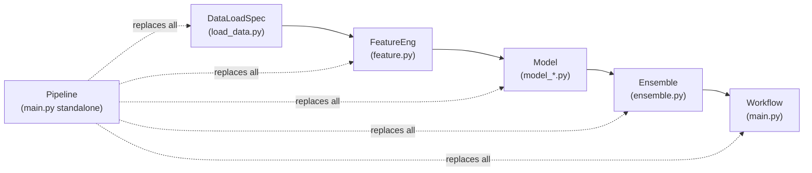
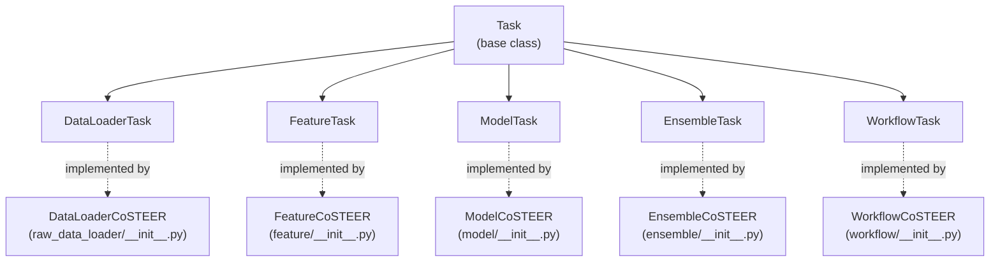
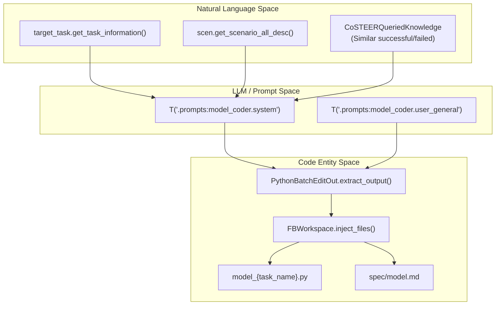

<!-- source: DeepWiki mcp.deepwiki.com · repo microsoft/RD-Agent · extra page Component-Based Development Pipeline · fetched 2026-10-26 -->

# Component-Based Development Pipeline

Relevant source files

The following files were used as context for generating this wiki page:

- [rdagent/components/coder/data_science/ensemble/__init__.py](rdagent/components/coder/data_science/ensemble/__init__.py)
- [rdagent/components/coder/data_science/ensemble/eval_tests/ensemble_test.txt](rdagent/components/coder/data_science/ensemble/eval_tests/ensemble_test.txt)
- [rdagent/components/coder/data_science/ensemble/prompts.yaml](rdagent/components/coder/data_science/ensemble/prompts.yaml)
- [rdagent/components/coder/data_science/feature/__init__.py](rdagent/components/coder/data_science/feature/__init__.py)
- [rdagent/components/coder/data_science/feature/eval_tests/feature_test.txt](rdagent/components/coder/data_science/feature/eval_tests/feature_test.txt)
- [rdagent/components/coder/data_science/feature/prompts.yaml](rdagent/components/coder/data_science/feature/prompts.yaml)
- [rdagent/components/coder/data_science/model/__init__.py](rdagent/components/coder/data_science/model/__init__.py)
- [rdagent/components/coder/data_science/model/eval_tests/model_test.txt](rdagent/components/coder/data_science/model/eval_tests/model_test.txt)
- [rdagent/components/coder/data_science/model/exp.py](rdagent/components/coder/data_science/model/exp.py)
- [rdagent/components/coder/data_science/model/prompts.yaml](rdagent/components/coder/data_science/model/prompts.yaml)
- [rdagent/components/coder/data_science/raw_data_loader/__init__.py](rdagent/components/coder/data_science/raw_data_loader/__init__.py)
- [rdagent/components/coder/data_science/raw_data_loader/eval_tests/data_loader_test.txt](rdagent/components/coder/data_science/raw_data_loader/eval_tests/data_loader_test.txt)
- [rdagent/components/coder/data_science/raw_data_loader/exp.py](rdagent/components/coder/data_science/raw_data_loader/exp.py)
- [rdagent/components/coder/data_science/raw_data_loader/prompts.yaml](rdagent/components/coder/data_science/raw_data_loader/prompts.yaml)
- [rdagent/components/coder/data_science/workflow/__init__.py](rdagent/components/coder/data_science/workflow/__init__.py)
- [rdagent/components/coder/data_science/workflow/prompts.yaml](rdagent/components/coder/data_science/workflow/prompts.yaml)

## Purpose and Scope

This document describes the component-based development system used in the data science scenario to structure machine learning pipeline development. The system defines six distinct component types (`DataLoadSpec`, `FeatureEng`, `Model`, `Ensemble`, `Workflow`, `Pipeline`) that represent modular, testable units of a complete ML solution. Each component type has associated metadata, task classes, specifications, and evaluation criteria implemented through the CoSTEER framework.

For information about how these components are used in the R&D loop workflow, see [Data Science Scenario](#3.1). For details on the CoSTEER code evolution framework that develops these components, see [CoSTEER Framework](#4.1).

## Component Type System

The system defines six component types organized in a logical execution order:

**Sources:** [rdagent/components/coder/data_science/raw_data_loader/prompts.yaml:16-21](), [rdagent/components/coder/data_science/workflow/__init__.py:64-68]()

### Component Execution Modes

The system supports two development modes controlled by `DS_RD_SETTING.coder_on_whole_pipeline`:

| Mode | Setting Value | Behavior | Component Focus |
|------|---------------|----------|-----------------|
| **Component-Based** | `False` | Develops components incrementally in order: DataLoadSpec → FeatureEng → Model → Ensemble → Workflow | Individual modular components |
| **Pipeline-Based** | `True` | Develops entire solution in single `main.py` file | Pipeline component only |

**Sources:** [rdagent/app/data_science/conf.py:67](), [rdagent/components/coder/data_science/raw_data_loader/__init__.py:28-29]()

## Component Metadata and Task Classes

Each component is represented by a specific Task class which holds the requirements for implementation.

### Task Class Hierarchy

**Sources:** [rdagent/components/coder/data_science/raw_data_loader/__init__.py:46-47](), [rdagent/components/coder/data_science/feature/__init__.py:16-17](), [rdagent/components/coder/data_science/model/__init__.py:18-19](), [rdagent/components/coder/data_science/ensemble/__init__.py:31-32](), [rdagent/components/coder/data_science/workflow/__init__.py:17-18]()

## Individual Component Specifications

### DataLoadSpec Component

**Purpose:** Loads raw competition data and generates specifications for the entire pipeline.

**Target Files:** `load_data.py`, `spec/data_loader.md`, `spec/feature.md`, `spec/model.md`, `spec/ensemble.md`, `spec/workflow.md`

**Key Requirements:**
- Function Interface: `load_data() -> (X, y, X_test, test_ids)` [rdagent/components/coder/data_science/raw_data_loader/prompts.yaml:42-48]().
- Responsible for generating the initial markdown specifications for all subsequent components if `DS_RD_SETTING.spec_enabled` is true [rdagent/components/coder/data_science/raw_data_loader/__init__.py:93-121]().

**Sources:** [rdagent/components/coder/data_science/raw_data_loader/prompts.yaml:39-68](), [rdagent/components/coder/data_science/raw_data_loader/__init__.py:115-121]()

### FeatureEng Component

**Purpose:** Transforms raw data into meaningful features.

**Target Files:** `feature.py`

**Key Requirements:**
- Function Interface: `feat_eng(X, y, X_test) -> (X_transformed, y_transformed, X_test_transformed)` [rdagent/components/coder/data_science/raw_data_loader/prompts.yaml:73-81]().
- Must handle missing values, prevent data leakage, and ensure scalability [rdagent/components/coder/data_science/raw_data_loader/prompts.yaml:96-101]().
- Encouraged to use GPU and multiprocessing [rdagent/components/coder/data_science/raw_data_loader/prompts.yaml:110]().

**Sources:** [rdagent/components/coder/data_science/raw_data_loader/prompts.yaml:70-120](), [rdagent/components/coder/data_science/feature/eval_tests/feature_test.txt:1-115]()

### Model Component

**Purpose:** Develops and tunes machine learning models.

**Target Files:** `model_*.py` (e.g., `model_01.py`)

**Key Requirements:**
- Function Interface: `model_workflow(X, y, val_X, val_y, test_X, hyper_params) -> (val_pred, test_pred, hyper_params)` [rdagent/components/coder/data_science/raw_data_loader/prompts.yaml:126-133]().
- Supports a retraining phase where hyperparameters from the initial validation phase are passed back [rdagent/components/coder/data_science/model/prompts.yaml:101-104]().
- Must include early stopping rounds in returned hyperparameters [rdagent/components/coder/data_science/model/prompts.yaml:109-111]().

**Sources:** [rdagent/components/coder/data_science/model/__init__.py:85-91](), [rdagent/components/coder/data_science/model/prompts.yaml:95-113]()

### Ensemble Component

**Purpose:** Combines predictions from multiple models.

**Target Files:** `ensemble.py`

**Key Requirements:**
- Function Interface: `ensemble_workflow(test_preds_dict, val_preds_dict, val_y) -> final_pred` [rdagent/components/coder/data_science/raw_data_loader/prompts.yaml:148-154]().
- Must generate a `scores.csv` file containing metrics for all individual models and the final ensemble [rdagent/components/coder/data_science/ensemble/eval_tests/ensemble_test.txt:121-127]().
- The column name in `scores.csv` must match the specific competition metric [rdagent/components/coder/data_science/ensemble/eval_tests/ensemble_test.txt:129]().

**Sources:** [rdagent/components/coder/data_science/ensemble/__init__.py:90-102](), [rdagent/components/coder/data_science/ensemble/eval_tests/ensemble_test.txt:1-138]()

### Workflow Component

**Purpose:** Integrates all previous components into a single executable pipeline.

**Target Files:** `main.py`

**Key Requirements:**
- Orchestrates `load_data`, `feat_eng`, multiple `model_workflow` calls, and `ensemble_workflow` [rdagent/components/coder/data_science/workflow/prompts.yaml:39]().
- Must implement cross-validation for training data [rdagent/components/coder/data_science/workflow/prompts.yaml:118]().
- Responsible for generating the final `submission.csv` in the format required by the competition [rdagent/components/coder/data_science/workflow/prompts.yaml:113]().

**Sources:** [rdagent/components/coder/data_science/workflow/__init__.py:64-76](), [rdagent/components/coder/data_science/workflow/prompts.yaml:87-131]()

## Component-Specific CoSTEER Implementation

Each component type implements its own `MultiProcessEvolvingStrategy` and `DSCoSTEER` class to handle its specific coding and evaluation logic.

### Data Flow in CoSTEER Coding Phase

The diagram below illustrates how a component (using `Model` as an example) moves from Natural Language space (Task/Knowledge) to Code Entity space (Files).

**Sources:** [rdagent/components/coder/data_science/model/__init__.py:38-110](), [rdagent/components/coder/data_science/raw_data_loader/__init__.py:129-158]()

### Evaluation and Testing Framework

Components are evaluated using specific test scripts that are injected into the execution environment.

| Component | Test Script Path | Key Functions Tested |
|-----------|------------------|----------------------|
| DataLoadSpec | `raw_data_loader/eval_tests/data_loader_test.txt` | `load_data` |
| FeatureEng | `feature/eval_tests/feature_test.txt` | `feat_eng` |
| Model | `model/eval_tests/model_test.txt` | `model_workflow` |
| Ensemble | `ensemble/eval_tests/ensemble_test.txt` | `ensemble_workflow` |

**Testing Logic Example (Ensemble):**
The `ensemble_test.txt` script performs the following:
1. Loads data and features [rdagent/components/coder/data_science/ensemble/eval_tests/ensemble_test.txt:40-41]().
2. Iterates through all available models in the workspace to get validation and test predictions [rdagent/components/coder/data_science/ensemble/eval_tests/ensemble_test.txt:49-60]().
3. Calls the generated `ensemble_workflow` [rdagent/components/coder/data_science/ensemble/eval_tests/ensemble_test.txt:103]().
4. Asserts that `scores.csv` is created and formatted correctly [rdagent/components/coder/data_science/ensemble/eval_tests/ensemble_test.txt:121-134]().

**Sources:** [rdagent/components/coder/data_science/ensemble/eval_tests/ensemble_test.txt:1-138](), [rdagent/components/coder/data_science/feature/eval_tests/feature_test.txt:1-115]()

### Common Constraints and Guidelines

Across all component coders, several guidelines are enforced via prompts:
- **No Logging:** Use `print()` instead of the `logging` module for output [rdagent/components/coder/data_science/model/prompts.yaml:41]().
- **Caching:** Use `joblib.Memory` to cache heavy computations (Feature Engineering, Model Training) [rdagent/components/coder/data_science/feature/prompts.yaml:46-50](), [rdagent/components/coder/data_science/model/prompts.yaml:43-47]().
- **Framework Preference:** Use PyTorch over TensorFlow if both are applicable [rdagent/components/coder/data_science/model/prompts.yaml:42]().

**Sources:** [rdagent/components/coder/data_science/model/prompts.yaml:35-49](), [rdagent/components/coder/data_science/feature/prompts.yaml:35-54]()

---

