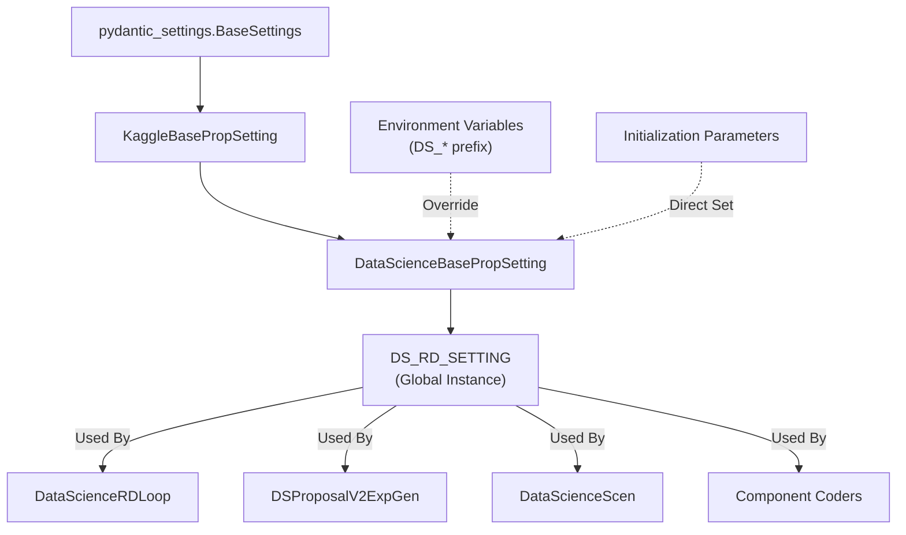
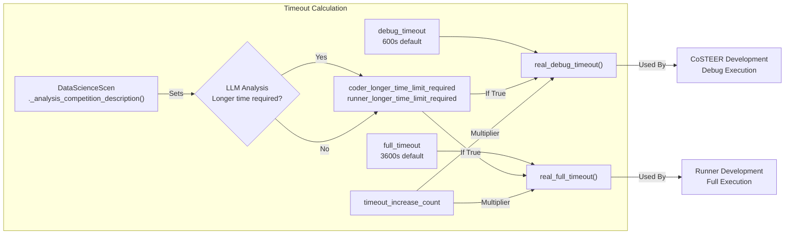
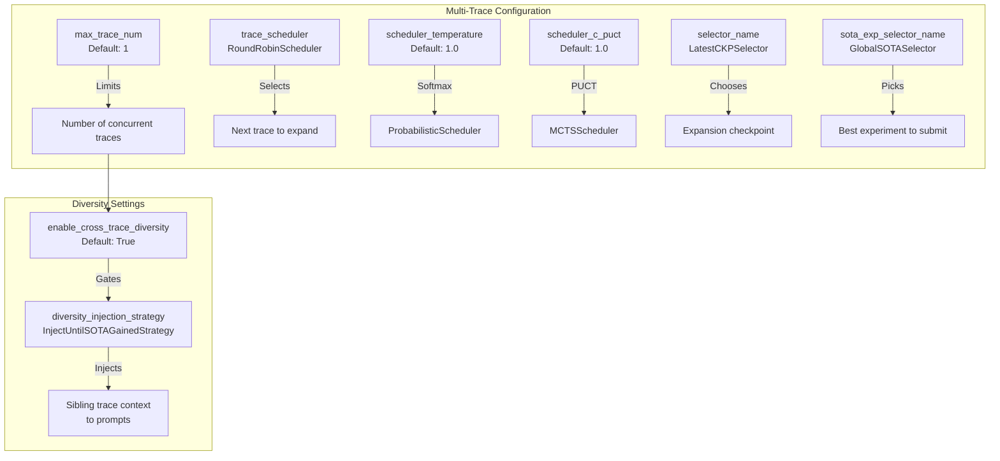
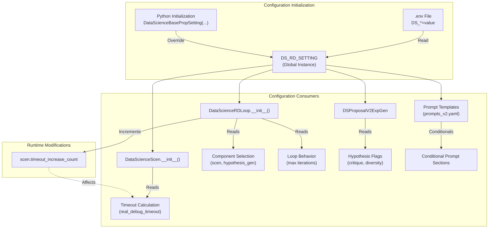

<!-- source: DeepWiki mcp.deepwiki.com · repo microsoft/RD-Agent · extra page Configuration and Settings · fetched 2026-10-26 -->

# Configuration and Settings

<details>
<summary>Relevant source files</summary>

The following files were used as context for generating this wiki page:

- [rdagent/app/data_science/conf.py](rdagent/app/data_science/conf.py)
- [rdagent/app/data_science/loop.py](rdagent/app/data_science/loop.py)
- [rdagent/app/utils/ws.py](rdagent/app/utils/ws.py)
- [rdagent/components/coder/data_science/conf.py](rdagent/components/coder/data_science/conf.py)
- [rdagent/components/coder/data_science/pipeline/__init__.py](rdagent/components/coder/data_science/pipeline/__init__.py)
- [rdagent/components/coder/data_science/pipeline/prompts.yaml](rdagent/components/coder/data_science/pipeline/prompts.yaml)
- [rdagent/components/interactor/__init__.py](rdagent/components/interactor/__init__.py)
- [rdagent/components/workflow/conf.py](rdagent/components/workflow/conf.py)
- [rdagent/core/interactor.py](rdagent/core/interactor.py)
- [rdagent/log/ui/ds_user_interact.py](rdagent/log/ui/ds_user_interact.py)
- [rdagent/scenarios/data_science/experiment/experiment.py](rdagent/scenarios/data_science/experiment/experiment.py)
- [rdagent/scenarios/data_science/interactor/__init__.py](rdagent/scenarios/data_science/interactor/__init__.py)
- [rdagent/scenarios/data_science/proposal/exp_gen/prompts_v2.yaml](rdagent/scenarios/data_science/proposal/exp_gen/prompts_v2.yaml)
- [rdagent/scenarios/data_science/proposal/exp_gen/proposal.py](rdagent/scenarios/data_science/proposal/exp_gen/proposal.py)
- [rdagent/scenarios/data_science/scen/__init__.py](rdagent/scenarios/data_science/scen/__init__.py)
- [rdagent/scenarios/data_science/scen/prompts.yaml](rdagent/scenarios/data_science/scen/prompts.yaml)
- [rdagent/scenarios/data_science/share.yaml](rdagent/scenarios/data_science/share.yaml)
- [test/utils/test_conf.py](test/utils/test_conf.py)

</details>


This page documents the configuration system for the Data Science scenario, including the `DS_RD_SETTING` global configuration object, feature flags, timeout management, multi-trace settings, and component selection options. For overall RD-Agent configuration, see [Configuration System Architecture](6.3). For loop execution and workflow, see [R&D Loop Framework](2.1).

---

## Overview

The Data Science scenario uses a centralized configuration system based on `pydantic-settings` that controls all aspects of the R&D loop behavior. The primary configuration class `DataScienceBasePropSetting` extends `KaggleBasePropSetting` and provides over 80 configurable parameters accessible through the global `DS_RD_SETTING` object. Configuration values can be set via environment variables with the `DS_` prefix.

Sources: [rdagent/app/data_science/conf.py:1-207]()

---

## Configuration Architecture

### Configuration Class Hierarchy



**Configuration Flow**: The `DataScienceBasePropSetting` class defines configuration schema with validation rules. At initialization, it reads from environment variables (with `DS_` prefix) and explicit parameters. The global `DS_RD_SETTING` instance is created at module load time and accessed throughout the codebase.

Sources: [rdagent/app/data_science/conf.py:9-201]()

---

## Core Component Configuration

These settings define which classes are used for major system components. Values are fully qualified class paths that are dynamically imported.

| Configuration Key | Default Value | Description |
|------------------|---------------|-------------|
| `scen` | `rdagent.scenarios.data_science.scen.KaggleScen` | Scenario class - use `DataScienceScen` for custom scenarios |
| `planner` | `rdagent.scenarios.data_science.proposal.exp_gen.planner.DSExpPlannerHandCraft` | Experiment planner implementation |
| `hypothesis_gen` | `rdagent.scenarios.data_science.proposal.exp_gen.router.ParallelMultiTraceExpGen` | Hypothesis generation class |
| `interactor` | `rdagent.components.interactor.SkipInteractor` | User interaction handler |
| `trace_scheduler` | `rdagent.scenarios.data_science.proposal.exp_gen.trace_scheduler.RoundRobinScheduler` | Trace scheduling strategy |
| `summarizer` | `rdagent.scenarios.data_science.dev.feedback.DSExperiment2Feedback` | Feedback generator class |

Sources: [rdagent/app/data_science/conf.py:14-28]()

---

## Timeout and Resource Management

### Timeout Configuration

The system uses a two-tier timeout system: **debug mode** (for quick validation on sampled data) and **full mode** (for complete training). Timeouts can dynamically increase based on failure patterns and competition requirements.



**Timeout Parameters:**

| Parameter | Default | Description |
|-----------|---------|-------------|
| `debug_timeout` | 600 | Base timeout for debug mode execution (seconds) |
| `debug_recommend_timeout` | 600 | Recommended debug timeout (seconds) |
| `full_timeout` | 3600 | Base timeout for full execution (seconds) |
| `full_recommend_timeout` | 3600 | Recommended full timeout (seconds) |
| `allow_longer_timeout` | False | Enable dynamic timeout extension |
| `coder_enable_llm_decide_longer_timeout` | False | Let LLM decide coder timeout needs |
| `runner_enable_llm_decide_longer_timeout` | False | Let LLM decide runner timeout needs |
| `coder_longer_timeout_multiplier_upper` | 3 | Maximum timeout multiplier for coder |
| `runner_longer_timeout_multiplier_upper` | 2 | Maximum timeout multiplier for runner |
| `coder_timeout_increase_stage` | 0.3 | Timeout increment step for coder |
| `runner_timeout_increase_stage` | 0.3 | Timeout increment step for runner |
| `runner_timeout_increase_stage_patience` | 2 | Failures before timeout increase |

**Dynamic Timeout Logic**: The scenario analyzes competition description via LLM to determine if longer timeouts are needed (CV/NLP tasks typically require more time). When `allow_longer_timeout=True`, failures increment `timeout_increase_count` in the scenario, which multiplies the base timeout by incremental stages up to the multiplier upper bound.

Sources: [rdagent/app/data_science/conf.py:38-165](), [rdagent/scenarios/data_science/scen/__init__.py:121-182]()

---

## Feature Flags and Switches

### Code Development Features

| Flag | Default | Description |
|------|---------|-------------|
| `spec_enabled` | True | Use specification files from workspace (`spec/*.md`) |
| `coder_on_whole_pipeline` | True | Code entire pipeline vs. component-by-component |
| `enable_notebook_conversion` | False | Structure code for notebook export with sections |
| `sample_data_by_LLM` | True | Use full data vs. pre-sampled debug data |
| `enable_model_dump` | False | Save trained models to disk |
| `enable_doc_dev` | False | Generate documentation for experiments |
| `model_dump_check_level` | "medium" | Validation level for model dumps ("medium" or "high") |

**Pipeline Coding Mode**: When `coder_on_whole_pipeline=True`, the system generates complete end-to-end pipelines in `PipelineTask` objects. When False, it builds components sequentially (DataLoader → Feature → Model → Ensemble → Workflow).

Sources: [rdagent/app/data_science/conf.py:47-62](), [rdagent/scenarios/data_science/proposal/exp_gen/proposal.py:45-82]()

### LLM Integration Features

| Flag | Default | Description |
|------|---------|-------------|
| `enable_mcp_documentation_search` | False | Use MCP for error resolution documentation lookup |
| `enable_research_rag` | False | Enable RAG agent for hypothesis generation |

Sources: [rdagent/app/data_science/conf.py:53-54](), [rdagent/app/data_science/conf.py:178-179]()

---

## Multi-Trace Configuration

Multi-trace settings control parallel exploration of multiple hypothesis branches.

### Core Multi-Trace Settings



| Parameter | Default | Description |
|-----------|---------|-------------|
| `max_trace_num` | 1 | Maximum concurrent traces before merging |
| `scheduler_temperature` | 1.0 | Temperature for softmax in ProbabilisticScheduler |
| `scheduler_c_puct` | 1.0 | PUCT exploration constant for MCTSScheduler |
| `enable_score_reward` | False | Use score-based rewards in trace selection |

Sources: [rdagent/app/data_science/conf.py:95-109]()

### Checkpoint and SOTA Selection

| Parameter | Default | Description |
|-----------|---------|-------------|
| `selector_name` | `rdagent.scenarios.data_science.proposal.exp_gen.select.expand.LatestCKPSelector` | Checkpoint selector class |
| `sota_count_window` | 5 | Number of trials for SOTA count calculation |
| `sota_count_threshold` | 1 | Threshold for SOTA count metric |
| `sota_exp_selector_name` | `rdagent.scenarios.data_science.proposal.exp_gen.select.submit.GlobalSOTASelector` | SOTA experiment selector class |
| `max_sota_retrieved_num` | 10 | Max SOTA experiments in single LLM call to avoid context overflow |

Sources: [rdagent/app/data_science/conf.py:111-149]()

### Diversity Injection

| Parameter | Default | Description |
|-----------|---------|-------------|
| `enable_inject_diverse` | False | Inject diversity for non-parallel single-trace case |
| `enable_cross_trace_diversity` | True | Inject sibling trace context in parallel mode |
| `diversity_injection_strategy` | `rdagent.scenarios.data_science.proposal.exp_gen.diversity_strategy.InjectUntilSOTAGainedStrategy` | Strategy determining when to inject diversity |

Sources: [rdagent/app/data_science/conf.py:123-135]()

---

## Hypothesis Generation Configuration

### Proposal Workflow Settings

| Parameter | Default | Description |
|-----------|---------|-------------|
| `enable_planner` | False | Enable experiment planning stage |
| `enable_draft_before_first_sota` | False | Draft components before first complete pipeline |
| `enable_hypo_critique_rewrite` | False | Enable hypothesis critique and rewrite stages |
| `enable_scale_check` | False | Include time budget status in prompts |
| `enable_simple_hypothesis` | False | Generate concise hypotheses (≤2 sentences) |
| `enable_generate_unique_hypothesis` | False | Generate unique hypothesis per component at start |

Sources: [rdagent/app/data_science/conf.py:151-186]()

### Hypothesis Selection

| Parameter | Default | Description |
|-----------|---------|-------------|
| `llm_select_hypothesis` | False | Use LLM to select hypothesis vs. ranking method |
| `ratio_merge_or_ensemble` | 70 | Time percentage threshold for merge/ensemble phase |
| `model_architecture_suggestion_time_percent` | 0.75 | Time percentage when model architecture focus kicks in |

Sources: [rdagent/app/data_science/conf.py:187-195]()

---

## Coder and Runner Configuration

### Iteration Limits

| Parameter | Default | Description |
|-----------|---------|-------------|
| `coder_max_loop` | 10 | Maximum evolution iterations for code generation |
| `runner_max_loop` | 3 | Maximum attempts for running experiments |
| `coding_fail_reanalyze_threshold` | 3 | Failures before reanalyzing competition description |
| `consecutive_errors` | 5 | Consecutive errors before trace restart |

Sources: [rdagent/app/data_science/conf.py:33-71]()

### Runner Configuration

| Parameter | Default | Description |
|-----------|---------|-------------|
| `runner_enable_code_change_summary` | True | Generate summaries of code changes by runner |

Sources: [rdagent/app/data_science/conf.py:166-167]()

---

## Knowledge Base Configuration

| Parameter | Default | Description |
|-----------|---------|-------------|
| `enable_knowledge_base` | False | Enable knowledge base for idea sampling |
| `knowledge_base_version` | "v1" | Knowledge base version |
| `knowledge_base_path` | None | Path to knowledge base storage |
| `idea_pool_json_path` | None | Path to idea pool JSON file |

Sources: [rdagent/app/data_science/conf.py:77-82]()

---

## Logging and Archive Configuration

| Parameter | Default | Description |
|-----------|---------|-------------|
| `enable_log_archive` | True | Archive logs after each loop |
| `log_archive_path` | None | Target path for log archives |
| `log_archive_temp_path` | None | Temporary storage for tar files before copying |
| `eval_sub_dir` | "eval" | Subdirectory for evaluation scripts |

Sources: [rdagent/app/data_science/conf.py:83-94]()

---

## Advanced Configuration

### Multi-Version Experiment Generation

| Parameter | Default | Description |
|-----------|---------|-------------|
| `enable_multi_version_exp_gen` | False | Enable multiple ExpGen versions in parallel |
| `exp_gen_version_list` | "v3,v2" | Comma-separated list of ExpGen versions |

Sources: [rdagent/app/data_science/conf.py:137-140]()

### Trace History Management

| Parameter | Default | Description |
|-----------|---------|-------------|
| `max_trace_hist` | 3 | Maximum number of historical traces to consider |
| `use_raw_description` | False | Use raw competition description vs. processed |
| `show_nan_columns` | False | Include NaN columns in data descriptions |

Sources: [rdagent/app/data_science/conf.py:68-75]()

---

## Configuration Usage Pattern



**Typical Access Pattern**:
```python
from rdagent.app.data_science.conf import DS_RD_SETTING

# Check feature flag
if DS_RD_SETTING.enable_knowledge_base:
    # logic for knowledge base
    pass

# Get timeout
timeout = DS_RD_SETTING.debug_timeout
```

Sources: [rdagent/app/data_science/conf.py:11](), [rdagent/scenarios/data_science/proposal/exp_gen/proposal.py:11]()

---

## Environment Variable Configuration

All settings can be overridden via environment variables with the `DS_` prefix:

```bash
# Component selection
export DS_SCEN="rdagent.scenarios.data_science.scen.DataScienceScen"
export DS_HYPOTHESIS_GEN="rdagent.scenarios.data_science.proposal.exp_gen.router.ParallelMultiTraceExpGen"

# Timeout configuration
export DS_DEBUG_TIMEOUT=900
export DS_FULL_TIMEOUT=7200
export DS_ALLOW_LONGER_TIMEOUT=true

# Multi-trace settings
export DS_MAX_TRACE_NUM=3
export DS_ENABLE_CROSS_TRACE_DIVERSITY=true
export DS_SCHEDULER_TEMPERATURE=0.8
```

Sources: [rdagent/app/data_science/conf.py:11](), [rdagent/app/data_science/conf.py:203-206]()

---

