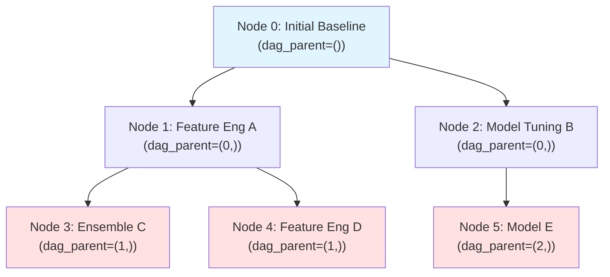
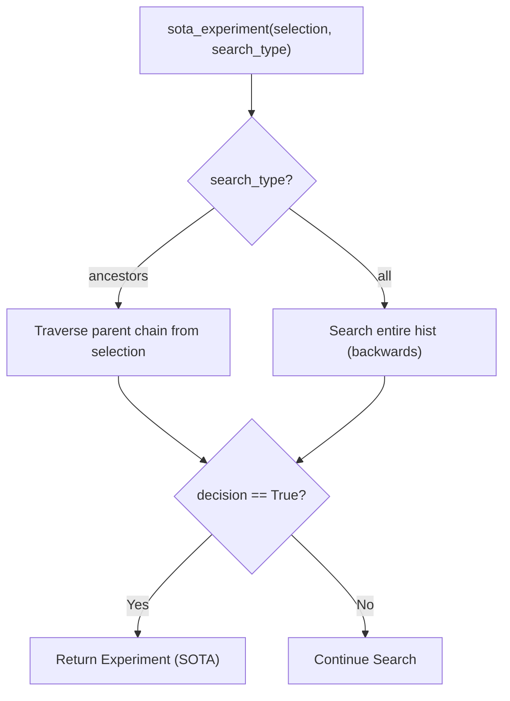

<!-- source: DeepWiki mcp.deepwiki.com · repo microsoft/RD-Agent · extra page DSTrace and Multi-Trace Exploration · fetched 2026-10-26 -->

# DSTrace and Multi-Trace Exploration

<details>
<summary>Relevant source files</summary>

The following files were used as context for generating this wiki page:

- [rdagent/components/coder/data_science/share/notebook.py](rdagent/components/coder/data_science/share/notebook.py)
- [rdagent/components/coder/data_science/share/util.py](rdagent/components/coder/data_science/share/util.py)
- [rdagent/core/proposal.py](rdagent/core/proposal.py)
- [rdagent/scenarios/data_science/proposal/exp_gen/base.py](rdagent/scenarios/data_science/proposal/exp_gen/base.py)
- [rdagent/scenarios/data_science/proposal/exp_gen/diversity_strategy.py](rdagent/scenarios/data_science/proposal/exp_gen/diversity_strategy.py)
- [rdagent/scenarios/data_science/proposal/exp_gen/draft/draft.py](rdagent/scenarios/data_science/proposal/exp_gen/draft/draft.py)
- [rdagent/scenarios/data_science/proposal/exp_gen/merge.py](rdagent/scenarios/data_science/proposal/exp_gen/merge.py)
- [rdagent/scenarios/data_science/proposal/exp_gen/merge.yaml](rdagent/scenarios/data_science/proposal/exp_gen/merge.yaml)
- [rdagent/scenarios/data_science/proposal/exp_gen/router/__init__.py](rdagent/scenarios/data_science/proposal/exp_gen/router/__init__.py)
- [rdagent/scenarios/data_science/proposal/exp_gen/select/expand.py](rdagent/scenarios/data_science/proposal/exp_gen/select/expand.py)
- [rdagent/scenarios/data_science/proposal/exp_gen/select/prompts.yaml](rdagent/scenarios/data_science/proposal/exp_gen/select/prompts.yaml)
- [rdagent/scenarios/data_science/proposal/exp_gen/select/submit.py](rdagent/scenarios/data_science/proposal/exp_gen/select/submit.py)
- [rdagent/scenarios/data_science/proposal/exp_gen/trace_scheduler.py](rdagent/scenarios/data_science/proposal/exp_gen/trace_scheduler.py)

</details>


This document explains the `DSTrace` class and the multi-trace exploration system used in the Data Science scenario. `DSTrace` maintains a Directed Acyclic Graph (DAG) of experiments, enabling parallel exploration of multiple hypothesis branches simultaneously. This architecture allows the system to test diverse approaches concurrently rather than exploring a single linear sequence of experiments.

For information about the overall Data Science R&D workflow, see [Data Science Scenario](#3.1). For details on hypothesis generation that populates these traces, see [Hypothesis and Experiment Generation](#3.1.2).

## DSTrace Class and DAG Structure

The `DSTrace` class extends the core `Trace` abstraction to provide DAG-based experiment tracking. Unlike a linear trace, `DSTrace` organizes experiments as nodes in a directed acyclic graph where each node represents an experiment-feedback pair and edges represent "built upon" relationships.

The core data structures are defined in `DSTrace` and its parent `Trace`:

| Field | Type | Purpose |
|-------|------|---------|
| `hist` | `list[tuple[DSExperiment, ExperimentFeedback]]` | Sequential list of all experiment-feedback pairs (nodes) [[rdagent/core/proposal.py:150-152](), [rdagent/scenarios/data_science/proposal/exp_gen/base.py:60]()] |
| `dag_parent` | `list[tuple[int, ...]]` | Parent indices for each node in `hist` [[rdagent/core/proposal.py:153]()] |
| `current_selection` | `tuple[int, ...]` | Current position in the DAG for next experiment [[rdagent/core/proposal.py:176]()] |
| `uncommitted_experiments` | `dict[int, DSExperiment]` | Experiments being developed in parallel (loop_id -> DSExperiment) [[rdagent/scenarios/data_science/proposal/exp_gen/base.py:64]()] |
| `sota_exp_to_submit` | `DSExperiment \| None` | Globally best experiment selected for submission [[rdagent/scenarios/data_science/proposal/exp_gen/base.py:62]()] |
| `idx2loop_id` | `dict[int, int]` | Maps `hist` index to the loop iteration that created it [[rdagent/core/proposal.py:165]()] |

**DAG Node Indexing**: Each experiment in `hist` has an index `i`. The `dag_parent[i]` tuple contains the indices of parent experiments that this experiment builds upon. An empty tuple `()` represents `NEW_ROOT`, indicating a root node [[rdagent/core/proposal.py:143](), [rdagent/scenarios/data_science/proposal/exp_gen/base.py:151]()].

### Example DAG Structure



**Sources:** [rdagent/core/proposal.py:141-177](), [rdagent/scenarios/data_science/proposal/exp_gen/base.py:55-65]()

## Trace Scheduling and Multi-Trace Exploration

When `DS_RD_SETTING.max_trace_num` is greater than 1, the system enables parallel multi-trace exploration via `ParallelMultiTraceExpGen` [[rdagent/scenarios/data_science/proposal/exp_gen/router/__init__.py:36-56]()]. This uses a `TraceScheduler` to determine which parent node to expand next.

### TraceScheduler Strategies

The `TraceScheduler` abstract base class defines the `next(trace)` method to select the next parent node for expansion [[rdagent/scenarios/data_science/proposal/exp_gen/trace_scheduler.py:18-48]()].

| Scheduler | Strategy | Logic |
|-----------|----------|-------|
| `RoundRobinScheduler` | Cycle through active traces | Starts a new root if `sub_trace_count < max_trace_num`, otherwise picks a leaf that isn't currently expanding [[rdagent/scenarios/data_science/proposal/exp_gen/trace_scheduler.py:102-131]()]. |
| `ProbabilisticScheduler` | Sample based on potential | Uses a potential function and softmax to select leaves. Higher potential nodes are more likely to be selected [[rdagent/scenarios/data_science/proposal/exp_gen/trace_scheduler.py:139-204]()]. |
| `MCTSScheduler` | Monte Carlo Tree Search | Selects leaves based on PUCT (Predictor + Upper Confidence Bound applied to Trees) formula, balancing exploitation (scores) and exploration [[rdagent/scenarios/data_science/proposal/exp_gen/trace_scheduler.py:280-340]()]. |
| `SOTABasedScheduler` | Prioritize success | Specifically targets nodes that have shown SOTA potential [[rdagent/scenarios/data_science/proposal/exp_gen/router/__init__.py:26](), [rdagent/scenarios/data_science/proposal/exp_gen/trace_scheduler.py:207-277]()]. |

### Multi-Trace Async Generation Flow

The `ParallelMultiTraceExpGen.async_gen` method orchestrates the creation of experiments across different branches [[rdagent/scenarios/data_science/proposal/exp_gen/router/__init__.py:70-143]()]:

```mermaid
sequenceDiagram
    participant Loop as LoopBase
    participant MultiGen as ParallelMultiTraceExpGen
    participant Scheduler as TraceScheduler
    participant Trace as DSTrace
    participant Draft as DSDraftV2ExpGen
    participant Merge as ExpGen2Hypothesis
    
    Loop->>MultiGen: async_gen(trace, loop)
    Note over MultiGen: Wait for parallel slot
    MultiGen->>Scheduler: next(trace)
    Scheduler-->>MultiGen: local_selection (e.g. (2,))
    MultiGen->>Trace: set_current_selection(local_selection)
    
    alt Time to Merge
        MultiGen->>Merge: gen(trace, plan)
    else First SOTA missing
        MultiGen->>Draft: gen(trace, plan)
    else Standard Improvement
        MultiGen->>ExpGen: gen(trace, plan)
    end
    
    MultiGen->>Trace: register_uncommitted_exp(exp, loop_idx)
    MultiGen-->>Loop: return DSExperiment
```

**Sources:** [rdagent/scenarios/data_science/proposal/exp_gen/router/__init__.py:70-143](), [rdagent/scenarios/data_science/proposal/exp_gen/trace_scheduler.py:50-131]()

## SOTA Selection Strategies

`DSTrace` tracks "State-of-the-Art" (SOTA) experiments—those that successfully improve performance. The `SOTAexpSelector` interface defines how the system chooses which experiment to ultimately submit or build upon [[rdagent/scenarios/data_science/proposal/exp_gen/select/submit.py:19-20]()].

| Selector | Implementation | Logic |
|----------|----------------|-------|
| `GlobalSOTASelector` | `trace.sota_experiment(search_type="all")` | Returns the single best experiment found in the entire history [[rdagent/scenarios/data_science/proposal/exp_gen/select/submit.py:43-56]()]. |
| `AutoSOTAexpSelector` | LLM-based | Collects candidates from all leaves and uses an LLM to pick the most promising one based on score, generalizability, and risk [[rdagent/scenarios/data_science/proposal/exp_gen/select/submit.py:58-128]()]. |
| `BestValidSelector` | Performance-based | Selects the top N experiments based on their validation score [[rdagent/scenarios/data_science/proposal/exp_gen/select/submit.py:158-180]()]. |

### SOTA Identification in DAG



**Sources:** [rdagent/core/proposal.py:267-295](), [rdagent/scenarios/data_science/proposal/exp_gen/select/submit.py:39-180]()

## Merging Traces

As the experiment timer nears expiration (controlled by `DS_RD_SETTING.merge_hours`), the system transitions from branch expansion to merging [[rdagent/scenarios/data_science/proposal/exp_gen/router/__init__.py:84-100]()].

The `MergeExpGen` and `ExpGen2Hypothesis` classes handle this by taking the best results from different branches and proposing a "merged" solution that combines their strengths [[rdagent/scenarios/data_science/proposal/exp_gen/merge.py:26-96]()].

### Merge Workflow
1. **Leaf Selection**: Identify the most promising leaf nodes in the DAG [[rdagent/scenarios/data_science/proposal/exp_gen/base.py:95-112]()].
2. **Context Retrieval**: Extract the successful iterations and code changes from both branches [[rdagent/scenarios/data_science/proposal/exp_gen/merge.py:60-76]()].
3. **Hypothesis Proposal**: The LLM proposes how to merge the codebases (e.g., merging feature engineering from Branch A with the model architecture of Branch B) [[rdagent/scenarios/data_science/proposal/exp_gen/merge.py:88-91]()].
4. **Code Injection**: Inject the code from the primary SOTA branch into the new experiment's workspace as a baseline [[rdagent/scenarios/data_science/proposal/exp_gen/merge.py:94-96]()].

**Sources:** [rdagent/scenarios/data_science/proposal/exp_gen/merge.py:26-152](), [rdagent/scenarios/data_science/proposal/exp_gen/router/__init__.py:113-121]()

## Key Methods Summary

| Class | Method | Description |
|-------|--------|-------------|
| `DSTrace` | `get_leaves()` | Identifies nodes with no children in the DAG [[rdagent/scenarios/data_science/proposal/exp_gen/base.py:95-112]()]. |
| `DSTrace` | `sync_dag_parent_and_hist()` | Atomically adds an experiment and its feedback to the DAG, establishing parentage [[rdagent/scenarios/data_science/proposal/exp_gen/base.py:139-163]()]. |
| `DSTrace` | `retrieve_search_list()` | Traverses ancestors or the whole history to provide context for new proposals [[rdagent/scenarios/data_science/proposal/exp_gen/base.py:165-202]()]. |
| `DSTrace` | `get_sibling_exps()` | Finds experiments running in other branches to maintain diversity [[rdagent/scenarios/data_science/proposal/exp_gen/base.py:114-137]()]. |
| `TraceScheduler` | `next()` | Asynchronously waits for a slot and returns the next selection index [[rdagent/scenarios/data_science/proposal/exp_gen/trace_scheduler.py:25-40]()]. |

**Sources:** [rdagent/core/proposal.py:141-295](), [rdagent/scenarios/data_science/proposal/exp_gen/base.py:55-202](), [rdagent/scenarios/data_science/proposal/exp_gen/trace_scheduler.py:18-48]()

---

