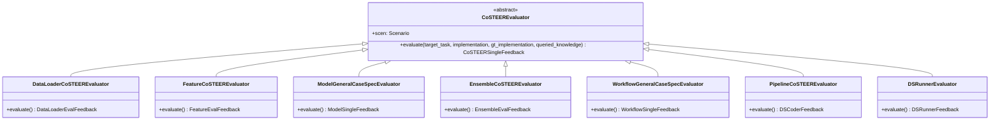
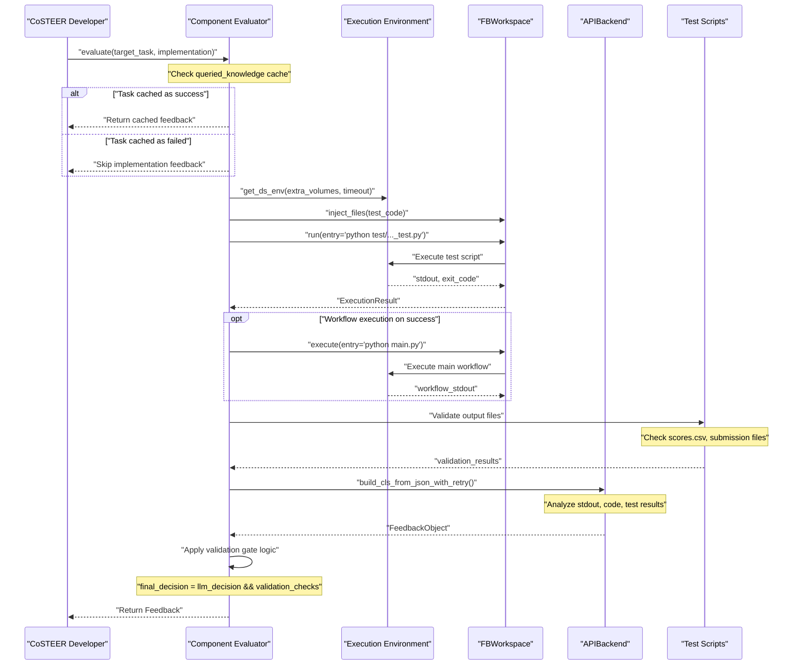
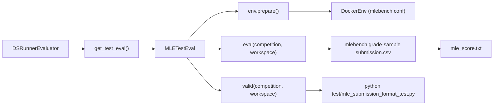

<!-- source: DeepWiki mcp.deepwiki.com · repo microsoft/RD-Agent · extra page Evaluation and Testing Framework · fetched 2026-10-26 -->

# Evaluation and Testing Framework

<details>
<summary>Relevant source files</summary>

The following files were used as context for generating this wiki page:

- [rdagent/components/coder/CoSTEER/__init__.py](rdagent/components/coder/CoSTEER/__init__.py)
- [rdagent/components/coder/data_science/ensemble/eval.py](rdagent/components/coder/data_science/ensemble/eval.py)
- [rdagent/components/coder/data_science/feature/eval.py](rdagent/components/coder/data_science/feature/eval.py)
- [rdagent/components/coder/data_science/model/eval.py](rdagent/components/coder/data_science/model/eval.py)
- [rdagent/components/coder/data_science/pipeline/eval.py](rdagent/components/coder/data_science/pipeline/eval.py)
- [rdagent/components/coder/data_science/raw_data_loader/eval.py](rdagent/components/coder/data_science/raw_data_loader/eval.py)
- [rdagent/components/coder/data_science/workflow/eval.py](rdagent/components/coder/data_science/workflow/eval.py)
- [rdagent/scenarios/data_science/dev/runner/__init__.py](rdagent/scenarios/data_science/dev/runner/__init__.py)
- [rdagent/scenarios/data_science/dev/runner/eval.py](rdagent/scenarios/data_science/dev/runner/eval.py)
- [rdagent/scenarios/data_science/dev/runner/prompts.yaml](rdagent/scenarios/data_science/dev/runner/prompts.yaml)
- [rdagent/scenarios/data_science/test_eval.py](rdagent/scenarios/data_science/test_eval.py)
- [rdagent/utils/prompts.yaml](rdagent/utils/prompts.yaml)
- [rdagent/utils/workflow/tracking.py](rdagent/utils/workflow/tracking.py)

</details>


## Purpose and Scope

The Evaluation and Testing Framework provides a comprehensive system for validating generated code in the data science scenario. This framework evaluates code at two levels: individual component validation during development and full pipeline validation during final execution. Each component type (data loader, feature, model, ensemble, workflow, pipeline) has a specialized evaluator that executes test code, validates outputs, and uses LLM-based reasoning to assess correctness.

For information about the CoSTEER code generation framework that produces implementations evaluated by this system, see [CoSTEER Framework](#4.1). For details on the component-based development pipeline structure, see [Component-Based Development Pipeline](#3.1.3).

## Evaluator Class Hierarchy

All evaluators in the data science scenario inherit from the `CoSTEEREvaluator` base class and implement a standardized `evaluate()` method that executes code, validates outputs, and returns structured feedback.

### Class Structure



**Sources:** [rdagent/components/coder/data_science/raw_data_loader/eval.py:26-27](), [rdagent/components/coder/data_science/feature/eval.py:19-20](), [rdagent/components/coder/data_science/model/eval.py:29-30](), [rdagent/components/coder/data_science/ensemble/eval.py:24-25](), [rdagent/components/coder/data_science/workflow/eval.py:27-28](), [rdagent/components/coder/data_science/pipeline/eval.py:123-124](), [rdagent/scenarios/data_science/dev/runner/eval.py:72-73]()

## Feedback Structures

Feedback objects encapsulate evaluation results and provide structured information to guide code improvement iterations. All feedback classes extend `CoSTEERSingleFeedback` with scenario-specific fields.

### Base Feedback Structure

The `CoSTEERSingleFeedback` class provides the foundation with three evaluation dimensions:

| Field | Type | Description |
|-------|------|-------------|
| `execution` | `str` | Runtime behavior and stdout analysis |
| `return_checking` | `str` | Output format and data validation |
| `code` | `str` | Code quality and implementation issues |
| `final_decision` | `bool` | Whether implementation is acceptable |

**Sources:** [rdagent/components/coder/data_science/workflow/eval.py:23](), [rdagent/components/coder/CoSTEER/evaluators.py]()

### DSRunnerFeedback

The `DSRunnerFeedback` class extends base feedback with execution-specific fields for full pipeline validation:

| Field | Type | Description |
|-------|------|-------------|
| `acceptable` | `bool \| None` | Override for final acceptance decision |
| `hyperparameter_tuning_decision` | `bool \| None` | Whether hyperparameter tuning is recommended |
| `hyperparameter_tuning_suggestion` | `str \| None` | Specific tuning recommendations |
| `score` | `str \| None` | Validation score from `scores.csv` |

**Sources:** [rdagent/scenarios/data_science/dev/runner/eval.py:33-48]()

### DSCoderFeedback

The `DSCoderFeedback` class (used by `PipelineCoSTEEREvaluator`) adds documentation search integration:

| Field | Type | Description |
|-------|------|-------------|
| `requires_documentation_search` | `bool \| None` | Whether MCP documentation search should be triggered |
| `error_message` | `str \| None` | Detailed error analysis, potentially enriched with API documentation |

**Sources:** [rdagent/components/coder/data_science/pipeline/eval.py:32-41]()

## Evaluation Workflow

The evaluation process follows a consistent pattern across all evaluators, consisting of execution, validation, and LLM-based assessment phases.

### Standard Evaluation Flow



**Sources:** [rdagent/components/coder/data_science/raw_data_loader/eval.py:26-94](), [rdagent/components/coder/data_science/feature/eval.py:19-81](), [rdagent/components/coder/data_science/model/eval.py:29-123]()

## Component-Specific Evaluators

Each component type has a specialized evaluator that validates adherence to component specifications and integration contracts.

### DataLoaderCoSTEEREvaluator

Evaluates data loading implementations by executing `test/data_loader_test.py`, which validates the `load_data()` function interface.

**Key Validations:**
- Correct return structure (train_data, valid_data, test_data dictionaries)
- Data loading executes without errors
- EDA output generation and length constraints (truncated if > 10000 words) [rdagent/components/coder/data_science/raw_data_loader/eval.py:64-65]()
- Integration with workflow execution

**Test Script Location:** [rdagent/components/coder/data_science/raw_data_loader/eval.py:56]() (references `data_loader_test.txt`)

**Implementation:** [rdagent/components/coder/data_science/raw_data_loader/eval.py:26-94]()

**Sources:** [rdagent/components/coder/data_science/raw_data_loader/eval.py:26-94]()

### FeatureCoSTEEREvaluator

Evaluates feature engineering implementations by executing `test/feature_test.py`, which validates the `feature_engineering()` function.

**Key Validations:**
- Correct input/output data structure transformations
- Feature engineering executes without errors
- Generated features integrate with downstream workflow
- No data leakage between train/valid/test splits

**Test Script Location:** [rdagent/components/coder/data_science/feature/eval.py:49]() (references `feature_test.txt`)

**Implementation:** [rdagent/components/coder/data_science/feature/eval.py:19-81]()

**Sources:** [rdagent/components/coder/data_science/feature/eval.py:19-81]()

### ModelGeneralCaseSpecEvaluator

Evaluates individual model implementations by executing dynamically generated test scripts that validate the model class interface.

**Key Validations:**
- Model class implements required `fit()` and `predict()` methods
- Model training executes without errors
- Model predictions have correct shape and format
- Model integrates with ensemble workflow

**Special Case:** If the model file is removed (model deletion task), the evaluator validates that the workflow continues to function without that model [rdagent/components/coder/data_science/model/eval.py:92-101]().

**Test Script Generation:** [rdagent/components/coder/data_science/model/eval.py:69-71]()

**Implementation:** [rdagent/components/coder/data_science/model/eval.py:29-123]()

**Sources:** [rdagent/components/coder/data_science/model/eval.py:29-123]()

### EnsembleCoSTEEREvaluator

Evaluates ensemble implementations by executing `test/ensemble_test.py`, which validates the ensemble's ability to combine predictions from all models.

**Key Validations:**
- Ensemble class implements `fit_ensemble()` and `predict_ensemble()` methods
- Ensemble correctly loads and combines predictions from all available models
- Ensemble produces predictions with correct shape and format
- Ensemble integrates with workflow submission generation

**Dynamic Test Generation:** Test code is rendered via Jinja2 template with model names extracted from workspace files matching pattern `model_(?!test)\w+\.py`.

**Template Rendering:** [rdagent/components/coder/data_science/ensemble/eval.py:57-66]()

**Implementation:** [rdagent/components/coder/data_science/ensemble/eval.py:24-100]()

**Sources:** [rdagent/components/coder/data_science/ensemble/eval.py:24-100]()

### WorkflowGeneralCaseSpecEvaluator

Evaluates workflow implementations (the `main.py` entry point) by executing the complete pipeline on debug data.

**Key Validations:**
- `scores.csv` file is generated with correct structure
- Submission file matches expected format
- Model names in `scores.csv` match available model files
- Metric name matches competition requirements (case-insensitive)
- No NaN values in scores [rdagent/components/coder/data_science/workflow/eval.py:114-117]()

**Submission Format Test:** [rdagent/components/coder/data_science/workflow/eval.py:124-130]()

**Implementation:** [rdagent/components/coder/data_science/workflow/eval.py:27-158]()

**Sources:** [rdagent/components/coder/data_science/workflow/eval.py:27-158]()

### PipelineCoSTEEREvaluator

Evaluates complete pipeline implementations that combine all components into a single `main.py` file. This evaluator is used when `DS_RD_SETTING.coder_on_whole_pipeline` is enabled.

**Key Validations:**
- Pipeline executes successfully (optionally with `--debug` flag for sampled data)
- `scores.csv` contains ensemble scores with correct structure
- Submission file passes MLEBench validation if enabled
- Code never opens sample submission files (detected via `strace`) [rdagent/components/coder/data_science/pipeline/eval.py:186-198]()
- Notebook conversion succeeds if enabled [rdagent/components/coder/data_science/pipeline/eval.py:204-207]()

**MCP Documentation Search Integration:**

When `DS_RD_SETTING.enable_mcp_documentation_search` is enabled and the LLM sets `requires_documentation_search=True`, the evaluator queries the `DocAgent` (Context7) for API documentation:

```python
doc_agent = DocAgent()
context7_result = doc_agent.query(query=wfb.error_message)
if context7_result:
    wfb.error_message += f"\n\n### API Documentation Reference:\n{context7_result}"
```

**Implementation:** [rdagent/components/coder/data_science/pipeline/eval.py:123-348]()

**Sources:** [rdagent/components/coder/data_science/pipeline/eval.py:123-348](), [rdagent/components/coder/data_science/pipeline/eval.py:306-333]()

## Full Pipeline Evaluator (DSRunnerEvaluator)

The `DSRunnerEvaluator` performs comprehensive validation of complete experiment implementations, executing the full workflow on real competition data and evaluating performance.

### Execution Flow

```mermaid
graph TB
    Start["evaluate(target_task, implementation)"] --> GetEnv["get_ds_env(extra_volumes, timeout)"]
    GetEnv --> ClearWS["execute(get_clear_ws_cmd())"]
    ClearWS --> RunMain["run('python -m coverage run main.py')"]
    RunMain --> ExtractEDA["Extract EDA output from stdout"]
    ExtractEDA --> InjectFiles["inject_files(EDA.md, stdout.txt)"]
    
    InjectFiles --> CheckScores{"scores.csv exists?"}
    CheckScores -->|No| FailScores["score_ret_code = 1"]
    CheckScores -->|Yes| ValidateScores["Validate DataFrame structure"]
    
    ValidateScores --> CheckModelNames{"Model names correct?"}
    CheckModelNames -->|No| FailScores
    CheckModelNames -->|Yes| CheckMetric{"Metric name correct?"}
    CheckMetric -->|No| FailScores
    CheckMetric -->|Yes| ScoresOK["score_ret_code = 0"]
    
    FailScores --> CheckSubmission
    ScoresOK --> CheckSubmission
    
    CheckSubmission["get_test_eval().valid()"] --> CheckSubmResult{"Submission valid?"}
    CheckSubmResult -->|No| FailSubmission["submission_ret_code = 1"]
    CheckSubmResult -->|Yes| SubmissionOK["submission_ret_code = 0"]
    
    FailSubmission --> CheckTuning
    SubmissionOK --> CheckTuning
    
    CheckTuning["Check hyperparameter tuning conditions"] --> BuildPrompt["Build system/user prompts"]
    BuildPrompt --> LLMEval["build_cls_from_json_with_retry(DSRunnerFeedback)"]
    LLMEval --> ExtractScore["Extract ensemble score from scores.csv"]
    ExtractScore --> SetDecision["final_decision = acceptable && !hyperparameter_tuning_decision"]
    
    SetDecision --> CheckCoverage{"coder_on_whole_pipeline?"}
    CheckCoverage -->|No| RunCoverage["execute('python -m coverage json')"]
    RunCoverage --> CheckUsedFiles{"All required files used?"}
    CheckUsedFiles -->|No| FailFinal["Set final_decision = False"]
    CheckUsedFiles -->|Yes| RemoveUnused["inject_files(unused_files: DEL_KEY)"]
    
    CheckCoverage -->|Yes| ApplyGates
    RemoveUnused --> ApplyGates
    FailFinal --> ApplyGates
    
    ApplyGates["Apply validation gates"] --> Return["Return DSRunnerFeedback"]
```



**Sources:** [rdagent/scenarios/data_science/dev/runner/eval.py:72-276]()

### Hyperparameter Tuning Assessment

The evaluator assesses whether hyperparameter tuning is recommended based on configuration and resource usage [rdagent/scenarios/data_science/dev/runner/eval.py:171-199]():

| Condition | Configuration Flag | Description |
|-----------|-------------------|-------------|
| `c1` | `only_first_loop_enable_hyperparameter_tuning` | Only enable on first evaluation loop |
| `c2` | `time_ratio_limit_to_enable_hyperparameter_tuning` | Execution time < threshold ratio of timeout |
| `c3` | `only_enable_tuning_in_merge` | Only enable during merge phase (final hours) |
| `c4` | `res_time_ratio_limit_to_enable_hyperparameter_tuning` | Remaining global time > threshold ratio |

**Final Decision Calculation:**
```python
feedback.final_decision = feedback.acceptable and (not feedback.hyperparameter_tuning_decision)
```

If the LLM recommends hyperparameter tuning, the implementation is rejected to trigger another evolution cycle with tuning incorporated [rdagent/scenarios/data_science/dev/runner/eval.py:228-229]().

**Sources:** [rdagent/scenarios/data_science/dev/runner/eval.py:171-229]()

## Validation Mechanisms

### Execution Validation

All evaluators execute code in isolated environments (LocalEnv or DockerEnv) with timeout constraints.

**Exit Code Enforcement:** If `result.exit_code != 0`, the `final_decision` is typically set to `False` regardless of LLM assessment [rdagent/components/coder/data_science/model/eval.py:121](), [rdagent/components/coder/data_science/feature/eval.py:78]().

**Sources:** [rdagent/components/coder/data_science/raw_data_loader/eval.py:49-60](), [rdagent/components/coder/data_science/feature/eval.py:42-45]()

### Output File Validation

#### scores.csv Validation
The `scores.csv` file must conform to strict structural requirements [rdagent/scenarios/data_science/dev/runner/eval.py:120-160]():
1. **Index:** Must contain all model names plus "ensemble".
2. **Column:** Must match the scenario's `metric_name` (case-insensitive).
3. **Values:** Must not contain NaN values [rdagent/components/coder/data_science/workflow/eval.py:114-117]().

#### Submission File Validation
1. **Format Test:** A script `test/submission_format_test.py` is injected to verify structure [rdagent/components/coder/data_science/workflow/eval.py:124-130]().
2. **MLE Benchmark:** `MLETestEval` class performs competition-specific validation [rdagent/scenarios/data_science/test_eval.py:107-140]().

**Sources:** [rdagent/scenarios/data_science/dev/runner/eval.py:120-160](), [rdagent/components/coder/data_science/workflow/eval.py:79-121](), [rdagent/components/coder/data_science/pipeline/eval.py:216-250]()

### Code Coverage and Anti-Cheating

The `DSRunnerEvaluator` uses Python's `coverage` module to ensure all required components (load, feature, ensemble) are actually used in the workflow [rdagent/scenarios/data_science/dev/runner/eval.py:232-268]().

**Anti-Cheating:** `PipelineCoSTEEREvaluator` uses `strace` to detect if the agent attempts to read the sample submission file directly [rdagent/components/coder/data_science/pipeline/eval.py:186-198]().

**Sources:** [rdagent/scenarios/data_science/dev/runner/eval.py:232-268](), [rdagent/components/coder/data_science/pipeline/eval.py:186-198]()

## MLEBench/MLETestEval Integration

The framework provides specialized evaluation for the MLE-Bench benchmark through the `MLETestEval` class.

### MLETestEval Implementation



**Key Functions:**
- `eval()`: Uses the `mlebench` CLI inside a Docker environment to grade `submission.csv` against the ground truth [rdagent/scenarios/data_science/test_eval.py:117-124]().
- `valid()`: Executes a competition-specific Python script to check submission format [rdagent/scenarios/data_science/test_eval.py:126-136]().
- `get_test_eval()`: Factory function that returns `MLETestEval` if `DS_RD_SETTING.if_using_mle_data` is true [rdagent/scenarios/data_science/test_eval.py:142-146]().

**Sources:** [rdagent/scenarios/data_science/test_eval.py:107-146]()

---

