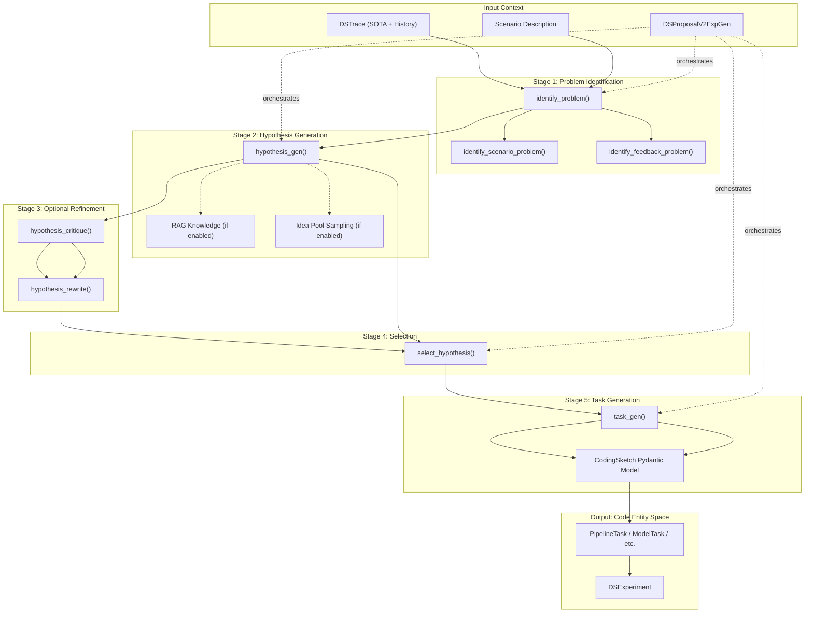
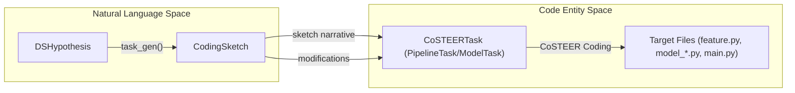

<!-- source: DeepWiki mcp.deepwiki.com · repo microsoft/RD-Agent · extra page Hypothesis and Experiment Generation · fetched 2026-10-26 -->

# Hypothesis and Experiment Generation

Relevant source files

The following files were used as context for generating this wiki page:

- [rdagent/app/data_science/conf.py](rdagent/app/data_science/conf.py)
- [rdagent/components/coder/data_science/pipeline/exp.py](rdagent/components/coder/data_science/pipeline/exp.py)
- [rdagent/components/coder/data_science/pipeline/prompts.yaml](rdagent/components/coder/data_science/pipeline/prompts.yaml)
- [rdagent/components/coder/data_science/workflow/exp.py](rdagent/components/coder/data_science/workflow/exp.py)
- [rdagent/components/proposal/__init__.py](rdagent/components/proposal/__init__.py)
- [rdagent/scenarios/data_science/proposal/exp_gen/README.md](rdagent/scenarios/data_science/proposal/exp_gen/README.md)
- [rdagent/scenarios/data_science/proposal/exp_gen/naive.py](rdagent/scenarios/data_science/proposal/exp_gen/naive.py)
- [rdagent/scenarios/data_science/proposal/exp_gen/naive.yaml](rdagent/scenarios/data_science/proposal/exp_gen/naive.yaml)
- [rdagent/scenarios/data_science/proposal/exp_gen/planner/__init__.py](rdagent/scenarios/data_science/proposal/exp_gen/planner/__init__.py)
- [rdagent/scenarios/data_science/proposal/exp_gen/prompts.yaml](rdagent/scenarios/data_science/proposal/exp_gen/prompts.yaml)
- [rdagent/scenarios/data_science/proposal/exp_gen/prompts_v2.yaml](rdagent/scenarios/data_science/proposal/exp_gen/prompts_v2.yaml)
- [rdagent/scenarios/data_science/proposal/exp_gen/proposal.py](rdagent/scenarios/data_science/proposal/exp_gen/proposal.py)
- [rdagent/scenarios/data_science/scen/__init__.py](rdagent/scenarios/data_science/scen/__init__.py)
- [rdagent/scenarios/data_science/scen/prompts.yaml](rdagent/scenarios/data_science/scen/prompts.yaml)
- [rdagent/scenarios/data_science/share.yaml](rdagent/scenarios/data_science/share.yaml)

## Purpose and Scope

This page documents the hypothesis and experiment generation system for the Data Science scenario, specifically focusing on the `DSProposalV2ExpGen` class and its multi-stage workflow. This component is responsible for analyzing the current state-of-the-art (SOTA) implementation, identifying improvement challenges, generating testable hypotheses, and converting them into executable experiments.

For information about the overall Data Science R&D loop that invokes this system, see [Data Science Scenario](#3.1). For details on how experiments are tracked and organized, see [DSTrace and Multi-Trace Exploration](#3.1.1). For the coding implementation of hypotheses, see [Component-Based Development Pipeline](#3.1.3).

## Overview

The hypothesis and experiment generation system transforms historical experiment data and scenario context into actionable development tasks. The primary entry point is `DSProposalV2ExpGen.gen()`, which orchestrates a multi-stage pipeline:

1.  **Problem Identification** - Analyze scenario and feedback to identify challenges.
2.  **Hypothesis Generation** - Propose solutions for each identified challenge.
3.  **Hypothesis Critique** (optional) - Identify flaws in proposed hypotheses.
4.  **Hypothesis Rewrite** (optional) - Improve hypotheses based on critiques.
5.  **Hypothesis Selection** - Choose the most promising hypothesis.
6.  **Task Generation** - Convert hypothesis into executable coding tasks.

**Key Classes:**
- `DSProposalV2ExpGen`: Main experiment generator implementing the multi-stage workflow [rdagent/scenarios/data_science/proposal/exp_gen/proposal.py:492-492]().
- `DSHypothesis`: Structured representation of a hypothesis with component, problem, and solution [rdagent/scenarios/data_science/proposal/exp_gen/base.py:13-13]().
- `CodingSketch`: Detailed implementation plan with structure, modifications, and packages [rdagent/scenarios/data_science/proposal/exp_gen/proposal.py:276-276]().
- `DSExperiment`: Container for hypothesis and pending tasks [rdagent/scenarios/data_science/experiment/experiment.py:14-14]().

**Sources:** [rdagent/scenarios/data_science/proposal/exp_gen/proposal.py:492-1397]()

## Workflow Architecture

Hypothesis and experiment generation bridges the **Natural Language Space** (problem statements and ideas) to the **Code Entity Space** (specific tasks for file modifications).

### System Component Interaction Diagram
Title: DSProposalV2ExpGen Workflow

**Sources:** [rdagent/scenarios/data_science/proposal/exp_gen/proposal.py:492-703](), [rdagent/scenarios/data_science/proposal/exp_gen/proposal.py:1020-1206]()

## Problem Identification

Problem identification analyzes the current competition state to determine what challenges need to be addressed. The system identifies two types of problems, weighted dynamically based on experiment history [rdagent/scenarios/data_science/proposal/exp_gen/proposal.py:569-606]().

### Dynamic Weighting Strategy
Early experiments focus heavily on scenario-level challenges to establish a baseline. As SOTA experiments accumulate, the system shifts toward feedback-based problems that refine existing implementations.

- **Scenario Challenges**: Identified via `identify_scenario_problem` [rdagent/scenarios/data_science/proposal/exp_gen/proposal.py:497-530](). Focuses on dataset properties and domain knowledge.
- **Feedback Challenges**: Identified via `identify_feedback_problem` [rdagent/scenarios/data_science/proposal/exp_gen/proposal.py:532-567](). Extracts learnings from experiment history and explicit feedback.

**Multiplier Formula:** `max(0, 3 - weighted_exp_num // 4)` where `weighted_exp_num = (sota * 3 + failed * 2) // 2` [rdagent/scenarios/data_science/proposal/exp_gen/proposal.py:575-581]().

**Sources:** [rdagent/scenarios/data_science/proposal/exp_gen/proposal.py:569-606](), [rdagent/scenarios/data_science/proposal/exp_gen/prompts_v2.yaml:1-134]()

## Hypothesis Generation

The `hypothesis_gen` method takes identified problems and generates one hypothesis per unique challenge [rdagent/scenarios/data_science/proposal/exp_gen/proposal.py:608-702]().

### Hypothesis Structure and Evaluation
Each hypothesis includes multi-dimensional scoring (1-10 scale) to assist in selection [rdagent/scenarios/data_science/proposal/exp_gen/proposal.py:218-241]():
- **Alignment**: How directly it addresses the challenge.
- **Impact**: Expected magnitude of improvement.
- **Novelty**: Originality compared to previous attempts.
- **Feasibility**: Likelihood of successful implementation.

**Component Assignment:** Each hypothesis is tagged with a target component (e.g., `FeatureEng`, `Model`, `Ensemble`) which determines which part of the code will be modified [rdagent/scenarios/data_science/proposal/exp_gen/proposal.py:212-216]().

**Sources:** [rdagent/scenarios/data_science/proposal/exp_gen/proposal.py:218-258](), [rdagent/scenarios/data_science/proposal/exp_gen/prompts_v2.yaml:135-301]()

## Hypothesis Critique and Rewrite

An optional refinement process improves hypothesis quality through self-reflection, enabled via `DS_RD_SETTING.enable_hypo_critique_rewrite` [rdagent/app/data_science/conf.py:182-182]().

1.  **Critique Stage**: `hypothesis_critique` analyzes technical risk, alignment, and potential improvement directions [rdagent/scenarios/data_science/proposal/exp_gen/proposal.py:704-771]().
2.  **Rewrite Stage**: `hypothesis_rewrite` generates improved versions based on critiques [rdagent/scenarios/data_science/proposal/exp_gen/proposal.py:773-868](). It also considers remaining time if `enable_scale_check` is true [rdagent/scenarios/data_science/proposal/exp_gen/proposal.py:781-787]().

**Sources:** [rdagent/scenarios/data_science/proposal/exp_gen/proposal.py:704-868](), [rdagent/scenarios/data_science/proposal/exp_gen/prompts_v2.yaml:302-455]()

## Task Generation

The `task_gen` method converts the selected hypothesis into executable coding tasks by creating a `CodingSketch` [rdagent/scenarios/data_science/proposal/exp_gen/proposal.py:1020-1206]().

### From Sketch to Code Entity
Title: Mapping Hypotheses to Code Entities

**CodingSketch Fields:**
- `current_state`: Summary of relevant baseline code [rdagent/scenarios/data_science/proposal/exp_gen/proposal.py:278-280]().
- `modifications`: Specific targeted changes to existing files [rdagent/scenarios/data_science/proposal/exp_gen/proposal.py:281-285]().
- `structure`: Function/class blueprints for new code [rdagent/scenarios/data_science/proposal/exp_gen/proposal.py:286-291]().
- `packages`: Required third-party dependencies [rdagent/scenarios/data_science/proposal/exp_gen/proposal.py:298-300]().

**Component Metadata Mapping:**
The system uses `_COMPONENT_META` to instantiate the correct task class (e.g., `ModelTask` for the "Model" component) and apply component-specific prompts [rdagent/scenarios/data_science/proposal/exp_gen/proposal.py:45-82]().

**Sources:** [rdagent/scenarios/data_science/proposal/exp_gen/proposal.py:45-96](), [rdagent/scenarios/data_science/proposal/exp_gen/proposal.py:1129-1206]()

## Configuration

Key configuration settings from `DS_RD_SETTING` [rdagent/app/data_science/conf.py:9-195]():

| Setting | Type | Purpose |
| :--- | :--- | :--- |
| `hypothesis_gen` | str | Entry point router for generation (e.g., `ParallelMultiTraceExpGen`) |
| `enable_hypo_critique_rewrite` | bool | Enables the optional critique/rewrite refinement stages |
| `llm_select_hypothesis` | bool | Uses LLM-based selection instead of the default ranking algorithm |
| `enable_knowledge_base` | bool | Enables sampling ideas from the `DSKnowledgeBase` |
| `enable_research_rag` | bool | Enables RAG search of community knowledge via `RAGAgent` |

**Sources:** [rdagent/app/data_science/conf.py:9-195]()

---

