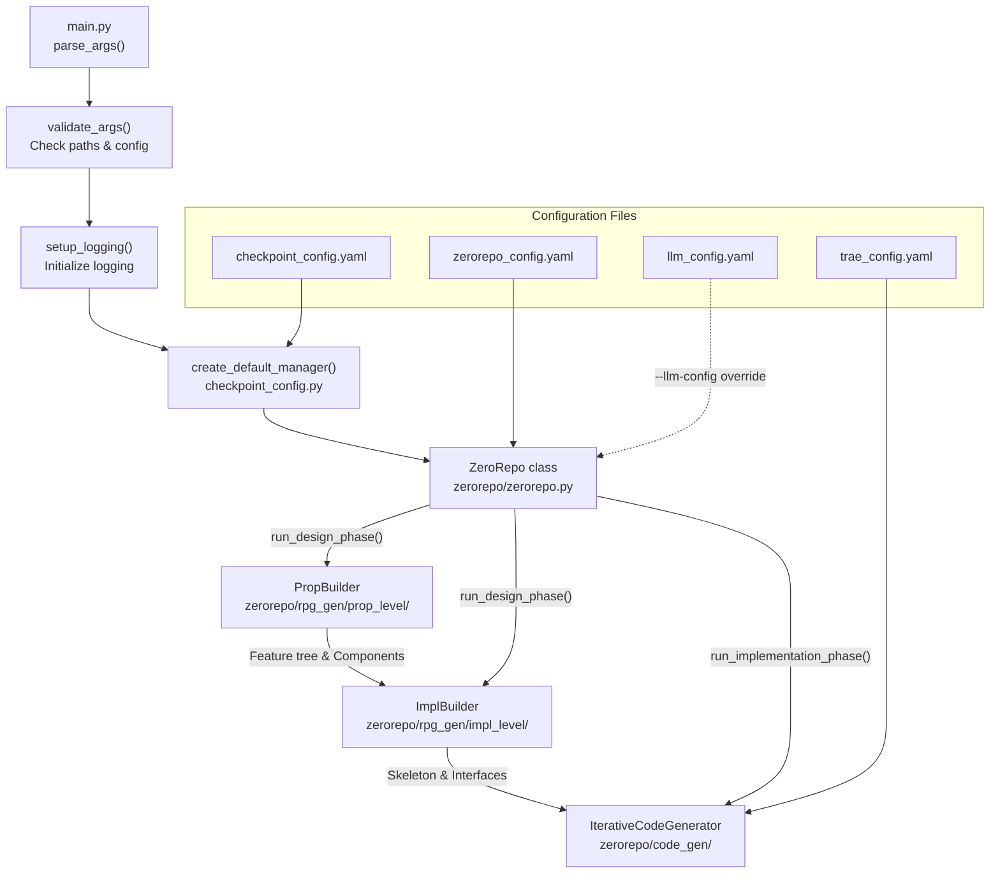
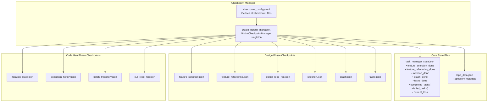
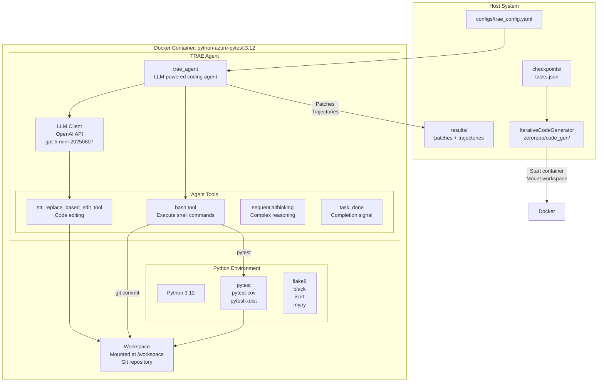
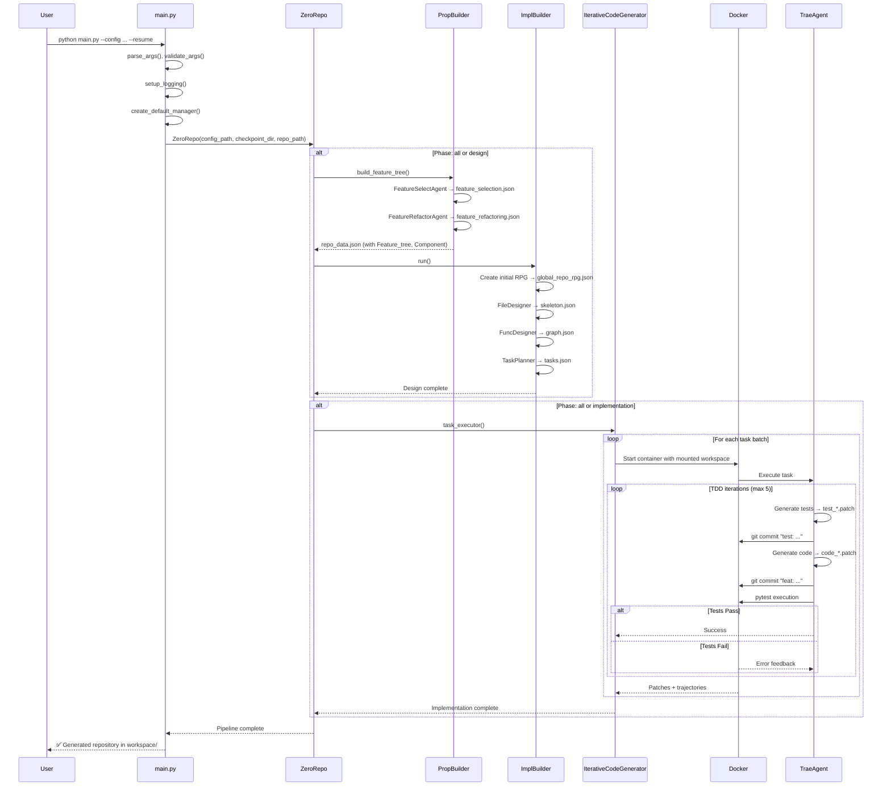

<!-- source: DeepWiki mcp.deepwiki.com · repo microsoft/RPG-ZeroRepo · page 1 Overview · fetched 2026-10-26 -->

# Overview

<details>
<summary>Relevant source files</summary>

The following files were used as context for generating this wiki page:

- [LICENSE](LICENSE)
- [README.md](README.md)
- [main.py](main.py)

</details>


## Purpose and Scope

This document provides a high-level introduction to the RPG-ZeroRepo system, explaining its purpose, architecture, and the three-phase automated repository generation pipeline. It covers the system's main components, data flow, and execution model.

For detailed installation and setup instructions, see [Getting Started](#2). For in-depth documentation on individual phases, see [Core Pipeline](#3). For configuration details, see [Configuration System](#4).

**Sources:** [README.md:1-32]()

## What is RPG-ZeroRepo?

RPG-ZeroRepo is an LLM-driven framework that generates complete software repositories from natural language descriptions. The system takes a short project description (e.g., "a multiplayer snake game") and automatically produces a fully functional codebase with tests, documentation, and proper structure.

The framework consists of two key concepts:

**RPG (Repository Planning Graph)**: A hierarchical graph representation that captures both the functional view (features, requirements) and the structural view (files, classes, functions, dependencies) of a software repository.

**ZeroRepo**: The automated generation framework built on RPG that orchestrates the transformation from natural language to working code through a three-phase pipeline.

**Sources:** [README.md:1-10](), [README.md:465-481]()

## System Architecture

The system is organized around three sequential phases, each producing specific artifacts that feed into the next phase. The entry point is `main.py`, which loads configurations, initializes the checkpoint system, and orchestrates the complete pipeline through the `ZeroRepo` class.

### System Entry Point and Main Components



**Sources:** [main.py:1-308](), [README.md:34-95]()

### Natural Language to Code Entity Mapping

The following diagram shows how natural language concepts are progressively transformed into concrete code entities through the pipeline:

```mermaid
graph LR
    subgraph "Natural Language Space"
        NL["'A multiplayer snake game<br/>with AI opponents...'"]
        
        Features["Feature Tree<br/>• game mechanics<br/>• AI pathfinding<br/>• replay recording"]
        
        Components["Components<br/>• gameplay.core<br/>• ai.pathfinding<br/>• io.persistence"]
    end
    
    subgraph "Intermediate Representation"
        RPG["global_repo_rpg.json<br/>Repository Planning Graph"]
        
        Skeleton["skeleton.json<br/>File Structure<br/>76 files"]
        
        Graph["graph.json<br/>Function Interfaces"]
        
        Tasks["tasks.json<br/>Implementation Batches"]
    end
    
    subgraph "Code Entity Space"
        Files["Generated Files<br/>src/ai/planning/pathfinding.py<br/>src/gameplay/rules/movement.py<br/>tests/test_pathfinding.py"]
        
        Classes["Python Classes<br/>class HighScoreBinarySerializer<br/>class PathfindingEngine<br/>class SnakeMovementController"]
        
        Functions["Python Functions<br/>def serialize(entries) -> bytes<br/>def find_path(start, goal) -> List<br/>def update_position(delta) -> None"]
    end
    
    NL --> |"FeatureSelectAgent"| Features
    Features --> |"FeatureRefactorAgent"| Components
    Components --> RPG
    
    RPG --> |"FileDesigner"| Skeleton
    Skeleton --> |"FuncDesigner"| Graph
    Graph --> |"TaskPlanner"| Tasks
    
    Tasks --> |"IterativeCodeGenerator<br/>+ TRAE Agent"| Files
    Files --> Classes
    Classes --> Functions
```



**Sources:** [README.md:98-172](), [README.md:174-281](), [README.md:283-351]()

## Three-Phase Pipeline

The pipeline transforms natural language descriptions into working code through three sequential phases, each managed by a dedicated builder class.

| Phase | Builder Class | Input | Output | Primary Agents |
|-------|--------------|-------|--------|----------------|
| **Phase 1: Feature Planning** | `PropBuilder` | `repo_data.json` (name + purpose) | Feature tree + Components | `FeatureSelectAgent`, `FeatureRefactorAgent` |
| **Phase 2: Architecture Design** | `ImplBuilder` | Feature tree + Components | File skeleton + Interfaces + Tasks | `FileDesigner`, `FuncDesigner`, `TaskPlanner` |
| **Phase 3: Code Generation** | `IterativeCodeGenerator` | Tasks + Interfaces | Working Python code + Tests | TRAE Agent (LLM-powered) |

### Phase 1: Feature Planning

**Module:** `zerorepo/rpg_gen/prop_level/`

**Entry Point:** `PropBuilder.build_feature_tree()`

This phase uses LLM agents to transform a simple project description into a structured feature taxonomy and logical component decomposition.

**Workflow:**
1. `FeatureSelectAgent` generates a hierarchical Feature Tree
2. `FeatureRefactorAgent` groups features into Components (logical modules)
3. Results saved to `repo_data.json` with `Feature_tree` and `Component` fields

**Example Output:**
```json
{
  "Feature_tree": {
    "functionality": {
      "game mechanics": ["movement", "collision detection", "food spawning"]
    },
    "algorithm": {
      "pathfinding": ["astar", "bfs flood fill"]
    }
  },
  "Component": [
    {
      "name": "gameplay.core",
      "refactored_subtree": { ... }
    }
  ]
}
```

**Sources:** [README.md:98-172]()

### Phase 2: Architecture Design

**Module:** `zerorepo/rpg_gen/impl_level/`

**Entry Point:** `ImplBuilder.run()`

This phase converts abstract features into concrete file structures, complete interfaces, and implementation tasks.

**Workflow:**
1. Create initial RPG from Components → `global_repo_rpg.json`
2. `FileDesigner` (via `RawSkeletonAgent` + `GroupSkeletonAgent`) generates file layout → `skeleton.json`
3. `FuncDesigner` (via `DataFlowAgent` + `BaseClassAgent` + `InterfaceAgent`) designs function signatures → `graph.json`
4. `TaskPlanner` splits work into implementation batches → `tasks.json`

**Key Artifacts:**
- **skeleton.json**: Complete directory structure with file paths and initial code skeletons
- **graph.json**: Full interface definitions with signatures, docstrings, and type hints
- **tasks.json**: Implementation batches grouped by component and file

**Sources:** [README.md:174-281]()

### Phase 3: Code Generation

**Module:** `zerorepo/code_gen/`

**Entry Point:** `IterativeCodeGenerator.task_executor()`

This phase executes a test-driven development loop inside Docker containers, using the TRAE agent to generate tests and implementation code iteratively.

**Workflow per Batch:**
1. TRAE agent generates test file → `test_*.patch` → `git commit "test: ..."`
2. TRAE agent implements code → `code_*.patch` → `git commit "feat: ..."`
3. Execute `pytest` inside container
4. If tests fail, retry with error feedback (up to `max_iterations`)
5. Save patches and trajectories to `results/` directory

**Workflow Types:**
- `TEST_DEVELOPMENT`: Initial test generation
- `CODE_INCREMENTAL`: Initial code implementation
- `TEST_FIX`: Fix failing tests
- `CODE_BUG_FIX`: Fix code based on test failures
- `ENV_SETUP`: Install packages or fix imports

**Sources:** [README.md:283-351]()

## Data Flow Through Pipeline

```mermaid
graph TB
    subgraph "Input"
        Input["repo_data.json<br/>{repository_name, repository_purpose}"]
    end
    
    subgraph "Phase 1 Outputs"
        FS["feature_selection.json<br/>FeatureSelectAgent output"]
        FR["feature_refactoring.json<br/>FeatureRefactorAgent output"]
        RD1["repo_data.json v2<br/>+ Feature_tree + Component"]
    end
    
    subgraph "Phase 2 Outputs"
        RPG1["global_repo_rpg.json v1<br/>Initial RPG structure"]
        Skel["skeleton.json<br/>File layout + code skeletons"]
        SkelTraj["skeleton_traj.json<br/>Design trajectories"]
        Graph["graph.json<br/>Complete interfaces"]
        Tasks["tasks.json<br/>Implementation batches"]
        RPG2["global_repo_rpg.json v2<br/>Updated with interfaces"]
    end
    
    subgraph "Phase 3 Outputs"
        Iter["iteration_state.json<br/>Current iteration state"]
        ExecHist["execution_history.json<br/>All workflow executions"]
        BatchTraj["batch_trajectory.json<br/>Per-batch execution records"]
        CurRPG["cur_repo_rpg.json<br/>Runtime RPG state"]
        Workspace["workspace/<br/>Generated repository"]
        Results["results/<br/>Patches + trajectories"]
    end
    
    subgraph "State Tracking"
        TMS["task_manager_state.json<br/>Progress tracking"]
    end
    
    Input --> FS
    FS --> FR
    FR --> RD1
    
    RD1 --> RPG1
    RPG1 --> Skel
    Skel --> SkelTraj
    Skel --> Graph
    Graph --> Tasks
    Graph --> RPG2
    
    Tasks --> Iter
    Iter --> ExecHist
    ExecHist --> BatchTraj
    BatchTraj --> CurRPG
    Tasks --> Workspace
    Workspace --> Results
    
    FS -.-> TMS
    FR -.-> TMS
    Skel -.-> TMS
    Graph -.-> TMS
    Tasks -.-> TMS
    Workspace -.-> TMS
```

**Sources:** [README.md:383-400]()

## Checkpoint System and Resumability

The checkpoint system enables the pipeline to resume from any point without repeating expensive LLM operations. The `task_manager_state.json` file tracks completion status for each phase and individual task.

### Checkpoint Architecture



**Resume Logic:**
When `--resume` flag is provided to `main.py`, the system:
1. Loads `task_manager_state.json` from checkpoint directory
2. Skips phases marked as complete
3. Resumes code generation from the next uncompleted batch
4. Failed tasks can be retried automatically

**Sources:** [README.md:353-380](), [main.py:97-101](), [checkpoint_config.yaml]()

## Docker Execution Environment

Phase 3 executes code generation inside isolated Docker containers to provide a clean, reproducible environment with all necessary development tools.

### Container Architecture



**Container Configuration:**
- **Image:** `python-azure-pytest:3.12` (specified in `zerorepo_config.yaml`)
- **Workspace Mount:** Host's `workspace/` directory mounted at `/workspace` in container
- **Network:** Isolated network with access to LLM APIs
- **Tools:** pytest, coverage.py, flake8, black, isort, mypy, Azure CLI

**Sources:** [README.md:283-351](), [README.md:425-458](), [Dockerfile]()

## Key Classes and Components

The following table maps system concepts to their concrete implementations:

| Concept | Class/Module | File Path | Purpose |
|---------|-------------|-----------|---------|
| **Main Orchestrator** | `ZeroRepo` | `zerorepo/zerorepo.py` | Top-level pipeline coordinator |
| **CLI Entry Point** | `main()` | `main.py` | Parse args, setup, run pipeline |
| **Feature Planning** | `PropBuilder` | `zerorepo/rpg_gen/prop_level/prop_builder.py` | Phase 1 orchestrator |
| **Feature Selection** | `FeatureSelectAgent` | `zerorepo/rpg_gen/prop_level/feature_select_agent.py` | Generate feature taxonomy |
| **Feature Refactoring** | `FeatureRefactorAgent` | `zerorepo/rpg_gen/prop_level/feature_refactor_agent.py` | Group into components |
| **Architecture Design** | `ImplBuilder` | `zerorepo/rpg_gen/impl_level/impl_builder.py` | Phase 2 orchestrator |
| **File Design** | `FileDesigner` | `zerorepo/rpg_gen/impl_level/file_designer.py` | Generate file skeleton |
| **Function Design** | `FuncDesigner` | `zerorepo/rpg_gen/impl_level/func_designer.py` | Design interfaces |
| **Task Planning** | `TaskPlanner` | `zerorepo/rpg_gen/impl_level/task_planner.py` | Split into batches |
| **Code Generation** | `IterativeCodeGenerator` | `zerorepo/code_gen/iterative_code_generator.py` | Phase 3 orchestrator |
| **Checkpoint System** | `GlobalCheckpointManager` | `zerorepo/config/checkpoint_config.py` | State management |
| **LLM Configuration** | `LLMConfig` | `zerorepo/rpg_gen/base/llm_client.py` | LLM client abstraction |

**Sources:** [README.md:98-351](), [main.py:1-308]()

## Configuration Files

The system uses a hierarchical configuration system with multiple YAML files:

| Configuration File | Purpose | Key Sections |
|-------------------|---------|--------------|
| `zerorepo_config.yaml` | Main orchestrator config | `llm`, `prop_level`, `impl_level`, `code_generation` |
| `llm_config.yaml` | LLM provider settings | `model_providers`, `models`, `api_keys` |
| `file_design_config.yaml` | File skeleton design params | `raw_skeleton`, `group_skeleton` |
| `func_design_config.yaml` | Function interface design params | `data_flow`, `base_classes`, `interfaces` |
| `trae_config.yaml` | TRAE agent configuration | `agents`, `tools`, `models`, `max_steps` |
| `checkpoint_config.yaml` | State management schema | Checkpoint file definitions |

**Configuration Override:**
The `--llm-config` CLI flag allows overriding LLM settings from the main config file, enabling easy switching between different models or providers.

**Sources:** [README.md:403-458](), [main.py:117-123](), [main.py:231-235]()

## System Execution Flow

The complete execution flow from command invocation to final repository:



**Sources:** [main.py:202-276](), [README.md:283-351]()

---

This overview provides the foundational understanding of RPG-ZeroRepo's architecture and operation. For detailed information on specific subsystems, refer to the subsequent sections of this documentation.

---

