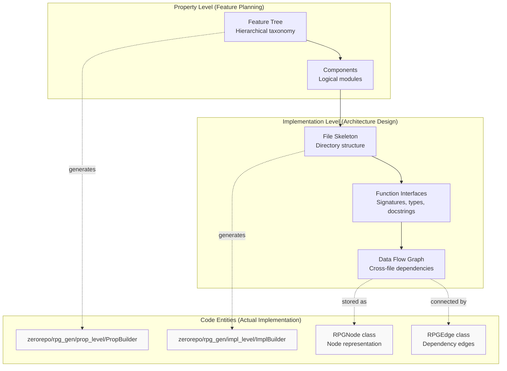
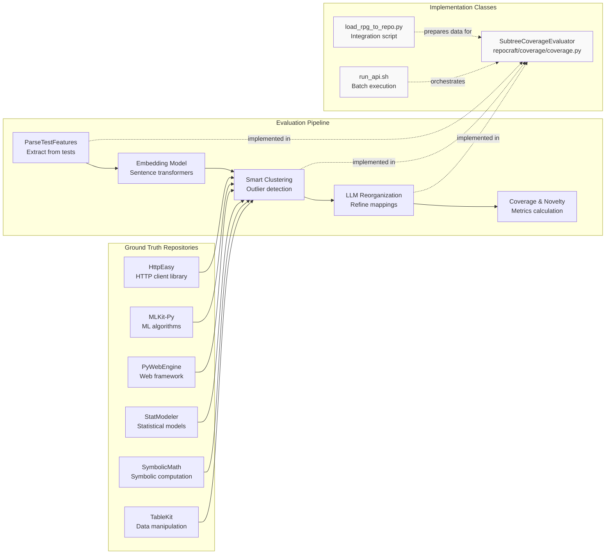
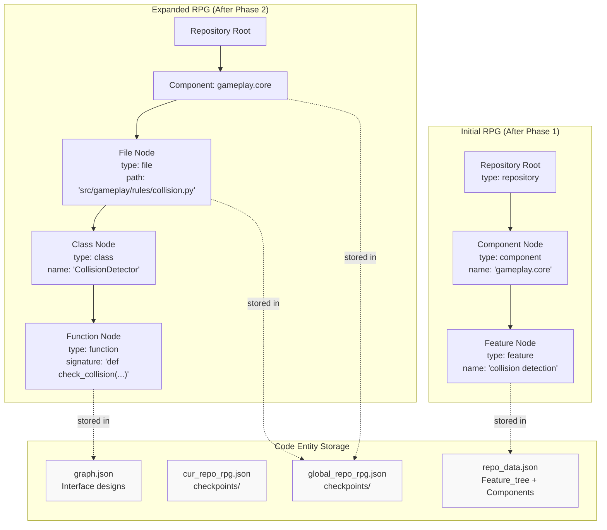

<!-- source: DeepWiki mcp.deepwiki.com · repo microsoft/RPG-ZeroRepo · page 10 Research Background · fetched 2026-10-26 -->

# Research Background

<details>
<summary>Relevant source files</summary>

The following files were used as context for generating this wiki page:

- [README.md](README.md)
- [docs/2509.16198.pdf](docs/2509.16198.pdf)
- [docs/2602.02084.pdf](docs/2602.02084.pdf)

</details>


This page provides context on the Large Language Models (LLM) research that underpins the RPG-ZeroRepo system. It explains the motivation, key contributions, and research innovations that led to the current implementation. For implementation details of the three-phase pipeline, see [Core Pipeline](#3). For practical usage instructions, see [Getting Started](#2).

---

## Research Motivation and Problem Statement

Traditional approaches to automated code generation focus on generating individual functions or completing code snippets. However, generating complete, coherent software repositories from natural language descriptions presents several fundamental challenges:

| Challenge | Description | Impact |
|-----------|-------------|--------|
| **Scalability** | Existing methods struggle to generate repositories with hundreds of files and thousands of functions | Limited to small-scale projects |
| **Coherence** | Generated code often lacks consistent architecture and dependencies across files | Fragmented, non-functional output |
| **Planning** | LLMs lack explicit planning mechanisms for repository-scale generation | Poor feature coverage and organization |
| **Evaluation** | No standardized benchmarks for full repository generation quality | Difficult to measure progress |

The RPG-ZeroRepo research addresses these challenges through a unified graph-based representation that captures both the functional requirements and structural design of software repositories.

**Sources:** [README.md:1-6](), [docs/2509.16198.pdf:1-20]()

---

## Key Research Contributions

The core research paper "RPG: A Repository Planning Graph for Unified and Scalable Codebase Generation" (arXiv:2509.16198) introduces three primary innovations:

### 1. Repository Planning Graph (RPG) Representation

RPG is a hierarchical graph structure that unifies the property level (features, requirements) and implementation level (files, classes, functions) into a single coherent representation. This dual-layer architecture enables systematic planning before code generation.



**Sources:** [README.md:6](), [docs/2509.16198.pdf:1-20]()

### 2. Three-Phase Generation Pipeline

The research establishes a systematic decomposition of repository generation into three sequential phases, each with specialized agents and intermediate artifacts:

| Phase | Research Contribution | Implementation Module |
|-------|----------------------|----------------------|
| **Phase 1: Feature Planning** | FeatureSelectAgent + FeatureRefactorAgent for hierarchical feature decomposition | [zerorepo/rpg_gen/prop_level/]() |
| **Phase 2: Architecture Design** | Multi-agent design pipeline (FileDesigner, FuncDesigner, TaskPlanner) with topological ordering | [zerorepo/rpg_gen/impl_level/]() |
| **Phase 3: Code Generation** | Iterative Test-Driven Development (TDD) loop with error recovery | [zerorepo/code_gen/]() |

**Sources:** [README.md:8-10](), [README.md:98-280]()

### 3. RepoCraft Evaluation Benchmark

The research introduces RepoCraft, a novel evaluation framework that measures both **coverage** (how many ground truth features are present) and **novelty** (how many new features are generated). This addresses the lack of standardized benchmarks for repository-level generation.



**Sources:** [README.md:1-6](), Diagram 6 from high-level architecture

---

## The RPG Data Structure

The Repository Planning Graph is implemented as a JSON-based hierarchical structure that evolves through the pipeline stages. The graph contains nodes representing features, components, files, and functions, with edges capturing dependencies and relationships.

### RPG Node Types and Evolution



### RPG Checkpoint Files

| Checkpoint File | Contains | Generated By | Format |
|----------------|----------|--------------|--------|
| `repo_data.json` | Repository metadata, Feature_tree, Components | Phase 1: PropBuilder | JSON with nested feature hierarchy |
| `global_repo_rpg.json` | Complete RPG with all nodes and edges | Phase 2: ImplBuilder | JSON graph structure |
| `cur_repo_rpg.json` | Current state during code generation | Phase 3: IterativeCodeGenerator | Updated RPG with implementation status |
| `skeleton.json` | File structure with code skeletons | Phase 2: FileDesigner | JSON mapping file paths to skeleton code |
| `graph.json` | Interface designs and data flow | Phase 2: FuncDesigner | JSON with function signatures and dependencies |

**Sources:** [README.md:383-399](), [checkpoint_config.yaml:1-100]()

---

## Research to Implementation Mapping

The research concepts are directly implemented in specific Python modules. Understanding this mapping helps developers navigate the codebase and extend the system.

```mermaid
graph TB
    subgraph "Research Concepts"
        R1["Feature Selection<br/>(Section 3.1 of paper)"]
        R2["Feature Refactoring<br/>(Section 3.1 of paper)"]
        R3["File Design<br/>(Section 3.2 of paper)"]
        R4["Function Design<br/>(Section 3.2 of paper)"]
        R5["Task Planning<br/>(Section 3.2 of paper)"]
        R6["Iterative TDD<br/>(Section 3.3 of paper)"]
        R7["Coverage Evaluation<br/>(Section 4 of paper)"]
    end
    
    subgraph "Implementation Classes"
        C1["FeatureSelectAgent<br/>zerorepo/rpg_gen/prop_level/feature_selection_agent.py"]
        C2["FeatureRefactorAgent<br/>zerorepo/rpg_gen/prop_level/feature_refactor_agent.py"]
        C3["RawSkeletonAgent + GroupSkeletonAgent<br/>zerorepo/rpg_gen/impl_level/file_designer/"]
        C4["DataFlowAgent + BaseClassAgent + InterfaceAgent<br/>zerorepo/rpg_gen/impl_level/func_designer/"]
        C5["TaskPlanner<br/>zerorepo/rpg_gen/impl_level/task_planner.py"]
        C6["IterativeCodeGenerator<br/>zerorepo/code_gen/iterative_code_generator.py"]
        C7["SubtreeCoverageEvaluator<br/>repocraft/coverage/coverage.py"]
    end
    
    subgraph "Configuration Files"
        CFG1["zerorepo_config.yaml<br/>prop_level section"]
        CFG2["file_design_config.yaml<br/>skeleton parameters"]
        CFG3["func_design_config.yaml<br/>interface parameters"]
        CFG4["trae_config.yaml<br/>agent tools & models"]
    end
    
    R1 --> C1
    R2 --> C2
    R3 --> C3
    R4 --> C4
    R5 --> C5
    R6 --> C6
    R7 --> C7
    
    C1 -.->|"configured by"| CFG1
    C2 -.->|"configured by"| CFG1
    C3 -.->|"configured by"| CFG2
    C4 -.->|"configured by"| CFG3
    C6 -.->|"configured by"| CFG4
    
    style C1 fill:#f9f9f9
    style C2 fill:#f9f9f9
    style C3 fill:#f9f9f9
    style C4 fill:#f9f9f9
    style C5 fill:#f9f9f9
    style C6 fill:#f9f9f9
    style C7 fill:#f9f9f9
```



**Sources:** [README.md:98-280](), [zerorepo_config.yaml:1-60]()

---

## Related Research: RPG-Encoder

The companion paper "Closing the Loop: Universal Repository Representation with RPG-Encoder" (arXiv:2602.02084) extends the RPG concept to create universal embeddings for existing repositories. While RPG-ZeroRepo focuses on **generation** (natural language → code), RPG-Encoder focuses on **understanding** (code → structured representation).

### RPG-Encoder Applications

| Application | Description | Relation to RPG-ZeroRepo |
|-------------|-------------|--------------------------|
| **Code Retrieval** | Find relevant code fragments using natural language queries | Could enhance Phase 2 by retrieving similar implementations |
| **Repository Understanding** | Automatically construct RPG from existing codebases | Reverse process of generation pipeline |
| **Quality Assessment** | Compare generated RPGs against reference repositories | Used in RepoCraft evaluation |
| **Code Search** | Navigate large codebases using semantic relationships | Potential future integration |

### Integration Status

RPG-Encoder is currently in the open-source release process and will be released separately. Once available, it will provide:

- Automatic RPG construction from existing repositories
- Enhanced retrieval capabilities for Phase 2 design
- Improved evaluation by comparing structural similarity

**Sources:** [README.md:15-16]()

---

## Paper Citations and References

### Primary Research Papers

**RPG-ZeroRepo (Generation)**
```bibtex
@article{luo2025rpg,
  title={RPG: A Repository Planning Graph for Unified and Scalable Codebase Generation},
  author={Luo, Jane and Zhang, Xin and Liu, Steven and Wu, Jie and Liu, Jianfeng and 
          Huang, Yiming and Huang, Yangyu and Yin, Chengyu and Xin, Ying and 
          Zhan, Yuefeng and others},
  journal={arXiv preprint arXiv:2509.16198},
  year={2025}
}
```

**RPG-Encoder (Understanding)**
```bibtex
@article{luo2026closing,
  title={Closing the Loop: Universal Repository Representation with RPG-Encoder},
  author={Luo, Jane and Yin, Chengyu and Zhang, Xin and Li, Qingtao and Liu, Steven and 
          Huang, Yiming and Wu, Jie and Liu, Hao and Huang, Yangyu and Kang, Yu and others},
  journal={arXiv preprint arXiv:2602.02084},
  year={2026}
}
```

### Access Research Papers

- **RPG-ZeroRepo Paper:** https://arxiv.org/abs/2509.16198
- **RPG-Encoder Paper:** https://arxiv.org/abs/2602.02084
- **License:** Creative Commons Attribution 4.0 International (CC BY 4.0)
- **Conference:** Accepted as poster at ICLR 2026

**Sources:** [README.md:465-481](), [README.md:14-18](), [docs/2509.16198.pdf:1-20]()

---

## Research Impact and Future Directions

The RPG representation and three-phase pipeline establish a foundation for repository-scale code generation. Key areas for future research include:

1. **Incremental Generation:** Extending existing repositories rather than generating from scratch
2. **Cross-Language Support:** Adapting RPG to languages beyond Python
3. **Interactive Refinement:** Allowing users to modify the RPG at each phase
4. **Integration with RPG-Encoder:** Using retrieval to enhance design quality
5. **Larger Scale:** Generating repositories with 10,000+ files

The modular architecture of the codebase facilitates experimentation with these directions. Each phase can be independently modified or replaced while maintaining the RPG interface contract.

**Sources:** [README.md:1-481]()

---

