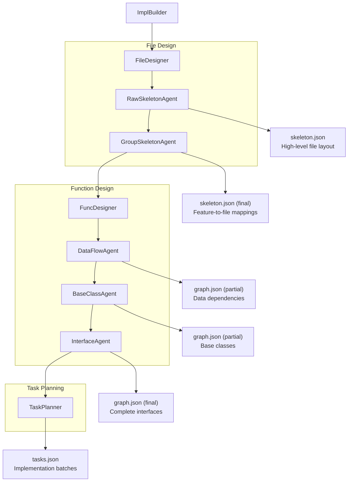
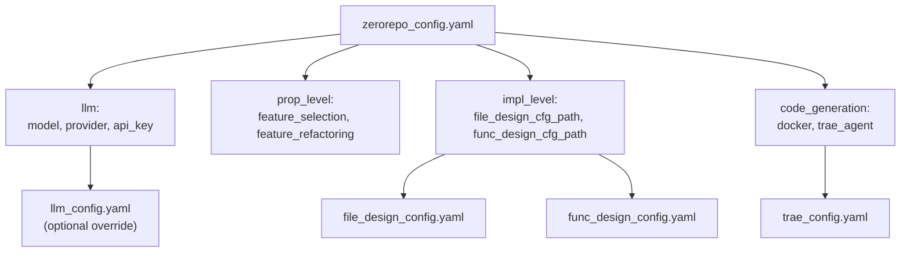
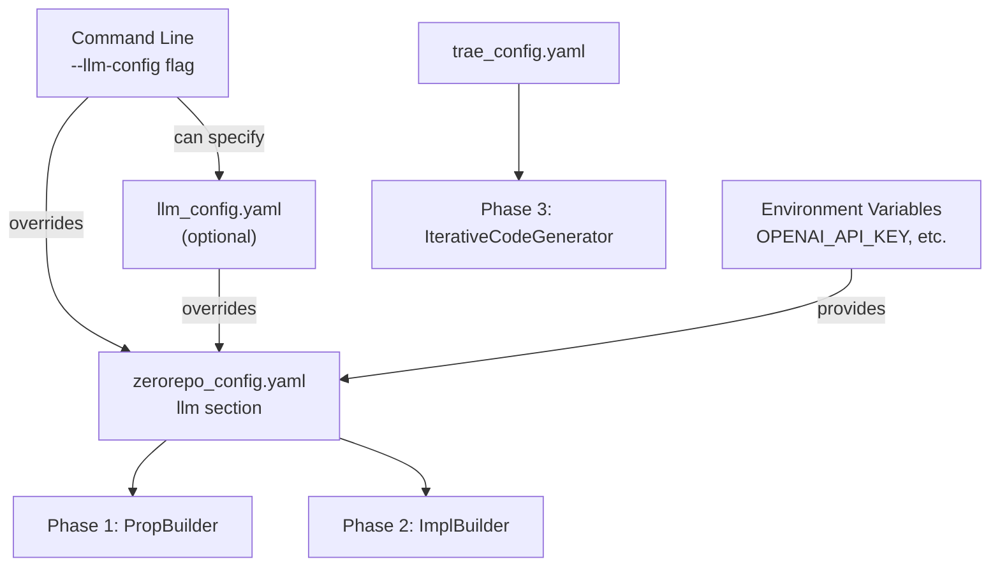
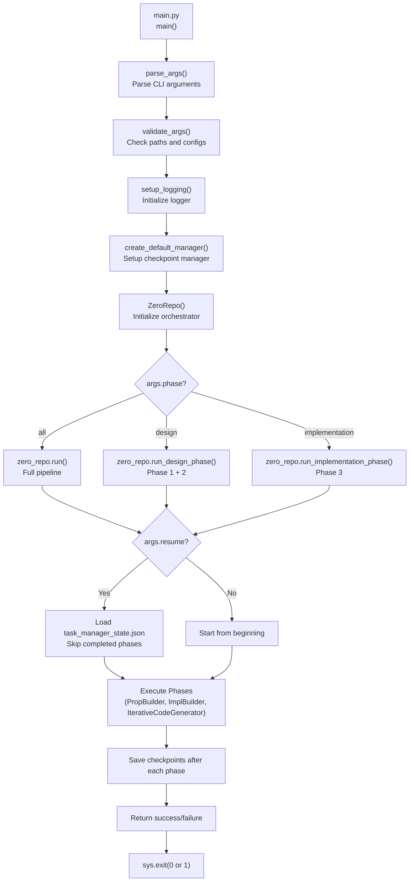

<!-- source: DeepWiki mcp.deepwiki.com · repo microsoft/RPG-ZeroRepo · page 11 Reference · fetched 2026-10-26 -->

# Reference

<details>
<summary>Relevant source files</summary>

The following files were used as context for generating this wiki page:

- [README.md](README.md)
- [configs/checkpoint_config.yaml](configs/checkpoint_config.yaml)
- [main.py](main.py)

</details>


This page provides a complete technical reference for the RPG-ZeroRepo system, covering its core components, configuration files, checkpoint system, and code entry points. This reference is organized to help developers quickly locate specific classes, functions, and configuration parameters.

For detailed command-line interface documentation, see [Command Line Interface](#11.1). For visual architecture diagrams, see [Pipeline Diagrams](#11.2).

---

## System Entry Points

The main entry point for the RPG-ZeroRepo system is `main.py`, which orchestrates the entire pipeline through the `ZeroRepo` class.

| Entry Point | File Path | Primary Class | Purpose |
|-------------|-----------|---------------|---------|
| CLI Entry | [main.py:1-308]() | N/A | Parse arguments, setup logging, initialize system |
| Orchestrator | [main.py:223-229]() | `ZeroRepo` | Coordinate three-phase pipeline execution |
| Feature Planning | Located in `zerorepo/rpg_gen/prop_level/` | `PropBuilder` | Generate feature tree and components |
| Architecture Design | Located in `zerorepo/rpg_gen/impl_level/` | `ImplBuilder` | Create file layouts and interfaces |
| Code Generation | Located in `zerorepo/code_gen/` | `IterativeCodeGenerator` | Execute TDD workflow in Docker |

**Sources**: [main.py:1-308]()

---

## Core Component Reference

### Main Orchestration Layer

**Class: `ZeroRepo`**

Located in `zerorepo/zerorepo.py`, this class serves as the main orchestrator that coordinates all three phases.

**Key Methods**:
- `run()` - Execute full pipeline (design + implementation)
- `run_design_phase(resume: bool)` - Execute Phase 1 and Phase 2 only
- `run_implementation_phase(resume: bool, force_rebuild: bool)` - Execute Phase 3 only

**Referenced in**: [main.py:223-254]()

---

### Phase 1: Property Level Components

**Class: `PropBuilder`**

Located in `zerorepo/rpg_gen/prop_level/prop_builder.py`

**Key Methods**:
- `build_feature_tree()` - Main entry point for Phase 1 execution

**Sub-components**:

| Agent Class | Purpose | Output Checkpoint |
|-------------|---------|-------------------|
| `FeatureSelectAgent` | Generate hierarchical feature taxonomy | `feature_selection.json` |
| `FeatureRefactorAgent` | Group features into logical components | `feature_refactoring.json` |

**Final Output**: Updates `repo_data.json` with `Feature_tree` and `Component` fields

**Sources**: [README.md:98-172]()

---

### Phase 2: Implementation Level Components

**Class: `ImplBuilder`**

Located in `zerorepo/rpg_gen/impl_level/impl_builder.py`

**Key Methods**:
- `run()` - Main entry point for Phase 2 execution

**Design Agents Architecture**:



**Agent Reference Table**:

| Agent Class | Configuration File | Primary Function | Output |
|-------------|-------------------|------------------|--------|
| `RawSkeletonAgent` | `file_design_config.yaml` | Generate initial file structure | Partial `skeleton.json` |
| `GroupSkeletonAgent` | `file_design_config.yaml` | Map features to files | Final `skeleton.json` |
| `DataFlowAgent` | `func_design_config.yaml` | Analyze data dependencies | Partial `graph.json` |
| `BaseClassAgent` | `func_design_config.yaml` | Design base classes | Partial `graph.json` |
| `InterfaceAgent` | `func_design_config.yaml` | Generate function signatures | Final `graph.json` |
| `TaskPlanner` | N/A | Split work into batches | `tasks.json` |

**Sources**: [README.md:176-280]()

---

### Phase 3: Code Generation Components

**Class: `IterativeCodeGenerator`**

Located in `zerorepo/code_gen/iterative_code_generator.py`

**Key Methods**:
- `task_executor()` - Main entry point for Phase 3 execution
- Executes tasks in Docker container using TRAE agent

**Workflow Types**:

| Workflow Type | Enum Value | Description | When Used |
|---------------|------------|-------------|-----------|
| Test Development | `TEST_DEVELOPMENT` | Write new test code | First iteration |
| Test Fix | `TEST_FIX` | Fix failing tests | Test code has errors |
| Code Incremental | `CODE_INCREMENTAL` | Write new implementation | First iteration |
| Code Bug Fix | `CODE_BUG_FIX` | Fix code bugs | Implementation has errors |
| Environment Setup | `ENV_SETUP` | Install packages, fix imports | Environment issues |

**Sources**: [README.md:284-351]()

---

## Configuration Files Reference

### Primary Configuration: `zerorepo_config.yaml`

Located at `configs/zerorepo_config.yaml`

**Configuration Sections**:



**Key Parameters**:

| Section | Parameter | Type | Purpose |
|---------|-----------|------|---------|
| `llm.model` | String | Model identifier | LLM for design phases (e.g., `gpt-5-mini-20250807`) |
| `llm.provider` | String | Provider name | API provider (`openai`, `anthropic`, etc.) |
| `llm.api_key` | String | API key | Authentication (can use env var) |
| `prop_level.feature_selection.mode` | String | Selection mode | `"simple"` or `"feature"` (multi-agent) |
| `prop_level.feature_refactoring.refactor_max_iterations` | Integer | Max iterations | Component refactoring limit (default: 40) |
| `impl_level.file_design_cfg_path` | String | File path | Path to file design config |
| `impl_level.func_design_cfg_path` | String | File path | Path to function design config |
| `code_generation.docker.image` | String | Docker image | Container image (e.g., `python-azure-pytest:3.12`) |
| `code_generation.docker.container_name` | String | Container name | Docker container identifier |
| `code_generation.trae_agent.max_iterations` | Integer | Max iterations | TDD loop limit per batch (default: 5) |
| `code_generation.trae_agent.max_retries_per_workflow` | Integer | Max retries | Retry limit per workflow type (default: 3) |

**Sources**: [README.md:403-434](), [configs/zerorepo_config.yaml]()

---

### TRAE Agent Configuration: `trae_config.yaml`

Located at `configs/trae_config.yaml`

**Configuration Structure**:

| Section | Parameter | Type | Purpose |
|---------|-----------|------|---------|
| `model_providers.openai.provider` | String | Provider type | LLM provider identifier |
| `model_providers.openai.api_key` | String | API key | Authentication for TRAE agent |
| `models.trae_agent_model.model_provider` | String | Provider ref | References `model_providers` section |
| `models.trae_agent_model.model` | String | Model ID | Model for code generation (e.g., `gpt-5-mini-20250807`) |
| `models.trae_agent_model.max_completion_tokens` | Integer | Token limit | Max tokens per completion (e.g., 16134) |
| `models.trae_agent_model.temperature` | Float | Temperature | Sampling temperature (0.0 for deterministic) |
| `agents.trae_agent.model` | String | Model ref | References `models` section |
| `agents.trae_agent.max_steps` | Integer | Max steps | Maximum agent steps (default: 300) |
| `agents.trae_agent.tools` | List[String] | Tool names | Available tools: `bash`, `str_replace_based_edit_tool`, `sequentialthinking`, `task_done` |

**TRAE Agent Tools Reference**:

| Tool Name | Purpose | Usage Context |
|-----------|---------|---------------|
| `bash` | Execute shell commands | Run pytest, git commits, install packages |
| `str_replace_based_edit_tool` | Edit files with string replacement | Generate/modify code and tests |
| `sequentialthinking` | Multi-step reasoning | Complex problem decomposition |
| `task_done` | Signal completion | Indicate task success/failure |

**Sources**: [README.md:436-458]()

---

### Design Phase Configurations

**File Design Config: `file_design_config.yaml`**

Located at `configs/file_design_config.yaml`

Controls `RawSkeletonAgent` and `GroupSkeletonAgent` behavior for generating file layouts.

**Function Design Config: `func_design_config.yaml`**

Located at `configs/func_design_config.yaml`

Controls `DataFlowAgent`, `BaseClassAgent`, and `InterfaceAgent` behavior for generating function interfaces.

**Sources**: Referenced in [README.md:422-423]()

---

### Checkpoint Configuration: `checkpoint_config.yaml`

Located at `configs/checkpoint_config.yaml`

Defines all checkpoint file names used throughout the system.

**Checkpoint File Definitions**:

```yaml
checkpoint_files:
  # Core state files
  repo_data: "repo_data.json"
  task_manager_state: "task_manager_state.json"
  
  # Design phase files
  skeleton: "skeleton.json"
  skeleton_trajectory: "skeleton_traj.json"
  graph: "graph.json"
  tasks: "tasks.json"
  
  # RPG files
  global_repo_rpg: "global_repo_rpg.json"
  current_repo_rpg: "cur_repo_rpg.json"
  
  # Code generation files
  iteration_state: "iteration_state.json"
  execution_history: "execution_history.json"
  batch_trajectory: "batch_trajectory.json"
  
  # Property level files
  feature_analysis: "feature_analysis.json"
  refactor_plan: "refactor_plan.json"
```

**Sources**: [configs/checkpoint_config.yaml:1-27]()

---

## Checkpoint Files Reference

### Core State Files

**`repo_data.json`**

**Purpose**: Central repository metadata file that evolves through Phase 1

**Initial Structure** (user-created):
```json
{
  "repository_name": "ProjectName",
  "repository_purpose": "Project description..."
}
```

**After Phase 1** (system-updated):
```json
{
  "repository_name": "ProjectName",
  "repository_purpose": "Project description...",
  "Feature_tree": {
    "functionality": { ... },
    "algorithm": { ... },
    "data structures": { ... }
  },
  "Component": [
    {
      "name": "component_name",
      "refactored_subtree": { ... }
    }
  ]
}
```

**Sources**: [README.md:51-172]()

---

**`task_manager_state.json`**

**Purpose**: Tracks completion status of all pipeline stages for resume capability

**Structure**:

| Field | Type | Description |
|-------|------|-------------|
| `feature_selection` | Boolean | Phase 1, Step 1 completion flag |
| `feature_refactoring` | Boolean | Phase 1, Step 2 completion flag |
| `build_skeleton` | Boolean | Phase 2, Step 2 completion flag |
| `build_function` | Boolean | Phase 2, Step 3 completion flag |
| `plan_tasks` | Boolean | Phase 2, Step 4 completion flag |
| `code_generation` | Boolean | Phase 3 completion flag |
| `completed_tasks` | List[String] | List of completed batch IDs |
| `failed_tasks` | List[String] | List of failed batch IDs |
| `current_task` | Object | Currently executing task details |
| `last_updated` | String | ISO 8601 timestamp |

**Sources**: [README.md:354-379]()

---

### Design Phase Checkpoint Files

**`skeleton.json`**

**Purpose**: Contains file/directory structure with initial code skeletons

**Generated by**: `FileDesigner` → `RawSkeletonAgent` → `GroupSkeletonAgent`

**Structure**: Maps file paths to skeleton code and feature assignments

**Sources**: [README.md:189-219]()

---

**`skeleton_traj.json`**

**Purpose**: LLM interaction trajectories from skeleton generation process

**Contains**: Prompts, responses, and intermediate states during file design

---

**`graph.json`**

**Purpose**: Complete interface design with function signatures, docstrings, and type hints

**Generated by**: `FuncDesigner` → `DataFlowAgent` → `BaseClassAgent` → `InterfaceAgent`

**Structure**:
```json
{
  "file_path": {
    "file_code": "class/function definitions with signatures",
    "units": ["class ClassName", "function function_name"],
    "units_to_features": {
      "class ClassName": ["feature1", "feature2"]
    },
    "units_to_code": {
      "class ClassName": "class definition code..."
    }
  }
}
```

**Sources**: [README.md:221-246]()

---

**`tasks.json`**

**Purpose**: Implementation batches organized by component and file

**Generated by**: `TaskPlanner`

**Structure**:
```json
{
  "planned_batches_dict": {
    "component_name": {
      "file_path": [
        {
          "task_id": "unique_task_identifier",
          "file_path": "src/path/to/file.py",
          "units_key": ["class ClassName", "function func_name"],
          "unit_to_code": { ... },
          "unit_to_features": { ... },
          "priority": 0,
          "subtree": "component_name",
          "task_type": "implementation"
        }
      ]
    }
  }
}
```

**Sources**: [README.md:248-280]()

---

### RPG Files

**`global_repo_rpg.json`**

**Purpose**: Repository Planning Graph - hierarchical graph representation of the entire repository

**Contains**:
- Directory nodes (components)
- File nodes
- Feature nodes (leaf nodes)
- Class/function nodes (after Phase 2)
- Edges representing relationships (contains, implements, depends_on)

**Created**: After Phase 2, Step 1
**Updated**: Throughout Phase 2 as design progresses

---

**`cur_repo_rpg.json`**

**Purpose**: Current state of RPG during code generation

**Updated**: As each task batch completes in Phase 3

---

### Code Generation Checkpoint Files

**`iteration_state.json`**

**Purpose**: Tracks current iteration state for active batch during Phase 3

**Contains**:
- Current iteration number
- Current workflow type
- Retry counts per workflow
- Test/code generation status

---

**`execution_history.json`**

**Purpose**: Flat chronological list of all workflow executions

**Contains**: All test generations, code generations, pytest runs, and their outcomes

---

**`batch_trajectory.json`**

**Purpose**: Detailed execution records per batch

**Contains**:
- LLM trajectories
- Git commits
- Test results
- Failure information
- Patches generated

---

## LLM Configuration System

### Configuration Loading Hierarchy



**Override Order** (highest to lowest priority):
1. `--llm-config` CLI flag ([main.py:232-235]())
2. `llm_config.yaml` file (if specified in `zerorepo_config.yaml`)
3. `llm` section in `zerorepo_config.yaml`
4. Environment variables (e.g., `OPENAI_API_KEY`)

**Sources**: [main.py:117-123](), [main.py:232-235]()

---

### LLMConfig Class Reference

**Class: `LLMConfig`**

Located in `zerorepo/rpg_gen/base/llm_client.py`

**Key Methods**:

| Method | Purpose | Return Type |
|--------|---------|-------------|
| `from_source(source: str)` | Load config from file or dict | `LLMConfig` |
| `to_dict()` | Convert to dictionary | `Dict[str, Any]` |

**Configuration Parameters**:

| Parameter | Type | Required | Description |
|-----------|------|----------|-------------|
| `model` | String | Yes | Model identifier (e.g., `gpt-5-mini-20250807`) |
| `provider` | String | Yes | Provider: `openai`, `anthropic`, `google`, `ollama` |
| `api_key` | String | Yes* | API key (*can use environment variable) |
| `base_url` | String | No | Custom API endpoint URL |
| `max_tokens` | Integer | No | Maximum tokens per request |
| `temperature` | Float | No | Sampling temperature (0.0-1.0) |
| `reasoning_effort` | String | No | Reasoning level for o1/o3 models: `low`, `medium`, `high` |

**Sources**: [main.py:19](), [main.py:233]()

---

## Checkpoint Manager System

### CheckpointManager Class

**Purpose**: Manages reading/writing of checkpoint files and coordinates state persistence

**Key Functions**:

| Function | Purpose | Parameters |
|----------|---------|------------|
| `create_default_manager(checkpoint_dir: Path)` | Initialize global checkpoint manager | `checkpoint_dir`: Directory for checkpoint files |

**Global Access Pattern**:
```python
from zerorepo.config.checkpoint_config import create_default_manager

# Initialize at startup
create_default_manager(checkpoint_dir)

# Components automatically access global instance
# No need to pass manager around
```

**Sources**: [main.py:20](), [main.py:214]()

---

## Command-Line Interface Reference

For complete CLI documentation including all flags, arguments, and usage examples, see [Command Line Interface](#11.1).

**Quick Reference Table**:

| Argument | Short | Type | Required | Description |
|----------|-------|------|----------|-------------|
| `--config` | `-c` | String | Yes | Path to `zerorepo_config.yaml` |
| `--checkpoint` | `-k` | String | Yes | Directory for checkpoint files |
| `--repo` | `-r` | String | Yes | Target repository path |
| `--log-level` | `-l` | String | No | Log level: DEBUG, INFO, WARNING, ERROR, CRITICAL |
| `--log-file` | | String | No | Log file path (console if not specified) |
| `--force-rebuild` | `-f` | Flag | No | Force rebuild Docker containers |
| `--resume` | `-res` | Flag | No | Resume from checkpoint |
| `--dry-run` | `-d` | Flag | No | Validate config without execution |
| `--phase` | | String | No | Execution phase: all, design, implementation |
| `--llm-config` | | String | No | Path to LLM config override file |
| `--version` | `-v` | Flag | No | Display version information |

**Sources**: [main.py:54-131]()

---

## Docker Execution Environment

### Container Specification

**Image**: `python-azure-pytest:3.12`

**Base Environment**:
- Python 3.12
- pytest + plugins (pytest-cov, pytest-xdist, pytest-timeout)
- coverage.py
- Code quality tools: flake8, black, isort, mypy
- Azure CLI
- Azure SDK libraries (azure-identity, azure-keyvault, azure-storage-blob)

**Mount Points**:

| Host Path | Container Path | Purpose |
|-----------|----------------|---------|
| `<repo_path>` | `/workspace` | Generated repository (git-initialized) |
| `<checkpoint_dir>` | (varies) | Access to checkpoint files |
| `<results_dir>` | (varies) | Output patches and trajectories |

**Configuration Reference**:

| Parameter | Config Path | Example Value |
|-----------|-------------|---------------|
| Docker image | `code_generation.docker.image` | `python-azure-pytest:3.12` |
| Container name | `code_generation.docker.container_name` | `zerorepo_2` |
| Workspace path | `code_generation.docker.workspace` | `/tare_workspace` |

**Sources**: [README.md:289](), Referenced in zerorepo_config.yaml

---

## System Execution Flow

### Main Pipeline Execution



**Sources**: [main.py:278-305]()

---

## Error Handling and Recovery

### Resume Capability

**Command**: `python main.py --resume ...`

**Behavior**:
1. Load `task_manager_state.json`
2. Check completion flags for each phase
3. Skip completed phases entirely
4. Resume from first incomplete phase
5. In Phase 3, resume from next uncompleted batch

**Force Rebuild**: `python main.py --force-rebuild ...`

**Behavior**:
1. Rebuild Docker containers from scratch
2. Useful for environment issues
3. Does not affect checkpoint state

**Sources**: [main.py:98-101](), [main.py:92-95](), [README.md:376-379]()

---

## Logging System

### Logger Configuration

**Setup Function**: `setup_logger()` in `zerorepo/utils/logs.py`

**Called from**: [main.py:168-200]()

**Log Levels**:
- `DEBUG`: Detailed diagnostic information
- `INFO`: General informational messages (default)
- `WARNING`: Warning messages for potential issues
- `ERROR`: Error messages for failures
- `CRITICAL`: Critical errors that stop execution

**Log Format**:
```
[TIMESTAMP] [LEVEL] [MODULE] Message
```

**Configuration**:
- `--log-level`: Set verbosity level
- `--log-file`: Write logs to file (console if not specified)

**Sources**: [main.py:168-200](), [main.py:77-89]()

---

## Version Information

**Current Version**: 1.0.0

**Check Version**: `python main.py --version`

**Sources**: [main.py:126-129]()

---

