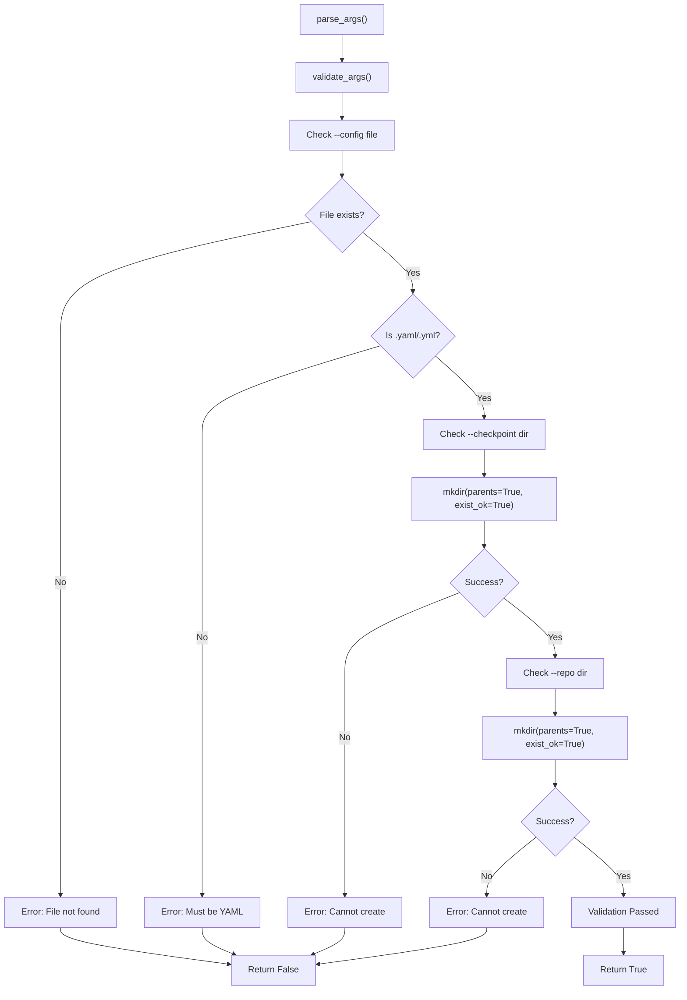
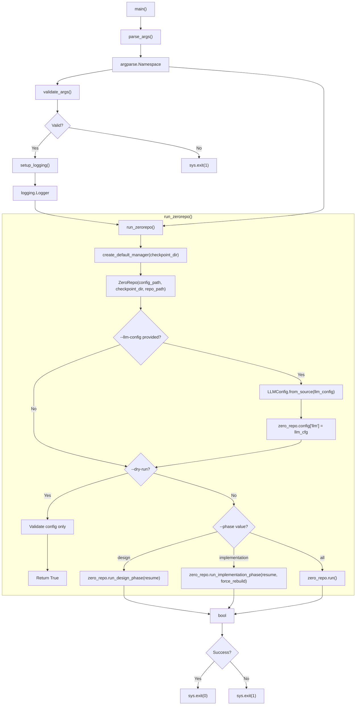
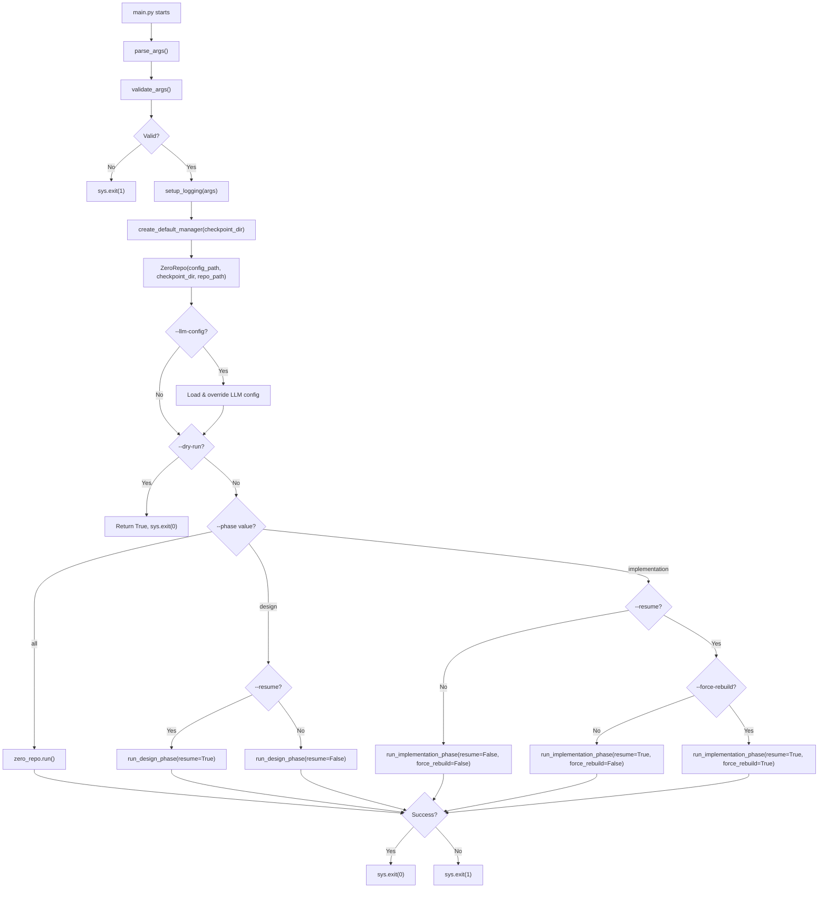
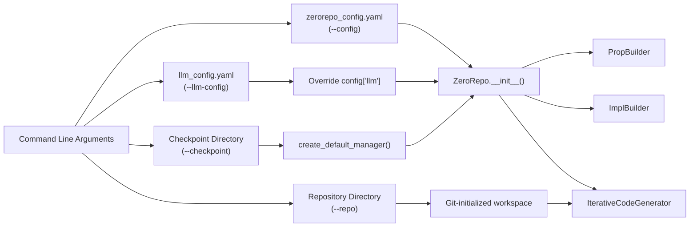

<!-- source: DeepWiki mcp.deepwiki.com · repo microsoft/RPG-ZeroRepo · page 11.1 Command Line Interface · fetched 2026-10-26 -->

# Command Line Interface

<details>
<summary>Relevant source files</summary>

The following files were used as context for generating this wiki page:

- [README.md](README.md)
- [main.py](main.py)

</details>


The Command Line Interface (CLI) serves as the primary entry point for the RPG-ZeroRepo system, exposed through the `main.py` script. This page documents all command-line arguments, their validation, and how they control the three-phase code generation pipeline.

For information about the configuration files referenced by CLI arguments, see [Configuration System](#4). For details on checkpoint files and resume behavior, see [State Management and Checkpointing](#5).

---

## Overview

The CLI is implemented in [main.py:24-131]() through the `parse_args()` function. It provides both required arguments that specify essential paths and optional arguments that control execution behavior, logging, and pipeline phases.

**Sources:** [main.py:1-308]()

---

## Required Arguments

### `--config` / `-c`

**Type:** String (path)  
**Required:** Yes  
**Description:** Path to the main ZeroRepo configuration file in YAML format.

This argument specifies the path to `zerorepo_config.yaml`, which controls:
- LLM settings for design phases (model, provider, API keys)
- Prop-level feature generation parameters
- Impl-level design configuration paths
- Docker container settings
- TRAE agent configuration

**Example:**
```bash
python main.py --config configs/zerorepo_config.yaml ...
```

**Validation:** The file must exist and have a `.yaml` or `.yml` extension ([main.py:138-143]()).

**Sources:** [main.py:55-60](), [README.md:62-74]()

---

### `--checkpoint` / `-k`

**Type:** String (path)  
**Required:** Yes  
**Description:** Directory path for saving intermediate states and checkpoint files.

This directory stores all checkpoint files that enable resume capability:
- `repo_data.json` - Repository metadata, features, and components
- `task_manager_state.json` - Progress tracking across all phases
- `global_repo_rpg.json` - Repository Planning Graph
- `skeleton.json` - File structure designs
- `graph.json` - Interface definitions
- `tasks.json` - Implementation task batches
- Phase-specific trajectory and state files

The directory is created automatically if it doesn't exist ([main.py:146-150]()).

**Example:**
```bash
python main.py --checkpoint ./my_project/checkpoints ...
```

**Sources:** [main.py:62-67](), [README.md:42-48](), [README.md:382-399]()

---

### `--repo` / `-r`

**Type:** String (path)  
**Required:** Yes  
**Description:** Target repository path where generated code will be written.

This directory becomes the workspace for code generation:
- Initialized as a git repository by the system
- Contains the generated source code structure (`src/`, `tests/`, etc.)
- Each code generation step creates git commits with conventional commit messages
- Must NOT be inside an existing git repository to avoid conflicts

The directory is created automatically if it doesn't exist ([main.py:153-157]()).

**Example:**
```bash
python main.py --repo ./my_project/workspace ...
```

**Sources:** [main.py:69-74](), [README.md:38-48](), [README.md:343-350]()

---

## Optional Arguments

### `--log-level` / `-l`

**Type:** Choice (string)  
**Default:** `INFO`  
**Choices:** `DEBUG`, `INFO`, `WARNING`, `ERROR`, `CRITICAL`  
**Description:** Sets the logging verbosity level.

The log level controls which messages are displayed:
- `DEBUG`: Detailed diagnostic information including LLM request/response traces
- `INFO`: General informational messages about pipeline progress
- `WARNING`: Warning messages about potential issues
- `ERROR`: Error messages about failures
- `CRITICAL`: Critical failures that halt execution

**Example:**
```bash
python main.py --log-level DEBUG ...
```

**Sources:** [main.py:77-83](), [main.py:168-182]()

---

### `--log-file`

**Type:** String (path)  
**Default:** None (console output)  
**Description:** Path to a log file for persistent logging.

When specified, log messages are written to the file in addition to console output. Useful for post-execution analysis and debugging.

**Example:**
```bash
python main.py --log-file ./logs/zerorepo.log ...
```

**Sources:** [main.py:85-89]()

---

### `--force-rebuild` / `-f`

**Type:** Boolean flag  
**Default:** False  
**Description:** Forces rebuilding of Docker containers and resets state.

When enabled:
- Docker containers are recreated from the base image
- Existing containers with the same name are removed
- Useful when Docker environment or dependencies have changed

**Example:**
```bash
python main.py --force-rebuild ...
```

**Sources:** [main.py:91-95](), [main.py:245-248]()

---

### `--resume` / `-res`

**Type:** Boolean flag  
**Default:** False  
**Description:** Resumes execution from the last completed checkpoint.

When enabled:
- Reads `task_manager_state.json` to determine completed phases
- Skips already completed design phases (feature selection, skeleton generation, etc.)
- In code generation phase, continues from the next uncompleted task batch
- Failed tasks can be retried

**Example:**
```bash
python main.py --resume ...
```

**Sources:** [main.py:97-101](), [README.md:354-379]()

---

### `--dry-run` / `-d`

**Type:** Boolean flag  
**Default:** False  
**Description:** Validates configuration without executing the pipeline.

When enabled:
- Initializes the ZeroRepo system and validates all configuration files
- Does not execute any LLM calls or code generation
- Useful for testing configuration changes before running expensive operations

**Example:**
```bash
python main.py --dry-run ...
```

**Sources:** [main.py:103-107](), [main.py:216-221]()

---

### `--phase`

**Type:** Choice (string)  
**Default:** `all`  
**Choices:** `all`, `design`, `implementation`  
**Description:** Specifies which portion of the pipeline to execute.

**Phase Options:**

| Phase | Includes | Use Case |
|-------|----------|----------|
| `all` | Phase 1 (Feature Planning) + Phase 2 (Architecture Design) + Phase 3 (Code Generation) | Complete end-to-end generation |
| `design` | Phase 1 + Phase 2 only | Generate RPG and design artifacts without code |
| `implementation` | Phase 3 only | Generate code from existing design artifacts |

**Example:**
```bash
# Generate design artifacts only
python main.py --phase design ...

# Generate code from existing design
python main.py --phase implementation ...
```

**Sources:** [main.py:109-115](), [main.py:237-253]()

---

### `--llm-config`

**Type:** String (path)  
**Default:** None  
**Description:** Path to an LLM configuration file that overrides the `llm` section in the main config.

This argument allows runtime override of LLM settings without modifying the main configuration file. The file can be in YAML or JSON format and follows the `LLMConfig` schema.

When specified:
- Loads LLM configuration from the provided file using `LLMConfig.from_source()`
- Overrides the `llm` section in `zerorepo_config.yaml`
- Useful for switching between different LLM providers or models

**Example:**
```bash
python main.py --llm-config ./configs/llm_config.yaml ...
```

**Sources:** [main.py:117-123](), [main.py:231-235]()

---

### `--version` / `-v`

**Type:** Boolean flag  
**Description:** Displays version information and exits.

**Example:**
```bash
python main.py --version
# Output: ZeroRepo 1.0.0
```

**Sources:** [main.py:125-129]()

---

## Argument Validation

The `validate_args()` function performs validation before pipeline execution:

### Validation Steps



**Diagram: Argument Validation Flow**

### Validation Rules

| Argument | Validation | Error Handling |
|----------|-----------|----------------|
| `--config` | Must exist, must be `.yaml` or `.yml` | Prints error, exits with code 1 |
| `--checkpoint` | Creates directory if missing | Prints error if creation fails |
| `--repo` | Creates directory if missing | Prints error if creation fails |
| `--log-level` | Must be valid Python logging level | Handled by argparse choices |
| `--phase` | Must be `all`, `design`, or `implementation` | Handled by argparse choices |

**Sources:** [main.py:134-166]()

---

## Argument Flow Through System

The following diagram shows how CLI arguments flow through the system components:



**Diagram: Argument Flow from CLI to Execution**

**Sources:** [main.py:202-276](), [main.py:278-304]()

---

## Usage Patterns

### Basic Full Pipeline Execution

```bash
python main.py \
  --config configs/zerorepo_config.yaml \
  --checkpoint ./my_project/checkpoints \
  --repo ./my_project/workspace
```

This runs the complete three-phase pipeline with default settings (INFO logging, all phases).

**Sources:** [README.md:66-74]()

---

### Resume from Checkpoint

```bash
python main.py \
  --config configs/zerorepo_config.yaml \
  --checkpoint ./my_project/checkpoints \
  --repo ./my_project/workspace \
  --resume
```

Continues execution from the last completed stage. Useful after interruption or failure.

**Sources:** [README.md:82]()

---

### Design Phase Only

```bash
python main.py \
  --config configs/zerorepo_config.yaml \
  --checkpoint ./my_project/checkpoints \
  --repo ./my_project/workspace \
  --phase design
```

Executes only Phase 1 (Feature Planning) and Phase 2 (Architecture Design), generating design artifacts without code implementation.

**Sources:** [main.py:238-242]()

---

### Implementation from Existing Design

```bash
python main.py \
  --config configs/zerorepo_config.yaml \
  --checkpoint ./my_project/checkpoints \
  --repo ./my_project/workspace \
  --phase implementation \
  --resume
```

Executes only Phase 3 (Code Generation) using existing design artifacts from `checkpoints/`. Requires `skeleton.json`, `graph.json`, and `tasks.json` to exist.

**Sources:** [main.py:243-249]()

---

### Debug Mode with Detailed Logging

```bash
python main.py \
  --config configs/zerorepo_config.yaml \
  --checkpoint ./my_project/checkpoints \
  --repo ./my_project/workspace \
  --log-level DEBUG \
  --log-file ./logs/debug.log
```

Runs with maximum verbosity, writing detailed logs to a file for debugging LLM interactions and pipeline behavior.

**Sources:** [main.py:77-89]()

---

### Override LLM Configuration at Runtime

```bash
python main.py \
  --config configs/zerorepo_config.yaml \
  --checkpoint ./my_project/checkpoints \
  --repo ./my_project/workspace \
  --llm-config ./configs/llm_config_alternative.yaml
```

Uses an alternative LLM configuration (e.g., different model or provider) without modifying the main config file.

**Sources:** [main.py:231-235]()

---

### Dry Run for Configuration Validation

```bash
python main.py \
  --config configs/zerorepo_config.yaml \
  --checkpoint ./my_project/checkpoints \
  --repo ./my_project/workspace \
  --dry-run
```

Validates all configuration files and initializes the system without executing any LLM calls or code generation. Returns exit code 0 if configuration is valid.

**Sources:** [main.py:216-221]()

---

### Force Rebuild Docker Environment

```bash
python main.py \
  --config configs/zerorepo_config.yaml \
  --checkpoint ./my_project/checkpoints \
  --repo ./my_project/workspace \
  --phase implementation \
  --force-rebuild
```

Recreates Docker containers before code generation. Useful when dependencies or Docker configuration have changed.

**Sources:** [main.py:245-248]()

---

## Execution Flow Based on Arguments

The following diagram shows how different argument combinations affect execution flow:



**Diagram: Execution Flow Based on CLI Arguments**

**Sources:** [main.py:202-276](), [main.py:278-304]()

---

## Environment Variables

While not CLI arguments, certain environment variables are recognized by the system:

### `OPENAI_API_KEY`

Used by the LLM client when OpenAI provider is configured and no explicit API key is provided in configuration files.

**Example:**
```bash
export OPENAI_API_KEY="sk-..."
python main.py --config configs/zerorepo_config.yaml ...
```

**Sources:** [main.py:42-44]()

---

## Exit Codes

The `main.py` script uses standard exit codes to indicate execution status:

| Exit Code | Meaning | When Occurs |
|-----------|---------|-------------|
| `0` | Success | Pipeline completed successfully or dry-run validation passed |
| `1` | Failure | Argument validation failed, configuration error, or pipeline execution failed |

Exit codes are set by `sys.exit()` calls in [main.py:285-304]().

**Sources:** [main.py:278-304]()

---

## Logging Output

The CLI configures logging through `setup_logging()` which produces structured output:

### Standard Output Format

```
============================================================
🚀 ZeroRepo Automated Code Generation System Starting
============================================================
📋 Configuration file: configs/zerorepo_config.yaml
💾 Checkpoint directory: ./checkpoints
📁 Target repository: ./workspace
🔧 Execution phase: all
📊 Log level: INFO
```

### Phase-Specific Messages

The logging system uses emoji indicators for different execution phases:
- 🚀 System initialization
- 🔧 Configuration setup
- 🎨 Design phase execution
- ⚡ Implementation phase execution
- 🔄 Full pipeline execution
- ✅ Successful completion
- ❌ Failure or error
- ⚠️ Warning or user interruption

**Sources:** [main.py:168-200](), [main.py:210-275]()

---

## Command Line Help

The full help text is available via:

```bash
python main.py --help
```

This displays:
- Description of the system
- All arguments with types and defaults
- Example usage patterns
- Supported LLM models

**Sources:** [main.py:24-131]()

---

## Integration with Configuration System

CLI arguments work in conjunction with configuration files:



**Diagram: CLI Integration with Configuration and Execution Components**

**Sources:** [main.py:202-235]()

---

