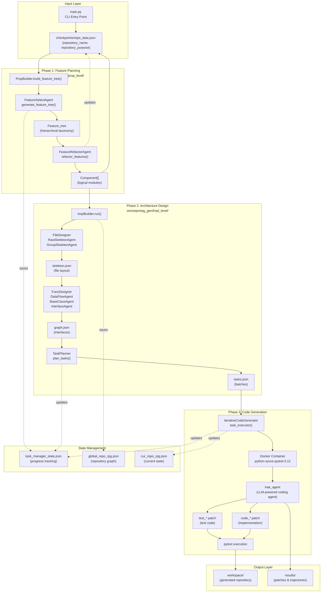
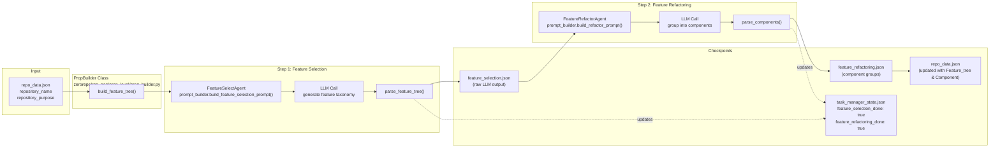
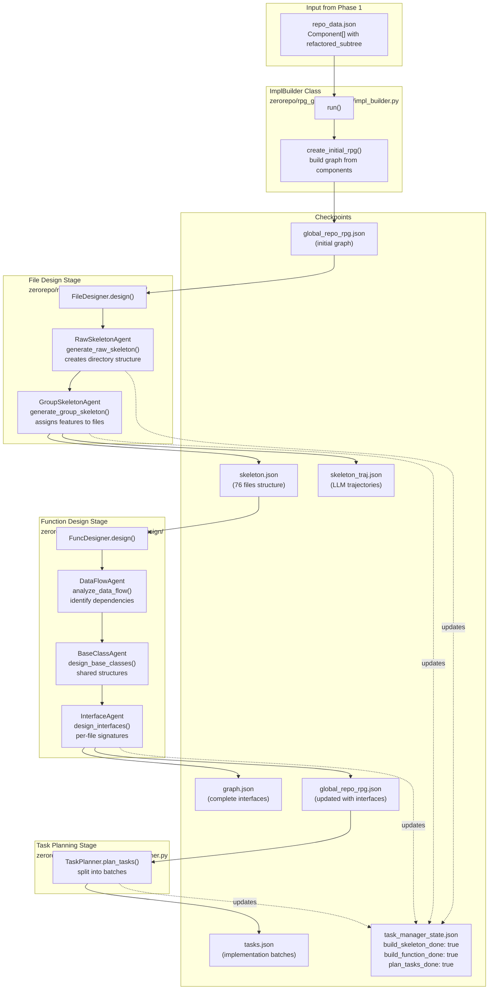
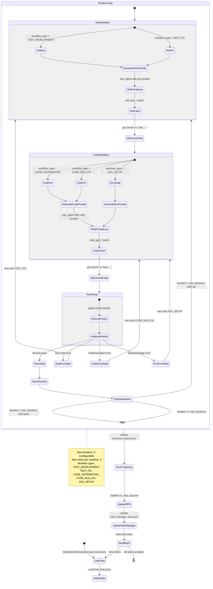
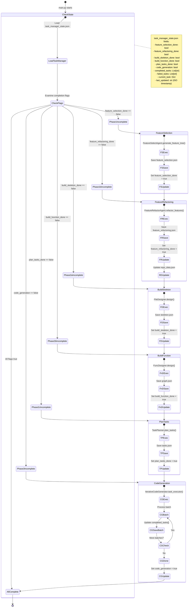
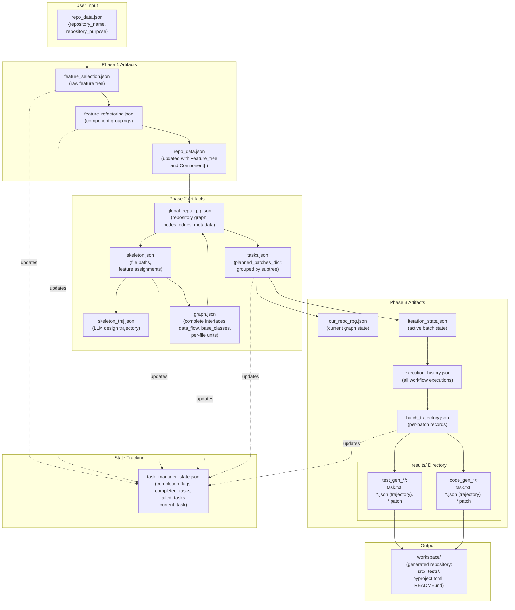

<!-- source: DeepWiki mcp.deepwiki.com · repo microsoft/RPG-ZeroRepo · page 11.2 Pipeline Diagrams · fetched 2026-10-26 -->

# Pipeline Diagrams

<details>
<summary>Relevant source files</summary>

The following files were used as context for generating this wiki page:

- [README.md](README.md)
- [docs/pipeline.png](docs/pipeline.png)
- [docs/rpg_example.png](docs/rpg_example.png)

</details>


This page provides visual reference diagrams for the RPG-ZeroRepo pipeline architecture, showing the complete flow from natural language input to generated code. These diagrams map high-level system concepts to concrete code entities (class names, file names, checkpoint files) to help navigate the codebase.

For configuration details, see [Configuration System](#4). For checkpoint file schemas, see [Checkpoint File Reference](#5.1). For command-line usage, see [Command Line Interface](#11.1).

---

## Pipeline Overview with Code Entities

This diagram shows the complete three-phase pipeline with actual class names and entry points from the codebase.



**Sources:**
- [README.md:98-282]()
- [main.py]() (CLI entry point and orchestration)

---

## Phase 1: Feature Planning Data Flow

This diagram shows how `PropBuilder` transforms natural language descriptions into structured features and components.



**Example Feature Tree Structure:**
```json
{
  "functionality": {
    "game mechanics": ["movement", "collision detection", "scoring"],
    "ai opponent": ["strategy", "training"]
  },
  "algorithm": {
    "pathfinding": ["astar", "bfs flood fill", "monte carlo rollouts"]
  }
}
```

**Example Component Structure:**
```json
{
  "name": "gameplay.core",
  "refactored_subtree": {
    "gameplay": {
      "rules": ["movement", "collision detection"],
      "levels": ["static layout", "procedural generation"]
    }
  }
}
```

**Sources:**
- [README.md:98-173]()
- `zerorepo/rpg_gen/prop_level/prop_builder.py` (PropBuilder class)
- `zerorepo/rpg_gen/prop_level/feature_select_agent.py` (FeatureSelectAgent)
- `zerorepo/rpg_gen/prop_level/feature_refactor_agent.py` (FeatureRefactorAgent)

---

## Phase 2: Architecture Design Pipeline

This diagram shows the detailed flow through `ImplBuilder` and its sub-agents.



**Skeleton Structure Example:**
```json
{
  "src/ai/planning/pathfinding.py": {
    "features": ["astar pathfinding", "bfs flood fill"],
    "dependencies": ["src/data/model/grid.py"]
  }
}
```

**Graph Interface Example:**
```json
{
  "src/io/persistence/serialization.py": {
    "file_code": "class HighScoreBinarySerializer:\n    def serialize(self, entries: List[ScoreEntry]) -> bytes:\n        \"\"\"Serialize high scores to binary format.\"\"\"\n        ...",
    "units": ["class HighScoreBinarySerializer"],
    "units_to_features": {
      "class HighScoreBinarySerializer": ["high score binary serialization"]
    }
  }
}
```

**Sources:**
- [README.md:175-281]()
- `zerorepo/rpg_gen/impl_level/impl_builder.py` (ImplBuilder class)
- `zerorepo/rpg_gen/impl_level/file_design/file_designer.py` (FileDesigner)
- `zerorepo/rpg_gen/impl_level/func_design/func_designer.py` (FuncDesigner)
- `zerorepo/rpg_gen/impl_level/task_planner.py` (TaskPlanner)

---

## Phase 3: Iterative Code Generation Loop

This diagram shows the TDD workflow execution within the Docker container.



**Workflow Type Mapping:**

| Workflow Type | Purpose | Triggered By |
|---------------|---------|--------------|
| `TEST_DEVELOPMENT` | Generate tests from scratch | First iteration or after test validation success |
| `TEST_FIX` | Fix failing test code | Test execution errors (syntax, import failures) |
| `CODE_INCREMENTAL` | Implement code from interfaces | First iteration after test generation |
| `CODE_BUG_FIX` | Fix failing implementation | pytest failures (assertion errors, logic bugs) |
| `ENV_SETUP` | Install packages, fix imports | Import errors, missing dependencies |

**Sources:**
- [README.md:284-352]()
- `zerorepo/code_gen/iterative_code_generator.py` (IterativeCodeGenerator class)
- `zerorepo/code_gen/workflow_types.py` (workflow type definitions)

---

## Checkpoint State Transitions

This diagram shows how `task_manager_state.json` tracks progress and enables resumability.



**Task Manager State Structure:**
```json
{
  "feature_selection_done": true,
  "feature_refactoring_done": true,
  "build_skeleton_done": true,
  "build_function_done": true,
  "plan_tasks_done": true,
  "code_generation": false,
  "completed_tasks": [
    "src_io_persistence_serialization.py_batch1",
    "src_gameplay_rules_movement.py_batch2"
  ],
  "failed_tasks": [],
  "current_task": {
    "task_id": "src_ai_planning_pathfinding.py_batch3",
    "iteration": 2,
    "workflow_type": "CODE_BUG_FIX"
  },
  "last_updated": "2026-02-09T13:56:20.123456"
}
```

**Sources:**
- [README.md:354-380]()
- `checkpoint_config.yaml` (checkpoint schema definitions)
- `zerorepo/checkpoint/task_manager.py` (TaskManager class)

---

## Complete Data Flow and Artifacts

This diagram maps all major data artifacts through the pipeline, showing checkpoint files and their relationships.



**Artifact Dependency Table:**

| Artifact | Producer | Consumer(s) | Contains |
|----------|----------|-------------|----------|
| `repo_data.json` | User input, Phase 1 | Phase 2 | Repository metadata, Feature_tree, Component[] |
| `feature_selection.json` | FeatureSelectAgent | FeatureRefactorAgent | Raw feature taxonomy from LLM |
| `feature_refactoring.json` | FeatureRefactorAgent | PropBuilder | Component decomposition results |
| `global_repo_rpg.json` | ImplBuilder | FuncDesigner, TaskPlanner | Complete repository graph (nodes, edges) |
| `skeleton.json` | FileDesigner | FuncDesigner | File paths, feature-to-file mappings |
| `skeleton_traj.json` | FileDesigner | (logging only) | LLM interaction trajectories for skeleton |
| `graph.json` | FuncDesigner | TaskPlanner | Complete interface design (data flow, base classes, interfaces) |
| `tasks.json` | TaskPlanner | IterativeCodeGenerator | Implementation batches by subtree |
| `cur_repo_rpg.json` | IterativeCodeGenerator | (evaluation tools) | Current RPG state during code generation |
| `iteration_state.json` | IterativeCodeGenerator | IterativeCodeGenerator (resume) | Active batch iteration state |
| `execution_history.json` | IterativeCodeGenerator | (analysis tools) | Flat list of all workflow executions |
| `batch_trajectory.json` | IterativeCodeGenerator | (analysis tools) | Per-batch execution records |
| `task_manager_state.json` | All phases | main.py (resume logic) | Completion flags, task progress |

**Sources:**
- [README.md:383-400]()
- `checkpoint_config.yaml` (complete checkpoint definitions)
- `zerorepo/checkpoint/` (checkpoint management classes)

---

## Docker Execution Context

This diagram shows the containerized execution environment for code generation with actual tool names.

```mermaid
graph TB
    subgraph HostSystem["Host System"]
        ICGHost["IterativeCodeGenerator<br/>(Python process on host)"]
        ConfigHost["configs/trae_config.yaml"]
        TasksHost["checkpoints/tasks.json"]
        ResultsHost["results/<br/>(patches & trajectories)"]
    end
    
    subgraph DockerContainer["Docker Container: python-azure-pytest:3.12"]
        subgraph PythonEnv["Python 3.12 Environment"]
            PyTest["pytest<br/>(testing framework)"]
            CovPy["coverage.py<br/>(code coverage)"]
            Flake8["flake8<br/>(linter)"]
            Black["black<br/>(formatter)"]
            Mypy["mypy<br/>(type checker)"]
        end
        
        subgraph TRAERuntime["TRAE Agent Runtime"]
            TRAEMain["trae_agent main loop"]
            
            subgraph Tools["Agent Tools"]
                BashTool["bash<br/>(shell commands:<br/>git, pytest, pip)"]
                EditTool["str_replace_based_edit_tool<br/>(code editing)"]
                ThinkTool["sequentialthinking<br/>(reasoning mode)"]
                DoneTool["task_done<br/>(completion signal)"]
            end
            
            LLMClient["OpenAI Client<br/>(gpt-5-mini-20250807)"]
            
            TRAEMain --> BashTool
            TRAEMain --> EditTool
            TRAEMain --> ThinkTool
            TRAEMain --> DoneTool
            TRAEMain --> LLMClient
        end
        
        subgraph MountedWorkspace["Mounted Workspace: /tare_workspace"]
            GitRepo["Git Repository<br/>(initialized by host)"]
            SrcFiles["src/**/*.py"]
            TestFiles["tests/**/*.py"]
            PyProject["pyproject.toml"]
        end
    end
    
    ICGHost -->|"1. docker run<br/>--mount workspace"| DockerContainer
    ICGHost -->|"2. execute task"| TRAEMain
    ConfigHost --> TRAEMain
    TasksHost --> TRAEMain
    
    LLMClient -.->|"3. generate test"| EditTool
    EditTool -->|"4. modify files"| TestFiles
    
    BashTool -->|"5. git add & commit"| GitRepo
    
    LLMClient -.->|"6. generate impl"| EditTool
    EditTool -->|"7. modify files"| SrcFiles
    
    BashTool -->|"8. git add & commit"| GitRepo
    BashTool -->|"9. pytest"| PyTest
    PyTest --> TestFiles
    PyTest --> SrcFiles
    
    PyTest -->|"10. test results"| TRAEMain
    TRAEMain -.->|"11. retry if fail"| LLMClient
    
    DoneTool -->|"12. completion"| ICGHost
    GitRepo -->|"13. extract patches"| ResultsHost
```



**TRAE Agent Tool Definitions:**

| Tool | Purpose | Example Usage |
|------|---------|---------------|
| `bash` | Execute shell commands | `git commit -m "test: add tests"`, `pytest tests/`, `pip install requests` |
| `str_replace_based_edit_tool` | Edit files with string replacement | Replace function bodies, add imports, fix syntax errors |
| `sequentialthinking` | Enable chain-of-thought reasoning | Complex logic analysis, multi-step problem decomposition |
| `task_done` | Signal task completion | Called when all tests pass or max retries reached |

**Git Commit Pattern:**
```bash
# Test commit
git add tests/
git commit -m "test: add unit tests for HighScoreBinarySerializer"

# Implementation commit
git add src/
git commit -m "feat: implement HighScoreBinarySerializer binary encoding/decoding"

# Bug fix commit
git add src/
git commit -m "fix: correct deserialization of optional player_name field"
```

**Sources:**
- [README.md:284-352]()
- `Dockerfile` (container environment setup)
- `configs/trae_config.yaml` (TRAE agent configuration)
- `zerorepo/code_gen/docker_executor.py` (Docker orchestration)
- `configs/zerorepo_config.yaml:425-434` (Docker settings)