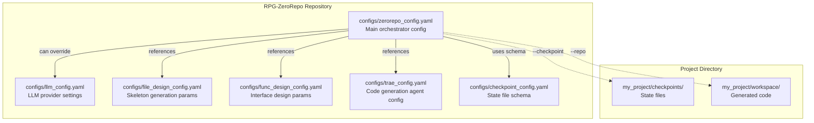
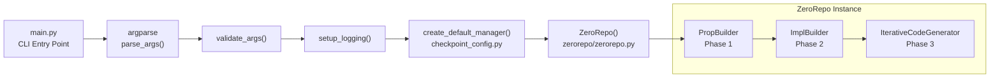
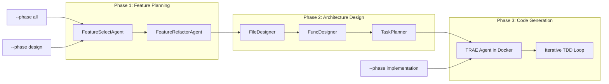
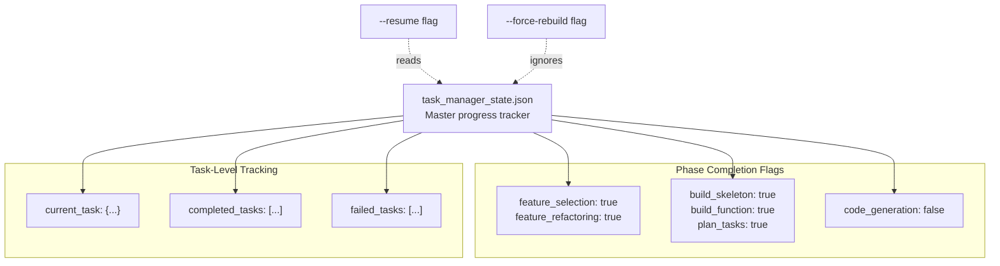

<!-- source: DeepWiki mcp.deepwiki.com · repo microsoft/RPG-ZeroRepo · page 2 Getting Started · fetched 2026-10-26 -->

# Getting Started

<details>
<summary>Relevant source files</summary>

The following files were used as context for generating this wiki page:

- [README.md](README.md)
- [configs/zerorepo_config.yaml](configs/zerorepo_config.yaml)
- [dockerfile/Dockerfile](dockerfile/Dockerfile)
- [main.py](main.py)

</details>


This page guides you through the initial setup required to use RPG-ZeroRepo for automated repository generation. It covers prerequisites, project structure, basic configuration, and executing your first code generation run.

For detailed installation instructions, see [Installation](#2.1). For a complete walkthrough with examples, see [Quick Start Guide](#2.2). For comprehensive configuration documentation, see [Configuration Overview](#2.3) and [Configuration System](#4).

---

## Prerequisites

RPG-ZeroRepo requires the following components to operate:

| Component | Requirement | Purpose |
|-----------|-------------|---------|
| **Python** | 3.11 or higher | Host system runtime |
| **Docker** | Latest stable version | Isolated code generation environment |
| **LLM API Access** | OpenAI, Anthropic, or compatible provider | Powers all AI-driven generation stages |
| **Git** | Any recent version | Version control for generated code |
| **Disk Space** | ~5GB minimum | Docker images and generated repositories |

The system architecture separates the host environment (Python 3.11+) from the code generation environment (Python 3.12 in Docker). The `python-azure-pytest:3.12` Docker image contains all testing and development tools needed for the TRAE agent to operate.

**Sources:** [README.md:1-50](), [dockerfile/Dockerfile:1-32]()

---

## Project Directory Structure

RPG-ZeroRepo operates on a project directory that **must not** be inside an existing git repository, as the system uses git internally to track implementation steps in the `workspace/` directory.

### Required Directory Layout

```
my_project/                     # Project root (NOT inside a git repo)
├── checkpoints/                # Design artifacts and pipeline state
│   ├── repo_data.json         # Input: project description (you create)
│   ├── task_manager_state.json # Auto-generated: progress tracking
│   ├── global_repo_rpg.json   # Auto-generated: repository planning graph
│   ├── skeleton.json          # Auto-generated: file layout design
│   ├── graph.json             # Auto-generated: interface definitions
│   └── tasks.json             # Auto-generated: implementation batches
└── workspace/                  # Generated repository (auto-initialized as git repo)
    ├── src/                    # Generated source code
    ├── tests/                  # Generated test files
    ├── pyproject.toml          # Generated project metadata
    └── README.md               # Generated documentation
```

### Directory Creation

```bash
# Create project structure
mkdir -p my_project/checkpoints my_project/workspace
cd my_project
```

The `checkpoints/` directory stores all intermediate design artifacts and state files that enable resumability. The `workspace/` directory becomes the generated repository with a git history tracking each implementation step.

**Sources:** [README.md:36-95](), [main.py:62-74]()

---

## Input Specification: repo_data.json

Create `checkpoints/repo_data.json` with your project description:

```json
{
  "repository_name": "SnakeGame",
  "repository_purpose": "A multiplayer snake game with AI opponents, pathfinding algorithms (A*, BFS), replay recording, and persistent high score storage using binary serialization."
}
```

| Field | Type | Description |
|-------|------|-------------|
| `repository_name` | string | Project identifier used for directory and module naming |
| `repository_purpose` | string | Natural language description of desired functionality |

The `repository_purpose` field drives the entire generation pipeline:
- **Phase 1** extracts a feature taxonomy from this description
- **Phase 2** designs file layouts and interfaces based on features
- **Phase 3** implements code to fulfill the described purpose

The more detailed your description, the more comprehensive the generated repository. Include specific algorithms, data structures, features, and architectural requirements.

**Sources:** [README.md:51-58](), [README.md:152-172]()

---

## Configuration Files Overview

The following diagram shows the configuration hierarchy and where each file is located:

**Configuration File Structure**



### Essential Configuration Files

| File | Location | Purpose |
|------|----------|---------|
| `zerorepo_config.yaml` | `configs/` | Main pipeline settings: LLM model, phase parameters, Docker settings |
| `trae_config.yaml` | `configs/` | TRAE agent configuration: tools, model, execution limits |
| `llm_config.yaml` | `configs/` (optional) | Override LLM settings from command line with `--llm-config` |

### Minimal Configuration Setup

Edit `configs/zerorepo_config.yaml` to set your LLM provider:

```yaml
llm:
  model: "gpt-5-mini-20250807"
  provider: "openai"
  api_key: "sk-..."
  temperature: 0.0
```

Edit `configs/trae_config.yaml` to configure the code generation agent:

```yaml
model_providers:
  openai:
    provider: openai
    api_key: "sk-..."

models:
  trae_agent_model:
    model_provider: openai
    model: gpt-5-mini-20250807
    max_completion_tokens: 16134
```

Both configuration files require valid API credentials. You can also set the `OPENAI_API_KEY` environment variable instead of storing keys in configuration files.

**Sources:** [configs/zerorepo_config.yaml:1-73](), [README.md:405-459](), [main.py:117-123]()

---

## Running Your First Generation

The following diagram shows how the `main.py` CLI entry point orchestrates the pipeline:

**CLI to System Components Flow**



### Basic Execution Command

```bash
python main.py \
  --config configs/zerorepo_config.yaml \
  --checkpoint ../my_project/checkpoints \
  --repo ../my_project/workspace \
  --phase all \
  --resume
```

### Command-Line Arguments Reference

| Argument | Short | Required | Description |
|----------|-------|----------|-------------|
| `--config` | `-c` | Yes | Path to `zerorepo_config.yaml` |
| `--checkpoint` | `-k` | Yes | Directory for state files (e.g., `my_project/checkpoints`) |
| `--repo` | `-r` | Yes | Target directory for generated code (e.g., `my_project/workspace`) |
| `--phase` | | No | Execution scope: `all` (default), `design`, `implementation` |
| `--resume` | `-res` | No | Skip completed phases, continue from last checkpoint |
| `--force-rebuild` | `-f` | No | Rebuild Docker containers, reset state |
| `--llm-config` | | No | Override LLM settings with external config file |
| `--log-level` | `-l` | No | Logging verbosity: `DEBUG`, `INFO`, `WARNING`, `ERROR`, `CRITICAL` |
| `--dry-run` | `-d` | No | Validate configuration without executing pipeline |

### Execution Phases

The `--phase` argument controls which parts of the pipeline execute:



- **`all`**: Executes the complete pipeline from feature planning through code generation
- **`design`**: Runs Phase 1 (feature planning) and Phase 2 (architecture design), stops before code generation
- **`implementation`**: Assumes design artifacts exist in `checkpoints/`, runs only Phase 3 (code generation)

**Sources:** [main.py:24-131](), [main.py:202-276](), [README.md:66-83]()

---

## Understanding the Output

After successful execution, your project directory contains:

### Checkpoint Directory Contents

```
checkpoints/
├── repo_data.json              # Updated with Feature_tree and Component fields
├── task_manager_state.json     # Progress tracking: completed/failed tasks
├── feature_selection.json      # Phase 1: Raw feature taxonomy
├── feature_refactoring.json    # Phase 1: Component decomposition
├── global_repo_rpg.json        # Phase 2: Full repository planning graph
├── skeleton.json               # Phase 2: File layout with 76+ files
├── skeleton_traj.json          # Phase 2: LLM interaction logs for skeleton
├── graph.json                  # Phase 2: Complete interface definitions
├── tasks.json                  # Phase 2: Implementation task batches
├── cur_repo_rpg.json           # Phase 3: Current RPG state during generation
├── batch_trajectory.json       # Phase 3: Per-batch execution records
├── execution_history.json      # Phase 3: Flat list of all workflow executions
└── iteration_state.json        # Phase 3: Active iteration state
```

### Workspace Directory Contents

```
workspace/
├── .git/                       # Git repository with commit history
├── src/                        # Source code organized by component
│   ├── ai/
│   │   ├── pathfinding.py
│   │   └── opponent/
│   ├── gameplay/
│   │   ├── rules/
│   │   └── levels/
│   ├── data/
│   └── network/
├── tests/                      # Mirror structure of src/
│   ├── test_ai/
│   ├── test_gameplay/
│   └── ...
├── pyproject.toml              # Python project metadata
├── README.md                   # Generated documentation
└── requirements.txt            # Dependency list
```

### Git History

The `workspace/` directory is initialized as a git repository. Each code generation step creates commits:

```
test: add unit tests for HighScoreBinarySerializer
feat: implement HighScoreBinarySerializer binary encoding/decoding
test: add tests for PathfindingEngine A* algorithm
feat: implement PathfindingEngine with A* and BFS
fix: correct deserialization of optional player_name field
```

This commit history provides full traceability of the generation process and enables rollback if needed.

**Sources:** [README.md:84-95](), [README.md:383-400](), [README.md:342-351]()

---

## Resume and Recovery

The checkpoint system enables resumability at multiple granularities:

**Checkpoint System Architecture**



### Resume Behavior

When `--resume` is specified, `main.py` loads `task_manager_state.json` to determine which stages are complete:

- **Phase-level resume**: If Phase 1 is complete, skip feature selection and refactoring
- **Task-level resume**: Within Phase 3, skip completed implementation batches
- **Failure recovery**: Retry failed tasks from the point of failure

### Force Rebuild

The `--force-rebuild` flag ignores all checkpoints and restarts from scratch:

```bash
python main.py \
  --config configs/zerorepo_config.yaml \
  --checkpoint ../my_project/checkpoints \
  --repo ../my_project/workspace \
  --force-rebuild
```

This also rebuilds Docker containers, useful when updating the execution environment or resolving persistent errors.

**Sources:** [README.md:354-380](), [main.py:91-101](), [main.py:237-249]()

---

## Docker Environment Verification

The code generation phase executes inside a Docker container with the following environment:

| Component | Version | Purpose |
|-----------|---------|---------|
| **Base Image** | `python:3.12` | Runtime environment |
| **Azure CLI** | Latest | Azure authentication support |
| **pytest** | + plugins | Test execution framework |
| **coverage** | Latest | Code coverage measurement |
| **flake8, black, isort, mypy** | Latest | Code quality and type checking |
| **azure-identity** | Latest | Azure SDK authentication |
| **openai** | Latest | LLM API client |

The `python-azure-pytest:3.12` image must be built before first execution. The system handles this automatically, or you can build manually:

```bash
cd dockerfile
docker build -t python-azure-pytest:3.12 .
```

The container mounts `workspace/` at `/tare_workspace` for the TRAE agent to access and modify generated code.

**Sources:** [dockerfile/Dockerfile:1-32](), [configs/zerorepo_config.yaml:54-61]()

---

## Example Execution Output

When running the pipeline, you'll see log output like:

```
============================================================
🚀 ZeroRepo Automated Code Generation System Starting
============================================================
📋 Configuration file: configs/zerorepo_config.yaml
💾 Checkpoint directory: ../my_project/checkpoints
📁 Target repository: ../my_project/workspace
🔧 Execution phase: all
📊 Log level: INFO
⏯️ Resume mode enabled
============================================================
🔧 Initializing ZeroRepo system...
📋 Setting up global checkpoint manager: ../my_project/checkpoints
🔄 Executing full pipeline...
[Phase 1] Feature Planning starting...
[Phase 1] FeatureSelectAgent: Generating feature tree...
[Phase 1] FeatureRefactorAgent: Grouping into components...
[Phase 2] Architecture Design starting...
[Phase 2] FileDesigner: Creating file layout...
[Phase 2] FuncDesigner: Designing interfaces...
[Phase 2] TaskPlanner: Splitting into implementation batches...
[Phase 3] Code Generation starting...
[Phase 3] Task 1/25: src/ai/pathfinding.py...
[Phase 3] Task 2/25: src/gameplay/rules/movement.py...
...
============================================================
🎉 ZeroRepo execution completed successfully!
📁 Generated code saved in: ../my_project/workspace
💾 Intermediate files saved in: ../my_project/checkpoints
============================================================
```

The entire process can take 30 minutes to several hours depending on repository size and LLM response times.

**Sources:** [main.py:183-200](), [main.py:252-265]()

---

## Next Steps

You now have the foundational knowledge to run RPG-ZeroRepo. Continue with:

- **[Installation](#2.1)** - Detailed installation procedures, dependency management, and troubleshooting
- **[Quick Start Guide](#2.2)** - Step-by-step walkthrough with a complete example project
- **[Configuration Overview](#2.3)** - Understanding the configuration hierarchy and customization options

For deeper understanding of the system:

- **[Core Pipeline](#3)** - Detailed explanation of the three-phase architecture
- **[Configuration System](#4)** - Comprehensive configuration reference
- **[State Management and Checkpointing](#5)** - Advanced checkpoint manipulation and recovery strategies

**Sources:** [README.md:21-31]()

---

