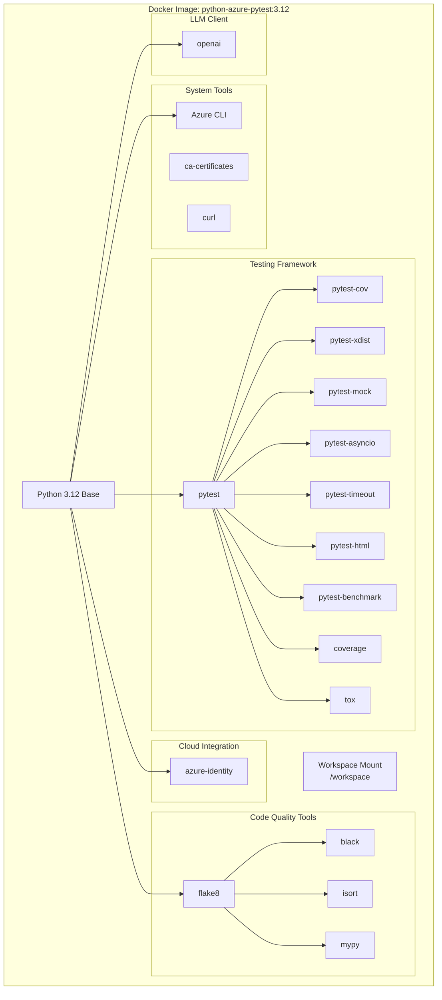
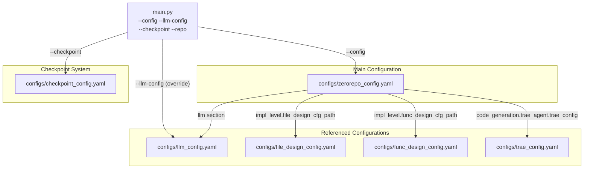

<!-- source: DeepWiki mcp.deepwiki.com · repo microsoft/RPG-ZeroRepo · page 2.1 Installation · fetched 2026-10-26 -->

# Installation

<details>
<summary>Relevant source files</summary>

The following files were used as context for generating this wiki page:

- [.gitignore](.gitignore)
- [README.md](README.md)
- [dockerfile/Dockerfile](dockerfile/Dockerfile)

</details>


This page provides detailed instructions for installing and configuring RPG-ZeroRepo, including Docker environment setup, Python dependencies, and initial configuration. After completing these steps, you will be ready to generate your first repository using the three-phase pipeline.

For instructions on running your first generation, see [Quick Start Guide](#2.2). For a comprehensive overview of the configuration system, see [Configuration Overview](#2.3).

---

## Prerequisites

RPG-ZeroRepo requires the following software to be installed on your host system:

| Component | Version | Purpose |
|-----------|---------|---------|
| Python | 3.11+ | Host-side pipeline orchestration |
| Docker | 20.10+ | Containerized code generation environment |
| Git | 2.30+ | Version control and workspace tracking |
| Bash | 4.0+ | Script execution |

**Sources:** [README.md:4](), [README.md:38-39]()

---

## Installation Workflow

The following diagram illustrates the complete installation process from prerequisites through verification:

**Installation Process Flow**

```mermaid
graph TB
    Start[Start Installation]
    
    subgraph "1. Prerequisites"
        CheckPython["Check Python 3.11+"]
        CheckDocker["Check Docker 20.10+"]
        CheckGit["Check Git 2.30+"]
    end
    
    subgraph "2. Docker Setup"
        CloneRepo["Clone Repository"]
        BuildImage["Build Docker Image<br/>python-azure-pytest:3.12"]
        VerifyImage["Verify Image"]
    end
    
    subgraph "3. Python Environment"
        CreateVenv["Create Virtual Environment<br/>(Optional)"]
        InstallDeps["Install Host Dependencies<br/>pip install -r requirements.txt"]
    end
    
    subgraph "4. Project Structure"
        CreateProjectDir["Create Project Directory<br/>Outside Git Repos"]
        CreateCheckpoints["Create checkpoints/"]
        CreateWorkspace["Create workspace/"]
        CreateRepoData["Write repo_data.json"]
    end
    
    subgraph "5. Configuration"
        CopyConfigs["Copy Config Templates"]
        SetAPIKeys["Configure LLM API Keys"]
        EditZeroRepo["Edit zerorepo_config.yaml"]
        EditTRAE["Edit trae_config.yaml"]
    end
    
    subgraph "6. Verification"
        TestDocker["Test Docker Container"]
        TestPython["Test Python Imports"]
        DryRun["Run with --dry-run"]
    end
    
    Start --> CheckPython
    CheckPython --> CheckDocker
    CheckDocker --> CheckGit
    CheckGit --> CloneRepo
    
    CloneRepo --> BuildImage
    BuildImage --> VerifyImage
    VerifyImage --> CreateVenv
    
    CreateVenv --> InstallDeps
    InstallDeps --> CreateProjectDir
    
    CreateProjectDir --> CreateCheckpoints
    CreateCheckpoints --> CreateWorkspace
    CreateWorkspace --> CreateRepoData
    
    CreateRepoData --> CopyConfigs
    CopyConfigs --> SetAPIKeys
    SetAPIKeys --> EditZeroRepo
    EditZeroRepo --> EditTRAE
    
    EditTRAE --> TestDocker
    TestDocker --> TestPython
    TestPython --> DryRun
    DryRun --> Complete[Installation Complete]
```



**Sources:** [README.md:34-95](), [dockerfile/Dockerfile:1-32]()

---

## Docker Environment Setup

### Building the Container Image

The code generation phase (Phase 3) executes inside a Docker container with a complete Python development environment. Build the image from the provided Dockerfile:

```bash
cd dockerfile
docker build -t python-azure-pytest:3.12 .
```

### Container Components

The Docker image includes the following tools and libraries:

**Container Architecture**



**Installed Packages:**

| Category | Packages | Purpose |
|----------|----------|---------|
| Testing | `pytest`, `pytest-cov`, `pytest-xdist`, `pytest-mock`, `pytest-asyncio`, `pytest-timeout`, `pytest-html`, `pytest-benchmark`, `coverage`, `tox` | Test execution and coverage measurement |
| Code Quality | `flake8`, `black`, `isort`, `mypy` | Linting, formatting, type checking |
| Azure | `azure-identity` | Azure SDK authentication |
| LLM | `openai` | OpenAI API client for TRAE agent |

**Sources:** [dockerfile/Dockerfile:1-32]()

### Verifying the Docker Image

Test that the container can start and has the required tools:

```bash
# Verify container can start
docker run --rm python-azure-pytest:3.12 python --version

# Verify pytest installation
docker run --rm python-azure-pytest:3.12 pytest --version

# Verify Azure CLI
docker run --rm python-azure-pytest:3.12 az --version
```

**Sources:** [dockerfile/Dockerfile:1-32]()

---

## Host System Dependencies

The host system runs the main pipeline orchestrator (`main.py`) and needs Python packages for:
- LLM API clients
- Configuration parsing
- Checkpoint management
- Docker SDK for Python

### Installation Steps

1. **Clone the repository:**
   ```bash
   git clone https://github.com/microsoft/RPG-ZeroRepo.git
   cd RPG-ZeroRepo
   ```

2. **Create a virtual environment (recommended):**
   ```bash
   python -m venv venv
   source venv/bin/activate  # On Windows: venv\Scripts\activate
   ```

3. **Install dependencies:**
   ```bash
   pip install -r requirements.txt
   ```

**Note:** The exact dependencies are not provided in the codebase files reviewed, but would typically include:
- `pyyaml` - Configuration file parsing
- `docker` - Docker SDK for container management
- `openai` or other LLM client libraries
- `jsonschema` - Configuration validation
- Standard libraries for the pipeline components

**Sources:** [README.md:1-6]()

---

## Project Directory Structure

Create a project directory **outside any existing Git repository**. ZeroRepo initializes `workspace/` as a Git repository to track code generation history, which conflicts with nested repositories.

### Directory Layout

```
my_project/                      # Project root (NOT inside a git repo)
├── checkpoints/                 # Pipeline state & design artifacts
│   ├── repo_data.json          # [REQUIRED] Project description (you create this)
│   ├── task_manager_state.json # Auto-generated progress tracker
│   ├── feature_selection.json  # Phase 1 output
│   ├── feature_refactoring.json
│   ├── global_repo_rpg.json    # Phase 2 RPG graph
│   ├── skeleton.json           # File layout design
│   ├── graph.json              # Interface design
│   ├── tasks.json              # Implementation batches
│   ├── cur_repo_rpg.json       # Phase 3 current state
│   ├── batch_trajectory.json   # Execution records
│   ├── execution_history.json  # Workflow history
│   └── iteration_state.json    # Current iteration
│
├── workspace/                   # Generated repository (auto-initialized as git repo)
│   ├── .git/                   # Auto-created by Phase 3
│   ├── src/                    # Generated source code
│   ├── tests/                  # Generated tests
│   ├── pyproject.toml          # Auto-generated
│   └── README.md               # Auto-generated
│
└── results/                     # TRAE agent outputs (optional)
    ├── test_gen_*/             # Test generation trajectories
    └── code_gen_*/             # Code generation trajectories
```

### Creating the Structure

```bash
# Create project directory (OUTSIDE any git repo)
mkdir -p my_project/checkpoints my_project/workspace

# Create the required repo_data.json
cat > my_project/checkpoints/repo_data.json << 'EOF'
{
  "repository_name": "MyProject",
  "repository_purpose": "A brief description of what your project should do. Be specific about features, algorithms, and requirements."
}
EOF
```

**Sources:** [README.md:36-58](), [README.md:385-399]()

---

## Configuration Files

RPG-ZeroRepo uses a hierarchical configuration system with four main files:

**Configuration File Relationships**



**Sources:** [README.md:404-458]()

### Primary Configuration: zerorepo_config.yaml

This file orchestrates the entire pipeline. Key sections to configure:

```yaml
# LLM settings for design phases (Phase 1 & 2)
llm:
  model: "gpt-5-mini-20250807"      # Or your preferred model
  provider: "openai"                 # Or "azure", "anthropic", etc.
  api_key: "${OPENAI_API_KEY}"      # Use environment variable

# Phase 1: Feature Planning
prop_level:
  feature_selection:
    mode: "simple"                   # "simple" or "feature"
  feature_refactoring:
    refactor_max_iterations: 40

# Phase 2: Architecture Design
impl_level:
  file_design_cfg_path: "configs/file_design_config.yaml"
  func_design_cfg_path: "configs/func_design_config.yaml"

# Phase 3: Code Generation
code_generation:
  docker:
    image: "python-azure-pytest:3.12"
    container_name: "zerorepo_container"
    workspace: "/workspace"
  trae_agent:
    trae_config: "configs/trae_config.yaml"
    max_iterations: 5
    max_retries_per_workflow: 3
```

**Sources:** [README.md:405-434]()

### TRAE Agent Configuration: trae_config.yaml

Controls the LLM-powered coding agent that runs inside Docker:

```yaml
# LLM provider configuration
model_providers:
  openai:
    provider: openai
    api_key: "${OPENAI_API_KEY}"

# Model settings for the coding agent
models:
  trae_agent_model:
    model_provider: openai
    model: gpt-5-mini-20250807
    max_completion_tokens: 16134
    temperature: 0.0
    reasoning_effort: high            # For o1 series models

# Agent configuration
agents:
  trae_agent:
    model: trae_agent_model
    max_steps: 300
    tools:
      - bash                          # Shell command execution
      - str_replace_based_edit_tool   # Code editing
      - sequentialthinking            # Complex reasoning
      - task_done                     # Completion signal
```

**Sources:** [README.md:436-458]()

### API Key Management

Set API keys as environment variables to avoid committing them:

```bash
# Add to ~/.bashrc or ~/.zshrc
export OPENAI_API_KEY="sk-..."
export AZURE_OPENAI_API_KEY="..."  # If using Azure
```

Or create a `.env` file (add to `.gitignore`):

```bash
OPENAI_API_KEY=sk-...
AZURE_OPENAI_API_KEY=...
```

**Sources:** [.gitignore:12](), [README.md:410-414]()

---

## Verification Steps

After installation, verify the setup:

### 1. Test Docker Container

```bash
# Start container with mounted workspace
docker run --rm -v $(pwd)/my_project/workspace:/workspace \
  python-azure-pytest:3.12 \
  bash -c "python --version && pytest --version && az --version"
```

Expected output:
```
Python 3.12.x
pytest 8.x.x
azure-cli 2.x.x
```

### 2. Test Python Environment

```bash
cd RPG-ZeroRepo
python -c "import yaml, json; print('Configuration modules loaded successfully')"
```

### 3. Validate Configuration

```bash
python main.py --version
```

### 4. Dry Run Test

```bash
python main.py \
  --config configs/zerorepo_config.yaml \
  --checkpoint my_project/checkpoints \
  --repo my_project/workspace \
  --dry-run
```

This validates configuration files without starting the pipeline.

**Sources:** [README.md:66-82]()

---

## Post-Installation Checklist

Before running your first repository generation, ensure:

| Step | Verification Command | Expected Result |
|------|---------------------|-----------------|
| Docker image built | `docker images | grep python-azure-pytest` | Image listed with tag 3.12 |
| Python version | `python --version` | Python 3.11 or higher |
| Host dependencies | `python -c "import yaml"` | No import errors |
| Project structure | `ls my_project/checkpoints/repo_data.json` | File exists |
| Configuration files | `ls configs/*.yaml` | All config files present |
| API keys set | `echo $OPENAI_API_KEY` | Key value displayed |
| Docker can access workspace | `docker run --rm -v $(pwd)/my_project/workspace:/workspace python-azure-pytest:3.12 ls /workspace` | Directory listing |

**Sources:** [README.md:34-95]()

---

## Troubleshooting

### Common Installation Issues

**Docker build fails:**
- Ensure Docker daemon is running: `docker ps`
- Check network connectivity for package downloads
- Verify sufficient disk space: `docker system df`

**Python import errors:**
- Verify virtual environment is activated
- Reinstall dependencies: `pip install --force-reinstall -r requirements.txt`

**Permission errors on workspace mount:**
- Ensure the workspace directory has correct permissions
- On Linux, the container runs as root; files may need ownership adjustment

**API key not recognized:**
- Verify environment variables are exported in current shell
- Check for leading/trailing whitespace in `.env` files
- Restart terminal after adding to `.bashrc`/`.zshrc`

**Sources:** [README.md:38-39](), [dockerfile/Dockerfile:1-32]()

---

## Next Steps

With installation complete, you are ready to:

1. **[Quick Start Guide](#2.2)** - Run your first repository generation
2. **[Configuration Overview](#2.3)** - Customize pipeline behavior
3. **[Command Line Interface](#11.1)** - Learn all CLI options

**Sources:** [README.md:23-31]()

---

