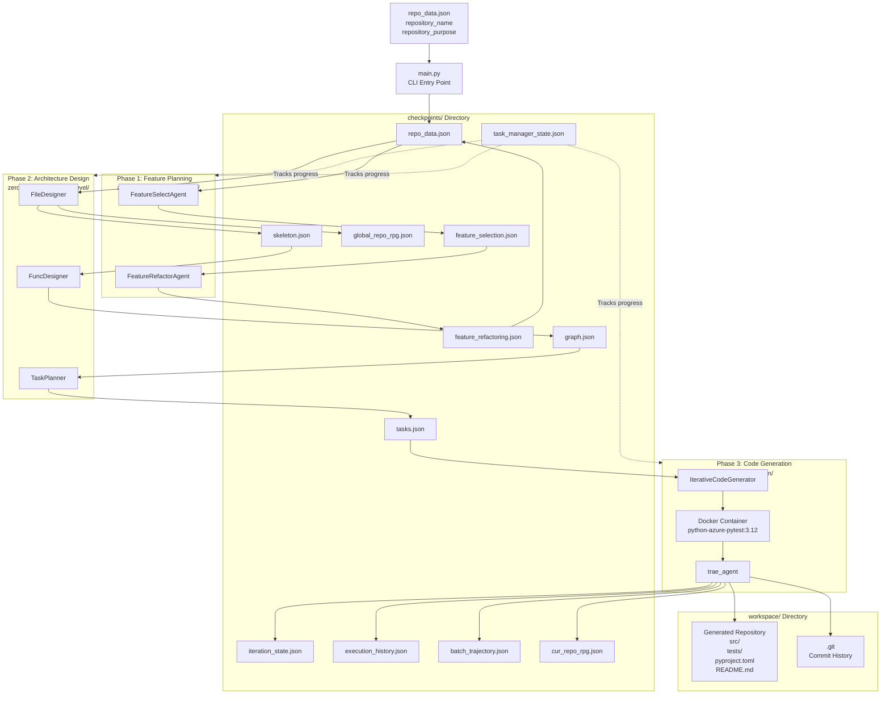
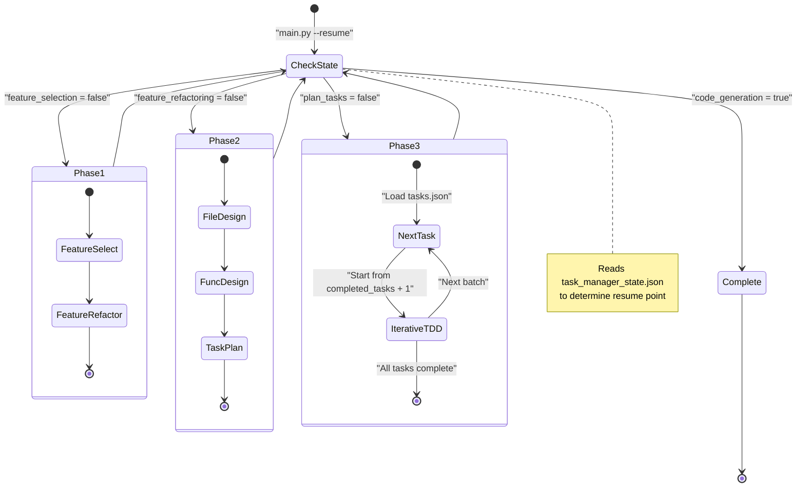

<!-- source: DeepWiki mcp.deepwiki.com · repo microsoft/RPG-ZeroRepo · page 2.2 Quick Start Guide · fetched 2026-10-26 -->

# Quick Start Guide

<details>
<summary>Relevant source files</summary>

The following files were used as context for generating this wiki page:

- [README.md](README.md)
- [configs/zerorepo_config.yaml](configs/zerorepo_config.yaml)
- [main.py](main.py)

</details>


## Purpose and Scope

This guide walks you through generating your first repository with RPG-ZeroRepo using the command-line interface. By the end, you will have executed the complete three-phase pipeline to transform a natural language project description into a functional codebase with tests.

**Prerequisites:** Before following this guide, ensure you have completed the installation steps described in [Installation](#2.1). For detailed configuration options, see [Configuration Overview](#2.3). For information about the checkpoint system and resuming execution, see [State Management and Checkpointing](#5).

---

## Directory Structure Setup

RPG-ZeroRepo requires a specific directory structure **outside of any existing git repository**. The system uses git internally to track code generation steps in `workspace/`, so placing it inside an existing repository will cause conflicts.

### Required Structure

```
my_project/                  # Must NOT be inside a git repo
├── checkpoints/             # Stores pipeline state & design artifacts
│   └── repo_data.json       # Your initial project description (required)
└── workspace/               # Generated repository (auto-created)
```

### Creating the Structure

```bash
# Create a directory outside any git repository
mkdir -p my_project/checkpoints my_project/workspace
cd my_project
```

**Sources:** [README.md:36-49]()

---

## Step 1: Define Your Project

Create `checkpoints/repo_data.json` with your project description. This file is the only required input to start the pipeline.

### Basic Template

```json
{
  "repository_name": "YourProjectName",
  "repository_purpose": "A detailed description of what the project should do, including key features and requirements."
}
```

### Example: Multiplayer Snake Game

```json
{
  "repository_name": "SnakeGame",
  "repository_purpose": "A multiplayer snake game with AI opponents, pathfinding algorithms (A*, BFS, Monte Carlo), replay recording, persistent high scores using binary serialization, and real-time network synchronization."
}
```

**Key Points:**
- `repository_name`: Will become the top-level directory name in `workspace/`
- `repository_purpose`: Should be detailed and specific about features, algorithms, and requirements
- The LLM will use this description to generate the feature tree in Phase 1

**Sources:** [README.md:51-58]()

---

## Step 2: Configure LLM Settings

Edit `configs/zerorepo_config.yaml` to set your LLM provider and authentication. The configuration file controls settings for both the design phases (Phases 1 & 2) and the code generation phase (Phase 3).

### Main Configuration File

**File:** `configs/zerorepo_config.yaml`

```yaml
llm:
  model: "gpt-5-mini-20250807"
  provider: "openai"
  api_key: "your-api-key-here"  # Or set OPENAI_API_KEY environment variable
  max_tokens: 32268
  temperature: 0.0
  reasoning_effort: "medium"
```

### TRAE Agent Configuration

The code generation agent (Phase 3) uses a separate configuration file.

**File:** `configs/trae_config.yaml`

```yaml
model_providers:
  openai:
    provider: openai
    api_key: "your-api-key-here"  # Or use environment variable

models:
  trae_agent_model:
    model_provider: openai
    model: gpt-5-mini-20250807
    max_completion_tokens: 16134
    temperature: 0.0

agents:
  trae_agent:
    model: trae_agent_model
    max_steps: 300
```

**Environment Variables (Recommended):**
```bash
export OPENAI_API_KEY="your-api-key-here"
```

**Sources:** [README.md:60-62](), [configs/zerorepo_config.yaml:7-17](), [README.md:436-458]()

---

## Step 3: Run the Pipeline

### Basic Execution

Navigate to the RPG-ZeroRepo repository root and run:

```bash
python main.py \
  --config configs/zerorepo_config.yaml \
  --checkpoint ../my_project/checkpoints \
  --repo ../my_project/workspace \
  --phase all \
  --resume
```

### Command-Line Arguments Reference

| Argument | Short | Required | Description |
|----------|-------|----------|-------------|
| `--config` | `-c` | ✓ | Path to `zerorepo_config.yaml` |
| `--checkpoint` | `-k` | ✓ | Directory for intermediate state files |
| `--repo` | `-r` | ✓ | Target directory for generated code |
| `--phase` | | | `all` (default), `design`, or `implementation` |
| `--resume` | `-res` | | Resume from last checkpoint |
| `--force-rebuild` | `-f` | | Rebuild Docker containers and reset state |
| `--log-level` | `-l` | | `DEBUG`, `INFO` (default), `WARNING`, `ERROR`, `CRITICAL` |
| `--log-file` | | | Save logs to file (default: console only) |
| `--dry-run` | `-d` | | Validate configuration without execution |
| `--llm-config` | | | Override LLM settings from separate file |

**Sources:** [main.py:54-131](), [README.md:64-83]()

---

## Pipeline Execution Flow

### Overview Diagram



**Key Entry Points:**
- **main.py:** CLI entry point, argument parsing, pipeline orchestration
- **ZeroRepo.run():** Main pipeline executor
- **PropBuilder.build_feature_tree():** Phase 1 entry
- **ImplBuilder.run():** Phase 2 entry
- **IterativeCodeGenerator.task_executor():** Phase 3 entry

**Sources:** [main.py:1-307](), [README.md:34-96]()

---

## Step 4: Monitor Progress

### Console Output

The system provides real-time progress information:

```
🚀 ZeroRepo Automated Code Generation System Starting
============================================================
📋 Configuration file: configs/zerorepo_config.yaml
💾 Checkpoint directory: ../my_project/checkpoints
📁 Target repository: ../my_project/workspace
🔧 Execution phase: all
📊 Log level: INFO
⏯️ Resume mode enabled
============================================================

🔧 Initializing ZeroRepo system...
📋 Setting up global checkpoint manager: ../my_project/checkpoints

🎨 Executing Phase 1: Feature Planning...
  └─ Running FeatureSelectAgent...
  └─ Running FeatureRefactorAgent...
  ✅ Phase 1 complete

🏗️ Executing Phase 2: Architecture Design...
  └─ Creating initial RPG...
  └─ Running FileDesigner (skeleton generation)...
  └─ Running FuncDesigner (interface design)...
  └─ Running TaskPlanner (batch splitting)...
  ✅ Phase 2 complete

⚡ Executing Phase 3: Code Generation...
  └─ Processing task batch 1/24...
  └─ Processing task batch 2/24...
  ...
```

### Checkpoint Files

Monitor progress by checking `checkpoints/task_manager_state.json`:

```json
{
  "feature_selection": true,
  "feature_refactoring": true,
  "build_skeleton": true,
  "build_function": true,
  "plan_tasks": true,
  "code_generation": false,
  "completed_tasks": ["batch_id_1", "batch_id_2"],
  "failed_tasks": [],
  "current_task": {
    "task_id": "batch_id_3",
    "file_path": "src/ai/pathfinding.py"
  },
  "last_updated": "2026-02-09T13:56:20"
}
```

**Sources:** [main.py:168-200](), [README.md:354-380]()

---

## Step 5: Understanding the Output

### Workspace Structure

After successful execution, `workspace/` contains a complete repository:

```
workspace/
├── .git/                    # Git repository with commit history
├── src/                     # Source code
│   ├── ai/
│   │   ├── pathfinding.py
│   │   └── opponent/
│   ├── gameplay/
│   │   ├── rules/
│   │   └── levels/
│   ├── data/
│   ├── io/
│   ├── simulation/
│   └── network/
├── tests/                   # Test files (mirroring src/ structure)
│   ├── test_pathfinding.py
│   └── ...
├── pyproject.toml          # Python project configuration
├── README.md               # Generated documentation
└── requirements.txt        # Dependencies
```

### Checkpoint Artifacts

The `checkpoints/` directory contains all design artifacts and state:

| File | Phase | Description |
|------|-------|-------------|
| `repo_data.json` | Input/Phase 1 | Project description + feature tree + components |
| `feature_selection.json` | Phase 1 | Raw feature taxonomy from LLM |
| `feature_refactoring.json` | Phase 1 | Component grouping results |
| `global_repo_rpg.json` | Phase 2 | Complete Repository Planning Graph |
| `skeleton.json` | Phase 2 | File/directory layout with code skeletons |
| `graph.json` | Phase 2 | Interface designs (signatures, docstrings, types) |
| `tasks.json` | Phase 2 | Implementation task batches |
| `iteration_state.json` | Phase 3 | Current TDD iteration state |
| `execution_history.json` | Phase 3 | Flat list of all workflow executions |
| `batch_trajectory.json` | Phase 3 | Per-batch execution records |
| `cur_repo_rpg.json` | Phase 3 | Updated RPG with implementation status |
| `task_manager_state.json` | All | Master progress tracker |

### Git History

The workspace is initialized as a git repository with detailed commit history:

```bash
cd workspace
git log --oneline
```

Example output:
```
abc1234 fix: correct deserialization of optional player_name field
def5678 feat: implement HighScoreBinarySerializer binary encoding/decoding
ghi9012 test: add unit tests for HighScoreBinarySerializer
jkl3456 feat: implement pathfinding A* algorithm
mno7890 test: add pathfinding integration tests
...
```

**Sources:** [README.md:84-96](), [README.md:382-399]()

---

## Resuming Execution

### Resume from Checkpoint

If execution is interrupted (Ctrl+C, error, timeout), resume with the same command using `--resume`:

```bash
python main.py \
  --config configs/zerorepo_config.yaml \
  --checkpoint ../my_project/checkpoints \
  --repo ../my_project/workspace \
  --phase all \
  --resume
```

### Resume Behavior



**Resume Logic:**
1. Loads `task_manager_state.json`
2. Skips completed phases entirely
3. Resumes Phase 3 from `completed_tasks` list
4. Can retry failed tasks from `failed_tasks` list

### Force Rebuild

To start completely fresh (useful for testing configuration changes):

```bash
python main.py \
  --config configs/zerorepo_config.yaml \
  --checkpoint ../my_project/checkpoints \
  --repo ../my_project/workspace \
  --force-rebuild
```

This will:
- Rebuild Docker containers
- Clear `task_manager_state.json`
- Re-execute all phases from scratch

**Sources:** [README.md:354-380](), [main.py:86-101]()

---

## Common Usage Scenarios

### Design Only (Phases 1 & 2)

Generate architecture without implementing code:

```bash
python main.py \
  --config configs/zerorepo_config.yaml \
  --checkpoint ../my_project/checkpoints \
  --repo ../my_project/workspace \
  --phase design
```

**Outputs:** Feature tree, components, file skeleton, interface designs, task plan
**Use Case:** Review architecture before committing to full code generation

### Implementation Only (Phase 3)

Execute code generation using existing design artifacts:

```bash
python main.py \
  --config configs/zerorepo_config.yaml \
  --checkpoint ../my_project/checkpoints \
  --repo ../my_project/workspace \
  --phase implementation
```

**Prerequisites:** Requires completed Phase 2 outputs (`skeleton.json`, `graph.json`, `tasks.json`)
**Use Case:** Re-run implementation with different code generation settings

### Dry Run (Validation)

Validate configuration without execution:

```bash
python main.py \
  --config configs/zerorepo_config.yaml \
  --checkpoint ../my_project/checkpoints \
  --repo ../my_project/workspace \
  --dry-run
```

**Use Case:** Test configuration changes before starting expensive operations

### Custom LLM Configuration

Override LLM settings without editing `zerorepo_config.yaml`:

```bash
python main.py \
  --config configs/zerorepo_config.yaml \
  --llm-config configs/custom_llm.yaml \
  --checkpoint ../my_project/checkpoints \
  --repo ../my_project/workspace
```

**Sources:** [main.py:109-115](), [main.py:231-235]()

---

## Execution Time Estimates

Typical execution times vary based on project complexity and LLM provider:

| Phase | SnakeGame Example | Typical Range |
|-------|-------------------|---------------|
| Phase 1: Feature Planning | 5-10 minutes | 3-15 minutes |
| Phase 2: Architecture Design | 15-30 minutes | 10-60 minutes |
| Phase 3: Code Generation | 1-3 hours | 30 min - 8 hours |
| **Total** | **1.5-3.5 hours** | **45 min - 9 hours** |

**Factors Affecting Time:**
- Project complexity (number of features, files)
- LLM response speed and rate limits
- Test-driven development iterations (Phase 3)
- Docker container startup overhead

**Sources:** [README.md:34-96](), [README.md:284-352]()

---

## Troubleshooting

### Common Issues

**Problem:** `Configuration file does not exist: configs/zerorepo_config.yaml`
- **Solution:** Ensure you're running from the RPG-ZeroRepo repository root

**Problem:** `Cannot create checkpoint directory`
- **Solution:** Verify directory permissions and path is outside git repository

**Problem:** Docker container fails to start
- **Solution:** Ensure Docker daemon is running and image `python-azure-pytest:3.12` is built (see [Docker Container Setup](#6.1))

**Problem:** LLM API authentication errors
- **Solution:** Verify `OPENAI_API_KEY` environment variable or `api_key` in configuration

**Problem:** Phase 3 hangs on test execution
- **Solution:** Check Docker container logs, may need to increase `workflow_timeout` in configuration

### Log Levels

For detailed debugging:

```bash
python main.py \
  --config configs/zerorepo_config.yaml \
  --checkpoint ../my_project/checkpoints \
  --repo ../my_project/workspace \
  --log-level DEBUG \
  --log-file debug.log
```

**Sources:** [main.py:76-89](), [main.py:134-167]()

---

## Next Steps

After successfully generating your first repository:

1. **Review Architecture:** Examine `checkpoints/skeleton.json` and `checkpoints/graph.json` to understand the design decisions
2. **Inspect Code Quality:** Run tests in `workspace/tests/`, review code style and documentation
3. **Customize Configuration:** See [Configuration Overview](#2.3) for advanced settings
4. **Understand Checkpoints:** Read [State Management and Checkpointing](#5) for recovery and resume capabilities
5. **Explore Evaluation:** Use [RepoCraft](#7) to assess quality against ground truth repositories

**Sources:** [README.md:1-482]()

---

