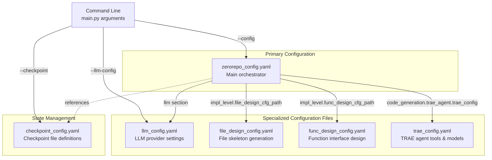
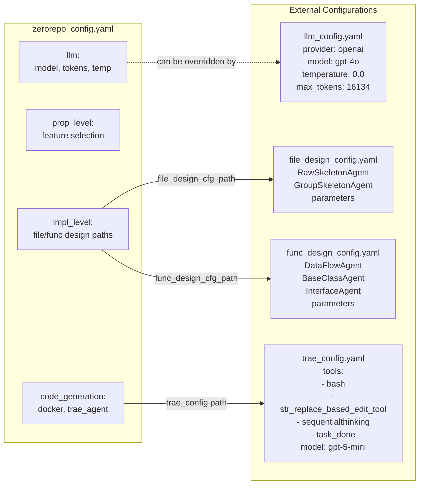
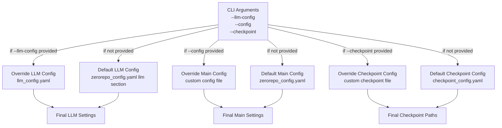

<!-- source: DeepWiki mcp.deepwiki.com · repo microsoft/RPG-ZeroRepo · page 2.3 Configuration Overview · fetched 2026-10-26 -->

# Configuration Overview

<details>
<summary>Relevant source files</summary>

The following files were used as context for generating this wiki page:

- [configs/checkpoint_config.yaml](configs/checkpoint_config.yaml)
- [configs/llm_config.yaml](configs/llm_config.yaml)
- [configs/zerorepo_config.yaml](configs/zerorepo_config.yaml)

</details>


This document introduces the RPG-ZeroRepo configuration system, explaining how configuration files work together to control system behavior. It provides an overview of the configuration hierarchy, file relationships, and override mechanisms. For detailed documentation of specific configuration parameters, see [Main Configuration](#4.1), [LLM Configuration](#4.2), [Design Configuration](#4.3), and [TRAE Agent Configuration](#4.4).

## Purpose and Scope

RPG-ZeroRepo uses a multi-layered configuration system that separates concerns across specialized files. The main orchestrator configuration file (`zerorepo_config.yaml`) references domain-specific configuration files for LLM settings, design agents, and code generation. This modular approach allows:

- Independent tuning of subsystem parameters
- Override capabilities via command-line arguments
- Consistent state management through checkpoint definitions
- Easy configuration sharing and version control

## Configuration File Hierarchy

The configuration system consists of a primary orchestrator and several specialized configuration files:

**Configuration File Relationships**



**Sources:** [configs/zerorepo_config.yaml](), [configs/llm_config.yaml](), [configs/checkpoint_config.yaml](), Diagram 3 from context

## Main Configuration File

The `zerorepo_config.yaml` file serves as the primary orchestrator, organizing configuration into three major sections corresponding to the three-phase pipeline:

| Section | Purpose | Key Parameters |
|---------|---------|----------------|
| `llm` | LLM provider and model settings | `model`, `max_tokens`, `temperature`, `reasoning_effort`, `api_key` |
| `prop_level` | Phase 1 feature planning parameters | `feature_selection`, `feature_refactoring` |
| `impl_level` | Phase 2 architecture design configuration | `file_design_cfg_path`, `func_design_cfg_path` |
| `code_generation` | Phase 3 code generation and Docker settings | `docker`, `trae_agent` |

### LLM Section

The `llm` section in `zerorepo_config.yaml` defines default LLM settings:

```yaml
llm:
  model: "gpt-5-mini-20250807"
  max_tokens: 32268
  temperature: 0.0
  reasoning_effort: "medium"
  provider: "openai"
  api_key: ""
```

These settings can be overridden by a separate `llm_config.yaml` file when provided via the `--llm-config` CLI argument.

**Sources:** [configs/zerorepo_config.yaml:7-17]()

### Property Level Section

The `prop_level` section configures Phase 1 feature planning:

```yaml
prop_level:
  feature_selection:
    mode: "simple"  # "feature" or "simple"
    explore_conditions: [5, 8, 5, 4, 5]
    select_max_iterations: 2
    temperature: 10
  
  feature_refactoring:
    refactor_max_iterations: 40
    refactor_context_window: 0
```

The `mode` parameter controls whether to use simple single-agent feature generation (`"simple"`) or complex multi-agent feature tree exploration (`"feature"`).

**Sources:** [configs/zerorepo_config.yaml:21-40]()

### Implementation Level Section

The `impl_level` section references external configuration files for Phase 2 design agents:

```yaml
impl_level:
  file_design_cfg_path: "configs/file_design_config.yaml"
  func_design_cfg_path: "configs/func_design_config.yaml"
```

This indirection allows detailed agent parameters to be maintained in separate files without cluttering the main configuration.

**Sources:** [configs/zerorepo_config.yaml:44-48]()

### Code Generation Section

The `code_generation` section configures Docker execution and TRAE agent behavior:

```yaml
code_generation:
  docker:
    enabled: true
    image: "python-azure-pytest:3.12"
    container_name: "zerorepo_2"
    force_rebuild: True
    workspace: "/tare_workspace"
  
  trae_agent:
    trae_config: "./configs/trae_config.yaml"
    max_retries: 3
    retry_delay: 5
    max_iterations: 5
    max_retries_per_workflow: 3
    workflow_timeout: 1800
```

**Sources:** [configs/zerorepo_config.yaml:53-72]()

## Specialized Configuration Files

**Configuration File Structure and References**



**Sources:** [configs/zerorepo_config.yaml](), [configs/llm_config.yaml](), Diagram 3 from context

### llm_config.yaml

A standalone LLM configuration file that can override the `llm` section in `zerorepo_config.yaml`:

| Parameter | Purpose | Example Value |
|-----------|---------|---------------|
| `model` | LLM model identifier | `gpt-4o` |
| `provider` | LLM provider service | `openai` |
| `temperature` | Sampling temperature | `0.0` |
| `max_tokens` | Maximum response tokens | `16134` |
| `api_key` | Authentication key | `""` |
| `base_url` | Optional custom endpoint | `""` |

**Sources:** [configs/llm_config.yaml:1-16]()

### file_design_config.yaml

Referenced by `impl_level.file_design_cfg_path`, this file configures the `RawSkeletonAgent` and `GroupSkeletonAgent` for Phase 2 file structure generation.

**Sources:** [configs/zerorepo_config.yaml:46]()

### func_design_config.yaml

Referenced by `impl_level.func_design_cfg_path`, this file configures the `DataFlowAgent`, `BaseClassAgent`, and `InterfaceAgent` for Phase 2 function interface design.

**Sources:** [configs/zerorepo_config.yaml:48]()

### trae_config.yaml

Referenced by `code_generation.trae_agent.trae_config`, this file defines the TRAE agent's available tools and model settings. Key tools include:
- `bash` - shell command execution
- `str_replace_based_edit_tool` - code editing
- `sequentialthinking` - reasoning mode
- `task_done` - completion signal

For detailed documentation, see [TRAE Agent Configuration](#4.4).

**Sources:** [configs/zerorepo_config.yaml:64](), Diagram 5 from context

## Configuration Override System

The system supports a hierarchical override mechanism where command-line arguments take precedence over configuration files:

**Override Precedence Flow**



**Sources:** Diagram 3 from context, [main.py CLI argument parsing]()

### CLI Override Arguments

| Argument | Purpose | Default |
|----------|---------|---------|
| `--config` | Override main configuration file | `configs/zerorepo_config.yaml` |
| `--llm-config` | Override LLM configuration file | Uses `llm` section from main config |
| `--checkpoint` | Override checkpoint configuration file | `configs/checkpoint_config.yaml` |

For complete CLI documentation, see [Command Line Interface](#11.1).

**Sources:** [main.py CLI arguments]()

## Checkpoint Configuration

The `checkpoint_config.yaml` file defines paths for all state files used throughout the pipeline. This configuration is separate from behavioral configuration because it defines the state management schema:

**Checkpoint File Categories**

```yaml
checkpoint_files:
  # Core state files
  repo_data: "repo_data.json"
  task_manager_state: "task_manager_state.json"
  
  # Design phase files
  skeleton: "skeleton.json"
  skeleton_trajectory: "skeleton_traj.json"
  graph: "graph.json"
  tasks: "tasks.json"
  
  # RPG files
  global_repo_rpg: "global_repo_rpg.json"
  current_repo_rpg: "cur_repo_rpg.json"
  
  # Code generation files
  iteration_state: "iteration_state.json"
  execution_history: "execution_history.json"
  batch_trajectory: "batch_trajectory.json"
  
  # Property level files
  feature_analysis: "feature_analysis.json"
  refactor_plan: "refactor_plan.json"
```

These checkpoint files enable the resume capability and progress tracking. For detailed information on checkpoint files and state management, see [State Management and Checkpointing](#5) and [Checkpoint File Reference](#5.1).

**Sources:** [configs/checkpoint_config.yaml:1-27]()

## Configuration Quick Reference

### Key Configuration Files

| File | Purpose | CLI Override | Referenced By |
|------|---------|--------------|---------------|
| `zerorepo_config.yaml` | Main orchestrator configuration | `--config` | `main.py` |
| `llm_config.yaml` | LLM provider and model settings | `--llm-config` | `zerorepo_config.yaml` or CLI |
| `checkpoint_config.yaml` | State file path definitions | `--checkpoint` | `main.py` |
| `file_design_config.yaml` | File skeleton agent parameters | N/A | `zerorepo_config.yaml` |
| `func_design_config.yaml` | Function design agent parameters | N/A | `zerorepo_config.yaml` |
| `trae_config.yaml` | TRAE agent tools and settings | N/A | `zerorepo_config.yaml` |

### Configuration Sections by Pipeline Phase

| Phase | Configuration Location | Key Parameters |
|-------|----------------------|----------------|
| **Phase 1: Feature Planning** | `zerorepo_config.yaml` → `prop_level` | `feature_selection.mode`, `feature_refactoring.refactor_max_iterations` |
| **Phase 2: Architecture Design** | `zerorepo_config.yaml` → `impl_level` → external files | `file_design_cfg_path`, `func_design_cfg_path` |
| **Phase 3: Code Generation** | `zerorepo_config.yaml` → `code_generation` | `docker.image`, `trae_agent.max_iterations` |

**Sources:** [configs/zerorepo_config.yaml](), [configs/checkpoint_config.yaml](), [configs/llm_config.yaml]()

## Next Steps

To customize RPG-ZeroRepo for your use case:

1. **Modify LLM settings** - See [LLM Configuration](#4.2) for details on model selection and API configuration
2. **Adjust design parameters** - See [Design Configuration](#4.3) for file and function design agent tuning
3. **Configure TRAE agent** - See [TRAE Agent Configuration](#4.4) for tool and execution parameter customization
4. **Understand state management** - See [State Management and Checkpointing](#5) for checkpoint system details

For a complete walkthrough of using these configurations, see [Quick Start Guide](#2.2).

**Sources:** [configs/zerorepo_config.yaml](), [configs/llm_config.yaml](), [configs/checkpoint_config.yaml]()

---

