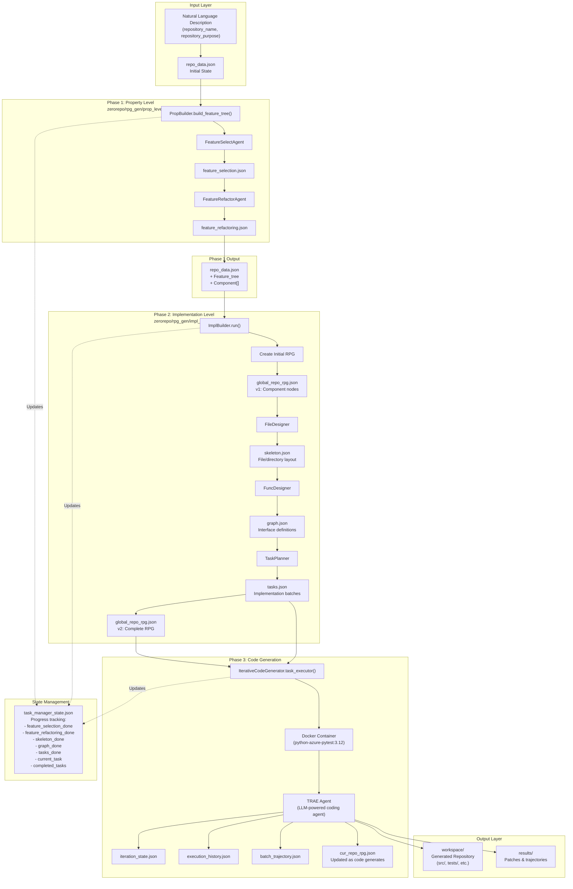
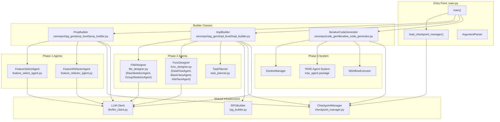
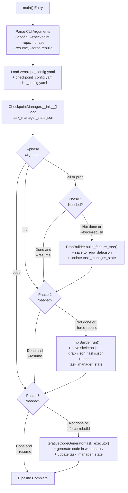
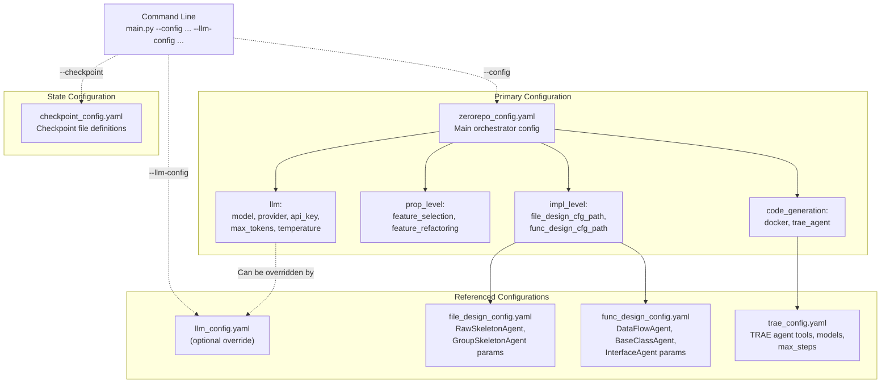
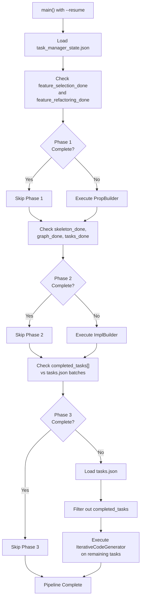

<!-- source: DeepWiki mcp.deepwiki.com · repo microsoft/RPG-ZeroRepo · page 3 Core Pipeline · fetched 2026-10-26 -->

# Core Pipeline

<details>
<summary>Relevant source files</summary>

The following files were used as context for generating this wiki page:

- [README.md](README.md)
- [configs/checkpoint_config.yaml](configs/checkpoint_config.yaml)
- [configs/zerorepo_config.yaml](configs/zerorepo_config.yaml)

</details>


The Core Pipeline is the three-phase orchestration system that transforms a natural language project description into a complete, tested software repository. This page provides an architectural overview of how phases interact, what data flows between them, and how the system maintains state for resumability.

For detailed information about individual phase implementations, see [Phase 1: Feature Planning](#3.1), [Phase 2: Architecture Design](#3.2), and [Phase 3: Code Generation](#3.3). For configuration details, see [Configuration System](#4).

---

## Three-Phase Architecture

The pipeline consists of three sequential phases, each producing checkpoint files that serve as inputs to the next phase:

| Phase | Module | Entry Point | Input | Output |
|-------|--------|-------------|-------|--------|
| **Phase 1: Feature Planning** | `zerorepo/rpg_gen/prop_level/` | `PropBuilder.build_feature_tree()` | `repo_data.json` (name + purpose) | `repo_data.json` (with Feature_tree + Component) |
| **Phase 2: Architecture Design** | `zerorepo/rpg_gen/impl_level/` | `ImplBuilder.run()` | Feature_tree + Component | `skeleton.json`, `graph.json`, `tasks.json` |
| **Phase 3: Code Generation** | `zerorepo/code_gen/` | `IterativeCodeGenerator.task_executor()` | `tasks.json` | `workspace/` (generated repository) |

Each phase is idempotent and resumable. If interrupted, the system can skip completed phases and resume from the next incomplete stage.

**Sources:** [README.md:98-280](), [main.py](), [zerorepo_config.yaml]()

---

## Pipeline Data Flow

This diagram shows the concrete checkpoint files and code entities that connect the three phases:

**Pipeline Phase Transitions and Checkpoint Files**



The pipeline transforms inputs through three distinct representations:

1. **Natural Language → Feature Tree**: User description becomes hierarchical taxonomy of features
2. **Feature Tree → Architecture**: Features mapped to file structure and interface specifications
3. **Architecture → Code**: Interface specifications filled with implementations via TDD

Each transition produces machine-readable JSON checkpoint files that enable phase independence and resumability.

**Sources:** [README.md:98-280](), [checkpoint_config.yaml](), [Diagram 2 from context]()

---

## Component Class Structure

The pipeline is implemented by three main builder classes, each managing a distinct phase:

**Core Pipeline Components and Their Relationships**



The `main()` function orchestrates phase execution by instantiating builder classes in sequence. Each builder depends on `CheckpointManager` for state persistence and `LLMClient` for model interactions (except Phase 3, which uses TRAE agent's internal LLM client).

**Sources:** [main.py](), [README.md:98-280](), [zerorepo/rpg_gen/prop_level/](), [zerorepo/rpg_gen/impl_level/](), [zerorepo/code_gen/]()

---

## Phase Orchestration

The `main()` function in [main.py]() controls phase execution based on command-line arguments and checkpoint state:

### Execution Flow



### Phase Selection Logic

The `--phase` argument determines which phases execute:

| Value | Behavior |
|-------|----------|
| `all` (default) | Run all three phases in sequence |
| `prop` | Run Phase 1 only (feature planning) |
| `impl` | Run Phase 2 only (architecture design) |
| `code` | Run Phase 3 only (code generation) |

When `--resume` is specified, completed phases are skipped based on flags in `task_manager_state.json`:
- `feature_selection_done` → skip `FeatureSelectAgent`
- `feature_refactoring_done` → skip `FeatureRefactorAgent`
- `skeleton_done` → skip `FileDesigner`
- `graph_done` → skip `FuncDesigner`
- `tasks_done` → skip `TaskPlanner`
- `completed_tasks[]` → skip completed implementation batches

The `--force-rebuild` flag clears completion flags, forcing phases to re-execute from scratch.

**Sources:** [main.py](), [README.md:354-380](), [checkpoint_config.yaml]()

---

## Checkpoint File Dependencies

Each phase produces specific checkpoint files that subsequent phases consume:

**Checkpoint File Dependency Graph**

```mermaid
graph LR
    subgraph Input["Input (User-Provided)"]
        RD0["repo_data.json<br/>{repository_name,<br/>repository_purpose}"]
    end
    
    subgraph P1Files["Phase 1 Checkpoints"]
        FS["feature_selection.json<br/>Raw feature taxonomy"]
        FR["feature_refactoring.json<br/>Component groupings"]
        RD1["repo_data.json<br/>+ Feature_tree<br/>+ Component[]"]
    end
    
    subgraph P2Files["Phase 2 Checkpoints"]
        RPG1["global_repo_rpg.json<br/>Initial RPG structure"]
        SKEL["skeleton.json<br/>File/directory layout"]
        SKELTRAJ["skeleton_traj.json<br/>LLM trajectories"]
        GRAPH["graph.json<br/>Interface definitions"]
        TASKS["tasks.json<br/>Implementation batches"]
        RPG2["global_repo_rpg.json<br/>Complete RPG with interfaces"]
    end
    
    subgraph P3Files["Phase 3 Checkpoints"]
        ITER["iteration_state.json<br/>Current iteration state"]
        EXEC["execution_history.json<br/>All workflow executions"]
        BATCH["batch_trajectory.json<br/>Per-batch execution records"]
        CRRPG["cur_repo_rpg.json<br/>Runtime RPG state"]
    end
    
    subgraph State["Global State"]
        TMS["task_manager_state.json<br/>Phase completion flags<br/>+ task progress"]
    end
    
    RD0 -->|"Phase 1 input"| FS
    FS --> FR
    FR --> RD1
    
    RD1 -->|"Phase 2 input"| RPG1
    RPG1 --> SKEL
    SKEL --> SKELTRAJ
    SKEL --> GRAPH
    GRAPH --> TASKS
    TASKS --> RPG2
    
    RPG2 -->|"Phase 3 input"| ITER
    TASKS -->|"Phase 3 input"| ITER
    ITER --> EXEC
    EXEC --> BATCH
    ITER --> CRRPG
    
    RD0 -.->|"Updated by all phases"| TMS
    RD1 -.->|"Updated by all phases"| TMS
    RPG2 -.->|"Updated by all phases"| TMS
```



### Critical Checkpoint Files

| File | Producer | Consumers | Purpose |
|------|----------|-----------|---------|
| `repo_data.json` | User (initial), Phase 1 (enriched) | Phase 1, Phase 2 | Master repository metadata with Feature_tree and Component definitions |
| `task_manager_state.json` | All phases | `main()`, All phases | Progress tracking and resume logic |
| `global_repo_rpg.json` | Phase 2 | Phase 3 | Complete Repository Planning Graph with all nodes/edges |
| `skeleton.json` | Phase 2 (`FileDesigner`) | Phase 2 (`FuncDesigner`) | File structure before interface design |
| `graph.json` | Phase 2 (`FuncDesigner`) | Phase 2 (`TaskPlanner`), Phase 3 | Complete interface definitions per file |
| `tasks.json` | Phase 2 (`TaskPlanner`) | Phase 3 | Implementation task batches with units and priorities |
| `cur_repo_rpg.json` | Phase 3 | Phase 3 | Dynamically updated RPG reflecting generated code |

The checkpoint system ensures that:
1. No phase is re-executed unnecessarily when resuming
2. Failures in later phases don't corrupt earlier work
3. Each phase can be developed/debugged independently

**Sources:** [README.md:383-399](), [checkpoint_config.yaml](), [Diagram 4 from context]()

---

## Configuration Hierarchy

The pipeline's behavior is controlled by a layered configuration system:

### Configuration File Structure



### Configuration Loading Order

1. `main()` parses command-line arguments
2. Loads `zerorepo_config.yaml` from `--config` path
3. If `--llm-config` provided, overrides `llm` section
4. Loads `checkpoint_config.yaml` to initialize `CheckpointManager`
5. Phase 2 loads `file_design_config.yaml` and `func_design_config.yaml`
6. Phase 3 loads `trae_config.yaml` for TRAE agent

This hierarchy allows:
- **Global defaults** in `zerorepo_config.yaml`
- **LLM-specific overrides** via `--llm-config`
- **Phase-specific tuning** via referenced config files
- **State management schema** via `checkpoint_config.yaml`

**Sources:** [main.py](), [zerorepo_config.yaml:1-73](), [Diagram 3 from context](), [configs/]()

---

## Resume and Recovery Mechanism

The checkpoint system enables the pipeline to resume from any point without repeating expensive operations:

### Resume Logic Flow



### task_manager_state.json Structure

```json
{
  "feature_selection_done": true,
  "feature_refactoring_done": true,
  "skeleton_done": true,
  "graph_done": true,
  "tasks_done": true,
  "code_generation": false,
  "completed_tasks": [
    "src_ai_pathfinding_astar.py_batch_1",
    "src_gameplay_rules_movement.py_batch_1"
  ],
  "failed_tasks": [
    "src_network_transport_reliability.py_batch_1"
  ],
  "current_task": {
    "task_id": "src_io_persistence_serialization.py_batch_1",
    "batch_name": "io.input_persistence",
    "iteration": 2,
    "last_workflow": "CODE_BUG_FIX"
  },
  "last_updated": "2026-02-09T14:23:45.123456"
}
```

### Recovery Capabilities

| Scenario | Behavior |
|----------|----------|
| **Phase 1 interrupted** | Resumes from `FeatureSelectAgent` or `FeatureRefactorAgent` based on completion flags |
| **Phase 2 interrupted** | Resumes from `FileDesigner`, `FuncDesigner`, or `TaskPlanner` |
| **Phase 3 interrupted** | Resumes from next uncompleted task batch; retries failed tasks |
| **Docker container crash** | Current task marked as failed; next run retries from iteration 0 |
| **LLM API error** | Task not marked complete; retry on next run |
| **Test failure at max iterations** | Task marked failed in `failed_tasks[]`; manual intervention required |

Failed tasks remain in `failed_tasks[]` until manually resolved. They can be retried by:
1. Removing the task from `failed_tasks[]` in `task_manager_state.json`
2. Running with `--resume`

Or by using `--force-rebuild` to restart all code generation from scratch.

**Sources:** [README.md:354-380](), [checkpoint_config.yaml](), [main.py](), [Diagram 4 from context]()

---

## Phase Input/Output Summary

This table summarizes the key transformations performed by each phase:

| Phase | Input Format | Output Format | Key Transformation |
|-------|--------------|---------------|-------------------|
| **Phase 1** | Natural language string: `"A multiplayer snake game..."` | Structured JSON: `Feature_tree` (hierarchical taxonomy), `Component[]` (logical modules) | Unstructured text → Structured feature hierarchy |
| **Phase 2** | Feature hierarchy + Components | File paths + Interface specifications: `skeleton.json` (76 files), `graph.json` (complete signatures, docstrings, types) | Abstract features → Concrete architecture |
| **Phase 3** | Interface specifications + Task batches | Executable Python code: `workspace/src/`, `workspace/tests/` | Type signatures → Working implementations |

### Data Size Growth

Using the SnakeGame example from the README:

- **Input**: ~50 words (project description)
- **After Phase 1**: ~200 features in Feature_tree, 6 Components
- **After Phase 2**: 76 files in skeleton, ~500 function/class interfaces in graph
- **After Phase 3**: ~5,000 lines of code, ~3,000 lines of tests

The pipeline expands a brief description into a complete repository through progressive refinement and LLM-guided generation.

**Sources:** [README.md:98-280](), [README.md:54-58](), [README.md:112-173](), [README.md:197-244]()

---

