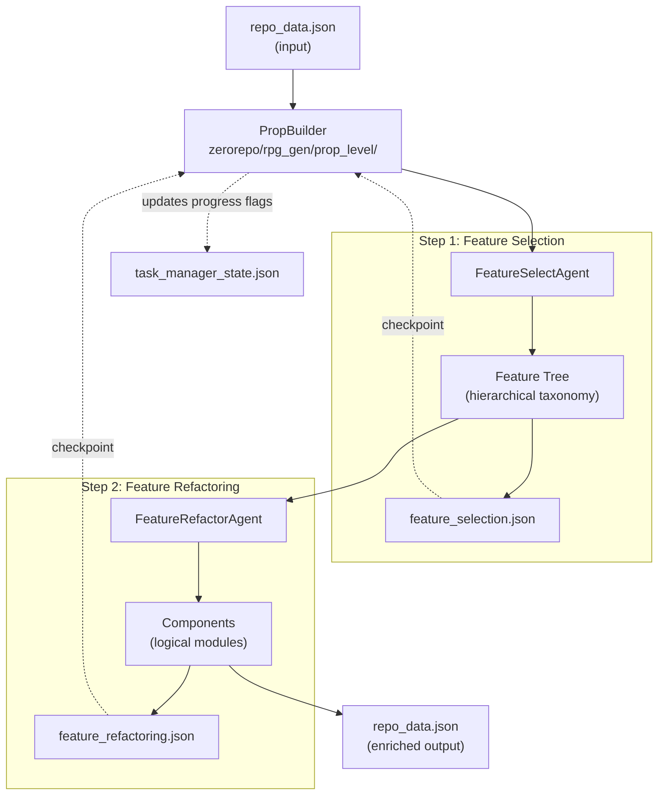
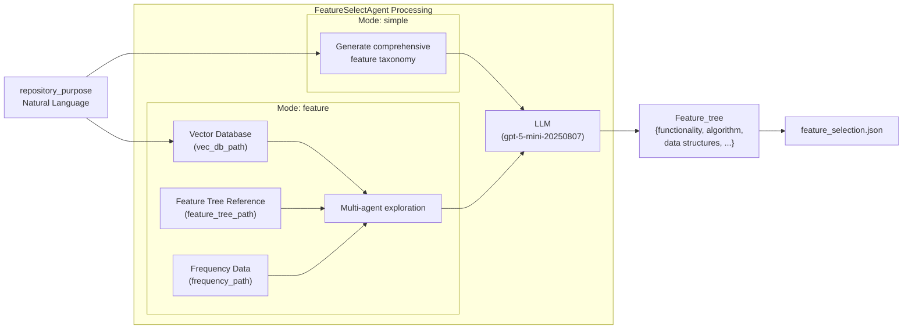
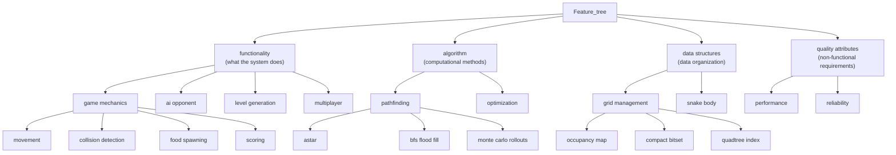
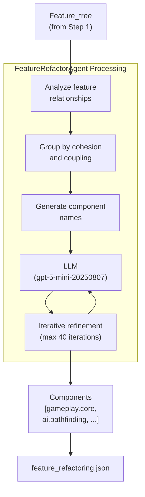
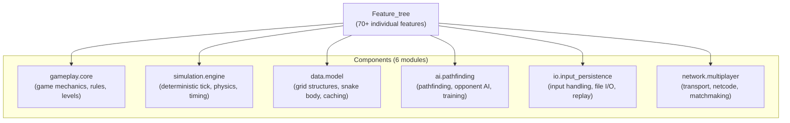
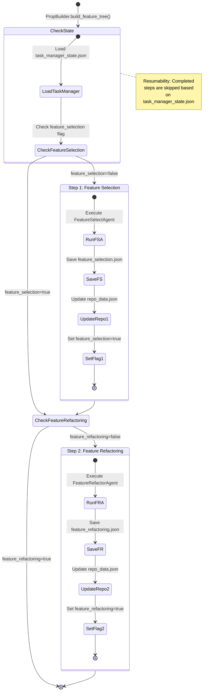
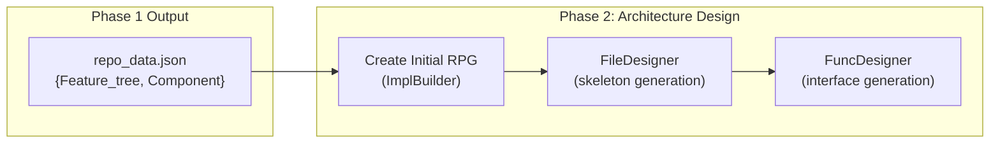

<!-- source: DeepWiki mcp.deepwiki.com · repo microsoft/RPG-ZeroRepo · page 3.1 Phase 1: Feature Planning · fetched 2026-10-26 -->

# Phase 1: Feature Planning

<details>
<summary>Relevant source files</summary>

The following files were used as context for generating this wiki page:

- [README.md](README.md)
- [configs/checkpoint_config.yaml](configs/checkpoint_config.yaml)
- [configs/zerorepo_config.yaml](configs/zerorepo_config.yaml)

</details>


## Purpose and Scope

Phase 1 transforms a natural language project description into a structured, hierarchical representation of features and logical components. This phase is implemented by the `PropBuilder` class in [zerorepo/rpg_gen/prop_level/]() and consists of two sequential steps: feature selection and feature refactoring. 

For information about the subsequent architecture design phase, see [Phase 2: Architecture Design](#3.2). For details on checkpoint management and resumability, see [State Management and Checkpointing](#5).

**Sources:** [README.md:98-173](), [configs/zerorepo_config.yaml:19-40]()

---

## Overview

Phase 1 is the first stage of the three-phase RPG-ZeroRepo pipeline. It takes a simple text description of a desired repository and produces two key outputs:

1. **Feature Tree**: A hierarchical taxonomy of all functionality, algorithms, data structures, and quality attributes the project should implement
2. **Components**: Logical modules that group related features and will become top-level source directories

The phase operates through two LLM-powered agents that progressively refine the project scope from abstract natural language to structured, implementable units.

**Phase 1 Architecture**



**Sources:** [README.md:98-173](), [configs/checkpoint_config.yaml:24-26]()

---

## Input and Output

### Input Format

Phase 1 expects a `repo_data.json` file in the checkpoints directory with the following minimal structure:

```json
{
  "repository_name": "SnakeGame",
  "repository_purpose": "A multiplayer snake game with AI opponents, pathfinding, replay recording, and persistent high scores."
}
```

| Field | Type | Description |
|-------|------|-------------|
| `repository_name` | string | Name of the repository to generate |
| `repository_purpose` | string | Natural language description of the project's purpose, features, and requirements |

**Sources:** [README.md:51-58]()

### Output Format

Phase 1 enriches the `repo_data.json` file by adding two new fields:

```json
{
  "repository_name": "SnakeGame",
  "repository_purpose": "...",
  "Feature_tree": {
    "functionality": {
      "game mechanics": ["movement", "collision detection", "food spawning", "scoring"],
      "ai opponent": ["strategy", "training"],
      "level generation": ["static layout", "procedural maze", "dynamic obstacles"]
    },
    "algorithm": {
      "pathfinding": ["astar", "bfs flood fill", "monte carlo rollouts"],
      "optimization": ["caching", "incremental updates", "memory management"]
    },
    "data structures": {
      "grid management": ["occupancy map", "compact bitset", "quadtree index"],
      "snake body": ["ring buffer segments", "delta encoding", "serialization"]
    }
  },
  "Component": [
    {
      "name": "gameplay.core",
      "refactored_subtree": {
        "gameplay": {
          "rules": ["movement", "collision detection", "scoring"],
          "levels": ["static layout", "procedural generation"]
        }
      }
    },
    {
      "name": "ai.pathfinding",
      "refactored_subtree": {
        "pathfinding": ["astar", "bfs flood fill"],
        "opponent AI": ["strategy selection", "difficulty scaling"]
      }
    }
  ]
}
```

| Field | Type | Description |
|-------|------|-------------|
| `Feature_tree` | object | Hierarchical feature taxonomy organized by category (functionality, algorithm, data structures, quality attributes) |
| `Component` | array | List of logical components, each with a name and refactored feature subtree |

**Sources:** [README.md:152-172]()

---

## Step 1: Feature Selection

### Agent Architecture

The `FeatureSelectAgent` is responsible for generating a comprehensive feature taxonomy from the natural language description. The agent operates in one of two modes:

| Mode | Description | Use Case |
|------|-------------|----------|
| `simple` | Single-agent generation | Default mode, suitable for most projects |
| `feature` | Multi-agent with vector database | Advanced mode requiring pre-populated feature database |

**Feature Selection Data Flow**



**Sources:** [configs/zerorepo_config.yaml:21-34](), [README.md:105-128]()

### Configuration Parameters

The feature selection step is configured via the `prop_level.feature_selection` section in `zerorepo_config.yaml`:

```yaml
prop_level:
  feature_selection:
    mode: "simple"  # "simple" or "feature"
    explore_conditions: [5, 8, 5, 4, 5]
    select_max_iterations: 2
    select_context_window: 0
    temperature: 10
    overlap_pct: 0
    
    # Required only for mode="feature"
    # feature_tree_path: "./data/seed42-step9001-27000_merged_fea_ori.json"
    # frequency_path: "./data/seed42-step9001-27000_merged_fea_ori_fre.json"
    # vec_db_path: "./data/vec_db"
```

| Parameter | Type | Description |
|-----------|------|-------------|
| `mode` | string | Agent mode: `"simple"` for single-agent, `"feature"` for multi-agent with vector DB |
| `explore_conditions` | array | Exploration depth parameters for each feature category (only for `"feature"` mode) |
| `select_max_iterations` | int | Maximum iterations for feature generation |
| `select_context_window` | int | Context window size for iterative refinement |
| `temperature` | float | LLM temperature for feature generation (higher = more creative) |
| `overlap_pct` | float | Allowed percentage overlap between feature categories |

**Sources:** [configs/zerorepo_config.yaml:21-34]()

### Feature Tree Structure

The `FeatureSelectAgent` generates a hierarchical feature tree organized by these standard categories:

**Feature Category Taxonomy**



**Sources:** [README.md:111-126]()

### Example Output

For the input `"A multiplayer snake game with AI opponents, pathfinding, replay recording, and persistent high scores"`, the `FeatureSelectAgent` produces:

```json
{
  "Feature_tree": {
    "functionality": {
      "game mechanics": [
        "movement",
        "collision detection", 
        "food spawning",
        "scoring"
      ],
      "ai opponent": [
        "strategy",
        "training"
      ],
      "level generation": [
        "static layout",
        "procedural maze",
        "dynamic obstacles"
      ],
      "multiplayer": [
        "transport",
        "netcode",
        "matchmaking"
      ],
      "replay system": [
        "recording",
        "playback",
        "fast-forward"
      ],
      "persistence": [
        "high score storage",
        "replay file I/O",
        "configuration"
      ]
    },
    "algorithm": {
      "pathfinding": [
        "astar",
        "bfs flood fill",
        "monte carlo rollouts"
      ],
      "optimization": [
        "caching",
        "incremental updates",
        "memory management"
      ]
    },
    "data structures": {
      "grid management": [
        "occupancy map",
        "compact bitset",
        "quadtree index"
      ],
      "snake body": [
        "ring buffer segments",
        "delta encoding",
        "serialization"
      ]
    },
    "quality attributes": {
      "performance": [
        "deterministic simulation",
        "fixed time step",
        "efficient collision"
      ],
      "reliability": [
        "network reliability",
        "error handling",
        "graceful degradation"
      ]
    }
  }
}
```

**Sources:** [README.md:111-126]()

---

## Step 2: Feature Refactoring

### Agent Architecture

The `FeatureRefactorAgent` takes the flat feature tree and groups related features into logical **Components**. Each component represents a cohesive module that will become a top-level directory in the generated repository structure.

**Feature Refactoring Process**



**Sources:** [configs/zerorepo_config.yaml:36-39](), [README.md:130-149]()

### Configuration Parameters

The feature refactoring step is configured via the `prop_level.feature_refactoring` section:

```yaml
prop_level:
  feature_refactoring:
    refactor_max_iterations: 40
    refactor_context_window: 0
```

| Parameter | Type | Description |
|-----------|------|-------------|
| `refactor_max_iterations` | int | Maximum iterations for component grouping refinement |
| `refactor_context_window` | int | Context window size for iterative refinement |

**Sources:** [configs/zerorepo_config.yaml:36-39]()

### Component Structure

Each component produced by the `FeatureRefactorAgent` has the following structure:

```json
{
  "name": "gameplay.core",
  "refactored_subtree": {
    "gameplay": {
      "rules": ["movement", "collision detection", "scoring"],
      "levels": ["static layout", "procedural generation"]
    },
    "game loop": {
      "timing": ["fixed time step", "deterministic simulation"]
    }
  }
}
```

| Field | Type | Description |
|-------|------|-------------|
| `name` | string | Component name (typically uses dot notation for namespace hierarchy) |
| `refactored_subtree` | object | Hierarchical grouping of features assigned to this component |

**Sources:** [README.md:154-172]()

### Example Output

For the SnakeGame example, the `FeatureRefactorAgent` groups features into these components:

**Component Decomposition**



Complete component list:

```json
{
  "Component": [
    {
      "name": "gameplay.core",
      "refactored_subtree": {
        "gameplay": {
          "rules": ["movement", "collision detection", "scoring"],
          "levels": ["static layout", "procedural generation"]
        }
      }
    },
    {
      "name": "simulation.engine",
      "refactored_subtree": {
        "simulation": {
          "deterministic": ["fixed time step", "tick processing"],
          "physics": ["collision resolution", "boundary handling"]
        }
      }
    },
    {
      "name": "data.model",
      "refactored_subtree": {
        "grid management": ["occupancy map", "quadtree index"],
        "snake body": ["ring buffer segments", "serialization"],
        "caching": ["incremental updates", "memory management"]
      }
    },
    {
      "name": "ai.pathfinding",
      "refactored_subtree": {
        "pathfinding": ["astar", "bfs flood fill", "monte carlo rollouts"],
        "opponent AI": ["strategy selection", "training", "difficulty scaling"]
      }
    },
    {
      "name": "io.input_persistence",
      "refactored_subtree": {
        "input handling": ["keyboard", "network input"],
        "replay system": ["recording", "playback", "fast-forward"],
        "persistence": ["high score storage", "replay file I/O"]
      }
    },
    {
      "name": "network.multiplayer",
      "refactored_subtree": {
        "transport": ["reliable messaging", "packet aggregation"],
        "netcode": ["client prediction", "server reconciliation"],
        "matchmaking": ["lobby system", "player discovery"]
      }
    }
  ]
}
```

**Sources:** [README.md:136-149]()

---

## Checkpoint Files

Phase 1 produces and updates several checkpoint files to enable resumability:

### Checkpoint File Reference

| File | Purpose | Producer | Format |
|------|---------|----------|--------|
| `feature_selection.json` | Raw feature tree from LLM | `FeatureSelectAgent` | JSON |
| `feature_refactoring.json` | Component decomposition results | `FeatureRefactorAgent` | JSON |
| `repo_data.json` | Enriched with `Feature_tree` and `Component` fields | `PropBuilder` | JSON |
| `task_manager_state.json` | Progress tracking with completion flags | `PropBuilder` | JSON |

**Sources:** [README.md:383-400](), [configs/checkpoint_config.yaml:24-26]()

### State Tracking

The `task_manager_state.json` file tracks completion of Phase 1 steps:

```json
{
  "feature_selection": true,
  "feature_refactoring": true,
  "build_skeleton": false,
  "build_function": false,
  "plan_tasks": false,
  "code_generation": false,
  "last_updated": "2026-02-09T13:56:20"
}
```

| Flag | Meaning |
|------|---------|
| `feature_selection: true` | Step 1 completed successfully |
| `feature_refactoring: true` | Step 2 completed successfully |

When resuming with `--resume`, the system checks these flags and skips completed steps.

**Sources:** [README.md:354-380]()

### Checkpoint State Diagram



**Sources:** [README.md:354-380](), [configs/checkpoint_config.yaml:5-7]()

---

## Configuration Reference

### LLM Configuration

Phase 1 agents use the LLM settings from the main configuration file:

```yaml
llm:
  model: "gpt-5-mini-20250807"
  max_tokens: 32268
  temperature: 0.0
  reasoning_effort: "medium"
  provider: "openai"
  api_key: ""
```

These settings can be overridden using the `--llm-config` CLI argument.

**Sources:** [configs/zerorepo_config.yaml:7-17](), [README.md:409-414]()

### PropBuilder Configuration

Complete Phase 1 configuration structure:

```yaml
prop_level:
  feature_selection:
    mode: "simple"                    # "simple" | "feature"
    explore_conditions: [5, 8, 5, 4, 5]
    select_max_iterations: 2
    select_context_window: 0
    temperature: 10
    overlap_pct: 0
    
    # Required for mode="feature" only
    # feature_tree_path: "./data/seed42-step9001-27000_merged_fea_ori.json"
    # frequency_path: "./data/seed42-step9001-27000_merged_fea_ori_fre.json"
    # vec_db_path: "./data/vec_db"

  feature_refactoring:
    refactor_max_iterations: 40
    refactor_context_window: 0
```

**Sources:** [configs/zerorepo_config.yaml:19-40]()

---

## Integration with Pipeline

Phase 1 is invoked as part of the complete pipeline or can be run independently:

### CLI Invocation

```bash
# Run Phase 1 only
python main.py \
  --config configs/zerorepo_config.yaml \
  --checkpoint ../my_project/checkpoints \
  --repo ../my_project/workspace \
  --phase prop \
  --resume

# Run all phases (Phase 1 executes first)
python main.py \
  --config configs/zerorepo_config.yaml \
  --checkpoint ../my_project/checkpoints \
  --repo ../my_project/workspace \
  --phase all \
  --resume
```

The `--phase prop` argument restricts execution to Phase 1 only. The `--resume` flag enables checkpoint-based resumability.

**Sources:** [README.md:60-83]()

### Transition to Phase 2

Upon successful completion, Phase 1 outputs serve as input to Phase 2:

**Phase 1 → Phase 2 Data Flow**



The `Component` array becomes the foundation for the Repository Planning Graph (RPG), and the `Feature_tree` guides file and interface design.

**Sources:** [README.md:175-247]()

---

