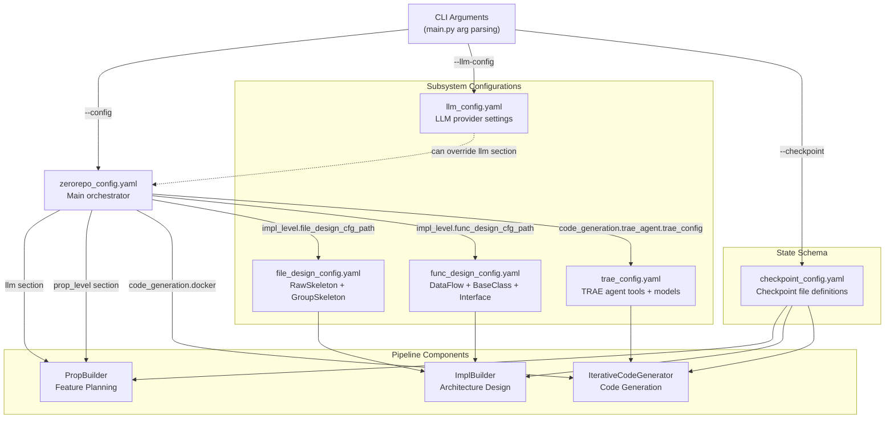
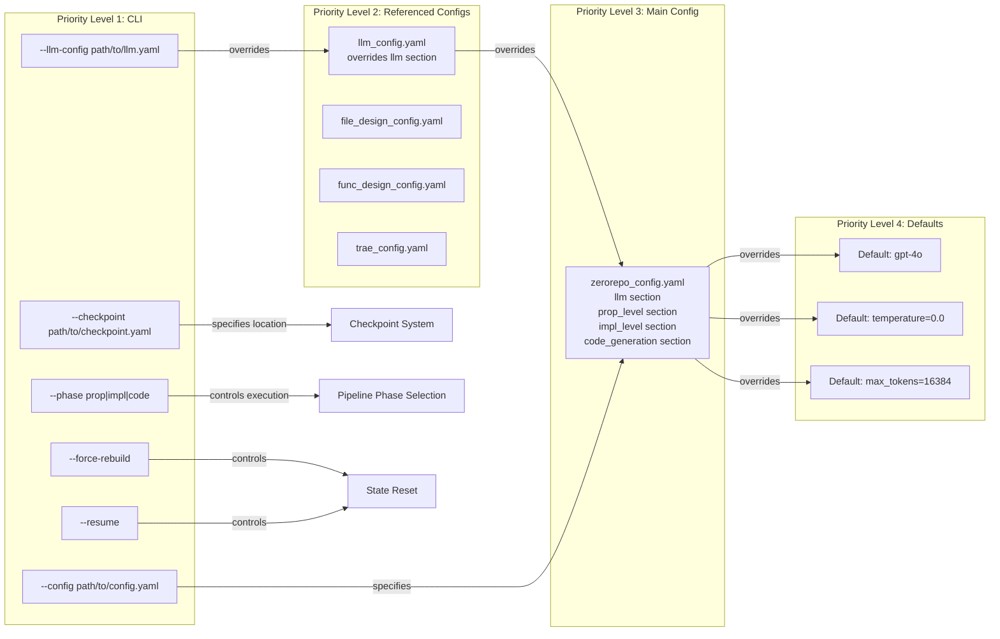
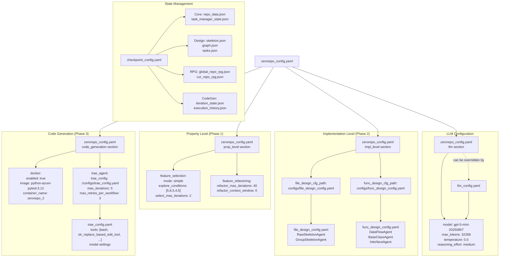

<!-- source: DeepWiki mcp.deepwiki.com · repo microsoft/RPG-ZeroRepo · page 4 Configuration System · fetched 2026-10-26 -->

# Configuration System

<details>
<summary>Relevant source files</summary>

The following files were used as context for generating this wiki page:

- [configs/checkpoint_config.yaml](configs/checkpoint_config.yaml)
- [configs/llm_config.yaml](configs/llm_config.yaml)
- [configs/zerorepo_config.yaml](configs/zerorepo_config.yaml)

</details>


## Purpose and Scope

The Configuration System provides a layered architecture for controlling all aspects of RPG-ZeroRepo's behavior, from LLM model selection to Docker execution parameters. This system enables modular customization where subsystems can be independently tuned while maintaining a unified control point through `zerorepo_config.yaml`.

This page documents the overall configuration architecture, file relationships, loading mechanisms, and override capabilities. For detailed documentation of individual configuration files and their parameters, see:
- Main Configuration: [4.1](#4.1)
- LLM Configuration: [4.2](#4.2)
- Design Configuration: [4.3](#4.3)
- TRAE Agent Configuration: [4.4](#4.4)

For state management and checkpoint files, see [State Management and Checkpointing](#5).

---

## Configuration Architecture

The configuration system follows a hierarchical design with three layers:

1. **Main Configuration Layer**: `zerorepo_config.yaml` acts as the orchestrator, defining high-level parameters for each pipeline phase
2. **Specialized Configuration Layer**: Referenced configuration files (`llm_config.yaml`, `file_design_config.yaml`, `func_design_config.yaml`, `trae_config.yaml`) that provide detailed subsystem settings
3. **State Management Layer**: `checkpoint_config.yaml` defines the schema for all checkpoint files that track execution state

### Configuration File Hierarchy



**Sources**: 
- [configs/zerorepo_config.yaml:1-73]()
- [configs/llm_config.yaml:1-16]()
- [configs/checkpoint_config.yaml:1-27]()

---

## Configuration Loading and Code Integration

The configuration system is loaded and integrated into the pipeline through a series of Python classes and functions. The following diagram maps configuration files to their corresponding code entities.

### Configuration to Code Entity Mapping

```mermaid
graph TB
    subgraph "Configuration Files"
        ZeroCfg["zerorepo_config.yaml"]
        LLMFile["llm_config.yaml"]
        ChkptFile["checkpoint_config.yaml"]
        FileDesignFile["file_design_config.yaml"]
        FuncDesignFile["func_design_config.yaml"]
        TraeFile["trae_config.yaml"]
    end
    
    subgraph "main.py Entry Point"
        ArgParser["argparse.ArgumentParser"]
        LoadConfig["load_config()"]
        MainFunc["main()"]
    end
    
    subgraph "Pipeline Classes"
        PropB["PropBuilder<br/>zerorepo/rpg_gen/prop_level/"]
        FSA["FeatureSelectAgent"]
        FRA["FeatureRefactorAgent"]
        
        ImplB["ImplBuilder<br/>zerorepo/rpg_gen/impl_level/"]
        RawSkelAgent["RawSkeletonAgent"]
        GroupSkelAgent["GroupSkeletonAgent"]
        DataFlowAgent["DataFlowAgent"]
        BaseClassAgent["BaseClassAgent"]
        InterfaceAgent["InterfaceAgent"]
        
        ICG["IterativeCodeGenerator<br/>zerorepo/code_gen/"]
        DockerMgr["DockerManager"]
        TraeAgent["trae_agent"]
    end
    
    subgraph "State Management"
        TaskMgr["TaskManagerState"]
        ChkptMgr["CheckpointManager"]
    end
    
    ArgParser -->|"args.config"| LoadConfig
    ArgParser -->|"args.llm_config"| LoadConfig
    ArgParser -->|"args.checkpoint"| LoadConfig
    
    LoadConfig --> ZeroCfg
    LoadConfig --> LLMFile
    LoadConfig --> ChkptFile
    
    MainFunc -->|"config['prop_level']"| PropB
    MainFunc -->|"config['impl_level']"| ImplB
    MainFunc -->|"config['code_generation']"| ICG
    
    ZeroCfg -->|"llm section"| FSA
    ZeroCfg -->|"llm section"| FRA
    ZeroCfg -->|"prop_level.feature_selection"| FSA
    ZeroCfg -->|"prop_level.feature_refactoring"| FRA
    
    ZeroCfg -->|"impl_level.file_design_cfg_path"| FileDesignFile
    ZeroCfg -->|"impl_level.func_design_cfg_path"| FuncDesignFile
    
    FileDesignFile --> RawSkelAgent
    FileDesignFile --> GroupSkelAgent
    FuncDesignFile --> DataFlowAgent
    FuncDesignFile --> BaseClassAgent
    FuncDesignFile --> InterfaceAgent
    
    ZeroCfg -->|"code_generation.docker"| DockerMgr
    ZeroCfg -->|"code_generation.trae_agent"| ICG
    TraeFile --> TraeAgent
    
    ChkptFile -->|"checkpoint_files"| ChkptMgr
    ChkptMgr --> TaskMgr
    TaskMgr --> PropB
    TaskMgr --> ImplB
    TaskMgr --> ICG
```



**Sources**:
- Main entry point loading logic in main.py
- [configs/zerorepo_config.yaml:1-73]()
- [configs/checkpoint_config.yaml:1-27]()

---

## Configuration File Reference

The following table provides a comprehensive overview of all configuration files in the system:

| Configuration File | Purpose | Referenced By | Key Sections |
|-------------------|---------|---------------|--------------|
| `zerorepo_config.yaml` | Main orchestrator configuration | `main.py` CLI `--config` | `llm`, `prop_level`, `impl_level`, `code_generation` |
| `llm_config.yaml` | LLM provider and model settings | `main.py` CLI `--llm-config`, can override `zerorepo_config.yaml` | `model`, `provider`, `api_key`, `temperature`, `max_tokens` |
| `checkpoint_config.yaml` | State management schema | `main.py` CLI `--checkpoint` | `checkpoint_files` (27 checkpoint definitions) |
| `file_design_config.yaml` | File skeleton generation parameters | `zerorepo_config.yaml` `impl_level.file_design_cfg_path` | `raw_skeleton`, `group_skeleton` agent settings |
| `func_design_config.yaml` | Function interface design parameters | `zerorepo_config.yaml` `impl_level.func_design_cfg_path` | `data_flow`, `base_class`, `interface` agent settings |
| `trae_config.yaml` | TRAE agent tool and model configuration | `zerorepo_config.yaml` `code_generation.trae_agent.trae_config` | `tools` (bash, str_replace_based_edit_tool, etc.), `model`, `max_iterations` |

**Sources**:
- [configs/zerorepo_config.yaml:1-73]()
- [configs/llm_config.yaml:1-16]()
- [configs/checkpoint_config.yaml:1-27]()

---

## Configuration Override Mechanism

The system supports a flexible override mechanism where more specific configurations take precedence over general ones. The override hierarchy is:

1. **CLI Arguments** (highest priority)
2. **Specialized Configuration Files** (e.g., `llm_config.yaml`)
3. **Main Configuration** (`zerorepo_config.yaml`)
4. **Default Values** (lowest priority)

### Override Flow



**Sources**:
- CLI argument parsing in main.py
- [configs/zerorepo_config.yaml:7-17]() (LLM section that can be overridden)
- [configs/llm_config.yaml:1-16]() (Override file)

---

## Configuration Relationships

Configuration files are interconnected through explicit path references and implicit schema dependencies. The following diagram illustrates these relationships:

### Inter-Configuration Dependencies



**Sources**:
- [configs/zerorepo_config.yaml:7-73]() (All sections and references)
- [configs/checkpoint_config.yaml:4-27]() (State file definitions)
- [configs/llm_config.yaml:1-16]() (LLM override configuration)

---

## Checkpoint Configuration Schema

The `checkpoint_config.yaml` file defines the naming schema for all state files used throughout the pipeline. These files enable resumability and progress tracking.

### Checkpoint File Categories

| Category | Configuration Key | File Name | Purpose |
|----------|------------------|-----------|---------|
| **Core State** | `repo_data` | `repo_data.json` | Repository metadata and feature tree |
| | `task_manager_state` | `task_manager_state.json` | Phase completion flags and task progress |
| **Design Phase** | `skeleton` | `skeleton.json` | File layout structure (76+ files) |
| | `skeleton_trajectory` | `skeleton_traj.json` | Design decision history |
| | `graph` | `graph.json` | Function interface definitions |
| | `tasks` | `tasks.json` | Implementation task batches |
| **RPG Files** | `global_repo_rpg` | `global_repo_rpg.json` | Complete repository planning graph |
| | `current_repo_rpg` | `cur_repo_rpg.json` | Current working graph state |
| **Code Generation** | `iteration_state` | `iteration_state.json` | Current TDD iteration state |
| | `execution_history` | `execution_history.json` | Test execution results history |
| | `batch_trajectory` | `batch_trajectory.json` | Batch-level generation trajectory |
| **Property Level** | `feature_analysis` | `feature_analysis.json` | Feature selection results |
| | `refactor_plan` | `refactor_plan.json` | Component grouping plan |

**Sources**:
- [configs/checkpoint_config.yaml:4-27]() (Complete checkpoint schema)

---

## Configuration Best Practices

### Modular Customization

The configuration system is designed for modular customization. To customize a specific subsystem:

1. **LLM Behavior**: Modify `llm_config.yaml` or the `llm` section in `zerorepo_config.yaml`
   - Example: Change model from `gpt-5-mini-20250807` to `gpt-4o` [configs/zerorepo_config.yaml:8]()
   - Example: Adjust `reasoning_effort` from `medium` to `high` [configs/zerorepo_config.yaml:11]()

2. **Feature Planning**: Modify `prop_level` section
   - Example: Switch from `simple` to `feature` mode [configs/zerorepo_config.yaml:29]()
   - Example: Adjust exploration depth via `explore_conditions` [configs/zerorepo_config.yaml:30]()

3. **Architecture Design**: Modify referenced design configs
   - File design: Edit `file_design_config.yaml` path [configs/zerorepo_config.yaml:46]()
   - Function design: Edit `func_design_config.yaml` path [configs/zerorepo_config.yaml:48]()

4. **Code Generation**: Modify `code_generation` section
   - Docker: Change image or container name [configs/zerorepo_config.yaml:57-58]()
   - TRAE agent: Adjust `max_iterations` or `max_retries_per_workflow` [configs/zerorepo_config.yaml:69-70]()

### Configuration Templates

The system provides default configurations optimized for general use. Key default values:

| Parameter | Default Value | Purpose |
|-----------|---------------|---------|
| `llm.temperature` | `0.0` | Deterministic generation |
| `llm.max_tokens` | `32268` | Maximum response length |
| `feature_selection.mode` | `simple` | Single-agent feature generation |
| `feature_refactoring.refactor_max_iterations` | `40` | Component grouping iterations |
| `trae_agent.max_iterations` | `5` | TDD loop iterations per task |
| `trae_agent.max_retries_per_workflow` | `3` | Retry attempts per workflow type |
| `docker.force_rebuild` | `True` | Always rebuild container |

**Sources**:
- [configs/zerorepo_config.yaml:7-73]() (All default values)
- [configs/llm_config.yaml:5-9]() (LLM defaults)

---

## Runtime Configuration Access

The configuration system is accessed throughout the codebase via configuration dictionaries passed to pipeline components. The main entry point loads configurations and distributes them:

```
main.py
  └─ load_config(args.config, args.llm_config, args.checkpoint)
       ├─ Parse YAML files
       ├─ Apply CLI overrides
       └─ Return unified config dict

  └─ PropBuilder(config['prop_level'], config['llm'], checkpoint_manager)
       ├─ FeatureSelectAgent(config['feature_selection'], llm_config)
       └─ FeatureRefactorAgent(config['feature_refactoring'], llm_config)

  └─ ImplBuilder(config['impl_level'], checkpoint_manager)
       ├─ Load file_design_config from config['file_design_cfg_path']
       ├─ Load func_design_config from config['func_design_cfg_path']
       ├─ RawSkeletonAgent(file_design_config['raw_skeleton'])
       ├─ GroupSkeletonAgent(file_design_config['group_skeleton'])
       ├─ DataFlowAgent(func_design_config['data_flow'])
       ├─ BaseClassAgent(func_design_config['base_class'])
       └─ InterfaceAgent(func_design_config['interface'])

  └─ IterativeCodeGenerator(config['code_generation'], checkpoint_manager)
       ├─ DockerManager(config['docker'])
       └─ TRAE agent loads config['trae_agent']['trae_config']
```

This hierarchical access pattern ensures that each component receives only the configuration it needs, promoting separation of concerns and modularity.

**Sources**:
- Main configuration loading and distribution in main.py
- [configs/zerorepo_config.yaml:1-73]() (Complete configuration structure)
- [configs/checkpoint_config.yaml:1-27]() (State management integration)

---

