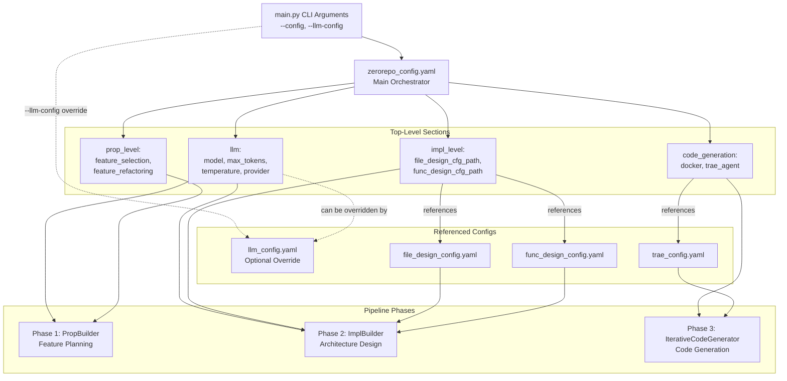
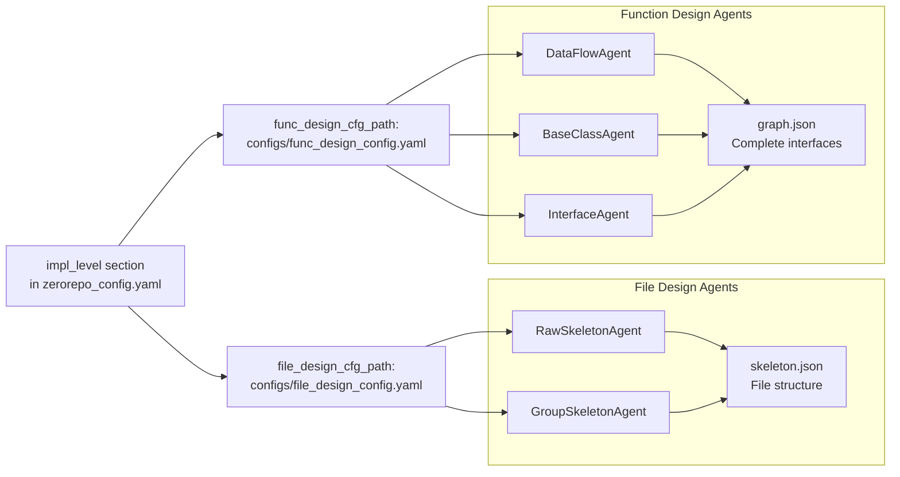
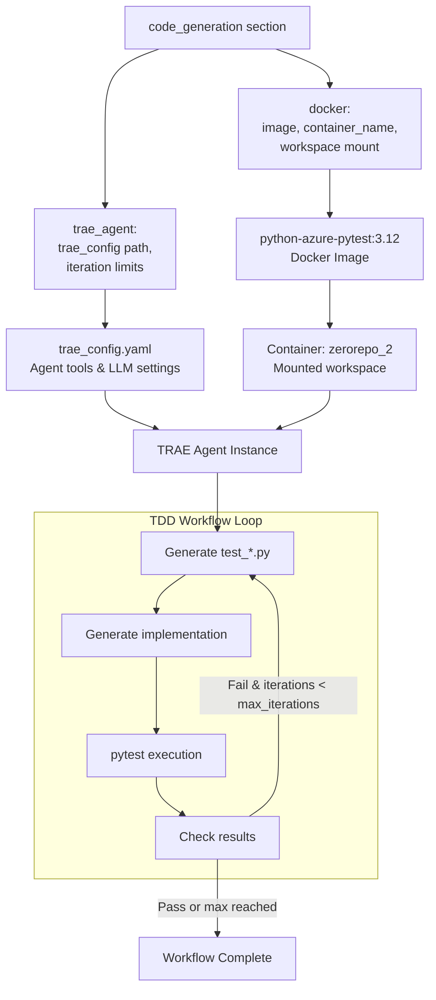
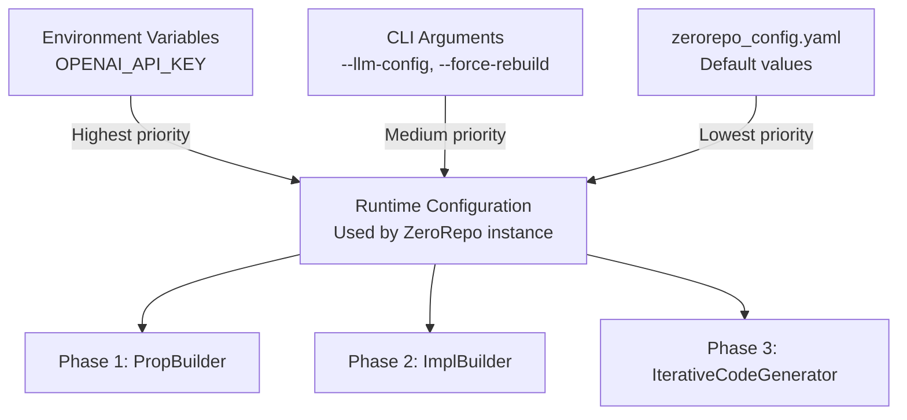

<!-- source: DeepWiki mcp.deepwiki.com · repo microsoft/RPG-ZeroRepo · page 4.1 Main Configuration (zerorepo_config.yaml) · fetched 2026-10-26 -->

# Main Configuration (zerorepo_config.yaml)

<details>
<summary>Relevant source files</summary>

The following files were used as context for generating this wiki page:

- [configs/zerorepo_config.yaml](configs/zerorepo_config.yaml)
- [main.py](main.py)

</details>


## Purpose and Scope

The `zerorepo_config.yaml` file serves as the primary orchestrator configuration for the RPG-ZeroRepo system. It defines settings for all three phases of the code generation pipeline and acts as the central control point for the entire workflow. This document describes the file's structure, all configuration sections, and their parameters.

For LLM provider-specific settings and advanced model configurations, see [LLM Configuration](#4.2). For design phase agent parameters, see [Design Configuration](#4.3). For TRAE agent execution settings, see [TRAE Agent Configuration](#4.4).

**Sources**: [configs/zerorepo_config.yaml:1-73](), [main.py:231-235]()

---

## Configuration File Location and Loading

The main configuration file is loaded via the `--config` CLI argument in [main.py:55-60](). The `ZeroRepo` class instantiates with this configuration path and parses the YAML structure to control system behavior.

```
python main.py --config configs/zerorepo_config.yaml --checkpoint ./checkpoints --repo ./workspace
```

The configuration can be validated without execution using the `--dry-run` flag [main.py:104-107](), [main.py:217-221]().

**Sources**: [main.py:24-131](), [configs/zerorepo_config.yaml:1-3]()

---

## Configuration Hierarchy

The following diagram illustrates how `zerorepo_config.yaml` integrates with other configuration files and the three-phase pipeline:

**Diagram: Configuration Architecture and Phase Mapping**



**Sources**: [configs/zerorepo_config.yaml:1-73](), [main.py:231-235]()

---

## Top-Level Structure

The configuration file contains four primary sections:

| Section | Purpose | Phase(s) |
|---------|---------|----------|
| `llm` | LLM provider and model settings | All phases |
| `prop_level` | Feature planning parameters | Phase 1 |
| `impl_level` | Architecture design configuration | Phase 2 |
| `code_generation` | Code generation and execution settings | Phase 3 |

**Sources**: [configs/zerorepo_config.yaml:1-73]()

---

## LLM Section

The `llm` section defines the language model configuration used throughout the pipeline. These settings apply to all LLM-based agents unless overridden by a separate `llm_config.yaml` file via the `--llm-config` CLI argument.

### Parameters

| Parameter | Type | Default | Description |
|-----------|------|---------|-------------|
| `model` | string | `"gpt-5-mini-20250807"` | Model identifier |
| `max_tokens` | integer | `32268` | Maximum token count per request |
| `temperature` | float | `0.0` | Sampling temperature (0.0 = deterministic) |
| `reasoning_effort` | string | `"medium"` | Reasoning effort level (`"low"`, `"medium"`, `"high"`) |
| `provider` | string | `"openai"` | LLM provider identifier |
| `api_key` | string | `""` | API key (can be set via environment variable) |
| `base_url` | string | (optional) | Custom API endpoint URL |
| `api_version` | string | (optional) | API version for Azure OpenAI |
| `tenant_id` | string | (optional) | Azure tenant ID |
| `token_scope` | string | (optional) | Azure token scope |

### Example Configuration

```yaml
llm:
  model: "gpt-5-mini-20250807"
  max_tokens: 32268
  temperature: 0.0
  reasoning_effort: "medium"
  provider: "openai"
  api_key: ""
```

### Override Mechanism

The LLM configuration can be replaced entirely by specifying an external file:

```bash
python main.py --config configs/zerorepo_config.yaml --llm-config configs/llm_config.yaml
```

This loads a `LLMConfig` instance from the specified file and overrides the `llm` section [main.py:232-235]().

**Sources**: [configs/zerorepo_config.yaml:4-17](), [main.py:117-123](), [main.py:231-235]()

---

## Property Level Section (Phase 1)

The `prop_level` section controls Phase 1 feature planning, which generates the feature tree and logical components from natural language descriptions. This section contains two subsections: `feature_selection` and `feature_refactoring`.

### Feature Selection Parameters

| Parameter | Type | Default | Description |
|-----------|------|---------|-------------|
| `mode` | string | `"simple"` | Selection mode: `"simple"` (single-agent) or `"feature"` (multi-agent) |
| `feature_tree_path` | string | (optional) | Path to pre-built feature tree (required for `"feature"` mode) |
| `frequency_path` | string | (optional) | Path to feature frequency data (required for `"feature"` mode) |
| `vec_db_path` | string | (optional) | Path to vector database (required for `"feature"` mode) |
| `explore_conditions` | list[int] | `[5, 8, 5, 4, 5]` | Exploration thresholds for feature selection |
| `select_max_iterations` | integer | `2` | Maximum iterations for feature selection agent |
| `select_context_window` | integer | `0` | Context window size for selection |
| `temperature` | float | `10` | Temperature for feature selection (not LLM temperature) |
| `overlap_pct` | float | `0` | Allowed overlap percentage between features |

### Feature Refactoring Parameters

| Parameter | Type | Default | Description |
|-----------|------|---------|-------------|
| `refactor_max_iterations` | integer | `40` | Maximum iterations for feature refactoring agent |
| `refactor_context_window` | integer | `0` | Context window size for refactoring |

### Example Configuration

```yaml
prop_level:
  feature_selection:
    mode: "simple"
    explore_conditions: [5, 8, 5, 4, 5]
    select_max_iterations: 2
    select_context_window: 0
    temperature: 10
    overlap_pct: 0

  feature_refactoring:
    refactor_max_iterations: 40
    refactor_context_window: 0
```

### Mode Selection

- **`"simple"` mode**: Single-agent approach for straightforward feature generation. Does not require pre-built feature trees or vector databases.
- **`"feature"` mode**: Multi-agent approach with exploration of pre-existing feature taxonomies. Requires `feature_tree_path`, `frequency_path`, and `vec_db_path` to be set.

**Sources**: [configs/zerorepo_config.yaml:18-40]()

---

## Implementation Level Section (Phase 2)

The `impl_level` section controls Phase 2 architecture design, which transforms features into file structures and interface definitions. Instead of inline parameters, this section references external configuration files that define agent-specific behavior.

### Parameters

| Parameter | Type | Description |
|-----------|------|-------------|
| `file_design_cfg_path` | string | Path to file design configuration (controls RawSkeletonAgent and GroupSkeletonAgent) |
| `func_design_cfg_path` | string | Path to function design configuration (controls DataFlowAgent, BaseClassAgent, InterfaceAgent) |

### Example Configuration

```yaml
impl_level:
  file_design_cfg_path: "configs/file_design_config.yaml"
  func_design_cfg_path: "configs/func_design_config.yaml"
```

**Diagram: Implementation Level Configuration Flow**



These referenced configuration files contain detailed parameters for the design agents. For complete documentation of those parameters, see [Design Configuration](#4.3).

**Sources**: [configs/zerorepo_config.yaml:41-48]()

---

## Code Generation Section (Phase 3)

The `code_generation` section controls Phase 3, where actual code is generated and tested inside Docker containers using the TRAE agent. This section contains two subsections: `docker` and `trae_agent`.

### Docker Parameters

| Parameter | Type | Default | Description |
|-----------|------|---------|-------------|
| `enabled` | boolean | `true` | Enable Docker execution (if false, runs on host) |
| `image` | string | `"python-azure-pytest:3.12"` | Docker image name |
| `container_name` | string | `"zerorepo_2"` | Container instance name |
| `force_rebuild` | boolean | `true` | Force container rebuild on start |
| `workspace` | string | `"/tare_workspace"` | Workspace mount point inside container |

### TRAE Agent Parameters

| Parameter | Type | Default | Description |
|-----------|------|---------|-------------|
| `trae_config` | string | `"./configs/trae_config.yaml"` | Path to TRAE agent configuration file |
| `max_retries` | integer | `3` | Maximum retries for agent initialization |
| `retry_delay` | integer | `5` | Delay in seconds between retries |
| `max_iterations` | integer | `5` | Maximum iterations per TDD workflow |
| `max_retries_per_workflow` | integer | `3` | Maximum retries per workflow type |
| `workflow_timeout` | integer | `1800` | Workflow timeout in seconds (30 minutes) |

### Example Configuration

```yaml
code_generation:
  docker:
    enabled: true
    image: "python-azure-pytest:3.12"
    container_name: "zerorepo_2"
    force_rebuild: true
    workspace: "/tare_workspace"

  trae_agent:
    trae_config: "./configs/trae_config.yaml"
    max_retries: 3
    retry_delay: 5
    max_iterations: 5
    max_retries_per_workflow: 3
    workflow_timeout: 1800
```

**Diagram: Code Generation Configuration to Execution Flow**



### Force Rebuild Override

The `force_rebuild` setting in the Docker section can be overridden by the CLI flag:

```bash
python main.py --config configs/zerorepo_config.yaml --force-rebuild
```

This CLI flag is checked in [main.py:92-95]() and passed to the implementation phase [main.py:245-248]().

**Sources**: [configs/zerorepo_config.yaml:50-72](), [main.py:92-95](), [main.py:243-249]()

---

## Configuration Override Mechanisms

Multiple mechanisms allow runtime configuration overrides:

### CLI Argument Overrides

| CLI Argument | Overrides | Description |
|--------------|-----------|-------------|
| `--llm-config <path>` | Entire `llm` section | Loads LLM config from external file |
| `--force-rebuild` | `code_generation.docker.force_rebuild` | Forces Docker container rebuild |
| `--resume` | Execution behavior | Skips completed phases based on checkpoints |

### Environment Variables

The `api_key` field in the `llm` section can be left empty and set via environment variable:

```bash
export OPENAI_API_KEY="your-api-key"
python main.py --config configs/zerorepo_config.yaml --checkpoint ./checkpoints --repo ./workspace
```

**Diagram: Configuration Override Priority**



### Validation

Configuration validation occurs during `ZeroRepo` initialization. In dry-run mode [main.py:217-221](), the system validates the configuration without executing the pipeline:

```bash
python main.py --config configs/zerorepo_config.yaml --checkpoint ./checkpoints --repo ./workspace --dry-run
```

If validation passes, the output confirms successful initialization without starting code generation.

**Sources**: [main.py:117-123](), [main.py:231-235](), [main.py:217-221](), [main.py:92-95]()

---

## Complete Configuration Template

Below is a complete annotated template showing all available sections and parameters:

```yaml
# ZeroRepo Main Configuration
# Complete configuration for the end-to-end ZeroRepo workflow

# ============================================================================
# LLM Configuration
# ============================================================================
llm:
  model: "gpt-5-mini-20250807"        # Model identifier
  max_tokens: 32268                    # Max tokens per request
  temperature: 0.0                     # Sampling temperature
  reasoning_effort: "medium"           # Reasoning level: low/medium/high
  provider: "openai"                   # Provider: openai/anthropic/google
  api_key: ""                          # API key (or use env var)
  # base_url: ""                       # Optional: custom endpoint
  # api_version: ""                    # Optional: Azure API version
  # tenant_id: ""                      # Optional: Azure tenant ID
  # token_scope: ""                    # Optional: Azure token scope

# ============================================================================
# Property Level Configuration (PropBuilder - Phase 1)
# ============================================================================
prop_level:
  feature_selection:
    # Optional paths for "feature" mode:
    # feature_tree_path: "./data/feature_tree.json"
    # frequency_path: "./data/feature_freq.json"
    # vec_db_path: "./data/vec_db"
    mode: "simple"                     # "simple" or "feature"
    explore_conditions: [5, 8, 5, 4, 5]
    select_max_iterations: 2
    select_context_window: 0
    temperature: 10
    overlap_pct: 0

  feature_refactoring:
    refactor_max_iterations: 40
    refactor_context_window: 0

# ============================================================================
# Implementation Level Configuration (ImplBuilder - Phase 2)
# ============================================================================
impl_level:
  file_design_cfg_path: "configs/file_design_config.yaml"
  func_design_cfg_path: "configs/func_design_config.yaml"

# ============================================================================
# Code Generation Configuration (IterativeCodeGenerator - Phase 3)
# ============================================================================
code_generation:
  docker:
    enabled: true
    image: "python-azure-pytest:3.12"
    container_name: "zerorepo_2"
    force_rebuild: true
    workspace: "/tare_workspace"

  trae_agent:
    trae_config: "./configs/trae_config.yaml"
    max_retries: 3
    retry_delay: 5
    max_iterations: 5
    max_retries_per_workflow: 3
    workflow_timeout: 1800
```

**Sources**: [configs/zerorepo_config.yaml:1-73]()

---

## Usage Examples

### Basic Execution

```bash
python main.py \
  --config configs/zerorepo_config.yaml \
  --checkpoint ./checkpoints \
  --repo ./workspace
```

### With LLM Override

```bash
python main.py \
  --config configs/zerorepo_config.yaml \
  --llm-config configs/custom_llm.yaml \
  --checkpoint ./checkpoints \
  --repo ./workspace
```

### Design Phase Only

```bash
python main.py \
  --config configs/zerorepo_config.yaml \
  --checkpoint ./checkpoints \
  --repo ./workspace \
  --phase design
```

### Resume from Checkpoint

```bash
python main.py \
  --config configs/zerorepo_config.yaml \
  --checkpoint ./checkpoints \
  --repo ./workspace \
  --resume
```

### Force Container Rebuild

```bash
python main.py \
  --config configs/zerorepo_config.yaml \
  --checkpoint ./checkpoints \
  --repo ./workspace \
  --force-rebuild
```

**Sources**: [main.py:29-51](), [main.py:109-115]()

---

## Related Configuration Files

The main configuration references several specialized configuration files:

| Referenced File | Purpose | Documented In |
|-----------------|---------|---------------|
| `llm_config.yaml` | LLM provider settings override | [LLM Configuration](#4.2) |
| `file_design_config.yaml` | File skeleton agent parameters | [Design Configuration](#4.3) |
| `func_design_config.yaml` | Function interface agent parameters | [Design Configuration](#4.3) |
| `trae_config.yaml` | TRAE agent tools and execution | [TRAE Agent Configuration](#4.4) |

For checkpoint file structure and state management, see [Checkpoint File Reference](#5.1).

**Sources**: [configs/zerorepo_config.yaml:46-48](), [configs/zerorepo_config.yaml:64]()

---

