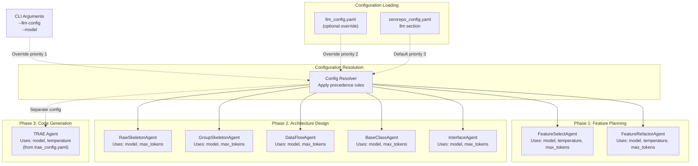
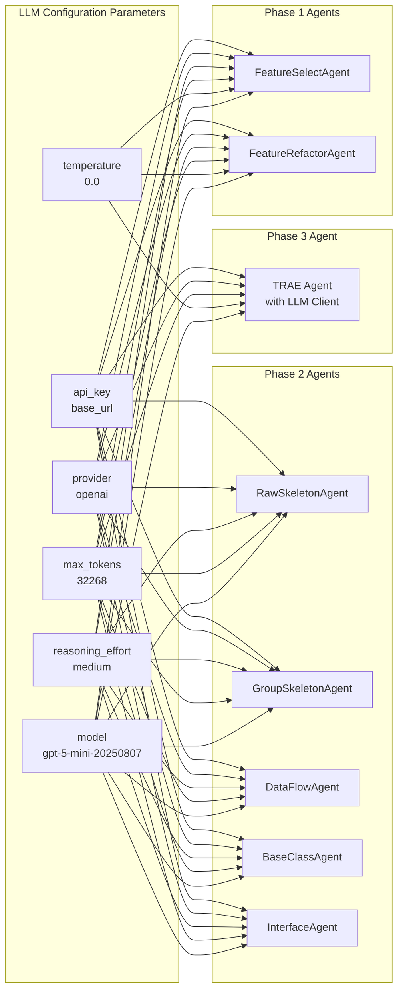

<!-- source: DeepWiki mcp.deepwiki.com · repo microsoft/RPG-ZeroRepo · page 4.2 LLM Configuration · fetched 2026-10-26 -->

# LLM Configuration

<details>
<summary>Relevant source files</summary>

The following files were used as context for generating this wiki page:

- [configs/llm_config.yaml](configs/llm_config.yaml)
- [configs/zerorepo_config.yaml](configs/zerorepo_config.yaml)

</details>


## Purpose and Scope

This page documents the LLM (Large Language Model) configuration system used throughout RPG-ZeroRepo. LLM configuration controls which language model provider and model are used, along with generation parameters like temperature and token limits. These settings apply to all LLM-powered agents across the three-phase pipeline, including feature generation agents, architecture design agents, and the TRAE code generation agent.

For the overall configuration system hierarchy, see [Configuration System](#4). For TRAE agent-specific configuration, see [TRAE Agent Configuration](#4.4). For main orchestrator settings, see [Main Configuration](#4.1).

---

## Configuration Locations

LLM configuration can be specified in two locations with different scopes and override capabilities:

### Inline Configuration (zerorepo_config.yaml)

The `llm` section in `zerorepo_config.yaml` provides inline LLM settings used by default throughout the pipeline:

```yaml
llm:
  model: "gpt-5-mini-20250807"
  max_tokens: 32268
  temperature: 0.0
  reasoning_effort: "medium"
  provider: "openai"
  api_key: ""
```

**Sources:** [configs/zerorepo_config.yaml:7-17]()

### Standalone Configuration (llm_config.yaml)

A separate `llm_config.yaml` file provides an alternative configuration format that can override the inline settings:

```yaml
model: gpt-4o
provider: openai
temperature: 0.0
max_tokens: 16134
top_p: 1.0
api_key: ""
```

**Sources:** [configs/llm_config.yaml:1-16]()

### Override Mechanism

The configuration override hierarchy follows this precedence (highest to lowest):

1. **Command-line arguments**: `--llm-config path/to/llm_config.yaml` or `--model model-name`
2. **Standalone llm_config.yaml**: When explicitly specified
3. **Inline configuration**: Default from `zerorepo_config.yaml`

**Sources:** [configs/llm_config.yaml:3](), [configs/zerorepo_config.yaml:7-17]()

---

## Configuration Parameters Reference

### Core Parameters

| Parameter | Type | Description | Example Values |
|-----------|------|-------------|----------------|
| `model` | string | Model identifier or name | `"gpt-5-mini-20250807"`, `"gpt-4o"` |
| `provider` | string | LLM provider backend | `"openai"` |
| `temperature` | float | Randomness in generation (0.0-2.0) | `0.0` (deterministic), `0.7` (creative) |
| `max_tokens` | integer | Maximum tokens in response | `16134`, `32268` |
| `top_p` | float | Nucleus sampling threshold (0.0-1.0) | `1.0` (no filtering) |

**Sources:** [configs/llm_config.yaml:5-9](), [configs/zerorepo_config.yaml:8-12]()

### Advanced Parameters

| Parameter | Type | Description | Example Values |
|-----------|------|-------------|----------------|
| `reasoning_effort` | string | Effort level for reasoning models | `"low"`, `"medium"`, `"high"` |

The `reasoning_effort` parameter is specific to reasoning-capable models like `gpt-5-mini-20250807`. It controls the computational effort the model invests in step-by-step reasoning before generating responses. Higher effort levels produce more thorough analysis but increase latency and token usage.

**Sources:** [configs/zerorepo_config.yaml:11]()

### Authentication Parameters

| Parameter | Type | Required | Description |
|-----------|------|----------|-------------|
| `api_key` | string | Yes | API authentication key for provider |
| `base_url` | string | Optional | Custom API endpoint URL |
| `api_version` | string | Optional | API version (Azure-specific) |
| `tenant_id` | string | Optional | Azure tenant identifier |
| `token_scope` | string | Optional | OAuth token scope (Azure-specific) |

Authentication parameters support both direct OpenAI API access and Azure OpenAI Service deployments. When using Azure, specify `base_url`, `api_version`, and optionally `tenant_id` and `token_scope` for managed identity authentication.

**Sources:** [configs/llm_config.yaml:11-15](), [configs/zerorepo_config.yaml:13-17]()

---

## Configuration Flow Diagram

The following diagram shows how LLM configuration flows through the system components:

**Diagram: LLM Configuration Distribution to Pipeline Components**



**Sources:** [configs/llm_config.yaml:3](), [configs/zerorepo_config.yaml:7-17]()

---

## Model Selection Guidelines

### Reasoning Models vs. Standard Models

RPG-ZeroRepo supports both reasoning-capable models and standard language models:

| Model Type | Example Models | Use Case | Key Parameters |
|------------|----------------|----------|----------------|
| **Reasoning Models** | `gpt-5-mini-20250807` | Complex architectural decisions, design pattern selection | `reasoning_effort`, `max_tokens` |
| **Standard Models** | `gpt-4o`, `gpt-4-turbo` | General code generation, interface design | `temperature`, `max_tokens` |

The default configuration uses `gpt-5-mini-20250807` with `reasoning_effort: "medium"` to balance quality and performance across all phases.

**Sources:** [configs/zerorepo_config.yaml:8-11]()

### Token Limits

Token limits must accommodate the largest prompts in the pipeline:

- **Phase 1 (Feature Planning)**: Requires moderate context for feature taxonomy (~8K-16K tokens)
- **Phase 2 (Architecture Design)**: Requires large context for file layouts and interfaces (~16K-32K tokens)
- **Phase 3 (Code Generation)**: TRAE agent manages context per task (~16K tokens)

The default `max_tokens: 32268` in `zerorepo_config.yaml` supports the most demanding Phase 2 operations.

**Sources:** [configs/zerorepo_config.yaml:9](), [configs/llm_config.yaml:8]()

---

## Temperature and Determinism

The `temperature` parameter controls randomness in model outputs:

| Temperature | Behavior | Use Case |
|-------------|----------|----------|
| `0.0` | Fully deterministic | **Default for reproducibility**<br/>Ensures consistent architecture decisions |
| `0.0-0.3` | Mostly deterministic | Code generation with slight variation |
| `0.4-0.7` | Balanced creativity | Feature ideation, naming |
| `0.8-1.0` | High creativity | Exploratory design, alternative solutions |

Both default configurations use `temperature: 0.0` to ensure reproducible repository generation across runs.

**Sources:** [configs/llm_config.yaml:7](), [configs/zerorepo_config.yaml:10]()

---

## Azure OpenAI Integration

For Azure OpenAI Service deployments, configure the following additional parameters:

### Required Azure Parameters

```yaml
llm:
  model: "gpt-4o"
  provider: "openai"
  base_url: "https://your-resource.openai.azure.com"
  api_version: "2024-02-15-preview"
  api_key: "your-azure-api-key"
```

### Managed Identity Authentication

For Azure managed identity (no API key):

```yaml
llm:
  model: "gpt-4o"
  provider: "openai"
  base_url: "https://your-resource.openai.azure.com"
  api_version: "2024-02-15-preview"
  tenant_id: "your-tenant-id"
  token_scope: "https://cognitiveservices.azure.com/.default"
  api_key: ""
```

**Sources:** [configs/llm_config.yaml:12-15](), [configs/zerorepo_config.yaml:14-17]()

---

## Configuration Usage Across Pipeline Phases

The following diagram illustrates how LLM configuration parameters are consumed by different agents in each phase:

**Diagram: LLM Configuration Parameter Usage by Phase**



**Sources:** [configs/zerorepo_config.yaml:7-17]()

---

## Complete Configuration Examples

### Example 1: Standard OpenAI Configuration

For direct OpenAI API usage with deterministic behavior:

```yaml
llm:
  model: "gpt-4o"
  provider: "openai"
  temperature: 0.0
  max_tokens: 16134
  top_p: 1.0
  api_key: "sk-proj-..."
```

### Example 2: Reasoning Model Configuration

For reasoning-capable models with enhanced analysis:

```yaml
llm:
  model: "gpt-5-mini-20250807"
  provider: "openai"
  temperature: 0.0
  max_tokens: 32268
  reasoning_effort: "high"
  api_key: "sk-proj-..."
```

### Example 3: Azure OpenAI Configuration

For Azure-hosted OpenAI deployments:

```yaml
llm:
  model: "gpt-4o"
  provider: "openai"
  base_url: "https://mycompany-openai.openai.azure.com"
  api_version: "2024-02-15-preview"
  api_key: "azure-key-..."
  temperature: 0.0
  max_tokens: 16134
```

**Sources:** [configs/llm_config.yaml:1-16](), [configs/zerorepo_config.yaml:7-17]()

---

## Configuration Validation

The system validates LLM configuration at startup and fails fast if required parameters are missing:

| Validation | Requirement | Error Behavior |
|------------|-------------|----------------|
| `model` | Must be non-empty string | Fatal error with message |
| `provider` | Must be non-empty string | Fatal error with message |
| `api_key` | Must be non-empty (unless using managed identity) | Fatal error with authentication message |
| `max_tokens` | Must be positive integer | Fatal error with value error |
| `temperature` | Must be 0.0-2.0 | Fatal error with range error |

**Sources:** [configs/llm_config.yaml:5-11]()

---

## Related Configuration

- **TRAE Agent Configuration**: Phase 3 code generation uses a separate LLM configuration in `trae_config.yaml`. See [TRAE Agent Configuration](#4.4) for details on agent-specific LLM settings.
- **Main Configuration**: The `llm` section is part of the larger `zerorepo_config.yaml` structure. See [Main Configuration](#4.1) for the complete configuration context.
- **Design Configuration**: Phase 2 agents use the LLM configuration but have additional agent-specific parameters. See [Design Configuration](#4.3).

**Sources:** [configs/zerorepo_config.yaml:63-64]()

---

