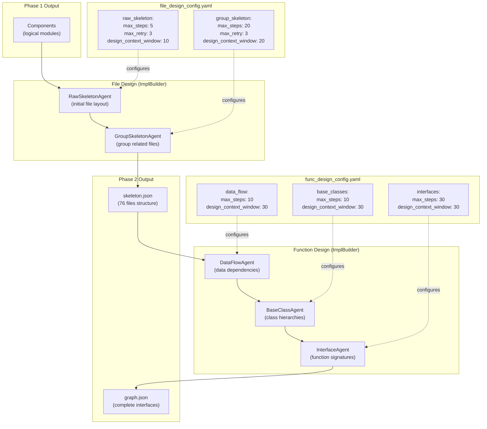
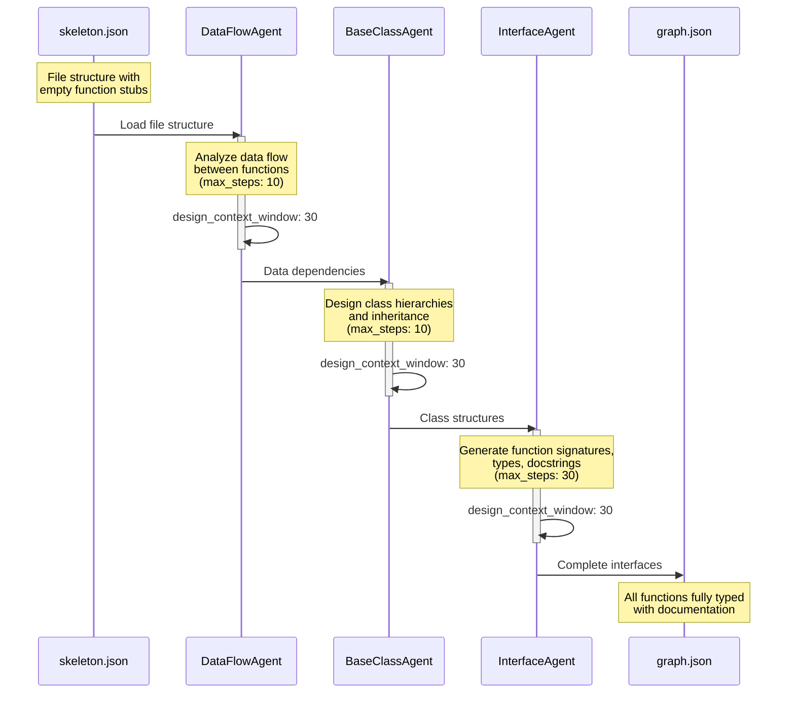
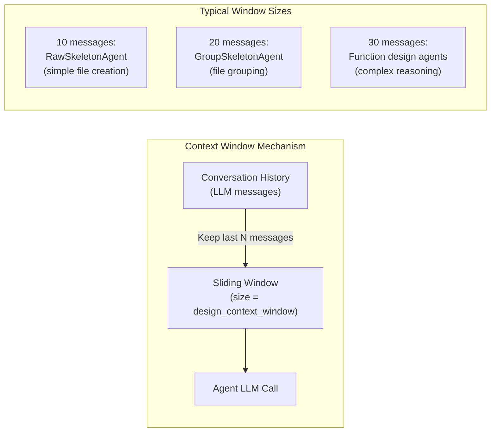
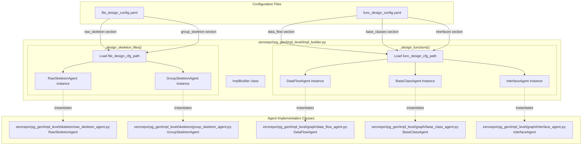

<!-- source: DeepWiki mcp.deepwiki.com · repo microsoft/RPG-ZeroRepo · page 4.3 Design Configuration · fetched 2026-10-26 -->

# Design Configuration

<details>
<summary>Relevant source files</summary>

The following files were used as context for generating this wiki page:

- [configs/file_design_config.yaml](configs/file_design_config.yaml)
- [configs/func_design_config.yaml](configs/func_design_config.yaml)
- [configs/zerorepo_config.yaml](configs/zerorepo_config.yaml)

</details>


This document covers the configuration files that control Phase 2 (Architecture Design) of the RPG-ZeroRepo pipeline. These configurations specify parameters for the skeleton design and function design agents that transform high-level components into concrete file structures and interface definitions.

For the main orchestrator configuration that references these files, see [Main Configuration](#4.1). For Phase 2 pipeline details and agent behaviors, see [Phase 2: Architecture Design](#3.2).

## Overview

The design phase uses two specialized configuration files:

1. **`file_design_config.yaml`** - Controls file skeleton generation via `RawSkeletonAgent` and `GroupSkeletonAgent`
2. **`func_design_config.yaml`** - Controls function interface design via `DataFlowAgent`, `BaseClassAgent`, and `InterfaceAgent`

These files are referenced from the main configuration at [configs/zerorepo_config.yaml:44-48]():

```yaml
impl_level:
  file_design_cfg_path: "configs/file_design_config.yaml"
  func_design_cfg_path: "configs/func_design_config.yaml"
```

**Sources:** [configs/zerorepo_config.yaml:44-48]()

## Design Configuration Flow

The following diagram shows how design configuration files control the Architecture Design phase:



**Sources:** [configs/file_design_config.yaml:1-21](), [configs/func_design_config.yaml:1-24]()

## File Design Configuration

The `file_design_config.yaml` file controls two sequential agents that generate the file skeleton structure.

### Raw Skeleton Agent

The `RawSkeletonAgent` creates the initial file layout by mapping components to source files. Configuration at [configs/file_design_config.yaml:4-9]():

| Parameter | Type | Default | Description |
|-----------|------|---------|-------------|
| `max_steps` | integer | 5 | Maximum design iteration steps |
| `max_retry` | integer | 3 | Maximum retry attempts on failures |
| `max_review_times` | integer | 0 | Number of self-review passes (0=disabled) |
| `design_context_window` | integer | 10 | Context window size for design decisions |
| `review_context_window` | integer | 10 | Context window size for review phase |

The `design_context_window` parameter controls how many previous design decisions the agent considers when generating new files. Lower values (5-10) produce more independent file structures; higher values increase consistency but also LLM token usage.

**Sources:** [configs/file_design_config.yaml:4-9]()

### Group Skeleton Agent

The `GroupSkeletonAgent` refines the raw skeleton by grouping related files into logical directory structures. Configuration at [configs/file_design_config.yaml:12-17]():

| Parameter | Type | Default | Description |
|-----------|------|---------|-------------|
| `max_steps` | integer | 20 | Maximum design iteration steps |
| `max_retry` | integer | 3 | Maximum retry attempts on failures |
| `max_review_times` | integer | 0 | Number of self-review passes (0=disabled) |
| `design_context_window` | integer | 20 | Context window size for design decisions |
| `review_context_window` | integer | 10 | Context window size for review phase |

The `GroupSkeletonAgent` has larger limits than `RawSkeletonAgent` (`max_steps: 20` vs `5`, `design_context_window: 20` vs `10`) because grouping operations require considering more file relationships simultaneously.

**Sources:** [configs/file_design_config.yaml:12-17]()

### General File Design Settings

Global settings apply to both agents at [configs/file_design_config.yaml:20-21]():

```yaml
general:
  log_level: INFO
```

Valid log levels: `DEBUG`, `INFO`, `WARNING`, `ERROR`, `CRITICAL`

**Sources:** [configs/file_design_config.yaml:20-21]()

## Function Design Configuration

The `func_design_config.yaml` file controls three sequential agents that design function interfaces and class hierarchies.

### Agent Execution Sequence



**Sources:** [configs/func_design_config.yaml:1-24]()

### Data Flow Agent

The `DataFlowAgent` analyzes data dependencies between functions to determine parameter passing and return value structures. Configuration at [configs/func_design_config.yaml:2-7]():

| Parameter | Type | Default | Description |
|-----------|------|---------|-------------|
| `max_steps` | integer | 10 | Maximum design iteration steps |
| `max_review_times` | integer | 0 | Number of self-review passes (0=disabled) |
| `max_retry` | integer | 3 | Maximum retry attempts on failures |
| `design_context_window` | integer | 30 | Context window size for design decisions |
| `review_context_window` | integer | 10 | Context window size for review phase |

The larger `design_context_window: 30` (compared to file design's 10-20) allows the agent to reason about complex data flows spanning multiple functions and modules.

**Sources:** [configs/func_design_config.yaml:2-7]()

### Base Classes Agent

The `BaseClassAgent` designs class hierarchies, abstract base classes, and inheritance relationships. Configuration at [configs/func_design_config.yaml:9-14]():

| Parameter | Type | Default | Description |
|-----------|------|---------|-------------|
| `max_steps` | integer | 10 | Maximum design iteration steps |
| `max_review_times` | integer | 0 | Number of self-review passes (0=disabled) |
| `max_retry` | integer | 3 | Maximum retry attempts on failures |
| `design_context_window` | integer | 30 | Context window size for design decisions |
| `review_context_window` | integer | 10 | Context window size for review phase |

This agent identifies common patterns and creates abstract base classes that reduce code duplication in Phase 3 implementation.

**Sources:** [configs/func_design_config.yaml:9-14]()

### Interface Agent

The `InterfaceAgent` generates complete function signatures including parameter types, return types, and docstrings. Configuration at [configs/func_design_config.yaml:16-21]():

| Parameter | Type | Default | Description |
|-----------|------|---------|-------------|
| `max_steps` | integer | 30 | Maximum design iteration steps |
| `max_review_times` | integer | 0 | Number of self-review passes (0=disabled) |
| `max_retry` | integer | 3 | Maximum retry attempts on failures |
| `design_context_window` | integer | 30 | Context window size for design decisions |
| `review_context_window` | integer | 10 | Context window size for review phase |

The `InterfaceAgent` has the highest `max_steps: 30` because it processes every function in the repository, generating type hints and documentation for each.

**Sources:** [configs/func_design_config.yaml:16-21]()

### General Function Design Settings

Global settings apply to all function design agents at [configs/func_design_config.yaml:23-24]():

```yaml
general:
  log_level: INFO
```

**Sources:** [configs/func_design_config.yaml:23-24]()

## Configuration Parameter Details

### Context Window Parameters

The `design_context_window` and `review_context_window` parameters control how much conversation history agents retain:



Larger context windows:
- **Advantages**: More consistent design decisions, better understanding of previous choices
- **Disadvantages**: Higher LLM token costs, slower inference, potential context confusion

**Sources:** [configs/file_design_config.yaml:8-9](), [configs/file_design_config.yaml:16-17](), [configs/func_design_config.yaml:6-7]()

### Retry and Review Parameters

All agents support retry and self-review mechanisms:

| Parameter | Purpose | Typical Value | Impact |
|-----------|---------|---------------|--------|
| `max_steps` | Hard limit on iteration steps | 5-30 | Prevents infinite loops |
| `max_retry` | Retries on LLM failures | 3 | Network/API resilience |
| `max_review_times` | Self-review passes | 0 | Quality vs. cost tradeoff |

Setting `max_review_times: 0` disables self-review, which is the default because review passes significantly increase LLM API calls without proportional quality improvement in testing.

**Sources:** [configs/file_design_config.yaml:5-7](), [configs/func_design_config.yaml:4-5](), [configs/func_design_config.yaml:11-12](), [configs/func_design_config.yaml:18-19]()

## Configuration Mapping to Pipeline Components

The following diagram maps configuration files to their corresponding code components in the `ImplBuilder`:



The `ImplBuilder` class loads these configuration files and passes the parameters to agent constructors. Each agent uses its configuration section to control iteration limits, retry behavior, and context management during the design process.

**Sources:** [configs/file_design_config.yaml:1-21](), [configs/func_design_config.yaml:1-24](), [configs/zerorepo_config.yaml:44-48]()

## Customization Guidelines

### Tuning File Design

For larger repositories (>100 files):
- Increase `raw_skeleton.max_steps` from 5 to 10-15
- Increase `group_skeleton.design_context_window` from 20 to 30-40 for better file organization

For simpler projects (<30 files):
- Decrease `group_skeleton.max_steps` from 20 to 10 to reduce unnecessary grouping iterations

### Tuning Function Design

For complex domains (e.g., ML frameworks, web servers):
- Increase `interfaces.max_steps` from 30 to 50-60 for more thorough interface design
- Increase all `design_context_window` values to 40-50 for better cross-function consistency

For simple utility libraries:
- Decrease `data_flow.max_steps` from 10 to 5 (simpler data flows)
- Decrease `base_classes.max_steps` from 10 to 5 (fewer abstractions needed)

### Enabling Self-Review

To enable quality review passes (increases LLM costs):

```yaml
raw_skeleton:
  max_review_times: 2  # Enable 2 review passes
  review_context_window: 15  # Larger window for review
```

This causes agents to self-critique their designs before finalizing, potentially improving quality at the cost of 2-3x more LLM calls.

**Sources:** [configs/file_design_config.yaml:1-21](), [configs/func_design_config.yaml:1-24]()

## Integration with Main Configuration

These design configuration files are loaded by `ImplBuilder` during Phase 2 execution. The main configuration at [configs/zerorepo_config.yaml:44-48]() specifies paths:

```yaml
impl_level:
  file_design_cfg_path: "configs/file_design_config.yaml"
  func_design_cfg_path: "configs/func_design_config.yaml"
```

To use custom configurations:

1. Create modified versions of the config files
2. Update paths in `zerorepo_config.yaml`
3. Run with `--config path/to/zerorepo_config.yaml`

Alternatively, specify config path via command line:

```bash
python main.py --config my_configs/zerorepo_config.yaml
```

The custom `zerorepo_config.yaml` can reference custom design configs at any path.

**Sources:** [configs/zerorepo_config.yaml:44-48]()

---

