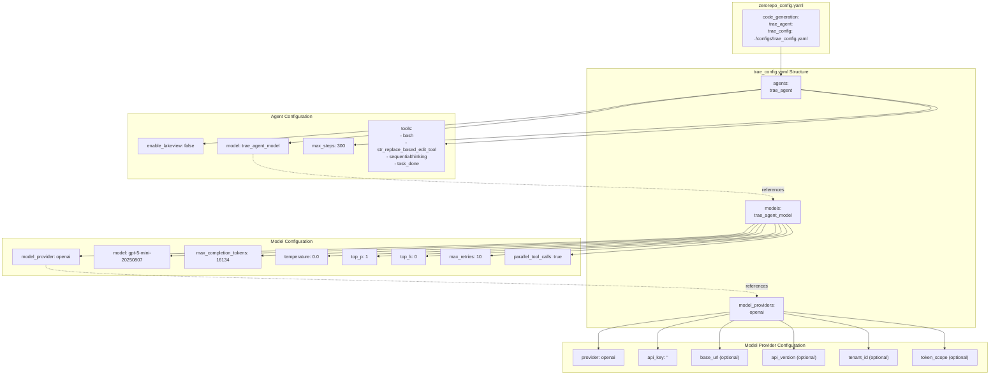
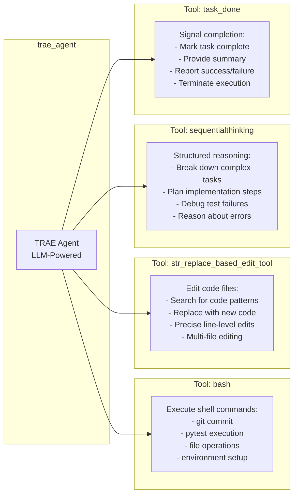
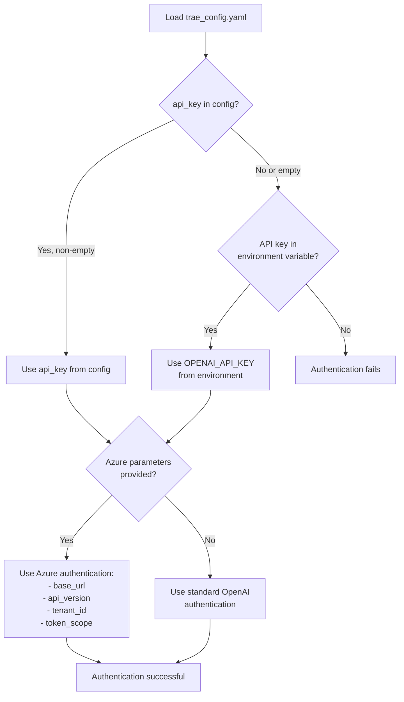
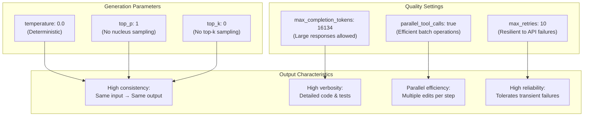
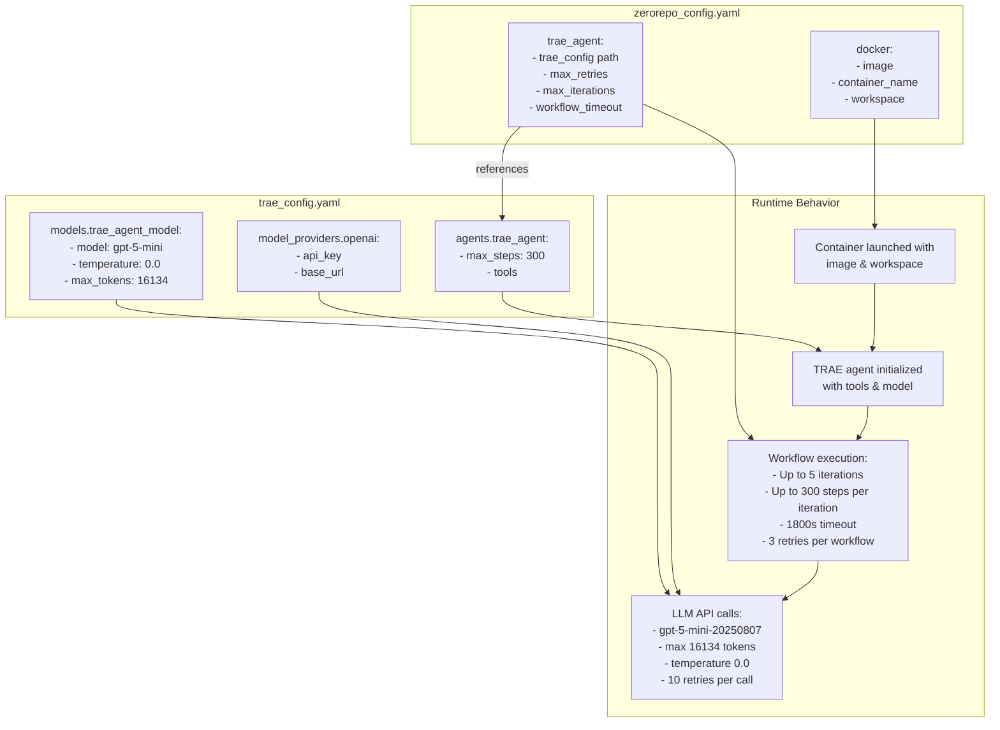

<!-- source: DeepWiki mcp.deepwiki.com · repo microsoft/RPG-ZeroRepo · page 4.4 TRAE Agent Configuration · fetched 2026-10-26 -->

# TRAE Agent Configuration

<details>
<summary>Relevant source files</summary>

The following files were used as context for generating this wiki page:

- [configs/trae_config.yaml](configs/trae_config.yaml)
- [configs/zerorepo_config.yaml](configs/zerorepo_config.yaml)

</details>


## Purpose and Scope

This document describes the configuration of the TRAE (Test-driven, Reasoning-enabled Agent Engine) agent through the `trae_config.yaml` file. The TRAE agent is the LLM-powered coding agent that executes inside Docker containers during Phase 3 (Code Generation) to implement code using a test-driven development workflow.

For information about:
- The overall configuration system and hierarchy, see [Configuration Overview](#2.3)
- The main configuration file that references this config, see [Main Configuration](#4.1)
- LLM model selection and general LLM settings, see [LLM Configuration](#4.2)
- The TRAE agent's runtime behavior and execution, see [TRAE Agent](#6.2)
- The code generation phase that uses this agent, see [Phase 3: Code Generation](#3.3)

**Sources:** [configs/trae_config.yaml:1-28]()

---

## Configuration File Structure

The `trae_config.yaml` file defines the TRAE agent's behavior, available tools, and LLM model settings. The configuration is organized into three main sections: `agents`, `model_providers`, and `models`.

### TRAE Agent Configuration Architecture



**Sources:** [configs/trae_config.yaml:1-28](), [configs/zerorepo_config.yaml:62-66]()

---

## Agents Section

The `agents` section defines the configuration for individual agent instances. The primary agent is `trae_agent`, which performs code generation tasks inside the Docker container.

### Agent Configuration Parameters

```yaml
agents:
    trae_agent:
        enable_lakeview: false
        model: trae_agent_model
        max_steps: 300
        tools:
            - bash
            - str_replace_based_edit_tool
            - sequentialthinking
            - task_done
```

| Parameter | Type | Default | Description |
|-----------|------|---------|-------------|
| `enable_lakeview` | boolean | `false` | Enables Lakeview telemetry/monitoring for agent execution |
| `model` | string | `trae_agent_model` | Reference to the model configuration defined in the `models` section |
| `max_steps` | integer | `300` | Maximum number of agent steps (tool calls) allowed per execution |
| `tools` | list | See below | List of tool names available to the agent |

### Available Tools

The TRAE agent is configured with four essential tools that enable it to perform test-driven development:



| Tool | Purpose | Primary Use Cases |
|------|---------|-------------------|
| `bash` | Shell command execution | Running `pytest`, executing `git commit`, file system operations, environment setup |
| `str_replace_based_edit_tool` | Code file editing | Implementing functions, writing tests, modifying existing code with search-and-replace |
| `sequentialthinking` | Structured reasoning | Planning implementation approach, debugging test failures, complex problem decomposition |
| `task_done` | Task completion signaling | Marking batch complete, providing execution summary, terminating agent loop |

**Sources:** [configs/trae_config.yaml:1-10]()

---

## Model Providers Section

The `model_providers` section configures connections to LLM providers. Currently, OpenAI is the primary supported provider.

### Provider Configuration

```yaml
model_providers:
    openai:
        provider: openai
        api_key: ""
        # base_url: ""
        # api_version: ""
        # tenant_id: ""
        # token_scope: ""
```

| Parameter | Type | Required | Description |
|-----------|------|----------|-------------|
| `provider` | string | Yes | Provider identifier, must be `openai` |
| `api_key` | string | Yes | OpenAI API key for authentication. Empty string means read from environment variable |
| `base_url` | string | No | Custom API endpoint URL (for Azure OpenAI or custom deployments) |
| `api_version` | string | No | API version string (primarily for Azure OpenAI) |
| `tenant_id` | string | No | Azure tenant ID for authentication |
| `token_scope` | string | No | OAuth token scope for Azure authentication |

### Authentication Flow



**Sources:** [configs/trae_config.yaml:11-18]()

---

## Models Section

The `models` section defines specific LLM model configurations with their parameters. Each model configuration can be referenced by agents.

### Model Configuration Structure

```yaml
models:
    trae_agent_model:
        model_provider: openai
        model: gpt-5-mini-20250807
        max_completion_tokens: 16134
        temperature: 0.0
        top_p: 1
        top_k: 0
        max_retries: 10
        parallel_tool_calls: true
```

### Model Parameters Reference

| Parameter | Type | Value | Description |
|-----------|------|-------|-------------|
| `model_provider` | string | `openai` | Reference to provider name in `model_providers` section |
| `model` | string | `gpt-5-mini-20250807` | Specific model identifier (OpenAI model name) |
| `max_completion_tokens` | integer | `16134` | Maximum tokens in model's response (limits output length) |
| `temperature` | float | `0.0` | Sampling temperature (0.0 = deterministic, higher = more random) |
| `top_p` | float | `1` | Nucleus sampling parameter (1 = disabled, <1 = sample from top probability mass) |
| `top_k` | integer | `0` | Top-k sampling parameter (0 = disabled) |
| `max_retries` | integer | `10` | Number of retry attempts for failed API calls |
| `parallel_tool_calls` | boolean | `true` | Whether agent can request multiple tool calls in single response |

### Parameter Impact on Code Generation



**Sources:** [configs/trae_config.yaml:19-28]()

---

## Integration with Main Configuration

The TRAE agent configuration is referenced from the main `zerorepo_config.yaml` file and integrates with other execution parameters.

### Configuration Integration

```yaml
# In zerorepo_config.yaml
code_generation:
  docker:
    enabled: true
    image: "python-azure-pytest:3.12"
    container_name: "zerorepo_2"
    force_rebuild: True
    workspace: "/tare_workspace"

  trae_agent:
    trae_config: "./configs/trae_config.yaml"  # References this file
    max_retries: 3
    retry_delay: 5  # seconds
    
    max_iterations: 5
    max_retries_per_workflow: 3
    workflow_timeout: 1800
```

### Configuration Layer Interaction



### Parameter Relationship Table

| Configuration Layer | Parameter | Scope | Purpose |
|---------------------|-----------|-------|---------|
| **zerorepo_config.yaml** | `max_iterations: 5` | Workflow level | Controls how many test-code-test cycles per task batch |
| **trae_config.yaml** | `max_steps: 300` | Agent level | Controls total tool calls within one iteration |
| **zerorepo_config.yaml** | `max_retries_per_workflow: 3` | Workflow level | How many times to retry failed workflow |
| **trae_config.yaml** | `max_retries: 10` | Model level | How many times to retry failed API call |
| **zerorepo_config.yaml** | `workflow_timeout: 1800` | Workflow level | Maximum seconds for one workflow execution |
| **trae_config.yaml** | `max_completion_tokens: 16134` | Model level | Maximum tokens in single LLM response |

**Sources:** [configs/zerorepo_config.yaml:53-72](), [configs/trae_config.yaml:1-28]()

---

## Configuration Examples

### Standard Configuration

The default configuration provides deterministic code generation with comprehensive tool access:

```yaml
agents:
    trae_agent:
        enable_lakeview: false
        model: trae_agent_model
        max_steps: 300
        tools:
            - bash
            - str_replace_based_edit_tool
            - sequentialthinking
            - task_done

model_providers:
    openai:
        provider: openai
        api_key: ""

models:
    trae_agent_model:
        model_provider: openai
        model: gpt-5-mini-20250807
        max_completion_tokens: 16134
        temperature: 0.0
        top_p: 1
        top_k: 0
        max_retries: 10
        parallel_tool_calls: true
```

### Azure OpenAI Configuration

For Azure deployments, uncomment and configure the Azure-specific parameters:

```yaml
model_providers:
    openai:
        provider: openai
        api_key: ""
        base_url: "https://your-resource.openai.azure.com/"
        api_version: "2024-02-15-preview"
        tenant_id: "your-tenant-id"
        token_scope: "https://cognitiveservices.azure.com/.default"

models:
    trae_agent_model:
        model_provider: openai
        model: "your-deployment-name"  # Azure deployment name
        max_completion_tokens: 16134
        temperature: 0.0
        top_p: 1
        top_k: 0
        max_retries: 10
        parallel_tool_calls: true
```

### Custom Model Configuration

To use a different model or adjust generation parameters:

```yaml
models:
    trae_agent_model:
        model_provider: openai
        model: gpt-4o-mini  # Different model
        max_completion_tokens: 8000  # Reduced for faster responses
        temperature: 0.2  # Slight randomness for variety
        top_p: 0.95  # Nucleus sampling
        top_k: 0
        max_retries: 5  # Fewer retries
        parallel_tool_calls: false  # Sequential tool calls only
```

**Sources:** [configs/trae_config.yaml:1-28]()

---

## Common Configuration Patterns

### Troubleshooting: Agent Exceeds Step Limit

If the agent frequently hits the 300-step limit:

```yaml
agents:
    trae_agent:
        max_steps: 500  # Increase for complex tasks
```

Also consider adjusting the workflow-level iterations in `zerorepo_config.yaml`:

```yaml
code_generation:
  trae_agent:
    max_iterations: 7  # More test-code cycles
```

### Troubleshooting: API Rate Limits

If encountering OpenAI rate limits, adjust retry behavior:

```yaml
models:
    trae_agent_model:
        max_retries: 20  # More retries with backoff
```

And in `zerorepo_config.yaml`:

```yaml
code_generation:
  trae_agent:
    retry_delay: 10  # Longer delay between retries
```

### Performance: Reduce Token Usage

For faster execution or cost optimization:

```yaml
models:
    trae_agent_model:
        max_completion_tokens: 8000  # Smaller responses
        parallel_tool_calls: true  # Keep parallel for efficiency
```

### Debugging: Enable Monitoring

To enable telemetry for debugging agent behavior:

```yaml
agents:
    trae_agent:
        enable_lakeview: true  # Enable monitoring
```

**Sources:** [configs/trae_config.yaml:1-28](), [configs/zerorepo_config.yaml:62-72]()

---

## Configuration Validation

The system validates the TRAE configuration at runtime. Common validation errors and resolutions:

| Error | Cause | Resolution |
|-------|-------|------------|
| "Model 'trae_agent_model' not found" | Agent references non-existent model | Ensure `agents.trae_agent.model` matches a key in `models` section |
| "Provider 'openai' not configured" | Model references non-existent provider | Ensure `models.trae_agent_model.model_provider` matches a key in `model_providers` |
| "Missing required tool" | Agent configuration missing essential tool | Ensure all four tools are listed: `bash`, `str_replace_based_edit_tool`, `sequentialthinking`, `task_done` |
| "Invalid API key" | Empty or incorrect API key | Set `api_key` in config or `OPENAI_API_KEY` environment variable |
| "Invalid parameter value" | Numeric parameter out of range | Check `temperature` (0-2), `top_p` (0-1), `max_retries` (>0), etc. |

**Sources:** [configs/trae_config.yaml:1-28]()

---

